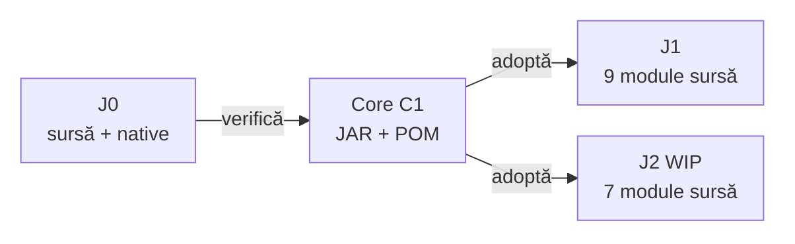

# ATF Core — distribuție și consum binar

## Pe scurt

J0 păstrează implementarea și toate testele native Core. J1 și J2 consumă
aceeași bibliotecă `atf.api:atf-core:1.0.0-c1`, fără modul sursă ori teste
native copiate în live. Reporting rămâne versiunea J6 existentă.

| Contract | C1 |
|---|---|
| runtime | Java 21; Jackson Databind și YAML 2.17.2 |
| independență | POM fără parent de reactor; zero dependențe ATF/JUnit/Extent de producție |
| layout consumer | `lib/atf-core-1.0.0-c1.jar` și `.pom`, lângă perechea Reporting J6; exact patru fișiere |
| proveniență | `coreLibrary` în `library-provenance.json`; hash JAR/POM, intrări și catalog native; istoricul J6 rămâne distinct |
| sursă și teste | [owner J0](../../atf_j0/atf-core/README.md); niciun Core shadow în consumer |

## Maven și IntelliJ

Din rădăcina unui staging TMP al consumerului, `mvn -B validate` instalează
ambele perechi în repository-ul Maven selectat. Apoi reîncarcă POM-ul rădăcină
în IntelliJ, folosind același repository Maven ca la bootstrap. Nu se folosesc
`systemPath`, repository file cu ierarhie ori un JAR adăugat manual în IDE.

```powershell
mvn -B validate
mvn -B -pl atf-tests -am "-Dtest=WholeAtfGovernanceSuiteTest" "-Dsurefire.failIfNoSpecifiedTests=false" test
```

Comenzile sunt pentru staging-ul propriu; adaugă `-Dmaven.repo.local=<TMP>/m2`
la ambele. Un `-pl` care omite rădăcina necesită bootstrap-ul anterior.

Core este acum dependență externă, astfel `-pl atf-core` se rulează doar în J0.
Reactorul sursă rămâne la `1.0.0-SNAPSHOT`; numai dependențele Core ale
consumerilor folosesc `atf.core.version=1.0.0-c1`.

## Publicare și verificare

1. Reconciliază schimbarea și probele la ownerul J0; păstrează codul și testele locale.
2. Construiește în TMP cu POM parentless; transformarea de publicare schimbă numai versiunea proiectului, nu versiunea Test Kit de test.
3. Rulează nativele și apoi aceleași teste pe JAR în harness TMP fără surse Core. Kit/JUnit rămân dependențe de test.
4. Verifică separat J1/J2: compile, contracte afectate, guvernanță, CodeSource/hash și rapoarte; J2 MOCK nu certifică un broker Kafka.
5. Livrează o singură pereche nouă per bibliotecă și proveniența verificată; retrage perechea anterioară fără versiuni paralele.

Guvernanța verifică coordonata, POM-ul inclus byte cu byte, hash-urile,
catalogul nativ, namespace-urile bytecode și încărcarea reală. Probele negative
refuză lipsa coordonatei, sursa shadow, fișiere extra/imbricate, dependențe ATF
de producție și metadata alterată. Analiza sursei Core rămâne responsabilitatea
J0; consumerul păstrează probele binare și testele propriei integrări.

Împachetarea nu schimbă preview-ul de 240 de caractere, aserțiunile
colapsabile, ownership-ul business ori backlog-ul funcțional existent.
Procedura completă este în [sincronizare](ATF_Workspace_Synchronization.md)
și [build izolat](ATF_Build_And_Execution_Safety.md).

## Harta livrării Core



<details>
<summary><strong>Legendă — aceeași bibliotecă, acceptanțe distincte</strong></summary>

- Muchiile descriu publicarea și adoptarea, nu dependențe Maven între workspace-uri.
- J0 păstrează implementarea și toate nativele; testele pe JAR se copiază numai într-un harness TMP.
- J1 verifică integrarea web; J2 verifică integrarea MOCK fără browser, independent de acceptanța Kafka reală.
- Reporting are propria versiune și proveniență; publicarea Core nu reconstruiește J6.

</details>

## Limita acceptanței Reporting

Distribuția Core C1 păstrează Reporting J6. [Timing-ul capturat/publicare](../../atf_j0/docs/feedback/ATF_Reporting_Feedback.md#report-recorded-timing-83--execuție-capturată-și-cost-de-publicare)
rămâne deschis la ownerul J0; verdicturile corecte, tabelele lizibile și
expandările verificate nu certifică relația temporală dintre fază și copil.
