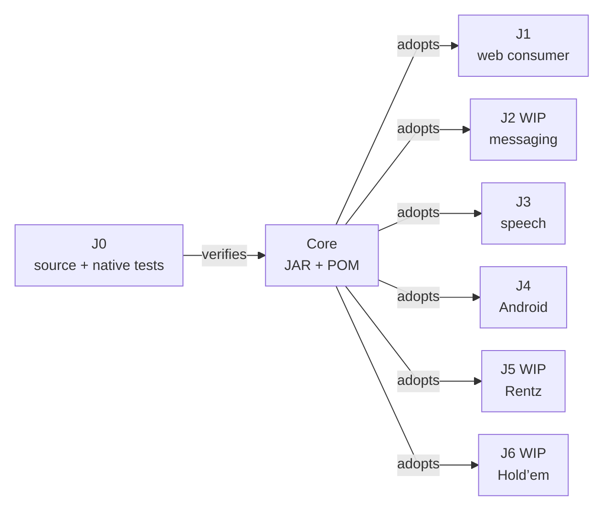

# ATF Core — source ownership and binary consumption

## Pe scurt

J0 owns Core implementation and native tests. Binary consumers keep the latest Core and Reporting JAR/POM pairs directly in `lib`; each library has independent coordinates, provenance and acceptance.

| Boundary | Current contract |
|---|---|
| runtime | Java 21 and the Jackson dependencies declared in the [Core POM](../atf-core/pom.xml) |
| independence | parentless POM; no production dependency on another ATF module, JUnit or a renderer |
| layout | one JAR/POM pair per library, directly in `lib`; no nested repository or source shadow |
| identity | consuming POM properties and root `library-provenance.json`: coordinates, hashes, producer inputs and native catalog |
| ownership | source/native tests stay in J0; consumers own adapters, business assertions and independent acceptance |

Provenance schemas are deployment-specific: common consumers use `coreLibrary`, while other consumers identify Core through their library inventory. Read the target's actual POM and metadata instead of inferring its state from a sibling.

## Maven and IntelliJ

Consumer bootstrap installs the flat pairs into the selected Maven repository. IntelliJ reloads the root POM against that repository; manually attached JARs and `systemPath` are outside the supported consumption route.

```powershell
mvn -B "-Dmaven.repo.local=${ATF_STAGING_ROOT}/m2" validate
mvn -B "-Dmaven.repo.local=${ATF_STAGING_ROOT}/m2" -pl atf-tests -am "-Dtest=${ATF_GOVERNANCE_SELECTION}" "-Dsurefire.failIfNoSpecifiedTests=false" test
```

- Run from the consumer staging root with that deployment's declared governance selection.
- A module-only launch that omits root bootstrap requires the same pair to be installed first.
- Run `-pl atf-core` only in J0; consumers select their Core version through their POM property.

## Publication and independent verification

1. Reconcile source, tests and consumer differences at J0 without overwriting local work.
2. Build the parentless module in owned TMP; the publication transform changes the library version and retains the effective POM and test dependency versions.
3. Run native and physical-JAR contracts without Core source on the consumer classpath; Kit/JUnit remain test dependencies.
4. Verify each consumer's compilation, affected contracts, governance, CodeSource/hash and relevant report evidence independently.
5. Promote the verified pair/provenance selectively, then retire the previous pair after live readback.

| Gate | Required evidence |
|---|---|
| source | native tests and raw producer inputs |
| JAR | loaded CodeSource/hash, embedded POM and declared transitives; reject missing coordinates, shadow source, extra/nested files and altered metadata |
| consumer | its reactor, configuration, adapters and independent business oracles |
| packaging | one current record beside the matching package; no release chronology in official contracts |

The [synchronization protocol](ATF_Workspace_Synchronization.md) and [isolated build process](ATF_Build_And_Execution_Safety.md) govern delivery. Publication or a mock fixture does not certify a real application, broker, device or acoustic ASR execution.

## Core delivery map



<details>
<summary><strong>Legend — one binary, independent acceptance</strong></summary>

- Edges describe delivery and adoption, not Maven dependencies between workspaces.
- J0 retains source/native tests; temporary JAR harnesses do not become consumer modules.
- Every consumer receives the same pair and proves its own integration; source acceptance is not inherited.
- Reporting has independent versioning/provenance; neither library has a production dependency on the other.

</details>

## JSON and evidence fidelity

| Boundary | Contract |
|---|---|
| JsonDocuments | one complete document; no trailing content or duplicate keys, including nested keys; immutable reader and a fresh tree per call |
| write factories | scalars and literal null are JSON syntax; JSON POST/PUT factories reject null before dispatch |
| explicit request | text/form remain explicit; the executor does not infer JSON from the HTTP method |
| Mock equality | exact decimals without narrowing; number/string and integer/decimal distinctions survive; raw body stays intact |
| Core redaction | public numeric tokens and duplicate fields survive; every sensitive value is masked in full |
| Reporting | independent streaming projection preserves numbers and duplicates before configured preview |
| assertions | comparison precedes redaction/preview; the caller's captured verdict is independent of the default 240-character display |

- Strict parsing rejects ambiguity for decisions; evidence projection retains duplicate occurrences for audit.
- Mock accepts literal null as syntax independently of the write-factory restriction; invalid diagnostic JSON never becomes a valid dispatched payload.
- Native tests stay at their source owner; temporary harnesses verify physical JARs without implementation shadow classes.

## Console and transport cancellation

The [Core lifecycle contract](../atf-core/README.md#proiecția-console-și-anularea-transportului) preserves redaction, primary failure and suppressed cleanup diagnostics. `HttpClientTransport` links cancellation to its owned upstream future; cancellation does not prove server-side rollback.

- `UrlConnectionTransport` owns its body subscription, virtual worker and connection. Body collection, connect and reads share the original monotonic deadline; a late body cannot claim a dispatch after cancellation or expiry.
- Native controlled-publisher and loopback contracts cover cancellation, the original 250 ms deadline, body/cleanup failures and terminal races on source and physical JAR.
- Consumer acceptance remains distinct; an uncertain mutation is not eligible for automatic replay.


## Shared platform libraries

The current reactor has 12 source modules. [Platform library consumption](ATF_Platform_Libraries.md) defines the five library owners, flat distribution, Maven/IntelliJ bootstrap and independent consumer acceptance. Console/Mock native tests stay in J0; consumer adapters and catalogs stay local.
