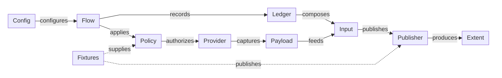
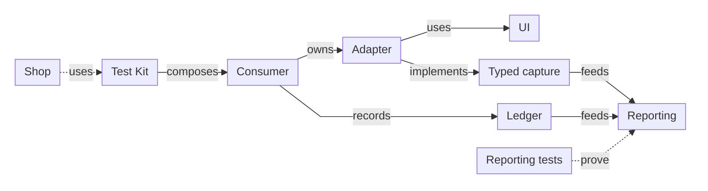

<a id="atf--cross-cutting-contract-for-configurable-evidence-capture"></a>
<a id="atf--contract-transversal-pentru-capturarea-configurabilă-a-dovezilor"></a>
# ATF — Cross-Cutting Contract for Configurable Evidence Capture

<a id="at-a-glance"></a>
<a id="pe-scurt"></a>
## At a glance

- a generic solution for visual and technical evidence;
- reusable by any UI consumer, not tied to one site;
- separates **how the flow runs**, **when capture occurs**, and **who provides the image**;
- keeps `atf-reporting` as a standalone publisher, with no browser or Playwright in production;
- verifies support first with unit, component, and integration tests;
- uses E2E only for the observable browser effect.

This document defines the cross-cutting contract. The typed profile is implemented in `atf-reporting`; the concrete browser/mock adapter remains the consumer's responsibility and is not hidden in the renderer. Practice Shop is a reference consumer, not the solution owner.

<a id="core-diagram"></a>
<a id="diagramă-de-bază"></a>
## Core diagram



<details>
<summary><strong>Legend — evidence path</strong></summary>

- `Config` describes consumer intent, not a selector or local path;
- `Flow` orders steps and retains neutral evidence;
- `Policy` decides which moments are allowed before invoking the provider;
- `Source` supplies the payload; it can be Playwright in a consumer or a test mock;
- `Input` is the semantic boundary consumed by reporting;
- `Publisher` publishes HTML; it does not replay browser actions;
- `Fixtures` prove policy and publisher behavior without an external endpoint or browser.

The short labels shall be kept as follows:

| In the scheme | Full meaning |
|---|---|
| Config | typed profile and configuration |
| Flow | flow coordinator |
| Ledger | evidence ledger · actions + assertions |
| Policy | capture policy |
| Provider | capture provider · browser or mock |
| Payload | typed screenshot payload |
| Input | semantic report input |
| Publisher | report publisher |
| Extent | Extent HTML |
| Fixtures | deterministic fixtures · in test scope |
| authorizes | permits before invocation |

</details>

<a id="independent-evidence-dimensions"></a>
<a id="dimensiuni-independente-ale-dovezilor"></a>
## Independent evidence dimensions

| Axis | Question | Contract values | Conceptual owner |
|---|---|---|---|
| flow mode | how is the flow represented? | `SCREEN_CHECKPOINTS`, `UNIFIED_FLOW` | `atf-reporting` lifecycle/publisher, configured by consumer |
| screenshot policy | when is an image published? | `EACH_CHECKPOINT`, `FINAL_ONLY`, `FAILURE_ONLY`, `FINAL_AND_FAILURE`, `NONE` | evidence contract + publisher |
| capture source | where does the payload come from? | `BROWSER`, `MOCK`, `CUSTOM_PROVIDER` | consumer adapter / test scope |
| action details mode | how much of the captured action data is disclosed? | `INCLUDED_COLLAPSED`, `SUMMARY_ONLY` | generic renderer; consumer chooses the profile |

`flow mode` and `screenshot policy` are independent. A unified flow can use `FINAL_ONLY`, `FAILURE_ONLY`, `FINAL_AND_FAILURE`, or `NONE`; a checkpoint flow can retain `EACH_CHECKPOINT` without changing the renderer. `action details mode` changes only action disclosure: it does not filter capture or change assertions or the verdict.

<details>
<summary><strong>Live state</strong></summary>

- **existing**: `atf-reporting` owns `ReportScreenshotPolicy`, the screenshot
  model, session lifecycle, and publication sink;
- **existing**: `atf-ui` can provide Base64 PNG captures and neutral actions;
- **existing**: `atf-reporting-tests` has deterministic PNG fixtures and checks
  the browser-free policy;
- **existing**: `ReportEvidenceProfile` composes typed `ReportEvidenceFlowMode`,
 `ReportScreenshotPolicy`, `ReportEvidenceCaptureSource`, and `ReportUiActionDetailsMode`; mapping uses `fromConfig(...)` or a builder and flows through `UiExtentReportSession`;
- **distinction**: `reporting.extent` settings remain publisher configuration;
  `evidence.flowMode` and flow mapping are not hidden in that loader;
- **implemented**: `ReportEvidenceCaptureProvider` is a browser-neutral seam.
 `ReportEvidenceProfile.capture(point, title, target, provider)` filters before the call, checks the declared source, and rejects a missing target or payload that is not Base64 PNG. The deterministic mock and Playwright adapter use the same contract;
- **implemented**: `SCREEN_CHECKPOINTS` retains each Gherkin request;
 `UNIFIED_FLOW` buffers a phase's UI checkpoints and publishes one Gherkin request: the last available `THEN`, or the last checkpoint as a fallback. Scenario/phase names remain separate metadata, without `Checkpoint N` children or a duplicate sentence in details;
- **implemented**: all UI actions/assertions are published in one `UI validation`.
 If the profile includes API evidence, exchanges remain in one `API validation`, as a sibling to UI validation under the same Gherkin checkpoint and in execution order;
- **independent**: screenshot policy selects captures before buffering; only
  allowed captures reach the aggregated UI validation (`FINAL_ONLY` → final capture);
- **implemented**: `INCLUDED_COLLAPSED` and `SUMMARY_ONLY` change disclosure of
 recorded actions without removing assertion evidence or changing the verdict; component tests cover both renderings;
- **boundary**: the consumer provides semantics and profiles, while Reporting
 owns generic grouping. Practice Shop only maps its own configuration and contains no publisher rules;

</details>

The existing publication policy remains part of the Reporting library's public API. The cross-cutting contract is stated separately so a future test kit or composition library can reuse it without confusing the publisher with the executor.

<a id="responsibilities-and-limits"></a>
<a id="responsabilități-și-limite"></a>
## Responsibilities and limits



<details>
<summary><strong>Legend — where each boundary ends</strong></summary>

- `test-kit` defines reusable configuration and allowed composition;
- the consumer defines semantic flows, the final target, and locators;
- `atf-ui` executes browser operations; the consumer adapter implements
  `ReportEvidenceCaptureProvider` and returns a neutral payload;
- `atf-reporting` normalizes and publishes the received evidence;
- `atf-reporting-tests` validates the library through fixtures, does not become production;
- Practice Shop demonstrates consumption but does not own the cross-cutting contract;
- no publisher should import a page object or application endpoint.

The short labels shall be kept as follows:

| In the scheme | Full meaning |
|---|---|
| Test Kit | generic test-kit · profile + annotations |
| Consumer | consumer composition · semantic flow |
| Adapter | consumer capture adapter |
| UI | atf-ui · browser operations |
| Ledger | evidence ledger |
| Typed capture | typed capture payload |
| Reporting | atf-reporting · flow grouping + model + publication |
| Reporting tests | atf-reporting-tests · fixtures + component/integration |
| Shop | Practice Shop · consumer mapping |
| implements | implements the provider |

</details>

<a id="implementation-and-testing-order"></a>
<a id="ordinea-de-implementare-și-de-testare"></a>
## Implementation and testing order

```mermaid
%%{init: {"themeVariables":{"fontSize":"15px"},"themeCSS":".nodeLabel, .nodeLabel p { font-size: 15px !important; line-height: 1.35 !important; } .edgeLabel, .edgeLabel p { font-size: 12px !important; font-weight: 400 !important; line-height: 1.2 !important; } .edgeLabel .labelBkg, .edgeLabel p { background: transparent !important; } .edgeLabel foreignObject { transform: translateY(-18px); overflow: visible; } .node rect { rx: 6px; ry: 6px; }","flowchart":{"curve":"linear","nodeSpacing":24,"rankSpacing":24,"padding":6,"diagramPadding":20}}}%%
flowchart LR
    Contract["Contract"] -->|defines| Unit["Unit"]
    Unit -->|composes| Component["Component"]
    Component -->|integrates| Integration["Integration"]
    Integration -->|validates| Browser["Browser adapter"]
    Browser -->|proves| ConsumerE2E["Consumer E2E"]
```



<details>
<summary><strong>Legend — why we do not start with Practice Shop</strong></summary>

- unit tests verify values, transitions, required targets, and duplicates;
- component tests directly verify markup, status, disclosure, and capture count;
- integration tests verify `session → model → HTML` without a browser;
- the browser adapter verifies only real capture on a local static HTML page;
- consumer E2E confirms integration, not generic support;
- a policy or markup defect must fail before E2E.

The short labels shall be kept as follows:

| In the scheme | Full meaning |
|---|---|
| Contract | contract + model |
| Unit | unit · policy and cardinality |
| Component | component · mock image + HTML |
| Integration | integration · session + publisher |
| Browser adapter | optional browser adapter · static HTML |
| Consumer E2E | consumer E2E · minimal proof |

</details>

<a id="minimum-contract-for-every-implementation"></a>
<a id="contract-minim-pentru-orice-implementare"></a>
## Minimum contract for every implementation

- `PASS`, `FAIL`, `WARNING`, and `SKIP` remain semantic statuses independent of capture;
- actions and assertions remain published when policy is `NONE`;
- `FINAL_ONLY` requires an explicit final target;
- `FAILURE_ONLY` does not claim that the flow has success evidence;
- `FINAL_AND_FAILURE` separates final evidence from failure diagnostics;
- expected cardinality is verifiable: `0`, `1`, or `N` captures;
- duplicate payloads are deduplicated only by a documented internal rule;
- missing payloads, missing targets, and invalid providers fail diagnostically;
- HTML is checked directly for text, structure, media reference, and disclosure;
- Playwright is not included in production models.

<a id="generic-configuration"></a>
<a id="configurație-generică"></a>
## Generic configuration

Configuration must be available through YAML or a typed builder. The keys below are a conceptual contract; final names align with the approved implementation without coupling the solution to Practice Shop:

```yaml
evidence:
  flowMode: unified-flow
  screenshotPolicy: final-only
  captureSource: mock
  finalTarget: <consumer-defined-key>
```

- `flowMode` selects the flow representation;
- `screenshotPolicy` selects capture points;
- `captureSource` describes payload provenance (`browser`, `mock`, `provider`);
- `finalTarget` is an opaque semantic key, not a locator hard-coded in Reporting;
- for `none`, the flow remains auditable through actions and assertions;
- YAML → `ReportEvidenceProfile` mapping belongs to the composition root and
  uses enums or a typed builder without propagating strings into the renderer;
- publisher configuration (`reporting.extent`) remains separate from the evidence profile.

<a id="api-and-ui-reuse"></a>
<a id="reutilizare-api-și-ui"></a>
## API and UI reuse

The same strategy applies to API evidence without introducing a browser:

- source: request/response exchange or deterministic fixture;
- policy: which evidence is retained and at which lifecycle point;
- model: typed body, headers, status, assertions, and execution metadata;
- publisher: disclosures and semantic HTML;
- test: fixture → component → integration → browser audit only for the UI effect.

Visual capture is one evidence type, not a reason to duplicate the renderer, session lifecycle, or status tests.

<a id="select-evidence-before-the-verdict"></a>
<a id="alegerea-dovezii-înaintea-verdictului"></a>
### Select evidence before the verdict

The correlation contract separates observation selection from result evaluation:

- The consumer correlates operation invocation, method, route, and capture order. A 4xx/5xx status is a result to evaluate; it does not exclude that capture in favor of an earlier successful response.
- A new evaluation replaces checkpoint selection, including with an empty list. Comparisons and exchanges retain the same identity and observation window.
- Absence retains FAIL comparisons and diagnostics without fabricating a status/body. A capture observed with failed transport remains distinct from no capture at all.
- Reporting publishes the supplied model; correlation and rejection of foreign evidence belong to the consumer, without rereading the service or repeating the action.

These rules are boundary requirements; a correct value comparator alone does not prove that each adapter selects the right evidence.

<a id="further-reading"></a>
<a id="unde-se-aprofundează"></a>
## Further reading

| Question | Owner |
|---|---|
| What is the cross-cutting capture contract? | this document |
| How does Reporting publish policy and HTML? | [`atf-reporting/README.md`](../atf-reporting/README.md) |
| How do you test the library without a browser? | [`atf-reporting-tests/README.md`](../atf-reporting-tests/README.md) |
| how to audit the artifact in the browser? | [`atf-reporting-tests/src/test/java/atf/ui/tests/extent/README.md`](../atf-reporting-tests/src/test/java/atf/ui/tests/extent/README.md) |
| How does the browser provide a neutral payload? | [`atf-ui/README.md`](../atf-ui/README.md) |
| How does a consumer map its YAML and flow? | the consumer README |
| What remains and how is it closed? | [`feedback/README.md`](feedback/README.md) and owner feedback |

Do not copy this matrix into every module. The local README keeps only its ownership and a link to the cross-cutting contract.