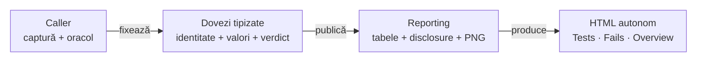

# Dovezi inline — contract de compoziție auditabilă

## Pe scurt

Un singur HTML poate agrega multe teste; fiecare invocare își păstrează
propriul scenariu, fazele, comparațiile și verdictul. Cititorul nu trebuie
să deschidă XML, JSON, properties ori loguri externe pentru a verifica propoziția.

| Boundary | Responsabilitate | API existent |
|---|---|---|
| caller | capturează și validează datele, evaluează o dată | modele Reporting imuabile |
| fapte | context și stare completă, fără verdict inventat | Phase.observation, ReportField, Body(JSON/TEXT) |
| comparații | nume / expected / actual / rezultat capturat | startAssertionStep sau UiPhase.uiValidation |
| imagini | PNG original la checkpoint-ul corect | ReportScreenshot și fațada UI |
| timp | intervalul execuției separat de publicare | ReportPhaseTiming, executionTiming |
| publicare | escaping, redacție, disclosure și HTML autonom | ExtentReportSession / HtmlReportSession |

<strong>Legendă — ownership și completitudine</strong>

- Callerul deține semantica datelor și oracolul; Reporting nu execută transportul, nu citește XML și nu deduce starea din PNG.
- Faptele neutre sunt observations INFO; comparațiile conțin verdictul evaluării originale.
- Muchiile transferă date, fără reevaluare ori scenarii PASS create numai pentru transport.
- HTML-ul păstrează informația necesară deciziei; fișierele diagnostice pot rămâne în afara lui.

## Profilul fără referințe externe

| Cerință a profilului | Compoziție |
|---|---|
| nicio dependență de fișiere | artifacts = List.of(); extragerea și proiecția se fac la caller |
| context lizibil | fields scurte pentru identitate/proveniență; bodies semantice pentru starea completă |
| standard assertions | tabel de patru coloane, colapsabil; nu Expected/Actual ascunse numai într-un blob |
| preview | 240 rămâne limita scalarilor scurți și titlurilor |
| corp complet | valoarea cerută trebuie să încapă în bugetul declarat al corpului; callerul verifică înainte să declare COMPLETE |
| fără screenshot la componentă | legitim; nu se inventează PNG pentru aspect de E2E |
| E2E cu PNG | bytes originali, titlu semantic, invocare/fază/checkpoint originale |

Artifact este în continuare o referință opțională pentru alți consumatori;
Reporting nu citește fișierul referit. Profilul de mai sus se obține prin
modelele publice existente, fără un switch global care schimbă alte rapoarte.

## Text și valori complete

- Corpurile JSON păstrează valorile tipizate, ordinea listelor și numerele exacte; formatarea nu este oracol.
- Corpurile TEXT păstrează newline-ul inițial, CR/LF și whitespace-ul final după redacție și limitare.
- Primitivele PRE au un owner comun în ReportEvidenceMarkup; valoarea literală nu devine markup executabil.
- Un dump brut al unui fișier nu înlocuiește proiecția semantică: înainte / input / după și comparațiile evaluate trebuie să fie lizibile.

Valorile assertions deja reduse de caller nu pot fi reconstruite. Criteriul
133 pentru acel boundary rămâne separat; corpurile complete nu îl închid implicit.

## Full-image viewer target

The expanded image viewer must use the available browser viewport, with small bounded controls, while fitting the complete source image and preserving its aspect ratio. The default fit view has no clipped edges or image scroll; portrait/landscape margins are preferable to crop or stretch. Original-size inspection is an explicit mode and preserves the immutable source bytes.

Closing, Escape and fit/zoom transitions must preserve the active invocation, disclosure state, scroll position and keyboard focus. Browser/OS fullscreen is optional and requires an explicit user action; viewport fit must work without that permission or API. These are open [viewport criteria 138](feedback/ATF_Reporting_Feedback.md#report-screenshot-viewport-138--imagine-integrală-în-spațiul-disponibil), not a claim about the current J15 viewer.

## Acceptanță permanentă

| Probă | Oracol |
|---|---|
| individual și combinat | invocări cu același titlu, identitate distinctă și rezultat PASS/FAIL capturat |
| no-file | fără href către fișiere și fără dependență XML/JSON/properties; valori complete în ownerul original |
| negative | body mutat la sibling, ultimul rând eliminat, FAIL convertit, timing schimbat, PNG reasociat și link introdus sunt refuzate |
| browser | Enter/Space, vecin închis, End până la ultimul scalar, panou îngust fără suprapunere |
| distribuție | aceleași controale pe sursă și JAR fizic; business-ul consumerului are acceptanță distinctă |

Implementarea probelor este în [Reporting Tests](../atf-reporting-tests/README.md).
