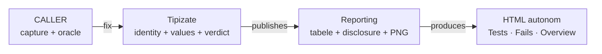

# Inline evidence - Auditable composition contract

## At a glance

A single HTML can aggregate many tests; each invoicing keeps its own scenario, phases, comparisons and verdict. The reader must not open XML, JSON, properties or external logs to check the sentence.

| Boundary | Responsibility | Existing API |
|---|---|---|
| caller | capture and validate data, evaluate once | Immovable Reporting models |
| facts | context and complete status without invented verdict | Phase.observation, ReportField, Body(JSON/TEXT) |
| comparisons | Name / expected / actual / captured result | startAssertionStep or UiPhase.uiValidation |
| images | PNG original to correct checkpoint | ReportScreenshot and UI façade |
| timing | interval of execution separate from publication | ReportPhaseTiming, executionTiming |
| publication | Escaping, editorial, discrete and HTML autonomous | ExtentReportSession / HtmlReportSession |

<strong>Legend - ownership and completeness</strong>

- The call holds the semantics of data and oracle; Reporting does not perform the transport, does not read XML and does not deduce the status of PNG.
- Neutral facts are observations INFO; comparisons contain the verdict of the original evaluation.
- The edges transfer data without revaluation or PASS scenarios created for transport only.
- HTML delivered keeps the information required for the decision; this profile does not require any supporting PNG / XML / JSON copies.

## Profiles without external references

| Profiling requirement | Composition |
|---|---|
| any dependence on files | artifacts = List.of (); extraction and projection are made at the caller |
| legible context | short fields for identity / provenance; semantic bodies for full status |
| standard assertions | table of four columns, collapsible; not Expected / Actual hidden only in a blob |
| preview | 240 remains the limit of short scalers and titles |
| complete body | the required value must fit in the declared body budget; the caller checks before declaring COMPLETE |
| without screen shot to component | legitimate; PNG is not invented for the appearance of E2E |
| E2E with PNG | original bytes, semantic title, invocation / phase / checkpoint original |

Artifact is still an optional reference for other consumers; Reporting does not read the file. The above profile is obtained through existing public models without a global switch that changes other reports.

- The public inspector shall qualify DOM in Extent, fallback and declared profile: Emended resources, resolvable internal references and unique canonical PNG targets.
- External operational evidence is denied, with owner / attribute / reference in diagnosis; text channels, XML / JSON escaped and documentation links remain valid.
- The inspection shall not access the network or delete the caller files; the interactive autonomy shall have distinct offline evidence.

## Reader context and configurable detail

The producer supplies the purpose, effective setup/inputs, independent expected values and evidence limits needed by a reader without repository access. Hashes belong to optional technical provenance; they establish byte identity, not business correctness. Renderer settings remain neutral: assertion preview and body display budgets are separate from consumer-owned game grouping or selection policies.

A summary profile must declare its scope and omissions. Display policy never changes the original evaluation, and missing mandatory evidence cannot be labeled COMPLETE audit acceptance. Large structures are grouped semantically before publication, with the caller retaining every comparison and input required by its claim.

## Text and full values

- JSON bodies keep typed values, order of lists and exact numbers; formatting is not oracle.
- TEXT bodies keep the original newline, CR / LF and the final whitespace after the editorial and limitation.
- PRE primitives share an owner in ReportEvidenceMarkup; the literal value does not become executable markup.
- A raw dump of a file does not replace semantic projection: before / input / after and the assumed comparisons shall be lawful.

The already low caller assertions cannot be reconstructed. 133 criterion for that boundary remains separate; the complete bodies do not close it by default.

## Full-image viewer target

The expanded image viewer must use the available browser viewport, with small bounded controls, while fitting the complete source image and preserving its aspect ratio. The default fit view has no clipped edges or image scroll; portrait/landscape margins are preferable to crop or stretch. Original-size inspection is an explicit mode and preserves the immutable source bytes.

Closing, Escape and fit/zoom transitions must preserve the active invocation, disclosure state, scroll position and keyboard focus. Browser/OS fullscreen is optional and requires an explicit user action; viewport fit must work without that permission or API. The viewer preserves this return context in both renderers; historical release artifacts remain dated witnesses.

## Permanent acceptance

| Test | Oracle |
|---|---|
| individual and combined | Conductions under the same title, identity and result PASS / FAIL captured |
| no-file | without href to files and without XML / JSON / properties; complete values in the original owner |
| negative | body moved to sibling, last row removed, FAIL converted, changing timing, PNG reassociated and link inserted are denied |
| browser | Enter / Space, closed neighbor, End up last scalar, narrow panel without overlap |
| distribution | Same source controls and physical JAR; consumer business has distinct acceptance |

The implementation of the samples is in [Reporting Tests](../atf-reporting-tests/README.md).

## Composite screenshot evidence

A checkpoint retains the supplied action sequence, comparisons, observations and original capture under its own scenario, phase and ordinal. The caller owns capture and evaluation; Reporting owns faithful publication and navigation.

Observation-only screenshots use the explicit uiValidationAsMedia route. The empty-comparison THEN/flow-mode matrix remains separately characterized in feedback; a general step overload is not an implicit media capability.

| Boundary | Stable contract |
|---|---|
| Composition | Keep keyword, title, target, ordinal, ordered actions, comparisons and the corresponding PNG together |
| Comparisons | Retain name, expected, actual and the captured result; a summary cannot replace individual checks |
| Screenshot | Preserve complete original PNG bytes at the correct checkpoint; a file link or gallery-only image cannot establish ownership |
| Observation | Keep visual facts as INFO; explicit consumer WARNING and functional FAIL retain their separate meaning |
| Failure | Retain completed evidence and the original throwable when action, capture, publication or cleanup fails |
| Identity | Same-title owners remain distinct; invocation, checkpoint, comparison and capture are separate populations |
| Renderers | Extent/fallback preserve semantic inputs, order, result and capture identity |
| Library | Keep ADB, browser execution and application oracles outside the Reporting runtime; verify the physical JAR separately |

Whole-context capture and 70% web geometry belong to the [J1 UI contract](../../atf_j1/atf-ui/README.md#full-context-screenshots). [Full-display Android capture](../../atf_j4/docs/reporting/ATF_Android.md#capture-and-ownership) retains its independent device acceptance.

## Composite evidence acceptance

| Neutral fixture | Required evidence | Independent negative |
|---|---|---|
| Functional checkpoint | two ordered actions, two distinct comparisons and exact PNG | reverse an ordinal or remove only the second comparison |
| Negative result | captured FAIL with expected/actual and its screenshot | replace only that result with PASS |
| Observation | factual visual state, original capture and explicit warning when supplied | move the observation to a same-title sibling |
| Intermediate failure | completed actions, available capture and original throwable | fail publication/close and retain the business cause |
| Multiple owners | matching captions with distinct phases/results and stable Tests/Fails/Overview identity | change only ordering or ownership |
| Physical JAR | declared pair and assets, with no producer source on the consumer runtime classpath | remove an asset or introduce shadow source |

A marker found in script/CSS or a neighboring owner cannot satisfy the oracle. [Delivered source/JAR families](feedback/ATF_Reporting_Tests_Feedback.md) and [remaining capture boundaries](feedback/ATF_Android_UI_Reporting_Feedback.md) retain distinct acceptance scopes.
