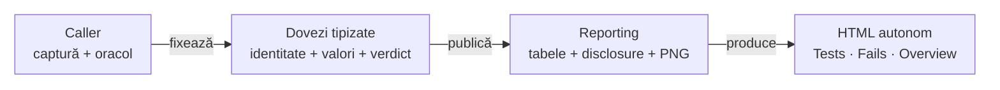

# Dovezi inline — contract de compoziție auditabilă

## Pe scurt

Un singur HTML poate agrega multe teste; fiecare invocare își păstrează propriul scenariu, fazele, comparațiile și verdictul. Cititorul nu trebuie să deschidă XML, JSON, properties ori loguri externe pentru a verifica propoziția.

| Boundary | Responsabilitate | API existent |
|---|---|---|
| caller | capturează și validează datele, evaluează o dată | modele Reporting imuabile |
| fapte | context și stare completă, fără verdict inventat | Phase.observation, ReportField, Body(JSON/TEXT) |
| comparații | nume / expected / actual / rezultat capturat | startAssertionStep sau UiPhase.uiValidation |
| imagini | PNG original la checkpoint-ul corect | ReportScreenshot și fațada UI |
| timp | intervalul execuției separat de publicare | ReportPhaseTiming, executionTiming |
| publicare | escaping, redacție, disclosure și HTML autonom | ExtentReportSession / HtmlReportSession |

<strong>Legendă — ownership și completitudine</strong>

- Callerul deține semantica datelor și oracolul; Reporting nu execută transportul, nu citește XML și nu deduce starea din PNG.
- Faptele neutre sunt observations INFO; comparațiile conțin verdictul evaluării originale.
- Muchiile transferă date, fără reevaluare ori scenarii PASS create numai pentru transport.
- HTML-ul livrat păstrează informația necesară deciziei; acest profil nu cere copii PNG/XML/JSON auxiliare.

## Profilul fără referințe externe

| Cerință a profilului | Compoziție |
|---|---|
| nicio dependență de fișiere | artifacts = List.of(); extragerea și proiecția se fac la caller |
| context lizibil | fields scurte pentru identitate/proveniență; bodies semantice pentru starea completă |
| standard assertions | tabel de patru coloane, colapsabil; nu Expected/Actual ascunse numai într-un blob |
| preview | 240 rămâne limita scalarilor scurți și titlurilor |
| corp complet | valoarea cerută trebuie să încapă în bugetul declarat al corpului; callerul verifică înainte să declare COMPLETE |
| fără screenshot la componentă | legitim; nu se inventează PNG pentru aspect de E2E |
| E2E cu PNG | bytes originali, titlu semantic, invocare/fază/checkpoint originale |

Artifact este în continuare o referință opțională pentru alți consumatori; Reporting nu citește fișierul referit. Profilul de mai sus se obține prin modelele publice existente, fără un switch global care schimbă alte rapoarte.

- Inspectorul public califică DOM-ul în Extent, fallback și profilul declarat: resurse embedded, referințe interne rezolvabile și ținte PNG canonice unice.
- Dovezile operative externe sunt refuzate, cu owner/atribut/referință în diagnostic; căile text, XML/JSON escaped și linkurile de documentare rămân valide.
- Inspecția nu accesează rețeaua și nu șterge fișierele callerului; autonomia interactivă are probă offline distinctă.

## Contextul cititorului și detalii configurabile

Producătorul furnizează scopul, setup-ul/intrările efective, expected-uri independente și limitele necesare unui cititor fără repository. Hash-urile sunt proveniență tehnică opțională: stabilesc identitatea octeților, nu corectitudinea business. Rendererul rămâne neutru: preview-ul aserțiunilor și bugetele corpului sunt separate de gruparea sau selecția jocului deținute de consumer.

Un profil sumar declară domeniul și omisiunile. Politica de afișare nu schimbă evaluarea originală, iar lipsa dovezii obligatorii nu poate primi acceptanță de audit COMPLETE. Structurile mari se grupează semantic înaintea publicării; callerul păstrează fiecare comparație și intrare necesară afirmației sale.

## Text și valori complete

- Corpurile JSON păstrează valorile tipizate, ordinea listelor și numerele exacte; formatarea nu este oracol.
- Corpurile TEXT păstrează newline-ul inițial, CR/LF și whitespace-ul final după redacție și limitare.
- Primitivele PRE au un owner comun în ReportEvidenceMarkup; valoarea literală nu devine markup executabil.
- Un dump brut al unui fișier nu înlocuiește proiecția semantică: înainte / input / după și comparațiile evaluate trebuie să fie lizibile.

Valorile assertions deja reduse de caller nu pot fi reconstruite. Criteriul 133 pentru acel boundary rămâne separat; corpurile complete nu îl închid implicit.

## Full-image viewer target

Viewerul expandat folosește viewport-ul disponibil, controale mici cu limite explicite și imaginea sursă completă, cu proporțiile păstrate. Potrivirea implicită nu taie margini și nu cere scroll în imagine; marginile portret/peisaj sunt preferabile decupării sau întinderii. Inspecția la dimensiunea originală este explicită și păstrează octeții sursă imuabili.

Închiderea, Escape și tranzițiile fit/zoom păstrează invocarea activă, disclosure-ul, scroll-ul și focusul. Fullscreen browser/OS este opțional și cere acțiunea explicită a utilizatorului; potrivirea în viewport funcționează fără acea permisiune sau API. Ambele renderere păstrează revenirea; artefactele istorice rămân martori datați.

## Acceptanță permanentă

| Probă | Oracol |
|---|---|
| individual și combinat | invocări cu același titlu, identitate distinctă și rezultat PASS/FAIL capturat |
| no-file | fără href către fișiere și fără dependență XML/JSON/properties; valori complete în ownerul original |
| negative | body mutat la sibling, ultimul rând eliminat, FAIL convertit, timing schimbat, PNG reasociat și link introdus sunt refuzate |
| browser | Enter/Space, vecin închis, End până la ultimul scalar, panou îngust fără suprapunere |
| distribuție | aceleași controale pe sursă și JAR fizic; business-ul consumerului are acceptanță distinctă |

Implementarea probelor este în [Reporting Tests](../atf-reporting-tests/README.md).

## Composite screenshot evidence

Un checkpoint păstrează acțiunile furnizate, comparațiile, observațiile și captura originală sub propriul scenariu, fază și ordinal. Callerul deține captura și evaluarea; Reporting deține publicarea fidelă și navigarea.

Capturile doar de observație folosesc ruta uiValidationAsMedia explicită. Matricea THEN/flow-mode fără comparații rămâne caracterizată separat în feedback; un overload generic de pas nu implică suport media.

| Boundary | Stable contract |
|---|---|
| Compoziție | Păstrează împreună cuvântul-cheie, titlul, ținta, ordinalul, acțiunile ordonate, comparațiile și PNG corespunzător |
| Comparații | Retain name, expected, actual and the captured result; a summary cannot replace individual checks |
| Screenshot | Păstrează octeții PNG originali compleți la checkpoint-ul corect; un link de fișier sau o imagine numai în galerie nu stabilește ownership-ul |
| Observație | Păstrează faptele vizuale ca INFO; WARNING explicit și FAIL funcțional ale consumerului își păstrează sensul separat |
| Eșec | Păstrează dovezile finalizate și excepția originală la eșecul acțiunii, capturii, publicării sau cleanup-ului |
| Identitate | Ownerii cu același titlu rămân distincți; invocarea, checkpoint-ul, comparația și captura sunt populații separate |
| Renderere | Extent/fallback preserve semantic inputs, order, result and capture identity |
| Bibliotecă | Păstrează ADB, execuția browser și oracolele aplicației în afara runtime-ului Reporting; verifică separat JAR fizic |

Captura întregului context și geometria web la 70% aparțin [J1 UI contract](../../atf_j1/atf-ui/README.md#full-context-screenshots). [Full-display Android capture](../../atf_j4/docs/reporting/ATF_Android.md#capture-and-ownership) își păstrează acceptanța independentă pe dispozitiv.

## Composite evidence acceptance

| Neutral fixture | Required evidence | Independent negative |
|---|---|---|
| Functional checkpoint | două acțiuni ordonate, două comparații distincte și PNG exact | inversează un ordinal sau elimină numai a doua comparație |
| Negative result | captured FAIL with expected/actual and its screenshot | înlocuiește numai acel rezultat cu PASS |
| Observație | stare vizuală factuală, captură originală și avertizare explicită atunci când este furnizată | mută observația la un sibling cu același titlu |
| Eșec intermediar | acțiuni finalizate, captură disponibilă și excepția originală | fail publication/close and retain the business cause |
| Owneri multipli | caption-uri identice cu faze/rezultate distincte și identitate stabilă în Tests/Fails/Overview | modifică numai ordinea sau ownership-ul |
| JAR fizic | perechea și asset-urile declarate, fără sursa producătorului în classpath-ul runtime al consumerului | remove an asset or introduce shadow source |

Un marker din script/CSS sau de la un owner vecin nu satisface oracolul. [Familii sursă/JAR livrate](feedback/ATF_Reporting_Tests_Feedback.md) și [remaining capture boundaries](feedback/ATF_Android_UI_Reporting_Feedback.md) păstrează domenii de acceptanță distincte.
