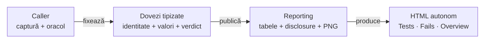

# Dovezi inline — contract de compoziție auditabilă

## Pe scurt

Un singur HTML poate agrega multe teste; fiecare invocare își păstrează
propriul scenariu, fazele, comparațiile și verdictul. Cititorul nu trebuie
să deschidă XML, JSON, properties ori loguri externe pentru a verifica propoziția.

| Boundary | Responsabilitate | API existent |
|---|---|---|
| caller | capturează și validează datele, evaluează o dată | modele Reporting imuabile |
| fapte | context și stare completă, fără verdict inventat | Phase.observation, ReportField, Body(JSON/TEXT) |
| comparații | nume / expected / actual / rezultat capturat | startAssertionStep sau UiPhase.uiValidation |
| imagini | PNG original la checkpoint-ul corect | ReportScreenshot și fațada UI |
| timp | intervalul execuției separat de publicare | ReportPhaseTiming, executionTiming |
| publicare | escaping, redacție, disclosure și HTML autonom | ExtentReportSession / HtmlReportSession |

<strong>Legendă — ownership și completitudine</strong>

- Callerul deține semantica datelor și oracolul; Reporting nu execută transportul, nu citește XML și nu deduce starea din PNG.
- Faptele neutre sunt observations INFO; comparațiile conțin verdictul evaluării originale.
- Muchiile transferă date, fără reevaluare ori scenarii PASS create numai pentru transport.
- HTML-ul livrat păstrează informația necesară deciziei; acest profil nu cere copii PNG/XML/JSON auxiliare.

## Profilul fără referințe externe

| Cerință a profilului | Compoziție |
|---|---|
| nicio dependență de fișiere | artifacts = List.of(); extragerea și proiecția se fac la caller |
| context lizibil | fields scurte pentru identitate/proveniență; bodies semantice pentru starea completă |
| standard assertions | tabel de patru coloane, colapsabil; nu Expected/Actual ascunse numai într-un blob |
| preview | 240 rămâne limita scalarilor scurți și titlurilor |
| corp complet | valoarea cerută trebuie să încapă în bugetul declarat al corpului; callerul verifică înainte să declare COMPLETE |
| fără screenshot la componentă | legitim; nu se inventează PNG pentru aspect de E2E |
| E2E cu PNG | bytes originali, titlu semantic, invocare/fază/checkpoint originale |

Artifact este în continuare o referință opțională pentru alți consumatori;
Reporting nu citește fișierul referit. Profilul de mai sus se obține prin
modelele publice existente, fără un switch global care schimbă alte rapoarte.

- Inspectorul public califică DOM-ul în Extent, fallback și profilul declarat: resurse embedded, referințe interne rezolvabile și ținte PNG canonice unice.
- Dovezile operative externe sunt refuzate, cu owner/atribut/referință în diagnostic; căile text, XML/JSON escaped și linkurile de documentare rămân valide.
- Inspecția nu accesează rețeaua și nu șterge fișierele callerului; autonomia interactivă are probă offline distinctă.

## Reader context and configurable detail

The producer supplies the purpose, effective setup/inputs, independent expected values and evidence limits needed by a reader without repository access. Hashes belong to optional technical provenance; they establish byte identity, not business correctness. Renderer settings remain neutral: assertion preview and body display budgets are separate from consumer-owned game grouping or selection policies.

A summary profile must declare its scope and omissions. Display policy never changes the original evaluation, and missing mandatory evidence cannot be labeled COMPLETE audit acceptance. Large structures are grouped semantically before publication, with the caller retaining every comparison and input required by its claim.

## Text și valori complete

- Corpurile JSON păstrează valorile tipizate, ordinea listelor și numerele exacte; formatarea nu este oracol.
- Corpurile TEXT păstrează newline-ul inițial, CR/LF și whitespace-ul final după redacție și limitare.
- Primitivele PRE au un owner comun în ReportEvidenceMarkup; valoarea literală nu devine markup executabil.
- Un dump brut al unui fișier nu înlocuiește proiecția semantică: înainte / input / după și comparațiile evaluate trebuie să fie lizibile.

Valorile assertions deja reduse de caller nu pot fi reconstruite. Criteriul
133 pentru acel boundary rămâne separat; corpurile complete nu îl închid implicit.

## Full-image viewer target

The expanded image viewer must use the available browser viewport, with small bounded controls, while fitting the complete source image and preserving its aspect ratio. The default fit view has no clipped edges or image scroll; portrait/landscape margins are preferable to crop or stretch. Original-size inspection is an explicit mode and preserves the immutable source bytes.

Closing, Escape and fit/zoom transitions must preserve the active invocation, disclosure state, scroll position and keyboard focus. Browser/OS fullscreen is optional and requires an explicit user action; viewport fit must work without that permission or API. The viewer preserves this return context in both renderers; historical release artifacts remain dated witnesses.

## Acceptanță permanentă

| Probă | Oracol |
|---|---|
| individual și combinat | invocări cu același titlu, identitate distinctă și rezultat PASS/FAIL capturat |
| no-file | fără href către fișiere și fără dependență XML/JSON/properties; valori complete în ownerul original |
| negative | body mutat la sibling, ultimul rând eliminat, FAIL convertit, timing schimbat, PNG reasociat și link introdus sunt refuzate |
| browser | Enter/Space, vecin închis, End până la ultimul scalar, panou îngust fără suprapunere |
| distribuție | aceleași controale pe sursă și JAR fizic; business-ul consumerului are acceptanță distinctă |

Implementarea probelor este în [Reporting Tests](../atf-reporting-tests/README.md).

## Composite screenshot evidence

A checkpoint retains the supplied action sequence, comparisons, observations and
original capture under its own scenario, phase and ordinal. The caller owns
capture and evaluation; Reporting owns faithful publication and navigation.

Observation-only screenshots use the explicit uiValidationAsMedia route.
The empty-comparison THEN/flow-mode matrix remains separately characterized
in feedback; a general step overload is not an implicit media capability.

| Boundary | Stable contract |
|---|---|
| Composition | Keep keyword, title, target, ordinal, ordered actions, comparisons and the corresponding PNG together |
| Comparisons | Retain name, expected, actual and the captured result; a summary cannot replace individual checks |
| Screenshot | Preserve complete original PNG bytes at the correct checkpoint; a file link or gallery-only image cannot establish ownership |
| Observation | Keep visual facts as INFO; explicit consumer WARNING and functional FAIL retain their separate meaning |
| Failure | Retain completed evidence and the original throwable when action, capture, publication or cleanup fails |
| Identity | Same-title owners remain distinct; invocation, checkpoint, comparison and capture are separate populations |
| Renderers | Extent/fallback preserve semantic inputs, order, result and capture identity |
| Library | Keep ADB, browser execution and application oracles outside the Reporting runtime; verify the physical JAR separately |

Whole-context capture and 70% web geometry belong to the
[J1 UI contract](../../atf_j1/atf-ui/README.md#full-context-screenshots).
[Full-display Android capture](../../atf_j4/docs/ATF_Android_Report_Contract.md#full-display-android-screenshots)
retains its independent device acceptance.

## Composite evidence acceptance

| Neutral fixture | Required evidence | Independent negative |
|---|---|---|
| Functional checkpoint | two ordered actions, two distinct comparisons and exact PNG | reverse an ordinal or remove only the second comparison |
| Negative result | captured FAIL with expected/actual and its screenshot | replace only that result with PASS |
| Observation | factual visual state, original capture and explicit warning when supplied | move the observation to a same-title sibling |
| Intermediate failure | completed actions, available capture and original throwable | fail publication/close and retain the business cause |
| Multiple owners | matching captions with distinct phases/results and stable Tests/Fails/Overview identity | change only ordering or ownership |
| Physical JAR | declared pair and assets, with no producer source on the consumer runtime classpath | remove an asset or introduce shadow source |

A marker found in script/CSS or a neighboring owner cannot satisfy the oracle.
[Delivered source/JAR families](feedback/ATF_Reporting_Tests_Feedback.md) and
[remaining capture boundaries](feedback/ATF_Android_UI_Reporting_Feedback.md)
retain distinct acceptance scopes.
