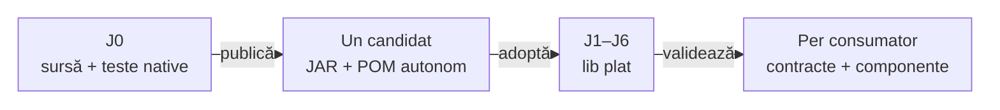

# ATF — platform library consumption

[Owner, feedback și sincronizare](../lib/README.md) descrie fluxul comun cu J0; această pagină detaliază integrarea tehnică.

## Pe scurt

J0 este reactorul producător cu 12 module. Deține implementarea și testele native Core, Reporting, Console, Mock și Test Kit. J1–J6 consumă direct din `lib` câte o singură pereche curentă JAR/POM pentru fiecare bibliotecă; adaptoarele, configurația și acceptanța aplicațiilor rămân locale.

| Proiect | Module sursă | Domeniu |
|---|---|---|
| J0 | 12 | Producător și contracte native ale bibliotecilor |
| J1 | 6 | Fluxuri browser/API pentru Shop și AutoEx |
| J2 | 5 | SQL, setup și mesagerie Eventuate WIP; fără module browser |
| J3 | 4 | Framework de vorbire și acceptanță |
| J4 | 3 | Framework Android și acceptanță |
| J5 | 2 | Rentz WIP și acceptanță independentă a bibliotecilor |
| J6 | 5 | Hold’em WIP; adoptare doar în scope-ul de test al holdem-app, fără surse producătoare sau harness |

## Limitele Console și Mock

| Bibliotecă | Dependențe de producție | Responsabilitate |
|---|---|---|
| Console | Core, Jackson YAML, JUnit API; Test Kit opțional pentru bridge-ul JUnit | Formatare neutră a evenimentelor, stdout configurat și proiecția ciclului de viață JUnit |
| Mock | Core și Jackson YAML; Kit și JUnit sunt doar pentru teste | Înlocuitor determinist pentru portul HTTP, JSON strict și potrivire exactă a rutei/query-ului/valorilor numerice |
| Reporting | Fără dependențe de module ATF | HTML/Extent/fallback, proiecția auditului și randare |

Console păstrează bridge-ul JUnit existent. Consumatorii care îl folosesc declară Kit direct; o dependență Maven opțională nu transmite Kit tranzitiv. Versiunile din POM-urile Console și Mock descriu publicațiile curente ale acestor biblioteci, iar POM-ul consumatorului selectează separat versiunea Kit.

Console și Mock nu depind de Reporting, Validation sau modulele aplicațiilor. Fixture-urile business și cataloagele YAML rămân la consumator.

## Fluxul sursă–binar



<details>
<summary><strong>Legendă — o publicație, acceptanță independentă</strong></summary>

- Săgețile arată publicarea și acceptanța, nu module Maven suplimentare.
- J0 păstrează toate clasele de teste native; acceptanța binară le reutilizează numai într-un harness TMP deținut, fără surse de producție în classpath.
- Fiecare consumator își păstrează baza Git și domeniul propriu; un gate verde în J1 nu este dovadă pentru J2–J6.
- Proprietățile POM-ului rădăcină selectează coordonatele curente. POM-ul publicat fixează dependența Core testată; versiunea sa este independentă de versiunea reactorului consumator.
- La schimbarea versiunii Core, se republică și perechile Console/Mock dependente; nu rescrieți doar POM-ul alăturat unui JAR existent.

</details>

## Maven și IntelliJ

Rulați din rădăcina consumatorului, într-o copie TMP deținută:

```powershell
mvn -B -ntp -N validate
mvn -B -ntp -DskipTests test-compile
```

Faza `validate` din POM-ul rădăcină instalează cele cinci perechi reale POM/JAR în repository-ul Maven selectat. Folosiți aceleași setări și același repository local Maven în IntelliJ, apoi reîncărcați POM-ul rădăcină. Dependențele folosesc `atf.core.version`, `atf.reporting.version`, `atf.console.version`, `atf.mock.version` și `atf.testkit.version`; nu restaurați module sursă pentru a rezolva importurile.

Comenzile native ale bibliotecilor rulează numai în J0. Acceptanța pe un JAR publicat compilează testele native în TMP fără să copieze clase de producție, verifică `CodeSource` real și păstrează oracolele negative. Nu selectați direct fixture-urile JUnit imbricate: eșecurile lor intenționate sunt verificate de testul exterior.

## Integritate și mentenanță

- `lib` conține zece artifacte binare, indexul și cinci ghiduri de utilizare: cinci perechi JAR/POM, fără repository imbricat, versiuni vechi, surse sau note de verificare.
- La schimbarea versiunii unei biblioteci, promovați mai întâi noua pereche și proveniența prin guard; apoi retrageți vechiul JAR/POM printr-o curățare explicită a celor două fișiere, după verificarea hash-urilor. Guard-ul nu șterge artifacte.
- `library-provenance.json` păstrează proveniența Core/Reporting și adaugă `platformLibraries.console`, `platformLibraries.mock` și `platformLibraries.test-kit`: coordonate, hash-uri binar/POM, digest-ul intrărilor producătorului, catalog nativ și dovada pachetului curent.
- POM-ul încorporat în JAR trebuie să fie identic octet cu octet cu POM-ul publicat alăturat. Guvernanța consumatorului verifică JAR-ul fizic, respingerea surselor paralele, limita dependențelor și inventarul plat.
- Build-urile, cache-urile, copiile de recuperare și ultima notă de verificare a pachetului rămân în staging-ul TMP al producătorului. Documentația oficială descrie contracte, nu istoricul incrementelor.
- Schimbările pornesc din J0, păstrează preview-ul implicit de 240 de caractere și assertions colapsabile auditabile, apoi primesc acceptanță componentă separată în fiecare consumator afectat. Verificările offline nu certifică device-uri, broker extern sau ASR.

Consultați [sincronizarea workspace-urilor](ATF_Workspace_Synchronization.md) și [execuția izolată](ATF_Build_And_Execution_Safety.md). Ownerii surselor sunt [Console](../atf-console/README.md) și [Mock](../atf-mock/README.md).

## Ghiduri executabile pe publicația binară

Profilul Maven `library-guides` verifică exemplele Java/YAML direct din cele cinci README-uri livrate în lib. Ownerii sunt `CoreLibraryGuideIT`, `ConsoleLibraryGuideIT` și `MockLibraryGuideIT` în modulele native, `KitLibraryGuideIT` în Test Kit, respectiv `ReportingLibraryGuideIT` în atf-reporting-tests. Suportul neutru din Test Kit compilează și execută consumerul; oracolele rămân la biblioteci.

Într-o copie J0 deținută în TMP, cu repository Maven și director JVM temporar proprii:

```powershell
mvn -B -ntp -DskipTests -pl atf-test-kit,atf-core,atf-console,atf-mock,atf-reporting-tests -am install
mvn -B -ntp -Plibrary-guides "-Datf.guide.bundle=$env:ATF_STAGING_ROOT\consumer\lib" -pl atf-test-kit,atf-core,atf-console,atf-mock,atf-reporting-tests test
```

Bundle-ul este obligatoriu și conține perechile JAR/POM efectiv distribuite și ghidurile asociate. Prima comandă pregătește runnerul; consumerul generat de a doua declară numai biblioteca testată, fără parent ATF. Folosiți `-Dmaven.repo.local=<cache TMP>` pentru runner și, dacă sunt necesare setări Maven proprii, `-Datf.guide.maven.settings=<settings.xml>` pentru resolverul izolat; fiecare probă are cache-ul său TMP.

Pentru CI offline adăugați `-Datf.guide.maven.seed=<cache pregătit>`: se copiază numai JAR/POM vendor, fără artifacte ATF ori tracking remote, apoi perechile selectate din bundle. Resolverul rulează `--offline`; o dependență sau un plugin absent produce FAIL, cu aceeași limită de 180 s per proces.

| Dovadă | Contract verificat |
|---|---|
| Publicație | POM explicit, fără parent, identic cu metadata încorporată; CodeSource și SHA-256 ale JAR-ului selectat |
| Izolare | Compile/runtime doar cu JAR-urile rezolvate din POM; fără surse paralele ori module de aplicație; numai proba Kit include Kit, iar Reporting nu include Core |
| Comportament | Core: URL, zecimale și JSON strict; Mock: catalog YAML și fallback; Console: YAML și precedență; Reporting: PASS/FAIL/null, tabel și preview 240 |
| Control negativ | API retras sau bibliotecă eliminată produc FAIL la compilare; Core refuză și lipsa tranzitivei Jackson |

Profilul cere teste prezente; bundle-ul absent sau un proces refuzat/eșuat nu devine skip ori PASS. Fără profil, selecțiile native existente rămân distincte. Pentru o singură bibliotecă selectați modulul său cu același profil și bundle.

Logurile, sursele extrase și HTML-urile rămân în TMP; această verificare nu certifică un browser, device, broker sau ASR real.

## Test Kit ca bibliotecă

[Test Kit](ATF_Test_Kit_Library.md) are owner de cod, native și feedback în J0. J1–J6 consumă perechea din lib și [ghidul local](../lib/README.TestKit.md); verifică binarul și integrarea, fără surse Kit paralele. Console păstrează bridge-ul opțional, iar produsul declară Kit numai în test scope.
