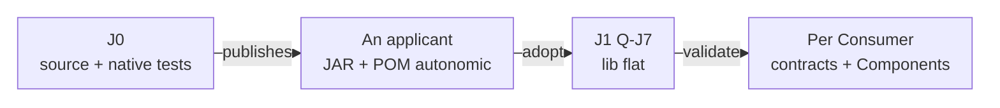

<a id="atf--platform-library-consumption"></a>
<a id="atf--consumul-bibliotecilor-platformei"></a>
# ATF — platform library consumption

[Owner, feedback and timing](../lib/README.md) describes the common flow with J0; this page details technical integration.

<a id="at-a-glance"></a>
<a id="pe-scurt"></a>
## At a glance

J0 is the producer reactor with 12 modules. It owns implementation and native tests for Core, Reporting, Console, Mock and Test Kit. J1–J7 consume one current JAR/POM pair per library directly from `lib`; application adapters, configuration and acceptance remain local.

| Project | Source plugins | Domain |
|---|---|---|
| J0 | 12 | Producer and native contracts of libraries |
| J1 | 6 | Browser / API flows for Shop and AutoEx |
| J2 | 5 | SQL, setup and messaging Eventuate WIP; without browser modules |
| J3 | 4 | Speech and acceptance framework |
| J4 | 3 | Framework Android and acceptance |
| J5 | 2 | Rentz WIP and independent acceptance of libraries |
| J6 | 5 | Hold'em WIP; adoption only in the holder-app test scope without producing or harness |
| J7 | 1 | Chess Lab. Maven Reactor qualifies the engine, reports and pairs of lib via atf-tests. |

<a id="console-and-mock-limits"></a>
<a id="limitele-console-și-mock"></a>
## Console and Mock limits

| Library | Production dependencies | Responsibility |
|---|---|---|
| Console | Core, Jackson YAML, JUnit API; Test Kit optional for JUnit Brigade | Neutral event formation, configured stdout and JUnit life cycle projection |
| Mock | Core and Jackson YAML; Kit and JUnit are for tests only | HTTP, JSON port determinist replacement and exact match of route / query / numerical values |
| Reporting | No dependence on ATF modules | HTML / Extent / fallback, audit projection and rendering |

Console keeps the existing JUnit. Consumers using it declare Kit directly; an optional Maven dependency does not transmit Transient Kit. POM Console and Mock describe the current publications of these libraries, and POM selects Kit version separately.

Console and Mock do not depend on Reporting, Validation or application modules. Business fixtures and YAML catalogues remain with the consumer.

<a id="source-binary-flow"></a>
<a id="fluxul-sursăbinar"></a>
## Source-binary flow



<details>
<summary><strong>Legend - a publication, independent acceptance</strong></summary>

- The arrows show publication and acceptance, not additional Maven modules.
- J0 maintains all native test classes; binary acceptance only reuses them in a owned TMP harness without production sources in the classSPath.
- Each consumer retains its Git base and its own domain; a green gate in J1 is not evidence for J2 Q-J7.
- POM root properties select current coordinates. POM published fixes the Core dependency tested; its version is independent of the consumer reactor version.
- When changing Core version, the Console / Mock pairs are also republished; do not just rewrite POM with an existing JAR.

</details>

<a id="maven-and-intellij"></a>
<a id="maven-și-intellij"></a>
## Maven and IntelliJ

Run from the consumer's root in a copy of TMP owned:

```powershell
mvn -B -ntp -N validate
mvn -B -ntp -DskipTests test-compile
```

`validate` phase in POM root sets up the five real POM / JAR pairs in the selected Maven repository. Use the same settings and local Maven repository in IntelliJ, then reload POM root. `atf.core.version`, `atf.reporting.version`, `atf.console.version`, `atf.mock.version` and `atf.testkit.version`; do not restore source modules to resolve imports.

The native library controls run only in J0. Acceptance on a published JAR compiles native tests in TMP without copying production classes, checks the actual `CodeSource` and retains negative oracles. Do not select directly JUnit fixed-ups: their intentional failures are checked by the external test.

<a id="integrity-and-maintenance"></a>
<a id="integritate-și-mentenanță"></a>
## Integrity and maintenance

- `lib` contains ten binary artifacts, index and five user guides: five JAR / POM pairs, without nested repository, old versions, sources or verification notes.
- When changing the version of a library, first promote the new pair and the provenance through the guard; then withdraw the old JAR / POM by explicitly cleaning the two files after checking the hashes. The guard does not delete artifacts.
- `library-provenance.json` maintains the Core / Reporting provenance and adds `platformLibraries.console`, `platformLibraries.mock` and `platformLibraries.test-kit`: coordinates, binary hashes / POM, manufacturer's input digestion, native catalogue and proof of current package.
- POM incorporated into JAR must be octet-octet with the next published POM. Consumer governance checks JAR physically, rejection of parallel sources, limit of dependence and flat inventory.
- The manufacturer's building, cachets, recovery copies and final check note remain in the manufacturer's TMP staging. The official documentation describes contracts, not the history of increments.
- The changes start from J0, keep the default 240 character preview.Accurable and auditable collapse assertions, then receive separate component acceptance in each affected consumer. Offline checks do not certify dev, external broker or ASR.

See [synchronization of workspaces](ATF_Workspace_Synchronization.md) and [isolated execution](ATF_Build_And_Execution_Safety.md). The sources' Owners are [Console](../atf-console/README.md) and [Mock](../atf-mock/README.md).

<a id="executable-guides-on-binary-publication"></a>
<a id="ghiduri-executabile-pe-publicația-binară"></a>
## Executable guides on binary publication

Maven `library-guides` profile verifies the examples Java / YAML directly from the five README delivered in lib. Owners are `CoreLibraryGuideIT`, `ConsoleLibraryGuideIT` and `MockLibraryGuideIT` in native modules `KitLibraryGuideIT` in Test Kit, `ReportingLibraryGuideIT` in atf-reporting-tests. Neutral support in Test Kit compiles and executes the consumption; oracles remain in libraries.

In a copy of J0 held in TMP, with the reposition Maven and the director of JVM temporarily own:

```powershell
mvn -B -ntp -DskipTests -pl atf-test-kit,atf-core,atf-console,atf-mock,atf-reporting-tests -am install
mvn -B -ntp -Plibrary-guides "-Datf.guide.bundle=$env:ATF_STAGING_ROOT\consumer\lib" -pl atf-test-kit,atf-core,atf-console,atf-mock,atf-reporting-tests test
```

Bundler is mandatory and contains JAR / POM pairs and associated guides. The first command prepares the runner; the second generated consumer declares only the tested library without parent ATF. Use `-Dmaven.repo.local=<cache TMP>` for runner and, if necessary, own Maven, `-Datf.guide.maven.settings=<settings.xml>` for isolated resolver; The evidence has its TMP cachet.

For CI offline add `-Datf.guide.maven.seed=<cache pregătit>`: copy only JAR / POM vendor, without artifacts ATF or tracking remote, then selected bundle pairs. Resolver runs `--offline`; an absence dependency or plugin produces FAIL with the same limit of 180 s per trial.

| Proof | Verified contract |
|---|---|
| Publication | POM explicitly without parent identical to the embedded metadata; CodeSource and SHA-256 of the selected JAR |
| Izolare | Compiles / runtime only with JAR solved POM; no parallel sources or application modules; only Kit sample includes Kit, and Reporting does not include Core |
| Behavior | Core: strict URL, decimal and JSON matching; Mock: YAML catalog and fallback; Console: YAML and precedence; Reporting: PASS/FAIL/null, table and preview 240 |
| Negative control | API withdrawn or library removed produce FAIL at compilation; Core refuses and lack of Jackson Transition |

The profile requires present tests; the absent bundler or a failed / refused process does not become skip or PASS. Without profile, the existing native selections remain distinct. For one library select its module with the same profile and bundle.

Logs, extracted sources and HTML remain in TMP; this check does not certify a real browser, device, broker or ASR.

<a id="test-kit-as-library"></a>
<a id="test-kit-ca-bibliotecă"></a>
## Test Kit as library

J0 owns [Test Kit](ATF_Test_Kit_Library.md) code, native tests and feedback. J1–J7 consume the pair in lib and [local guide](../lib/README.TestKit.md), checking the binary and integration without parallel Kit source. Console retains the optional bridge; products declare Kit only in test scope.
