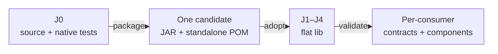

# ATF — platform library consumption

[Owner, feedback și sincronizare](../lib/README.md) descrie fluxul comun cu J0; această pagină detaliază integrarea tehnică.

## Pe scurt

This workspace is the twelve-module producer. J0 owns Core, Reporting, Console and Mock implementation and native tests. J1–J4 consume exactly one current JAR/POM pair per library directly in `lib`; their application adapters, configuration and acceptance remain local.

| Workspace | Source modules | Domain |
|---|---|---|
| J0 | 12 | Producer and native library contracts |
| J1 | 7 | Shop and AutoEx browser/API journeys |
| J2 | 6 | SQL, Setup and Eventuate messaging WIP; no browser modules |
| J3 | 5 | Speech framework and acceptance |
| J4 | 4 | Android framework and acceptance |

## Console and Mock boundaries

| Library | Production dependencies | Ownership |
|---|---|---|
| Console | Core, Jackson YAML, JUnit API; optional Test Kit for the JUnit bridge | Neutral event formatting, configured stdout and JUnit lifecycle projection |
| Mock | Core and Jackson YAML; Kit and JUnit are test-only | Deterministic HTTP-port replacement, strict JSON and exact route/query/numeric matching |
| Reporting | No ATF module dependency | HTML/Extent/fallback, audit projection and rendering |

Console retains its existing JUnit bridge. Consumers using that bridge declare Kit themselves; an optional Maven dependency does not provide Kit transitively. 

Console and Mock do not depend on Reporting, Validation or application modules. Business fixtures and YAML catalogs remain at their consumer.

## Source and binary flow



<details>
<summary><strong>Legend — one package, independent acceptance</strong></summary>

- Arrows describe publication and acceptance, not extra Maven modules.
- J0 keeps all native test classes; binary acceptance reuses them only in an owned TMP harness, with no production source on its classpath.
- Every consumer retains its own Git base and domain scope; a passing J1 gate is not J2/J3/J4 evidence.
- Root POM properties select the current coordinates. The publication POM pins the tested Core dependency; its version is independent of the consumer reactor version.

</details>

## Maven and IntelliJ

Run from the consumer root, in an owned TMP copy:

```powershell
mvn -B -ntp -N validate
mvn -B -ntp -DskipTests test-compile
```

The root validate phase installs the four real POM/JAR pairs into the selected Maven local repository. Use the same Maven settings and local repository in IntelliJ, then reload the root POM. Dependencies use `atf.core.version`, `atf.reporting.version`, `atf.console.version` and `atf.mock.version`; source modules must not be restored to satisfy imports.

Native library commands run at J0 only. Acceptance against a published JAR compiles the native tests in TMP without copying production classes, verifies the actual CodeSource, and preserves negative oracles. Do not select nested JUnit fixture classes directly: their intentional failures are asserted by their enclosing test.

## Integrity and maintenance

- `lib` contains eight binary artifacts plus the index and four per-library usage guides: four JAR/POM pairs, no nested repository, old versions, source or verification notes.
- Root `library-provenance.json` retains original Core/Reporting provenance and adds `platformLibraries.console` and `platformLibraries.mock`: coordinates, binary/POM hashes, producer-input digest, native catalog and current package evidence.
- The embedded Maven POM must equal the adjacent published POM byte for byte. Consumer governance verifies the physical JAR, source-shadow rejection, dependency boundary and flat inventory.
- Builds, caches, recovery copies and the latest package verification note stay in the owned producer TMP stage. Official docs describe contracts rather than iterative release history.
- Changes start at J0, preserve the 240-character default preview and auditable collapsible assertions, then receive separate component acceptance in every affected consumer. No device, external broker or ASR acceptance is inferred from offline checks.

See [workspace synchronization](ATF_Workspace_Synchronization.md) and [isolated execution](ATF_Build_And_Execution_Safety.md). The source owners are [Console](../atf-console/README.md) and [Mock](../atf-mock/README.md).
