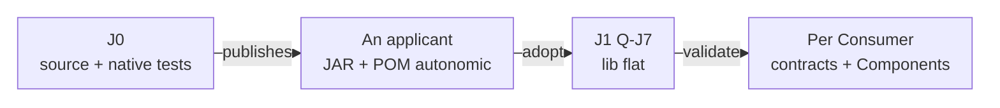

<a id="atf--platform-library-consumption"></a>
<a id="atf--consumul-bibliotecilor-platformei"></a>
# ATF — platform library consumption

[Owner, feedback and timing](../lib/README.md) describes the common flow with J0; this page details technical integration.

<a id="at-a-glance"></a>
<a id="pe-scurt"></a>
## At a glance

- J0 owns the source, native tests, packaging and shared feedback for Core, Reporting, Console, Mock, Test Kit and Debug UI.
- Consumers select versioned JAR/POM pairs from a flat `lib` catalog. Application adapters, configuration and acceptance remain with each consumer.
- J1 is the first Debug UI consumer. J2–J7 catalogs are unchanged by this adoption.

| Project | Source plugins | Domain |
|---|---|---|
| J0 | 12 | Producer and native contracts of libraries |
| J1 | 5 local modules + 6 library pairs | Browser / API flows for Shop and AutoEx; first Debug UI binary consumer |
| J2 | 5 | SQL, setup and messaging Eventuate WIP; without browser modules |
| J3 | 4 | Speech and acceptance framework |
| J4 | 3 | Framework Android and acceptance |
| J5 | 2 | Rentz WIP and independent acceptance of libraries |
| J6 | 5 | Hold'em WIP; adoption only in the holder-app test scope without producing or harness |
| J7 | 1 | Chess Lab. Maven Reactor qualifies the engine, reports and pairs of lib via atf-tests. |

<a id="debug-ui-ownership-and-acceptance"></a>
## Debug UI ownership and acceptance

- J0 owns the `atf-debug-ui` source module, its native regression tests, the published JAR/POM contract and shared implementation feedback.
- J1 is the first binary consumer. It selects one versioned pair from its flat `lib` catalog and uses the launcher only from the `atf-tests` test classpath.
- J1 owns its launcher configuration and local inspection acceptance. It does not fork the implementation or certify report behavior.

The Debug UI serves an already-generated HTML file over loopback for browser inspection. It does not produce reports, evaluate assertions or set the test verdict. See the [consumer usage guide](../lib/README.DebugUi.md), [source module](../atf-debug-ui/README.md) and [J0-owned feedback registry](feedback/README.md#common-libraries).

<a id="console-and-mock-limits"></a>
<a id="limitele-console-și-mock"></a>
## Console and Mock limits

| Library | Production dependencies | Responsibility |
|---|---|---|
| Console | Core, Jackson YAML, JUnit API; Test Kit optional for JUnit Brigade | Neutral event formation, configured stdout and JUnit life cycle projection |
| Mock | Core and Jackson YAML; Kit and JUnit are for tests only | HTTP, JSON port determinist replacement and exact match of route / query / numerical values |
| Reporting | No dependence on ATF modules | HTML / Extent / fallback, audit projection and rendering |

Console keeps the existing JUnit. Consumers using it declare Kit directly; an optional Maven dependency does not transmit Transient Kit. POM Console and Mock describe the current publications of these libraries, and POM selects Kit version separately.

Console and Mock do not depend on Reporting, Validation or application modules. Business fixtures and YAML catalogues remain with the consumer.

<a id="source-binary-flow"></a>
<a id="fluxul-sursăbinar"></a>
## Source-binary flow



<details>
<summary><strong>Legend - a publication, independent acceptance</strong></summary>

- The arrows show publication and acceptance, not additional Maven modules.
- J0 maintains all native test classes; binary acceptance only reuses them in a owned TMP harness without production sources in the classSPath.
- Each consumer retains its Git base and its own domain; a green gate in J1 is not evidence for J2 Q-J7.
- POM root properties select current coordinates. POM published fixes the Core dependency tested; its version is independent of the consumer reactor version.
- When changing Core version, the Console / Mock pairs are also republished; do not just rewrite POM with an existing JAR.

</details>

<a id="maven-and-intellij"></a>
<a id="maven-și-intellij"></a>
## Maven and IntelliJ

Run from the consumer's root in a copy of TMP owned:

```powershell
mvn -B -ntp -N validate
mvn -B -ntp -DskipTests test-compile
```

- The J1 root POM's `validate` phase installs the six selected POM/JAR pairs into the configured Maven repository, including `atf.debugui.version`.
- Use the same settings and local repository in IntelliJ, then reload the root POM.
- J1 declares Debug UI only in `atf-tests` test scope. Do not restore its source module to resolve imports.

The native library controls run only in J0. Acceptance on a published JAR compiles native tests in TMP without copying production classes, checks the actual `CodeSource` and retains negative oracles. Do not select directly JUnit fixed-ups: their intentional failures are checked by the external test.

<a id="integrity-and-maintenance"></a>
<a id="integritate-și-mentenanță"></a>
## Integrity and maintenance

- J1 `lib` contains twelve binary artifacts, the index and six usage guides: six JAR / POM pairs, without nested repositories, old versions, source trees or release notes.
- When changing the version of a library, first promote the new pair and the provenance through the guard; then withdraw the old JAR / POM by explicitly cleaning the two files after checking the hashes. The guard does not delete artifacts.
- J1 `library-provenance.json` records all six consumed pairs. `platformLibraries.debug-ui` records the selected coordinate, binary and POM hashes, producer inputs, native test catalog, package stage, and J0 ownership; J1 records its independent physical-JAR acceptance.
- POM incorporated into JAR must be octet-octet with the next published POM. Consumer governance checks JAR physically, rejection of parallel sources, limit of dependence and flat inventory.
- The manufacturer's building, cachets, recovery copies and final check note remain in the manufacturer's TMP staging. The official documentation describes contracts, not the history of increments.
- Library changes are implemented and qualified in J0, then accepted independently by each affected consumer.
- Consumer tests should keep report evidence auditable and assertion details easy to inspect. Offline checks do not certify devices, external brokers or speech services.

See [synchronization of workspaces](ATF_Workspace_Synchronization.md) and [isolated execution](ATF_Build_And_Execution_Safety.md). The sources' Owners are [Console](../atf-console/README.md) and [Mock](../atf-mock/README.md).

<a id="executable-guides-on-binary-publication"></a>
<a id="ghiduri-executabile-pe-publicația-binară"></a>
## Executable guides on binary publication

Maven `library-guides` profile verifies the examples Java / YAML directly from the selected library guides in `lib`. Owners are `CoreLibraryGuideIT`, `ConsoleLibraryGuideIT` and `MockLibraryGuideIT` in native modules, `KitLibraryGuideIT` in Test Kit, and `ReportingLibraryGuideIT` in atf-reporting-tests. Debug UI is verified by J0's source tests and J1's physical-JAR boundary checks; it is an inspection tool, not a report producer.

In a copy of J0 held in TMP, with the reposition Maven and the director of JVM temporarily own:

```powershell
mvn -B -ntp -DskipTests -pl atf-test-kit,atf-core,atf-console,atf-mock,atf-reporting-tests -am install
mvn -B -ntp -Plibrary-guides "-Datf.guide.bundle=$env:ATF_STAGING_ROOT\consumer\lib" -pl atf-test-kit,atf-core,atf-console,atf-mock,atf-reporting-tests test
```

Bundler is mandatory and contains JAR / POM pairs and associated guides. The first command prepares the runner; the second generated consumer declares only the tested library without parent ATF. Use `-Dmaven.repo.local=<cache TMP>` for runner and, if necessary, own Maven, `-Datf.guide.maven.settings=<settings.xml>` for isolated resolver; The evidence has its TMP cachet.

For CI offline add `-Datf.guide.maven.seed=<cache pregătit>`: copy only JAR / POM vendor, without artifacts ATF or tracking remote, then selected bundle pairs. Resolver runs `--offline`; an absence dependency or plugin produces FAIL with the same limit of 180 s per trial.

| Proof | Verified contract |
|---|---|
| Publication | POM explicitly without parent identical to the embedded metadata; CodeSource and SHA-256 of the selected JAR |
| Izolare | Compiles / runtime only with JAR solved POM; no parallel sources or application modules; only Kit sample includes Kit, and Reporting does not include Core |
| Behavior | Core: strict URL, decimal and JSON matching; Mock: YAML catalog and fallback; Console: YAML and precedence; Reporting: PASS/FAIL/null, table and preview 240 |
| Negative control | API withdrawn or library removed produce FAIL at compilation; Core refuses and lack of Jackson Transition |

The profile requires present tests; the absent bundler or a failed / refused process does not become skip or PASS. Without profile, the existing native selections remain distinct. For one library select its module with the same profile and bundle.

Logs, extracted sources and HTML remain in TMP; this check does not certify a real browser, device, broker or ASR.

<a id="test-kit-as-library"></a>
<a id="test-kit-ca-bibliotecă"></a>
## Test Kit as library

J0 owns [Test Kit](ATF_Test_Kit_Library.md) code, native tests and feedback. J1–J7 consume the pair in lib and [local guide](../lib/README.TestKit.md), checking the binary and integration without parallel Kit source. Console retains the optional bridge; products declare Kit only in test scope.
