<a id="atf-java-extent-reporting-contract"></a>
<a id="contractul-de-raportare-extent-pentru-atf-java"></a>
# ATF Java Extent Reporting Contract

<a id="at-a-glance"></a>
<a id="pe-scurt"></a>
## At a glance

Caller status is reconciled with evaluated evidence through [Reporting common policy](../atf-reporting/README.md#consistența-statusului-transmis-de-caller). A FAIL row or child cannot close as PASS, while legitimate SKIP and INFO observations retain their semantics; the consumer still owns business evaluation.

- the report represents execution; it does not create a second verdict;
- the runner and contract evaluator remain the authorities for the result;
- Extent publishes evidence in a readable, navigable form;
- each surface reuses the same identity and semantics.

The visible form, layout, disclosures, and verification matrix are specified separately in the [Display and Layout Contract](ATF_Reporting_Display_Contract.md); this document remains the owner of report and evidence semantics.

For the AutoEx / Shop components, an owner class / suite publishes a common report, and each audited invoicing retains its script, phases and verdict. The unit remains exempt; the fixture-artifacts of the Reporting tests have ownership separately.

<a id="overviewsystem--semantic-snapshot"></a>
<a id="overviewsystem--instantaneu-semantic"></a>
### Overview/System — semantic snapshot

System answers one question: **what operational settings did this report run with?** It is a flat summary, not a second location for test identity or execution evidence.

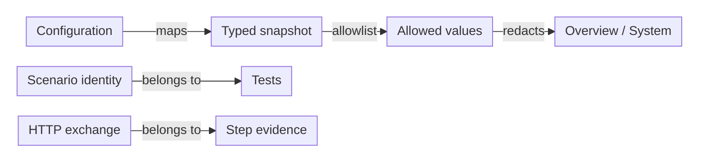

<details>
<summary><strong>Legend — ownership by surface</strong></summary>

- `Snapshot` preserves typed settings; allowlisting and redaction happen before publication;
- `System` is the operational summary in flat `label · value` format;
- scenario identity and results belong in `Tests`, while transport data
  stays with the exchange that produced it.

</details>

| System includes — when relevant | System excludes — already owned elsewhere |
|---|---|
| Environment, profile, and build | Suite, test package, and scenario identity → `Tests` |
| Hosts and transport mode | Flow, fixture, and journey-specific precondition → `Tests` |
| Browser, viewport, and readable timeouts | Checkout and other business data → test steps |
| Authentication mode, retry/network settings | Request, response, retry history, and payload → exchange evidence |
| Reporting, screenshot policy, and preview limits | Secrets, raw YAML, local paths, and unstable identifiers → not published |

- `ReportEnvironmentField` defines the typed vocabulary and semantic categories;
- `ReportEnvironmentSnapshot` ignores empty values and filters fields
  that are not visible in System;
- `ReportEnvironment` applies redaction at the publication boundary;
- an explicit `Client` is operational metadata that is retained and redacted before
  publication; when absent, use exactly `Configured per execution`;
- System publishes a single `Client` row; missing metadata does not authorize
  assigning a fictitious API transport;
- categories (`Run`, `Targets`, `Browser`, `Time`, `Flow`, `Auth`, `Network`,
  `Evidence`, `Reporting`) do not become groups or visual table headers.

<details>
<summary><strong>Details — boundary, formatting, and compatibility</strong></summary>

- `Precondition` in System describes only a global operational setting; state prepared for a particular journey remains in `Tests`;
- `Body preview` shows the configured limit and where full evidence is located, not the body content. It is distinct from the Request/Response JSON limit and the Network Inspector observation preview;
- durations are shown in human-readable units (`20s`, `45s`), not opaque ISO values;
- `Map<String,String>` remains only for compatibility with existing consumers; new code uses the typed snapshot;
- the System snapshot describes effective configuration; it does not replace observed evidence or infer values from raw YAML, test names, or business payloads.

</details>

<a id="api-evidence-auth-schema"></a>
<a id="schema-auth-a-dovezilor-api"></a>
## API evidence auth schema

| Request field | Value | Shared rule |
|---|---|---|
| `AUTH PROFILE` | Configured profile identity, for example `shop-user` | This is not the auth mechanism; the browser does not invent a profile |
| `AUTH TYPE` | Observed mechanism, for example `bearer`, `basic`, `none`, `other/unknown` | Do not replace it with the profile name |

- Standalone API, API audit, UI+API, and HTML fallback use the same
  pair of fields in the same order in `Request details`.
- An observed header or query takes precedence over a hint from the profile
  name. Profile classification remains a compatibility fallback.
- The typed observation is retained when headers are redacted; the auth mechanism
  is not recalculated from credentials that have already been masked.
- The `auth.type` and `Auth type` aliases produce `AUTH TYPE`;
  legacy per-exchange aliases retain only the `API n ·` qualifier.
- `auth.mode` remains the operational mode, labeled `AUTHENTICATION`; it is not
  an alias for the request's observed mechanism.
- `Authentication` in System and `Authentication evidence` in the inspector are
  other surfaces; do not rename them to fix a request schema.

<a id="surface-order"></a>
<a id="ordinea-suprafețelor"></a>
## Surface order

The approved order and role of each surface are shown in a single flow:

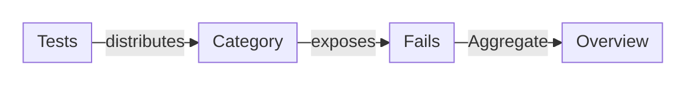

<details>
<summary><strong>Legend — surfaces and navigation rules</strong></summary>

- `Tests` is the authoritative source for classes, scenarios, status, duration, and
  selectable evidence;
- `Category` and `Overview` are projections, not alternative verdicts;
- `Fails` preserves each individual failure and links to `Tests`;
- `Overview` opens by default on load/refresh, but does not move ahead of
  `Tests` in semantic order;
- hashes and clicks must reach the same surface.

| Surface | Contents |
|---|---|
| Tests | classes/scenarios, status, duration, and selectable details |
| Category | distributions and links to relevant scenarios |
| Fails | all failures, without grouping that hides individual tests |
| Overview | totals and aggregated metadata, without creating alternative verdicts |

</details>

<a id="test-tree"></a>
<a id="arborele-unui-test"></a>
## Test tree

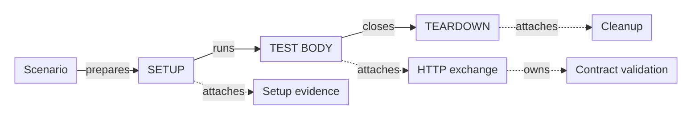

<details>
<summary><strong>Legend — visual hierarchy of a test</strong></summary>

- the solid column shows the lifecycle; phases are created only when they contain real content;
- dotted branches group local evidence and do not introduce new steps;
- `SETUP` may publish setup evidence, while `TEST BODY` publishes a request and response-contract validation when a contract was evaluated;
- in a direct API report, contract validation is a child of the request that owns the exchange; in a UI report, UI/API validation remain semantic children of the same Gherkin checkpoint;
- `TEARDOWN` publishes only real cleanup/read-back;
- the aggregate table belongs to validation, not the request or phase;
- a failure is displayed once, in the area that produces it.

</details>

In a direct API report, the request and its technical evidence are followed in the same card by nested `Contract validation` when the response was evaluated against a contract. In a UI report, the Gherkin checkpoint owns UI and API validation as sibling evidence; exchanges belong to API validation and do not become new Gherkin steps.

The consumer audit retains one node per observed exchange and attaches `Contract validation` only when the producer associated a typed HTTP contract with the exchange. Expected status is explicit and compared with the observed status; neither the observed status nor the JUnit verdict replaces it. Capture completeness remains internal phase context; JUnit failure and a missing association are explicit scenario diagnostics, not repeated assertions on every exchange.

Ownership rules:

1. the request contains the method, path, duration, technical trace, and JSON;
2. for direct API, contract validation is nested under the evaluated request; for UI,
   UI and API validation are attached to the Gherkin checkpoint;
3. the assertions table belongs to validation;
4. the phase does not repeat a failure already detailed in the table;
5. the scenario shows the aggregate verdict; it does not duplicate each phase's evidence.

<a id="internal-context-and-scenario-diagnostics"></a>
<a id="context-intern-și-diagnostic-al-scenariului"></a>
### Internal context and scenario diagnostics

The phase organizes real steps without its own `Status / Details → Info → Audit details` band. `Phase.detail` preserves internal context and field names in the semantic snapshot, not as a public disclosure. Absence is checked structurally, including for empty or hidden wrappers.

| Channel | Rule |
|---|---|
| Explicit diagnostic | `Phase.diagnostic(Kind, message)` and `ReportPhaseDiagnostic`; bounded conversion for legacy keys |
| Scenario | Owns `Execution diagnostics`, with redaction; closing hides the block, normalization does not duplicate it |
| Fails | Cause of the failed phase and link to the exact scenario, including without an exchange; notes from PASS phases do not contaminate the cause |
| Verdict | Belongs to the consumer; a diagnostic alone does not change it |

- In component audit, an exception captured when the callback exits does not disappear if a JUnit handler swallows it. Kit reconciles FAIL/SKIP with the runner, preserving cause and timing.
- Successful comparisons remain PASS; when no comparison has failed, Fails shows the diagnostic without an invented request or HTTP duration. Measured empty phases are not expandable merely because of metadata.

`Setup evidence`, demand / response / actual execution, contract validations and API inspector remain intact. The renderer's ownership and the samples are in [README Reporting](../atf-reporting/README.md#context-de-fază-și-diagnostic-de-execuție).

<a id="setup-evidence"></a>
<a id="dovezile-configurării-inițiale"></a>
## Setup evidence

`SETUP` owns preconditions and fixture acquisition/verification; it is not reserved for read-only inputs. A consumer may explicitly select a setup operation with external effects, such as account registration, before `TEST BODY`. The report contract separates the check summary from transport evidence:

- a single `Setup evidence` block;
- tabelul `CHECK | EXPECTED | ACTUAL | RESULT`;
- checks summarize the selected source, setup result, and readiness for the next phase; the table does not duplicate the request/response or transport JSON;
- UI actions and real API exchanges remain distinct evidence for the same `SETUP` checkpoint; when API evidence is selected, `API validation` retains the canonical `Exchange → Request → Response → Execution` structure;
- setup remains separate; `UI validation` belongs to `TEST BODY`, after business actions and observations;
- transport does not create a duplicate Gherkin checkpoint or by itself change the business verdict.

<a id="uiapi-validation-ownership"></a>
<a id="ownership-ul-validărilor-uiapi"></a>
### UI/API validation ownership

In a UI+API checkpoint, assertions are separate typed inputs, not one list classified by name prefixes:

- `UI validation` receives only UI actions, observations, assertions, and verdict; it is the only public title for UI evidence;
- `API validation` receives cross-channel correlations and typed exchanges;
- each exchange owns its assertions and status, and its status is not propagated to sibling exchanges;
- checkpoint and scenario status aggregate child statuses; aggregation does not rewrite the local status of validations or exchanges;
- HTTP status alone does not decide the contract verdict: an expected negative response may have a PASS assertion, while a `2xx` with an invalid payload may have a FAIL assertion;
- UI/API correlation remains under `API validation`, is not duplicated in the UI table, and does not create a second Gherkin step.

The single public renderer-neutral contract is `UiApiValidationEvidence`.

- Consumers explicitly link each exchange and its assertions; there is no
  legacy validation input using `Collection<ReportExecutionEvidence>`.
- The rule applies to checkpoints, setup, traces, final captures, and unified flows.
- UI-only sends `UiApiValidationEvidence.empty()`; an observed exchange
  with no checks is still represented as typed evidence and does not inherit the UI verdict.
- Ownership is not inferred from assertion text. The aggregated inspector remains
  a transport diagnostic, not an alternate route for API validation.

<a id="request-evidence"></a>
<a id="dovezile-unei-cereri"></a>
## Request evidence

<a id="canonical-labels"></a>
<a id="etichete-canonice"></a>
### Canonical labels

The `Tests` tab is the visible source of truth for evidence labels. The same labels must be preserved in `Category`, `Fails`, `Overview`, and the fallback renderer:

| Role | Label |
|---|---|
| request context | `Request details · N fields` |
| disclosure trace | `Response details · N fields` |
| internal classification | `TECHNICAL TRACE` |
| request payload | `REQUEST JSON`, `REQUEST FORM BODY`, or `REQUEST BODY`, depending on format |
| response payload | `RESPONSE JSON`, `RESPONSE FORM BODY`, or `RESPONSE BODY`, depending on format |
| transport execution | `Execution evidence · N attempts` |
| assertions | `Assertions · N` |

<details>
<summary><strong>Details — payload, provenance, and replay</strong></summary>

- `TECHNICAL TRACE` describes the contents of `Response details`; `N` is the
  actual number of rows in the trace table;
- `Request details` contains method, URL/path, headers, params, auth, and request
  body before transport;
- `request.action`, `request.target`, `evidence.type`, and `evidence.policy` are
 internal checkpoint context, not public HTTP fields. The Extent/fallback projection excludes them from both request/response tables while preserving the semantic model. A checkpoint whose only details are these keys does not publish the `Status / Details / Info` table or an empty disclosure; UI/API validations remain children of the step;
- `ui-validation` delimits policy filtering; the `api-trace`/`unified-ui-flow` contracts
  and `ui-failure` capture diagnostic are preserved;
- exact filtering of these keys does not remove Playwright action targets or
 suppress `Request details`, JSON, or HTTP exchange execution evidence from `API validation`;
- in new artifacts, each UI+API exchange has its own node and the three
  canonical disclosures, without repeating the `API n ·` prefix in every field;
- the formatter continues to recognize flat legacy keys `request.api.n.*`
 and `response.api.n.*`; the `API n ·` prefix is for read compatibility, not the default format or a different detail level;
- for `0..N` exchanges, the prefix is not sufficient structure: each
 exchange must retain the canonical API disclosure `Request details` → `Response details` → `Execution evidence`; metadata such as `TRACE PARENT STEP` and `TRACE POSITION` belongs to trace context, not the response table;
- in a UI trace, this spine is the semantic child `API validation`, positioned
 between the Gherkin step and collapsed disclosures; `API validation` has the style and status of a `UI validation`, but does not create a parallel test or verdict;
- there is no generic capture or publication channel for console/page
  diagnostics; the report does not claim those signals were checked;
- `Technical diagnostics` in Network Inspector derives only from failed HTTP
  exchanges; it does not become a Gherkin step, business validation, or new exchange;
- the inspector receives contractual exchanges and causal checkpoints;
  any verdict remains owned by checkpoint/scenario validation;
- the network inspector is a single synthetic node, and `Network aggregate · N exchanges` is its actual child; the child owns typed disclosures for auth, correlation, transport, unique signatures, and diagnostics, without repeating the title or requests in the parent;
- summary geometry, table viewport policy, responsiveness, and
 badges are defined once in the [ATF Reporting Display Contract](ATF_Reporting_Display_Contract.md); this contract preserves semantic ownership and does not duplicate CSS rules;
- when multiple exchanges exist, `Execution evidence` must preserve
 the exchange identity in its parent disclosure or title; repeating a generic title without context is not auditable;
- retrying the same request is not a new exchange: request/response remain a
 single API unit, while attempts, retry events, and outcome remain in `Execution evidence`;
- `REQUEST JSON` and `RESPONSE JSON` exist only for a captured JSON body
  (`AVAILABLE`); the literal text `null` is a real JSON document;
- `ABSENT` confirms that there was no body, while `NOT_CAPTURED` declares that evidence
  is unavailable. Both publish an explanation in details, not a `null` payload;
- the auditor receives capture availability separately from the document: it accepts
 confirmed absence without JSON, rejects missing or contradictory capture, and treats literal `null` as a payload. The absence of an HTML block alone does not prove that the HTTP body was absent;
- exchange metadata preserves the method/route and availability of both bodies.
 Fails uses the validation owner and this exchange's identity, including extensible HTTP methods; a sibling exchange does not replace its context;
- request/response direction is typed and independent of the visible label;
  form/text are not relabeled JSON, and the upstream MIME- is not rewritten. `NOT_CAPTURED` is explicit and invents no payload; JSON legacy compatibility and format rules belong to [README-ul Reporting](../atf-reporting/README.md#dovezi-json-și-componentele-de-randare-ui);
- `TRANSPORT PROVENANCE` comes from the composition root: `ACCEPTANCE / MOCK` did not
 use the network, `LIVE / HTTP` contacted the endpoint, and `UNKNOWN` does not prove a call;
- `MANUAL REPLAY` is safe: acceptance is `NOT EXECUTABLE`, live mode publishes redacted
  cURL, and the operator fills in credentials from the profile.
- the UI projection preserves relevant request headers after filtering browser noise
 and publishes response headers only when they remain stable/relevant under the same redaction policy; volatile response headers do not change the canonical level of a direct API report.

| Request header source | Rule |
|---|---|
| browser observation (`OBSERVED`) | authoritative; an absent header does not become an executed header |
| configured client (`CLIENT_CONFIGURED`) | defaults are declared at input, with case-insensitive overrides |
| Request details and replay | same sanitized projection; do not copy Content-Type from the response |

</details>

For the journey inspector, Gherkin correlation and the network inspector are two distinct axes, not two copies of the same table:

```text
Gherkin checkpoint
├── UI validation
├── API validation
└── Network inspector
    ├── Scenario correlation       → Gherkin steps + count/assertions
    └── Unique request signatures  → method/route/status/count + metadata
```

`Response details` in the inspector is a bounded index:

- it does not repeat request rows, `NETWORK EXCHANGE n`, or Gherkin statements;
- each fact appears once in its appropriate semantic disclosure;
- UI and API remain under the same Gherkin statement, without duplicate steps;
- retried/repeated requests are grouped by signature, while attempt history
  remains in `Execution evidence`.

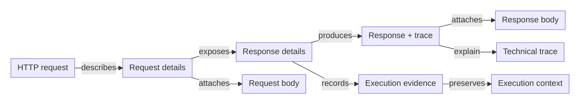

<details>
<summary><strong>Legend — provenance and evidence</strong></summary>

- the main column reads `HTTP request → request details → response details`;
- `ResponseEvidence` and `ExecutionContext` are local visual groups that avoid long arrows and do not introduce new disclosures;
- JSON and trace are local request/response details, while retry, provenance, replay, and assertions are local execution details;
- `Request details`, `Response details`, and `Execution evidence` are separate disclosures in the artifact; the schema connects them with a compact spine. In a UI trace with multiple exchanges, the same spine repeats for each exchange under one Gherkin node. The node has separate semantic children for `UI validation` and `API validation`; a second card with the same Gherkin statement duplicates intent and is not the canonical contract. Concatenating every row into one shared `API 1/API 2` table is not the canonical contract;
- `TECHNICAL TRACE` describes response context; it does not replace the response;
- provenance and replay explain transport without claiming that a mock made real traffic;
- assertions remain linked to the request and validation that produced them.

</details>

<details>
<summary><strong>Details — execution evidence, duration, and redaction</strong></summary>

Execution evidence is renderer-neutral. It records the response status, redacted URL, measured duration, number of attempts, and retry/attempt history. Retry reasons and URLs pass through the same redaction boundary as headers, JSON, and assertion values; a renderer does not reconstruct secrets.

The technical trace is compact and relevant. It preserves the request URL but does not repeat the response status or execution mechanics:

```text
URL
CONTENT TYPE
FAILURE CAUSE (if present)
other non-duplicative HTTP facts
```

Rendered labels are distinct from HTTP header names: `CONTENT TYPE` is the report field, while `Content-Type` is the transport header. `ApiReportEvidenceField` defines canonical labels and explicit legacy aliases, including `CONTENT-TYPE`, `response.status`, and `response.url`. The audit does not silently choose a favorable value if aliases conflict. The query is reconciled from the full request URL; the effective response URL remains separate evidence. Response fields are read only from their disclosure, without the execution technical trace.

`Execution evidence · N attempts` is the separate disclosure for transport mechanics. It preserves the effective URL, response duration, number of attempts, number of retry events, and attempt history. It is closed by default and must not be merged with `TECHNICAL TRACE`.

A `request-failed` before any HTTP response is different from an existing response with no body:

- the internal sentinel `status=-1` is displayed as `Unavailable`, not as an HTTP status;
- the attempt has outcome `FAILURE` and a bounded reason; no `RESPONSE JSON` is fabricated;
- the exchange and inspector are `Warning`, and aggregation keeps the scenario at `Warning` even if a consumer closes it with `PASS`. The business test separately decides whether that failure is `FAIL`.

Playwright retry follows the same fail-closed rule but is a UI policy separate from transport retry: `UiRetryPolicy` starts with one attempt and no eligible operations. Configuration may list only read-only operations (`navigate` and waits), set `maxAttempts`, `backoff`, and a bounded reason, and each retry is an `Info` row in the Playwright sequence. `click`, `fill`, `select-option`, and replaying the entire test are ineligible; the final failure remains the action verdict.

Duration is displayed explicitly as `RESPONSE DURATION` in execution evidence and as `N ms` for values up to `300 ms`, or `N s` for values above the threshold, in navigable headers. Bare `1`, `16`, or `25` values without units are not accepted because they could be mistaken for a step or assertion count. A timestamp is not the test's semantic identity and is not used for sorting or grouping.

Node duration follows the same rule throughout the tree:

```text
leaf      = measured duration
    parent    = exclusive self duration, if present
            + sum of direct structural children's totals
inclusive = value already calculated by Extent; do not add descendants again
```

A parent total does not sum all descendants or combine an inclusive duration with those same children. Any technical self-duration must be marked separately from the inclusive total.

For `ReportPhaseTiming` phases, the inclusive duration is the sum of the execution call backings, measured monotonically before publication. It takes precedence over the publication timestamps Extent. The scenario gathers the direct phases once only; the Assertion Pass Badge describes the publication and does not add up over the execution of the phase. Zero measured remains zero and the missing timings remain unknown. These cumulative totals do not represent any of any of the following: The contract and the evidence are at [Reporting Owner](../atf-reporting/README.md#timing-măsurat-înaintea-publicării).

- The UI facade propagates explicit timing; AutoEx and Shop delimit phases at
  runtime through `measureExecution()`, with capture and publication instrumented separately.
- Final cleanup, browser release, and HTML flush do not increase TEST BODY;
  explicitly measured teardown phases retain their own verdict and duration.
- Without explicit timing, legacy aggregation and its meaning are preserved;
  unmeasured capture and uncaptured HTTP duration remain unknown.


In the `Tests` navigator, the class total is the sum of the direct scenario totals visible in the class panel. The value on the left and in the class header must match; a raw Extent duration that already includes the scenarios is not copied over their sum. The auth value is the profile/mode, never the secret.

- The Overview timeline uses the same canonical class durations as Tests, once per class; it does not sum native durations that include suite time.
- Chart bars, the Timeline model, and accessible attributes update together. Measured zero duration is valid; native data is the fallback when canonical totals are not yet available.
- Repeating the projection does not reinitialize the chart or change status charts. Identically named classes retain distinct entries through root identity.

Request JSON and Response JSON are standalone code blocks. Lines wrap or scroll inside the block; a payload must not cause horizontal page scrolling. If the payload is small, the block remains compact; do not impose a large height just for uniformity. Request/Response JSON bodies are limited after redaction by `reporting.bodyMaxDisplayCharacters` (default `100`); truncation is marked with `… [truncated; showing first N of TOTAL chars]`, and internal scrolling remains enabled. A value of `0` disables the limit only for body preview.

Redaction is applied at the publication boundary for both renderers. Request and phase details, JSON, URL, retry history, failure cause, and assertion values pass through the same sensitive-data redaction policy; the key and non-confidential query parameters remain visible, while secret values are replaced with the redaction marker. Neither renderer can publish the input received from transport or the validator directly.

</details>

UI error context places the operation, target, measured time, and expectation before the technical diagnostic. The primary exception, causes, and suppressed exceptions remain separate INFO observations, redacted and limited by the same cap. A successful action is not attributed to a later error; uncaptured data remains explicitly unknown.

- Fails publishes the contextual summary; the native timeout message and redaction
  markers are checked in Tests → Audit observations.
- The backlink preserves the scenario and access to diagnostics in Extent/fallback,
  including when a custom cap truncates the message before the marker.

Relations, verdict and identity of the original error shall be maintained, without replica or confirmation of the dispatch / navigation deducted from a message. The contract and projection belong to [Osnere Reporting](../atf-reporting/README.md#contextul-erorii-înaintea-diagnosticului-tehnic).

<a id="assertion-value-budget"></a>
<a id="bugetul-valorilor-de-aserțiune"></a>
### Assertion value budget

- `assertionMaxDisplayCharacters` limits the full displayed value, including `…`;
  default is 240 in both Tests and Fails, in Extent and fallback.
- Redact the full value before truncation; the raw value is not reintroduced through
  a tooltip or attribute. The verdict remains the one evaluated against full data.
- JSON bodies retain their own budget and marker; the absolute path
  reported after artifact publication is not an assertion value.

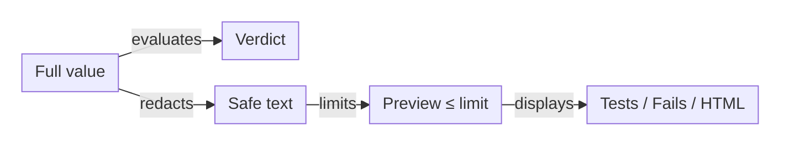

<details>
<summary><strong>Legend — published value and verdict</strong></summary>

The verdict uses the full value. Renderers and the Fails projection receive only safe, limited text; expansion and the backlink do not reconstruct the raw value. The typed diagnostic prioritizes the failed action and measured time.

</details>

<a id="aggregate-assertion-table"></a>
<a id="tabelul-agregat-de-aserțiuni"></a>
## Aggregate assertion table

All checks for the same response appear in a single structure:

```text
ASSERTION | EXPECTED | ACTUAL | RESULT
```

RESULT may be PASS, FAIL, or WARNING, and the table status is derived from its rows. On failure, all rows evaluated so far are retained, not just the first mismatch. A duplicate node for the same assertions is not published in TEST BODY.

The single precedence order is:

```text
FAIL > SKIP > WARNING > PASS
```

This rule applies to rows, tables, validation, phases, and scenarios. If the runner has a stricter rule, the report reflects it and does not override it.

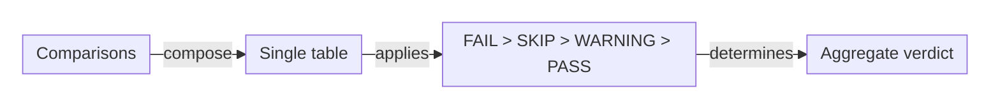

<details>
<summary><strong>Legend — aggregation and precedence</strong></summary>

- all evaluated rows remain in the same table;
- precedence propagates upward without creating a parallel verdict;
- `TEST BODY` does not repeat the assertion table already published in validation.

</details>

<a id="adaptive-assertion-layout"></a>
<a id="aranjare-adaptivă-pentru-aserțiuni"></a>
### Adaptive assertion layout

<details>
<summary><strong>Details — adaptive layout and long payloads</strong></summary>

The table keeps its four columns in `ASSERTION`, `EXPECTED`, `ACTUAL`, `RESULT` order, but widths are not fixed in pixels. The runtime measures visible text across all rows, proportionally assigns more space to the flexible column with the longest values, and keeps `RESULT` compact. It recalculates when the viewport is resized. This keeps bodies, lists, and long messages readable without document overflow, and browser verification confirms both the total width and that the dominant column receives the most width.

</details>

<a id="layout-for-field--value-evidence"></a>
<a id="aranjare-pentru-dovezile-field--value"></a>
### Layout for `FIELD | VALUE` evidence

For the column layout of key/value tables in the trace and request/response details:

- `FIELD` and `VALUE` use the same text/font measurements as other columns;
- the table uses the full available width; space first goes to long text, then any remainder is distributed in proportion to content;
- no 20–38% share or 62% minimum is reserved for a column based on its name;
- headers and cells remain in columns; when readable minimums do not fit, horizontal scrolling stays local to the table;
- font, shared scroll limit, and verdict remain independent of geometry.

The `data-atf-key-value-layout` and `data-atf-key-column-width` markers expose column allocation decisions for audit. `ValidationTableLayoutComponentTest` checks the shared asset, while `EvidenceColumnSizingComponentTest` measures geometry, redistribution, mutations, and the absence of vertical columns in the browser.

The visible form and local scrolling boundary are defined in the [display contract](ATF_Reporting_Display_Contract.md#restoring-tabular-evidence-presentation). The same policy serves Actions, Audit, Assert, and API evidence in Extent/fallback.

<a id="fails-and-links"></a>
<a id="fails-și-legături"></a>
## Fails and links

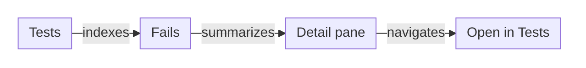

<details>
<summary><strong>Legend — Fails is an index; Tests is the source</strong></summary>

- **Fails**: one entry for each failure, not a grouping that loses scenarios.
- **Minimum content**: status, test/scenario, phase/request, assertion/cause, and duration.
- **Link**: stable internal anchor, independent of the Windows path or artifact name.
- **Detail pane**: index-only projection; it does not clone `test-contents` or create another evidence tree.
- **Open in Tests**: navigates to the original node without changing verdict or evidence ownership.
- **UI/API owner**: typed validation metadata, not the title or table shape. An API failure retains its owning `REQUEST` and Gherkin checkpoint; a UI failure retains `STEP`. A sibling PASS exchange does not replace the failed request. Invalid API correlation with PASS exchanges appears as `API correlation`, without an artificially assigned response duration.
- **Complete evidence**: request/response JSON, trace, response details, and assertions remain in `Tests`.

<a id="failure-semantics-in-the-api-lifecycle"></a>
<a id="semantica-eșecului-în-ciclul-de-viață-api"></a>
### Failure semantics in the API lifecycle

An API report may intentionally be `Fail` when a negative fixture checks that a rejected contract is visible. This verdict is not confused with a failure in the UI test that inspects the report: the source report remains red, while the UI audit is green if rendering is correct.

The semantic summary of a contract failure is:

```text
FAILURE CAUSE | Contract assertion failed: HTTP status
ASSERTION     | HTTP status
EXPECTED      | 201
ACTUAL        | 200
```

For multiple assertions, preserve `name = value` pairs; for a teardown failure, publish a readable cause instead of exposing only `FailureSignal` or the Java class name. The aggregate request table remains the detailed evidence; the phase contains only the compact projection needed for navigation and the Fails tab.

Duration in the Fails index is derived from `RESPONSE DURATION`, not a timestamp. If the failure has no measured response, the index explicitly displays `No response duration recorded`; execution time remains available in the request evidence and Tests tab.

Navigation works by clicking the tab or using a direct hash:

- `#atf-fails-view`;
- `#test-view`;
- `#category-view`;
- `#dashboard-view`.

The runtime synchronizes the initial hash and `hashchange` events; otherwise an offline artifact may show an empty view even when data is present in the document.

</details>

<a id="overview-and-aggregation"></a>
<a id="prezentare-generală-și-agregări"></a>
## Overview and aggregation

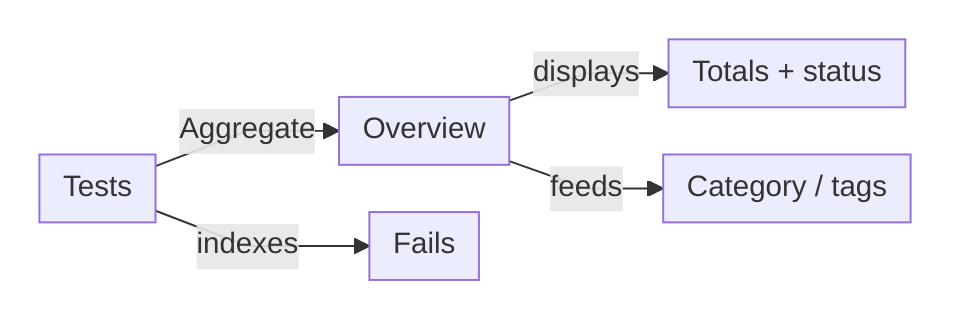

<details>
<summary><strong>Legend — aggregation without duplication</strong></summary>

- **Overview**: aggregate precisely the scenarios published in `Tests`.
- **Counts + status**: a single semantic total; unit checks do not become API tests.
- **Category + tags**: navigation and filtering; they do not change verdicts or clone nodes.
- **Fails**: a controlled index into concrete evidence in `Tests`.
- **Scanning**: the list shows names, status, and duration; avoid pills and decorative metadata.

Rendering rules for the scenario card:

- the title and annotations stay on the same left axis;
- the title + annotation group is centered only vertically in the header;
- expansion and duration/status toolbars remain in separate columns;
- the rule holds for long names, multiple tags, and durations in `ms`.

</details>

A `WARNING` scenario remains diagnostic but is included in the pass-like totals in Overview:

- `Tests Passed`, the `Tests`/`Steps` summary, and percentages: `PASS + WARNING`;
- charts, categories, badges, and the `warnings` line keep `WARNING`
  distinct; they do not convert it to `PASS`;
- `Fails` indexes only actual failures, not warnings.

<a id="rendering-parity"></a>
<a id="paritate-de-randare"></a>
## Rendering parity

Extent and fallback publish the same semantics, order, tokens, and interactions; the publisher is the only integration difference. Exact values for layout, responsiveness, badges, and viewport are owned by the [Display Contract](ATF_Reporting_Display_Contract.md), and this page does not redefine CSS or per-tab geometry.

<a id="header-metadata-duration-direct-link-and-controls"></a>
<a id="metadatele-antetului-durată-link-direct-și-controale"></a>
### Header metadata: duration, direct link, and controls

<details>
<summary><strong>Details — metadata and controls</strong></summary>

`detail-head .info` contains three different types of elements; do not handle them with a generic `badge-default` selector:

```text
duration               → neutral badge, numerically normalized (`9 ms`, `1.2 s`)
uri-anchor             → machine-readable deep link, kept in the DOM, visually hidden
Expand/Collapse        → pointer controls, preserve vendor icons (`fa-expand` / `fa-compress`)
```

The duration runtime uses the typed `DURATION_MARKERS` selector and explicitly excludes `.uri-anchor` and `.pointer`. This prevents it from accidentally turning an anchor or icon into `—`, and metadata does not compete visually with the duration. The deep link remains available for programmatic navigation, while the user-visible action is `Open in Tests` in Fails. The vendor `·` separator between measured duration and the hidden anchor is removed from the DOM only when it is an isolated text node, so the header does not retain a meaningless symbol.

The final artifact must be a single self-contained HTML file:

- CSS and JavaScript included;
- fonts and icons available offline;
- no extent/... references or shipped auxiliary folder;
- evidence nodes closed by default;
- phase shells collapsed by default;
- scenario cards in Tests collapsed by default, but expandable on click;
- Overview open by default;
- no decorative vertical lines breaking up the test body;
- consistent contrast and fonts between Overview tables and test details.

</details>

<a id="expandable-section-stability--browser-verification"></a>
<a id="stabilitatea-secțiunilor-expandabile--verificare-în-browser"></a>
### Expandable section stability — browser verification

Disclosures form a state tree, not independent controls:

- opening a child does not close its parent or containing phase;
- closing a scenario closes and hides all descendant phases, checkpoints, and
  disclosures;
- reopening a scenario opens only the scenario container; children remain
  closed until an explicit action;
- visual state, panel, `aria-expanded`, and glyph update together;
  delayed normalization does not reverse an established transition.

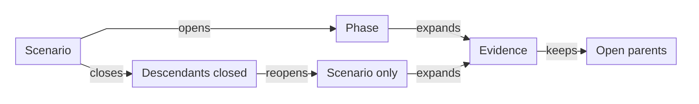

<details>
<summary><strong>Legend — stable disclosure transitions</strong></summary>

- the check starts in a new report with the scenario collapsed;
- opening a child does not close its parents;
- closing the scenario resets its descendants;
- reopening the scenario does not automatically expand its children.

</details>

Component/interaction tests verify transitions and attribute synchronization; the browser check uses a fresh artifact through ATF Debug/TAB MCP and verifies sequential expansion, parent stability, reset when the scenario closes, and reopening without automatically expanding children. An old artifact or a text-only assertion does not prove this contract.

<a id="required-evidence-for-changes"></a>
<a id="dovezi-obligatorii-pentru-schimbări"></a>
## Required evidence for changes

| Change | Minimum evidence |
|---|---|
| assertion aggregation | unit test for aggregation + artifact with a table |
| request/validation tree | component test + expansion in TAB MCP |
| tabs and deep link | contract test + click on each surface |
| fonts, colors, lines | token tests + computed-style check in TAB MCP |
| durations and totals | test for the `300 ms`/`301 ms` threshold + exclusive/direct-child aggregation |
| status badges | token test for geometry and palette across all tabs |
| JSON, scrolling, and overflow | real artifact + small and large payloads |
| Fails | fail/warning/skip cases + link verification |

A test that checks only HTML text does not replace interactive DOM verification when the issue concerns rendering, clicking, collapsing, or navigation.

<a id="visual-and-functional-reference-guard"></a>
<a id="guard-de-referință-vizuală-și-funcțională"></a>
## Visual and functional reference guard

Verify the contract against the current run's code and artifact. An older HTML file may help with local investigation, but it is not a permanent baseline and is not referenced in READMEs.

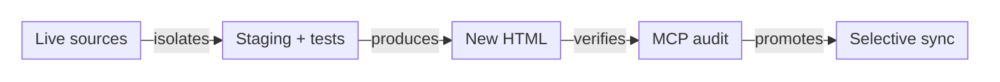

<details>
<summary><strong>Legend — what the guard validates</strong></summary>

- `Staging + tests` combines the isolated copy and unit/component/integration checks;
- `MCP audit` combines read-only serving through ATF Debug and verification in Chromium/Playwright;
- input is the report generated by the current run or an explicitly configured static file;
- verify tabs, deep links, disclosures, clicks, computed style,
  wrapping, screenshot, console, and page errors;
- comparison is semantic: vocabulary + model → markup/CSS/JavaScript → DOM + accessibility → interaction;
- any deviation first becomes a component/contract or E2E test, not a relaxed test;
- sync to live happens only after reconciling sources and artifact.

</details>

<a id="report-naming-and-run-separation"></a>
<a id="numele-raportului-și-diferențierea-rulărilor"></a>
## Report naming and run separation

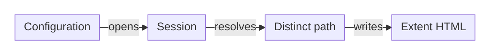

<details>
<summary><strong>Legend — deterministic names and separate runs</strong></summary>

- **Config**: the name and capture policy belong to configuration, not the test.
- **Session**: the timestamp is resolved once, when the session opens.
- **Path**: each published run receives a distinct destination.
- **Artifact**: an open report is not overwritten.

</details>

<details>
<summary><strong>Details — configuration and publication rules</strong></summary>

The minimal configuration is:

```yaml
reporting:
  bodyMaxDisplayCharacters: 100
  extent:
    outputDirectory: artifacts/reports
    fileName: ${REPORT_FILE_NAME}
    timestampEnabled: true
    timestampPattern: yyyy-MM-dd_HH-mm-ss-SSS
    timestampZone: system
    screenshotPolicy: each-checkpoint
```

Runtime rules:

- `timestampEnabled: true` inserts the timestamp before the extension;
- `timestampPattern` uses Java `DateTimeFormatter` syntax;
- `timestampZone` accepts `system` or an IANA identifier;
- patterns containing filename-unsafe characters are rejected;
- deterministic tests may use a fixed `Clock` through `resolveReportPath(Clock)`;
- `timestampEnabled: false` is reserved for internal tests with a stable destination;
- published ATF runs use timestamped names, even without explicit YAML.

Screenshot policy is typed, not a duplicate boolean in UI tests:

- `each-checkpoint`;
- `final-only`;
- `failure-only`;
- `final-and-failure`;
- `none`.

A `final-only` flow explicitly marks the checkpoint through `ReportScreenshotPolicy.CapturePoint.FINAL`; Reporting does not guess which state is final. When policy allows a screenshot, the target is required, and actions and assertions remain published even if the image is disabled.

For evidence, the composition root can map `flowMode`, `screenshotPolicy`, `captureSource`, and `actionDetailsMode` to `ReportEvidenceProfile`, through `fromConfig(...)` or a builder. `actionDetailsMode` changes only the disclosure for actions already captured. The profile does not run Playwright or move the mock into Reporting.

This contract describes publication policy and its effect in the artifact. The generic separation between flow mode, capture source, action-details mode, and the composition root is in [`ATF_Evidence_Capture_Contract.md`](ATF_Evidence_Capture_Contract.md); it is It is not specific to Practice Shop and is not inferred from `reporting.extent`.

Changing the timestamp does not change the Extent tree, statuses, aggregation, or HTML rendering.

</details>


<a id="messaging---decision-subject-to-the-actual-contract"></a>
<a id="mesagerie--decizie-condiționată-de-contractul-real"></a>
## Messaging - decision subject to the actual contract

Reporting maintains a neutral pattern and does not depend on Kafka / RabbitMQ. Typed observations and existing assertions remain the current composition points.

| Situation | Purpose decision |
|---|---|
| MOCK components in existence J2 | publish independent verdicts through current ports; do not ask for a new MQ table |
| message / delivery contract demonstrated LIVE | assess only then the evidence for identity, position and attempts, distinct from HTTP |
| acceptance of a new projection | neutral fixture in Reporting Tests, Extent / fallback, timing, FAIL, incomplete evidence and navigation; expectations and Eventuate code remain at the consumer |

This decision keeps the REPORT-MQ-02 proposal in the project, without counting it as current defect or functionality delivered. Owner [messaging J2](../../atf_j2/docs/ATF_J2_Scope.md) provides the actual witness before an extension of the library.

<a id="explicit-inspection-and-time-sources"></a>
<a id="inspecție-explicită-și-surse-temporale"></a>
## Explicit inspection and time sources

[The inspector's contract](../atf-reporting/README.md#inspecția-artifactului-cu-intenție-explicită) requires the intent of the caller for Extent / fallback and the inventory of evidence.

- The legacy default remains Extent / HTTP.
- The lack of mandatory evidence does not automatically select a permissive profile.
- Empty, incomplete or contradictory results are non-compliant; the business verdict is assessed prior to the default 240 preview.

[Origin of durations](../atf-reporting/README.md#originea-duratelor-sub-o-fază-capturată) distinguishes Execution, Transport and Publication. The children published subsequently do not change the captured execution of the phase; the unknown time is not completed with zero. The assertions indicator and mouse / Enter / Space controls belong to the common disclosure, keeping the table collapsed by default.

[Auditable inline profile](ATF_Inline_Audit_Contract.md) defines the composition without external artifacts and maintaining the identity of the invoicing.
