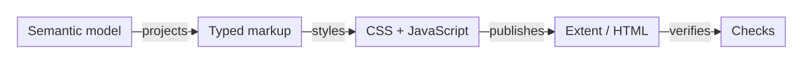

# ATF Reporting — display and layout contract

## At a glance

This document is the normative source for the visible form and interactions of the Extent report and HTML fallback. It complements the [ATF Reporting Contract](ATF_Reporting_Contract.md), which owns evidence semantics, verdict ownership, and the API schema.

`atf-reporting` holds the markup, tokens, CSS-ul and JavaScriptul published; `atf-reporting-tests` holds the unit / component / integration / browser samples; the consumers check only the integration of their adapters. The document does not describe a concrete artifact, a URL or a historical capture.

<strong>Legend — boundary and ownership</strong>

- **Semantic model**: decides role, order, status, and evidence; it does not decide
  CSS or browser interaction.
- **Typed markup**: projects the HTML structure and accessibility attributes;
  it does not infer roles from titles or business strings.
- **Native CSS + JavaScript**: own layout and interactions; sources remain
  readable `.css`/`.js` files, while Java is only the composition/facade seam.
- **Artifact**: is self-contained and inspectable offline.
- **Proof**: checks the semantic contract first, then the DOM, computed style,
  and interaction; a global `contains` check does not replace this path.

## Required visible hierarchy

| Area | Stable rule |
|---|---|
| test case | `SETUP` is optional and remains setup; `TEST BODY` contains the action and validation; `TEARDOWN` is cleanup/read-back when present |
| Gherkin checkpoint | `UI validation` and `API validation` are sibling children of the same checkpoint; Network Inspector is a separate aggregate and does not duplicate exchanges |
| API exchange | `Request details`, `Response details`, and `Execution evidence` are sibling disclosures; `Contract validation` is a child of the exchange that owns the contract |
| UI validation | Playwright actions, audit observations, and assertions belong to UI validation; this is the only public title for UI validation; setup evidence remains `Setup evidence` |
| phase observation | a non-HTTP trace may appear as a step INFO separately in `TEST BODY`; remains collapsed and does not change phase status or assignment coverage |
| setup context | internal keys `request.action`, `request.target`, `evidence.type`, and `evidence.policy` may remain in the model, but do not become a visible HTTP table without real HTTP evidence |

Titles are short, explanatory phrases. Semantic structure does not depend on the text `Contract validation`, the HTTP method, or the number of fields. `UI validation` is the only public title for UI evidence; `ui-validation` may remain a typed internal discriminator, but is not displayed as a second name.

## Interaction invariants

- the `＋/−` glyph is inline, on the same first line and immediately before
  the phrase; artificial wrapping does not push it onto a separate line;
- disclosures are collapsed by default, except for surfaces explicitly
  declared open by default, such as Overview;
- a scenario/phase with no published child content is a terminal node, not a disclosure:
 it does not show the `＋/−` glyph, receive a button role/focus, or announce `aria-expanded`; JUnit assertions without steps/evidence do not generate fictitious content;
- a component test that publishes `AtfAssertion` rows has a typed child
 `AssertionStep` under `TEST BODY`; the node and table are collapsed by default in Extent and fallback, while `Expand all nodes` can open the step. Status and FAIL rows raise the phase and scenario status and follow the same `Fails` projection and redaction as the rest of the report; no synthetic HTTP request is introduced;
- Typed facts published by `Phase.observation(ReportObservation)` are
  INFO steps sisters of `Component assertions`; bulk expansion opens the nodes of the test, but keeps the observation dislocator closed until its own activation. The editorial applies before the preview, and observation does not enter the verdict, assertion coverage or number of tests;
- closing a parent hides the entire subtree and synchronizes the status
  of the parent: visibility, `open`, `aria-expanded` and glyph. Children retain their local state; reopening the parent reveals previously open children while closed children stay closed. An ancestor hiding them does not reset local selection;
- opening a child does not close its parent or siblings; mouse, Enter, and Space
  produce the same semantic transition;
- a deferred opening from a deep link is invalidated by newer navigation
 or explicit interaction in Tests; an old callback does not reopen a disclosure the user just closed;
- decorative horizontal rules are not used between actions, observations, and
 assertions inside a test body; disclosures, spacing, and semantic hierarchy provide the separation;
- a screenshot is an inline link with the current emoji; its fingerprint or
  deduplication digest remains internal and does not replace the human-readable link;
- a deduplicated capture opens the same image on click or Enter, including
  when its source is in a collapsed scenario; it does not merely jump to a hidden anchor;
- navigation controls and deep links preserve the same identity across
  `Tests`, `Overview`, `Categories`, and `Fails`.

In `Categories`, applying a filter with no results clears the previous category selection and detail; the panel must not display content that does not belong to the current result. `Clear` restores the list and selects a category with its details again. Filters change only the navigation projection, not test status or evidence.

## API, UI, and UI+API contract

| Channel | What must be visible | What must not be invented |
|---|---|---|
| API | method/path, request/response details, captured body or availability explanation, execution attempts, and contract validation when present | synthetic request for a UI step, invented payload, verdict from HTTP status without a contract, `0 ms` duration for an uncaptured duration |
| UI | relevant actions including `getText`/text extraction, audit observations, assertions, and relevant captures | HTTP request/response for internal setup, duplicate Gherkin statement, or business verdict inferred from a screenshot |
| UI+API | the two validation children, explicit correlation, and a Network Inspector that references published exchanges | republishing the same exchange as a new call or moving all assertions into `UI validation` |

For `POST` and `PUT`, the published request and response must retain a parseable, non-empty JSON body when required by the endpoint contract.

| Body availability | Display |
|---|---|
| `AVAILABLE` | captured payload after redaction; only the literal JSON text `null` becomes a JSON `null` document |
| `ABSENT` | explanation in details that no body existed, without a JSON pane |
| `NOT_CAPTURED` | explanation that evidence is missing, without an assumed payload |

Request details and replay use the same sanitized projection of headers; browser observations do not receive defaults from the client or response. Cardinality labels are produced by the shared vocabulary, not by local publishers.

## Layout and responsive requirements

| Surface | Requirement |
|---|---|
| document | no horizontal overflow; wrapping keeps identifiers and URLs readable, without cropping or arbitrary breaks |
| data table | shared, focusable wrapper, `height: auto`, `max-height: var(--atf-table-scroll-height)`; short content remains natural and long content scrolls locally |
| Request details | the request metadata table uses the same viewport, including when nested in the request disclosure; JSON and the outer disclosure do not become scroll containers for the table |
| long table | sticky header, final row reachable by mouse and keyboard; title and counters do not change when scrolling appears; no nested viewports for the same table |
| JSON/code payload | a payload pane, not a table; it does not go inside the table viewport wrapper |
| Response details / `TECHNICAL TRACE` | the trace table scrolls in its local viewport, separate from the outer disclosure and JSON panes |
| narrow viewport | at `≤991px`, Overview starts after the fixed `70px` navigation rail; padding and columns adapt through tokens/media queries, without hidden overflow masking the geometry |
| summary | `34px` base; text flows naturally; `Unique request signatures` and `Technical diagnostics` use a dedicated `68px` token and are collapsed by default |
| separation | do not add `
` or decorative lines between areas of a test; the card's structural border remains only at the required semantic boundary |

`--atf-table-scroll-height` is the shared theme token, derived from `AtfReportThemeTokens.TABLE_SCROLL_HEIGHT` (current profile: `500px`). It applies to data tables in Overview, API/UI evidence, audit, action sequence, assertions, setup, and execution, including Category, tag audit, and `TECHNICAL TRACE` in Response details.

Do not duplicate the threshold in renderers or as a local test value.

### Restoring tabular evidence presentation

The approved requirement for Actions, Audit observations, and Assert is to restore tables with visible headers and aligned columns, including in nested desktop panels. Widths adapt dynamically to the content and available space; full values and verdicts are not reconstructed from the 240-character preview.

The common policy keeps the columns and measures the header, values and font; the short columns do not consume fixed percentage rates. The allocator details and geometry samples are at [owner](../atf-reporting/README.md#lizibilitatea-dovezilor-în-panouri-înguste).

- The table uses the full available width, including when values are short; extra space is distributed proportionally to content columns, while status and time remain compact, without an artificial right margin.
- The same rule applies to setup and Overview/Category/System tables; actual text maxima compete for space, without a pixel cap or reserved gutter when no scrollbar is needed.
- Keep wrapping readable and height natural; the vertical limit and sticky header remain shared by Extent and fallback.
- When columns do not fit readably, horizontal scrolling stays local to the table; it does not extend to the document, screenshot, or outer disclosure.
- Acceptance checks: visible headers/columns, accessible values and final row, expansion and resizing in both renderers, component tests, and consumer E2E.

### Visual tokens

`AtfReportThemeTokens` and `AtfReportColors` are the source of values; the table documents the visible contract and does not introduce parallel constants.

| Element | Stable value |
|---|---|
| badge `Pass` / `Warning` / `Fail` | height `18.2px`, padding `0 5px`, radius `4px`, font `9.52px`, line-height `18.2px`, weight `400`, no border |
| neutral duration/metadata badge | height `22.4px`, padding `5px 7px`, radius `4px`, font `9.52px`, line-height `10.6624px` |
| status colors | `Pass #9ccc65`, `Warning #ffc107`, `Fail #e57373`; Pass/Fail text `#fff`, Warning text `#f6f7f6` |
| scrollable table | shared `500px` limit, passed through `--atf-table-scroll-height` |
| aggregate summary | `34px` base; signatures and technical diagnostics `68px` |

Tabs do not override these values to imitate Extent, and the fallback does not introduce a second geometry. Verify any deviation at the token and computed-style level, not by copying a local rule.

## Assets and Java/CSS/JavaScript ownership

- native `.css` and `.js` files in `atf-reporting/src/main/resources` are formatted across multiple lines and organized around small responsibilities: vocabulary, layout, disclosure, navigation, evidence, duration, and failure;
- Java classes compose assets and expose typed seams; they do not reconstruct large JavaScript function bodies or CSS blocks through fragile concatenation;
- the copy injected into HTML may be compacted by `ReportAssetCompactor`, but formatted source remains available for review and component testing;
- published JavaScript does not use inline `onclick`; the hash and semantic attributes form the static contract, and the native controller enables interaction;
- Extent and fallback consume the same semantics, tokens, and viewport policies; the publication adapter is the only legitimate difference.

## Minimum verification matrix

| Level | Check | Owner |
|---|---|---|
| unit | vocabulary, models, tokens, policy, and published JS/CSS functions | `atf-reporting` |
| component | actual markup, order, ownership, disclosure, JSON, view port and asset manifest | `atf-reporting-tests` |
| integration | Extent / fallback, publication, input mock and projection parity | `atf-reporting-tests` |
| E2E/browser | click, Enter / Space, Extend / Collapse, Computer style, scroll, Deeplink and Page Errors on the fresh artifact | `atf-reporting-tests`, by ATF Debug + Playwright / Chromium headless |
| consumer | business intent and application adapter, without a parallel renderer | consumer module |

Visual verification does not use a real Windows browser or stop active runs. Build in external staging, generate a fresh artifact, then inspect it through ATF Debug/TAB MCP or Playwright MCP. Do not copy run artifacts or screenshots into READMEs.

## Promoting and reopening the contract

Move a rule from feedback into this document only after live code and the right check demonstrate it. Feedback retains active gaps and their closure criteria; technical `VERIFIED` checks required for the baseline belong in [`ATF_Test_Changes_Baseline.md`](ATF_Test_Changes_Baseline.md), not in functional feedback or the backlog.

If a historical artifact contradicts this contract, mark it stale; it does not reopen a ToDo on its own. Reopening requires a reproducible deviation in live code and tests, or an explicit requirements change.

## References

- [Semantic Reporting Contract](ATF_Reporting_Contract.md)
- [Evidence Capture Contract](ATF_Evidence_Capture_Contract.md)
- [README `atf-reporting`](../atf-reporting/README.md)
- [README `atf-reporting-tests`](../atf-reporting-tests/README.md)
- [Active feedback register](feedback/README.md)

## ACTION / OBSERVE cells complete

| Projection | Contract preserved |
|---|---|
| preview | 240, summary compact and redacted |
| Expected / observed long | full text redacted and with HTML escaping, in the disclosure of the original cell |
| interaction | initial closed; Enter / Space, view port focus End / Home, independent neighbours and no overlap |
| configuration | body display limit separately; SUMMARY_ONLY continues to omit ACTION details |
| verdict | the captured result remains in full, without comparison on preview |

[Projection Owner](../atf-reporting/README.md#actionobserve--preview-și-valori-complete) and [Reporting owner contract](../atf-reporting/README.md) delimit the values of assertions separately.
