# ATF Reporting — contract de display și layout

## Pe scurt

Acest document este sursa normativă pentru forma vizibilă și interacțiunile
raportului Extent și ale fallback-ului HTML. El completează
[Contractul de raportare ATF](ATF_Reporting_Contract.md), care deține semantica
evidence-ului, ownership-ul verdictelor și schema API.

`atf-reporting` deține markup-ul, token-urile, CSS-ul și JavaScript-ul publicat;
`atf-reporting-tests` deține probele unit/component/integration/browser;
consumerii verifică doar integrarea propriilor adaptoare. Documentul nu descrie
un artifact concret, un URL sau o captură istorică.

```mermaid
%%{init: {"themeVariables":{"fontSize":"15px"},"themeCSS":".nodeLabel, .nodeLabel p { font-size: 15px !important; line-height: 1.35 !important; } .edgeLabel, .edgeLabel p { font-size: 12px !important; font-weight: 400 !important; line-height: 1.2 !important; } .edgeLabel .labelBkg, .edgeLabel p { background: transparent !important; } .edgeLabel foreignObject { transform: translateY(-18px); overflow: visible; } .node rect { rx: 6px; ry: 6px; }","flowchart":{"curve":"linear","nodeSpacing":24,"rankSpacing":24,"padding":6,"diagramPadding":20}}}%%
flowchart LR
    Model[Model semantic] -->|proiectează| Markup[Markup typed]
    Markup -->|stilizează| Assets["CSS + JavaScript"]
    Assets -->|publică| Artifact["Extent / HTML"]
    Artifact -->|verifică| Proof["Verificări"]
```

<strong>Legendă — boundary și ownership</strong>

- **Model semantic**: decide rolul, ordinea, statusul și evidence-ul; nu decide
  CSS sau interacțiunea browserului.
- **Markup typed**: proiectează structura HTML și atributele de accesibilitate;
  nu deduce roluri din titluri sau din string-uri de business.
- **CSS + JavaScript native**: dețin layout-ul și interacțiunile; sursele rămân
  fișiere `.css`/`.js` lizibile, iar Java este doar composition/facade seam.
- **Artifact**: este autonom și inspectabil fără rețea.
- **Proof**: verifică mai întâi contractul semantic, apoi DOM-ul, stilul efectiv
  și interacțiunea; un `contains` global nu înlocuiește acest traseu.

## Ierarhia vizibilă obligatorie

| Zonă | Regulă stabilă |
|---|---|
| test case | `SETUP` este opțional și rămâne setup; `TEST BODY` conține acțiunea și validarea; `TEARDOWN` este cleanup/read-back când există |
| checkpoint Gherkin | `UI validation` și `API validation` sunt copii surori ale aceluiași checkpoint; Network Inspector este agregat separat și nu dublează exchange-urile |
| exchange API | `Request details`, `Response details` și `Execution evidence` sunt disclosures surori; `Contract validation` este copilul exchange-ului care deține contractul |
| UI validation | acțiunile Playwright, observațiile de audit și aserțiunile aparțin validării UI; acesta este singurul titlu public pentru validarea UI; setup evidence rămâne `Setup evidence` |
| setup context | cheile interne `request.action`, `request.target`, `evidence.type` și `evidence.policy` pot rămâne în model, dar nu devin tabel HTTP vizibil fără evidence HTTP real |

Titlurile sunt propoziții scurte și explicative. Structura semantică nu depinde
de textul `Contract validation`, de metoda HTTP sau de numărul de câmpuri.
`UI validation` este singurul titlu public pentru evidence UI; `ui-validation`
poate rămâne un discriminator intern tipizat, dar nu se afișează ca al doilea nume.

## Invariante de interacțiune

- glyph-ul `＋/−` este inline, pe aceeași primă linie și imediat înaintea
  propoziției; nu este împins pe o linie separată de wrapping artificial;
- disclosure-urile sunt collapsed implicit, cu excepția suprafețelor declarate
  explicit ca deschise implicit, precum Overview;
- un scenariu/fază fără conținut copil publicat este nod terminal, nu disclosure:
  nu afișează glyph `＋/−`, nu primește rol/focus de buton și nu anunță
  `aria-expanded`; aserțiunile JUnit fără pași/evidence nu generează conținut
  fictiv;
- un test de componentă care publică rânduri `AtfAssertion` are un copil tipizat
  `AssertionStep` sub `TEST BODY`; nodul și tabelul sunt colapsate implicit în
  Extent și fallback, iar `Expand all nodes` poate deschide pasul. Statusul și
  rândurile FAIL ridică statusul fazei și scenariului și urmează aceeași
  proiecție `Fails` și aceeași redacție ca restul raportului; nu se introduce
  un request HTTP sintetic;
- închiderea unui părinte ascunde întregul subarbore și sincronizează simultan
  vizibilitatea, `open`, `aria-expanded` și glyph-ul; redeschiderea părintelui nu
  deschide automat copiii;
- deschiderea unui copil nu închide părintele sau frații; mouse, Enter și Space
  produc aceeași tranziție semantică;
- o deschidere amânată dintr-un deep-link este invalidată de o navigare mai nouă
  sau de interacțiunea explicită în Tests; callback-ul vechi nu redeschide
  disclosure-ul pe care utilizatorul tocmai l-a închis;
- nu se folosesc linii orizontale decorative între acțiuni, observații și
  aserțiuni din interiorul unui test body; separarea este dată de disclosures,
  spațiere și ierarhia semantică;
- screenshot-ul este un link inline cu emoji-ul curent; fingerprint-ul sau
  digest-ul deduplicării rămâne intern și nu înlocuiește linkul uman;
- o captură deduplicată deschide aceeași imagine prin click sau Enter, inclusiv
  când sursa este într-un scenariu colapsat; nu face doar salt la o ancoră ascunsă;
- controalele de navigare și deep-link-urile păstrează aceeași identitate în
  `Tests`, `Overview`, `Categories` și `Fails`.

În `Categories`, aplicarea unui filtru fără rezultate elimină selecția și
detaliul categoriei precedente; nu este permis ca panoul să afișeze conținut
care nu aparține rezultatului curent. `Clear` restaurează lista și selectează
din nou o categorie cu detaliul ei. Filtrele modifică numai proiecția de
navigare, nu statusul sau evidence-ul testelor.

## Contractul API, UI și UI+API

| Canal | Ce trebuie să fie vizibil | Ce nu se inventează |
|---|---|---|
| API | method/path, request/response details, body capturat sau explicația disponibilității, execution attempts și validarea contractului când aceasta există | request sintetic pentru un pas UI, payload inventat, verdict din status HTTP fără contract, durată `0 ms` pentru o durată necapturată |
| UI | acțiunile relevante inclusiv `getText`/text extraction, audit observations, assertions și capturi relevante | request/response HTTP pentru setup intern, duplicate de propoziție Gherkin sau verdict business dedus din screenshot |
| UI+API | cei doi copii de validare, corelarea explicită și un Network Inspector care referă exchange-urile publicate | republicarea aceluiași exchange ca apel nou sau mutarea tuturor aserțiunilor în `UI validation` |

Pentru `POST` și `PUT`, request-ul și response-ul publicate trebuie să păstreze
body JSON parseable și non-empty atunci când contractul endpointului îl cere.

| Disponibilitatea body-ului | Afișare |
|---|---|
| `AVAILABLE` | payload-ul capturat, după redacție; numai textul JSON literal `null` devine document JSON `null` |
| `ABSENT` | explicație în details că nu a existat body, fără pane JSON |
| `NOT_CAPTURED` | explicație că dovada lipsește, fără payload presupus |

Request details și replay folosesc aceeași proiecție sanitizată a headerelor;
observația browser nu primește default-uri de la client sau din response.
Etichetele de cardinalitate sunt produse de vocabularul comun, nu de publisheri locali.

## Cerințe de layout și responsive

| Suprafață | Cerință |
|---|---|
| document | fără overflow orizontal; wrapping-ul păstrează identificatorii și URL-urile lizibile, fără crop sau break arbitrar |
| tabel de date | wrapper comun, focusabil, `height: auto`, `max-height: var(--atf-table-scroll-height)`; conținutul scurt rămâne natural, iar conținutul lung derulează local |
| Request details | tabelul metadatelor request-ului respectă același viewport, inclusiv când este imbricat în disclosure-ul request-ului; JSON-ul și disclosure-ul exterior nu devin containere de scroll ale tabelului |
| tabel lung | header sticky, ultimul rând accesibil prin mouse și tastatură; titlul și contoarele nu se schimbă când apare scroll-ul; nu se creează viewport-uri imbricate pentru aceeași tabelă |
| payload JSON/code | este pane de payload, nu tabel; nu intră în wrapper-ul de viewport al tabelului |
| Response details / `TECHNICAL TRACE` | tabelul trace derulează în viewport-ul său local, separat de disclosure-ul exterior și de pane-urile JSON |
| viewport îngust | la `≤991px`, Overview începe după rail-ul fix de navigare de `70px`; padding-ul și coloanele se adaptează prin token-uri/media queries, fără overflow ascuns care maschează geometria |
| summary | bază de `34px`; textul curge natural; `Unique request signatures` și `Technical diagnostics` au token dedicat de `68px` și sunt collapsed implicit |
| delimitare | nu se adaugă `
` sau linii decorative pentru a separa zonele unui test; border-ul structural al cardului rămâne doar la boundary-ul semantic necesar |

`--atf-table-scroll-height` este tokenul comun al temei, derivat din
`AtfReportThemeTokens.TABLE_SCROLL_HEIGHT` (profilul curent: `500px`). Se aplică
tabelelor de date din Overview, evidence API/UI, audit, action sequence,
assertions, setup și execution, inclusiv Category, tag audit și
`TECHNICAL TRACE` din Response details.

Nu duplicați pragul în renderer-e sau ca valoare locală de test.

### Restabilirea prezentării tabelare a dovezilor

Cerința aprobată pentru Actions, Audit observations și Assert este revenirea
la tabele cu antet vizibil și coloane aliniate, inclusiv în panouri desktop
imbricate. Lățimile se adaptează dinamic după conținut și spațiul real;
valorile complete și verdictul nu sunt reconstruite din preview-ul de 240.

Politica comună păstrează coloanele și măsoară antetul, valorile și fontul;
coloanele scurte nu consumă cote procentuale fixe. Detaliile allocatorului și
probele de geometrie sunt la [owner](../atf-reporting/README.md#lizibilitatea-dovezilor-în-panouri-înguste).

- Tabelul ocupă întreaga lățime disponibilă, inclusiv când valorile sunt scurte;
  spațiul suplimentar revine proporțional coloanelor de conținut, cu statusul și
  timpul compacte, fără margine artificială la dreapta.
- Aceeași regulă se aplică setup-ului și tabelelor Overview/Category/System;
  maximele reale ale textului concurează pentru spațiu, fără plafon în pixeli
  sau gutter rezervat când scrollbar-ul nu este necesar.
- Păstrați wrapping-ul lizibil și înălțimea naturală; plafonul vertical și
  antetul sticky rămân comune Extent/fallback.
- Când coloanele nu încap lizibil, derularea orizontală este locală tabelului;
  nu se extinde la document, screenshot sau disclosure-ul exterior.
- Probe de acceptanță: antet/coloane vizibile, valori și ultimul rând accesibile,
  expandare și redimensionare în ambele renderere, componente și E2E consumer.

### Tokens vizuale

`AtfReportThemeTokens` și `AtfReportColors` sunt sursa valorilor; tabelul
documentează contractul vizibil, nu introduce constante paralele.

| Element | Valoare stabilă |
|---|---|
| badge `Pass` / `Warning` / `Fail` | înălțime `18.2px`, padding `0 5px`, radius `4px`, font `9.52px`, line-height `18.2px`, weight `400`, fără border |
| badge neutru de durată/metadata | înălțime `22.4px`, padding `5px 7px`, radius `4px`, font `9.52px`, line-height `10.6624px` |
| culori status | `Pass #9ccc65`, `Warning #ffc107`, `Fail #e57373`; text Pass/Fail `#fff`, text Warning `#f6f7f6` |
| tabel scrollabil | plafon comun `500px`, transmis prin `--atf-table-scroll-height` |
| summary aggregate | bază `34px`; semnături și diagnostic tehnic `68px` |

Tab-urile nu suprascriu aceste valori pentru a imita Extent, iar fallback-ul nu
introduce o a doua geometrie. Orice abatere se verifică la nivel de token și
computed style, nu prin copierea unei reguli locale.

## Assets și responsabilitate Java/CSS/JavaScript

- fișierele native `.css` și `.js` din `atf-reporting/src/main/resources` sunt
  formatate multiline și organizate pe responsabilități mici: vocabulary,
  layout, disclosure, navigation, evidence, duration și failure;
- clasele Java compun asset-uri și expun seams typed; nu reconstruiesc corpuri
  mari de funcții JavaScript sau blocuri CSS prin concatenări fragile;
- copia injectată în HTML poate fi compactată de `ReportAssetCompactor`, dar
  sursa formatată rămâne accesibilă pentru review și testare component;
- JavaScript-ul publicat nu folosește `onclick` inline; hash-ul și atributele
  semantice sunt contractul static, iar controllerul nativ activează
  interacțiunea;
- Extent și fallback consumă aceeași semantică, aceleași token-uri și aceleași
  politici de viewport; adaptorul de publicare este singura diferență legitimă.

## Matricea minimă de verificare

| Nivel | Verifică | Owner |
|---|---|---|
| unit | vocabular, modele, token-uri, policy și funcții JS/CSS publicate | `atf-reporting` |
| component | markup real, ordine, ownership, disclosure, JSON, viewport și asset manifest | `atf-reporting-tests` |
| integration | Extent/fallback, publication, input mock și paritatea proiecțiilor | `atf-reporting-tests` |
| E2E/browser | click, Enter/Space, expand/collapse, computed style, scroll, deep-link și page errors pe artifact fresh | `atf-reporting-tests`, prin ATF Debug + Playwright/Chromium headless |
| consumer | intenția business și adaptorul aplicației, fără renderer paralel | modulul consumer |

Verificarea vizuală nu folosește browser Windows real și nu oprește rulările
active. Se construiește în staging extern, se generează un artifact fresh,
apoi se inspectează prin ATF Debug/TAB MCP sau Playwright MCP. Artifactele și
capturile de rulare nu se copiază în README-uri.

## Promovarea și redeschiderea contractului

O regulă trece din feedback în acest document numai după ce codul live și proba
potrivită o demonstrează. Feedback-ul păstrează gap-urile active și criteriul
lor de închidere; controalele tehnice `VERIFIED` necesare baseline-ului stau în
[`ATF_Test_Changes_Baseline.md`](ATF_Test_Changes_Baseline.md), nu în
feedback-ul funcțional sau în backlog.

Dacă un artifact istoric contrazice acest contract, este marcat stale și nu
redeschide singur un ToDo. Redeschiderea cere o abatere reproductibilă în codul
și testele live sau o schimbare explicită de cerință.

## Referințe

- [Contractul semantic de raportare](ATF_Reporting_Contract.md)
- [Contractul de captură a evidence-ului](ATF_Evidence_Capture_Contract.md)
- [README `atf-reporting`](../atf-reporting/README.md)
- [README `atf-reporting-tests`](../atf-reporting-tests/README.md)
- [Registrul feedback-ului activ](feedback/README.md)

## Celule ACTION/OBSERVE complete

| Proiecție | Contract conservat |
|---|---|
| preview | implicit 240, summary compact și redactat |
| expected/observed lungi | text integral redactat și cu escaping HTML, în disclosure-ul celulei originale |
| interacțiune | inițial închis; Enter/Space, viewport focusabil End/Home, vecini independenți și fără suprapunere |
| configurație | body display limit separat; SUMMARY_ONLY continuă să omită detaliile ACTION |
| verdict | rezultatul capturat rămâne integral, fără comparație pe preview |

[Ownerul proiecției](../atf-reporting/README.md#actionobserve--preview-și-valori-complete)
și [Reporting owner contract](../atf-reporting/README.md) delimitează valorile assertions separat.
