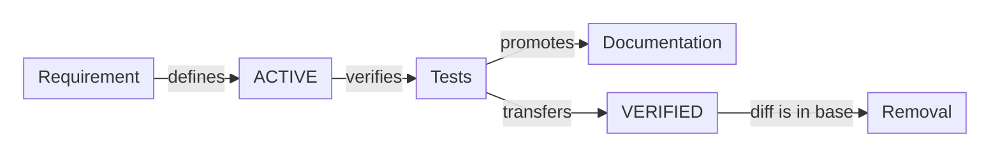

<a id="atf--test-change-control-register"></a>
<a id="atf--registrul-de-control-al-schimbărilor-de-teste"></a>
# ATF — test change control register

<a id="at-a-glance"></a>
<a id="pe-scurt"></a>
## At a glance

The register retains technical VERIFIED controls required for the Git diff against the review base. Visible sections explain the purpose, roles, and rules; entries with SHA hashes, paths, and commands are collapsed at the end.

| Reader question | Where to find the answer |
|---|---|
| What behavior still needs correction? | [Feedback register](feedback/README.md): requirement, gap, criterion, and missing evidence |
| What test change is still in progress? | ACTIVE blocks in owner feedback, indexed in the [feedback register](feedback/README.md) |
| Which verified difference still needs follow-up through integration? | [Verified technical controls](#verified-technical-controls): only VERIFIED |
| How does governance verify it? | [ATF Tests README](../atf-tests/README.md#test-change-governance): schema, executable rules, and CI |

<a id="business-purpose"></a>
<a id="scop-business"></a>
## Business purpose

Changing a test must preserve confidence in the behavior it verifies. The technical control links the change to its requirement and reproducible evidence.

| Objective | Intended result | Acceptance criterion |
|---|---|---|
| Regression confidence | changes preserve the contract or explain its change | explicit requirement and relevant evidence, including negative cases |
| Clear review | reason, scope, and evidence can be traced together | one eligible control per path and baseline |
| Current documentation | readers distinguish delivered behavior from remaining work | owner contract, gaps in feedback, temporary Git control |

These objectives provide context for the register. Concrete functional requirements and their priority remain with the domain owner and are indexed in the [feedback register](feedback/README.md).

<a id="context-and-responsibilities"></a>
<a id="context-și-responsabilități"></a>
## Context and responsibilities

| Layer | Question | Responsible owner and outcome |
|---|---|---|
| Business need | Why is this behavior needed? | product/consumer owner: desired outcome and priority |
| Requirement / contract | What must the system do? | domain owner: criteria in feedback, then a stable contract in its documentation |
| Rule | Which invariant must be preserved? | module/governance owner: documented rule and executable guard |
| Acceptance test | How do we demonstrate the behavior? | test owner: suitable unit, component, integration, or E2E test |
| Change control | Which Git difference do we cover? | change author: baseline, exact paths, reason, expiry, and Maven command |
| Integration | When do we remove the entry? | integrator: checks the diff against the new base and keeps the contract with its owner |

A single person may fill several roles; decisions and evidence remain distinct. VERIFIED describes verification of the technical increment, while business acceptance is decided separately against the requirement criteria.

<a id="usage-rules"></a>
<a id="reguli-de-folosire"></a>
## Usage rules

| Rule | Application |
|---|---|
| Exact scope | a control covers only declared paths and the resolved Git base; deletions require allowDelete: true |
| Single transfer | when moving to VERIFIED, move the entry from owner feedback into this baseline; keep its ID and avoid duplicate eligible owners |
| Separate evidence | proof declares a command; the gate checks schema and eligibility without running the command or certifying its result |
| Local status | verifying an increment allows its promotion; the functional requirement remains open while any criteria are unmet |
| Removal from register | remove the control when the diff against the gate base no longer contains the covered changes; a new commit alone is insufficient |
| Reconciliation | expiry or a different baseline requires review of the control and evidence; do not extend or rebase it automatically |

Moving or renaming a test changes its protected path: do not automatically replace the old path with the new one or add wildcards. A VERIFIED entry retains the exact path set approved for its base; a new path or deletion requires an exact, active control authorized in feedback. The proof field is a proposed reproduction command, not evidence of execution and not additional permission.

The field schema and exact file protection are defined once in [test change governance](../atf-tests/README.md#test-change-governance). The parser reads testChanges blocks from every Markdown document in docs/feedback and this baseline; active controls stay with the owner feedback rather than in a separate register.

<a id="lifecycle"></a>
<a id="ciclul-de-viață"></a>
## Lifecycle



<details>
<summary><strong>Legend — acceptance, transfer, and removal</strong></summary>

- ACTIVE tracks work in progress in the owner document feedback.
- Relevant tests verify the change scope; promote the demonstrated contract
  before removing the corresponding feedback gap.
- VERIFIED retains only a verified increment control that still appears
  in the diff; transfer does not automatically close the entire functional requirement.
- If the diff no longer requires the control, remove the entry directly;
  VERIFIED is not a required archive stage.
- Stable documentation remains with the owner after the technical entry is removed.

The short labels shall be kept as follows:

| In diagram | Full meaning |
|---|---|
| Requirement | Requirement and criterion |
| ACTIVE | ACTIVE control in owner feedback |
| Tests | Relevant tests |
| Documentation | Owner documentation |
| VERIFIED | VERIFIED control |
| Removal | Removal from the register |
| verifies | verifies the increment |
| promotes | promotes the contract |
| transfers | transfers the control |

</details>

<a id="verified-technical-controls"></a>
## Verified technical controls <a id="controale-tehnice-verificate"></a>

<details>
<summary><strong>Control tehnic — UI-RECOVERY-REPORT-PROBE-20261121</strong></summary>

```yaml
testChanges:
  - id: UI-RECOVERY-REPORT-PROBE-20261121
    status: VERIFIED
    base: 97d0968854326bb266be98a80791b49b86008234
    expires: 2026-11-30
    reason: "Print AutoEx recovery scenarios and check Extent ratio for recovered and exhausted UI_ONLY with INFO, disclosure and editorial tests."
    proof: >-
      mvn -pl atf-test-auto-ex,atf-test-practice-shop,atf-tests -am
      "-Dtest=AutoExBackendRecoveryComponentTest,ShopBackendRecoveryComponentTest,WholeAtfGovernanceSuiteTest"
      "-Datf.governance.testChanges.baseRef=97d0968854326bb266be98a80791b49b86008234"
      "-Datf.test.heap.max=384m"
      "-Dsurefire.failIfNoSpecifiedTests=false" test
    paths:
      - atf-test-auto-ex/src/test/java/atf/autoex/tests/component/recovery/AutoExBackendRecoveryComponentTest.java
      - atf-test-auto-ex/src/test/java/atf/autoex/tests/support/reporting/AutoExRecoveryExtentReportProbe.java
```

</details>

<details>
<summary><strong>Control tehnic — DOC-ROOT-OVERVIEW-20261121</strong></summary>

```yaml
testChanges:
  - id: DOC-ROOT-OVERVIEW-20261121
    status: VERIFIED
    base: 97d0968854326bb266be98a80791b49b86008234
    expires: 2026-11-30
    reason: "Government executive presentation and J0-J7 routes from README root."
    proof: >-
      mvn -pl atf-test-auto-ex,atf-test-practice-shop,atf-tests -am
      "-Dtest=AutoExBackendRecoveryComponentTest,ShopBackendRecoveryComponentTest,WholeAtfGovernanceSuiteTest"
      "-Datf.governance.testChanges.baseRef=97d0968854326bb266be98a80791b49b86008234"
      "-Datf.test.heap.max=384m"
      "-Dsurefire.failIfNoSpecifiedTests=false" test
    paths:
      - atf-tests/src/test/java/atf/api/tests/governance/documentation/DocumentationReadmeStructureGovernanceTest.java
```

</details>

<details>
<summary><strong>YAML register — VERIFIED controls and their exact scopes</strong></summary>

```yaml
testChanges:
  - id: AUTOEX-STORE-AVAILABILITY-12
    status: VERIFIED
    base: 9b0860bfc734df570c7512b76aa5dbb559527b7d
    expires: 2026-11-25
    reason: "Add only bounded recovery for queue-full page on the observed GET document, origine and validated reading routes. Keep all scenarios and assertions E2E; do not repeat clicks, POST, account operations, basket or payment. Probes components for recovery and exhaustion, foreign origine, absent element and non-replay, plus strict configuration."
    proof: mvn -pl atf-test-auto-ex,atf-tests -am "-Dtest=AutoExComponentSuite,WholeAtfGovernanceSuiteTest" "-Datf.governance.testChanges.baseRef=9b0860bfc734df570c7512b76aa5dbb559527b7d" "-Datf.test.heap.max=384m" "-Dsurefire.failIfNoSpecifiedTests=false" test
    paths:
      - atf-test-auto-ex/src/test/java/atf/ui/tests/autoex/component/navigation/AutoExAvailabilityFixture.java
      - atf-test-auto-ex/src/test/java/atf/ui/tests/autoex/component/navigation/AutoExStoreAvailabilityComponentTest.java
      - atf-test-auto-ex/src/test/java/atf/ui/tests/autoex/component/configuration/AutoExConfigurationLoaderComponentTest.java
      - atf-test-auto-ex/src/test/resources/atf-auto-ex.yaml
  - id: CONSUMER-SHOP-API-TEST-11
    status: VERIFIED
    base: 9b0860bfc734df570c7512b76aa5dbb559527b7d
    expires: 2026-11-25
    reason: "Move the two API contracts and the fixture into the canonical namespaceul api.network, keeping the 19 methods and decoding the query. The fixture introduces observations via the public inspector; a new large distinguishes the query drawn up at the capture of the pathogen and the converted value query. Runtime record be made private; the face of the map converts observations and executions Core without exposing the internal callback or alias. The suite keeps the selection and governance protects the new border; it takes the uniform guard from CONSUMER-AUTOEX-RUNTIME-10 to the same base."
    proof: mvn -pl atf-test-practice-shop,atf-tests -am "-Dtest=ShopComponentSuite,WholeAtfGovernanceSuiteTest" "-Datf.governance.testChanges.baseRef=9b0860bfc734df570c7512b76aa5dbb559527b7d" "-Datf.test.heap.max=384m" "-Dsurefire.failIfNoSpecifiedTests=false" test
    paths:
      - atf-tests/src/test/java/atf/api/tests/governance/consumers/ConsumerModuleArchitectureGovernanceTest.java
  - id: CONSUMER-AUTOEX-RUNTIME-10
    status: VERIFIED
    base: 9b0860bfc734df570c7512b76aa5dbb559527b7d
    expires: 2026-11-24
    reason: "Explicit AutoEx runtime in the main with completion port and JUnit adapter; keep the selected, steps and business assertions, observed mappings and the clayanopus Kit. Maven goals remain unchanged; new samples for primary / secondary errors, mapper and publication from local DOM. The Guardian asks for the new border without the allowlist."
    proof: mvn -pl atf-test-auto-ex,atf-tests -am "-Dtest=AutoExComponentSuite,WholeAtfGovernanceSuiteTest" "-Datf.governance.testChanges.baseRef=9b0860bfc734df570c7512b76aa5dbb559527b7d" "-Datf.test.heap.max=384m" "-Dsurefire.failIfNoSpecifiedTests=false" test
    allowDelete: true
    paths:
      - atf-test-auto-ex/src/test/java/atf/ui/autoex/support/AutoExConsoleBridge.java
      - atf-test-auto-ex/src/test/java/atf/ui/autoex/support/AutoExCustomerApiSetup.java
      - atf-test-auto-ex/src/test/java/atf/ui/autoex/support/AutoExE2eExtension.java
      - atf-test-auto-ex/src/test/java/atf/ui/autoex/support/AutoExE2eRun.java
      - atf-test-auto-ex/src/test/java/atf/ui/autoex/support/AutoExEvidenceProfile.java
      - atf-test-auto-ex/src/test/java/atf/ui/autoex/support/AutoExProjectRoot.java
      - atf-test-auto-ex/src/test/java/atf/ui/tests/autoex/api/AutoExApiContractReportExtension.java
      - atf-test-auto-ex/src/test/java/atf/ui/tests/autoex/component/AutoExEvidenceProfileComponentTest.java
      - atf-test-auto-ex/src/test/java/atf/ui/tests/autoex/component/lifecycle/AutoExRunLifecycleAdapterComponentTest.java
      - atf-test-auto-ex/src/test/java/atf/ui/tests/autoex/component/lifecycle/AutoExRuntimeBoundaryComponentTest.java
      - atf-test-auto-ex/src/test/java/atf/ui/tests/autoex/e2e/AutoExAccountUiE2eTest.java
      - atf-test-auto-ex/src/test/java/atf/ui/tests/autoex/e2e/AutoExCartUiE2eTest.java
      - atf-test-auto-ex/src/test/java/atf/ui/tests/autoex/e2e/AutoExExistingCustomerUiApiE2eTest.java
      - atf-test-auto-ex/src/test/java/atf/ui/tests/autoex/e2e/AutoExPurchaseUiApiE2eTest.java
      - atf-test-auto-ex/src/test/java/atf/ui/tests/autoex/e2e/AutoExPurchaseUiE2eTest.java
      - atf-test-auto-ex/src/test/java/atf/ui/tests/autoex/e2e/AutoExPurchaseUiFinalScreenshotE2eTest.java
      - atf-test-auto-ex/src/test/java/atf/ui/tests/autoex/extension/AutoExE2eExtension.java
      - atf-test-auto-ex/src/test/java/atf/ui/tests/autoex/extension/AutoExEvidenceProfileAdapter.java
      - atf-test-auto-ex/src/test/java/atf/ui/tests/autoex/extension/AutoExRunFactory.java
      - atf-test-auto-ex/src/test/java/atf/ui/tests/autoex/extension/AutoExRunLifecycleAdapter.java
  - id: CONSUMER-ACCOUNT-SCOPE-02
    status: VERIFIED
    base: 9b0860bfc734df570c7512b76aa5dbb559527b7d
    expires: 2026-11-26
    reason: "Deploy the explicit scope and move the required runtime factories directly into feedback; keep the entire previous contract ConsumerModuleArchitectureGovernanceTest and take over its unique control ownership, keep Shop account samples, add the actual lifecycle Jupiter and strengthen the main without JUnit / Kit, without relaxing the thresholds or external eighty-inus."
    proof: mvn -pl atf-test-kit,atf-test-practice-shop,atf-tests -am "-Dtest=ScopedTestValueTest,TestRunScopeComponentTest,ShopComponentSuite,WholeAtfGovernanceSuiteTest" "-Datf.governance.testChanges.baseRef=9b0860bfc734df570c7512b76aa5dbb559527b7d" "-Dsurefire.failIfNoSpecifiedTests=false" test
    paths:
      - atf-test-kit/pom.xml
      - atf-test-kit/src/test/java/atf/api/testkit/scope/ScopedTestValueTest.java
      - atf-test-kit/src/test/java/atf/api/testkit/scope/TestRunScopeComponentTest.java
  - id: REPORT-OBSERVED-OWNER-LIVE-08
    status: VERIFIED
    base: 9b0860bfc734df570c7512b76aa5dbb559527b7d
    expires: 2026-11-24
    reason: "Check the observed / configured source, absence versus missing catch and JSON literally null, API / UI owner, sister exchanges and exact Open in Tests index. Includes catches in audit and keeping whitespace at UI source, sanitization, signature and publisher; keep all previous cases and the explicitly revised basis. PRIMARY / SECONDARY, the independent of the order of the headers and the explicit owner in the markup; the extraction of durations is common without increasing the budget of assets."
    proof: mvn -pl atf-reporting-tests,atf-test-auto-ex,atf-test-practice-shop,atf-tests -am "-Dtest=UiNetworkBodyFidelityComponentTest,UiNetworkInspectorComponentTest,AtfReportingUnitSuite,AtfReportingComponentSuite,AtfReportingIntegrationSuite,UiFailureReportContractTest,ShopComponentSuite,AutoExComponentSuite,WholeAtfGovernanceSuiteTest" "-Datf.governance.testChanges.baseRef=9b0860bfc734df570c7512b76aa5dbb559527b7d" "-Datf.test.heap.max=384m" "-Dsurefire.failIfNoSpecifiedTests=false" test
    paths:
      - atf-reporting-tests/src/test/java/atf/api/reporting/api/request/ReportRequestHeadersTest.java
      - atf-reporting-tests/src/test/java/atf/api/reporting/api/request/ObservedRequestEvidenceComponentTest.java
      - atf-reporting-tests/src/test/java/atf/api/reporting/support/request/ObservedRequestFixture.java
      - atf-reporting-tests/src/test/java/atf/api/reporting/ui/validation/UiApiValidationContractComponentTest.java
      - atf-reporting-tests/src/test/java/atf/api/reporting/api/evidence/ApiBodyMediaComponentTest.java
      - atf-reporting-tests/src/test/java/atf/api/reporting/api/evidence/ApiWhitespaceBodyComponentTest.java
      - atf-reporting-tests/src/test/java/atf/api/reporting/extent/session/ExtentReportFailureProjectionContractTest.java
      - atf-reporting-tests/src/test/java/atf/api/reporting/extent/session/ExtentReportSessionContractTest.java
      - atf-reporting-tests/src/test/java/atf/api/reporting/ui/ExtentReportUiFailureEvidenceTest.java
      - atf-reporting-tests/src/test/java/atf/api/reporting/runtime/core/ExtentReportRuntimeScriptTest.java
      - atf-reporting-tests/src/test/java/atf/ui/tests/extent/support/inspection/parity/ApiExchangeParityProbe.java
      - atf-ui/src/test/java/atf/api/ui/network/UiNetworkBodyFidelityComponentTest.java
      - atf-reporting-tests/src/test/java/atf/ui/tests/extent/support/inspection/reconciliation/UiApiVerdictProjectionProbe.java
  - id: REPORT-OBSERVED-OWNER-07
    status: VERIFIED
    base: 5eb3fd3cb099fc67b49be3c17de564db63755db7
    expires: 2026-11-24
    reason: "Check the observed / configured source, absence versus missing catch and JSON literally null, API / UI owner, sister exchanges and exact Open in Tests index. Includes catches in audit and keeping whitespace at UI source, sanitization, signature and publisher; keep all previous cases and the explicitly revised basis. PRIMARY / SECONDARY, the independent of the order of the headers and the explicit owner in the markup; the extraction of durations is common without increasing the budget of assets."
    proof: mvn -pl atf-reporting-tests -am "-Dtest=UiNetworkBodyFidelityComponentTest,UiNetworkInspectorComponentTest,AtfReportingUnitSuite,AtfReportingComponentSuite,AtfReportingIntegrationSuite,UiFailureReportContractTest" "-Datf.test.heap.max=384m" "-Dsurefire.failIfNoSpecifiedTests=false" test
    paths:
      - atf-reporting-tests/src/test/java/atf/api/reporting/api/request/ReportRequestHeadersTest.java
      - atf-reporting-tests/src/test/java/atf/api/reporting/api/request/ObservedRequestEvidenceComponentTest.java
      - atf-reporting-tests/src/test/java/atf/api/reporting/support/request/ObservedRequestFixture.java
      - atf-reporting-tests/src/test/java/atf/api/reporting/ui/validation/UiApiValidationContractComponentTest.java
      - atf-reporting-tests/src/test/java/atf/api/reporting/api/evidence/ApiBodyMediaComponentTest.java
      - atf-reporting-tests/src/test/java/atf/api/reporting/api/evidence/ApiWhitespaceBodyComponentTest.java
      - atf-reporting-tests/src/test/java/atf/api/reporting/extent/session/ExtentReportFailureProjectionContractTest.java
      - atf-reporting-tests/src/test/java/atf/api/reporting/extent/session/ExtentReportSessionContractTest.java
      - atf-reporting-tests/src/test/java/atf/api/reporting/ui/ExtentReportUiFailureEvidenceTest.java
      - atf-reporting-tests/src/test/java/atf/api/reporting/runtime/core/ExtentReportRuntimeScriptTest.java
      - atf-reporting-tests/src/test/java/atf/ui/tests/extent/support/inspection/parity/ApiExchangeParityProbe.java
      - atf-ui/src/test/java/atf/api/ui/network/UiNetworkBodyFidelityComponentTest.java
      - atf-reporting-tests/src/test/java/atf/ui/tests/extent/support/inspection/reconciliation/UiApiVerdictProjectionProbe.java
      - atf-test-auto-ex/src/test/java/atf/ui/autoex/support/AutoExE2eRun.java
  - id: REPORT-BODY-AUDITOR-OWNER-09
    status: VERIFIED
    base: 9b0860bfc734df570c7512b76aa5dbb559527b7d
    expires: 2026-11-24
    reason: "Explicit review of the body auditor against the common live base 9b0860b; distinguishes the confirmed absence of missing catch and literal null, covers JSON fallback without relaxing controls. The three existing ObservedRequestEvidenceComponentTest, ObservedRequestFixture and UiApiVerdictProjectionProbe keep the unique REPORT-OBSERVED-OWNER-LIVE-08 owner and include reinforcements for QUERY, retry and real headers."
    proof: mvn -pl atf-reporting-tests,atf-tests -am "-Dtest=AtfReportingUnitSuite,AtfReportingComponentSuite,AtfReportingIntegrationSuite,WholeAtfGovernanceSuiteTest" "-Datf.governance.testChanges.baseRef=9b0860bfc734df570c7512b76aa5dbb559527b7d" "-Dsurefire.failIfNoSpecifiedTests=false" test
    paths:
      - atf-reporting-tests/src/test/java/atf/api/reporting/api/request/ObservedBodyAuditComponentTest.java
      - atf-reporting-tests/src/test/java/atf/api/reporting/api/contract/ApiReportContractAuditorTest.java
      - atf-reporting-tests/src/test/java/atf/api/reporting/support/request/LiveClientHeaderProbe.java
      - atf-reporting-tests/src/test/java/atf/api/reporting/html/contract/HtmlReportStaticContractTest.java
      - atf-reporting-tests/src/test/java/atf/api/reporting/ui/audit/section/CategoriesAndEvidenceSectionValidatorTest.java
      - atf-reporting-tests/src/test/java/atf/ui/tests/extent/support/audit/api/ApiJsonEvidenceAuditor.java
      - atf-reporting-tests/src/test/java/atf/ui/tests/extent/support/audit/mock/MockReportContractAuditor.java
      - atf-reporting-tests/src/test/java/atf/ui/tests/extent/support/locators/ReportEvidenceLocators.java
      - atf-reporting-tests/src/test/java/atf/ui/tests/extent/support/locators/ReportUiLocators.java
      - atf-reporting-tests/src/test/java/atf/ui/tests/extent/support/section/extract/ApiJsonEvidenceExtractor.java
  - id: AUTOEX-DELETE-DIAGNOSTICS-02
    status: VERIFIED
    base: 9b0860bfc734df570c7512b76aa5dbb559527b7d
    expires: 2026-11-26
    reason: "Keep the existing cases and check exactly one GET navigation document in a complete snapshot, distinct from the total browser events; any observed request continues to ban the replica. Negative cases remain FAIL, and the two E2E business checks the deletion at 70%, including Close JavaScript after natural vignette, without traffic or advertising manufactured."
    proof: mvn -pl atf-test-auto-ex,atf-tests -am "-Dtest=AutoExAccountDeletionSafetyComponentTest,AutoExAccountUiE2eTest,AutoExExistingCustomerUiApiE2eTest,WholeAtfGovernanceSuiteTest" "-Datf.autoex.e2e.enabled=true" "-Datf.governance.testChanges.baseRef=9b0860bfc734df570c7512b76aa5dbb559527b7d" "-Dsurefire.failIfNoSpecifiedTests=false" test
    paths:
      - atf-test-auto-ex/src/test/java/atf/ui/tests/autoex/component/journey/AutoExAccountDeletionSafetyComponentTest.java
  - id: CONSUMER-REPORTING-INTEGRATION-06
    status: VERIFIED
    base: 9b0860bfc734df570c7512b76aa5dbb559527b7d
    expires: 2026-11-24
    allowDelete: true
    reason: "Separate review of the difference from the integrated live commit; keeps API migration typed and new samples of cleanup, only moves neutral support and owner samples and eliminates suite aliases without loss of selection; does not rebase existing controls and does not relax thresholds."
    proof: mvn -pl atf-tests,atf-test-practice-shop,atf-test-auto-ex -am "-Dtest=WholeAtfGovernanceSuiteTest,ShopComponentSuite,AutoExComponentSuite" "-Datf.governance.testChanges.baseRef=9b0860bfc734df570c7512b76aa5dbb559527b7d" "-Dsurefire.failIfNoSpecifiedTests=false" test
    paths:
      - atf-reporting-tests/src/test/java/atf/api/reporting/api/ApiManualReplayProjectionTest.java
      - atf-reporting-tests/src/test/java/atf/api/reporting/extent/time/ReportingTimestampComponentTest.java
      - atf-reporting-tests/src/test/java/atf/api/reporting/ui/failure/UiSetupFailureEvidenceComponentTest.java
      - atf-reporting/src/test/java/atf/api/reporting/standalone/ReportingTimestampComponentTest.java
      - atf-test-auto-ex/src/test/java/atf/ui/autoex/support/AutoExScreenAuditObservations.java
      - atf-test-auto-ex/src/test/java/atf/ui/tests/autoex/api/AutoExApiAccountCleanup.java
      - atf-test-auto-ex/src/test/java/atf/ui/tests/autoex/api/AutoExApiLiveContractTest.java
      - atf-test-auto-ex/src/test/java/atf/ui/tests/autoex/api/AutoExApiReadOnlyLiveContractTest.java
      - atf-test-auto-ex/src/test/java/atf/ui/tests/autoex/api/AutoExApiResponseAssertions.java
      - atf-test-auto-ex/src/test/java/atf/ui/tests/autoex/component/api/AutoExApiAccountCleanupComponentTest.java
      - atf-test-auto-ex/src/test/java/atf/ui/tests/autoex/component/api/AutoExApiContractReportPublisherComponentTest.java
      - atf-test-auto-ex/src/test/java/atf/ui/tests/autoex/component/api/AutoExApiResponseAssertionsComponentTest.java
      - atf-test-auto-ex/src/test/java/atf/ui/tests/autoex/suites/AutoExApiComponentSuite.java
      - atf-test-auto-ex/src/test/java/atf/ui/tests/autoex/suites/AutoExApiLiveSuite.java
      - atf-test-auto-ex/src/test/java/atf/ui/tests/autoex/suites/AutoExApiReadOnlyLiveSuite.java
      - atf-test-auto-ex/src/test/java/atf/ui/tests/autoex/suites/AutoExBusinessSuite.java
      - atf-test-auto-ex/src/test/java/atf/ui/tests/autoex/suites/AutoExE2eSuite.java
      - atf-test-auto-ex/src/test/java/atf/ui/tests/autoex/suites/AutoExPurchaseSuite.java
      - atf-test-auto-ex/src/test/java/atf/ui/tests/autoex/support/api/AutoExApiTestSupport.java
      - atf-test-kit/src/test/java/atf/api/testkit/AtfTestLayerArchitectureTest.java
      - atf-test-kit/src/test/java/atf/api/testkit/lifecycle/ArmedCleanupTest.java
      - atf-test-kit/src/test/java/atf/api/testkit/lifecycle/CloseOnceResourceTest.java
      - atf-tests/src/test/java/atf/api/tests/governance/WholeAtfGovernanceSuiteTest.java
      - atf-tests/src/test/java/atf/api/tests/governance/layers/AtfTestLayerArchitectureTest.java
      - atf-tests/src/test/java/atf/api/tests/governance/layers/ConsumerSuiteCoverageGovernanceTest.java
      - atf-ui/src/test/java/atf/api/ui/audit/UiScreenAuditTest.java
  - id: REPORT-INVALID-CAPTURE-03
    status: VERIFIED
    base: b9b1325c28d665be6289bb2cf9286666513e7a05
    expires: 2026-11-24
    reason: "Add invalid and non-PNG payloads64 to the Extent / fallback matrix without removing cases integrated in parallel; check for lack of false links and preserve the original cause."
    proof: mvn -pl atf-reporting-tests -am "-Dtest=UiAuditLifecycleTest,ReportEvidenceProfileIntegrationTest,ReportScreenshotTest" "-Dsurefire.failIfNoSpecifiedTests=false" test
    paths:
      - atf-reporting-tests/src/test/java/atf/api/reporting/ui/UiAuditLifecycleTest.java
  - id: REPORT-CLIENT-METADATA-01
    status: VERIFIED
    base: a23c76e662516504f55a4369c58ca98bbf2f26ec
    expires: 2026-10-30
    reason: "Check that the Generic System Client alternative remains neutral when consumer metadata is missing."
    proof: mvn -pl atf-reporting-tests -am "-Dtest=ReportEnvironmentSnapshotTest" "-Dsurefire.failIfNoSpecifiedTests=false" test
    paths:
      - atf-reporting-tests/src/test/java/atf/api/reporting/configuration/ReportEnvironmentSnapshotTest.java
  - id: AUTOEX-EXISTING-CUSTOMER-DELETE-01
    status: VERIFIED
    base: 5eb3fd3cb099fc67b49be3c17de564db63755db7
    expires: 2026-11-24
    reason: "Add actual self- service login / delete and API- only preparation with pre-created armed cleanup, without manufactured or replica advertisements. Changes in the live adapter and factory remain at the existing AUTOEX-VOCABULARY-01 and AUTOEX-CONTRACT-VOCABULARY-02 controls, revalidated by the same sample; the acceptance of vignette remains distinct."
    proof: mvn -pl atf-test-auto-ex,atf-tests -am "-Dtest=AutoExComponentSuite,AutoExAccountUiE2eTest,AutoExExistingCustomerUiApiE2eTest,WholeAtfGovernanceSuiteTest" "-Datf.autoex.e2e.enabled=true" "-Datf.governance.testChanges.baseRef=5eb3fd3cb099fc67b49be3c17de564db63755db7" "-Dsurefire.failIfNoSpecifiedTests=false" test
    paths:
      - atf-test-auto-ex/src/test/java/atf/ui/autoex/support/AutoExCustomerApiSetup.java
      - atf-test-auto-ex/src/test/java/atf/ui/tests/autoex/e2e/AutoExExistingCustomerUiApiE2eTest.java
  - id: CONSUMER-REPORTING-RECONCILE-05
    status: VERIFIED
    base: a1dd0c3a9de6912e48e17c8e3724addd0fe77bfc
    expires: 2026-11-24
    allowDelete: true
    reason: "Explicit review on the new live commit; keeps API migration typed and all assertions, extract neutral lifecycle into Kit and neutral audit into UI, move neutral samples to Reporting Tests and strengthen complete selection without further exceptions."
    proof: mvn -pl atf-reporting-tests -am test; mvn -pl atf-tests,atf-test-practice-shop,atf-test-auto-ex -am "-Dtest=WholeAtfGovernanceSuiteTest,ShopComponentSuite,AutoExComponentSuite" "-Datf.governance.testChanges.baseRef=a1dd0c3a9de6912e48e17c8e3724addd0fe77bfc" "-Dsurefire.failIfNoSpecifiedTests=false" test; mvn -pl atf-reporting-tests -am "-Dtest=ExtentReportAssetCleanupTest,ExtentReportSessionContractTest,UiFailureReportContractTest" "-Dsurefire.failIfNoSpecifiedTests=false" test
    paths:
      - atf-reporting-tests/src/test/java/atf/api/reporting/api/ApiManualReplayProjectionTest.java
      - atf-reporting-tests/src/test/java/atf/api/reporting/api/auth/ApiAuthenticationSchemaContractTest.java
      - atf-reporting-tests/src/test/java/atf/api/reporting/api/evidence/ApiBodyArtifactFixture.java
      - atf-reporting-tests/src/test/java/atf/api/reporting/api/evidence/ApiBodyMediaComponentTest.java
      - atf-reporting-tests/src/test/java/atf/api/reporting/extent/session/ExtentReportSessionContractTest.java
      - atf-reporting-tests/src/test/java/atf/api/reporting/extent/time/ReportingTimestampComponentTest.java
      - atf-reporting-tests/src/test/java/atf/api/reporting/markup/ExtentReportAssetCleanupTest.java
      - atf-reporting-tests/src/test/java/atf/api/reporting/support/publication/CleanupPublicationFixture.java
      - atf-reporting-tests/src/test/java/atf/api/reporting/ui/ExtentReportUiEvidencePublishingTest.java
      - atf-reporting-tests/src/test/java/atf/api/reporting/ui/failure/UiSetupFailureEvidenceComponentTest.java
      - atf-reporting-tests/src/test/java/atf/api/reporting/ui/network/NetworkInspectorSummaryRoleTest.java
      - atf-reporting-tests/src/test/java/atf/api/reporting/ui/profile/ReportEvidenceProfileIntegrationTest.java
      - atf-reporting-tests/src/test/java/atf/api/reporting/ui/validation/UiApiValidationContractComponentTest.java
      - atf-reporting-tests/src/test/java/atf/api/reporting/ui/validation/UiApiValidationFixtures.java
      - atf-reporting-tests/src/test/java/atf/ui/tests/extent/component/inspection/network/NetworkCaptureEvidenceTest.java
      - atf-reporting-tests/src/test/java/atf/ui/tests/extent/component/inspection/retry/ApiRetryProjectionContractTest.java
      - atf-reporting-tests/src/test/java/atf/ui/tests/extent/support/inspection/disclosure/ExtentReportDisclosureProbe.java
      - atf-reporting-tests/src/test/java/atf/ui/tests/extent/support/inspection/layout/ScrollableTableReportFixture.java
      - atf-reporting-tests/src/test/java/atf/ui/tests/extent/support/inspection/parity/ApiExchangeParityProbe.java
      - atf-reporting/src/test/java/atf/api/reporting/standalone/ReportingTimestampComponentTest.java
      - atf-test-auto-ex/src/test/java/atf/ui/autoex/support/AutoExE2eRun.java
      - atf-test-auto-ex/src/test/java/atf/ui/autoex/support/AutoExScreenAuditObservations.java
      - atf-test-auto-ex/src/test/java/atf/ui/tests/autoex/api/AutoExApiAccountCleanup.java
      - atf-test-auto-ex/src/test/java/atf/ui/tests/autoex/api/AutoExApiContractReportExtension.java
      - atf-test-auto-ex/src/test/java/atf/ui/tests/autoex/api/AutoExApiLiveContractTest.java
      - atf-test-auto-ex/src/test/java/atf/ui/tests/autoex/api/AutoExApiReadOnlyLiveContractTest.java
      - atf-test-auto-ex/src/test/java/atf/ui/tests/autoex/api/AutoExApiResponseAssertions.java
      - atf-test-auto-ex/src/test/java/atf/ui/tests/autoex/component/AutoExEvidenceProfileComponentTest.java
      - atf-test-auto-ex/src/test/java/atf/ui/tests/autoex/component/api/AutoExApiAccountCleanupComponentTest.java
      - atf-test-auto-ex/src/test/java/atf/ui/tests/autoex/component/api/AutoExApiContractReportPublisherComponentTest.java
      - atf-test-auto-ex/src/test/java/atf/ui/tests/autoex/component/api/AutoExApiResponseAssertionsComponentTest.java
      - atf-test-auto-ex/src/test/java/atf/ui/tests/autoex/suites/AutoExApiComponentSuite.java
      - atf-test-auto-ex/src/test/java/atf/ui/tests/autoex/suites/AutoExApiLiveSuite.java
      - atf-test-auto-ex/src/test/java/atf/ui/tests/autoex/suites/AutoExApiReadOnlyLiveSuite.java
      - atf-test-auto-ex/src/test/java/atf/ui/tests/autoex/suites/AutoExBusinessSuite.java
      - atf-test-auto-ex/src/test/java/atf/ui/tests/autoex/suites/AutoExE2eSuite.java
      - atf-test-auto-ex/src/test/java/atf/ui/tests/autoex/suites/AutoExPurchaseSuite.java
      - atf-test-auto-ex/src/test/java/atf/ui/tests/autoex/support/api/AutoExApiTestSupport.java
      - atf-test-kit/src/test/java/atf/api/testkit/AtfTestLayerArchitectureTest.java
      - atf-test-kit/src/test/java/atf/api/testkit/lifecycle/ArmedCleanupTest.java
      - atf-test-kit/src/test/java/atf/api/testkit/lifecycle/CloseOnceResourceTest.java
      - atf-tests/src/test/java/atf/api/tests/governance/WholeAtfGovernanceSuiteTest.java
      - atf-tests/src/test/java/atf/api/tests/governance/consumers/ConsumerModuleArchitectureGovernanceTest.java
      - atf-tests/src/test/java/atf/api/tests/governance/layers/AtfTestLayerArchitectureTest.java
      - atf-tests/src/test/java/atf/api/tests/governance/layers/ConsumerSuiteCoverageGovernanceTest.java
      - atf-ui/src/test/java/atf/api/ui/audit/UiScreenAuditTest.java
  - id: REPORT-ASSET-CLEANUP-LOCK-05
    status: VERIFIED
    base: 5eb3fd3cb099fc67b49be3c17de564db63755db7
    expires: 2026-11-24
    reason: "Probe both forms of Windows lock, boaded exhaustion and interruption, without changing the ceiling of the cleanup or ignoring publication errors. The exact review of the file confirms the same basic content in 5eb3fd3 and b9b1325; control uses the common base of the gate without expanding the paths; promotion follows the execution of the samples."
    proof: mvn -pl atf-reporting-tests -am "-Dtest=ExtentReportAssetCleanupTest,AtfReportingComponentSuite,UiFailureReportContractTest" "-Dsurefire.failIfNoSpecifiedTests=false" test
    paths:
      - atf-reporting-tests/src/test/java/atf/api/reporting/markup/ExtentReportAssetCleanupTest.java
  - id: REPORT-FAILURE-CLIENT-COMPONENT-04
    status: VERIFIED
    base: 7b365028ac8356960614e35023556e757311e633
    expires: 2026-11-24
    reason: "Keep original and parallel cases; add the policy matrix, Extent / fallback snapshots and the no-action case, keeping the Client exactly once and the state of the catch in a typed vocabulary."
    proof: mvn -pl atf-reporting-tests -am "-Dtest=AtfReportingComponentSuite" "-Dsurefire.failIfNoSpecifiedTests=false" test
    paths:
      - atf-reporting-tests/src/test/java/atf/api/reporting/ui/UiAuditLifecycleTest.java
      - atf-reporting-tests/src/test/java/atf/api/reporting/extent/session/ExtentReportSessionContractTest.java
  - id: UI-API-TYPED-ONLY-01
    status: VERIFIED
    base: 5eb3fd3cb099fc67b49be3c17de564db63755db7
    expires: 2026-11-23
    reason: "Direct request for the removal of horses legacy UI_API; mechanical migration of samples and component / guard test for the unique typed model without relaxing contracts."
    proof: mvn -pl atf-reporting-tests,atf-test-practice-shop,atf-test-auto-ex,atf-tests -am "-Dtest=UiApiValidationContractComponentTest,AtfReportingComponentSuite,ShopComponentSuite,AutoExComponentSuite,WholeAtfGovernanceSuiteTest" "-Datf.governance.testChanges.baseRef=5eb3fd3cb099fc67b49be3c17de564db63755db7" "-Dsurefire.failIfNoSpecifiedTests=false" test
    paths:
      - atf-reporting-tests/src/test/java/atf/api/reporting/ui/validation/UiApiValidationFixtures.java
      - atf-reporting-tests/src/test/java/atf/api/reporting/ui/profile/ReportEvidenceProfileIntegrationTest.java
      - atf-reporting-tests/src/test/java/atf/api/reporting/ui/ExtentReportUiEvidencePublishingTest.java
      - atf-reporting-tests/src/test/java/atf/ui/tests/extent/support/inspection/layout/ScrollableTableReportFixture.java
      - atf-reporting-tests/src/test/java/atf/ui/tests/extent/support/inspection/disclosure/ExtentReportDisclosureProbe.java
      - atf-reporting-tests/src/test/java/atf/api/reporting/api/auth/ApiAuthenticationSchemaContractTest.java
  - id: AUTOEX-DELETE-AFTER-AD-01
    status: VERIFIED
    base: 5eb3fd3cb099fc67b49be3c17de564db63755db7
    expires: 2026-11-23
    reason: "Check the safety of the continuation after the commercial without the required erasure on; the exact inventory includes the two new classes without relaxing the threshold. The diffuse of the three path is identical to the revised bases 5eb3fd3 and 7b36502."
    proof: mvn "-pl=atf-test-auto-ex,atf-tests" -am "-Dtest=AutoExComponentSuite,AutoExAccountUiE2eTest,AutoExBusinessSuite,AutoExPurchaseUiApiE2eTest,WholeAtfGovernanceSuiteTest" "-Datf.autoex.e2e.enabled=true" "-Datf.governance.testChanges.baseRef=5eb3fd3cb099fc67b49be3c17de564db63755db7" "-Dsurefire.failIfNoSpecifiedTests=false" test
    paths:
      - atf-test-auto-ex/src/test/java/atf/ui/tests/autoex/component/journey/AutoExAccountDeletionSafetyComponentTest.java
      - atf-test-auto-ex/src/test/java/atf/ui/tests/autoex/e2e/AutoExAccountUiE2eTest.java
      - atf-tests/src/test/java/atf/api/tests/governance/AtfPackageCohesionGovernanceTest.java
  - id: REPORT-OPEN-GAPS-COMPONENT-03
    status: VERIFIED
    base: 5eb3fd3cb099fc67b49be3c17de564db63755db7
    expires: 2026-11-23
    reason: "Keep all the Network cases at the UI component, reclassify the publication of HTML as a component sample and check the reason for the capture and client neutral or explicitly redacted. The deletion of the old path Network is already authorised by UI-NETWORK-CAPTURE-PROOFS-01."
    proof: mvn -pl atf-reporting-tests -am "-Dtest=AtfReportingComponentSuite,ExtentReportUiFailureEvidenceTest" "-Dsurefire.failIfNoSpecifiedTests=false" test
    paths:
      - atf-reporting-tests/src/test/java/atf/ui/tests/extent/component/inspection/network/NetworkCaptureEvidenceTest.java
      - atf-reporting-tests/src/test/java/atf/ui/tests/extent/support/locators/network/ReportNetworkCaptureLocators.java
      - atf-reporting-tests/src/test/java/atf/api/reporting/ui/UiAuditLifecycleTest.java
  - id: REPORT-NATIVE-CLOCK-LAYER-03
    status: VERIFIED
    base: 5eb3fd3cb099fc67b49be3c17de564db63755db7
    expires: 2026-11-23
    reason: "Accurate the ReportingTimestampComponentTest native sample in the finished standalone inventory without allowing any further imports or expanding the browser allowlist."
    proof: mvn -pl atf-test-kit -am test
    paths:
      - atf-test-kit/src/test/java/atf/api/testkit/AtfTestLayerArchitectureTest.java
      - atf-reporting/src/test/java/atf/api/reporting/standalone/ReportingTimestampComponentTest.java
  - id: UI-JAVASCRIPT-CLICK-01
    status: VERIFIED
    base: 5eb3fd3cb099fc67b49be3c17de564db63755db7
    expires: 2026-11-23
    reason: "Integrate the explicit DOM activation with atomic postcondition and neutral samples at the UI owner; replace AutoEx 100 fallback with 70 profile without changing business clicks."
    proof: mvn "-pl=atf-test-auto-ex,atf-tests" -am "-Dtest=PlaywrightJavaScriptClickComponentTest,PlaywrightActionSequenceTest,PlaywrightUiSessionTest,AutoExComponentSuite,AutoExBusinessSuite,AutoExPurchaseUiApiE2eTest,WholeAtfGovernanceSuiteTest" "-Datf.autoex.e2e.enabled=true" "-Datf.governance.testChanges.baseRef=5eb3fd3cb099fc67b49be3c17de564db63755db7" "-Dsurefire.failIfNoSpecifiedTests=false" test
    paths:
      - atf-ui/src/test/java/atf/api/ui/playwright/PlaywrightJavaScriptClickComponentTest.java
      - atf-ui/src/test/resources/atf/ui/playwright/javascript-click.html
      - atf-test-auto-ex/src/test/resources/atf-auto-ex.yaml
  - id: API-BODY-SECURITY-COMPONENT-02
    status: VERIFIED
    base: 5eb3fd3cb099fc67b49be3c17de564db63755db7
    expires: 2026-11-23
    reason: "Check live samples for multipart editing and whitespace fidelity at the Reporting host, with common neutral fixture, without eliminating or relaxing existing assertions."
    proof: mvn -pl atf-reporting-tests -am "-Dtest=ApiMultipartBodyComponentTest,ApiWhitespaceBodyComponentTest" "-Dsurefire.failIfNoSpecifiedTests=false" test
    paths:
      - atf-reporting-tests/src/test/java/atf/api/reporting/api/evidence/ApiBodyArtifactFixture.java
      - atf-reporting-tests/src/test/java/atf/api/reporting/api/evidence/ApiMultipartBodyComponentTest.java
  - id: UI-NETWORK-CAPTURE-PROOFS-01
    status: VERIFIED
    base: 5eb3fd3cb099fc67b49be3c17de564db63755db7
    expires: 2026-11-23
    allowDelete: true
    reason: "Owner samples for selection before body and budget, overflow, cursor, redaction and completeness; remove the generic helper and its sample from AutoEx."
    proof: mvn -pl atf-ui,atf-reporting-tests,atf-test-auto-ex,atf-tests -am "-Dtest=UiNetworkInspectorComponentTest,NetworkCaptureEvidenceTest,AutoExComponentSuite,AutoExPurchaseUiApiE2eTest,WholeAtfGovernanceSuiteTest" "-Datf.autoex.e2e.enabled=true" "-Datf.governance.testChanges.baseRef=5eb3fd3cb099fc67b49be3c17de564db63755db7" "-Dsurefire.failIfNoSpecifiedTests=false" test
    paths:
      - atf-ui/src/test/java/atf/api/ui/network/UiNetworkInspectorComponentTest.java
      - atf-reporting-tests/src/test/java/atf/api/reporting/ui/network/NetworkCaptureEvidenceTest.java
      - atf-test-auto-ex/src/test/java/atf/ui/autoex/support/AutoExApiTrafficWindow.java
      - atf-test-auto-ex/src/test/java/atf/ui/tests/autoex/component/journey/AutoExPurchaseBusinessComponentTest.java
  - id: UI-NETWORK-CAPTURE-CHECKS-01
    status: VERIFIED
    base: 5eb3fd3cb099fc67b49be3c17de564db63755db7
    expires: 2026-11-23
    allowDelete: true
    reason: "Maintain the approval of the selection and completeness samples from the live increment; the generic window sample is reinforced at the UI Owner."
    proof: mvn -pl atf-ui,atf-reporting-tests,atf-test-auto-ex -am "-Dtest=UiNetworkInspectionConfigurationTest,UiNetworkInspectorComponentTest,NetworkInspectorSummaryRoleTest,NetworkCaptureEvidenceTest,AutoExComponentSuite,AutoExPurchaseUiApiE2eTest" "-Datf.autoex.e2e.enabled=true" "-Dsurefire.failIfNoSpecifiedTests=false" test
    paths:
      - atf-ui/src/test/java/atf/api/ui/config/UiNetworkInspectionConfigurationTest.java
      - atf-test-auto-ex/src/test/java/atf/ui/tests/autoex/component/AutoExApiTrafficWindowComponentTest.java
      - atf-reporting-tests/src/test/java/atf/api/reporting/ui/network/NetworkInspectorSummaryRoleTest.java
  - id: AUTOEX-VOCABULARY-01
    status: VERIFIED
    base: 5eb3fd3cb099fc67b49be3c17de564db63755db7
    expires: 2026-11-23
    reason: "Centralize the identity of AutoEx, the origin of fixture, the methods HTTP, MIME-ul form and the fields wire; keep the oracle independent and probe the override URL, the encoding and intentionally omitted parameters."
    proof: mvn -pl atf-test-auto-ex,atf-tests -am "-Dtest=AutoExComponentSuite,AutoExApiReadOnlyLiveSuite,AtfPackageCohesionGovernanceTest,ConsumerModuleArchitectureGovernanceTest" "-Datf.autoex.api.readonly.live.enabled=true" "-Dsurefire.failIfNoSpecifiedTests=false" test
    paths:
      - atf-test-auto-ex/src/test/java/atf/ui/tests/autoex/component/AutoExEvidenceProfileComponentTest.java
      - atf-test-auto-ex/src/test/java/atf/ui/tests/autoex/component/api/AutoExApiContractComponentTest.java
      - atf-test-auto-ex/src/test/java/atf/ui/tests/autoex/component/api/AutoExApiContractReportPublisherComponentTest.java
      - atf-test-auto-ex/src/test/java/atf/ui/tests/autoex/component/configuration/AutoExConfigurationLoaderComponentTest.java
      - atf-test-auto-ex/src/test/java/atf/ui/tests/autoex/support/AutoExApiFixture.java
  - id: AUTOEX-CONTRACT-VOCABULARY-02
    status: VERIFIED
    base: 5eb3fd3cb099fc67b49be3c17de564db63755db7
    expires: 2026-11-23
    reason: "The AutoEx vocabulary with API typed results, common UI verdicts, semantic search location and diagnostic limits continue to be reviewed; the Patches already held by AUTOEX-VOCABULARY-01 remain there and are revalidated by the same sample."
    proof: mvn -pl atf-test-auto-ex,atf-tests -am "-Dtest=AutoExComponentSuite,AutoExApiReadOnlyLiveSuite,AtfPackageCohesionGovernanceTest,ConsumerModuleArchitectureGovernanceTest" "-Datf.autoex.api.readonly.live.enabled=true" "-Dsurefire.failIfNoSpecifiedTests=false" test
    paths:
      - atf-test-auto-ex/src/test/java/atf/ui/tests/autoex/api/AutoExApiLiveContractTest.java
      - atf-test-auto-ex/src/test/java/atf/ui/tests/autoex/api/AutoExApiResponseAssertions.java
      - atf-test-auto-ex/src/test/java/atf/ui/tests/autoex/api/AutoExApiContractReportExtension.java
      - atf-test-auto-ex/src/test/java/atf/ui/tests/autoex/component/AutoExCatalogAssertionsComponentTest.java
      - atf-test-auto-ex/src/test/java/atf/ui/tests/autoex/component/AutoExStoreAssertionsComponentTest.java
  - id: TEST-LAYER-DECLARATIONS-01
    status: VERIFIED
    base: 5eb3fd3cb099fc67b49be3c17de564db63755db7
    expires: 2026-11-23
    allowDelete: true
    reason: "Declare actual level of existing evidence, separate metrological annotations from fixture and maintain the browser retry test at the UI Owner Component without relaxing governance."
    proof: mvn -pl atf-console,atf-core,atf-ui,atf-reporting-tests,atf-test-practice-shop,atf-tests -am "-Dtest=AtfConsoleTestExtensionIntegrationTest,AtfReportPathOptInTest,ThrowableDiagnosticsTest,ApiBodyEvidenceTest,AuthProfilesTest,AtfConsoleEventInteropTest,ExtentUnifiedFlowMultipleScreenshotTest,ShopE2eContextEvidenceProfileTest,CssStringEscaperTest,HtmlElementTest,ApiRetryProjectionContractTest,WholeAtfGovernanceSuiteTest" "-Datf.governance.testChanges.baseRef=5eb3fd3cb099fc67b49be3c17de564db63755db7" "-Dsurefire.failIfNoSpecifiedTests=false" test
    paths:
      - atf-console/src/test/java/atf/api/console/junit/AtfConsoleTestExtensionIntegrationTest.java
      - atf-console/src/test/java/atf/api/console/junit/AtfReportPathOptInTest.java
      - atf-core/src/test/java/atf/api/core/diagnostics/ThrowableDiagnosticsTest.java
      - atf-core/src/test/java/atf/api/core/http/ApiBodyEvidenceTest.java
      - atf-core/src/test/java/atf/api/core/http/auth/AuthProfilesTest.java
      - atf-core/src/test/java/atf/api/core/reporting/AtfConsoleEventInteropTest.java
      - atf-reporting-tests/src/test/java/atf/api/reporting/ui/ExtentUnifiedFlowMultipleScreenshotTest.java
      - atf-ui/src/test/java/atf/api/ui/dom/CssStringEscaperTest.java
      - atf-ui/src/test/java/atf/api/ui/dom/HtmlElementTest.java
      - atf-test-kit/src/test/java/atf/api/testkit/reporting/AtfReportPathPolicyResolverTest.java
      - atf-test-kit/src/test/java/atf/api/testkit/reporting/TestReportPathOwner.java
      - atf-test-kit/src/test/java/atf/api/testkit/reporting/TestDisabledReportPathOwner.java
      - atf-reporting-tests/src/test/java/atf/api/reporting/api/retry/ApiRetryProjectionContractTest.java
      - atf-reporting-tests/src/test/java/atf/ui/tests/extent/component/inspection/retry/ApiRetryProjectionContractTest.java
  - id: AUTOEX-CART-SESSION-01
    status: VERIFIED
    base: 0f6a95265024a78c20754d5c18937d24434a2d2d
    expires: 2026-11-23
    reason: "Add real business stories for recalculating the basket and continuity after login, keeping the identity cleanup and separate API suites."
    proof: mvn "-pl=atf-test-auto-ex,atf-tests" -am "-Dtest=TestRunInitializationTest,FailureAwareCleanupTest,PlaywrightUiSessionTest,AutoExComponentSuite,AutoExBusinessSuite,AutoExApiReadOnlyLiveSuite,AutoExApiLiveSuite,WholeAtfGovernanceSuiteTest" "-Datf.autoex.e2e.enabled=true" "-Datf.autoex.api.readonly.live.enabled=true" "-Datf.autoex.api.live.enabled=true" "-Datf.governance.testChanges.baseRef=0f6a95265024a78c20754d5c18937d24434a2d2d" "-Dsurefire.failIfNoSpecifiedTests=false" test
    paths:
      - atf-test-auto-ex/src/test/java/atf/ui/autoex/support/AutoExE2eRun.java
      - atf-test-auto-ex/src/test/java/atf/ui/tests/autoex/api/AutoExApiLiveContractTest.java
      - atf-test-auto-ex/src/test/java/atf/ui/tests/autoex/e2e/AutoExCartUiE2eTest.java
      - atf-test-auto-ex/src/test/java/atf/ui/tests/autoex/suites/AutoExApiComponentSuite.java
      - atf-test-auto-ex/src/test/java/atf/ui/tests/autoex/suites/AutoExBusinessSuite.java
  - id: UI-FRAME-ZOOM-01
    status: VERIFIED
    base: 0f6a95265024a78c20754d5c18937d24434a2d2d
    expires: 2026-11-23
    reason: "Separate the image of the main iframe document and test the geometry of the pole at the native scale in the UI host, without the commercial or artificial AutoEx site."
    proof: mvn "-pl=atf-test-auto-ex,atf-tests" -am "-Dtest=TestRunInitializationTest,FailureAwareCleanupTest,PlaywrightUiSessionTest,AutoExComponentSuite,AutoExBusinessSuite,AutoExApiReadOnlyLiveSuite,AutoExApiLiveSuite,WholeAtfGovernanceSuiteTest" "-Datf.autoex.e2e.enabled=true" "-Datf.autoex.api.readonly.live.enabled=true" "-Datf.autoex.api.live.enabled=true" "-Datf.governance.testChanges.baseRef=0f6a95265024a78c20754d5c18937d24434a2d2d" "-Dsurefire.failIfNoSpecifiedTests=false" test
    paths:
      - atf-ui/src/test/java/atf/api/ui/playwright/PlaywrightUiSessionTest.java
  - id: CONSUMER-PROOF-CONSOLIDATION-01
    status: VERIFIED
    base: 0f6a95265024a78c20754d5c18937d24434a2d2d
    expires: 2026-11-23
    reason: "Complete neutral evidence and negative cases without doubling the live-based consolidated contracts; keep DTO-uri and consumer artifact safety."
    proof: mvn -pl atf-test-kit,atf-reporting-tests,atf-test-practice-shop,atf-test-auto-ex,atf-tests -am -Dtest=FailureAwareCleanupTest,TestRunInitializationTest,ApiRetryProjectionContractTest,ApiManualReplayProjectionTest,ReportPhaseDiagnosticPublicationComponentTest,ApiAuthenticationSchemaContractTest,ReportEvidenceProfileTest,ShopComponentSuite,AutoExComponentSuite,AtfReportingComponentSuite,WholeAtfGovernanceSuiteTest -Datf.governance.testChanges.baseRef=0f6a95265024a78c20754d5c18937d24434a2d2d -Dsurefire.failIfNoSpecifiedTests=false test
    paths:
      - atf-test-kit/src/test/java/atf/api/testkit/lifecycle/FailureAwareCleanupTest.java
      - atf-reporting-tests/src/test/java/atf/api/reporting/api/auth/ApiAuthenticationSchemaContractTest.java
      - atf-reporting-tests/src/test/java/atf/api/reporting/diagnostic/ReportPhaseDiagnosticPublicationComponentTest.java
  - id: CONSUMER-NEUTRAL-PROOFS-02
    status: VERIFIED
    base: 0f6a95265024a78c20754d5c18937d24434a2d2d
    expires: 2026-11-23
    allowDelete: true
    reason: "Promote generic initialization and rollback samples in Test Kit; strengthen capture and retrieval at Reporting Tests, keeping the mapping and security of the consumer artifacts and strengthening the ownership. e"
    proof: mvn -pl atf-test-practice-shop,atf-test-auto-ex,atf-reporting-tests,atf-tests -am "-Dtest=TestRunInitializationTest,FailureAwareCleanupTest,ReportEvidenceProfileTest,ApiRetryProjectionContractTest,ApiManualReplayProjectionTest,ApiAuthenticationSchemaContractTest,UiScreenshotPolicyIntegrationTest,ShopComponentSuite,AutoExComponentSuite,WholeAtfGovernanceSuiteTest" "-Dsurefire.failIfNoSpecifiedTests=false" "-Datf.governance.testChanges.baseRef=0f6a95265024a78c20754d5c18937d24434a2d2d" test
    paths:
      - atf-test-kit/src/test/java/atf/api/testkit/lifecycle/TestRunInitializationTest.java
      - atf-test-auto-ex/src/test/java/atf/ui/autoex/support/lifecycle/AutoExE2eInitialization.java
      - atf-test-auto-ex/src/test/java/atf/ui/tests/autoex/component/lifecycle/AutoExE2eInitializationComponentTest.java
      - atf-reporting-tests/src/test/java/atf/api/reporting/evidence/profile/ReportEvidenceProfileTest.java
      - atf-reporting-tests/src/test/java/atf/api/reporting/api/retry/ApiRetryProjectionContractTest.java
      - atf-reporting-tests/src/test/java/atf/api/reporting/api/ApiManualReplayProjectionTest.java
      - atf-test-auto-ex/src/test/java/atf/ui/tests/autoex/component/api/AutoExApiContractReportPublisherComponentTest.java
      - atf-tests/src/test/java/atf/api/tests/governance/consumers/ConsumerModuleArchitectureGovernanceTest.java
  - id: AUTOEX-PURCHASE-DEPTH-01
    status: VERIFIED
    base: 0f6a95265024a78c20754d5c18937d24434a2d2d
    expires: 2026-11-23
    reason: "Validates the full propagation of addresses and orders, customer and invoice amount, with business diagnosis and recovery cleanup keeping the original cause."
    proof: mvn -pl atf-test-auto-ex,atf-tests -am "-Dtest=AutoExComponentSuite,AutoExPurchaseUiE2eTest,WholeAtfGovernanceSuiteTest" "-Datf.autoex.e2e.enabled=true" "-Datf.governance.testChanges.baseRef=0f6a95265024a78c20754d5c18937d24434a2d2d" "-Dsurefire.failIfNoSpecifiedTests=false" test
    paths:
      - atf-test-auto-ex/src/test/java/atf/ui/tests/autoex/component/journey/AutoExPurchaseBusinessComponentTest.java
  - id: CONSOLE-COMPOSITION-BOUNDARY-02
    status: VERIFIED
    base: 0f6a95265024a78c20754d5c18937d24434a2d2d
    expires: 2026-11-22
    allowDelete: true
    reason: "Eliminate the Console's dependence to Reporting; Core's neutral factory and exhaustive evidence in the composition root, keeping the lifecycle tests available and correcting their imports."
    proof: mvn -pl atf-reporting-tests,atf-test-practice-shop,atf-test-auto-ex,atf-tests -am "-Dtest=AtfConsole*Test,AtfReportPathOptInTest,ShopComponentSuite,AutoExComponentSuite,ExtentReportSessionLifecycleTest,ReportEvidenceProfileIntegrationTest,WholeAtfGovernanceSuiteTest" "-Dsurefire.failIfNoSpecifiedTests=false" "-Datf.governance.testChanges.baseRef=0f6a95265024a78c20754d5c18937d24434a2d2d" test
    paths:
      - atf-console/pom.xml
      - atf-console/src/test/java/atf/api/console/reporting/AtfReportingConsoleSinkAdapterTest.java
      - atf-core/src/test/java/atf/api/core/reporting/AtfConsoleEventInteropTest.java
      - atf-test-auto-ex/src/test/java/atf/ui/autoex/support/AutoExConsoleBridge.java
      - atf-reporting-tests/src/test/java/atf/api/tests/support/console/AtfConsoleBridge.java
      - atf-reporting-tests/src/test/java/atf/api/tests/support/console/AtfConsoleBridgeVocabularyTest.java
      - atf-reporting-tests/src/test/java/atf/api/reporting/extent/session/ExtentReportSessionLifecycleTest.java
      - atf-reporting-tests/src/test/java/atf/ui/tests/extent/support/inspection/reconciliation/UiApiVerdictProjectionProbe.java
  - id: CORE-HTTP-VOCABULARY-01
    status: VERIFIED
    base: 521135291e642194294f9734ee1410ede0f19ef6
    expires: 2026-11-21
    reason: "Existing samples for the common HTTP vocabulary extracted in parallel; verification without modification of implementation or tests."
    proof: mvn -pl atf-core -am -Dtest=ApiUrisTest,HttpHeaderProfilesTest -Dsurefire.failIfNoSpecifiedTests=false test
    paths:
      - atf-core/src/test/java/atf/api/core/http/protocol/ApiUrisTest.java
      - atf-core/src/test/java/atf/api/core/http/protocol/HttpHeaderProfilesTest.java
  - id: REPORT-AUDIT-RECONCILIATION-01
    status: VERIFIED
    base: 521135291e642194294f9734ee1410ede0f19ef6
    expires: 2026-11-21
    reason: "Strict rebuilding of fields and query, phase navigation, historical retention of capture and opening of image, replenished with the collapsed source."
    proof: mvn -pl atf-reporting-tests -am -Dtest=ApiReportContractAuditorTest,ApiReportRenderedEvidenceComponentTest,ExtentReportDisclosureBrowserComponentTest,ReportAssetSizeBudgetTest,SelectedApiTestsReportUiTest -Dsurefire.failIfNoSpecifiedTests=false test
    paths:
      - atf-reporting-tests/src/test/java/atf/api/reporting/api/contract/ApiReportContractAuditorTest.java
      - atf-reporting-tests/src/test/java/atf/ui/tests/extent/component/audit/ApiReportRenderedEvidenceComponentTest.java
      - atf-reporting-tests/src/test/java/atf/ui/tests/extent/support/inspection/reconciliation/ApiReportRenderedEvidenceProbe.java
      - atf-reporting-tests/src/test/java/atf/ui/tests/extent/support/locators/ReportEvidenceLocators.java
      - atf-reporting-tests/src/test/java/atf/ui/tests/extent/support/locators/ReportTreeLocators.java
      - atf-reporting-tests/src/test/java/atf/ui/tests/extent/support/audit/api/ApiReportContractValidation.java
      - atf-reporting-tests/src/test/java/atf/ui/tests/extent/support/section/extract/EvidenceSectionExtractor.java
      - atf-reporting-tests/src/test/java/atf/ui/tests/extent/support/audit/ReportAuditContext.java
      - atf-reporting-tests/src/test/java/atf/ui/tests/extent/support/lifecycle/UiAuditFlow.java
      - atf-reporting-tests/src/test/java/atf/ui/tests/extent/support/section/module/ExtentSectionAuditModule.java
      - atf-reporting-tests/src/test/java/atf/ui/tests/extent/component/inspection/ExtentReportDisclosureBrowserComponentTest.java
      - atf-reporting-tests/src/test/java/atf/ui/tests/extent/support/inspection/disclosure/ExtentReportDisclosureProbe.java
  - id: CONSOLE-DEFAULTS-01
    status: VERIFIED
    base: 521135291e642194294f9734ee1410ede0f19ef6
    expires: 2026-11-21
    reason: "Default details of UI / API console with YAML override and verifiable wiring."
    proof: mvn -pl atf-console,atf-reporting-tests,atf-tests,atf-test-practice-shop -am -Dtest=AtfConsoleConfigurationLoaderTest,AtfConsoleReporterTest,ReportingTestConsoleTest,ApiModuleFactoryTest,ConsoleDefaultsGovernanceTest,ShopConsoleTelemetryTest -Dsurefire.failIfNoSpecifiedTests=false test
    paths:
      - atf-console/src/test/java/atf/api/console/AtfConsoleConfigurationLoaderTest.java
      - atf-console/src/test/java/atf/api/console/AtfConsoleReporterTest.java
      - atf-reporting-tests/src/test/java/atf/api/tests/support/console/ReportingTestConsole.java
      - atf-reporting-tests/src/test/java/atf/api/tests/support/console/ReportingTestConsoleTest.java
      - atf-reporting-tests/src/test/java/atf/api/tests/support/junit/ApiTestFixture.java
      - atf-reporting-tests/src/test/java/atf/api/execution/ApiModuleFactory.java
      - atf-reporting-tests/src/test/java/atf/api/execution/ApiModuleFactoryTest.java
      - atf-reporting-tests/src/test/java/atf/ui/tests/extent/support/api/ApiReportAuditSetup.java
      - atf-tests/src/test/java/atf/api/tests/governance/console/ConsoleDefaultsGovernanceTest.java
  - id: TEST-CHANGE-GOVERNANCE-01
    status: VERIFIED
    base: 521135291e642194294f9734ee1410ede0f19ef6
    expires: 2026-11-21
    reason: "Explicit governance of changes in tests and negative political evidence."
    proof: mvn -pl atf-tests -am -Dtest=WholeAtfGovernanceSuiteTest -Datf.governance.testChanges.baseRef=521135291e642194294f9734ee1410ede0f19ef6 -Dsurefire.failIfNoSpecifiedTests=false test
    paths:
      - atf-tests/pom.xml
      - atf-tests/src/test/java/atf/api/tests/governance/WholeAtfGovernanceSuiteTest.java
      - atf-tests/src/test/java/atf/api/tests/governance/changes/TestChangeRequest.java
      - atf-tests/src/test/java/atf/api/tests/governance/changes/FeedbackTestChangeRequests.java
      - atf-tests/src/test/java/atf/api/tests/governance/changes/GitTestChanges.java
      - atf-tests/src/test/java/atf/api/tests/governance/changes/TestChangePolicy.java
      - atf-tests/src/test/java/atf/api/tests/governance/changes/TestChangeGovernanceTest.java
      - atf-tests/src/test/java/atf/api/tests/governance/changes/TestChangePolicyTest.java
      - atf-tests/src/test/java/atf/api/tests/governance/changes/GitTestChangesTest.java
      - atf-tests/src/test/java/atf/api/tests/governance/documentation/DocumentationTargetGovernanceTest.java
      - atf-reporting-tests/src/test/java/atf/ui/tests/extent/README.md
  - id: REPORT-AUDIT-INPUT-01
    status: VERIFIED
    base: 521135291e642194294f9734ee1410ede0f19ef6
    expires: 2026-11-21
    reason: "Checking the existing changes for the selection of the UI audit input."
    proof: mvn -pl atf-reporting-tests -am -Dtest=ReportAuditInputsTest,AtfTestLayerArchitectureTest,FailureEvidenceFlowTest,ReportNavigationAggregationFlowTest,StaticUiExtentReportContractTest,DeclarativeUiTestArchitectureTest,UiTestLayerArchitectureTest -Dsurefire.failIfNoSpecifiedTests=false test
    paths:
      - atf-reporting-tests/src/test/java/atf/ui/tests/extent/e2e/failure/FailureEvidenceFlowTest.java
      - atf-reporting-tests/src/test/java/atf/ui/tests/extent/e2e/navigation/ReportNavigationAggregationFlowTest.java
      - atf-reporting-tests/src/test/java/atf/ui/tests/extent/e2e/uireport/StaticUiExtentReportContractTest.java
      - atf-reporting-tests/src/test/java/atf/ui/tests/extent/support/audit/ReportAuditInputs.java
      - atf-reporting-tests/src/test/java/atf/ui/tests/extent/support/uireport/browser/UiReportContractFixture.java
      - atf-reporting-tests/src/test/java/atf/ui/tests/extent/component/audit/ReportAuditInputsTest.java
      - atf-reporting-tests/src/test/java/atf/ui/tests/extent/support/uireport/browser/UiReportContractInputFactory.java
      - atf-reporting-tests/src/test/java/atf/ui/tests/extent/support/locators/ReportScreenValidationLocators.java
      - atf-reporting-tests/src/test/java/atf/ui/tests/extent/support/section/extract/ScreenValidationSectionExtractor.java
  - id: REPORT-EVIDENCE-STATIC-GATE-01
    status: VERIFIED
    base: 521135291e642194294f9734ee1410ede0f19ef6
    expires: 2026-11-21
    reason: "The structural contract must reject UI / API areas even if the selectors exist in CSS."
    proof: mvn -pl atf-reporting-tests -am -Dtest=ReportEvidenceStyleContractTest -Dsurefire.failIfNoSpecifiedTests=false test
    paths:
      - atf-reporting-tests/src/test/java/atf/api/reporting/evidence/ReportEvidenceStyleContractTest.java
  - id: UI-CHECKPOINT-CONTEXT-01
    status: VERIFIED
    base: 521135291e642194294f9734ee1410ede0f19ef6
    expires: 2026-11-21
    reason: "The internal context of UI checkpoint shall not be published as a synthetic HTTP quest."
    proof: mvn -pl atf-reporting-tests -am -Dtest=UiCheckpointEvidenceProjectionTest,ExtentReportUiEvidencePublishingTest,ExtentReportDisclosureBrowserComponentTest -Dsurefire.failIfNoSpecifiedTests=false test
    paths:
      - atf-reporting-tests/src/test/java/atf/api/reporting/ui/contract/UiCheckpointEvidenceProjectionTest.java
      - atf-reporting-tests/src/test/java/atf/api/reporting/ui/ExtentReportUiEvidencePublishingTest.java
  - id: TEST-LAYER-COMPOSITION-01
    status: VERIFIED
    base: 521135291e642194294f9734ee1410ede0f19ef6
    expires: 2026-11-21
    reason: "The inventory recognizes the canonical layer by compound annotations without relaxing the uniqueness."
    proof: mvn -pl atf-test-kit -am -Dtest=AtfTestLayerArchitectureTest test
    paths:
      - atf-test-kit/src/test/java/atf/api/testkit/AtfTestLayerArchitectureTest.java
  - id: REPORT-DISCLOSURE-CONTRACT-01
    status: VERIFIED
    base: 521135291e642194294f9734ee1410ede0f19ef6
    expires: 2026-11-21
    reason: "The static guard needs to check the live helper for all direct panels."
    proof: mvn -pl atf-reporting-tests -am -Dtest=ExtentReportInteractionContractTest,ExtentReportDisclosureBrowserComponentTest -Dsurefire.failIfNoSpecifiedTests=false test
    paths:
      - atf-reporting-tests/src/test/java/atf/api/reporting/extent/session/ExtentReportInteractionContractTest.java
  - id: REPORT-TABLE-ALLOCATION-01
    status: VERIFIED
    base: 521135291e642194294f9734ee1410ede0f19ef6
    expires: 2026-11-21
    reason: "Reconciliation of the integrated budget reuses the canvas and the classification of headers; the guard checks the new mechanism without relaxed thresholds."
    proof: mvn -pl atf-reporting-tests -am -Dtest=ReportAssetSizeInventoryTest,ReportAssetSizeBudgetTest,ValidationTableLayoutComponentTest,TableViewportBrowserComponentTest -Dsurefire.failIfNoSpecifiedTests=false test
    paths:
      - atf-reporting-tests/src/test/java/atf/ui/tests/extent/component/layout/ValidationTableLayoutComponentTest.java
  - id: TABLE-VIEWPORT-01
    status: VERIFIED
    base: 521135291e642194294f9734ee1410ede0f19ef6
    expires: 2026-11-21
    reason: "The common view policy for any data table, including SETUP and assertions."
    proof: mvn -pl atf-reporting-tests -am -Dtest=ReportTableViewportComponentTest,TableViewportBrowserComponentTest,AtfReportEvidenceCssTest,AtfReportOverviewCssTest,CategoryCardinalityBrowserFixtureTest,ReportApiViewportParityComponentTest -Dsurefire.failIfNoSpecifiedTests=false test
    paths:
      - atf-reporting-tests/src/test/java/atf/api/reporting/markup/table/ReportTableViewportComponentTest.java
      - atf-reporting-tests/src/test/java/atf/api/reporting/theme/css/AtfReportOverviewCssTest.java
      - atf-reporting-tests/src/test/java/atf/ui/tests/extent/component/inspection/table/TableViewportBrowserComponentTest.java
      - atf-reporting-tests/src/test/java/atf/ui/tests/extent/support/inspection/table/TableViewportReportFixture.java
      - atf-reporting-tests/src/test/java/atf/ui/tests/extent/support/inspection/table/TableViewportProbe.java
      - atf-reporting-tests/src/test/java/atf/ui/tests/extent/support/locators/table/TableViewportLocators.java
  - id: REPORT-UI-OUTPUT-01
    status: VERIFIED
    base: 521135291e642194294f9734ee1410ede0f19ef6
    expires: 2026-11-21
    reason: "Separating the UI output configuration for the eight-class limit without changing the behavior or validars E2E."
    proof: mvn -pl atf-reporting-tests,atf-tests -am -Dtest=UiReportSubdirectoryTest,SelectedApiTestsReportUiTest,WholeAtfGovernanceSuiteTest -Datf.governance.testChanges.baseRef=521135291e642194294f9734ee1410ede0f19ef6 -Dsurefire.failIfNoSpecifiedTests=false test
    allowDelete: true
    paths:
      - atf-reporting-tests/src/test/java/atf/ui/tests/extent/support/config/UiReportSubdirectory.java
      - atf-reporting-tests/src/test/java/atf/ui/tests/extent/support/config/UiReportSubdirectoryTest.java
      - atf-reporting-tests/src/test/java/atf/ui/tests/extent/support/config/ReportingTestResources.java
      - atf-reporting-tests/src/test/java/atf/ui/tests/extent/support/config/output/UiReportSubdirectory.java
      - atf-reporting-tests/src/test/java/atf/ui/tests/extent/support/config/output/UiReportOutputDirectory.java
      - atf-reporting-tests/src/test/java/atf/ui/tests/extent/support/config/output/UiReportSubdirectoryTest.java
      - atf-reporting-tests/src/test/java/atf/ui/tests/extent/e2e/configurable/CategoryCardinalityBrowserFixtureTest.java
      - atf-reporting-tests/src/test/java/atf/ui/tests/extent/e2e/failure/UiFailureReportContractTest.java
      - atf-reporting-tests/src/test/java/atf/ui/tests/extent/e2e/section/SelectedApiTestsReportUiTest.java
  - id: REPORT-EXCHANGE-PARITY-01
    status: VERIFIED
    base: 521135291e642194294f9734ee1410ede0f19ef6
    expires: 2026-11-21
    reason: "Global semantic expansion and same projection of API capture with explicit unknown durations."
    proof: mvn -pl atf-reporting-tests,atf-test-practice-shop -am -Dtest=ReportBulkDisclosureComponentTest,ReportTransportTimingTest,ApiExchangeParityComponentTest,ApiReplayRedactionBoundaryTest,ShopComponentSuite -Dsurefire.failIfNoSpecifiedTests=false test
    paths:
      - atf-reporting-tests/src/test/java/atf/ui/tests/extent/component/inspection/ReportBulkDisclosureComponentTest.java
      - atf-reporting-tests/src/test/java/atf/ui/tests/extent/support/inspection/disclosure/ReportBulkDisclosureProbe.java
      - atf-reporting-tests/src/test/java/atf/ui/tests/extent/support/locators/disclosure/ReportBulkDisclosureLocators.java
      - atf-reporting-tests/src/test/java/atf/api/reporting/api/timing/ReportTransportTimingTest.java
      - atf-reporting-tests/src/test/java/atf/api/reporting/api/evidence/ApiReplayRedactionBoundaryTest.java
      - atf-reporting-tests/src/test/java/atf/ui/tests/extent/component/inspection/ApiExchangeParityComponentTest.java
      - atf-reporting-tests/src/test/java/atf/ui/tests/extent/support/inspection/parity/ApiExchangeParityProbe.java
      - atf-reporting-tests/src/test/java/atf/ui/tests/extent/support/locators/parity/ApiExchangeParityLocators.java
      - atf-reporting-tests/src/test/java/atf/api/reporting/api/acceptance/ApiAcceptancePublisher.java
      - atf-reporting-tests/src/test/java/atf/api/reporting/support/CoreReportPortsAdapter.java
  - id: REPORT-DISCLOSURE-ARIA-01
    status: VERIFIED
    base: 521135291e642194294f9734ee1410ede0f19ef6
    expires: 2026-11-21
    reason: "The Java native discards must synchronize the open and the area-expanded including in the selected copy."
    proof: mvn -pl atf-reporting-tests -am -Dtest=EvidenceDisclosureAriaComponentTest,ExtentReportDisclosureBrowserComponentTest -Dsurefire.failIfNoSpecifiedTests=false test
    paths:
      - atf-reporting-tests/src/test/java/atf/ui/tests/extent/component/inspection/EvidenceDisclosureAriaComponentTest.java
      - atf-reporting-tests/src/test/java/atf/ui/tests/extent/support/inspection/disclosure/EvidenceDisclosureAriaProbe.java
  - id: API-AUTH-SCHEMA-01
    status: VERIFIED
    base: 521135291e642194294f9734ee1410ede0f19ef6
    expires: 2026-11-21
    reason: "The common auth scheme must keep the profile and mechanism distinct after redaction."
    proof: mvn -pl atf-reporting-tests,atf-test-practice-shop -am -Dtest=ApiAuthenticationSchemaContractTest,ReportAuthObservationTest,ExtentReportUiEvidencePublishingTest,ShopComponentSuite -Dsurefire.failIfNoSpecifiedTests=false test
    paths:
      - atf-reporting-tests/src/test/java/atf/api/reporting/api/auth/ApiAuthenticationSchemaContractTest.java
      - atf-reporting-tests/src/test/java/atf/api/reporting/api/ReportAuthObservationTest.java
  - id: REPORT-API-UNIFORMITY-01
    status: VERIFIED
    base: 521135291e642194294f9734ee1410ede0f19ef6
    expires: 2026-11-21
    reason: "Technical control for the cutting of API / UI evidence, the ownerships of verdicts and common interactions."
    proof: mvn -pl atf-reporting-tests -am -Dtest=ReportPhaseDiagnosticTest,ReportPhaseAuditBrowserComponentTest,ExtentReportRuntimeTestsComponentTest,HtmlReportViewsTest,AtfReportMarkupTest,ExtentReportRuntimeScriptTest,ExtentReportRuntimeNavigationComponentTest,ExtentReportDisclosureBrowserComponentTest,ReportApiViewportParityComponentTest,AtfReportEvidenceCssTest,ReportEvidenceMarkupTest,ExtentReportSessionContractTest,HtmlReportSessionTest,AtfReportSemanticSnapshotTest,ExtentReportUiEvidenceRenderingTest,ExtentReportUiFailureEvidenceTest -Dsurefire.failIfNoSpecifiedTests=false test
    paths:
      - atf-reporting-tests/src/test/java/atf/api/reporting/html/HtmlReportViewsTest.java
      - atf-reporting-tests/src/test/java/atf/api/reporting/markup/AtfReportMarkupTest.java
      - atf-reporting-tests/src/test/java/atf/api/reporting/runtime/core/ExtentReportRuntimeScriptTest.java
      - atf-reporting-tests/src/test/java/atf/api/reporting/runtime/tests/ExtentReportRuntimeTestsComponentTest.java
      - atf-reporting-tests/src/test/java/atf/api/reporting/runtime/section/ExtentReportRuntimeNavigationComponentTest.java
      - atf-reporting-tests/src/test/java/atf/ui/tests/extent/component/inspection/ReportApiViewportParityComponentTest.java
      - atf-reporting-tests/src/test/java/atf/ui/tests/extent/support/inspection/viewport/ReportApiViewportProbe.java
      - atf-reporting-tests/src/test/java/atf/ui/tests/extent/support/locators/disclosure/ReportDisclosureLocators.java
      - atf-reporting-tests/src/test/java/atf/api/reporting/theme/evidence/AtfReportEvidenceCssTest.java
      - atf-reporting-tests/src/test/java/atf/api/reporting/evidence/markup/ReportEvidenceMarkupTest.java
      - atf-reporting-tests/src/test/java/atf/api/reporting/extent/session/ExtentReportSessionContractTest.java
      - atf-reporting-tests/src/test/java/atf/api/reporting/html/HtmlReportSessionTest.java
      - atf-reporting-tests/src/test/java/atf/api/reporting/semantic/AtfReportSemanticSnapshotTest.java
      - atf-reporting-tests/src/test/java/atf/api/reporting/ui/ExtentReportUiEvidenceRenderingTest.java
      - atf-reporting-tests/src/test/java/atf/api/reporting/ui/ExtentReportUiFailureEvidenceTest.java
      - atf-reporting-tests/src/test/java/atf/api/reporting/diagnostic/ReportPhaseDiagnosticTest.java
      - atf-reporting-tests/src/test/java/atf/ui/tests/extent/component/inspection/ReportPhaseAuditBrowserComponentTest.java
      - atf-reporting-tests/src/test/java/atf/ui/tests/extent/support/inspection/diagnostic/ReportPhaseAuditProbe.java
      - atf-reporting-tests/src/test/java/atf/ui/tests/extent/support/locators/diagnostic/ReportPhaseAuditLocators.java
  - id: PLATFORM-REUSABLE-VOCABULARY-01
    status: VERIFIED
    base: 521135291e642194294f9734ee1410ede0f19ef6
    expires: 2026-11-21
    reason: "Centralizes the authentication, diagnosis and vocabulary of DOM reusable in the atf-core and atf-ui ownership owners, with verifiable consumers and security."
    proof: mvn -pl atf-core,atf-ui,atf-reporting-tests,atf-tests -am -Dtest=ThrowableDiagnosticsTest,AuthProfilesTest,HtmlElementTest,ApiReportRenderedEvidenceComponentTest,ConstantsOwnershipGovernanceTest -Dsurefire.failIfNoSpecifiedTests=false test
    paths:
      - atf-core/src/test/java/atf/api/core/diagnostics/ThrowableDiagnosticsTest.java
      - atf-core/src/test/java/atf/api/core/http/auth/AuthProfilesTest.java
      - atf-ui/src/test/java/atf/api/ui/dom/HtmlElementTest.java
      - atf-reporting-tests/src/test/java/atf/ui/tests/extent/support/inspection/failure/FailureTransportEvidenceInspector.java
      - atf-reporting-tests/src/test/java/atf/ui/tests/extent/support/section/extract/ApiJsonEvidenceExtractor.java
      - atf-tests/src/test/java/atf/api/tests/governance/ConstantsOwnershipGovernanceTest.java
  - id: ANN-INFRA-EXTRACTION-01
    status: VERIFIED
    base: da4327b5dea8476b719779da055d445d8b2d4e48
    expires: 2026-11-21
    reason: "Extract the setup output and document targets in TestKit with solving and integration samples; the filesystem boundary is checked by symlink or junction."
    proof: mvn -pl atf-test-kit,atf-reporting-tests,atf-tests -am -Dtest=ReportOutputDirectoryTest,AtfUiConfigurationLoaderTest,UiReportSubdirectoryTest,WholeAtfGovernanceSuiteTest -Datf.governance.testChanges.baseRef=da4327b5dea8476b719779da055d445d8b2d4e48 -Dsurefire.failIfNoSpecifiedTests=false test
    allowDelete: true
    paths:
      - atf-test-kit/src/test/java/atf/api/testkit/output/ReportOutputDirectoryTest.java
      - atf-test-kit/src/test/java/atf/api/testkit/output/ReportOutputSymlinkFixture.java
      - atf-reporting-tests/src/test/java/atf/ui/tests/extent/support/config/AtfUiConfigurationLoaderTest.java
      - atf-reporting-tests/src/test/java/atf/ui/tests/extent/support/config/output/UiReportSubdirectoryTest.java
      - atf-reporting-tests/src/test/java/atf/ui/tests/extent/support/uireport/browser/UiReportContractInputFactory.java
      - atf-reporting-tests/src/test/java/atf/ui/tests/extent/support/failure/UiFailureReportFactory.java
      - atf-reporting-tests/src/test/java/atf/ui/tests/extent/support/audit/ReportAuditContext.java
      - atf-reporting-tests/src/test/java/atf/ui/tests/extent/support/section/runtime/SectionAuditPreconditions.java
      - atf-reporting-tests/src/test/java/atf/api/tests/support/ApiScenarioSetupCatalog.java
      - atf-reporting-tests/src/test/java/atf/ui/tests/extent/support/api/ApiReportSetupDeclarations.java
      - atf-reporting-tests/src/test/java/atf/ui/tests/extent/component/plan/ApiSelectionMockPublisherComponentTest.java
      - atf-reporting-tests/src/test/java/atf/ui/tests/extent/component/plan/ApiScenarioManifestTest.java
      - atf-reporting-tests/src/test/java/atf/ui/tests/extent/component/architecture/DeclarativeUiTestArchitectureTest.java
      - atf-reporting-tests/src/test/java/atf/api/tests/support/ApiScenarioSetupCatalogTest.java
      - atf-reporting-tests/src/test/java/atf/ui/tests/extent/support/config/UiConfiguration.java
  - id: ANN-CONSOLE-MESSAGES-01
    status: VERIFIED
    base: da4327b5dea8476b719779da055d445d8b2d4e48
    expires: 2026-11-22
    reason: "It implements the AtfConsoleMessages-typed policy and applies one-time single-link to Shop UI / API and Reporting API tests."
    proof: mvn "-pl=atf-test-kit,atf-console,atf-reporting-tests,atf-test-practice-shop,atf-tests" -am "-Dtest=AtfConsoleMessagePolicyResolverTest,AtfConsoleMessagePolicyTest,AtfConsoleTestExtensionIntegrationTest,UsersApiTests,RequestVariantsApiTests,ApiHeadersAndEdgeCasesTests,ShopApiContractReportComponentTest,ShopPurchaseE2eTest,ShopUiOnlyPurchaseE2eTest,ShopUiOnlySingleFlowPurchaseE2eTest,WholeAtfGovernanceSuiteTest" "-Datf.governance.testChanges.baseRef=da4327b5dea8476b719779da055d445d8b2d4e48" "-Dsurefire.failIfNoSpecifiedTests=false" test
    paths:
      - atf-console/pom.xml
      - atf-test-kit/src/test/java/atf/api/testkit/console/AtfConsoleMessagePolicyResolverTest.java
      - atf-console/src/test/java/atf/api/console/junit/AtfConsoleMessagePolicyTest.java
      - atf-reporting-tests/src/test/java/atf/api/tests/api/headers/ApiHeadersAndEdgeCasesTests.java
      - atf-reporting-tests/src/test/java/atf/api/tests/api/requests/RequestVariantsApiTests.java
      - atf-reporting-tests/src/test/java/atf/api/tests/support/junit/ApiResourceTestBase.java
      - atf-console/src/test/java/atf/api/console/junit/AtfConsoleTestLifecycleTest.java
      - atf-console/src/test/java/atf/api/console/junit/AtfConsoleTestExtensionIntegrationTest.java
  - id: REPORTING-LIVE-SURFACE-01
    status: VERIFIED
    base: da4327b5dea8476b719779da055d445d8b2d4e48
    expires: 2026-11-22
    reason: "Check the live area of evidence failure, locators and component tests of the reporting without separating the implementation from the observable browser contract."
    proof: mvn -pl atf-reporting-tests,atf-tests -am -Dtest=ExtentReportRuntimeEvidenceComponentTest,ExtentReportUiFailureEvidenceTest,FailureEvidenceFlowTest,CategoryCardinalityBrowserFixtureTest,ReportUiLocatorsTest,ApiReportRenderedEvidenceComponentTest,WholeAtfGovernanceSuiteTest -Datf.governance.testChanges.baseRef=da4327b5dea8476b719779da055d445d8b2d4e48 -Dsurefire.failIfNoSpecifiedTests=false test
    paths:
      - atf-reporting-tests/src/test/java/atf/api/reporting/runtime/evidence/ExtentReportRuntimeEvidenceComponentTest.java
      - atf-reporting-tests/src/test/java/atf/ui/tests/extent/e2e/configurable/CategoryCardinalityBrowserFixtureTest.java
      - atf-reporting-tests/src/test/java/atf/ui/tests/extent/support/failure/UiFailureReportDynamicEngine.java
      - atf-reporting-tests/src/test/java/atf/ui/tests/extent/support/inspection/failure/UiFailureReportInspector.java
      - atf-reporting-tests/src/test/java/atf/ui/tests/extent/support/locators/ReportScreenValidationLocators.java
      - atf-reporting-tests/src/test/java/atf/ui/tests/extent/support/locators/ReportEvidenceLocators.java
      - atf-reporting-tests/src/test/java/atf/ui/tests/extent/support/locators/ReportTreeLocators.java
      - atf-reporting-tests/src/test/java/atf/ui/tests/extent/support/locators/ReportUiLocators.java
  - id: AUTOEX-MODULE-BASE-01
    status: VERIFIED
    base: da4327b5dea8476b719779da055d445d8b2d4e48
    expires: 2026-11-22
    reason: "One business purchase journey is exposed through UI, UI+API and final-screenshot profiles; component checks and live API remain separate suites, without invented UI/API correlation."
    proof: mvn "-pl=atf-test-auto-ex" -am "-Dtest=AutoExComponentSuite,AutoExPurchaseSuite" "-Datf.autoex.e2e.enabled=true" "-Dsurefire.failIfNoSpecifiedTests=false" test
    paths:
      - pom.xml
      - atf-test-auto-ex/pom.xml
      - atf-test-auto-ex/src/test/resources/atf-auto-ex.yaml
      - atf-test-auto-ex/src/test/java/atf/ui/autoex/config/AutoExConfiguration.java
      - atf-test-auto-ex/src/test/java/atf/ui/autoex/config/AutoExConfigurationLoader.java
      - atf-test-auto-ex/src/test/java/atf/ui/autoex/locator/AutoExRoutes.java
      - atf-test-auto-ex/src/test/java/atf/ui/autoex/locator/AutoExSelectors.java
      - atf-test-auto-ex/src/test/java/atf/ui/autoex/page/AccountPage.java
      - atf-test-auto-ex/src/test/java/atf/ui/autoex/page/AutoExPage.java
      - atf-test-auto-ex/src/test/java/atf/ui/autoex/page/CartPage.java
      - atf-test-auto-ex/src/test/java/atf/ui/autoex/page/CheckoutPage.java
      - atf-test-auto-ex/src/test/java/atf/ui/autoex/page/HomePage.java
      - atf-test-auto-ex/src/test/java/atf/ui/autoex/page/ProductPage.java
      - atf-test-auto-ex/src/test/java/atf/ui/autoex/page/ProductsPage.java
      - atf-test-auto-ex/src/test/java/atf/ui/autoex/support/AutoExConsoleBridge.java
      - atf-test-auto-ex/src/test/java/atf/ui/autoex/support/AutoExE2eExtension.java
      - atf-test-auto-ex/src/test/java/atf/ui/autoex/support/AutoExE2eRun.java
      - atf-test-auto-ex/src/test/java/atf/ui/autoex/support/AutoExPurchaseJourney.java
      - atf-test-auto-ex/src/test/java/atf/ui/autoex/support/AutoExProjectRoot.java
      - atf-test-auto-ex/src/test/java/atf/ui/autoex/support/AutoExTestAccount.java
      - atf-test-auto-ex/src/test/java/atf/ui/autoex/page/PrivacyChoicesPage.java
      - atf-test-auto-ex/src/test/java/atf/ui/autoex/support/AutoExVignetteHandler.java
      - atf-test-auto-ex/src/test/java/atf/ui/tests/autoex/e2e/AutoExPurchaseE2eTest.java
      - atf-tests/src/test/java/atf/api/tests/governance/documentation/DocumentationTargetGovernanceTest.java
  - id: REPORT-LARGE-ARTIFACT-01
    status: VERIFIED
    base: 521135291e642194294f9734ee1410ede0f19ef6
    expires: 2026-11-21
    reason: "Checking the JVM budget configurably and the integrity of the evidence from bulky reports."
    proof: mvn -pl atf-reporting-tests -am -Dtest=ExtentReportFinalizerBoundaryTest,LargeReportPublicationComponentTest -Dsurefire.failIfNoSpecifiedTests=false test
    paths:
      - pom.xml
      - atf-reporting-tests/src/test/java/atf/api/reporting/extent/session/ExtentReportFinalizerBoundaryTest.java
      - atf-reporting-tests/src/test/java/atf/api/reporting/extent/publication/LargeReportPublicationComponentTest.java
      - atf-reporting-tests/src/test/java/atf/api/reporting/support/publication/LargeReportPublicationProbe.java
  - id: ANN-CHANNEL-01
    status: VERIFIED
    base: 521135291e642194294f9734ee1410ede0f19ef6
    expires: 2026-11-21
    reason: "Channel typed solved and applied to Shop adapters with neutral test and preflight."
    proof: mvn -pl atf-test-kit,atf-test-practice-shop,atf-reporting-tests,atf-tests -am -Dtest=AtfTestChannelResolverTest,ShopE2eTestSupportTest,ShopArchitectureTest,UiThenDisclosureSanityTest,WholeAtfGovernanceSuiteTest -Datf.governance.testChanges.baseRef=521135291e642194294f9734ee1410ede0f19ef6 -Dsurefire.failIfNoSpecifiedTests=false test
    paths:
      - atf-test-kit/src/test/java/atf/api/testkit/channel/AtfTestChannelResolverTest.java
      - atf-reporting-tests/src/test/java/atf/ui/tests/extent/e2e/sanity/UiThenDisclosureSanityTest.java
      - atf-reporting-tests/src/test/java/atf/ui/tests/extent/e2e/ExtentReportingE2eSuite.java
```

</details>

<details>
<summary><strong>Verified controls — Timeline and duration inspection</strong></summary>

```yaml
testChanges:
  - id: REPORT-TIMELINE-PROJECTION-21
    status: VERIFIED
    base: 77a297d9273eae12934c0d62a5a11784deeffe85
    expires: 2026-11-26
    reason: "Component samples for the total and the Timeline chart of the canonical durations of classes, with native values outdated, zero, fallback, duplicate names and refresh idempotent; keep existing cases and revised bases, without relaxing the lasting contract."
    proof: mvn -pl atf-reporting-tests,atf-tests -am "-Dtest=OverviewDurationProjectionComponentTest,ExtentReportDurationRuntimeComponentTest,ExtentReportRuntimeScriptTest,ReportAssetSizeBudgetTest,ApiReportRenderedEvidenceComponentTest,WholeAtfGovernanceSuiteTest" "-Datf.governance.testChanges.baseRef=77a297d9273eae12934c0d62a5a11784deeffe85" "-Dsurefire.failIfNoSpecifiedTests=false" test
    paths:
      - atf-reporting-tests/src/test/java/atf/reporting/runtime/core/ExtentReportDurationRuntimeComponentTest.java
      - atf-reporting-tests/src/test/java/atf/ui/tests/extent/component/inspection/duration/OverviewDurationProjectionComponentTest.java
      - atf-reporting-tests/src/test/java/atf/ui/tests/extent/support/inspection/duration/OverviewDurationProjectionProbe.java
      - atf-reporting-tests/src/test/resources/atf/reporting/fixtures/overview-duration.html
      - atf-reporting-tests/src/test/resources/atf/reporting/fixtures/overview-duration.js
      - atf-reporting-tests/src/test/java/atf/ui/tests/extent/support/inspection/duration/ApiReportDurationProjectionAuditor.java
      - atf-reporting-tests/src/test/java/atf/ui/tests/extent/support/inspection/duration/ApiReportDurationDomInspector.java
      - atf-reporting-tests/src/test/resources/atf/reporting/inspection/duration-projections.js
  - id: REPORT-TIMELINE-REVIEW-22
    status: VERIFIED
    base: 490a0f274d71ec4bb288b01655e60f768daa74ba
    expires: 2026-11-26
    reason: "Component samples for the total and the Timeline chart of the canonical durations of classes, with native values outdated, zero, fallback, duplicate names and refresh idempotent; keep existing cases and revised bases, without relaxing the lasting contract."
    proof: mvn -pl atf-reporting-tests,atf-tests -am "-Dtest=OverviewDurationProjectionComponentTest,ExtentReportDurationRuntimeComponentTest,ExtentReportRuntimeScriptTest,ReportAssetSizeBudgetTest,ApiReportRenderedEvidenceComponentTest,WholeAtfGovernanceSuiteTest" "-Datf.governance.testChanges.baseRef=490a0f274d71ec4bb288b01655e60f768daa74ba" "-Dsurefire.failIfNoSpecifiedTests=false" test
    paths:
      - atf-reporting-tests/src/test/java/atf/reporting/runtime/core/ExtentReportDurationRuntimeComponentTest.java
      - atf-reporting-tests/src/test/java/atf/ui/tests/extent/component/inspection/duration/OverviewDurationProjectionComponentTest.java
      - atf-reporting-tests/src/test/java/atf/ui/tests/extent/support/inspection/duration/OverviewDurationProjectionProbe.java
      - atf-reporting-tests/src/test/resources/atf/reporting/fixtures/overview-duration.html
      - atf-reporting-tests/src/test/resources/atf/reporting/fixtures/overview-duration.js
      - atf-reporting-tests/src/test/java/atf/ui/tests/extent/support/inspection/duration/ApiReportDurationProjectionAuditor.java
      - atf-reporting-tests/src/test/java/atf/ui/tests/extent/support/inspection/duration/ApiReportDurationDomInspector.java
      - atf-reporting-tests/src/test/resources/atf/reporting/inspection/duration-projections.js
  - id: REPORT-TIMELINE-MIGRATION-23
    status: VERIFIED
    base: 9d444354620b904f736302a2217f35e38ee5a875
    expires: 2026-11-26
    reason: "Component samples for the total and the Timeline chart of the canonical durations of classes, with native values outdated, zero, fallback, duplicate names and refresh idempotent; keep existing cases and revised bases, without relaxing the lasting contract."
    proof: mvn -pl atf-reporting-tests,atf-tests -am "-Dtest=OverviewDurationProjectionComponentTest,ExtentReportDurationRuntimeComponentTest,ExtentReportRuntimeScriptTest,ReportAssetSizeBudgetTest,ApiReportRenderedEvidenceComponentTest,WholeAtfGovernanceSuiteTest" "-Datf.governance.testChanges.baseRef=9d444354620b904f736302a2217f35e38ee5a875" "-Dsurefire.failIfNoSpecifiedTests=false" test
    paths:
      - atf-reporting-tests/src/test/java/atf/ui/tests/extent/component/inspection/duration/OverviewDurationProjectionComponentTest.java
      - atf-reporting-tests/src/test/java/atf/ui/tests/extent/support/inspection/duration/OverviewDurationProjectionProbe.java
      - atf-reporting-tests/src/test/resources/atf/reporting/fixtures/overview-duration.html
      - atf-reporting-tests/src/test/resources/atf/reporting/fixtures/overview-duration.js
      - atf-reporting-tests/src/test/resources/atf/reporting/inspection/duration-projections.js
```

</details>

<details>
<summary><strong>Verified controls — namespaces and consumer separation</strong></summary>

```yaml
testChanges:
  - id: GOV-NAMESPACE-MATCH-02
    status: VERIFIED
    base: 490a0f274d71ec4bb288b01655e60f768daa74ba
    expires: 2026-11-26
    reason: "Negative evidence on controlled sources for imports, qualified types, file shifting and Unicode Java escapes; keeps the restrictions boundary, exclude only examples from and literal comments and reject sources with invalid escape."
    proof: mvn -pl atf-core,atf-reporting-tests,atf-tests -am "-Dtest=AtfJavaSourceReferencesTest,ArchitectureModuleBoundaryTest,ApiTestBoundaryArchitectureTest,WholeAtfGovernanceSuiteTest" "-Datf.governance.testChanges.baseRef=490a0f274d71ec4bb288b01655e60f768daa74ba" "-Dsurefire.failIfNoSpecifiedTests=false" test
    paths:
      - atf-core/src/test/java/atf/core/files/AtfJavaSourceReferencesTest.java
      - atf-reporting-tests/src/test/java/atf/reporting/api/tests/architecture/ApiTestBoundaryArchitectureTest.java
      - atf-tests/src/test/java/atf/api/tests/governance/ArchitectureModuleBoundaryTest.java
      - atf-tests/src/test/java/atf/api/tests/governance/AtfGovernanceTestSupport.java
  - id: GOV-NAMESPACE-REVIEW-16
    status: VERIFIED
    base: 9d444354620b904f736302a2217f35e38ee5a875
    expires: 2026-11-25
    reason: "Negative executable samples for Java namespaces, normal import / static / wildcard, packaging, FQCN and moves. Comments and literals are examples, not dependencies; the actual adjacent reference remains prohibited. The business guard is reinforced, without new exceptions or thresholds."
    proof: mvn -pl atf-test-auto-ex,atf-test-practice-shop,atf-reporting-tests,atf-tests -am "-Dtest=AutoExComponentSuite,ShopComponentSuite,AtfReportingUnitSuite,AtfReportingComponentSuite,AtfReportingIntegrationSuite,WholeAtfGovernanceSuiteTest,AtfUiEvidenceResolverTest,AtfJavaSourceReferencesTest" "-Datf.governance.testChanges.baseRef=9d444354620b904f736302a2217f35e38ee5a875" "-Dsurefire.failIfNoSpecifiedTests=false" "-Datf.test.heap.max=768m" test
    paths:
      - atf-core/src/test/java/atf/core/files/AtfJavaSourceReferencesTest.java
      - atf-reporting-tests/src/test/java/atf/reporting/api/tests/architecture/ApiTestBoundaryArchitectureTest.java
      - atf-tests/src/test/java/atf/api/tests/governance/ArchitectureModuleBoundaryTest.java
      - atf-tests/src/test/java/atf/api/tests/governance/AtfGovernanceTestSupport.java
      - atf-tests/src/test/java/atf/api/tests/governance/AtfPackageCohesionGovernanceTest.java
      - atf-tests/src/test/java/atf/api/tests/governance/consumers/ConsumerModuleArchitectureGovernanceTest.java
  - id: GOV-NAMESPACE-MIGRATION-13
    status: VERIFIED
    base: 9d444354620b904f736302a2217f35e38ee5a875
    expires: 2026-11-25
    allowDelete: true
    reason: "Explicit rebuilding of the migration of namespaces and roots already integrated from the original base without re-bazaar. The old-new inventory keeps the methods and assertions; it includes precisely both ends of the mutations, documentation from the test sources and the affected POM. Existing controls remain at their bases and cross-phase sample has separate owner."
    proof: mvn -pl atf-test-auto-ex,atf-test-practice-shop,atf-reporting-tests,atf-tests -am "-Dtest=AutoExComponentSuite,ShopComponentSuite,AtfReportingUnitSuite,AtfReportingComponentSuite,AtfReportingIntegrationSuite,WholeAtfGovernanceSuiteTest,AtfUiEvidenceResolverTest,AtfJavaSourceReferencesTest" "-Datf.governance.testChanges.baseRef=9d444354620b904f736302a2217f35e38ee5a875" "-Dsurefire.failIfNoSpecifiedTests=false" "-Datf.test.heap.max=768m" test
    paths:
      - atf-console/src/test/java/atf/api/console/AtfConsoleConfigurationLoaderTest.java
      - atf-console/src/test/java/atf/api/console/AtfConsoleReporterTest.java
      - atf-console/src/test/java/atf/api/console/ConsoleLifecycleStateTest.java
      - atf-console/src/test/java/atf/api/console/junit/AtfConsoleMessagePolicyTest.java
      - atf-console/src/test/java/atf/api/console/junit/AtfConsoleTestExtensionIntegrationTest.java
      - atf-console/src/test/java/atf/api/console/junit/AtfConsoleTestLifecycleTest.java
      - atf-console/src/test/java/atf/api/console/junit/AtfReportPathOptInTest.java
      - atf-console/src/test/java/atf/console/AtfConsoleConfigurationLoaderTest.java
      - atf-console/src/test/java/atf/console/AtfConsoleReporterTest.java
      - atf-console/src/test/java/atf/console/ConsoleLifecycleStateTest.java
      - atf-console/src/test/java/atf/console/junit/AtfConsoleMessagePolicyTest.java
      - atf-console/src/test/java/atf/console/junit/AtfConsoleTestExtensionIntegrationTest.java
      - atf-console/src/test/java/atf/console/junit/AtfConsoleTestLifecycleTest.java
      - atf-console/src/test/java/atf/console/junit/AtfReportPathOptInTest.java
      - atf-core/src/test/java/atf/api/core/ApiTransportPolicyTest.java
      - atf-core/src/test/java/atf/api/core/AtfDurationParserTest.java
      - atf-core/src/test/java/atf/api/core/AuthenticationAndRetryTest.java
      - atf-core/src/test/java/atf/api/core/ConfigurationContractTest.java
      - atf-core/src/test/java/atf/api/core/CoreContractTest.java
      - atf-core/src/test/java/atf/api/core/ExecutionResilienceTest.java
      - atf-core/src/test/java/atf/api/core/ReportStatusAggregatorTest.java
      - atf-core/src/test/java/atf/api/core/config/AtfModuleConfigurationLoaderTest.java
      - atf-core/src/test/java/atf/api/core/config/module
      - atf-core/src/test/java/atf/api/core/diagnostics/ThrowableDiagnosticsTest.java
      - atf-core/src/test/java/atf/api/core/files/AtfFileTreeTest.java
      - atf-core/src/test/java/atf/api/core/files/AtfJavaSourceInventoryTest.java
      - atf-core/src/test/java/atf/api/core/files/AtfPathLocatorTest.java
      - atf-core/src/test/java/atf/api/core/http/ApiBodyEvidenceTest.java
      - atf-core/src/test/java/atf/api/core/http/ApiExecutorConsoleTelemetryTest.java
      - atf-core/src/test/java/atf/api/core/http/ApiUrlBuilderTest.java
      - atf-core/src/test/java/atf/api/core/http/JsonBodyPolicyTest.java
      - atf-core/src/test/java/atf/api/core/http/RetryAfterParserTest.java
      - atf-core/src/test/java/atf/api/core/http/auth/AuthProfilesTest.java
      - atf-core/src/test/java/atf/api/core/http/execution/ApiExecutionTimePolicyTest.java
      - atf-core/src/test/java/atf/api/core/http/protocol/ApiUrisTest.java
      - atf-core/src/test/java/atf/api/core/http/protocol/HttpHeaderProfilesTest.java
      - atf-core/src/test/java/atf/api/core/http/transport/ApiLiveTransportCatalogTest.java
      - atf-core/src/test/java/atf/api/core/lifecycle/ApiScenarioPhaseExecutorTest.java
      - atf-core/src/test/java/atf/api/core/lifecycle/CleanupRegistryTest.java
      - atf-core/src/test/java/atf/api/core/reporting/AtfConsoleEventInteropTest.java
      - atf-core/src/test/java/atf/api/core/reporting/AtfDurationFormatterTest.java
      - atf-core/src/test/java/atf/api/core/reporting/contract/AtfReportStatusTest.java
      - atf-core/src/test/java/atf/api/core/routing/ApiPathTemplateTest.java
      - atf-core/src/test/java/atf/api/core/security/RedactionStrategiesTest.java
      - atf-core/src/test/java/atf/api/core/sync/AtfPromotionGuardTest.java
      - atf-core/src/test/java/atf/api/core/testing/api/ApiScenarioSelectionTest.java
      - atf-core/src/test/java/atf/api/core/testing/http/RecordingApiTransportTest.java
      - atf-core/src/test/java/atf/api/core/ui/AtfUiActionRecordTest.java
      - atf-core/src/test/java/atf/core/ApiTransportPolicyTest.java
      - atf-core/src/test/java/atf/core/AtfDurationParserTest.java
      - atf-core/src/test/java/atf/core/AuthenticationAndRetryTest.java
      - atf-core/src/test/java/atf/core/ConfigurationContractTest.java
      - atf-core/src/test/java/atf/core/CoreContractTest.java
      - atf-core/src/test/java/atf/core/ExecutionResilienceTest.java
      - atf-core/src/test/java/atf/core/ReportStatusAggregatorTest.java
      - atf-core/src/test/java/atf/core/config/AtfModuleConfigurationLoaderTest.java
      - atf-core/src/test/java/atf/core/config/module
      - atf-core/src/test/java/atf/core/diagnostics/ThrowableDiagnosticsTest.java
      - atf-core/src/test/java/atf/core/files/AtfFileTreeTest.java
      - atf-core/src/test/java/atf/core/files/AtfJavaSourceInventoryTest.java
      - atf-core/src/test/java/atf/core/files/AtfPathLocatorTest.java
      - atf-core/src/test/java/atf/core/http/ApiBodyEvidenceTest.java
      - atf-core/src/test/java/atf/core/http/ApiExecutorConsoleTelemetryTest.java
      - atf-core/src/test/java/atf/core/http/ApiUrlBuilderTest.java
      - atf-core/src/test/java/atf/core/http/JsonBodyPolicyTest.java
      - atf-core/src/test/java/atf/core/http/RetryAfterParserTest.java
      - atf-core/src/test/java/atf/core/http/auth/AuthProfilesTest.java
      - atf-core/src/test/java/atf/core/http/execution/ApiExecutionTimePolicyTest.java
      - atf-core/src/test/java/atf/core/http/protocol/ApiUrisTest.java
      - atf-core/src/test/java/atf/core/http/protocol/HttpHeaderProfilesTest.java
      - atf-core/src/test/java/atf/core/http/transport/ApiLiveTransportCatalogTest.java
      - atf-core/src/test/java/atf/core/lifecycle/ApiScenarioPhaseExecutorTest.java
      - atf-core/src/test/java/atf/core/lifecycle/CleanupRegistryTest.java
      - atf-core/src/test/java/atf/core/reporting/AtfConsoleEventInteropTest.java
      - atf-core/src/test/java/atf/core/reporting/AtfDurationFormatterTest.java
      - atf-core/src/test/java/atf/core/reporting/contract/AtfReportStatusTest.java
      - atf-core/src/test/java/atf/core/routing/ApiPathTemplateTest.java
      - atf-core/src/test/java/atf/core/security/RedactionStrategiesTest.java
      - atf-core/src/test/java/atf/core/sync/AtfPromotionGuardTest.java
      - atf-core/src/test/java/atf/core/testing/api/ApiScenarioSelectionTest.java
      - atf-core/src/test/java/atf/core/testing/http/RecordingApiTransportTest.java
      - atf-core/src/test/java/atf/core/ui/AtfUiActionRecordTest.java
      - atf-debug-ui/src/test/java/atf/api/debugui/AtfDebugUiLauncherParallelTest.java
      - atf-debug-ui/src/test/java/atf/api/debugui/DebugUiMemoryPolicyTest.java
      - atf-debug-ui/src/test/java/atf/api/debugui/DebugUiParallelStartupTest.java
      - atf-debug-ui/src/test/java/atf/api/debugui/DebugUiServerTest.java
      - atf-debug-ui/src/test/java/atf/debugui/AtfDebugUiLauncherParallelTest.java
      - atf-debug-ui/src/test/java/atf/debugui/DebugUiMemoryPolicyTest.java
      - atf-debug-ui/src/test/java/atf/debugui/DebugUiParallelStartupTest.java
      - atf-debug-ui/src/test/java/atf/debugui/DebugUiServerTest.java
      - atf-mock/src/test/java/atf/api/mock/AtfMockTransportTest.java
      - atf-mock/src/test/java/atf/api/mock/MockRequestBodyModeTest.java
      - atf-mock/src/test/java/atf/api/mock/MockRouteIdentityTest.java
      - atf-mock/src/test/java/atf/api/mock/fixtures/MockTransportTestFixtures.java
      - atf-mock/src/test/java/atf/mock/AtfMockTransportTest.java
      - atf-mock/src/test/java/atf/mock/MockRequestBodyModeTest.java
      - atf-mock/src/test/java/atf/mock/MockRouteIdentityTest.java
      - atf-mock/src/test/java/atf/mock/fixtures/MockTransportTestFixtures.java
      - atf-reporting-tests/src/test/java/atf/api/execution/ApiBootstrap.java
      - atf-reporting-tests/src/test/java/atf/api/execution/ApiBootstrapTest.java
      - atf-reporting-tests/src/test/java/atf/api/execution/ApiModule.java
      - atf-reporting-tests/src/test/java/atf/api/execution/ApiModuleFactory.java
      - atf-reporting-tests/src/test/java/atf/api/execution/ApiModuleFactoryTest.java
      - atf-reporting-tests/src/test/java/atf/api/execution/ApiScenarioLifecycleRunnerTest.java
      - atf-reporting-tests/src/test/java/atf/api/execution/ApiTransportBinding.java
      - atf-reporting-tests/src/test/java/atf/api/execution/WriteRouteContractTest.java
      - atf-reporting-tests/src/test/java/atf/api/execution/model/PostRequest.java
      - atf-reporting-tests/src/test/java/atf/api/execution/model/PostResponse.java
      - atf-reporting-tests/src/test/java/atf/api/execution/model/UserRequest.java
      - atf-reporting-tests/src/test/java/atf/api/execution/model/UserResponse.java
      - atf-reporting-tests/src/test/java/atf/api/execution/routing/ApiRoutes.java
      - atf-reporting-tests/src/test/java/atf/api/execution/routing/RouteCatalogTest.java
      - atf-reporting-tests/src/test/java/atf/api/execution/routing/RoutePaths.java
      - atf-reporting-tests/src/test/java/atf/api/execution/service/PostsService.java
      - atf-reporting-tests/src/test/java/atf/api/execution/service/UsersService.java
      - atf-reporting-tests/src/test/java/atf/api/reporting/api/ApiManualReplayProjectionTest.java
      - atf-reporting-tests/src/test/java/atf/api/reporting/api/ApiManualReplayTest.java
      - atf-reporting-tests/src/test/java/atf/api/reporting/api/ReportAuthObservationTest.java
      - atf-reporting-tests/src/test/java/atf/api/reporting/api/ReportModelAdaptersTest.java
      - atf-reporting-tests/src/test/java/atf/api/reporting/api/ReportRequestSignatureTest.java
      - atf-reporting-tests/src/test/java/atf/api/reporting/api/acceptance/ApiAcceptancePlanBuilder.java
      - atf-reporting-tests/src/test/java/atf/api/reporting/api/acceptance/ApiAcceptancePublisher.java
      - atf-reporting-tests/src/test/java/atf/api/reporting/api/auth/ApiAuthenticationSchemaContractTest.java
      - atf-reporting-tests/src/test/java/atf/api/reporting/api/contract/ApiReportArtifactAuditTest.java
      - atf-reporting-tests/src/test/java/atf/api/reporting/api/contract/ApiReportContractAuditorTest.java
      - atf-reporting-tests/src/test/java/atf/api/reporting/api/contract/ApiReportJsonEvidenceAuditorTest.java
      - atf-reporting-tests/src/test/java/atf/api/reporting/api/contract/MockApiReportIntegrationTest.java
      - atf-reporting-tests/src/test/java/atf/api/reporting/api/evidence/ApiBodyArtifactFixture.java
      - atf-reporting-tests/src/test/java/atf/api/reporting/api/evidence/ApiBodyMediaComponentTest.java
      - atf-reporting-tests/src/test/java/atf/api/reporting/api/evidence/ApiMultipartBodyComponentTest.java
      - atf-reporting-tests/src/test/java/atf/api/reporting/api/evidence/ApiReplayRedactionBoundaryTest.java
      - atf-reporting-tests/src/test/java/atf/api/reporting/api/evidence/ApiWhitespaceBodyComponentTest.java
      - atf-reporting-tests/src/test/java/atf/api/reporting/api/request/ObservedBodyAuditComponentTest.java
      - atf-reporting-tests/src/test/java/atf/api/reporting/api/request/ObservedRequestEvidenceComponentTest.java
      - atf-reporting-tests/src/test/java/atf/api/reporting/api/request/ReportRequestHeadersTest.java
      - atf-reporting-tests/src/test/java/atf/api/reporting/api/timing/ReportTransportTimingTest.java
      - atf-reporting-tests/src/test/java/atf/api/reporting/artifact/ReportArtifactIdentityTest.java
      - atf-reporting-tests/src/test/java/atf/api/reporting/artifact/ReportArtifactInspectorTest.java
      - atf-reporting-tests/src/test/java/atf/api/reporting/artifact/contract/ReportArtifactContractChecksTest.java
      - atf-reporting-tests/src/test/java/atf/api/reporting/artifact/contract/ReportArtifactContractGroupsTest.java
      - atf-reporting-tests/src/test/java/atf/api/reporting/asset/ReportAssetCompactorTest.java
      - atf-reporting-tests/src/test/java/atf/api/reporting/asset/ReportAssetContractTest.java
      - atf-reporting-tests/src/test/java/atf/api/reporting/asset/ReportAssetSizeBudgetTest.java
      - atf-reporting-tests/src/test/java/atf/api/reporting/asset/ReportAssetSizeInventoryTest.java
      - atf-reporting-tests/src/test/java/atf/api/reporting/audit/CrossTabReconcilerTest.java
      - atf-reporting-tests/src/test/java/atf/api/reporting/audit/ReportAuditChecksTest.java
      - atf-reporting-tests/src/test/java/atf/api/reporting/audit/ReportAuditSnapshotTest.java
      - atf-reporting-tests/src/test/java/atf/api/reporting/audit/RetryEvidenceValidatorTest.java
      - atf-reporting-tests/src/test/java/atf/api/reporting/audit/ValidationResultConvergenceTest.java
      - atf-reporting-tests/src/test/java/atf/api/reporting/audit/ValidationResultTest.java
      - atf-reporting-tests/src/test/java/atf/api/reporting/browser/StaticHtmlScreenshotAdapter.java
      - atf-reporting-tests/src/test/java/atf/api/reporting/browser/StaticHtmlScreenshotAdapterTest.java
      - atf-reporting-tests/src/test/java/atf/api/reporting/configuration/AtfReportConfigurationLoaderTest.java
      - atf-reporting-tests/src/test/java/atf/api/reporting/configuration/ReportEnvironmentSnapshotTest.java
      - atf-reporting-tests/src/test/java/atf/api/reporting/contract/AtfReportStatusTest.java
      - atf-reporting-tests/src/test/java/atf/api/reporting/diagnostic/ReportPhaseDiagnosticPublicationComponentTest.java
      - atf-reporting-tests/src/test/java/atf/api/reporting/diagnostic/ReportPhaseDiagnosticTest.java
      - atf-reporting-tests/src/test/java/atf/api/reporting/evidence/ExtentReportAssetsTest.java
      - atf-reporting-tests/src/test/java/atf/api/reporting/evidence/ReportEvidenceStyleContractTest.java
      - atf-reporting-tests/src/test/java/atf/api/reporting/evidence/ReportEvidenceTableTest.java
      - atf-reporting-tests/src/test/java/atf/api/reporting/evidence/ReportScreenshotPolicyTest.java
      - atf-reporting-tests/src/test/java/atf/api/reporting/evidence/ReportTraceMetadataRenderingTest.java
      - atf-reporting-tests/src/test/java/atf/api/reporting/evidence/markup/ReportEvidenceJsonFormatterTest.java
      - atf-reporting-tests/src/test/java/atf/api/reporting/evidence/markup/ReportEvidenceMarkupTest.java
      - atf-reporting-tests/src/test/java/atf/api/reporting/evidence/profile/ReportEvidenceProfileTest.java
      - atf-reporting-tests/src/test/java/atf/api/reporting/extent/architecture/ExtentReportContractCohesionArchitectureTest.java
      - atf-reporting-tests/src/test/java/atf/api/reporting/extent/publication/LargeReportPublicationComponentTest.java
      - atf-reporting-tests/src/test/java/atf/api/reporting/extent/session/ExtentNodeLifecycleTest.java
      - atf-reporting-tests/src/test/java/atf/api/reporting/extent/session/ExtentReportClassMetadataTest.java
      - atf-reporting-tests/src/test/java/atf/api/reporting/extent/session/ExtentReportFailureProjectionContractTest.java
      - atf-reporting-tests/src/test/java/atf/api/reporting/extent/session/ExtentReportFinalizerBoundaryTest.java
      - atf-reporting-tests/src/test/java/atf/api/reporting/extent/session/ExtentReportInteractionContractTest.java
      - atf-reporting-tests/src/test/java/atf/api/reporting/extent/session/ExtentReportNavigationContractTest.java
      - atf-reporting-tests/src/test/java/atf/api/reporting/extent/session/ExtentReportSessionContractTest.java
      - atf-reporting-tests/src/test/java/atf/api/reporting/extent/session/ExtentReportSessionLifecycleTest.java
      - atf-reporting-tests/src/test/java/atf/api/reporting/extent/time/ReportingTimestampComponentTest.java
      - atf-reporting-tests/src/test/java/atf/api/reporting/governance/AtfReportingApiFixtureSuite.java
      - atf-reporting-tests/src/test/java/atf/api/reporting/governance/AtfReportingComponentSuite.java
      - atf-reporting-tests/src/test/java/atf/api/reporting/governance/AtfReportingIntegrationSuite.java
      - atf-reporting-tests/src/test/java/atf/api/reporting/governance/AtfReportingUiAuditSuite.java
      - atf-reporting-tests/src/test/java/atf/api/reporting/governance/AtfReportingUnitSuite.java
      - atf-reporting-tests/src/test/java/atf/api/reporting/governance/ReportingCoverageMatrixTest.java
      - atf-reporting-tests/src/test/java/atf/api/reporting/html/HtmlReportComponentContractTest.java
      - atf-reporting-tests/src/test/java/atf/api/reporting/html/HtmlReportNavigationScriptTest.java
      - atf-reporting-tests/src/test/java/atf/api/reporting/html/HtmlReportSemanticDocumentTest.java
      - atf-reporting-tests/src/test/java/atf/api/reporting/html/HtmlReportSemanticSnapshotMapperTest.java
      - atf-reporting-tests/src/test/java/atf/api/reporting/html/HtmlReportSessionTest.java
      - atf-reporting-tests/src/test/java/atf/api/reporting/html/HtmlReportViewsTest.java
      - atf-reporting-tests/src/test/java/atf/api/reporting/html/contract/HtmlReportStaticContractTest.java
      - atf-reporting-tests/src/test/java/atf/api/reporting/html/script/HtmlReportScriptBuilderTest.java
      - atf-reporting-tests/src/test/java/atf/api/reporting/markup/AtfReportAssetTest.java
      - atf-reporting-tests/src/test/java/atf/api/reporting/markup/AtfReportHtmlVocabularyTest.java
      - atf-reporting-tests/src/test/java/atf/api/reporting/markup/AtfReportMarkupTest.java
      - atf-reporting-tests/src/test/java/atf/api/reporting/markup/ExtentReportAssetCleanupTest.java
      - atf-reporting-tests/src/test/java/atf/api/reporting/markup/ExtentReportCategoryMarkupTest.java
      - atf-reporting-tests/src/test/java/atf/api/reporting/markup/ExtentReportMarkupContractTest.java
      - atf-reporting-tests/src/test/java/atf/api/reporting/markup/ReportRendererParityTest.java
      - atf-reporting-tests/src/test/java/atf/api/reporting/markup/table/ReportTableViewportComponentTest.java
      - atf-reporting-tests/src/test/java/atf/api/reporting/model/ReportExecutionModelTest.java
      - atf-reporting-tests/src/test/java/atf/api/reporting/model/ReportExecutionProjectionTest.java
      - atf-reporting-tests/src/test/java/atf/api/reporting/model/ReportJsonBodyFormatterTest.java
      - atf-reporting-tests/src/test/java/atf/api/reporting/model/ReportModelTest.java
      - atf-reporting-tests/src/test/java/atf/api/reporting/model/ReportScreenshotTest.java
      - atf-reporting-tests/src/test/java/atf/api/reporting/model/ReportTagNormalizerTest.java
      - atf-reporting-tests/src/test/java/atf/api/reporting/publication/ReportPublicationCoordinatorTest.java
      - atf-reporting-tests/src/test/java/atf/api/reporting/publication/ReportStagingWorkspaceTest.java
      - atf-reporting-tests/src/test/java/atf/api/reporting/runtime/core/ExtentReportDurationRuntimeComponentTest.java
      - atf-reporting-tests/src/test/java/atf/api/reporting/runtime/core/ExtentReportRuntimeModuleTest.java
      - atf-reporting-tests/src/test/java/atf/api/reporting/runtime/core/ExtentReportRuntimeScriptTest.java
      - atf-reporting-tests/src/test/java/atf/api/reporting/runtime/core/ExtentReportRuntimeVocabularyTest.java
      - atf-reporting-tests/src/test/java/atf/api/reporting/runtime/evidence/ExtentReportRuntimeEvidenceComponentTest.java
      - atf-reporting-tests/src/test/java/atf/api/reporting/runtime/failure/ExtentReportFailureRuntimeComponentTest.java
      - atf-reporting-tests/src/test/java/atf/api/reporting/runtime/performance/ReportRuntimePerformanceComponentTest.java
      - atf-reporting-tests/src/test/java/atf/api/reporting/runtime/section/ExtentReportRuntimeNavigationComponentTest.java
      - atf-reporting-tests/src/test/java/atf/api/reporting/runtime/section/ExtentReportRuntimeOverviewComponentTest.java
      - atf-reporting-tests/src/test/java/atf/api/reporting/runtime/tests/ExtentReportRuntimeTestsComponentTest.java
      - atf-reporting-tests/src/test/java/atf/api/reporting/semantic/ApiOperationDescriptorContractTest.java
      - atf-reporting-tests/src/test/java/atf/api/reporting/semantic/AtfGherkinKeywordTest.java
      - atf-reporting-tests/src/test/java/atf/api/reporting/semantic/AtfReportSemanticSnapshotTest.java
      - atf-reporting-tests/src/test/java/atf/api/reporting/support/ApiReportTestUrls.java
      - atf-reporting-tests/src/test/java/atf/api/reporting/support/CoreReportPortsAdapter.java
      - atf-reporting-tests/src/test/java/atf/api/reporting/support/CssContractSupport.java
      - atf-reporting-tests/src/test/java/atf/api/reporting/support/MockApiReportContractFixtures.java
      - atf-reporting-tests/src/test/java/atf/api/reporting/support/MockApiReportExecution.java
      - atf-reporting-tests/src/test/java/atf/api/reporting/support/ReportTestScreenshots.java
      - atf-reporting-tests/src/test/java/atf/api/reporting/support/TestReportPaths.java
      - atf-reporting-tests/src/test/java/atf/api/reporting/support/failurecorrelation/UiFailureCorrelationFixture.java
      - atf-reporting-tests/src/test/java/atf/api/reporting/support/publication/CleanupPublicationFixture.java
      - atf-reporting-tests/src/test/java/atf/api/reporting/support/publication/LargeReportPublicationProbe.java
      - atf-reporting-tests/src/test/java/atf/api/reporting/support/request/LiveClientHeaderProbe.java
      - atf-reporting-tests/src/test/java/atf/api/reporting/support/request/ObservedRequestFixture.java
      - atf-reporting-tests/src/test/java/atf/api/reporting/test/AtfModuleTest.java
      - atf-reporting-tests/src/test/java/atf/api/reporting/test/AtfModuleTestCondition.java
      - atf-reporting-tests/src/test/java/atf/api/reporting/theme/AtfFallbackThemeTest.java
      - atf-reporting-tests/src/test/java/atf/api/reporting/theme/AtfReportCategoryThemeTest.java
      - atf-reporting-tests/src/test/java/atf/api/reporting/theme/AtfReportFailsLayoutCssTest.java
      - atf-reporting-tests/src/test/java/atf/api/reporting/theme/AtfReportFailsStatusCssTest.java
      - atf-reporting-tests/src/test/java/atf/api/reporting/theme/AtfReportFailsThemeTest.java
      - atf-reporting-tests/src/test/java/atf/api/reporting/theme/AtfReportTestsWarningStatusCssTest.java
      - atf-reporting-tests/src/test/java/atf/api/reporting/theme/css/AtfReportCssBuilderTest.java
      - atf-reporting-tests/src/test/java/atf/api/reporting/theme/css/AtfReportOverviewCssTest.java
      - atf-reporting-tests/src/test/java/atf/api/reporting/theme/css/AtfReportThemeCompositionTest.java
      - atf-reporting-tests/src/test/java/atf/api/reporting/theme/css/AtfReportThemeResponsiveCssTest.java
      - atf-reporting-tests/src/test/java/atf/api/reporting/theme/css/AtfReportThemeScenarioCssTest.java
      - atf-reporting-tests/src/test/java/atf/api/reporting/theme/evidence/AtfReportEvidenceCssTest.java
      - atf-reporting-tests/src/test/java/atf/api/reporting/theme/evidence/AtfUiEvidenceCssTest.java
      - atf-reporting-tests/src/test/java/atf/api/reporting/theme/tokens/AtfReportColorsTest.java
      - atf-reporting-tests/src/test/java/atf/api/reporting/theme/tokens/AtfReportCssSelectorsTest.java
      - atf-reporting-tests/src/test/java/atf/api/reporting/theme/tokens/AtfReportThemeTokensTest.java
      - atf-reporting-tests/src/test/java/atf/api/reporting/ui/ExtentReportUiEvidencePublishingTest.java
      - atf-reporting-tests/src/test/java/atf/api/reporting/ui/ExtentReportUiEvidenceRenderingTest.java
      - atf-reporting-tests/src/test/java/atf/api/reporting/ui/ExtentReportUiFailureEvidenceTest.java
      - atf-reporting-tests/src/test/java/atf/api/reporting/ui/ExtentReportUiScreenshotContractTest.java
      - atf-reporting-tests/src/test/java/atf/api/reporting/ui/ExtentUnifiedFlowMultipleScreenshotTest.java
      - atf-reporting-tests/src/test/java/atf/api/reporting/ui/UiAuditLifecycleTest.java
      - atf-reporting-tests/src/test/java/atf/api/reporting/ui/UiExtentReportSessionCompositionTest.java
      - atf-reporting-tests/src/test/java/atf/api/reporting/ui/UiFallbackFailureEvidenceTest.java
      - atf-reporting-tests/src/test/java/atf/api/reporting/ui/audit/category/CategoryFilterContractTest.java
      - atf-reporting-tests/src/test/java/atf/api/reporting/ui/audit/plan/ExtentSectionGherkinTest.java
      - atf-reporting-tests/src/test/java/atf/api/reporting/ui/audit/plan/ReportProjectionTest.java
      - atf-reporting-tests/src/test/java/atf/api/reporting/ui/audit/plan/SectionAuditSpecPlanTest.java
      - atf-reporting-tests/src/test/java/atf/api/reporting/ui/audit/result/SectionAuditResultTest.java
      - atf-reporting-tests/src/test/java/atf/api/reporting/ui/audit/runtime/SectionAuditCheckExecutorTest.java
      - atf-reporting-tests/src/test/java/atf/api/reporting/ui/audit/runtime/SectionAuditCheckPolicyTest.java
      - atf-reporting-tests/src/test/java/atf/api/reporting/ui/audit/section/CategoriesAndEvidenceSectionValidatorTest.java
      - atf-reporting-tests/src/test/java/atf/api/reporting/ui/audit/section/FailsSectionValidatorTest.java
      - atf-reporting-tests/src/test/java/atf/api/reporting/ui/audit/section/OverviewSectionValidatorTest.java
      - atf-reporting-tests/src/test/java/atf/api/reporting/ui/audit/section/ReportProjectionValidatorTest.java
      - atf-reporting-tests/src/test/java/atf/api/reporting/ui/audit/section/ScreenValidationSectionValidatorTest.java
      - atf-reporting-tests/src/test/java/atf/api/reporting/ui/contract/ReportUiContractTest.java
      - atf-reporting-tests/src/test/java/atf/api/reporting/ui/contract/UiCheckpointEvidenceProjectionTest.java
      - atf-reporting-tests/src/test/java/atf/api/reporting/ui/contract/UiReportArtifactContractTest.java
      - atf-reporting-tests/src/test/java/atf/api/reporting/ui/contract/UiReportContractSpecTest.java
      - atf-reporting-tests/src/test/java/atf/api/reporting/ui/contract/UiReportContractValidatorTest.java
      - atf-reporting-tests/src/test/java/atf/api/reporting/ui/failure/UiCheckpointFailureTest.java
      - atf-reporting-tests/src/test/java/atf/api/reporting/ui/failure/UiFailureReportSpecTest.java
      - atf-reporting-tests/src/test/java/atf/api/reporting/ui/failure/UiSetupFailureEvidenceComponentTest.java
      - atf-reporting-tests/src/test/java/atf/api/reporting/ui/model/ReportSectionModelTest.java
      - atf-reporting-tests/src/test/java/atf/api/reporting/ui/network/NetworkInspectorSummaryRoleTest.java
      - atf-reporting-tests/src/test/java/atf/api/reporting/ui/network/ReportNetworkInspectorTest.java
      - atf-reporting-tests/src/test/java/atf/api/reporting/ui/profile/ReportEvidenceProfileIntegrationTest.java
      - atf-reporting-tests/src/test/java/atf/api/reporting/ui/screenshot/UiScreenshotPolicyIntegrationTest.java
      - atf-reporting-tests/src/test/java/atf/api/reporting/ui/support/ExtentReportUiEvidenceTestSupport.java
      - atf-reporting-tests/src/test/java/atf/api/reporting/ui/validation/UiApiValidationContractComponentTest.java
      - atf-reporting-tests/src/test/java/atf/api/reporting/ui/validation/UiApiValidationFixtures.java
      - atf-reporting-tests/src/test/java/atf/api/tests/api/ApiRouteCoverageMatrixTest.java
      - atf-reporting-tests/src/test/java/atf/api/tests/api/data/ApiFixtureData.java
      - atf-reporting-tests/src/test/java/atf/api/tests/api/data/ApiFixtureDataTest.java
      - atf-reporting-tests/src/test/java/atf/api/tests/api/flows/ApiFlowAssertions.java
      - atf-reporting-tests/src/test/java/atf/api/tests/api/flows/ApiFlowAssertionsTest.java
      - atf-reporting-tests/src/test/java/atf/api/tests/api/flows/ApiRequestFlowFixtures.java
      - atf-reporting-tests/src/test/java/atf/api/tests/api/flows/ApiRequestFlowScenarios.java
      - atf-reporting-tests/src/test/java/atf/api/tests/api/flows/ApiRequestFlowsTests.java
      - atf-reporting-tests/src/test/java/atf/api/tests/api/headers/ApiHeaderRoutes.java
      - atf-reporting-tests/src/test/java/atf/api/tests/api/headers/ApiHeadersAndEdgeCaseScenarios.java
      - atf-reporting-tests/src/test/java/atf/api/tests/api/headers/ApiHeadersAndEdgeCasesTests.java
      - atf-reporting-tests/src/test/java/atf/api/tests/api/lifecycle/LifecycleApiScenarios.java
      - atf-reporting-tests/src/test/java/atf/api/tests/api/negative/ApiNegativeMatrixTests.java
      - atf-reporting-tests/src/test/java/atf/api/tests/api/negative/ApiNegativeRoutes.java
      - atf-reporting-tests/src/test/java/atf/api/tests/api/negative/ApiNegativeScenarios.java
      - atf-reporting-tests/src/test/java/atf/api/tests/api/posts/PostsApiScenarios.java
      - atf-reporting-tests/src/test/java/atf/api/tests/api/posts/PostsApiTests.java
      - atf-reporting-tests/src/test/java/atf/api/tests/api/requests/RequestVariantRoutes.java
      - atf-reporting-tests/src/test/java/atf/api/tests/api/requests/RequestVariantsApiScenarios.java
      - atf-reporting-tests/src/test/java/atf/api/tests/api/requests/RequestVariantsApiTests.java
      - atf-reporting-tests/src/test/java/atf/api/tests/api/users/UsersApiScenarios.java
      - atf-reporting-tests/src/test/java/atf/api/tests/api/users/UsersApiTests.java
      - atf-reporting-tests/src/test/java/atf/api/tests/architecture/ApiTestBoundaryArchitectureTest.java
      - atf-reporting-tests/src/test/java/atf/api/tests/architecture/ArchitectureTestSupport.java
      - atf-reporting-tests/src/test/java/atf/api/tests/support/ApiBootstrapConfigurationLoaderTest.java
      - atf-reporting-tests/src/test/java/atf/api/tests/support/ApiScenarioSetupCatalogTest.java
      - atf-reporting-tests/src/test/java/atf/api/tests/support/ApiTestResources.java
      - atf-reporting-tests/src/test/java/atf/api/tests/support/console/AtfConsoleBridge.java
      - atf-reporting-tests/src/test/java/atf/api/tests/support/console/AtfConsoleBridgeTest.java
      - atf-reporting-tests/src/test/java/atf/api/tests/support/console/AtfConsoleBridgeVocabularyTest.java
      - atf-reporting-tests/src/test/java/atf/api/tests/support/console/ReportingTestConsole.java
      - atf-reporting-tests/src/test/java/atf/api/tests/support/console/ReportingTestConsoleTest.java
      - atf-reporting-tests/src/test/java/atf/api/tests/support/junit/ApiAcceptanceFixtureSupportTest.java
      - atf-reporting-tests/src/test/java/atf/api/tests/support/junit/ApiReportTestContext.java
      - atf-reporting-tests/src/test/java/atf/api/tests/support/junit/ApiResourceTestBase.java
      - atf-reporting-tests/src/test/java/atf/api/tests/support/junit/ApiTestFixture.java
      - atf-reporting-tests/src/test/java/atf/api/tests/support/junit/AtfExtentReportTestExtension.java
      - atf-reporting-tests/src/test/java/atf/api/tests/support/setup/ApiScenarioSetupCatalog.java
      - atf-reporting-tests/src/test/java/atf/reporting/api/ApiManualReplayProjectionTest.java
      - atf-reporting-tests/src/test/java/atf/reporting/api/ApiManualReplayTest.java
      - atf-reporting-tests/src/test/java/atf/reporting/api/ReportAuthObservationTest.java
      - atf-reporting-tests/src/test/java/atf/reporting/api/ReportModelAdaptersTest.java
      - atf-reporting-tests/src/test/java/atf/reporting/api/ReportRequestSignatureTest.java
      - atf-reporting-tests/src/test/java/atf/reporting/api/acceptance/ApiAcceptancePlanBuilder.java
      - atf-reporting-tests/src/test/java/atf/reporting/api/acceptance/ApiAcceptancePublisher.java
      - atf-reporting-tests/src/test/java/atf/reporting/api/auth/ApiAuthenticationSchemaContractTest.java
      - atf-reporting-tests/src/test/java/atf/reporting/api/contract/ApiReportArtifactAuditTest.java
      - atf-reporting-tests/src/test/java/atf/reporting/api/contract/ApiReportContractAuditorTest.java
      - atf-reporting-tests/src/test/java/atf/reporting/api/contract/ApiReportJsonEvidenceAuditorTest.java
      - atf-reporting-tests/src/test/java/atf/reporting/api/contract/MockApiReportIntegrationTest.java
      - atf-reporting-tests/src/test/java/atf/reporting/api/evidence/ApiBodyArtifactFixture.java
      - atf-reporting-tests/src/test/java/atf/reporting/api/evidence/ApiBodyMediaComponentTest.java
      - atf-reporting-tests/src/test/java/atf/reporting/api/evidence/ApiMultipartBodyComponentTest.java
      - atf-reporting-tests/src/test/java/atf/reporting/api/evidence/ApiReplayRedactionBoundaryTest.java
      - atf-reporting-tests/src/test/java/atf/reporting/api/evidence/ApiWhitespaceBodyComponentTest.java
      - atf-reporting-tests/src/test/java/atf/reporting/api/execution/ApiBootstrap.java
      - atf-reporting-tests/src/test/java/atf/reporting/api/execution/ApiBootstrapTest.java
      - atf-reporting-tests/src/test/java/atf/reporting/api/execution/ApiModule.java
      - atf-reporting-tests/src/test/java/atf/reporting/api/execution/ApiModuleFactory.java
      - atf-reporting-tests/src/test/java/atf/reporting/api/execution/ApiModuleFactoryTest.java
      - atf-reporting-tests/src/test/java/atf/reporting/api/execution/ApiScenarioLifecycleRunnerTest.java
      - atf-reporting-tests/src/test/java/atf/reporting/api/execution/ApiTransportBinding.java
      - atf-reporting-tests/src/test/java/atf/reporting/api/execution/WriteRouteContractTest.java
      - atf-reporting-tests/src/test/java/atf/reporting/api/execution/model/PostRequest.java
      - atf-reporting-tests/src/test/java/atf/reporting/api/execution/model/PostResponse.java
      - atf-reporting-tests/src/test/java/atf/reporting/api/execution/model/UserRequest.java
      - atf-reporting-tests/src/test/java/atf/reporting/api/execution/model/UserResponse.java
      - atf-reporting-tests/src/test/java/atf/reporting/api/execution/routing/ApiRoutes.java
      - atf-reporting-tests/src/test/java/atf/reporting/api/execution/routing/RouteCatalogTest.java
      - atf-reporting-tests/src/test/java/atf/reporting/api/execution/routing/RoutePaths.java
      - atf-reporting-tests/src/test/java/atf/reporting/api/execution/service/PostsService.java
      - atf-reporting-tests/src/test/java/atf/reporting/api/execution/service/UsersService.java
      - atf-reporting-tests/src/test/java/atf/reporting/api/request/ObservedBodyAuditComponentTest.java
      - atf-reporting-tests/src/test/java/atf/reporting/api/request/ObservedRequestEvidenceComponentTest.java
      - atf-reporting-tests/src/test/java/atf/reporting/api/request/ReportRequestHeadersTest.java
      - atf-reporting-tests/src/test/java/atf/reporting/api/tests/api/ApiRouteCoverageMatrixTest.java
      - atf-reporting-tests/src/test/java/atf/reporting/api/tests/api/data/ApiFixtureData.java
      - atf-reporting-tests/src/test/java/atf/reporting/api/tests/api/data/ApiFixtureDataTest.java
      - atf-reporting-tests/src/test/java/atf/reporting/api/tests/api/flows/ApiFlowAssertions.java
      - atf-reporting-tests/src/test/java/atf/reporting/api/tests/api/flows/ApiFlowAssertionsTest.java
      - atf-reporting-tests/src/test/java/atf/reporting/api/tests/api/flows/ApiRequestFlowFixtures.java
      - atf-reporting-tests/src/test/java/atf/reporting/api/tests/api/flows/ApiRequestFlowScenarios.java
      - atf-reporting-tests/src/test/java/atf/reporting/api/tests/api/flows/ApiRequestFlowsTests.java
      - atf-reporting-tests/src/test/java/atf/reporting/api/tests/api/headers/ApiHeaderRoutes.java
      - atf-reporting-tests/src/test/java/atf/reporting/api/tests/api/headers/ApiHeadersAndEdgeCaseScenarios.java
      - atf-reporting-tests/src/test/java/atf/reporting/api/tests/api/headers/ApiHeadersAndEdgeCasesTests.java
      - atf-reporting-tests/src/test/java/atf/reporting/api/tests/api/lifecycle/LifecycleApiScenarios.java
      - atf-reporting-tests/src/test/java/atf/reporting/api/tests/api/negative/ApiNegativeMatrixTests.java
      - atf-reporting-tests/src/test/java/atf/reporting/api/tests/api/negative/ApiNegativeRoutes.java
      - atf-reporting-tests/src/test/java/atf/reporting/api/tests/api/negative/ApiNegativeScenarios.java
      - atf-reporting-tests/src/test/java/atf/reporting/api/tests/api/posts/PostsApiScenarios.java
      - atf-reporting-tests/src/test/java/atf/reporting/api/tests/api/posts/PostsApiTests.java
      - atf-reporting-tests/src/test/java/atf/reporting/api/tests/api/requests/RequestVariantRoutes.java
      - atf-reporting-tests/src/test/java/atf/reporting/api/tests/api/requests/RequestVariantsApiScenarios.java
      - atf-reporting-tests/src/test/java/atf/reporting/api/tests/api/requests/RequestVariantsApiTests.java
      - atf-reporting-tests/src/test/java/atf/reporting/api/tests/api/users/UsersApiScenarios.java
      - atf-reporting-tests/src/test/java/atf/reporting/api/tests/api/users/UsersApiTests.java
      - atf-reporting-tests/src/test/java/atf/reporting/api/tests/architecture/ArchitectureTestSupport.java
      - atf-reporting-tests/src/test/java/atf/reporting/api/tests/support/ApiBootstrapConfigurationLoaderTest.java
      - atf-reporting-tests/src/test/java/atf/reporting/api/tests/support/ApiScenarioSetupCatalogTest.java
      - atf-reporting-tests/src/test/java/atf/reporting/api/tests/support/ApiTestResources.java
      - atf-reporting-tests/src/test/java/atf/reporting/api/tests/support/console/AtfConsoleBridge.java
      - atf-reporting-tests/src/test/java/atf/reporting/api/tests/support/console/AtfConsoleBridgeTest.java
      - atf-reporting-tests/src/test/java/atf/reporting/api/tests/support/console/AtfConsoleBridgeVocabularyTest.java
      - atf-reporting-tests/src/test/java/atf/reporting/api/tests/support/console/ReportingTestConsole.java
      - atf-reporting-tests/src/test/java/atf/reporting/api/tests/support/console/ReportingTestConsoleTest.java
      - atf-reporting-tests/src/test/java/atf/reporting/api/tests/support/junit/ApiAcceptanceFixtureSupportTest.java
      - atf-reporting-tests/src/test/java/atf/reporting/api/tests/support/junit/ApiReportTestContext.java
      - atf-reporting-tests/src/test/java/atf/reporting/api/tests/support/junit/ApiResourceTestBase.java
      - atf-reporting-tests/src/test/java/atf/reporting/api/tests/support/junit/ApiTestFixture.java
      - atf-reporting-tests/src/test/java/atf/reporting/api/tests/support/junit/AtfExtentReportTestExtension.java
      - atf-reporting-tests/src/test/java/atf/reporting/api/tests/support/setup/ApiScenarioSetupCatalog.java
      - atf-reporting-tests/src/test/java/atf/reporting/api/timing/ReportTransportTimingTest.java
      - atf-reporting-tests/src/test/java/atf/reporting/artifact/ReportArtifactIdentityTest.java
      - atf-reporting-tests/src/test/java/atf/reporting/artifact/ReportArtifactInspectorTest.java
      - atf-reporting-tests/src/test/java/atf/reporting/artifact/contract/ReportArtifactContractChecksTest.java
      - atf-reporting-tests/src/test/java/atf/reporting/artifact/contract/ReportArtifactContractGroupsTest.java
      - atf-reporting-tests/src/test/java/atf/reporting/asset/ReportAssetCompactorTest.java
      - atf-reporting-tests/src/test/java/atf/reporting/asset/ReportAssetContractTest.java
      - atf-reporting-tests/src/test/java/atf/reporting/asset/ReportAssetSizeBudgetTest.java
      - atf-reporting-tests/src/test/java/atf/reporting/asset/ReportAssetSizeInventoryTest.java
      - atf-reporting-tests/src/test/java/atf/reporting/audit/CrossTabReconcilerTest.java
      - atf-reporting-tests/src/test/java/atf/reporting/audit/ReportAuditChecksTest.java
      - atf-reporting-tests/src/test/java/atf/reporting/audit/ReportAuditSnapshotTest.java
      - atf-reporting-tests/src/test/java/atf/reporting/audit/RetryEvidenceValidatorTest.java
      - atf-reporting-tests/src/test/java/atf/reporting/audit/ValidationResultConvergenceTest.java
      - atf-reporting-tests/src/test/java/atf/reporting/audit/ValidationResultTest.java
      - atf-reporting-tests/src/test/java/atf/reporting/browser/StaticHtmlScreenshotAdapter.java
      - atf-reporting-tests/src/test/java/atf/reporting/browser/StaticHtmlScreenshotAdapterTest.java
      - atf-reporting-tests/src/test/java/atf/reporting/configuration/AtfReportConfigurationLoaderTest.java
      - atf-reporting-tests/src/test/java/atf/reporting/contract/AtfReportStatusTest.java
      - atf-reporting-tests/src/test/java/atf/reporting/diagnostic/ReportPhaseDiagnosticPublicationComponentTest.java
      - atf-reporting-tests/src/test/java/atf/reporting/diagnostic/ReportPhaseDiagnosticTest.java
      - atf-reporting-tests/src/test/java/atf/reporting/evidence/ExtentReportAssetsTest.java
      - atf-reporting-tests/src/test/java/atf/reporting/evidence/ReportEvidenceStyleContractTest.java
      - atf-reporting-tests/src/test/java/atf/reporting/evidence/ReportEvidenceTableTest.java
      - atf-reporting-tests/src/test/java/atf/reporting/evidence/ReportScreenshotPolicyTest.java
      - atf-reporting-tests/src/test/java/atf/reporting/evidence/ReportTraceMetadataRenderingTest.java
      - atf-reporting-tests/src/test/java/atf/reporting/evidence/markup/ReportEvidenceJsonFormatterTest.java
      - atf-reporting-tests/src/test/java/atf/reporting/evidence/markup/ReportEvidenceMarkupTest.java
      - atf-reporting-tests/src/test/java/atf/reporting/evidence/profile/ReportEvidenceProfileTest.java
      - atf-reporting-tests/src/test/java/atf/reporting/extent/architecture/ExtentReportContractCohesionArchitectureTest.java
      - atf-reporting-tests/src/test/java/atf/reporting/extent/publication/LargeReportPublicationComponentTest.java
      - atf-reporting-tests/src/test/java/atf/reporting/extent/session/ExtentNodeLifecycleTest.java
      - atf-reporting-tests/src/test/java/atf/reporting/extent/session/ExtentReportClassMetadataTest.java
      - atf-reporting-tests/src/test/java/atf/reporting/extent/session/ExtentReportFailureProjectionContractTest.java
      - atf-reporting-tests/src/test/java/atf/reporting/extent/session/ExtentReportFinalizerBoundaryTest.java
      - atf-reporting-tests/src/test/java/atf/reporting/extent/session/ExtentReportInteractionContractTest.java
      - atf-reporting-tests/src/test/java/atf/reporting/extent/session/ExtentReportNavigationContractTest.java
      - atf-reporting-tests/src/test/java/atf/reporting/extent/session/ExtentReportSessionContractTest.java
      - atf-reporting-tests/src/test/java/atf/reporting/extent/session/ExtentReportSessionLifecycleTest.java
      - atf-reporting-tests/src/test/java/atf/reporting/extent/time/ReportingTimestampComponentTest.java
      - atf-reporting-tests/src/test/java/atf/reporting/governance/AtfReportingApiFixtureSuite.java
      - atf-reporting-tests/src/test/java/atf/reporting/governance/AtfReportingComponentSuite.java
      - atf-reporting-tests/src/test/java/atf/reporting/governance/AtfReportingIntegrationSuite.java
      - atf-reporting-tests/src/test/java/atf/reporting/governance/AtfReportingUiAuditSuite.java
      - atf-reporting-tests/src/test/java/atf/reporting/governance/AtfReportingUnitSuite.java
      - atf-reporting-tests/src/test/java/atf/reporting/governance/ReportingCoverageMatrixTest.java
      - atf-reporting-tests/src/test/java/atf/reporting/html/HtmlReportComponentContractTest.java
      - atf-reporting-tests/src/test/java/atf/reporting/html/HtmlReportNavigationScriptTest.java
      - atf-reporting-tests/src/test/java/atf/reporting/html/HtmlReportSemanticDocumentTest.java
      - atf-reporting-tests/src/test/java/atf/reporting/html/HtmlReportSemanticSnapshotMapperTest.java
      - atf-reporting-tests/src/test/java/atf/reporting/html/HtmlReportSessionTest.java
      - atf-reporting-tests/src/test/java/atf/reporting/html/HtmlReportViewsTest.java
      - atf-reporting-tests/src/test/java/atf/reporting/html/ReportRendererParityTest.java
      - atf-reporting-tests/src/test/java/atf/reporting/html/contract/HtmlReportStaticContractTest.java
      - atf-reporting-tests/src/test/java/atf/reporting/html/script/HtmlReportScriptBuilderTest.java
      - atf-reporting-tests/src/test/java/atf/reporting/markup/AtfReportAssetTest.java
      - atf-reporting-tests/src/test/java/atf/reporting/markup/AtfReportHtmlVocabularyTest.java
      - atf-reporting-tests/src/test/java/atf/reporting/markup/AtfReportMarkupTest.java
      - atf-reporting-tests/src/test/java/atf/reporting/markup/ExtentReportAssetCleanupTest.java
      - atf-reporting-tests/src/test/java/atf/reporting/markup/ExtentReportCategoryMarkupTest.java
      - atf-reporting-tests/src/test/java/atf/reporting/markup/ExtentReportMarkupContractTest.java
      - atf-reporting-tests/src/test/java/atf/reporting/markup/table/ReportTableViewportComponentTest.java
      - atf-reporting-tests/src/test/java/atf/reporting/model/ReportExecutionModelTest.java
      - atf-reporting-tests/src/test/java/atf/reporting/model/ReportExecutionProjectionTest.java
      - atf-reporting-tests/src/test/java/atf/reporting/model/ReportJsonBodyFormatterTest.java
      - atf-reporting-tests/src/test/java/atf/reporting/model/ReportModelTest.java
      - atf-reporting-tests/src/test/java/atf/reporting/model/ReportScreenshotTest.java
      - atf-reporting-tests/src/test/java/atf/reporting/model/ReportTagNormalizerTest.java
      - atf-reporting-tests/src/test/java/atf/reporting/publication/ReportPublicationCoordinatorTest.java
      - atf-reporting-tests/src/test/java/atf/reporting/publication/ReportStagingWorkspaceTest.java
      - atf-reporting-tests/src/test/java/atf/reporting/runtime/core/ExtentReportDurationRuntimeComponentTest.java
      - atf-reporting-tests/src/test/java/atf/reporting/runtime/core/ExtentReportRuntimeModuleTest.java
      - atf-reporting-tests/src/test/java/atf/reporting/runtime/core/ExtentReportRuntimeScriptTest.java
      - atf-reporting-tests/src/test/java/atf/reporting/runtime/core/ExtentReportRuntimeVocabularyTest.java
      - atf-reporting-tests/src/test/java/atf/reporting/runtime/evidence/ExtentReportRuntimeEvidenceComponentTest.java
      - atf-reporting-tests/src/test/java/atf/reporting/runtime/failure/ExtentReportFailureRuntimeComponentTest.java
      - atf-reporting-tests/src/test/java/atf/reporting/runtime/performance/ReportRuntimePerformanceComponentTest.java
      - atf-reporting-tests/src/test/java/atf/reporting/runtime/section/ExtentReportRuntimeNavigationComponentTest.java
      - atf-reporting-tests/src/test/java/atf/reporting/runtime/section/ExtentReportRuntimeOverviewComponentTest.java
      - atf-reporting-tests/src/test/java/atf/reporting/runtime/tests/ExtentReportRuntimeTestsComponentTest.java
      - atf-reporting-tests/src/test/java/atf/reporting/semantic/ApiOperationDescriptorContractTest.java
      - atf-reporting-tests/src/test/java/atf/reporting/semantic/AtfGherkinKeywordTest.java
      - atf-reporting-tests/src/test/java/atf/reporting/semantic/AtfReportSemanticSnapshotTest.java
      - atf-reporting-tests/src/test/java/atf/reporting/support/ApiReportTestUrls.java
      - atf-reporting-tests/src/test/java/atf/reporting/support/CoreReportPortsAdapter.java
      - atf-reporting-tests/src/test/java/atf/reporting/support/CssContractSupport.java
      - atf-reporting-tests/src/test/java/atf/reporting/support/MockApiReportContractFixtures.java
      - atf-reporting-tests/src/test/java/atf/reporting/support/MockApiReportExecution.java
      - atf-reporting-tests/src/test/java/atf/reporting/support/ReportTestScreenshots.java
      - atf-reporting-tests/src/test/java/atf/reporting/support/TestReportPaths.java
      - atf-reporting-tests/src/test/java/atf/reporting/support/failurecorrelation/UiFailureCorrelationFixture.java
      - atf-reporting-tests/src/test/java/atf/reporting/support/publication/CleanupPublicationFixture.java
      - atf-reporting-tests/src/test/java/atf/reporting/support/publication/LargeReportPublicationProbe.java
      - atf-reporting-tests/src/test/java/atf/reporting/support/request/LiveClientHeaderProbe.java
      - atf-reporting-tests/src/test/java/atf/reporting/support/request/ObservedRequestFixture.java
      - atf-reporting-tests/src/test/java/atf/reporting/test/AtfModuleTest.java
      - atf-reporting-tests/src/test/java/atf/reporting/test/AtfModuleTestCondition.java
      - atf-reporting-tests/src/test/java/atf/reporting/theme/AtfFallbackThemeTest.java
      - atf-reporting-tests/src/test/java/atf/reporting/theme/AtfReportCategoryThemeTest.java
      - atf-reporting-tests/src/test/java/atf/reporting/theme/AtfReportFailsLayoutCssTest.java
      - atf-reporting-tests/src/test/java/atf/reporting/theme/AtfReportFailsStatusCssTest.java
      - atf-reporting-tests/src/test/java/atf/reporting/theme/AtfReportFailsThemeTest.java
      - atf-reporting-tests/src/test/java/atf/reporting/theme/AtfReportTestsWarningStatusCssTest.java
      - atf-reporting-tests/src/test/java/atf/reporting/theme/css/AtfReportCssBuilderTest.java
      - atf-reporting-tests/src/test/java/atf/reporting/theme/css/AtfReportOverviewCssTest.java
      - atf-reporting-tests/src/test/java/atf/reporting/theme/css/AtfReportThemeCompositionTest.java
      - atf-reporting-tests/src/test/java/atf/reporting/theme/css/AtfReportThemeResponsiveCssTest.java
      - atf-reporting-tests/src/test/java/atf/reporting/theme/css/AtfReportThemeScenarioCssTest.java
      - atf-reporting-tests/src/test/java/atf/reporting/theme/evidence/AtfReportEvidenceCssTest.java
      - atf-reporting-tests/src/test/java/atf/reporting/theme/evidence/AtfUiEvidenceCssTest.java
      - atf-reporting-tests/src/test/java/atf/reporting/theme/tokens/AtfReportColorsTest.java
      - atf-reporting-tests/src/test/java/atf/reporting/theme/tokens/AtfReportCssSelectorsTest.java
      - atf-reporting-tests/src/test/java/atf/reporting/theme/tokens/AtfReportThemeTokensTest.java
      - atf-reporting-tests/src/test/java/atf/reporting/ui/ExtentReportUiEvidencePublishingTest.java
      - atf-reporting-tests/src/test/java/atf/reporting/ui/ExtentReportUiEvidenceRenderingTest.java
      - atf-reporting-tests/src/test/java/atf/reporting/ui/ExtentReportUiFailureEvidenceTest.java
      - atf-reporting-tests/src/test/java/atf/reporting/ui/ExtentReportUiScreenshotContractTest.java
      - atf-reporting-tests/src/test/java/atf/reporting/ui/ExtentUnifiedFlowMultipleScreenshotTest.java
      - atf-reporting-tests/src/test/java/atf/reporting/ui/UiAuditLifecycleTest.java
      - atf-reporting-tests/src/test/java/atf/reporting/ui/UiExtentReportSessionCompositionTest.java
      - atf-reporting-tests/src/test/java/atf/reporting/ui/UiFallbackFailureEvidenceTest.java
      - atf-reporting-tests/src/test/java/atf/reporting/ui/audit/category/CategoryFilterContractTest.java
      - atf-reporting-tests/src/test/java/atf/reporting/ui/audit/plan/ExtentSectionGherkinTest.java
      - atf-reporting-tests/src/test/java/atf/reporting/ui/audit/plan/ReportProjectionTest.java
      - atf-reporting-tests/src/test/java/atf/reporting/ui/audit/plan/SectionAuditSpecPlanTest.java
      - atf-reporting-tests/src/test/java/atf/reporting/ui/audit/result/SectionAuditResultTest.java
      - atf-reporting-tests/src/test/java/atf/reporting/ui/audit/runtime/SectionAuditCheckExecutorTest.java
      - atf-reporting-tests/src/test/java/atf/reporting/ui/audit/runtime/SectionAuditCheckPolicyTest.java
      - atf-reporting-tests/src/test/java/atf/reporting/ui/audit/section/CategoriesAndEvidenceSectionValidatorTest.java
      - atf-reporting-tests/src/test/java/atf/reporting/ui/audit/section/FailsSectionValidatorTest.java
      - atf-reporting-tests/src/test/java/atf/reporting/ui/audit/section/OverviewSectionValidatorTest.java
      - atf-reporting-tests/src/test/java/atf/reporting/ui/audit/section/ReportProjectionValidatorTest.java
      - atf-reporting-tests/src/test/java/atf/reporting/ui/audit/section/ScreenValidationSectionValidatorTest.java
      - atf-reporting-tests/src/test/java/atf/reporting/ui/contract/ReportUiContractTest.java
      - atf-reporting-tests/src/test/java/atf/reporting/ui/contract/UiCheckpointEvidenceProjectionTest.java
      - atf-reporting-tests/src/test/java/atf/reporting/ui/contract/UiReportArtifactContractTest.java
      - atf-reporting-tests/src/test/java/atf/reporting/ui/contract/UiReportContractSpecTest.java
      - atf-reporting-tests/src/test/java/atf/reporting/ui/contract/UiReportContractValidatorTest.java
      - atf-reporting-tests/src/test/java/atf/reporting/ui/failure/UiCheckpointFailureTest.java
      - atf-reporting-tests/src/test/java/atf/reporting/ui/failure/UiFailureReportSpecTest.java
      - atf-reporting-tests/src/test/java/atf/reporting/ui/failure/UiSetupFailureEvidenceComponentTest.java
      - atf-reporting-tests/src/test/java/atf/reporting/ui/model/ReportSectionModelTest.java
      - atf-reporting-tests/src/test/java/atf/reporting/ui/network/NetworkInspectorSummaryRoleTest.java
      - atf-reporting-tests/src/test/java/atf/reporting/ui/network/ReportNetworkInspectorTest.java
      - atf-reporting-tests/src/test/java/atf/reporting/ui/profile/ReportEvidenceProfileIntegrationTest.java
      - atf-reporting-tests/src/test/java/atf/reporting/ui/screenshot/UiScreenshotPolicyIntegrationTest.java
      - atf-reporting-tests/src/test/java/atf/reporting/ui/support/ExtentReportUiEvidenceTestSupport.java
      - atf-reporting-tests/src/test/java/atf/reporting/ui/validation/UiApiValidationContractComponentTest.java
      - atf-reporting-tests/src/test/java/atf/reporting/ui/validation/UiApiValidationFixtures.java
      - atf-reporting-tests/src/test/java/atf/ui/tests/extent/README.md
      - atf-reporting-tests/src/test/java/atf/ui/tests/extent/component/architecture/ApiReportAuditSetupTest.java
      - atf-reporting-tests/src/test/java/atf/ui/tests/extent/component/architecture/ApiReportCompositionBoundaryArchitectureTest.java
      - atf-reporting-tests/src/test/java/atf/ui/tests/extent/component/architecture/ApiReportDurationCompositionArchitectureTest.java
      - atf-reporting-tests/src/test/java/atf/ui/tests/extent/component/architecture/ApiReportUiArchitectureTest.java
      - atf-reporting-tests/src/test/java/atf/ui/tests/extent/component/architecture/DeclarativeUiTestArchitectureTest.java
      - atf-reporting-tests/src/test/java/atf/ui/tests/extent/component/architecture/E2eSuiteBudgetArchitectureTest.java
      - atf-reporting-tests/src/test/java/atf/ui/tests/extent/component/architecture/UiSelectorBoundaryArchitectureTest.java
      - atf-reporting-tests/src/test/java/atf/ui/tests/extent/component/architecture/UiTestLayerArchitectureTest.java
      - atf-reporting-tests/src/test/java/atf/ui/tests/extent/component/audit/ApiReportRenderedEvidenceComponentTest.java
      - atf-reporting-tests/src/test/java/atf/ui/tests/extent/component/audit/CategoryOutcomeFlowAuditorTest.java
      - atf-reporting-tests/src/test/java/atf/ui/tests/extent/component/audit/OverviewScreenValidatorTest.java
      - atf-reporting-tests/src/test/java/atf/ui/tests/extent/component/audit/OverviewSecondaryContractValidatorTest.java
      - atf-reporting-tests/src/test/java/atf/ui/tests/extent/component/audit/ReportAuditInputsTest.java
      - atf-reporting-tests/src/test/java/atf/ui/tests/extent/component/audit/UiApiVerdictProjectionComponentTest.java
      - atf-reporting-tests/src/test/java/atf/ui/tests/extent/component/audit/UiFailureCorrelationComponentTest.java
      - atf-reporting-tests/src/test/java/atf/ui/tests/extent/component/config/UiReportEnvironmentSnapshotFactoryTest.java
      - atf-reporting-tests/src/test/java/atf/ui/tests/extent/component/inspection/ApiExchangeParityComponentTest.java
      - atf-reporting-tests/src/test/java/atf/ui/tests/extent/component/inspection/ApiReportDurationArchitectureTest.java
      - atf-reporting-tests/src/test/java/atf/ui/tests/extent/component/inspection/ApiReportDurationProjectionPolicyTest.java
      - atf-reporting-tests/src/test/java/atf/ui/tests/extent/component/inspection/EvidenceDisclosureAriaComponentTest.java
      - atf-reporting-tests/src/test/java/atf/ui/tests/extent/component/inspection/ExtentReportDisclosureBrowserComponentTest.java
      - atf-reporting-tests/src/test/java/atf/ui/tests/extent/component/inspection/ReportApiViewportParityComponentTest.java
      - atf-reporting-tests/src/test/java/atf/ui/tests/extent/component/inspection/ReportBulkDisclosureComponentTest.java
      - atf-reporting-tests/src/test/java/atf/ui/tests/extent/component/inspection/ReportPhaseAuditBrowserComponentTest.java
      - atf-reporting-tests/src/test/java/atf/ui/tests/extent/component/inspection/duration/ApiReportDurationProjectionPolicy.java
      - atf-reporting-tests/src/test/java/atf/ui/tests/extent/component/inspection/network/NetworkCaptureEvidenceTest.java
      - atf-reporting-tests/src/test/java/atf/ui/tests/extent/component/inspection/retry/ApiRetryProjectionContractTest.java
      - atf-reporting-tests/src/test/java/atf/ui/tests/extent/component/inspection/table/TableViewportBrowserComponentTest.java
      - atf-reporting-tests/src/test/java/atf/ui/tests/extent/component/layout/ValidationTableLayoutComponentTest.java
      - atf-reporting-tests/src/test/java/atf/ui/tests/extent/component/locators/ReportUiLocatorsTest.java
      - atf-reporting-tests/src/test/java/atf/ui/tests/extent/component/plan/ApiScenarioManifest.java
      - atf-reporting-tests/src/test/java/atf/ui/tests/extent/component/plan/ApiScenarioManifestTest.java
      - atf-reporting-tests/src/test/java/atf/ui/tests/extent/component/plan/ApiSelectionMockPublisherComponentTest.java
      - atf-reporting-tests/src/test/java/atf/ui/tests/extent/component/plan/UiReportAuditSpec.java
      - atf-reporting-tests/src/test/java/atf/ui/tests/extent/component/section/architecture/DomInspectorMigrationBoundaryTest.java
      - atf-reporting-tests/src/test/java/atf/ui/tests/extent/component/section/architecture/ExtractionValidationConvergenceTest.java
      - atf-reporting-tests/src/test/java/atf/ui/tests/extent/component/section/architecture/SectionAuditArchitectureGuardTest.java
      - atf-reporting-tests/src/test/java/atf/ui/tests/extent/component/section/contract/SectionAuditRegistryTest.java
      - atf-reporting-tests/src/test/java/atf/ui/tests/extent/component/section/contract/SectionSourceResolverTest.java
      - atf-reporting-tests/src/test/java/atf/ui/tests/extent/component/support/ReportAuditInputsTest.java
      - atf-reporting-tests/src/test/java/atf/ui/tests/extent/component/support/ReportingTestResourcesIdeLaunchTest.java
      - atf-reporting-tests/src/test/java/atf/ui/tests/extent/component/support/ReportingTestResourcesTest.java
      - atf-reporting-tests/src/test/java/atf/ui/tests/extent/e2e/ExtentReportingE2eSuite.java
      - atf-reporting-tests/src/test/java/atf/ui/tests/extent/e2e/configurable/CategoryCardinalityBrowserFixtureTest.java
      - atf-reporting-tests/src/test/java/atf/ui/tests/extent/e2e/failure/FailureEvidenceFlowTest.java
      - atf-reporting-tests/src/test/java/atf/ui/tests/extent/e2e/failure/UiFailureReportContractTest.java
      - atf-reporting-tests/src/test/java/atf/ui/tests/extent/e2e/navigation/ReportNavigationAggregationFlowTest.java
      - atf-reporting-tests/src/test/java/atf/ui/tests/extent/e2e/sanity/UiThenDisclosureSanityTest.java
      - atf-reporting-tests/src/test/java/atf/ui/tests/extent/e2e/section/SelectedApiTestsReportUiTest.java
      - atf-reporting-tests/src/test/java/atf/ui/tests/extent/e2e/uireport/StaticUiExtentReportContractTest.java
      - atf-reporting-tests/src/test/java/atf/ui/tests/extent/support/api/ApiReportAuditSetup.java
      - atf-reporting-tests/src/test/java/atf/ui/tests/extent/support/api/ApiReportExplorationFlow.java
      - atf-reporting-tests/src/test/java/atf/ui/tests/extent/support/api/ApiReportSetupDeclarations.java
      - atf-reporting-tests/src/test/java/atf/ui/tests/extent/support/api/ApiReportUiContractFlow.java
      - atf-reporting-tests/src/test/java/atf/ui/tests/extent/support/api/ApiReportUiFlow.java
      - atf-reporting-tests/src/test/java/atf/ui/tests/extent/support/api/ApiReportUiTestProfile.java
      - atf-reporting-tests/src/test/java/atf/ui/tests/extent/support/audit/ReportAuditContext.java
      - atf-reporting-tests/src/test/java/atf/ui/tests/extent/support/audit/ReportAuditInputSource.java
      - atf-reporting-tests/src/test/java/atf/ui/tests/extent/support/audit/ReportAuditInputs.java
      - atf-reporting-tests/src/test/java/atf/ui/tests/extent/support/audit/ReportUiActionAdapters.java
      - atf-reporting-tests/src/test/java/atf/ui/tests/extent/support/audit/api/ApiJsonEvidenceAuditor.java
      - atf-reporting-tests/src/test/java/atf/ui/tests/extent/support/audit/api/ApiReportContractValidation.java
      - atf-reporting-tests/src/test/java/atf/ui/tests/extent/support/audit/api/ApiReportContractValidationTest.java
      - atf-reporting-tests/src/test/java/atf/ui/tests/extent/support/audit/mock/MockReportContractAuditor.java
      - atf-reporting-tests/src/test/java/atf/ui/tests/extent/support/audit/screen/ApiReportDurationAuditor.java
      - atf-reporting-tests/src/test/java/atf/ui/tests/extent/support/audit/screen/CategoryFilterAuditor.java
      - atf-reporting-tests/src/test/java/atf/ui/tests/extent/support/audit/screen/CategoryOutcomeFlowAuditor.java
      - atf-reporting-tests/src/test/java/atf/ui/tests/extent/support/audit/screen/ExistingReportStructureAuditor.java
      - atf-reporting-tests/src/test/java/atf/ui/tests/extent/support/audit/screen/OverviewScreenValidator.java
      - atf-reporting-tests/src/test/java/atf/ui/tests/extent/support/audit/screen/OverviewSecondaryContractValidator.java
      - atf-reporting-tests/src/test/java/atf/ui/tests/extent/support/audit/screen/ReportStyleValidator.java
      - atf-reporting-tests/src/test/java/atf/ui/tests/extent/support/config/ApiReportEnvironmentSnapshotFactory.java
      - atf-reporting-tests/src/test/java/atf/ui/tests/extent/support/config/AtfUiConfigurationLoader.java
      - atf-reporting-tests/src/test/java/atf/ui/tests/extent/support/config/AtfUiConfigurationLoaderTest.java
      - atf-reporting-tests/src/test/java/atf/ui/tests/extent/support/config/ReportingTestResources.java
      - atf-reporting-tests/src/test/java/atf/ui/tests/extent/support/config/UiConfiguration.java
      - atf-reporting-tests/src/test/java/atf/ui/tests/extent/support/config/UiConfigurationYamlReader.java
      - atf-reporting-tests/src/test/java/atf/ui/tests/extent/support/config/environment/UiReportEnvironmentSnapshotFactory.java
      - atf-reporting-tests/src/test/java/atf/ui/tests/extent/support/config/output/UiReportSubdirectoryTest.java
      - atf-reporting-tests/src/test/java/atf/ui/tests/extent/support/configurable/CategoryCardinalityReportFixtures.java
      - atf-reporting-tests/src/test/java/atf/ui/tests/extent/support/data/UiTestData.java
      - atf-reporting-tests/src/test/java/atf/ui/tests/extent/support/failure/UiFailureReportDynamicEngine.java
      - atf-reporting-tests/src/test/java/atf/ui/tests/extent/support/failure/UiFailureReportFactory.java
      - atf-reporting-tests/src/test/java/atf/ui/tests/extent/support/failure/UiFailureReportFixture.java
      - atf-reporting-tests/src/test/java/atf/ui/tests/extent/support/inspection/diagnostic/ReportPhaseAuditProbe.java
      - atf-reporting-tests/src/test/java/atf/ui/tests/extent/support/inspection/disclosure/EvidenceDisclosureAriaProbe.java
      - atf-reporting-tests/src/test/java/atf/ui/tests/extent/support/inspection/disclosure/ExtentReportDisclosureProbe.java
      - atf-reporting-tests/src/test/java/atf/ui/tests/extent/support/inspection/disclosure/ReportBulkDisclosureProbe.java
      - atf-reporting-tests/src/test/java/atf/ui/tests/extent/support/inspection/duration/ApiReportDurationDomInspector.java
      - atf-reporting-tests/src/test/java/atf/ui/tests/extent/support/inspection/duration/ApiReportDurationInspector.java
      - atf-reporting-tests/src/test/java/atf/ui/tests/extent/support/inspection/duration/ApiReportDurationProjectionAuditor.java
      - atf-reporting-tests/src/test/java/atf/ui/tests/extent/support/inspection/duration/ApiReportDurationResponsiveInspector.java
      - atf-reporting-tests/src/test/java/atf/ui/tests/extent/support/inspection/failure/FailureFlowInspector.java
      - atf-reporting-tests/src/test/java/atf/ui/tests/extent/support/inspection/failure/FailureTransportEvidenceInspector.java
      - atf-reporting-tests/src/test/java/atf/ui/tests/extent/support/inspection/failure/UiFailureReportInspector.java
      - atf-reporting-tests/src/test/java/atf/ui/tests/extent/support/inspection/layout/ScrollableApiAggregateReportFixture.java
      - atf-reporting-tests/src/test/java/atf/ui/tests/extent/support/inspection/layout/ScrollableTableReportFixture.java
      - atf-reporting-tests/src/test/java/atf/ui/tests/extent/support/inspection/layout/ScrollableTableViewportBrowserProbe.java
      - atf-reporting-tests/src/test/java/atf/ui/tests/extent/support/inspection/parity/ApiExchangeParityProbe.java
      - atf-reporting-tests/src/test/java/atf/ui/tests/extent/support/inspection/projection/ApiReportStatusBadgeGeometryAuditor.java
      - atf-reporting-tests/src/test/java/atf/ui/tests/extent/support/inspection/projection/ReportProjectionMatrixInspector.java
      - atf-reporting-tests/src/test/java/atf/ui/tests/extent/support/inspection/reconciliation/ApiReportRenderedEvidenceProbe.java
      - atf-reporting-tests/src/test/java/atf/ui/tests/extent/support/inspection/reconciliation/UiApiVerdictProjectionProbe.java
      - atf-reporting-tests/src/test/java/atf/ui/tests/extent/support/inspection/reconciliation/UiFailureCorrelationProbe.java
      - atf-reporting-tests/src/test/java/atf/ui/tests/extent/support/inspection/table/TableViewportProbe.java
      - atf-reporting-tests/src/test/java/atf/ui/tests/extent/support/inspection/table/TableViewportReportFixture.java
      - atf-reporting-tests/src/test/java/atf/ui/tests/extent/support/inspection/viewport/ReportApiViewportProbe.java
      - atf-reporting-tests/src/test/java/atf/ui/tests/extent/support/lifecycle/UiAuditFlow.java
      - atf-reporting-tests/src/test/java/atf/ui/tests/extent/support/locators/ReportCategoryLocators.java
      - atf-reporting-tests/src/test/java/atf/ui/tests/extent/support/locators/ReportEvidenceLocators.java
      - atf-reporting-tests/src/test/java/atf/ui/tests/extent/support/locators/ReportFailureLocators.java
      - atf-reporting-tests/src/test/java/atf/ui/tests/extent/support/locators/ReportLocatorSupport.java
      - atf-reporting-tests/src/test/java/atf/ui/tests/extent/support/locators/ReportPageLocators.java
      - atf-reporting-tests/src/test/java/atf/ui/tests/extent/support/locators/ReportScreenValidationLocators.java
      - atf-reporting-tests/src/test/java/atf/ui/tests/extent/support/locators/ReportTreeLocators.java
      - atf-reporting-tests/src/test/java/atf/ui/tests/extent/support/locators/ReportUiLocators.java
      - atf-reporting-tests/src/test/java/atf/ui/tests/extent/support/locators/diagnostic/ReportPhaseAuditLocators.java
      - atf-reporting-tests/src/test/java/atf/ui/tests/extent/support/locators/disclosure/ReportDisclosureLocators.java
      - atf-reporting-tests/src/test/java/atf/ui/tests/extent/support/locators/table/TableViewportLocators.java
      - atf-reporting-tests/src/test/java/atf/ui/tests/extent/support/navigation/ExistingReportUiFlow.java
      - atf-reporting-tests/src/test/java/atf/ui/tests/extent/support/navigation/ReportNavigationFlow.java
      - atf-reporting-tests/src/test/java/atf/ui/tests/extent/support/navigation/ThenDisclosureFlow.java
      - atf-reporting-tests/src/test/java/atf/ui/tests/extent/support/performance/ReportRuntimePerformanceBrowserProbe.java
      - atf-reporting-tests/src/test/java/atf/ui/tests/extent/support/sanity/UiThenDisclosureReportFixtures.java
      - atf-reporting-tests/src/test/java/atf/ui/tests/extent/support/section/extract/ApiJsonEvidenceExtractor.java
      - atf-reporting-tests/src/test/java/atf/ui/tests/extent/support/section/extract/ApiReportStructureExtractor.java
      - atf-reporting-tests/src/test/java/atf/ui/tests/extent/support/section/extract/CategoriesSectionExtractor.java
      - atf-reporting-tests/src/test/java/atf/ui/tests/extent/support/section/extract/EvidenceSectionExtractor.java
      - atf-reporting-tests/src/test/java/atf/ui/tests/extent/support/section/extract/FilterSectionExtractor.java
      - atf-reporting-tests/src/test/java/atf/ui/tests/extent/support/section/extract/OverviewSectionExtractor.java
      - atf-reporting-tests/src/test/java/atf/ui/tests/extent/support/section/extract/ScreenValidationSectionExtractor.java
      - atf-reporting-tests/src/test/java/atf/ui/tests/extent/support/section/extract/VisualEvidenceSectionExtractor.java
      - atf-reporting-tests/src/test/java/atf/ui/tests/extent/support/section/fixtures/MissingApiSetupDeclaration.java
      - atf-reporting-tests/src/test/java/atf/ui/tests/extent/support/section/module/CategoriesSectionAuditModule.java
      - atf-reporting-tests/src/test/java/atf/ui/tests/extent/support/section/module/EvidenceSectionAuditModule.java
      - atf-reporting-tests/src/test/java/atf/ui/tests/extent/support/section/module/ExtentSectionAuditModule.java
      - atf-reporting-tests/src/test/java/atf/ui/tests/extent/support/section/module/FailsSectionAuditModule.java
      - atf-reporting-tests/src/test/java/atf/ui/tests/extent/support/section/module/OverviewSectionAuditModule.java
      - atf-reporting-tests/src/test/java/atf/ui/tests/extent/support/section/module/ScreenValidationSectionAuditModule.java
      - atf-reporting-tests/src/test/java/atf/ui/tests/extent/support/section/module/SectionAuditRegistry.java
      - atf-reporting-tests/src/test/java/atf/ui/tests/extent/support/section/module/TestsSectionAuditModule.java
      - atf-reporting-tests/src/test/java/atf/ui/tests/extent/support/section/publish/ExtentSectionAuditPublisher.java
      - atf-reporting-tests/src/test/java/atf/ui/tests/extent/support/section/publish/SectionAuditPublisher.java
      - atf-reporting-tests/src/test/java/atf/ui/tests/extent/support/section/runtime/SectionAuditDynamicEngine.java
      - atf-reporting-tests/src/test/java/atf/ui/tests/extent/support/section/runtime/SectionAuditFixture.java
      - atf-reporting-tests/src/test/java/atf/ui/tests/extent/support/section/runtime/SectionAuditPreconditions.java
      - atf-reporting-tests/src/test/java/atf/ui/tests/extent/support/section/source/ReportSourceResolver.java
      - atf-reporting-tests/src/test/java/atf/ui/tests/extent/support/uireport/UiReportContractDynamicEngine.java
      - atf-reporting-tests/src/test/java/atf/ui/tests/extent/support/uireport/browser/UiReportContractFixture.java
      - atf-reporting-tests/src/test/java/atf/ui/tests/extent/support/uireport/browser/UiReportContractInputFactory.java
      - atf-reporting-tests/src/test/java/atf/ui/tests/extent/support/uireport/browser/UiReportNavigationFlow.java
      - atf-reporting-tests/src/test/java/atf/ui/tests/extent/support/uireport/browser/UiReportStyleValidator.java
      - atf-reporting-tests/src/test/java/atf/ui/tests/extent/support/uireport/browser/UiReportTabInspector.java
      - atf-reporting-tests/src/test/java/atf/ui/tests/extent/support/uireport/contract/UiReportInput.java
      - atf-reporting-tests/src/test/java/atf/ui/tests/extent/support/uireport/contract/UiReportInputResolver.java
      - atf-reporting/pom.xml
      - atf-reporting/src/test/java/atf/api/reporting/standalone/ReportingStandaloneContractTest.java
      - atf-reporting/src/test/java/atf/api/reporting/standalone/ReportingStandaloneDependencyTest.java
      - atf-reporting/src/test/java/atf/api/reporting/standalone/ReportingStandaloneEnvironmentSnapshotTest.java
      - atf-reporting/src/test/java/atf/api/reporting/standalone/ReportingStandaloneEvidenceLayoutTest.java
      - atf-reporting/src/test/java/atf/reporting/standalone/ReportingStandaloneContractTest.java
      - atf-reporting/src/test/java/atf/reporting/standalone/ReportingStandaloneEnvironmentSnapshotTest.java
      - atf-reporting/src/test/java/atf/reporting/standalone/ReportingStandaloneEvidenceLayoutTest.java
      - atf-test-auto-ex/src/test/java/atf/autoex/tests/api/AutoExApiContractReportExtension.java
      - atf-test-auto-ex/src/test/java/atf/autoex/tests/api/AutoExApiLiveContractTest.java
      - atf-test-auto-ex/src/test/java/atf/autoex/tests/api/AutoExApiReadOnlyLiveContractTest.java
      - atf-test-auto-ex/src/test/java/atf/autoex/tests/component/AutoExAccountCleanupDecisionComponentTest.java
      - atf-test-auto-ex/src/test/java/atf/autoex/tests/component/AutoExCatalogAssertionsComponentTest.java
      - atf-test-auto-ex/src/test/java/atf/autoex/tests/component/AutoExPrivacyConsentHandlerComponentTest.java
      - atf-test-auto-ex/src/test/java/atf/autoex/tests/component/AutoExPurchaseTraceStepTest.java
      - atf-test-auto-ex/src/test/java/atf/autoex/tests/component/AutoExStoreAssertionsComponentTest.java
      - atf-test-auto-ex/src/test/java/atf/autoex/tests/component/api/AutoExApiContractComponentTest.java
      - atf-test-auto-ex/src/test/java/atf/autoex/tests/component/api/AutoExApiContractReportPublisherComponentTest.java
      - atf-test-auto-ex/src/test/java/atf/autoex/tests/component/api/AutoExApiResponseAssertionsComponentTest.java
      - atf-test-auto-ex/src/test/java/atf/autoex/tests/component/api/AutoExCatalogApiPreconditionComponentTest.java
      - atf-test-auto-ex/src/test/java/atf/autoex/tests/component/journey/AutoExAccountDeletionSafetyComponentTest.java
      - atf-test-auto-ex/src/test/java/atf/autoex/tests/component/journey/AutoExCheckoutAddressComponentTest.java
      - atf-test-auto-ex/src/test/java/atf/autoex/tests/component/journey/AutoExPurchaseBusinessComponentTest.java
      - atf-test-auto-ex/src/test/java/atf/autoex/tests/component/lifecycle/AutoExRunLifecycleAdapterComponentTest.java
      - atf-test-auto-ex/src/test/java/atf/autoex/tests/component/lifecycle/AutoExRuntimeBoundaryComponentTest.java
      - atf-test-auto-ex/src/test/java/atf/autoex/tests/component/navigation/AutoExAvailabilityFixture.java
      - atf-test-auto-ex/src/test/java/atf/autoex/tests/component/navigation/AutoExStoreAvailabilityComponentTest.java
      - atf-test-auto-ex/src/test/java/atf/autoex/tests/e2e/AutoExAccountUiE2eTest.java
      - atf-test-auto-ex/src/test/java/atf/autoex/tests/e2e/AutoExCartUiE2eTest.java
      - atf-test-auto-ex/src/test/java/atf/autoex/tests/e2e/AutoExExistingCustomerUiApiE2eTest.java
      - atf-test-auto-ex/src/test/java/atf/autoex/tests/e2e/AutoExPurchaseUiApiE2eTest.java
      - atf-test-auto-ex/src/test/java/atf/autoex/tests/e2e/AutoExPurchaseUiE2eTest.java
      - atf-test-auto-ex/src/test/java/atf/autoex/tests/e2e/AutoExPurchaseUiFinalScreenshotE2eTest.java
      - atf-test-auto-ex/src/test/java/atf/autoex/tests/extension/AutoExE2eExtension.java
      - atf-test-auto-ex/src/test/java/atf/autoex/tests/extension/AutoExRunLifecycleAdapter.java
      - atf-test-auto-ex/src/test/java/atf/autoex/tests/suites/AutoExApiLiveSuite.java
      - atf-test-auto-ex/src/test/java/atf/autoex/tests/suites/AutoExComponentSuite.java
      - atf-test-auto-ex/src/test/java/atf/autoex/tests/suites/AutoExE2eSuite.java
      - atf-test-auto-ex/src/test/java/atf/autoex/tests/support/AutoExApiFixture.java
      - atf-test-auto-ex/src/test/java/atf/autoex/tests/support/api/AutoExApiTestSupport.java
      - atf-test-auto-ex/src/test/java/atf/ui/tests/autoex/api/AutoExApiContractReportExtension.java
      - atf-test-auto-ex/src/test/java/atf/ui/tests/autoex/api/AutoExApiLiveContractTest.java
      - atf-test-auto-ex/src/test/java/atf/ui/tests/autoex/api/AutoExApiReadOnlyLiveContractTest.java
      - atf-test-auto-ex/src/test/java/atf/ui/tests/autoex/component/AutoExAccountCleanupDecisionComponentTest.java
      - atf-test-auto-ex/src/test/java/atf/ui/tests/autoex/component/AutoExCatalogAssertionsComponentTest.java
      - atf-test-auto-ex/src/test/java/atf/ui/tests/autoex/component/AutoExEvidenceProfileComponentTest.java
      - atf-test-auto-ex/src/test/java/atf/ui/tests/autoex/component/AutoExPrivacyConsentHandlerComponentTest.java
      - atf-test-auto-ex/src/test/java/atf/ui/tests/autoex/component/AutoExPurchaseTraceStepTest.java
      - atf-test-auto-ex/src/test/java/atf/ui/tests/autoex/component/AutoExStoreAssertionsComponentTest.java
      - atf-test-auto-ex/src/test/java/atf/ui/tests/autoex/component/api/AutoExApiContractComponentTest.java
      - atf-test-auto-ex/src/test/java/atf/ui/tests/autoex/component/api/AutoExApiContractReportPublisherComponentTest.java
      - atf-test-auto-ex/src/test/java/atf/ui/tests/autoex/component/api/AutoExApiResponseAssertionsComponentTest.java
      - atf-test-auto-ex/src/test/java/atf/ui/tests/autoex/component/api/AutoExCatalogApiPreconditionComponentTest.java
      - atf-test-auto-ex/src/test/java/atf/ui/tests/autoex/component/configuration/AutoExConfigurationLoaderComponentTest.java
      - atf-test-auto-ex/src/test/java/atf/ui/tests/autoex/component/journey/AutoExAccountDeletionSafetyComponentTest.java
      - atf-test-auto-ex/src/test/java/atf/ui/tests/autoex/component/journey/AutoExCheckoutAddressComponentTest.java
      - atf-test-auto-ex/src/test/java/atf/ui/tests/autoex/component/journey/AutoExPurchaseBusinessComponentTest.java
      - atf-test-auto-ex/src/test/java/atf/ui/tests/autoex/component/lifecycle/AutoExRunLifecycleAdapterComponentTest.java
      - atf-test-auto-ex/src/test/java/atf/ui/tests/autoex/component/lifecycle/AutoExRuntimeBoundaryComponentTest.java
      - atf-test-auto-ex/src/test/java/atf/ui/tests/autoex/e2e/AutoExAccountUiE2eTest.java
      - atf-test-auto-ex/src/test/java/atf/ui/tests/autoex/e2e/AutoExCartUiE2eTest.java
      - atf-test-auto-ex/src/test/java/atf/ui/tests/autoex/e2e/AutoExExistingCustomerUiApiE2eTest.java
      - atf-test-auto-ex/src/test/java/atf/ui/tests/autoex/e2e/AutoExPurchaseUiApiE2eTest.java
      - atf-test-auto-ex/src/test/java/atf/ui/tests/autoex/e2e/AutoExPurchaseUiE2eTest.java
      - atf-test-auto-ex/src/test/java/atf/ui/tests/autoex/e2e/AutoExPurchaseUiFinalScreenshotE2eTest.java
      - atf-test-auto-ex/src/test/java/atf/ui/tests/autoex/extension/AutoExE2eExtension.java
      - atf-test-auto-ex/src/test/java/atf/ui/tests/autoex/extension/AutoExEvidenceProfileAdapter.java
      - atf-test-auto-ex/src/test/java/atf/ui/tests/autoex/extension/AutoExRunFactory.java
      - atf-test-auto-ex/src/test/java/atf/ui/tests/autoex/extension/AutoExRunLifecycleAdapter.java
      - atf-test-auto-ex/src/test/java/atf/ui/tests/autoex/suites/AutoExApiLiveSuite.java
      - atf-test-auto-ex/src/test/java/atf/ui/tests/autoex/suites/AutoExComponentSuite.java
      - atf-test-auto-ex/src/test/java/atf/ui/tests/autoex/suites/AutoExE2eSuite.java
      - atf-test-auto-ex/src/test/java/atf/ui/tests/autoex/support/AutoExApiFixture.java
      - atf-test-auto-ex/src/test/java/atf/ui/tests/autoex/support/api/AutoExApiTestSupport.java
      - atf-test-auto-ex/src/test/resources/atf-auto-ex.yaml
      - atf-test-kit/src/test/java/atf/api/testkit/channel/AtfTestChannelResolverTest.java
      - atf-test-kit/src/test/java/atf/api/testkit/config/AtfTestKitConfigurationLoaderTest.java
      - atf-test-kit/src/test/java/atf/api/testkit/config/AtfTestSelectionTest.java
      - atf-test-kit/src/test/java/atf/api/testkit/console/AtfConsoleMessagePolicyResolverTest.java
      - atf-test-kit/src/test/java/atf/api/testkit/evidence/AtfUiEvidenceContractTest.java
      - atf-test-kit/src/test/java/atf/api/testkit/files/AtfTestResourceReaderTest.java
      - atf-test-kit/src/test/java/atf/api/testkit/lifecycle/ArmedCleanupTest.java
      - atf-test-kit/src/test/java/atf/api/testkit/lifecycle/AtfE2eActivationPolicyTest.java
      - atf-test-kit/src/test/java/atf/api/testkit/lifecycle/CloseOnceResourceTest.java
      - atf-test-kit/src/test/java/atf/api/testkit/lifecycle/FailureAwareCleanupTest.java
      - atf-test-kit/src/test/java/atf/api/testkit/lifecycle/TestRunInitializationTest.java
      - atf-test-kit/src/test/java/atf/api/testkit/output/ReportOutputDirectoryTest.java
      - atf-test-kit/src/test/java/atf/api/testkit/output/ReportOutputSymlinkFixture.java
      - atf-test-kit/src/test/java/atf/api/testkit/reporting/AtfReportPathPolicyResolverTest.java
      - atf-test-kit/src/test/java/atf/api/testkit/reporting/TestDisabledReportPathOwner.java
      - atf-test-kit/src/test/java/atf/api/testkit/reporting/TestReportPathOwner.java
      - atf-test-kit/src/test/java/atf/api/testkit/scope/ScopedTestValueTest.java
      - atf-test-kit/src/test/java/atf/api/testkit/scope/TestRunScopeComponentTest.java
      - atf-test-kit/src/test/java/atf/testkit/channel/AtfTestChannelResolverTest.java
      - atf-test-kit/src/test/java/atf/testkit/config/AtfTestKitConfigurationLoaderTest.java
      - atf-test-kit/src/test/java/atf/testkit/config/AtfTestSelectionTest.java
      - atf-test-kit/src/test/java/atf/testkit/console/AtfConsoleMessagePolicyResolverTest.java
      - atf-test-kit/src/test/java/atf/testkit/evidence/AtfUiEvidenceContractTest.java
      - atf-test-kit/src/test/java/atf/testkit/files/AtfTestResourceReaderTest.java
      - atf-test-kit/src/test/java/atf/testkit/lifecycle/ArmedCleanupTest.java
      - atf-test-kit/src/test/java/atf/testkit/lifecycle/AtfE2eActivationPolicyTest.java
      - atf-test-kit/src/test/java/atf/testkit/lifecycle/CloseOnceResourceTest.java
      - atf-test-kit/src/test/java/atf/testkit/lifecycle/FailureAwareCleanupTest.java
      - atf-test-kit/src/test/java/atf/testkit/lifecycle/TestRunInitializationTest.java
      - atf-test-kit/src/test/java/atf/testkit/output/ReportOutputDirectoryTest.java
      - atf-test-kit/src/test/java/atf/testkit/output/ReportOutputSymlinkFixture.java
      - atf-test-kit/src/test/java/atf/testkit/reporting/AtfReportPathPolicyResolverTest.java
      - atf-test-kit/src/test/java/atf/testkit/reporting/TestDisabledReportPathOwner.java
      - atf-test-kit/src/test/java/atf/testkit/reporting/TestReportPathOwner.java
      - atf-test-kit/src/test/java/atf/testkit/scope/ScopedTestValueTest.java
      - atf-test-kit/src/test/java/atf/testkit/scope/TestRunScopeComponentTest.java
      - atf-tests/src/test/java/atf/api/tests/governance/ArchitectureOwnershipBoundaryTest.java
      - atf-tests/src/test/java/atf/api/tests/governance/AtfGovernanceRules.java
      - atf-tests/src/test/java/atf/api/tests/governance/AtfSourceReadabilityGovernanceTest.java
      - atf-tests/src/test/java/atf/api/tests/governance/ConstantsOwnershipGovernanceTest.java
      - atf-tests/src/test/java/atf/api/tests/governance/WholeAtfGovernanceSuiteTest.java
      - atf-tests/src/test/java/atf/api/tests/governance/changes/GitTestChangesTest.java
      - atf-tests/src/test/java/atf/api/tests/governance/changes/TestChangeGovernanceTest.java
      - atf-tests/src/test/java/atf/api/tests/governance/changes/TestChangePolicy.java
      - atf-tests/src/test/java/atf/api/tests/governance/changes/TestChangePolicyTest.java
      - atf-tests/src/test/java/atf/api/tests/governance/console/ConsoleDefaultsGovernanceTest.java
      - atf-tests/src/test/java/atf/api/tests/governance/documentation/DocumentationDiagramGovernanceTest.java
      - atf-tests/src/test/java/atf/api/tests/governance/documentation/DocumentationProseGovernanceTest.java
      - atf-tests/src/test/java/atf/api/tests/governance/documentation/DocumentationReadmeStructureGovernanceTest.java
      - atf-tests/src/test/java/atf/api/tests/governance/documentation/DocumentationStyleGovernanceTest.java
      - atf-tests/src/test/java/atf/api/tests/governance/documentation/DocumentationTargetGovernanceTest.java
      - atf-tests/src/test/java/atf/api/tests/governance/documentation/DynamicPathDocumentationArchitectureTest.java
      - atf-tests/src/test/java/atf/api/tests/governance/layers/AtfTestLayerArchitectureTest.java
      - atf-tests/src/test/java/atf/api/tests/governance/layers/ConsumerSuiteCoverageGovernanceTest.java
      - atf-tests/src/test/java/atf/ui/tests/support/reporting/ReportUiActionAdapters.java
      - atf-ui/src/test/java/atf/api/ui/audit/UiScreenAuditTest.java
      - atf-ui/src/test/java/atf/api/ui/config/UiBrowserConfigurationTest.java
      - atf-ui/src/test/java/atf/api/ui/config/UiNetworkInspectionConfigurationTest.java
      - atf-ui/src/test/java/atf/api/ui/config/UiRetryPolicyTest.java
      - atf-ui/src/test/java/atf/api/ui/dom/CssStringEscaperTest.java
      - atf-ui/src/test/java/atf/api/ui/dom/HtmlElementTest.java
      - atf-ui/src/test/java/atf/api/ui/network/UiNetworkBodyFidelityComponentTest.java
      - atf-ui/src/test/java/atf/api/ui/network/UiNetworkInspectorComponentTest.java
      - atf-ui/src/test/java/atf/api/ui/playwright/PlaywrightActionSequenceTest.java
      - atf-ui/src/test/java/atf/api/ui/playwright/PlaywrightJavaScriptClickComponentTest.java
      - atf-ui/src/test/java/atf/api/ui/playwright/PlaywrightUiSessionTest.java
      - atf-ui/src/test/java/atf/api/ui/playwright/UiScreenValidationTest.java
      - atf-ui/src/test/java/atf/ui/audit/UiScreenAuditTest.java
      - atf-ui/src/test/java/atf/ui/config/UiBrowserConfigurationTest.java
      - atf-ui/src/test/java/atf/ui/config/UiNetworkInspectionConfigurationTest.java
      - atf-ui/src/test/java/atf/ui/config/UiRetryPolicyTest.java
      - atf-ui/src/test/java/atf/ui/dom/CssStringEscaperTest.java
      - atf-ui/src/test/java/atf/ui/dom/HtmlElementTest.java
      - atf-ui/src/test/java/atf/ui/network/UiNetworkBodyFidelityComponentTest.java
      - atf-ui/src/test/java/atf/ui/network/UiNetworkInspectorComponentTest.java
      - atf-ui/src/test/java/atf/ui/playwright/PlaywrightActionSequenceTest.java
      - atf-ui/src/test/java/atf/ui/playwright/PlaywrightJavaScriptClickComponentTest.java
      - atf-ui/src/test/java/atf/ui/playwright/PlaywrightUiSessionTest.java
      - atf-ui/src/test/java/atf/ui/playwright/UiScreenValidationTest.java
      - atf-validation/src/test/java/atf/api/validation/ResponseContractReporterTest.java
      - atf-validation/src/test/java/atf/api/validation/ResponseContractTest.java
      - atf-validation/src/test/java/atf/api/validation/ValidationFailureEvidenceTest.java
      - atf-validation/src/test/java/atf/api/validation/ValidationOutcomePolicyTest.java
      - atf-validation/src/test/java/atf/api/validation/ValidationTableTest.java
      - atf-validation/src/test/java/atf/api/validation/ai/AiEvaluationEvaluatorTest.java
      - atf-validation/src/test/java/atf/api/validation/contract/ResponseContractRuleSetTest.java
      - atf-validation/src/test/java/atf/validation/ResponseContractReporterTest.java
      - atf-validation/src/test/java/atf/validation/ResponseContractTest.java
      - atf-validation/src/test/java/atf/validation/ValidationFailureEvidenceTest.java
      - atf-validation/src/test/java/atf/validation/ValidationOutcomePolicyTest.java
      - atf-validation/src/test/java/atf/validation/ValidationTableTest.java
      - atf-validation/src/test/java/atf/validation/ai/AiEvaluationEvaluatorTest.java
      - atf-validation/src/test/java/atf/validation/contract/ResponseContractRuleSetTest.java
  - id: CONSUMER-CART-QUERY-20
    status: VERIFIED
    base: 77a297d9273eae12934c0d62a5a11784deeffe85
    expires: 2026-11-26
    reason: "Complete the readback sample with query of the quantity redacted, keeping the neighbors with prefixed product, wrong method and document. Demonstrates regression before the fixture and acceptance of the URI path precisely after the fix, without replica or relaxation of selection."
    proof: mvn -pl atf-test-auto-ex,atf-tests -am "-Dtest=AutoExRuntimeBoundaryComponentTest,WholeAtfGovernanceSuiteTest" "-Datf.governance.testChanges.baseRef=77a297d9273eae12934c0d62a5a11784deeffe85" "-Dsurefire.failIfNoSpecifiedTests=false" test
    paths:
      - atf-test-auto-ex/src/test/java/atf/autoex/tests/component/lifecycle/AutoExRuntimeBoundaryComponentTest.java
  - id: CONSUMER-INVOICE-IO-19
    status: VERIFIED
    base: 77a297d9273eae12934c0d62a5a11784deeffe85
    expires: 2026-11-26
    reason: "After parallel integration, the bill sample tests the actual file reading by name and Path; the Playwright adapter remains in the Page Object. Keeps the four cases and all assertions, without import Playwright into the IO component and without relaxation of the guard."
    proof: mvn -pl atf-test-auto-ex,atf-tests -am "-Dtest=AutoExInvoiceComponentTest,WholeAtfGovernanceSuiteTest" "-Datf.governance.testChanges.baseRef=77a297d9273eae12934c0d62a5a11784deeffe85" "-Dsurefire.failIfNoSpecifiedTests=false" test
    paths:
      - atf-test-auto-ex/src/test/java/atf/autoex/tests/component/journey/AutoExInvoiceComponentTest.java
  - id: CONSUMER-CART-ACCOUNT-14
    status: VERIFIED
    base: 9d444354620b904f736302a2217f35e38ee5a875
    expires: 2026-11-25
    reason: "Business Pilot for basket observation, gate fail-fast before checkout and keeping the case to publishing failure; account owner per execution, common to the Page Object courts. Do not remove E2E scenarios or assertions."
    proof: mvn -pl atf-test-auto-ex,atf-test-practice-shop,atf-reporting-tests,atf-tests -am "-Dtest=AutoExComponentSuite,ShopComponentSuite,AtfReportingUnitSuite,AtfReportingComponentSuite,AtfReportingIntegrationSuite,WholeAtfGovernanceSuiteTest,AtfUiEvidenceResolverTest,AtfJavaSourceReferencesTest" "-Datf.governance.testChanges.baseRef=9d444354620b904f736302a2217f35e38ee5a875" "-Dsurefire.failIfNoSpecifiedTests=false" "-Datf.test.heap.max=768m" test
    paths:
      - atf-test-auto-ex/src/test/java/atf/autoex/tests/component/journey/AutoExInvoiceComponentTest.java
      - atf-test-auto-ex/src/test/java/atf/autoex/tests/component/journey/AutoExCartDomComponentTest.java
      - atf-test-auto-ex/src/test/java/atf/autoex/tests/component/journey/AutoExAccountLifecycleComponentTest.java
      - atf-test-auto-ex/src/test/java/atf/autoex/tests/component/journey/AutoExCartFlowComponentTest.java
  - id: CONSUMER-EVIDENCE-PLAN-15
    status: VERIFIED
    base: 9d444354620b904f736302a2217f35e38ee5a875
    expires: 2026-11-25
    reason: "Independent configuration of the obvious axes and solving direct / compound annotations prior to resources; mutual overview faithful to the brothers. Keep existing evidence and add cases of inheritance, conflict and mixed values."
    proof: mvn -pl atf-test-auto-ex,atf-test-practice-shop,atf-reporting-tests,atf-tests -am "-Dtest=AutoExComponentSuite,ShopComponentSuite,AtfReportingUnitSuite,AtfReportingComponentSuite,AtfReportingIntegrationSuite,WholeAtfGovernanceSuiteTest,AtfUiEvidenceResolverTest,AtfJavaSourceReferencesTest" "-Datf.governance.testChanges.baseRef=9d444354620b904f736302a2217f35e38ee5a875" "-Dsurefire.failIfNoSpecifiedTests=false" "-Datf.test.heap.max=768m" test
    paths:
      - atf-reporting-tests/src/test/java/atf/reporting/ui/profile/UiActionDetailsIsolationComponentTest.java
      - atf-reporting-tests/src/test/java/atf/reporting/configuration/ReportEnvironmentSnapshotTest.java
      - atf-test-auto-ex/src/test/java/atf/autoex/tests/component/AutoExEvidenceProfileComponentTest.java
      - atf-test-auto-ex/src/test/java/atf/autoex/tests/component/configuration/AutoExConfigurationLoaderComponentTest.java
      - atf-test-auto-ex/src/test/java/atf/autoex/tests/extension/AutoExEvidenceProfileAdapter.java
      - atf-test-auto-ex/src/test/java/atf/autoex/tests/extension/AutoExRunFactory.java
      - atf-test-kit/src/test/java/atf/testkit/evidence/AtfUiEvidenceResolverTest.java
  - id: CONSUMER-EVIDENCE-CURRENT-17
    status: VERIFIED
    base: 490a0f274d71ec4bb288b01655e60f768daa74ba
    expires: 2026-11-26
    reason: "Additional samples for the restricted UI port, the observed invoice and pure gear, the exact GET / XHR correlation of the basket, the evidence configuration and the isolation of details per scenario in Extent and fallback; keep the E2E selections and the existing controls at their bases."
    proof: mvn -pl atf-test-auto-ex,atf-test-practice-shop,atf-reporting-tests,atf-tests -am "-Dtest=AutoExComponentSuite,ShopComponentSuite,AtfReportingUnitSuite,AtfReportingComponentSuite,AtfReportingIntegrationSuite,WholeAtfGovernanceSuiteTest,AtfUiEvidenceResolverTest,AtfJavaSourceReferencesTest" "-Datf.governance.testChanges.baseRef=490a0f274d71ec4bb288b01655e60f768daa74ba" "-Dsurefire.failIfNoSpecifiedTests=false" "-Datf.test.heap.max=768m" test
    paths:
      - atf-reporting-tests/src/test/java/atf/reporting/configuration/ReportEnvironmentSnapshotTest.java
      - atf-reporting-tests/src/test/java/atf/reporting/ui/profile/UiActionDetailsIsolationComponentTest.java
      - atf-test-auto-ex/src/test/java/atf/autoex/tests/component/AutoExEvidenceProfileComponentTest.java
      - atf-test-auto-ex/src/test/java/atf/autoex/tests/component/journey/AutoExCartDomComponentTest.java
      - atf-test-auto-ex/src/test/java/atf/autoex/tests/component/journey/AutoExInvoiceComponentTest.java
      - atf-test-auto-ex/src/test/java/atf/autoex/tests/component/lifecycle/AutoExRuntimeBoundaryComponentTest.java
      - atf-test-auto-ex/src/test/java/atf/autoex/tests/extension/AutoExEvidenceProfileAdapter.java
      - atf-test-auto-ex/src/test/java/atf/autoex/tests/extension/AutoExRunFactory.java
      - atf-test-kit/src/test/java/atf/testkit/evidence/AtfUiEvidenceResolverTest.java
      - atf-tests/src/test/java/atf/api/tests/governance/consumers/ConsumerModuleArchitectureGovernanceTest.java
  - id: REPORTING-LAUNCHER-REVIEW-18
    status: VERIFIED
    base: 9d444354620b904f736302a2217f35e38ee5a875
    expires: 2026-11-26
    reason: "Review the new discovery sample against the original migration base; the existing alias is already covered by migration control, and the parallel laser control remains at its base. The sample does not open the browser or modify E2E selections."
    proof: mvn -pl atf-reporting-tests,atf-tests -am "-Dtest=ReportingUiLauncherSelectionTest,WholeAtfGovernanceSuiteTest" "-Datf.governance.testChanges.baseRef=9d444354620b904f736302a2217f35e38ee5a875" "-Dsurefire.failIfNoSpecifiedTests=false" test
    paths:
      - atf-reporting-tests/src/test/java/atf/reporting/governance/ReportingUiLauncherSelectionTest.java
  - id: CONSUMER-E2E-COMPOSED-DECLARATION-22
    status: VERIFIED
    base: fdbafdbaa4bdf617c9fd103ba0b917cc2efdc766
    expires: 2026-11-26
    reason: "It only composes the repeated infrastructure of the six E2E AutoEx; it retains the channels, local records, order, suite list and launch of IntelliJ, proven by actual consumer annotation."
    proof: mvn -pl atf-test-auto-ex,atf-tests -am "-Dtest=AutoExComponentSuite,WholeAtfGovernanceSuiteTest" "-Datf.governance.testChanges.baseRef=fdbafdbaa4bdf617c9fd103ba0b917cc2efdc766" "-Dsurefire.failIfNoSpecifiedTests=false" test
    paths:
      - atf-test-auto-ex/src/test/java/atf/autoex/tests/component/AutoExEvidenceProfileComponentTest.java
      - atf-test-auto-ex/src/test/java/atf/autoex/tests/e2e/AutoExAccountUiE2eTest.java
      - atf-test-auto-ex/src/test/java/atf/autoex/tests/e2e/AutoExCartUiE2eTest.java
      - atf-test-auto-ex/src/test/java/atf/autoex/tests/e2e/AutoExExistingCustomerUiApiE2eTest.java
      - atf-test-auto-ex/src/test/java/atf/autoex/tests/e2e/AutoExPurchaseUiApiE2eTest.java
      - atf-test-auto-ex/src/test/java/atf/autoex/tests/e2e/AutoExPurchaseUiE2eTest.java
      - atf-test-auto-ex/src/test/java/atf/autoex/tests/e2e/AutoExPurchaseUiFinalScreenshotE2eTest.java
      - atf-test-auto-ex/src/test/java/atf/autoex/tests/extension/AutoExE2eTest.java
  - id: REPORT-PATH-WIRING-05
    status: VERIFIED
    base: 3219ef1ff546369d00a006cfc7434644251c6f9a
    expires: 2026-11-26
    reason: "Keep existing oracles; explain the direct override and keep the meta conflict without override. Add evidence to the actual adapters for final publication, dynamic lifecycle and common owners, without relaxing inventory or activating the united reporting. Synchronized observation of the stdout belongs to Console, with restoration including exception."
    proof: mvn -pl atf-test-kit,atf-console,atf-test-auto-ex,atf-test-practice-shop,atf-reporting-tests,atf-tests -am "-Dtest=AtfReportPathPolicyResolverTest,AtfReportPathOptInTest,AtfConsoleReporterTest,AtfConsoleTestExtensionIntegrationTest,AtfReportPathLifecycleIntegrationTest,AtfConsoleOutputCaptureTest,AutoExReportPathComponentTest,AutoExE2eReportPathComponentTest,ShopReportPathComponentTest,ExtentReportSessionLifecycleTest,ComponentAssertionStepReportTest,AssertionAuditPublicationComponentTest,AutoExApiReportScopeComponentTest,ShopE2eTestSupportTest,WholeAtfGovernanceSuiteTest,DocumentationAnchorGovernanceTest" "-Datf.governance.testChanges.baseRef=3219ef1ff546369d00a006cfc7434644251c6f9a" "-Dsurefire.failIfNoSpecifiedTests=false" test
    paths:
      - atf-test-kit/src/test/java/atf/testkit/reporting/AtfReportPathPolicyResolverTest.java
      - atf-console/src/test/java/atf/console/junit/AtfReportPathLifecycleIntegrationTest.java
      - atf-console/src/test/java/atf/console/capture/AtfConsoleOutputCaptureTest.java
      - atf-test-auto-ex/src/test/java/atf/autoex/tests/extension/AutoExExtentTestExtension.java
      - atf-test-auto-ex/src/test/java/atf/autoex/tests/extension/AutoExRunFactory.java
      - atf-test-auto-ex/src/test/java/atf/autoex/tests/component/reporting/AutoExReportPathComponentTest.java
      - atf-test-auto-ex/src/test/java/atf/autoex/tests/component/reporting/AutoExE2eReportPathComponentTest.java
  - id: REPORT-PREVIEW-LIVE-REVIEW-06
    status: VERIFIED
    base: e311d1d4305ba850876ae54faf1dbe0acec62bc0
    expires: 2026-11-26
    reason: "Explicit the four samples added live after snapshot; maintain their original control with 3219 base without re-bazaar. The samples pass on the reconciled composition, including 240/18, secret above limit, editorial, Fails and full verdict; do not change oracles, selections or guards-."
    proof: mvn -pl atf-reporting-tests,atf-tests -am "-Dtest=ReportingPreviewBudgetTest,LegacyPreviewBudgetComponentTest,UiFailureCorrelationComponentTest,WholeAtfGovernanceSuiteTest" "-Datf.governance.testChanges.baseRef=e311d1d4305ba850876ae54faf1dbe0acec62bc0" "-Dsurefire.failIfNoSpecifiedTests=false" test
    paths:
      - atf-reporting-tests/src/test/java/atf/reporting/evidence/markup/ReportingPreviewBudgetTest.java
      - atf-reporting-tests/src/test/java/atf/ui/tests/extent/component/preview/LegacyPreviewBudgetComponentTest.java
      - atf-reporting-tests/src/test/java/atf/ui/tests/extent/support/inspection/preview/LegacyPreviewBudgetProbe.java
      - atf-reporting-tests/src/test/java/atf/ui/tests/extent/support/locators/preview/ReportPreviewLocators.java
  - id: BOUNDED-PREVIEW-SEARCH-01
    status: VERIFIED
    base: e311d1d4305ba850876ae54faf1dbe0acec62bc0
    expires: 2026-11-26
    reason: "Add evidence for the total budget of the preview, pre-cut edition, FAIL context and single post-condition click; intentionally adapt the existing test catalogue port, keeping business order and oracles. The aggregate of existing components is checked without changing the government or canonical selections. The setup large requirements the captured context with sequence, target, time and waiting; the native message remains in a separate INFO diagnosis, with the same redaction checks and without gross dump."
    proof: mvn -pl atf-test-auto-ex,atf-test-practice-shop,atf-ui,atf-reporting-tests,atf-tests -am "-Dtest=AssertionPreviewBudgetTest,BoundedFailureEvidenceComponentTest,UiSetupFailureEvidenceComponentTest,PlaywrightClickPostconditionComponentTest,AutoExSearchReadinessComponentTest,AutoExPagePortsComponentTest,AutoExComponentReportScopeComponentTest,ShopComponentReportScopeComponentTest,WholeAtfGovernanceSuiteTest" "-Datf.governance.testChanges.baseRef=e311d1d4305ba850876ae54faf1dbe0acec62bc0" "-Dsurefire.failIfNoSpecifiedTests=false" test
    paths:
      - atf-reporting-tests/src/test/java/atf/reporting/markup/AssertionPreviewBudgetTest.java
      - atf-reporting-tests/src/test/java/atf/reporting/ui/preview/BoundedFailureEvidenceComponentTest.java
      - atf-reporting-tests/src/test/java/atf/reporting/ui/failure/UiSetupFailureEvidenceComponentTest.java
      - atf-ui/src/test/java/atf/ui/playwright/PlaywrightClickPostconditionComponentTest.java
      - atf-test-auto-ex/src/test/java/atf/autoex/tests/component/pages/AutoExSearchReadinessComponentTest.java
      - atf-test-auto-ex/src/test/java/atf/autoex/tests/component/pages/AutoExPagePortsComponentTest.java
  - id: TIMING-LIVE-REVIEW-07
    status: VERIFIED
    base: e311d1d4305ba850876ae54faf1dbe0acec62bc0
    expires: 2026-11-26
    reason: "It revises the exact live delta of the timeming and the adaptation of the markup samples to the joint projection. It keeps the time of the distinct publication execution, zero / unknown cases, isolated invokes, totals and readable font of values; it verifies the browser samples, the consumers and the three existing contracts, without changing the guards-."
    proof: mvn -pl atf-test-kit,atf-test-auto-ex,atf-test-practice-shop,atf-reporting-tests,atf-tests -am "-Dtest=InvocationTimerTest,ComponentPhaseTimingExtensionComponentTest,ReportPhaseTimingTest,ReportPhaseTimingComponentTest,AutoExComponentPhaseTimingComponentTest,ShopComponentPhaseTimingComponentTest,ExtentReportSessionContractTest,ExtentReportRuntimeScriptTest,AtfReportEvidenceCssTest,WholeAtfGovernanceSuiteTest" "-Datf.governance.testChanges.baseRef=e311d1d4305ba850876ae54faf1dbe0acec62bc0" "-Dsurefire.failIfNoSpecifiedTests=false" test
    paths:
      - atf-reporting-tests/src/test/java/atf/reporting/extent/session/ExtentReportSessionContractTest.java
      - atf-reporting-tests/src/test/java/atf/reporting/runtime/core/ExtentReportRuntimeScriptTest.java
      - atf-reporting-tests/src/test/java/atf/reporting/theme/evidence/AtfReportEvidenceCssTest.java
      - atf-reporting-tests/src/test/java/atf/reporting/timing/ReportPhaseTimingTest.java
      - atf-reporting-tests/src/test/java/atf/ui/tests/extent/component/timing/ReportPhaseTimingComponentTest.java
      - atf-reporting-tests/src/test/java/atf/ui/tests/extent/support/locators/timing/ReportPhaseTimingLocators.java
      - atf-test-auto-ex/src/test/java/atf/autoex/tests/component/reporting/AutoExComponentPhaseTimingComponentTest.java
      - atf-test-auto-ex/src/test/java/atf/autoex/tests/extension/AutoExExtentTestExtension.java
      - atf-test-kit/src/test/java/atf/testkit/assertions/ComponentPhaseTimingExtensionComponentTest.java
      - atf-test-kit/src/test/java/atf/testkit/timing/InvocationTimerTest.java
  - id: COMPONENT-SCOPE-AND-SELECTORS-01
    status: VERIFIED
    base: 3219ef1ff546369d00a006cfc7434644251c6f9a
    expires: 2026-11-26
    reason: "Agrega only the component session at the class / suite host, retains the audit per invoicing and the building Reporting owned, renews the complete inventory of the Shop suite and strengthens the parser against comments without relaxing the coverage; add lifecycle, parametrization, parallel, notification and The text of the text is available on the website of the European Commission."
    proof: mvn -pl atf-test-auto-ex,atf-test-practice-shop,atf-reporting-tests,atf-tests -am "-Dtest=AutoExComponentSuite,ShopComponentSuite,ScopedTestResourceTest,ScopedComponentAuditExtensionComponentTest,AtfJavaSourceReferencesTest,AssertionAuditRunComponentTest,ExtentReportSessionContractTest,ReportUiLocatorsTest,UiSelectorBoundaryArchitectureTest,ComponentAssertionStepReportTest,NarrowEvidenceReadabilityComponentTest,ReportTableViewportComponentTest,ReportApiViewportParityComponentTest,TableViewportBrowserComponentTest,ReportAssetSizeInventoryTest,WholeAtfGovernanceSuiteTest" "-Datf.governance.testChanges.baseRef=3219ef1ff546369d00a006cfc7434644251c6f9a" "-Dsurefire.failIfNoSpecifiedTests=false" test
    paths:
      - atf-reporting-tests/src/test/java/atf/ui/tests/extent/support/locators/readability/ReportReadabilityLocators.java
      - atf-reporting-tests/src/test/java/atf/reporting/extent/session/ExtentReportSessionContractTest.java
      - atf-reporting-tests/src/test/java/atf/ui/tests/extent/support/locators/diagnostic/ReportPhaseAuditLocators.java
      - atf-reporting-tests/src/test/java/atf/reporting/audit/AssertionAuditRunComponentTest.java
      - atf-test-auto-ex/src/test/java/atf/autoex/tests/component/reporting/AutoExComponentReportScopeComponentTest.java
      - atf-test-kit/src/test/java/atf/testkit/assertions/ScopedComponentAuditExtensionComponentTest.java
      - atf-test-kit/src/test/java/atf/testkit/scope/ScopedTestResourceTest.java
      - atf-core/src/test/java/atf/core/files/AtfJavaSourceReferencesTest.java
      - atf-test-auto-ex/src/test/java/atf/autoex/tests/extension/AutoExComponentTest.java

      - atf-test-auto-ex/src/test/java/atf/autoex/tests/suites/AutoExComponentSuite.java
      - atf-tests/src/test/java/atf/api/tests/governance/consumers/ConsumerModuleArchitectureGovernanceTest.java
      - atf-tests/src/test/java/atf/api/tests/governance/layers/ConsumerSuiteCoverageGovernanceTest.java
  - id: DOC-LINK-ANCHOR-01
    status: VERIFIED
    base: 3219ef1ff546369d00a006cfc7434644251c6f9a
    expires: 2026-11-26
    reason: "Reinforce the resolution of README links without relaxing existing rules; add negative evidence for missing fragment, Unicode, duplicates and fenced examples."
    proof: mvn -pl atf-tests -am "-Dtest=DocumentationAnchorGovernanceTest,DocumentationTargetGovernanceTest,WholeAtfGovernanceSuiteTest" "-Datf.governance.testChanges.baseRef=3219ef1ff546369d00a006cfc7434644251c6f9a" "-Dsurefire.failIfNoSpecifiedTests=false" test
    paths:
      - atf-tests/src/test/java/atf/api/tests/governance/documentation/DocumentationReadmeStructureGovernanceTest.java
      - atf-tests/src/test/java/atf/api/tests/governance/documentation/DocumentationAnchorGovernanceTest.java
      - atf-tests/src/test/java/atf/api/tests/governance/documentation/links/MarkdownAnchorIndex.java
  - id: UI-LOCATOR-NATIVE-01
    status: VERIFIED
    base: 3219ef1ff546369d00a006cfc7434644251c6f9a
    expires: 2026-11-26
    reason: "Add browser samples for transient / permanent absence, uniqueness, document and replaced target; keep all previous samples. Click / fill / select use the unique and native budget; the selection without confirmation is FAIL without replica and the driver limit remains explicitly open."
    proof: mvn -pl atf-ui,atf-test-auto-ex,atf-tests -am "-Dtest=PlaywrightLocatorReadinessComponentTest,PlaywrightActionSequenceTest,PlaywrightJavaScriptClickComponentTest,AutoExCheckoutReadinessComponentTest,WholeAtfGovernanceSuiteTest" "-Datf.governance.testChanges.baseRef=3219ef1ff546369d00a006cfc7434644251c6f9a" "-Dsurefire.failIfNoSpecifiedTests=false" test
    paths:
      - atf-ui/src/test/java/atf/ui/playwright/PlaywrightLocatorReadinessComponentTest.java
      - atf-ui/src/test/resources/atf/ui/playwright/locator-readiness.html
  - id: UI-FRAME-POINTER-METADATA-01
    status: VERIFIED
    base: 490a0f274d71ec4bb288b01655e60f768daa74ba
    expires: 2026-11-26
    reason: "The Reporting probe asserts the viewport and CSS scale actually resolved through overrides; this metadata does not imply repaired pointer coordinates inside an iframe."
    proof: mvn -pl atf-reporting-tests,atf-tests -am "-Dtest=UiReportEnvironmentSnapshotFactoryTest,WholeAtfGovernanceSuiteTest" "-Datf.governance.testChanges.baseRef=490a0f274d71ec4bb288b01655e60f768daa74ba" "-Dsurefire.failIfNoSpecifiedTests=false" test
    paths:
      - atf-reporting-tests/src/test/java/atf/ui/tests/extent/component/config/UiReportEnvironmentSnapshotFactoryTest.java
  - id: REPORT-RAW-PREVIEW-05
    status: VERIFIED
    base: 3219ef1ff546369d00a006cfc7434644251c6f9a
    expires: 2026-11-26
    reason: "Add samples for direct UI ports and the Fails projection in Extent / fallback. The budget includes ellipsis, previous redaction limitation, 240/18 limits are propagated through discords and the full verdict and budget JSON are kept; do not alter existing samples or the ceilings of the assets."
    proof: mvn -pl atf-reporting-tests,atf-tests -am "-Dtest=ReportingPreviewBudgetTest,LegacyPreviewBudgetComponentTest,HtmlReportSessionTest,ExtentReportSessionLifecycleTest,ReportEvidenceJsonFormatterTest,ComponentAssertionStepReportTest,UiFailureCorrelationComponentTest,WholeAtfGovernanceSuiteTest" "-Datf.governance.testChanges.baseRef=3219ef1ff546369d00a006cfc7434644251c6f9a" "-Dsurefire.failIfNoSpecifiedTests=false" test
    paths:
      - atf-reporting-tests/src/test/java/atf/reporting/evidence/markup/ReportingPreviewBudgetTest.java
      - atf-reporting-tests/src/test/java/atf/ui/tests/extent/component/preview/LegacyPreviewBudgetComponentTest.java
      - atf-reporting-tests/src/test/java/atf/ui/tests/extent/support/inspection/preview/LegacyPreviewBudgetProbe.java
      - atf-reporting-tests/src/test/java/atf/ui/tests/extent/support/locators/preview/ReportPreviewLocators.java
  - id: REPORT-NARROW-READABILITY-02
    status: VERIFIED
    base: 3219ef1ff546369d00a006cfc7434644251c6f9a
    expires: 2026-11-26
    reason: "Add nominal and negative samples for cells labelled to the width of the panel; keep the limits of the scroll, lack of overflow and values. Repeated labels on the mobile surface only replace the sticky visual header, and the existing check requires the label of each cell; the desktop keeps the sticky header."
    proof: mvn -pl atf-reporting-tests,atf-tests -am "-Dtest=NarrowEvidenceReadabilityComponentTest,ReportTableViewportComponentTest,ReportApiViewportParityComponentTest,TableViewportBrowserComponentTest,ReportAssetSizeInventoryTest,ComponentAssertionStepReportTest,WholeAtfGovernanceSuiteTest" "-Datf.governance.testChanges.baseRef=3219ef1ff546369d00a006cfc7434644251c6f9a" "-Dsurefire.failIfNoSpecifiedTests=false" test
    paths:
      - atf-reporting-tests/src/test/java/atf/ui/tests/extent/component/readability/NarrowEvidenceReadabilityComponentTest.java
      - atf-reporting-tests/src/test/java/atf/ui/tests/extent/support/inspection/readability/NarrowEvidenceReadabilityProbe.java
      - atf-reporting-tests/src/test/java/atf/ui/tests/extent/support/inspection/readability/NarrowEvidenceFailureFixture.java
      - atf-reporting-tests/src/test/java/atf/ui/tests/extent/support/inspection/table/TableViewportProbe.java
      - atf-reporting-tests/src/test/java/atf/ui/tests/extent/support/inspection/viewport/ReportApiViewportProbe.java
  - id: REPORT-ASSET-ASSERTION-DISCLOSURE-01
    status: VERIFIED
    base: 466a045e95a7336b183a7d75e0b369f8deb3082c
    expires: 2026-11-26
    reason: "It explicitly rebudgets only the ceilings exceeded by the source inventory and the typed assertion dissent; it keeps CSS and the total native and it proves the publication compacted."
    proof: mvn -pl atf-reporting-tests,atf-tests -am "-Dtest=ReportAssetSizeInventoryTest,ComponentAssertionStepReportTest,ExtentReportDisclosureBrowserComponentTest,WholeAtfGovernanceSuiteTest" "-Dsurefire.failIfNoSpecifiedTests=false" test
    paths:
      - atf-reporting-tests/src/test/java/atf/reporting/asset/ReportAssetSizeInventoryTest.java
  - id: REPORT-COMPONENT-ASSERTION-STEP-01
    status: VERIFIED
    base: 466a045e95a7336b183a7d75e0b369f8deb3082c
    expires: 2026-11-26
    reason: "Check Extent discoloration for empty phases and nodes with evidence, plus the typed step of assertions in Extent and fallback; FAIL keeps the component owner, exact values and the Deeplink to the table, without the synthetic HTTP quest."
    proof: mvn -pl atf-reporting-tests,atf-tests -am "-Dtest=ComponentAssertionStepReportTest,ExtentReportDisclosureBrowserComponentTest,WholeAtfGovernanceSuiteTest" "-Dsurefire.failIfNoSpecifiedTests=false" test
    paths:
      - atf-reporting-tests/src/test/java/atf/ui/tests/extent/README.md
      - atf-reporting-tests/src/test/java/atf/ui/tests/extent/component/inspection/ExtentReportDisclosureBrowserComponentTest.java
      - atf-reporting-tests/src/test/java/atf/ui/tests/extent/support/inspection/disclosure/ExtentReportDisclosureProbe.java
      - atf-reporting-tests/src/test/java/atf/ui/tests/extent/component/assertions/ComponentAssertionStepReportTest.java
      - atf-reporting-tests/src/test/java/atf/ui/tests/extent/support/locators/diagnostic/ReportPhaseAuditLocators.java
  - id: REPORTING-LAUNCHER-06
    status: VERIFIED
    base: 490a0f274d71ec4bb288b01655e60f768daa74ba
    expires: 2026-11-26
    reason: "Declare ExtentReportingE2eSuite as canonical UI gate and keep the old launcher as a compatible alias; the discovery sample compares methods and temples that are parametric without browser or reduction of selection."
    proof: mvn -pl atf-reporting-tests,atf-tests -am "-Dtest=ReportingUiLauncherSelectionTest,WholeAtfGovernanceSuiteTest" "-Datf.governance.testChanges.baseRef=490a0f274d71ec4bb288b01655e60f768daa74ba" "-Dsurefire.failIfNoSpecifiedTests=false" test
    paths:
      - atf-reporting-tests/src/test/java/atf/reporting/governance/AtfReportingUiAuditSuite.java
      - atf-reporting-tests/src/test/java/atf/reporting/governance/ReportingUiLauncherSelectionTest.java
  - id: REPORT-UNIFIED-TABLES-01
    status: VERIFIED
    base: 9d444354620b904f736302a2217f35e38ee5a875
    expires: 2026-11-26
    reason: "Add only new component samples for aggregation UI-only cross-phase, Extent / fallback parity, terminal catch, police without catch and failure regression / UI + API; existing tests remain intact."
    proof: mvn -pl atf-reporting-tests,atf-tests -am "-Dtest=UiCrossPhaseCompactFlowComponentTest,ReportEvidenceProfileIntegrationTest,ExtentUnifiedFlowMultipleScreenshotTest,WholeAtfGovernanceSuiteTest" "-Datf.governance.testChanges.baseRef=9d444354620b904f736302a2217f35e38ee5a875" "-Dsurefire.failIfNoSpecifiedTests=false" test
    paths:
      - atf-reporting-tests/src/test/java/atf/reporting/ui/profile/UiCrossPhaseCompactFlowComponentTest.java
  - id: REPORT-UI-FAILURE-CORRELATION-10
    status: VERIFIED
    base: 9b0860bfc734df570c7512b76aa5dbb559527b7d
    expires: 2026-11-25
    reason: "Correlate explicitly through the UI assertion identity published in the current scenario. Neutral checks cover direct/wrapped propagation, independent exceptions, equal-text identities, distinct channels and cleanup, retaining every earlier case. Main runtime retains AutoEx correlation; consumer moves and checks are tracked separately by CONSUMER-AUTOEX-RUNTIME-10."
    proof: mvn -pl atf-reporting-tests,atf-test-auto-ex,atf-tests -am "-Dtest=AtfReportingUnitSuite,AtfReportingComponentSuite,AtfReportingIntegrationSuite,AutoExComponentSuite,WholeAtfGovernanceSuiteTest" "-Datf.governance.testChanges.baseRef=9b0860bfc734df570c7512b76aa5dbb559527b7d" "-Dsurefire.failIfNoSpecifiedTests=false" test
    paths:
      - atf-reporting-tests/src/test/java/atf/reporting/ui/failure/UiCheckpointFailureTest.java
      - atf-reporting-tests/src/test/java/atf/reporting/support/failurecorrelation/UiFailureCorrelationFixture.java
      - atf-reporting-tests/src/test/java/atf/ui/tests/extent/support/inspection/reconciliation/UiFailureCorrelationProbe.java
      - atf-reporting-tests/src/test/java/atf/ui/tests/extent/support/api/ApiReportUiFlow.java
      - atf-reporting-tests/src/test/java/atf/ui/tests/extent/component/audit/UiFailureCorrelationComponentTest.java
  - id: REPORT-LIVE-CONTROL-04
    status: VERIFIED
    base: b9b1325c28d665be6289bb2cf9286666513e7a05
    expires: 2026-11-24
    allowDelete: true
    reason: "Explicit the current diffs of Network Relocation with all five cases and the facade of locators, Client sample and the final standalone inventory. Do not change the guards; reexecute the samples for the current base without automatically rebasing previous controls."
    proof: mvn -pl atf-reporting-tests,atf-test-kit -am "-Dtest=AtfReportingComponentSuite,AtfTestLayerArchitectureTest" "-Dsurefire.failIfNoSpecifiedTests=false" test
    paths:
      - atf-reporting-tests/src/test/java/atf/reporting/extent/session/ExtentReportSessionContractTest.java
      - atf-reporting-tests/src/test/java/atf/reporting/ui/network/NetworkCaptureEvidenceTest.java
      - atf-reporting-tests/src/test/java/atf/ui/tests/extent/component/inspection/network/NetworkCaptureEvidenceTest.java
      - atf-reporting-tests/src/test/java/atf/ui/tests/extent/support/locators/network/ReportNetworkCaptureLocators.java
      - atf-test-kit/src/test/java/atf/testkit/AtfTestLayerArchitectureTest.java
  - id: SHOP-CAPTURE-01
    status: VERIFIED
    base: 0f6a95265024a78c20754d5c18937d24434a2d2d
    expires: 2026-10-30
    reason: "Probe Shop, API, and failure of the setup case without body or end screen shot."
    proof: mvn -pl atf-reporting-tests,atf-test-practice-shop -am "-Dtest=ShopComponentSuite,ReportEvidenceProfileIntegrationTest,ExtentUnifiedFlowMultipleScreenshotTest" "-Dsurefire.failIfNoSpecifiedTests=false" test
    paths:
      - atf-reporting-tests/src/test/java/atf/reporting/ui/profile/ReportEvidenceProfileIntegrationTest.java
  - id: REPORT-UI-ACTION-REDACTION-01
    status: VERIFIED
    base: a23c76e662516504f55a4369c58ca98bbf2f26ec
    expires: 2026-10-30
    reason: "Check the masking of card data / CVC prior to recording UI evidence, including on routes with exceptions and diagnostic traces, as well as in the reinforced HTML artifact."
    proof: mvn -pl atf-ui -am "-Dtest=PlaywrightActionSequenceTest" "-Dsurefire.failIfNoSpecifiedTests=false" test; mvn -pl atf-reporting-tests -am "-Dtest=ExtentReportUiEvidenceRenderingTest,ReportEnvironmentSnapshotTest" "-Dsurefire.failIfNoSpecifiedTests=false" test
    paths:
      - atf-ui/src/test/java/atf/ui/playwright/PlaywrightActionSequenceTest.java
      - atf-reporting-tests/src/test/java/atf/reporting/ui/ExtentReportUiEvidenceRenderingTest.java
  - id: COMPONENT-PHASE-TIMING-01
    status: VERIFIED
    base: 3219ef1ff546369d00a006cfc7434644251c6f9a
    expires: 2026-11-26
    reason: "Add controlled monotonous watch samples for Kit phases and FAIL / SKIP / lifecycle, semantic parity and Extent / fallback without doubling the publication, plus the AutoEx consumption adapter. Shop has the approval sample in its module; does not relax the bets, 240 ceiling or The existing evidence of the suit's purpose."
    proof: mvn -pl atf-test-kit,atf-reporting-tests,atf-test-auto-ex,atf-test-practice-shop,atf-tests -am "-Dtest=InvocationTimerTest,ComponentPhaseTimingExtensionComponentTest,ReportPhaseTimingTest,ReportPhaseTimingComponentTest,AutoExComponentSuite,ShopComponentSuite,WholeAtfGovernanceSuiteTest" "-Datf.governance.testChanges.baseRef=3219ef1ff546369d00a006cfc7434644251c6f9a" "-Dsurefire.failIfNoSpecifiedTests=false" test
    paths:
      - atf-test-kit/src/test/java/atf/testkit/timing/InvocationTimerTest.java
      - atf-test-kit/src/test/java/atf/testkit/assertions/ComponentPhaseTimingExtensionComponentTest.java
      - atf-reporting-tests/src/test/java/atf/reporting/timing/ReportPhaseTimingTest.java
      - atf-reporting-tests/src/test/java/atf/ui/tests/extent/component/timing/ReportPhaseTimingComponentTest.java
      - atf-reporting-tests/src/test/java/atf/ui/tests/extent/support/locators/timing/ReportPhaseTimingLocators.java
      - atf-test-auto-ex/src/test/java/atf/autoex/tests/component/reporting/AutoExComponentPhaseTimingComponentTest.java
  - id: REPORT-ADJACENT-ORACLES-07
    status: VERIFIED
    base: 3219ef1ff546369d00a006cfc7434644251c6f9a
    expires: 2026-11-26
    reason: "It aligns three existing samples with live implementation without changing production for oracles. Unknown times and execution / publication sources keep structural gatecaps; values, precedence and lack of duplication are proven in the browser. Fails index keeps DURATION exclusively for API by common helper; CSS protects container, common legible font and zero border without redundant declarations, rejecting The other cases, budgets and controls remain intact."
    proof: mvn -pl atf-reporting-tests,atf-tests -am "-Dtest=AtfReportingUnitSuite,ExtentReportSessionContractTest,ReportPhaseTimingComponentTest,OverviewDurationProjectionComponentTest,NarrowEvidenceReadabilityComponentTest,LegacyPreviewBudgetComponentTest,WholeAtfGovernanceSuiteTest" "-Datf.governance.testChanges.baseRef=3219ef1ff546369d00a006cfc7434644251c6f9a" "-Dsurefire.failIfNoSpecifiedTests=false" test
    paths:
      - atf-reporting-tests/src/test/java/atf/reporting/runtime/core/ExtentReportRuntimeScriptTest.java
      - atf-reporting-tests/src/test/java/atf/reporting/theme/evidence/AtfReportEvidenceCssTest.java
  - id: COMPONENT-EXECUTION-DIAGNOSTIC-08
    status: VERIFIED
    base: e311d1d4305ba850876ae54faf1dbe0acec62bc0
    expires: 2026-11-26
    reason: "Add evidence for errors and hidden approaches to JUnit handlers with the same cause and duration measured. The output separates the diagnosis from PASS comparisons, omits the HTTP fields without quest and keeps the empty phases without expansion, 42 from accessible rows and 240 ceiling in Extent / fallback. Check the real adapters too. Shop / AutoEx individually and through the suite; do not relax the previous samples."
    proof: mvn -pl atf-test-kit,atf-reporting-tests,atf-test-auto-ex,atf-test-practice-shop,atf-tests -am "-Dtest=HandledComponentFailureComponentTest,ComponentExecutionDiagnosticReportTest,AutoExComponentPhaseTimingComponentTest,ShopComponentPhaseTimingComponentTest,AutoExComponentReportScopeComponentTest,ShopComponentReportScopeComponentTest,WholeAtfGovernanceSuiteTest" "-Datf.governance.testChanges.baseRef=e311d1d4305ba850876ae54faf1dbe0acec62bc0" "-Dsurefire.failIfNoSpecifiedTests=false" test
    paths:
      - atf-test-kit/src/test/java/atf/testkit/assertions/HandledComponentFailureComponentTest.java
      - atf-reporting-tests/src/test/java/atf/ui/tests/extent/component/timing/ComponentExecutionDiagnosticReportTest.java
      - atf-reporting-tests/src/test/java/atf/ui/tests/extent/support/locators/diagnostic/ComponentDiagnosticLocators.java
  - id: CORE-TERMINAL-EXECUTION-EVIDENCE-02
    status: VERIFIED
    base: f5214994b4516c5ad1ecdad2e36b4866ee0d2a70
    expires: 2026-11-28
    reason: >-
      Reproduce the loss of 503 history followed by a terminal error and introduce
      an immutable snapshot without a fabricated response. Preserve the cause, cancellation,
      interruption, deadline, and dispatch count; tests cover
      both consumer adapters, Extent/fallback, disclosure, and redaction
      before the 240 cap, plus compatibility with existing constructors.
    proof: mvn -pl atf-core,atf-test-auto-ex,atf-test-practice-shop,atf-reporting-tests,atf-tests -am "-Dtest=ApiTerminalExecutionEvidenceTest,TerminalExecutionProjectionTest,AutoExTerminalExecutionComponentTest,ShopTerminalExecutionComponentTest,TerminalApiExecutionReportTest,WholeAtfGovernanceSuiteTest" "-Datf.governance.testChanges.baseRef=f5214994b4516c5ad1ecdad2e36b4866ee0d2a70" "-Dsurefire.failIfNoSpecifiedTests=false" test
    paths:
      - atf-core/src/test/java/atf/core/http/execution/ApiTerminalExecutionEvidenceTest.java
      - atf-reporting-tests/src/test/java/atf/ui/tests/extent/component/execution/TerminalApiExecutionReportTest.java
      - atf-reporting-tests/src/test/java/atf/ui/tests/extent/support/locators/execution/TerminalExecutionLocators.java
      - atf-reporting-tests/src/test/java/atf/reporting/api/execution/terminal/TerminalExecutionProjectionTest.java
      - atf-test-auto-ex/src/test/java/atf/autoex/tests/component/api/AutoExTerminalExecutionComponentTest.java
      - atf-test-auto-ex/src/test/java/atf/autoex/tests/api/AutoExApiContractReportExtension.java
  - id: UI-BACKEND-RECOVERY-POLICY-02
    status: VERIFIED
    base: 74143eeb0c5260aada147fedf67212dc05834eb1
    expires: 2026-11-27
    reason: >-
      Add a YAML policy and neutral annotation for read-only BE re-observation:
      master OFF, semantic allowlist, passive opt-in capture, one deadline,
      scope correlation, and explicit refusal without business replay.
      Browser tests and both consumer adapters verify a single dispatch,
      refusal/exhaustion, INFO, and auditable assertions; preserve prior tests.
    proof: mvn -pl atf-test-kit,atf-ui,atf-test-auto-ex,atf-test-practice-shop,atf-reporting-tests,atf-tests -am "-Dtest=AtfUiRecoveryResolverTest,UiRecoveryConfigurationTest,UiRecoveryLoopTest,UiBackendRecoveryComponentTest,AutoExBackendRecoveryComponentTest,ShopBackendRecoveryComponentTest,BackendRecoveryObservationReportTest,ComponentAssertionStepReportTest,WholeAtfGovernanceSuiteTest" "-Datf.governance.testChanges.baseRef=74143eeb0c5260aada147fedf67212dc05834eb1" "-Dsurefire.failIfNoSpecifiedTests=false" test
    paths:
      - atf-reporting-tests/src/test/java/atf/ui/tests/extent/component/recovery/BackendRecoveryObservationReportTest.java
      - atf-test-kit/src/test/java/atf/testkit/recovery/AtfUiRecoveryResolverTest.java
      - atf-ui/src/test/java/atf/ui/config/recovery/UiRecoveryConfigurationTest.java
      - atf-ui/src/test/java/atf/ui/recovery/UiRecoveryLoopTest.java
      - atf-ui/src/test/java/atf/ui/recovery/browser/RecoveryBrowserFixture.java
      - atf-ui/src/test/java/atf/ui/recovery/browser/UiBackendRecoveryComponentTest.java
      - atf-test-auto-ex/src/test/java/atf/autoex/tests/component/recovery/AutoExBackendRecoveryComponentTest.java
      - atf-test-auto-ex/src/test/java/atf/autoex/tests/extension/AutoExRunFactory.java
      - atf-test-auto-ex/src/test/resources/atf-auto-ex.yaml
  - id: COMPONENT-DIAGNOSTIC-LIVE-RECONCILE-09
    status: VERIFIED
    base: 74143eeb0c5260aada147fedf67212dc05834eb1
    expires: 2026-11-27
    reason: >-
      Explicitly reconcile tests already present in the live tree at the start of the
      BE increment. Preserve the original control without rebasing and verify
      JUnit handlers, the no-HTTP diagnostic, timing, and disclosures
      with the new composition, without changing oracles or governance.
    proof: mvn -pl atf-test-kit,atf-test-auto-ex,atf-reporting-tests,atf-tests -am "-Dtest=HandledComponentFailureComponentTest,AutoExComponentPhaseTimingComponentTest,ComponentExecutionDiagnosticReportTest,WholeAtfGovernanceSuiteTest" "-Datf.governance.testChanges.baseRef=74143eeb0c5260aada147fedf67212dc05834eb1" "-Dsurefire.failIfNoSpecifiedTests=false" test
    paths:
      - atf-test-auto-ex/src/test/java/atf/autoex/tests/component/reporting/AutoExComponentPhaseTimingComponentTest.java
      - atf-reporting-tests/src/test/java/atf/ui/tests/extent/component/timing/ComponentExecutionDiagnosticReportTest.java
      - atf-reporting-tests/src/test/java/atf/ui/tests/extent/support/locators/diagnostic/ComponentDiagnosticLocators.java
      - atf-test-kit/src/test/java/atf/testkit/assertions/HandledComponentFailureComponentTest.java
  - id: CONSUMER-COHESION-INVENTORY-01
    status: VERIFIED
    base: 466a045e95a7336b183a7d75e0b369f8deb3082c
    expires: 2026-11-26
    reason: "Updates the exact inventory of AutoEx Journey package with AutoExAccountJourney already present in the main sources; keeps the cohesion limit and checks of all packages."
    proof: mvn -pl atf-tests -am "-Dtest=AtfPackageCohesionGovernanceTest,WholeAtfGovernanceSuiteTest" "-Dsurefire.failIfNoSpecifiedTests=false" test
    paths:
      - atf-tests/src/test/java/atf/api/tests/governance/AtfPackageCohesionGovernanceTest.java
  - id: CONSUMER-CHECKOUT-READINESS-06
    status: VERIFIED
    base: 3219ef1ff546369d00a006cfc7434644251c6f9a
    expires: 2026-11-26
    reason: "Add local browser samples for delayed, absent and ambiguous checkout after the failure matched 0 with the button present in the subsequent capture; keep the unique click, business comparisons and lack of response mutations."
    proof: mvn -pl atf-test-auto-ex,atf-tests -am "-Dtest=AutoExCheckoutReadinessComponentTest,AutoExCartDomComponentTest,AutoExPurchaseUiAdapterComponentTest,WholeAtfGovernanceSuiteTest" "-Datf.governance.testChanges.baseRef=3219ef1ff546369d00a006cfc7434644251c6f9a" "-Dsurefire.failIfNoSpecifiedTests=false" test
    paths:
      - atf-test-auto-ex/src/test/java/atf/autoex/tests/component/purchase/AutoExCheckoutReadinessComponentTest.java
  - id: REPORT-TEST-README-STYLE-11
    status: VERIFIED
    base: f5214994b4516c5ad1ecdad2e36b4866ee0d2a70
    expires: 2026-11-28
    reason: >-
      Preserve Mermaid style reconciliation and the test README inventory.
      Clarify timeout surfaces: captured context in Fails and the native
      redacted message in Audit observations in Tests, preserving identity and backlink.
      Do not change Java tests, selections, or governance rules.
    proof: mvn -pl atf-reporting-tests,atf-tests -am "-Dtest=UiFailureReportContractTest,UiTimeoutReportComponentTest,WholeAtfGovernanceSuiteTest,DocumentationAnchorGovernanceTest" "-Datf.governance.testChanges.baseRef=f5214994b4516c5ad1ecdad2e36b4866ee0d2a70" "-Dsurefire.failIfNoSpecifiedTests=false" test
    paths:
      - atf-reporting-tests/src/test/java/atf/ui/tests/extent/README.md
  - id: REPORT-VERDICT-RECONCILIATION-12
    status: VERIFIED
    base: f5214994b4516c5ad1ecdad2e36b4866ee0d2a70
    expires: 2026-11-28
    reason: >-
      Reconcile FAIL/SKIP/INFO/WARNING evidence with caller status,
      nested requests, the snapshot, and both renderers without reevaluation.
      Add only the explicitly requested standalone component and its name to the finite
      inventory, preserving other names, the boundary with no ATF dependencies, and all
      guards. New browser tests preserve 240, disclosures, and Fails,
      including UNIFIED_FLOW across phases. Invalidate a deferred open callback
      after newer navigation, pointer, or keyboard input, preserving asset budgets.
      Normalize terminal execution selectors
      already present in live to attribute form without changing selected elements;
      preserve the locator guard and do not relax existing oracles. TerminalExecutionLocators
      retains the exact CORE-TERMINAL-EXECUTION-EVIDENCE-02 control;
      do not duplicate eligible ownership for the same base.
      Transfer exact Layer inventory control to CODE-SOURCE-READABILITY-03,
      preserving the finite standalone names verified by the same whole-ATF suite.
    proof: mvn -pl atf-reporting-tests,atf-tests -am "-Dtest=ReportingStandaloneVerdictComponentTest,ReportingVerdictProjectionComponentTest,AtfReportSemanticSnapshotTest,ComponentAssertionStepReportTest,LegacyPreviewBudgetComponentTest,WholeAtfGovernanceSuiteTest" "-Datf.governance.testChanges.baseRef=f5214994b4516c5ad1ecdad2e36b4866ee0d2a70" "-Dsurefire.failIfNoSpecifiedTests=false" test
    paths:
      - atf-reporting/src/test/java/atf/reporting/standalone/ReportingStandaloneVerdictComponentTest.java
      - atf-reporting-tests/src/test/java/atf/ui/tests/extent/component/verdict/ReportingVerdictProjectionComponentTest.java
      - atf-reporting-tests/src/test/java/atf/ui/tests/extent/support/locators/verdict/VerdictReportLocators.java
  - id: REPORT-TIMEOUT-CONTRACT-ALIGNMENT-13
    status: VERIFIED
    base: f5214994b4516c5ad1ecdad2e36b4866ee0d2a70
    expires: 2026-11-28
    reason: "Align the timeout oracle with the existing contract: typed context in the action and Fails, native message and redaction in Audit observations. Preserve timeout and credential checks, extend secret absence checks to the full HTML, and add Extent/fallback component tests at 240/18 for cause/suppressed, measured time distinct from the native deadline, owner, backlink, keyboard, and negative oracle. Do not relax selections or caps."
    proof: mvn -pl atf-reporting-tests,atf-tests -am "-Dtest=UiFailureReportContractTest,UiTimeoutReportComponentTest,UiFailureContextComponentTest,UiFailureContextTest,WholeAtfGovernanceSuiteTest" "-Datf.governance.testChanges.baseRef=f5214994b4516c5ad1ecdad2e36b4866ee0d2a70" "-Dsurefire.failIfNoSpecifiedTests=false" test
    paths:
      - atf-reporting-tests/src/test/java/atf/ui/tests/extent/support/inspection/failure/UiFailureReportInspector.java
      - atf-reporting-tests/src/test/java/atf/reporting/ui/failurecontext/UiTimeoutReportFixture.java
      - atf-reporting-tests/src/test/java/atf/ui/tests/extent/component/failurecontext/UiTimeoutReportComponentTest.java
      - atf-reporting-tests/src/test/java/atf/ui/tests/extent/support/inspection/failurecontext/UiTimeoutReportProbe.java
      - atf-reporting-tests/src/test/java/atf/ui/tests/extent/support/locators/failurecontext/ReportFailureContextLocators.java
  - id: REPORT-FAILURE-CONTEXT-04
    status: VERIFIED
    base: e311d1d4305ba850876ae54faf1dbe0acec62bc0
    expires: 2026-11-26
    reason: "Place the first UI FAIL evidence context before the long diagnostic and preserve the Throwable, causes/suppressed, and verdict. Add named and negative tests plus browser Extent/fallback checks at 240/18, including phase diagnostic, Fails, and backlink. UiAuditLifecycleTest requires exactly three rows instead of two: action, the new primary INFO diagnostic, and the existing capture; UiFallbackFailureEvidenceTest requires action/target/time in Fails while preserving checks for the original message in Tests and redaction. Do not relax caps or selections."
    proof: mvn -pl atf-reporting-tests,atf-tests -am "-Dtest=UiFailureContextTest,UiFailureContextReportTest,UiFailureContextComponentTest,UiAuditLifecycleTest,UiFallbackFailureEvidenceTest,UiApiVerdictProjectionComponentTest,LegacyPreviewBudgetComponentTest,ReportAssetSizeInventoryTest,WholeAtfGovernanceSuiteTest" "-Datf.governance.testChanges.baseRef=e311d1d4305ba850876ae54faf1dbe0acec62bc0" "-Dsurefire.failIfNoSpecifiedTests=false" test
    paths:
      - atf-reporting-tests/src/test/java/atf/reporting/ui/failurecontext/UiFailureContextFixture.java
      - atf-reporting-tests/src/test/java/atf/reporting/ui/failurecontext/UiFailureContextReportTest.java
      - atf-reporting-tests/src/test/java/atf/reporting/ui/failure/UiFailureContextTest.java
      - atf-reporting-tests/src/test/java/atf/ui/tests/extent/component/failurecontext/UiFailureContextComponentTest.java
      - atf-reporting-tests/src/test/java/atf/ui/tests/extent/support/inspection/failurecontext/UiFailureContextProbe.java
      - atf-reporting-tests/src/test/java/atf/ui/tests/extent/support/locators/failurecontext/ReportFailureContextLocators.java
      - atf-reporting-tests/src/test/java/atf/reporting/ui/UiAuditLifecycleTest.java
      - atf-reporting-tests/src/test/java/atf/reporting/ui/UiFallbackFailureEvidenceTest.java
  - id: REPORT-ASSET-CLEANUP-COMPONENT-06
    status: VERIFIED
    base: 5eb3fd3cb099fc67b49be3c17de564db63755db7
    expires: 2026-11-24
    reason: "Add only Spark offline fixture for two component cases of the publication pipeline.Existing samples of the cleanup and session keep their exact controls without doubling the owner or automatic re-baiting."
    proof: mvn -pl atf-reporting-tests -am "-Dtest=ExtentReportAssetCleanupTest,ExtentReportSessionContractTest,UiTimeoutReportComponentTest,UiFailureReportContractTest" "-Dsurefire.failIfNoSpecifiedTests=false" test
    paths:
      - atf-reporting-tests/src/test/java/atf/reporting/support/publication/CleanupPublicationFixture.java
  - id: CODE-SOURCE-READABILITY-03
    status: VERIFIED
    base: f5214994b4516c5ad1ecdad2e36b4866ee0d2a70
    expires: 2026-11-28
    reason: >-
      Unify the main/test inventory declared in the POM, including Shop layouts,
      without relaxing levels, standalone names, or existing exceptions.
      Extend invocation detection to current ATF namespaces with the shared lexer
      and test configured/default roots, overlaps, excluded output,
      invalid paths, constructors, multiline calls, comments, and literals.
      The four call-site adjustments use normal imports, without changing oracles.
      The Layer file has sole ownership for the current base, transferred from
      the verdict control; TerminalExecutionProjectionTest retains the
      CORE-TERMINAL-EXECUTION-EVIDENCE-02 control and receives only a normal import.
    proof: mvn -pl atf-test-practice-shop,atf-reporting-tests,atf-tests -am "-Dtest=ShopOrderValidationComponentTest,ShopCheckoutOrderCorrelationComponentTest,ShopCheckoutPaymentCorrelationComponentTest,ShopApiAssertionsTest,ShopApiNetworkJournalTest,ShopCheckoutFlowComponentTest,StaticUiExtentReportContractTest,UiFailureReportContractTest,TerminalExecutionProjectionTest,WholeAtfGovernanceSuiteTest,DocumentationAnchorGovernanceTest" "-Datf.governance.testChanges.baseRef=f5214994b4516c5ad1ecdad2e36b4866ee0d2a70" "-Dsurefire.failIfNoSpecifiedTests=false" test
    paths:
      - atf-tests/src/test/java/atf/api/tests/governance/AtfSourceReadabilityGovernanceTest.java
      - atf-tests/src/test/java/atf/api/tests/governance/layers/AtfJavaSourceInventory.java
      - atf-tests/src/test/java/atf/api/tests/governance/layers/AtfTestLayerArchitectureTest.java
      - atf-reporting-tests/src/test/java/atf/ui/tests/extent/e2e/uireport/StaticUiExtentReportContractTest.java
      - atf-reporting-tests/src/test/java/atf/ui/tests/extent/support/navigation/ReportNavigationFlow.java
      - atf-reporting-tests/src/test/java/atf/ui/tests/extent/support/section/runtime/SectionAuditFixture.java
      - atf-reporting-tests/src/test/java/atf/ui/tests/extent/support/inspection/failure/FailureFlowInspector.java

  - id: CODE-SOURCE-READABILITY-04
    status: VERIFIED
    base: 9c13cdb004b8f00d275c239fea3856af529b3cf0
    expires: 2026-11-28
    reason: >-
      Separately review the remaining delta after the live commit of terminal evidence and verdicts.
      Preserve CODE-SOURCE-READABILITY-03 at its original base; do not rebase it.
      Cover the same shared inventory and readability lexer, preserving standalone names,
      exceptions, and existing oracles. The five Reporting call sites
      use normal imports; TerminalExecutionProjectionTest changes no comparisons.
    proof: mvn -pl atf-tests -am "-Dtest=WholeAtfGovernanceSuiteTest,DocumentationAnchorGovernanceTest" "-Datf.governance.testChanges.baseRef=9c13cdb004b8f00d275c239fea3856af529b3cf0" "-Dsurefire.failIfNoSpecifiedTests=false" test
    paths:
      - atf-tests/src/test/java/atf/api/tests/governance/AtfSourceReadabilityGovernanceTest.java
      - atf-tests/src/test/java/atf/api/tests/governance/layers/AtfJavaSourceInventory.java
      - atf-tests/src/test/java/atf/api/tests/governance/layers/AtfTestLayerArchitectureTest.java
      - atf-reporting-tests/src/test/java/atf/ui/tests/extent/e2e/uireport/StaticUiExtentReportContractTest.java
      - atf-reporting-tests/src/test/java/atf/ui/tests/extent/support/navigation/ReportNavigationFlow.java
      - atf-reporting-tests/src/test/java/atf/ui/tests/extent/support/section/runtime/SectionAuditFixture.java
      - atf-reporting-tests/src/test/java/atf/ui/tests/extent/support/inspection/failure/FailureFlowInspector.java
      - atf-reporting-tests/src/test/java/atf/reporting/api/execution/terminal/TerminalExecutionProjectionTest.java

  - id: REPORT-SCOPE-ATOMICITY-14
    status: VERIFIED
    base: f5214994b4516c5ad1ecdad2e36b4866ee0d2a70
    expires: 2026-11-28
    reason: "Add regression through public ports Extent / fallback for repeated completions, late mutations, open children, ideal close, FAIL to incomplete scopes and best- effort console. Refusing keeps snapshots and allows publication; does not relax oracles or ceilings."
    proof: mvn -pl atf-reporting-tests,atf-tests -am "-Dtest=ReportScopeAtomicityComponentTest,AtfReportSemanticSnapshotTest,ExtentReportSessionLifecycleTest,WholeAtfGovernanceSuiteTest" "-Datf.governance.testChanges.baseRef=f5214994b4516c5ad1ecdad2e36b4866ee0d2a70" "-Dsurefire.failIfNoSpecifiedTests=false" test
    paths:
      - atf-reporting-tests/src/test/java/atf/reporting/lifecycle/ReportScopeAtomicityComponentTest.java
  - id: REPORT-REQUEST-UI-EVIDENCE-16
    status: VERIFIED
    base: f5214994b4516c5ad1ecdad2e36b4866ee0d2a70
    expires: 2026-11-28
    reason: "Probe the set through Extent / fallback to 240/18 in the browser. The actions, comparisons and capture are inspectable; the wording precedes the ceiling, the verdict assessed beyond the preview remains FAIL even with the PASS caller, and the keyboard and the absence of HTTP manufactured are checked."
    proof: mvn -pl atf-reporting-tests -am "-Dtest=UiSetupFallbackParityComponentTest,AtfReportSemanticSnapshotTest,ReportScopeAtomicityComponentTest,UiAuditLifecycleTest,LegacyPreviewBudgetComponentTest" "-Dsurefire.failIfNoSpecifiedTests=false" test
    paths:
      - atf-reporting-tests/src/test/java/atf/ui/tests/extent/component/lifecycle/UiSetupFallbackParityComponentTest.java
  - id: REPORT-E2E-PHASE-TIMING-15
    status: VERIFIED
    base: f5214994b4516c5ad1ecdad2e36b4866ee0d2a70
    expires: 2026-11-28
    reason: "Add controlled clock samples for UI phases, excluding catches / publication and propagation through UI facade. Only the existing Shop lifecycle adapter, keeping business narrative, oracles, number of modules and limit 240."
    proof: mvn -pl atf-reporting-tests,atf-test-auto-ex,atf-test-practice-shop,atf-tests -am "-Dtest=UiPhaseExecutionTest,UiPhaseTimingLifecycleComponentTest,ReportPhaseTimingComponentTest,AutoExRuntimeBoundaryComponentTest,ShopE2eContextEvidenceProfileTest,WholeAtfGovernanceSuiteTest" "-Datf.governance.testChanges.baseRef=f5214994b4516c5ad1ecdad2e36b4866ee0d2a70" "-Dsurefire.failIfNoSpecifiedTests=false" test
    paths:
      - atf-reporting-tests/src/test/java/atf/reporting/ui/timing/UiPhaseExecutionTest.java
      - atf-reporting-tests/src/test/java/atf/reporting/ui/timing/UiPhaseTimingLifecycleComponentTest.java
  - id: REPORT-LIFECYCLE-CURRENT-BASE-17
    status: VERIFIED
    base: 9c13cdb004b8f00d275c239fea3856af529b3cf0
    expires: 2026-11-28
    reason: >-
      Review the four new tests against the current live commit without rebasing
      controls 14/15/16. Preserve refusal without mutation, recoverable close,
      explicit timing, and Extent/fallback setup at 240/18; keep the oracles and
      module count unchanged. The Shop adapter retains its documented testChanges
      exception and is verified separately.
    proof: mvn -pl atf-reporting-tests,atf-tests -am "-Dtest=ReportScopeAtomicityComponentTest,UiPhaseExecutionTest,UiPhaseTimingLifecycleComponentTest,UiSetupFallbackParityComponentTest,WholeAtfGovernanceSuiteTest,DocumentationAnchorGovernanceTest" "-Datf.governance.testChanges.baseRef=9c13cdb004b8f00d275c239fea3856af529b3cf0" "-Dsurefire.failIfNoSpecifiedTests=false" test
    paths:
      - atf-reporting-tests/src/test/java/atf/reporting/lifecycle/ReportScopeAtomicityComponentTest.java
      - atf-reporting-tests/src/test/java/atf/reporting/ui/timing/UiPhaseExecutionTest.java
      - atf-reporting-tests/src/test/java/atf/reporting/ui/timing/UiPhaseTimingLifecycleComponentTest.java
      - atf-reporting-tests/src/test/java/atf/ui/tests/extent/component/lifecycle/UiSetupFallbackParityComponentTest.java

  - id: REPORT-SCOPE-RECOVERY-15
    status: VERIFIED
    base: 9c13cdb004b8f00d275c239fea3856af529b3cf0
    expires: 2026-11-28
    reason: >-
      Add complementary tests after live reconciliation: refusal without mutations in Extent/fallback,
      invalid payload, open copies, FAIL on close, best-effort console, publication errors, and
      aggregate replacement without drift. Preserve existing controls and the 240 limit.
    proof: mvn -pl atf-reporting-tests,atf-test-practice-shop,atf-tests -am "-Dtest=ReportingScopeAtomicityComponentTest,ReportScopeAtomicityComponentTest,ExtentReportSessionLifecycleTest,UiAuditLifecycleTest,ReportingCoverageMatrixTest,ReportingVerdictProjectionComponentTest,ReportPhaseTimingComponentTest,LegacyPreviewBudgetComponentTest,ShopOrderEvidenceComponentTest,ShopCheckoutOrderCorrelationComponentTest,WholeAtfGovernanceSuiteTest,DocumentationAnchorGovernanceTest" "-Datf.governance.testChanges.baseRef=9c13cdb004b8f00d275c239fea3856af529b3cf0" "-Dsurefire.failIfNoSpecifiedTests=false" test
    paths:
      - atf-reporting-tests/src/test/java/atf/reporting/lifecycle/ReportingScopeAtomicityComponentTest.java
      - atf-reporting-tests/src/test/java/atf/reporting/lifecycle/ScopeAtomicityFixture.java
  - id: REPORT-ORDER-CURRENT-BASE-19
    status: VERIFIED
    base: 0a0998e2b5ba584a6cc97c30f4bb2b12074ab22e
    expires: 2026-11-28
    reason: >-
      Review the same sources after the live commit of lifecycle and evidence policies.
      Preserve REPORT-SCOPE-RECOVERY-15 and AUTOEX-READINESS-FIXTURE-18 at their
      original bases without rebasing. Cover the new complementary Reporting tests and only
      the separation of DOM setup from the negative AutoEx 60 ms deadline; retain all oracles.
    proof: mvn -pl atf-reporting-tests,atf-test-auto-ex,atf-tests -am "-Dtest=ReportingScopeAtomicityComponentTest,AutoExCheckoutReadinessComponentTest,WholeAtfGovernanceSuiteTest,DocumentationAnchorGovernanceTest" "-Datf.governance.testChanges.baseRef=0a0998e2b5ba584a6cc97c30f4bb2b12074ab22e" "-Dsurefire.failIfNoSpecifiedTests=false" test
    paths:
      - atf-reporting-tests/src/test/java/atf/reporting/lifecycle/ReportingScopeAtomicityComponentTest.java
      - atf-reporting-tests/src/test/java/atf/reporting/lifecycle/ScopeAtomicityFixture.java
      - atf-test-auto-ex/src/test/java/atf/autoex/tests/component/purchase/AutoExCheckoutReadinessComponentTest.java
  - id: AUTOEX-READINESS-FIXTURE-18
    status: VERIFIED
    base: 9c13cdb004b8f00d275c239fea3856af529b3cf0
    expires: 2026-11-28
    reason: >-
      Separate DOM setup from the negative-test deadline after the observed setContent timeout
      before the verified action. Keep readiness at exactly 60 ms, refusal for absent/ambiguous,
      the single click, and the same comparisons; do not change framework logic or oracles.
    proof: mvn -pl atf-test-auto-ex,atf-tests -am "-Dtest=AutoExCheckoutReadinessComponentTest,WholeAtfGovernanceSuiteTest,DocumentationAnchorGovernanceTest" "-Datf.governance.testChanges.baseRef=9c13cdb004b8f00d275c239fea3856af529b3cf0" "-Dsurefire.failIfNoSpecifiedTests=false" test
    paths:
      - atf-test-auto-ex/src/test/java/atf/autoex/tests/component/purchase/AutoExCheckoutReadinessComponentTest.java

  - id: REPORT-README-NAVIGATION-22
    status: VERIFIED
    base: 0a0998e2b5ba584a6cc97c30f4bb2b12074ab22e
    expires: 2026-11-12
    reason: "Improve the protected Extent README navigation, ownership wording, live-source proof links and measured column-allocation contract without changing tests or governed rules."
    proof: 'mvn -B -pl atf-tests -am "-Dtest=WholeAtfGovernanceSuiteTest,DocumentationAnchorGovernanceTest" "-Datf.governance.testChanges.baseRef=0a0998e2b5ba584a6cc97c30f4bb2b12074ab22e" "-Dsurefire.failIfNoSpecifiedTests=false" test'
    paths:
      - atf-reporting-tests/src/test/java/atf/ui/tests/extent/README.md

  - id: REPORT-TABLE-COLUMNS-21
    status: VERIFIED
    base: 0a0998e2b5ba584a6cc97c30f4bb2b12074ab22e
    expires: 2026-11-28
    reason: "Keep visible headers and cells in the columns according to explicit user correction. Replace the vertical oracle with accessible local columns geometry and scroll, keeping fonts, values, ceiling, verdict and evidence negative."
    proof: mvn -pl atf-reporting-tests,atf-tests -am "-Dtest=EvidenceColumnSizingComponentTest,ValidationTableLayoutComponentTest,TableViewportBrowserComponentTest,NarrowEvidenceReadabilityComponentTest,ReportApiViewportParityComponentTest,AtfReportEvidenceCssTest,ReportAssetSizeInventoryTest,ComponentAssertionStepReportTest,LegacyPreviewBudgetComponentTest,WholeAtfGovernanceSuiteTest" "-Dsurefire.failIfNoSpecifiedTests=false" test
    paths:
      - atf-reporting-tests/src/test/java/atf/ui/tests/extent/support/inspection/table/TableViewportProbe.java
      - atf-reporting-tests/src/test/java/atf/ui/tests/extent/support/inspection/readability/NarrowEvidenceReadabilityProbe.java
      - atf-reporting-tests/src/test/java/atf/ui/tests/extent/support/inspection/viewport/ReportApiViewportProbe.java
      - atf-reporting-tests/src/test/java/atf/ui/tests/extent/support/inspection/layout/ScrollableTableViewportBrowserProbe.java
      - atf-reporting-tests/src/test/java/atf/reporting/theme/evidence/AtfReportEvidenceCssTest.java
      - atf-reporting-tests/src/test/java/atf/ui/tests/extent/component/layout/ValidationTableLayoutComponentTest.java
      - atf-reporting-tests/src/test/java/atf/ui/tests/extent/support/inspection/layout/ValidationTableLayoutInspector.java
      - atf-reporting-tests/src/test/java/atf/ui/tests/extent/component/layout/EvidenceColumnSizingComponentTest.java
      - atf-reporting-tests/src/test/java/atf/ui/tests/extent/support/inspection/layout/EvidenceColumnSizingProbe.java

  - id: QUERY-CONTRACT-SAFETY-24
    status: VERIFIED
    base: 7e36b49c67d7a8035bbf4e75c53a812cd4ff3e90
    expires: 2026-11-12
    reason: "Preserve query multiplicity and reject contradictory request evidence; associate the selected contract with its exact source without changing report display or layout."
    proof: 'mvn -B -pl atf-reporting-tests,atf-tests -am "-Dtest=ReportQueryContractComponentTest,MockQueryAssociationComponentTest,ApiReportContractAuditorTest,ReportModelAdaptersTest,QueryFailureReportComponentTest,WholeAtfGovernanceSuiteTest,DocumentationAnchorGovernanceTest" "-Datf.governance.testChanges.baseRef=7e36b49c67d7a8035bbf4e75c53a812cd4ff3e90" "-Dsurefire.failIfNoSpecifiedTests=false" test'
    paths:
      - atf-reporting-tests/src/test/java/atf/reporting/api/query/ReportQueryContractComponentTest.java
      - atf-reporting-tests/src/test/java/atf/reporting/api/query/MockQueryAssociationComponentTest.java
      - atf-reporting-tests/src/test/java/atf/ui/tests/extent/support/audit/mock/MockReportContractAuditor.java
      - atf-reporting-tests/src/test/java/atf/ui/tests/extent/component/verdict/QueryFailureReportComponentTest.java
      - atf-reporting-tests/src/test/java/atf/ui/tests/extent/support/audit/query/QueryFailureReportProbe.java
      - atf-reporting-tests/src/test/java/atf/ui/tests/extent/support/locators/query/QueryReportLocators.java

  - id: BOUNDARY-FAILURE-SAFETY-25
    status: VERIFIED
    base: 7e36b49c67d7a8035bbf4e75c53a812cd4ff3e90
    expires: 2026-11-12
    reason: "Preserve functional failure, refuse invalid callbacks and restore owned contexts without changing report display."
    proof: 'mvn -B -pl atf-debug-ui,atf-validation,atf-tests -am "-Dtest=ApiDiagnosticIsolationTest,ValidationProtocolTest,NestedConsoleContextIntegrationTest,DebugUiShutdownComponentTest,WholeAtfGovernanceSuiteTest,DocumentationAnchorGovernanceTest" "-Datf.governance.testChanges.baseRef=7e36b49c67d7a8035bbf4e75c53a812cd4ff3e90" "-Dsurefire.failIfNoSpecifiedTests=false" test'
    paths:
      - atf-core/src/test/java/atf/core/http/diagnostics/ApiDiagnosticIsolationTest.java
      - atf-validation/src/test/java/atf/validation/protocol/ValidationProtocolTest.java
      - atf-console/src/test/java/atf/console/junit/NestedConsoleContextIntegrationTest.java
      - atf-debug-ui/src/test/java/atf/debugui/DebugUiShutdownComponentTest.java

  - id: REPORT-PUBLISHED-TABLE-AUDIT-26
    status: VERIFIED
    base: 7e36b49c67d7a8035bbf4e75c53a812cd4ff3e90
    expires: 2026-11-28
    reason: >-
      Add component tests for UI/API/UI+API publications, exact inventory,
      values and independent verdicts, geometry, and negative controls across all
      data surfaces, including the Fails rail and technical headers transformed
      visually by CSS. Preserve the accepted allocation, 240 limit, and 12 modules.
    proof: mvn -pl atf-reporting-tests,atf-tests -am "-Dtest=PublishedEvidenceTableComponentTest,EvidenceColumnSizingComponentTest,NarrowEvidenceReadabilityComponentTest,TableViewportBrowserComponentTest,AtfReportFailsThemeTest,WholeAtfGovernanceSuiteTest,DocumentationAnchorGovernanceTest" "-Datf.governance.testChanges.baseRef=7e36b49c67d7a8035bbf4e75c53a812cd4ff3e90" "-Dsurefire.failIfNoSpecifiedTests=false" test
    paths:
      - atf-reporting-tests/src/test/java/atf/ui/tests/extent/component/layout/PublishedEvidenceTableComponentTest.java
      - atf-reporting-tests/src/test/java/atf/ui/tests/extent/support/inspection/table/PublishedEvidenceTableFixture.java
      - atf-reporting-tests/src/test/java/atf/ui/tests/extent/support/inspection/table/PublishedEvidenceTableProbe.java
      - atf-reporting-tests/src/test/java/atf/ui/tests/extent/support/inspection/table/PublishedEvidenceTableOracle.java
      - atf-reporting-tests/src/test/java/atf/ui/tests/extent/support/inspection/table/PublishedEvidenceTableMeasurements.java
      - atf-reporting-tests/src/test/java/atf/ui/tests/extent/support/locators/table/PublishedEvidenceTableLocators.java
      - atf-reporting-tests/src/test/java/atf/reporting/theme/AtfReportFailsThemeTest.java
      - atf-reporting-tests/src/test/java/atf/ui/tests/extent/support/inspection/table/PublishedEvidenceTableMutation.java

  - id: SHOP-CATALOG-BOUNDED-READ-28
    status: VERIFIED
    base: 0baa54b3ec94a74352ecc190cef4dba78e3158a4
    expires: 2026-11-28
    reason: >-
      Test initial loading with one deadline, home GET only after a confirmed
      transient error, and the original QUERY method/body. Extend
      CatalogInputs projection only with the typed endpoint; preserve checkout
      isolation, business gates, verdict, 240 limit, and 12 modules.
    proof: mvn -pl atf-test-practice-shop,atf-tests -am "-Dtest=ShopCatalogReadinessComponentTest,PlaywrightReadinessBudgetComponentTest,ShopCatalogPurchaseFlowComponentTest,ShopPurchaseStageInputsComponentTest,ShopBackendRecoveryComponentTest,PlaywrightClickPostconditionComponentTest,PlaywrightLocatorReadinessComponentTest,WholeAtfGovernanceSuiteTest,DocumentationAnchorGovernanceTest" "-Datf.governance.testChanges.baseRef=0baa54b3ec94a74352ecc190cef4dba78e3158a4" "-Dsurefire.failIfNoSpecifiedTests=false" test
    paths:
      - atf-ui/src/test/java/atf/ui/playwright/PlaywrightReadinessBudgetComponentTest.java

  - id: AUTOEX-OVERVIEW-NARRATIVE-PARITY-01
    status: VERIFIED
    base: 0baa54b3ec94a74352ecc190cef4dba78e3158a4
    expires: 2026-11-28
    reason: >-
      Reproduce AutoEx metadata limited to the browser and verify the effective
      configuration projection per scenario, including Mixed in the shared report.
      The Gherkin sequence preserves the same sentences in the checkpoint and Scenario
      correlation, without changing order, verdict, captures, or the 240 cap.
      Keep reporting primitives in Reporting, neutral resolution in Kit,
      and application mapping in main at the consumer.
      The cart regression preserves independent UI/API verdicts for HTTP 503,
      failed request, and missing response, with the first WHEN anchor and AND continuations.
      Governance requires the pure System mapper in main, without duplication in test
      or JUnit/Kit dependencies; lifecycle context remains in the test.
      The same boundary verifies that Shop acquisition is delegated to main factories,
      with explicit sink and environment and no hidden JVM resolution.
    proof: mvn -pl atf-reporting-tests,atf-test-auto-ex,atf-test-practice-shop,atf-tests -am "-Dtest=ReportUiEnvironmentTest,ReportGherkinSequenceTest,AutoExSystemMetadataComponentTest,AutoExE2eOverviewNarrativeComponentTest,ShopReportSystemMetadataTest,AutoExRuntimeBoundaryComponentTest,WholeAtfGovernanceSuiteTest" "-Datf.governance.testChanges.baseRef=0baa54b3ec94a74352ecc190cef4dba78e3158a4" "-Dsurefire.failIfNoSpecifiedTests=false" test
    paths:
      - atf-reporting-tests/src/test/java/atf/reporting/configuration/ui/ReportUiEnvironmentTest.java
      - atf-reporting-tests/src/test/java/atf/reporting/gherkin/ReportGherkinSequenceTest.java
      - atf-test-auto-ex/src/test/java/atf/autoex/tests/component/reporting/system/AutoExSystemMetadataComponentTest.java
      - atf-test-auto-ex/src/test/java/atf/autoex/tests/component/reporting/system/AutoExE2eOverviewNarrativeComponentTest.java
      - atf-test-auto-ex/src/test/java/atf/autoex/tests/extension/AutoExRunFactory.java
      - atf-test-auto-ex/src/test/java/atf/autoex/tests/component/lifecycle/AutoExRuntimeBoundaryComponentTest.java
      - atf-tests/src/test/java/atf/api/tests/governance/consumers/ConsumerModuleArchitectureGovernanceTest.java

  - id: PROMOTION-PREFLIGHT-SAFETY-28
    status: VERIFIED
    base: 0baa54b3ec94a74352ecc190cef4dba78e3158a4
    expires: 2026-11-12
    reason: "Dismisses an approved but incomplete staging plan before any live writing, keeping conflict checks and atomicity per file."
    proof: mvn -B -pl atf-core,atf-tests -am "-Dtest=AtfPromotionPreflightTest,AtfPromotionGuardTest,WholeAtfGovernanceSuiteTest,DocumentationAnchorGovernanceTest" "-Datf.governance.testChanges.baseRef=0baa54b3ec94a74352ecc190cef4dba78e3158a4" "-Dsurefire.failIfNoSpecifiedTests=false" test
    paths:
      - atf-core/src/test/java/atf/core/sync/AtfPromotionPreflightTest.java

  - id: UI-REQUEST-DELIVERY-29
    status: VERIFIED
    base: 0baa54b3ec94a74352ecc190cef4dba78e3158a4
    expires: 2026-11-12
    reason: "Keep the ownership observed when the application is started and isolate the errors of subscribers in runtime without producing evidence HTTP or changing the retention verdict."
    proof: mvn -B -pl atf-ui,atf-tests -am "-Dtest=UiNetworkDeliveryComponentTest,UiRequestIdentityComponentTest,UiNetworkInspectorComponentTest,WholeAtfGovernanceSuiteTest,DocumentationAnchorGovernanceTest" "-Datf.governance.testChanges.baseRef=0baa54b3ec94a74352ecc190cef4dba78e3158a4" "-Dsurefire.failIfNoSpecifiedTests=false" test
    paths:
      - atf-ui/src/test/java/atf/ui/network/UiNetworkInspectorComponentTest.java
      - atf-ui/src/test/java/atf/ui/network/delivery/UiNetworkDeliveryComponentTest.java
      - atf-ui/src/test/java/atf/ui/network/identity/UiRequestIdentityComponentTest.java

  - id: AUTOEX-CHECKOUT-OWNER-30
    status: VERIFIED
    base: 0baa54b3ec94a74352ecc190cef4dba78e3158a4
    expires: 2026-11-12
    reason: "Requests the owner and current basket prior to the unique activation of the checkout, keeping independent assertions and prior failures."
    proof: mvn -B -pl atf-test-auto-ex,atf-tests -am "-Dtest=AutoExCheckoutAccessComponentTest,AutoExCheckoutUiGateComponentTest,AutoExPurchaseTraceStepTest,WholeAtfGovernanceSuiteTest,DocumentationAnchorGovernanceTest" "-Datf.governance.testChanges.baseRef=0baa54b3ec94a74352ecc190cef4dba78e3158a4" "-Dsurefire.failIfNoSpecifiedTests=false" test
    paths:
      - atf-test-auto-ex/src/test/java/atf/autoex/tests/component/purchase/AutoExCheckoutAccessComponentTest.java
      - atf-test-auto-ex/src/test/java/atf/autoex/tests/component/purchase/AutoExCheckoutUiGateComponentTest.java
      - atf-test-auto-ex/src/test/java/atf/autoex/tests/component/AutoExPurchaseTraceStepTest.java

  - id: REPORT-UI-PUBLICATION-CAUSE-32
    status: VERIFIED
    base: fce4b045a04b01dee020e7cf0e283e50d805d808
    expires: 2026-11-28
    reason: >-
      Inject failures separately in body, complete, and close through public ports,
      including the same instance and Error, without repeating publication.
      Also independently verify live request identity, with Shop guest/authenticated
      tests and Page/inspector adapters, without replay or a longer timeout.
    proof: mvn -pl atf-ui,atf-reporting-tests,atf-test-practice-shop,atf-test-auto-ex,atf-tests -am "-Dtest=UiPublicationFailureComponentTest,UiNetworkRequestIdentityComponentTest,ShopOrderRequestStartComponentTest,AutoExRuntimeBoundaryComponentTest,WholeAtfGovernanceSuiteTest" "-Datf.governance.testChanges.baseRef=fce4b045a04b01dee020e7cf0e283e50d805d808" "-Dsurefire.failIfNoSpecifiedTests=false" test
    paths:
      - atf-reporting-tests/src/test/java/atf/reporting/ui/publication/UiPublicationFailureComponentTest.java
      - atf-ui/src/test/java/atf/ui/network/UiNetworkRequestIdentityComponentTest.java

  - id: REPORT-PREVIEW-CONFIGURATION-37
    status: VERIFIED
    base: addd434eaeec7a67fa58eb85256b843ae30c3db5
    expires: 2026-11-29
    reason: >-
      Verify the default and configured budget in the collector and renderer, with
      the effective value in System, individually and through the suite, without deriving the verdict from the preview.
    proof: mvn -B -pl atf-reporting-tests,atf-test-auto-ex,atf-test-practice-shop,atf-tests -am "-Dtest=ReportingPreviewConfigurationComponentTest,ReportingCoverageMatrixTest,AutoExComponentReportScopeComponentTest,ShopComponentReportScopeComponentTest,WholeAtfGovernanceSuiteTest,DocumentationAnchorGovernanceTest" "-Datf.governance.testChanges.baseRef=addd434eaeec7a67fa58eb85256b843ae30c3db5" "-Dsurefire.failIfNoSpecifiedTests=false" test
    paths:
      - atf-reporting-tests/src/test/java/atf/reporting/ui/preview/ReportingPreviewConfigurationComponentTest.java
      - atf-reporting-tests/src/test/java/atf/reporting/governance/ReportingCoverageMatrixTest.java
      - atf-test-auto-ex/src/test/java/atf/autoex/tests/extension/AutoExExtentTestExtension.java
      - atf-test-auto-ex/src/test/java/atf/autoex/tests/component/reporting/AutoExComponentReportScopeComponentTest.java

```

</details>

<a id="identity-observation-cleanup-and-navigation"></a>
<a id="observarea-identității-cleanup-și-navigare"></a>
### Identity observation, cleanup, and navigation

These controls tie independent tests for readiness, resource cleanup, and return to the original comparison to the exact review scope.

<details>
<summary><strong>YAML register — indivisible attachment and extended boundary tests</strong></summary>

```yaml
testChanges:
  - id: UI-CAPTURE-ATTACH-38
    status: VERIFIED
    base: ddba3dee4dd4ecd544a8b1c22d31bae226eed5cf
    expires: 2026-11-29
    reason: "Extend the existing sample with the refusal of the catch prior to the last entry, close reentrant to each hook, fail before / after the entry and all causes of roll back directly suppressed. The previous live behavior is denied in five cases."
    proof: mvn -B -pl atf-ui,atf-test-auto-ex,atf-reporting-tests,atf-test-practice-shop,atf-tests -am "-Dtest=UiNetworkLifecycleComponentTest,AutoExCustomerIdentityObservationComponentTest,UiPublicationFailureComponentTest,UiFailurePublicationComponentTest,AutoExComponentReportScopeComponentTest,ShopComponentReportScopeComponentTest,WholeAtfGovernanceSuiteTest" "-Datf.governance.testChanges.baseRef=ddba3dee4dd4ecd544a8b1c22d31bae226eed5cf" "-Dsurefire.failIfNoSpecifiedTests=false" test
    paths:
      - atf-ui/src/test/java/atf/ui/network/lifecycle/UiNetworkLifecycleComponentTest.java
  - id: AUTOEX-IDENTITY-DEADLINE-38
    status: VERIFIED
    base: ddba3dee4dd4ecd544a8b1c22d31bae226eed5cf
    expires: 2026-11-29
    reason: "Extend the existing fixture and test with delayed foreign owner and visibility after deadline. Expecteddon't replace observation, and both refusals keep zero activations without increased timeout."
    proof: mvn -B -pl atf-ui,atf-test-auto-ex,atf-reporting-tests,atf-test-practice-shop,atf-tests -am "-Dtest=UiNetworkLifecycleComponentTest,AutoExCustomerIdentityObservationComponentTest,UiPublicationFailureComponentTest,UiFailurePublicationComponentTest,AutoExComponentReportScopeComponentTest,ShopComponentReportScopeComponentTest,WholeAtfGovernanceSuiteTest" "-Datf.governance.testChanges.baseRef=ddba3dee4dd4ecd544a8b1c22d31bae226eed5cf" "-Dsurefire.failIfNoSpecifiedTests=false" test
    paths:
      - atf-test-auto-ex/src/test/java/atf/autoex/tests/component/pages/AutoExCustomerIdentityObservationComponentTest.java
      - atf-test-auto-ex/src/test/java/atf/autoex/tests/support/identity/AutoExCustomerIdentityFixture.java
  - id: REPORT-PUBLICATION-ACQUISITION-38
    status: VERIFIED
    base: ddba3dee4dd4ecd544a8b1c22d31bae226eed5cf
    expires: 2026-11-29
    reason: "Extend public matrix to delegated failure, acquisition of each scope, same error court and distinct errors of child / parent cleanup. Keep direct cases and common live protocol without parallel implementation."
    proof: mvn -B -pl atf-ui,atf-test-auto-ex,atf-reporting-tests,atf-test-practice-shop,atf-tests -am "-Dtest=UiNetworkLifecycleComponentTest,AutoExCustomerIdentityObservationComponentTest,UiPublicationFailureComponentTest,UiFailurePublicationComponentTest,AutoExComponentReportScopeComponentTest,ShopComponentReportScopeComponentTest,WholeAtfGovernanceSuiteTest" "-Datf.governance.testChanges.baseRef=ddba3dee4dd4ecd544a8b1c22d31bae226eed5cf" "-Dsurefire.failIfNoSpecifiedTests=false" test
    paths:
      - atf-reporting-tests/src/test/java/atf/reporting/ui/publication/UiPublicationFailureComponentTest.java
```

</details>

<details>
<summary><strong>YAML register — VERIFIED controls for the three priorities</strong></summary>

```yaml
testChanges:
  - id: AUTOEX-IDENTITY-OBSERVATION-37
    status: VERIFIED
    base: addd434eaeec7a67fa58eb85256b843ae30c3db5
    expires: 2026-11-06
    reason: "Protect the bounded identity observation through the actual page, refusal of foreign or unavailable identity and unique activation of the checkout. Keep the five comparison of the existing gate.Add browser evidence for delayed text, replaced document and delayed foreign identity, keeping the deadline and unique activation. Clarify the auditable messages of existing comparisons in the checkout gear without changing the values, order or number of assessments."
    proof: mvn "-Dtest=AutoExCustomerIdentityObservationComponentTest,AutoExCheckoutUiGateComponentTest,UiNetworkLifecycleComponentTest,UiFailurePublicationComponentTest,PublishedFailureNavigationComponentTest,PublishedFailureNavigationEdgeComponentTest,WholeAtfGovernanceSuiteTest" "-Datf.governance.testChanges.baseRef=addd434eaeec7a67fa58eb85256b843ae30c3db5" "-Datf.test.heap.max=384m" "-Dsurefire.failIfNoSpecifiedTests=false" test
    paths:
      - atf-test-auto-ex/src/test/java/atf/autoex/tests/component/pages/AutoExCustomerIdentityObservationComponentTest.java
      - atf-test-auto-ex/src/test/java/atf/autoex/tests/support/identity/AutoExCustomerIdentityFixture.java
      - atf-test-auto-ex/src/test/java/atf/autoex/tests/component/purchase/AutoExCheckoutUiGateComponentTest.java
  - id: UI-CAPTURE-CLEANUP-32
    status: VERIFIED
    base: addd434eaeec7a67fa58eb85256b843ae30c3db5
    expires: 2026-11-06
    reason: "Independent samples for partial attachment, all unsubscriptions, backups after close and RuntimeException / Error without self-pressure. Cover the directly used timepiece, the rollback of your own registration and refuse to access a browser response after close."
    proof: mvn "-Dtest=AutoExCustomerIdentityObservationComponentTest,AutoExCheckoutUiGateComponentTest,UiNetworkLifecycleComponentTest,UiFailurePublicationComponentTest,PublishedFailureNavigationComponentTest,PublishedFailureNavigationEdgeComponentTest,WholeAtfGovernanceSuiteTest" "-Datf.governance.testChanges.baseRef=addd434eaeec7a67fa58eb85256b843ae30c3db5" "-Datf.test.heap.max=384m" "-Dsurefire.failIfNoSpecifiedTests=false" test
    paths:
      - atf-ui/src/test/java/atf/ui/network/lifecycle/UiNetworkLifecycleComponentTest.java
  - id: REPORT-FAILURE-OWNERSHIP-NAVIGATION-37
    status: VERIFIED
    base: addd434eaeec7a67fa58eb85256b843ae30c3db5
    expires: 2026-11-06
    reason: "Protect the default editor directly and delegate through ports without cleanup in cascade and accurate navigation in SETUP / TEST BODY / TEARDOWN for UI / API / component, including negative controls and keyboard. Extend navigation to diagnostics typed without comparison and fallback with diagnostics intercalated, configured preview, reload and negative oracles. Reconciliation keeps the public procurement / cleanup matrix extended live, checked and at the basis of this audit."
    proof: mvn "-Dtest=AutoExCustomerIdentityObservationComponentTest,AutoExCheckoutUiGateComponentTest,UiNetworkLifecycleComponentTest,UiFailurePublicationComponentTest,UiPublicationFailureComponentTest,PublishedFailureNavigationComponentTest,PublishedFailureNavigationEdgeComponentTest,WholeAtfGovernanceSuiteTest" "-Datf.governance.testChanges.baseRef=addd434eaeec7a67fa58eb85256b843ae30c3db5" "-Datf.test.heap.max=384m" "-Dsurefire.failIfNoSpecifiedTests=false" test
    paths:
      - atf-reporting-tests/src/test/java/atf/reporting/ui/publication/UiPublicationFailureComponentTest.java
      - atf-reporting-tests/src/test/java/atf/reporting/ui/publication/UiFailurePublicationComponentTest.java
      - atf-reporting-tests/src/test/java/atf/ui/tests/extent/component/failurecontext/PublishedFailureNavigationComponentTest.java
```

</details>

<a id="cart-and-invoice-correction-control"></a>
<a id="controlul-corecției-coșului-și-facturii"></a>
## Cart and invoice correction control

<details>
<summary><strong>Technical control — causal confirmation and measured download</strong></summary>

Shop keeps tests with its owner; the YAML control lists only the protected AutoEx/UI paths, as defined by TestChangePolicy.protectedPath(...).

```yaml
testChanges:
  - id: CONSUMER-CART-INVOICE-40
    status: VERIFIED
    base: addd434eaeec7a67fa58eb85256b843ae30c3db5
    expires: 2026-11-30
    reason: "Determine evidence for the confirmation of the basketball quest after a single activity and exclusive recovery of GET-ului bill queue- full in the original deadline. Quantity fixture receives a real controlled HTTP response, keeping existing assertions; backlink compasses exactly the decoded URI fragment and the ordinary, including ID-X Fallback encoded; Download keeps the cause, timing and clanupon of the listener, without reply of mutations."
    proof: mvn -B "-Dtest=ShopCartAcknowledgementComponentTest,ShopProductQuantityComponentTest,ShopOrderRequestStartComponentTest,AutoExInvoiceDownloadComponentTest,AutoExPagePortsComponentTest,PlaywrightDownloadComponentTest,WholeAtfGovernanceSuiteTest,DocumentationAnchorGovernanceTest" "-Datf.governance.testChanges.baseRef=addd434eaeec7a67fa58eb85256b843ae30c3db5" "-Dsurefire.failIfNoSpecifiedTests=false" test
    paths:
      - atf-test-auto-ex/src/test/java/atf/autoex/tests/component/pages/AutoExInvoiceDownloadComponentTest.java
      - atf-test-auto-ex/src/test/java/atf/autoex/tests/support/invoice/AutoExInvoiceDownloadFixture.java
      - atf-ui/src/test/java/atf/ui/playwright/download/PlaywrightDownloadComponentTest.java
      - atf-ui/src/test/java/atf/ui/tests/support/download/UiDownloadPortFixture.java
```

</details>

<details>
<summary><strong>Technical control — destination parents in preflight</strong></summary>

```yaml
testChanges:
  - id: CORE-PROMOTION-PARENTS-41
    status: VERIFIED
    base: addd434eaeec7a67fa58eb85256b843ae30c3db5
    expires: 2026-11-30
    reason: "Extend the public preflight sample with parent file existing or changed after the catch, including intermediate ancestor; keep all sources and files live at refusal, without creating parents in preflight or transaction claimed for the lot."
    proof: mvn -B -pl atf-core,atf-test-practice-shop,atf-tests -am "-Dtest=AtfPromotionPreflightTest,AtfPromotionGuardTest,ShopLegacyMarkerComponentTest,WholeAtfGovernanceSuiteTest,DocumentationAnchorGovernanceTest" "-Datf.governance.testChanges.baseRef=addd434eaeec7a67fa58eb85256b843ae30c3db5" "-Dsurefire.failIfNoSpecifiedTests=false" test
    paths:
      - atf-core/src/test/java/atf/core/sync/AtfPromotionPreflightTest.java
```

</details>

<details>
<summary><strong>YAML control — terminal verdict and nested evidence</strong></summary>

```yaml
testChanges:
  - id: REPORT-TERMINAL-EXCHANGE-39
    status: VERIFIED
    base: ddba3dee4dd4ecd544a8b1c22d31bae226eed5cf
    expires: 2026-11-13
    reason: "Refuse an unanswered and unexplicit verdict or assessed assertions. Negative evidence detects the implicit success and loss of child API; Extent and fallback keep the diagnosis, history, neighbors PASS and budget configured through all UI pathways."
    proof: mvn -B -pl atf-reporting-tests,atf-test-auto-ex,atf-test-practice-shop,atf-tests -am "-Dtest=ReportingStandaloneVerdictComponentTest,UiTerminalExchangeReportComponentTest,UiApiValidationContractComponentTest,TerminalExecutionProjectionTest,TerminalApiExecutionReportTest,AutoExComponentReportScopeComponentTest,ShopComponentReportScopeComponentTest,WholeAtfGovernanceSuiteTest,DocumentationAnchorGovernanceTest" "-Datf.governance.testChanges.baseRef=ddba3dee4dd4ecd544a8b1c22d31bae226eed5cf" "-Dsurefire.failIfNoSpecifiedTests=false" test
    paths:
      - atf-reporting/src/test/java/atf/reporting/standalone/ReportingStandaloneVerdictComponentTest.java
      - atf-reporting-tests/src/test/java/atf/reporting/support/execution/UiTerminalExchangeFixture.java
      - atf-reporting-tests/src/test/java/atf/ui/tests/extent/component/execution/UiTerminalExchangeReportComponentTest.java
      - atf-reporting-tests/src/test/java/atf/ui/tests/extent/support/locators/execution/UiTerminalExchangeLocators.java
      - atf-reporting-tests/src/test/java/atf/ui/tests/extent/support/inspection/execution/UiTerminalExchangeProbe.java
```

</details>

<details>
<summary><strong>Technical control — invoice and download revalidation at HEAD</strong></summary>

```yaml
testChanges:
  - id: CONSUMER-CART-INVOICE-40-HEAD
    status: VERIFIED
    base: ddba3dee4dd4ecd544a8b1c22d31bae226eed5cf
    expires: 2026-11-13
    reason: "Revalidate the unchanged live AutoEx invoice and Playwright download checks at HEAD, integrated during Reporting. The seven invoice and eight download cases pass with the updated library; the original control remains separate, without overwriting consumer source."
    proof: mvn -B -pl atf-ui,atf-test-auto-ex,atf-tests -am "-Dtest=PlaywrightDownloadComponentTest,AutoExInvoiceDownloadComponentTest,WholeAtfGovernanceSuiteTest,DocumentationAnchorGovernanceTest" "-Datf.governance.testChanges.baseRef=ddba3dee4dd4ecd544a8b1c22d31bae226eed5cf" "-Dsurefire.failIfNoSpecifiedTests=false" test
    paths:
      - atf-test-auto-ex/src/test/java/atf/autoex/tests/component/pages/AutoExInvoiceDownloadComponentTest.java
      - atf-test-auto-ex/src/test/java/atf/autoex/tests/support/invoice/AutoExInvoiceDownloadFixture.java
      - atf-ui/src/test/java/atf/ui/playwright/download/PlaywrightDownloadComponentTest.java
      - atf-ui/src/test/java/atf/ui/tests/support/download/UiDownloadPortFixture.java
```

</details>

<details>
<summary><strong>Control YAML — verdict terminal la baza revizuirii</strong></summary>

```yaml
testChanges:
  - id: REPORT-TERMINAL-EXCHANGE-39-REVIEW
    status: VERIFIED
    base: addd434eaeec7a67fa58eb85256b843ae30c3db5
    expires: 2026-11-13
    reason: "Refuse an unanswered and unexplicit verdict or assessed assertions. Negative evidence detects the implicit success and loss of child API; Extent and fallback keep the diagnosis, history, neighbors PASS and budget configured through all UI pathways."
    proof: mvn -B -pl atf-reporting-tests,atf-test-auto-ex,atf-test-practice-shop,atf-tests -am "-Dtest=ReportingStandaloneVerdictComponentTest,UiTerminalExchangeReportComponentTest,UiApiValidationContractComponentTest,TerminalExecutionProjectionTest,TerminalApiExecutionReportTest,AutoExComponentReportScopeComponentTest,ShopComponentReportScopeComponentTest,WholeAtfGovernanceSuiteTest,DocumentationAnchorGovernanceTest" "-Datf.governance.testChanges.baseRef=addd434eaeec7a67fa58eb85256b843ae30c3db5" "-Dsurefire.failIfNoSpecifiedTests=false" test
    paths:
      - atf-reporting/src/test/java/atf/reporting/standalone/ReportingStandaloneVerdictComponentTest.java
      - atf-reporting-tests/src/test/java/atf/reporting/support/execution/UiTerminalExchangeFixture.java
      - atf-reporting-tests/src/test/java/atf/ui/tests/extent/component/execution/UiTerminalExchangeReportComponentTest.java
      - atf-reporting-tests/src/test/java/atf/ui/tests/extent/support/locators/execution/UiTerminalExchangeLocators.java
      - atf-reporting-tests/src/test/java/atf/ui/tests/extent/support/inspection/execution/UiTerminalExchangeProbe.java
```

</details>

<details>
<summary><strong>Technical control — select replaced before native activation</strong></summary>

```yaml
testChanges:
  - id: UI-NATIVE-SELECT-CONTINUITY-42
    status: VERIFIED
    base: addd434eaeec7a67fa58eb85256b843ae30c3db5
    expires: 2026-11-30
    reason: "Seamless data for read-only observation before the unique native selection, including select disabled, hidden, delayed option, fieldset / ARIA, frame and document replaced. The old FAIL contract at single replacement becomes confirmed success; the ambiguity and native result remain empty FAIL without replica. Keep the cause, the editorial, native label and the original Deadline without driver update."
    proof: mvn -B -pl atf-ui,atf-tests -am "-Dtest=PlaywrightSelectContinuityComponentTest,PlaywrightLocatorReadinessComponentTest,PlaywrightActionSequenceTest,PlaywrightReadinessBudgetComponentTest,WholeAtfGovernanceSuiteTest,DocumentationAnchorGovernanceTest" "-Datf.governance.testChanges.baseRef=addd434eaeec7a67fa58eb85256b843ae30c3db5" "-Dsurefire.failIfNoSpecifiedTests=false" test
    paths:
      - atf-ui/src/test/java/atf/ui/playwright/PlaywrightLocatorReadinessComponentTest.java
      - atf-ui/src/test/java/atf/ui/playwright/PlaywrightActionSequenceTest.java
      - atf-ui/src/test/java/atf/ui/playwright/selection/PlaywrightSelectContinuityComponentTest.java
      - atf-ui/src/test/java/atf/ui/tests/support/selection/SelectContinuityFixture.java
      - atf-ui/src/test/java/atf/ui/tests/support/selection/SelectContinuityBrowser.java
      - atf-ui/src/test/resources/atf/ui/playwright/select-continuity.html
```

</details>

<a id="verified-technical-control--documentation-anchors"></a>
<a id="control-tehnic-verificat--ancorele-documentației"></a>
## Verified technical control — documentation anchors

<details>
<summary><strong>Technical control — atlas and document anchors</strong></summary>

```yaml
testChanges:
  - id: DOC-ATLAS-LINKS-42
    status: VERIFIED
    base: addd434eaeec7a67fa58eb85256b843ae30c3db5
    expires: 2026-11-30
    reason: "Extend the verification of links and fragments to all docs documents, renamed and excluded negative proven outputs; keep Unicode parser and include the samples in the whole- ATF suite."
    proof: mvn -B -pl atf-tests -am "-Dtest=DocumentationLinkGovernanceTest,DocumentationAnchorGovernanceTest,WholeAtfGovernanceSuiteTest" "-Datf.governance.testChanges.baseRef=addd434eaeec7a67fa58eb85256b843ae30c3db5" "-Dsurefire.failIfNoSpecifiedTests=false" test
    paths:
      - atf-tests/src/test/java/atf/api/tests/governance/documentation/DocumentationGovernanceSupport.java
      - atf-tests/src/test/java/atf/api/tests/governance/documentation/links/DocumentationLinkGovernanceTest.java
      - atf-tests/src/test/java/atf/api/tests/governance/documentation/links/DocumentationLocalLinks.java
      - atf-tests/src/test/java/atf/api/tests/governance/documentation/DocumentationReadmeStructureGovernanceTest.java
      - atf-tests/src/test/java/atf/api/tests/governance/documentation/DocumentationAnchorGovernanceTest.java
      - atf-tests/src/test/java/atf/api/tests/governance/documentation/DocumentationTargetGovernanceTest.java
```

</details>

<a id="verified-technical-control--diagnostic-ownership"></a>
<a id="control-tehnic-verificat--ownership-diagnostic"></a>
## Verified technical control — diagnostic ownership

<details>
<summary><strong>Technical control — generic diagnostic in Reporting</strong></summary>

```yaml
testChanges:
  - id: REPORT-DIAGNOSTIC-OWNER-43
    status: VERIFIED
    base: addd434eaeec7a67fa58eb85256b843ae30c3db5
    expires: 2026-11-30
    reason: "Move the generic description of the AutoEx / Shop exception graph to Reporting and neutral samples to Reporting Tests, keeping the checks of the real adapters, the editorial before 240 and the publication of Extent / fallback without business rules in the library."
    proof: mvn -B -pl atf-reporting-tests,atf-test-auto-ex,atf-test-practice-shop,atf-tests -am "-Dtest=ReportFailureDescriptionTest,ReportFailureDescriptionComponentTest,AutoExApiContractReportPublisherComponentTest,AutoExTerminalExecutionComponentTest,ShopTerminalExecutionComponentTest,WholeAtfGovernanceSuiteTest" "-Datf.governance.testChanges.baseRef=addd434eaeec7a67fa58eb85256b843ae30c3db5" "-Dsurefire.failIfNoSpecifiedTests=false" test
    paths:
      - atf-test-auto-ex/src/test/java/atf/autoex/tests/api/AutoExApiContractReportExtension.java
      - atf-test-auto-ex/src/test/java/atf/autoex/tests/component/api/AutoExApiContractReportPublisherComponentTest.java
      - atf-reporting-tests/src/test/java/atf/reporting/evidence/diagnostic/ReportFailureDescriptionTest.java
      - atf-reporting-tests/src/test/java/atf/reporting/evidence/diagnostic/ReportFailureDescriptionComponentTest.java
```

</details>

<a id="verified-technical-control--ui-and-shop-observer-lifecycle"></a>
<a id="control-tehnic-verificat--lifecycle-observeri-ui-și-shop"></a>
## Verified technical control — UI and Shop observer lifecycle

<details>
<summary><strong>Technical control — observer lifecycle</strong></summary>

```yaml
testChanges:
  - id: UI-OBSERVER-LIFECYCLE-39
    status: VERIFIED
    base: addd434eaeec7a67fa58eb85256b843ae30c3db5
    expires: 2026-11-29
    reason: "New negative samples for complete cleanup, primary cause, identical and distinct errors, partial attachment and inert callbacks. Compose the same runtime scope UI in the passive observer and Shop catalogue, without changes in Reporting, without elimination of tests and without relaxing contracts or deadliners."
    proof: mvn -pl atf-test-practice-shop,atf-test-auto-ex,atf-tests -am "-Dtest=UiListenerScopeComponentTest,UiRecoveryObserverLifecycleComponentTest,ShopCatalogLifecycleComponentTest,ShopPostalLookupComponentTest,PlaywrightSelectContinuityComponentTest,ShopCatalogReadinessComponentTest,ShopBackendRecoveryComponentTest,AutoExBackendRecoveryComponentTest,WholeAtfGovernanceSuiteTest" "-Datf.governance.testChanges.baseRef=addd434eaeec7a67fa58eb85256b843ae30c3db5" "-Datf.test.heap.max=384m" "-Dsurefire.failIfNoSpecifiedTests=false" test
    paths:
      - atf-ui/src/test/java/atf/ui/playwright/lifecycle/UiListenerScopeComponentTest.java
      - atf-ui/src/test/java/atf/ui/playwright/recovery/UiRecoveryObserverLifecycleComponentTest.java
```

</details>

<a id="verified-technical-control--native-ui-context-geometry"></a>
<a id="control-tehnic-verificat--geometria-nativă-a-contextului-ui"></a>
## Verified technical control — native UI context geometry

<details>
<summary><strong>Technical control — native context geometry</strong></summary>

```yaml
testChanges:
  - id: UI-NATIVE-VIEWPORT-GEOMETRY-44
    status: VERIFIED
    base: addd434eaeec7a67fa58eb85256b843ae30c3db5
    expires: 2026-11-30
    reason: "Replace CSS zoom injected with native context scaling, with viewport CSS and DPR explicit. Keep zoomPercent, required size of the catch and driver; document native rounding. Independent samples for pointer trusted, focus, keyboard, capture and refusal of overlay in real frames Same / cross-origine without force, disconnect or replay. Old contracts of the script are replaced by evidence of behavior without moving DOM. Extend the existing PlaywrightUiSessionTest owner with 16 independent acquisition / close samples for RuntimeException and Error, successfully returned resources, order of release, distinct causes and self- pressure. the four native samples and the threshold of eight classes without new exception."
    proof: mvn -pl atf-test-practice-shop,atf-test-auto-ex,atf-tests -am "-Dtest=UiViewportScaleTest,PlaywrightPointerGeometryComponentTest,PlaywrightUiSessionTest,PlaywrightJavaScriptClickComponentTest,AutoExPointerGeometryComponentTest,ShopPointerGeometryComponentTest,AutoExSystemMetadataComponentTest,ShopReportSystemMetadataTest,AutoExE2eOverviewNarrativeComponentTest,WholeAtfGovernanceSuiteTest" "-Datf.governance.testChanges.baseRef=addd434eaeec7a67fa58eb85256b843ae30c3db5" "-Datf.test.heap.max=384m" "-Dsurefire.failIfNoSpecifiedTests=false" test
    paths:
      - atf-ui/src/test/java/atf/ui/config/geometry/UiViewportScaleTest.java
      - atf-ui/src/test/java/atf/ui/playwright/PlaywrightUiSessionTest.java
      - atf-ui/src/test/java/atf/ui/playwright/PlaywrightJavaScriptClickComponentTest.java
      - atf-test-auto-ex/src/test/java/atf/autoex/tests/component/geometry/AutoExPointerGeometryComponentTest.java
      - atf-test-auto-ex/src/test/java/atf/autoex/tests/support/geometry/AutoExPointerGeometryFixture.java
      - atf-test-auto-ex/src/test/java/atf/autoex/tests/component/reporting/system/AutoExSystemMetadataComponentTest.java
```

</details>

<a id="verified-technical-control--autoex-product-document"></a>
<a id="control-tehnic-verificat--documentul-produsului-autoex"></a>
## Verified technical control — AutoEx product document

<details>
<summary><strong>Technical control — bounded product transition</strong></summary>

```yaml
testChanges:
  - id: CONSUMER-PRODUCT-DOCUMENT-51
    status: VERIFIED
    base: addd434eaeec7a67fa58eb85256b843ae30c3db5
    expires: 2026-11-30
    reason: "The product transition confirms the GET document and the name configured after a unique click. The historical capture demonstrates the 520 Cloudflare page; the recovery composes the readonly existing policy in the action deadline. Keeps the POST refusal / origin / route unsafe, the lack or the wrong product and FAIL at exhaustion; the port of the page declares business intention without clicking or repeated mutation. 520/525 / queue-full observations are INFO, not PASS business. The post-click ad uses explicit close-out, with one product pole, refusal of lack / ambiguity and without doubling the timing. DOM Snapshots read identity and text in a single solution, without explanation or parsing The message, refuses the ambiguous headingand retrieves the delayed queue-full with normalized whitespace, keeping the 1100 ms of the sample. The Deadline and exhaustion after successive observations are transferred to ObservationBudgetComponentTest via the actual clickAndAwait owner; the browser no longer uses the slow-520 race or the wall- clock threshold as oracle Temporal training without input and 1100/3000 ms Deadlines remain explicit."
    proof: mvn -B -pl atf-test-auto-ex,atf-tests -am "-Dtest=AutoExProductTransitionComponentTest,AutoExPagePortsComponentTest,AutoExSearchReadinessComponentTest,AutoExStoreAvailabilityComponentTest,AutoExInvoiceDownloadComponentTest,WholeAtfGovernanceSuiteTest,DocumentationAnchorGovernanceTest" "-Datf.governance.testChanges.baseRef=addd434eaeec7a67fa58eb85256b843ae30c3db5" "-Dsurefire.failIfNoSpecifiedTests=false" test
    paths:
      - atf-test-auto-ex/src/test/java/atf/autoex/tests/component/pages/AutoExPagePortsComponentTest.java
      - atf-test-auto-ex/src/test/java/atf/autoex/tests/component/pages/AutoExProductTransitionComponentTest.java
      - atf-test-auto-ex/src/test/java/atf/autoex/tests/support/product/AutoExProductTransitionSite.java
```

</details>

<a id="reporting-consolidation-control"></a>
<a id="controlul-consolidării-reporting"></a>
## Reporting consolidation control

<details>
<summary><strong>Technical control — neutral publication, private query, and physical JAR</strong></summary>

```yaml
testChanges:
  - id: REPORT-CONSOLIDATION-50
    status: VERIFIED
    base: addd434eaeec7a67fa58eb85256b843ae30c3db5
    expires: 2026-11-13
    reason: "Pull out the neutral publication and summary in Reporting, preserve available query pairs and opacia print of the redacted catch, protect semantic editing and navigation of the terminal cause. The guard inspects its own module without artificial reactor. The adaptor samples remain on the consumer without relaxing the governance. Negative control conceals the phase independent of the navigation display, and the backlink opens the original table directly."
    proof: mvn -B -pl atf-reporting-tests,atf-test-auto-ex,atf-test-practice-shop,atf-tests -am "-Dtest=*JsonEvidence*Test,*ObservedQuery*Test,*AssertionAuditStep*Test,ReportAssertionSummaryTest,ReportingNumericConfigurationTest,ReportingStandalone*Test,StandaloneBoundaryRulesTest,ReportingLibraryDistributionIntegrationTest,TerminalFailure*Test,ReportRequestSignatureTest,ReportModelAdaptersTest,ExtentReportSessionContractTest,UiApiVerdictProjectionComponentTest,ReportUiLocatorsTest,PublishedFailureNavigation*Test,ComponentAssertionStepReportTest,*ComponentReportScopeComponentTest,*ComponentPhaseTimingComponentTest,WholeAtfGovernanceSuiteTest,DocumentationAnchorGovernanceTest" "-Datf.governance.testChanges.baseRef=addd434eaeec7a67fa58eb85256b843ae30c3db5" "-Dsurefire.failIfNoSpecifiedTests=false" test
    paths:
      - atf-ui/src/test/java/atf/ui/network/UiObservedQueryFingerprintComponentTest.java
      - atf-reporting-tests/src/test/java/atf/ui/tests/extent/component/assertions/ComponentAssertionStepReportTest.java
      - atf-reporting-tests/src/test/java/atf/reporting/api/execution/terminal/TerminalFailureIndexComponentTest.java
      - atf-reporting-tests/src/test/java/atf/reporting/api/query/ObservedQueryEvidenceComponentTest.java
      - atf-reporting-tests/src/test/java/atf/reporting/audit/AssertionAuditStepComponentTest.java
      - atf-reporting-tests/src/test/java/atf/reporting/configuration/ReportingNumericConfigurationTest.java
      - atf-reporting-tests/src/test/java/atf/reporting/distribution/DistributionProcesses.java
      - atf-reporting-tests/src/test/java/atf/reporting/evidence/diagnostic/ReportAssertionSummaryTest.java
      - atf-reporting-tests/src/test/java/atf/reporting/security/JsonEvidenceRedactionComponentTest.java
      - atf-reporting-tests/src/test/java/atf/reporting/security/JsonEvidenceRedactorTest.java
      - atf-reporting-tests/src/test/java/atf/reporting/support/failurecorrelation/TerminalFailureFixture.java
      - atf-reporting-tests/src/test/java/atf/ui/tests/extent/component/failurecontext/TerminalFailureNavigationComponentTest.java
      - atf-reporting-tests/src/test/java/atf/ui/tests/extent/support/inspection/failurenavigation/TerminalFailureIndexProbe.java
      - atf-reporting-tests/src/test/java/atf/ui/tests/extent/support/locators/terminal/TerminalFailureLocators.java
      - atf-reporting/src/test/java/atf/reporting/standalone/StandaloneBoundaryRules.java
      - atf-reporting/src/test/java/atf/reporting/standalone/StandaloneBoundaryRulesTest.java
      - atf-test-auto-ex/src/test/java/atf/autoex/tests/component/api/AutoExObservedQueryComponentTest.java
      - atf-reporting-tests/src/test/java/atf/reporting/extent/session/ExtentReportSessionContractTest.java
```

</details>

<a id="verified-technical-control--geometry-gate-setup"></a>
<a id="control-tehnic-verificat--pregătirea-gate-ului-de-geometrie"></a>
## Verified technical control — geometry gate setup

[UI fixture contract](../atf-ui/README.md#geometry-fixture-gate) separates setup from one-time activation; preserves budgets and native oracles.

<details>
<summary><strong>Verified technical control — independent setup and pointer action</strong></summary>

```yaml
testChanges:
  - id: UI-GEOMETRY-PREPARATION-52
    status: VERIFIED
    base: addd434eaeec7a67fa58eb85256b843ae30c3db5
    expires: 2026-11-30
    reason: "Separate initialized documents, three equal observations of the layout and native capture of the single believed pointer. Keep 850ms, all scales / frames, overlay / disabled / detached refusals, standards / quirks and independent pixel markers. Take the fixture / matrix patches from 44 control; try late initialization, permanently unstable layouts and consumption unrenewed navigation 5s. No force, trial click, DOM activation, retry or driver modification."
    proof: mvn -B -pl atf-test-auto-ex,atf-test-practice-shop,atf-tests -am "-Dtest=PlaywrightPointerGeometryComponentTest,PointerGeometryPreparationComponentTest,UiViewportScaleTest,PlaywrightUiSessionTest,PlaywrightJavaScriptClickComponentTest,UiListenerScopeComponentTest,UiRecoveryObserverLifecycleComponentTest,ShopCatalogLifecycleComponentTest,AutoExPointerGeometryComponentTest,ShopPointerGeometryComponentTest,WholeAtfGovernanceSuiteTest" "-Datf.governance.testChanges.baseRef=addd434eaeec7a67fa58eb85256b843ae30c3db5" "-Datf.test.heap.max=384m" "-Dsurefire.failIfNoSpecifiedTests=false" test
    paths:
      - atf-ui/src/test/java/atf/ui/playwright/geometry/PlaywrightPointerGeometryComponentTest.java
      - atf-ui/src/test/java/atf/ui/playwright/geometry/PointerGeometryPreparationComponentTest.java
      - atf-ui/src/test/java/atf/ui/tests/support/geometry/PointerGeometryFixture.java
```

</details>

<a id="compaction-test-ownership-control"></a>
<a id="control-tehnic-verificat--ownerul-probei-de-compactare"></a>
## Compaction-test ownership control

[UI](../atf-ui/README.md#network-inspector--generic-responsibility-boundary) verifies presentation; [Shop](../atf-test-practice-shop/README.md#api-test-boundary) verifies cart data and real activation. The Shop exception in testChanges does not replace review or behavioral evidence.

<details>
<summary><strong>Verified technical control — test oracles and ownership</strong></summary>

```yaml
testChanges:
  - id: CONSUMER-OBSERVATION-OWNERSHIP-53
    status: VERIFIED
    base: addd434eaeec7a67fa58eb85256b843ae30c3db5
    expires: 2026-11-30
    reason: "Move neutral compaction from Shop to UI and try to track the raw log, 201 → 500, the deactivated policy and non-sequential repetition with independent oracles. Shop retains the readback after the cursor and counts the actual activations / quests exactly, including zero for absence only; delete STAMP and projectRoot private unused. Keep the timeouts, verdict and exception Shop from testChanges; the only new protected patch of the increment is UI sample."
    proof: mvn -B -pl atf-test-practice-shop,atf-tests -am "-Dtest=UiNetworkPresentationStreamComponentTest,UiNetworkInspectorComponentTest,ShopUiNetworkSettlementComponentTest,ShopCartAcknowledgementComponentTest,ShopE2eContextEvidenceProfileTest,WholeAtfGovernanceSuiteTest" "-Datf.governance.testChanges.baseRef=addd434eaeec7a67fa58eb85256b843ae30c3db5" "-Datf.test.heap.max=384m" "-Dsurefire.failIfNoSpecifiedTests=false" test
    paths:
      - atf-ui/src/test/java/atf/ui/network/UiNetworkPresentationStreamComponentTest.java
```

</details>

<a id="navigation-selector-control"></a>
<a id="controlul-selectorilor-de-navigare"></a>
## Navigation selector control

<details>
<summary><strong>Technical control — selected cells under the locator owner</strong></summary>

```yaml
testChanges:
  - id: REPORT-CONSUMER-SELECTORS-52
    status: VERIFIED
    base: addd434eaeec7a67fa58eb85256b843ae30c3db5
    expires: 2026-11-13
    reason: "Replace the selection of cells from the inspector with the facade of the existing locators, keeping exactly the turn, verdict, geometry and negative controls. The guard is not relaxed; binary consumption keeps the same evidence."
    proof: mvn -B -pl atf-reporting-tests,atf-tests -am "-Dtest=UiSelectorBoundaryArchitectureTest,PublishedFailureNavigationComponentTest,PublishedFailureNavigationEdgeComponentTest,WholeAtfGovernanceSuiteTest" "-Datf.governance.testChanges.baseRef=addd434eaeec7a67fa58eb85256b843ae30c3db5" "-Dsurefire.failIfNoSpecifiedTests=false" test
    paths:
      - atf-reporting-tests/src/test/java/atf/ui/tests/extent/support/inspection/failurenavigation/FailureNavigationProbe.java
```

</details>

<a id="determinism-readiness-and-documentation-contracts"></a>
<a id="determinism-readiness-și-contracte-documentare"></a>
## Determinism, readiness, and documentation contracts

<details>
<summary><strong>Control tehnic — CORE-CANCELLATION-TEST-51</strong></summary>

```yaml
testChanges:
  - id: CORE-CANCELLATION-TEST-51
    status: VERIFIED
    base: addd434eaeec7a67fa58eb85256b843ae30c3db5
    expires: 2026-11-30
    reason: "Confirm entry of the transport through the barrier and transfer any result / error of the workshop via FutureTask to JUnit. Keep API 2s and the 1s bounded joint; check separately zerodiscath, cancelled future and terminal snapshots without sleep sync."
    proof: mvn -B -pl atf-core -am "-Dtest=ExecutionResilienceTest,ApiTerminalExecutionEvidenceTest" "-Dsurefire.failIfNoSpecifiedTests=false" test
    paths:
      - atf-core/src/test/java/atf/core/ExecutionResilienceTest.java
```

</details>

<details>
<summary><strong>Control tehnic — DOC-FACTUAL-CONTRACT-35</strong></summary>

```yaml
testChanges:
  - id: DOC-FACTUAL-CONTRACT-35
    status: VERIFIED
    base: addd434eaeec7a67fa58eb85256b843ae30c3db5
    expires: 2026-11-30
    reason: "Add a narrow guard for the declared number of modules and Kit scope in the architecture matrix, independently compared to actual POM. Mutants only modify the document, including lack and duplication of statement. Extend the suite of whole- ATF without relaxing existing guards- and take the suite's exact path from DOC-ATLAS-LINKS-42 control to the same base."
    proof: mvn -B -pl atf-tests -am "-Dtest=DocumentedBuildContractTest,WholeAtfGovernanceSuiteTest" "-Datf.governance.testChanges.baseRef=addd434eaeec7a67fa58eb85256b843ae30c3db5" "-Dsurefire.failIfNoSpecifiedTests=false" test
    paths:
      - atf-tests/src/test/java/atf/api/tests/governance/documentation/factual/DocumentedBuildContracts.java
      - atf-tests/src/test/java/atf/api/tests/governance/documentation/factual/DocumentedBuildContractTest.java
```

</details>

<details>
<summary><strong>Control tehnic — UI-READINESS-REUSE-30</strong></summary>

```yaml
testChanges:
  - id: UI-READINESS-REUSE-30
    status: VERIFIED
    base: addd434eaeec7a67fa58eb85256b843ae30c3db5
    expires: 2026-11-30
    reason: "Unify only the composition of INFO reused by the two adapters and separate the passive observation Shop from the refresh.Keep all existing tests, endpoints, methods GET / QUERY vs GET / HEAD, limits and expectations; the new neutral sample checks INFO, source of policy and original cause, without disstation or PASS by default."
    proof: mvn -B -pl atf-test-practice-shop,atf-test-auto-ex,atf-tests -am "-Dtest=ObservationBudgetComponentTest,UiRecoveryRecordingComponentTest,UiBackendRecoveryComponentTest,UiRecoveryObserverLifecycleComponentTest,PlaywrightReadinessBudgetComponentTest,ShopCatalogReadinessComponentTest,ShopCatalogLifecycleComponentTest,ShopBackendRecoveryComponentTest,AutoExBackendRecoveryComponentTest,AutoExSearchReadinessComponentTest,AutoExStoreAvailabilityComponentTest,WholeAtfGovernanceSuiteTest" "-Datf.governance.testChanges.baseRef=addd434eaeec7a67fa58eb85256b843ae30c3db5" "-Dsurefire.failIfNoSpecifiedTests=false" test
    paths:
      - atf-ui/src/test/java/atf/ui/playwright/recovery/UiRecoveryRecordingComponentTest.java
```

</details>

<details>
<summary><strong>Control tehnic — CONSUMER-PROFILE-SMOKE-52</strong></summary>

```yaml
testChanges:
  - id: CONSUMER-PROFILE-SMOKE-52
    status: VERIFIED
    base: addd434eaeec7a67fa58eb85256b843ae30c3db5
    expires: 2026-11-30
    reason: "Adds a component using a real browser and loopback HTTP 500/200 through the real E2E extension. Verifies individual UI/UI_API failure and failure followed by success in the opposite profile, isolated context/localStorage, one GET per invocation, the original verdict, capture and one HTML per launch. Preserves business selections and existing probes. Verdict/capture markers are checked in markup excluding scripts/styles, with a negative control retaining the runtime."
    proof: mvn -B -pl atf-test-auto-ex -am "-Dtest=AutoExEvidenceProfileIsolationComponentTest,AutoExEvidenceProfileComponentTest,AutoExRunLifecycleAdapterComponentTest" "-Dsurefire.failIfNoSpecifiedTests=false" test
    paths:
      - atf-test-auto-ex/src/test/java/atf/autoex/tests/component/reporting/AutoExEvidenceProfileIsolationComponentTest.java
```

</details>

<a id="verified-technical-control--body-only-preparation"></a>
<a id="control-tehnic-verificat--pregătire-body-only"></a>
## Verified technical control — body-only preparation

<a id="verified-technical-control--account-setup-ordercart-confirmation-and-cleanup-for-autoex-profiles"></a>
<a id="control-tehnic-verificat--setup-cont-confirmare-comandăcoș-și-cleanup-pe-profile-autoex"></a>
## Verified technical control — account setup, order/cart confirmation, and cleanup for AutoEx profiles

<details>
<summary><strong>Technical control — business failure and account ownership</strong></summary>

```yaml
testChanges:
  - id: AUTOEX-ORDER-REJECTION-PROFILES
    status: VERIFIED
    base: addd434eaeec7a67fa58eb85256b843ae30c3db5
    expires: 2026-11-30
    reason: "Extend the local browser fixture and UI/UI_API matrix for account registration through AccountPage, post-setup failure, order confirmation and cart gating, using real validators/checkpoints and pages/adapters/flow. Registration arms cleanup through the actual action; foreign identity refuses deletion while retaining primary/secondary errors and HTML cleanup diagnostics after the original capture is published. Keep queue-full, foreign-identity and replay-refusal checks. Verify unique POST, stopping before invalid checkout, original cause/snapshot, pre-cleanup capture, owned deletion and a fresh subsequent context. The status oracle inspects markup without scripts/styles. Do not reduce E2E selection or modify Reporting."
    proof: mvn -pl atf-test-auto-ex,atf-test-practice-shop,atf-tests -am "-Dtest=AutoExAccountCleanupRecoveryComponentTest,ShopE2eContextEvidenceProfileTest,WholeAtfGovernanceSuiteTest" "-Datf.governance.testChanges.baseRef=addd434eaeec7a67fa58eb85256b843ae30c3db5" "-Dsurefire.failIfNoSpecifiedTests=false" "-Datf.test.heap.max=384m" test
    paths:
      - atf-test-auto-ex/src/test/java/atf/autoex/tests/component/navigation/AutoExCleanupBrowserFixture.java
      - atf-test-auto-ex/src/test/java/atf/autoex/tests/component/navigation/AutoExAccountCleanupRecoveryComponentTest.java
```

</details>

<details>
<summary><strong>Control tehnic — CONSUMER-PURCHASE-PORT-55</strong></summary>

```yaml
testChanges:
  - id: CONSUMER-PURCHASE-PORT-55
    status: VERIFIED
    base: addd434eaeec7a67fa58eb85256b843ae30c3db5
    expires: 2026-11-30
    reason: "Line up the Purchase double with the intent typed openFirstProduct introduced by the product transition, checking the product configured and one delegation. Keep all business oracles, the refusal of mutation and the actual time of the mode; add the refusal of transition with the same cause and without checkpoint or add later."
    proof: mvn -B -pl atf-test-auto-ex,atf-tests -am "-Dtest=AutoExProductTransitionComponentTest,AutoExPurchaseUiAdapterComponentTest,AutoExPagePortsComponentTest,WholeAtfGovernanceSuiteTest,DocumentationAnchorGovernanceTest" "-Datf.governance.testChanges.baseRef=addd434eaeec7a67fa58eb85256b843ae30c3db5" "-Dsurefire.failIfNoSpecifiedTests=false" test
    paths:
      - atf-test-auto-ex/src/test/java/atf/autoex/tests/component/purchase/AutoExPurchaseUiAdapterComponentTest.java
```

</details>

<details>
<summary><strong>Control tehnic — UI-CLICK-DEADLINE-56</strong></summary>

```yaml
testChanges:
  - id: UI-CLICK-DEADLINE-56
    status: VERIFIED
    base: addd434eaeec7a67fa58eb85256b843ae30c3db5
    expires: 2026-11-30
    reason: "Retain the exact ObservationBudget check from UI-READINESS-REUSE-30 while preserving the package-cohesion limit. Inject the clickAndAwait monotonic clock through package-private constructors; production uses System.nanoTime. Verify the shared 1100 ms budget, exhaustion during pointer input, callback return and successive observations, the original cause and one activation. Replace the slow-520 browser race and wall-clock thresholds with this deterministic proof. Document/product/request oracles remain with the consumer, with unchanged timeout and input-free preparation."
    proof: mvn -pl atf-test-auto-ex,atf-tests -am "-Dtest=ObservationBudgetComponentTest,AutoExProductTransitionComponentTest,WholeAtfGovernanceSuiteTest" "-Datf.governance.testChanges.baseRef=addd434eaeec7a67fa58eb85256b843ae30c3db5" "-Dsurefire.failIfNoSpecifiedTests=false" test
    paths:
      - atf-ui/src/test/java/atf/ui/playwright/ObservationBudgetComponentTest.java
```

</details>

<details>
<summary><strong>Control tehnic — CONSUMER-BUSINESS-FAILURES-55</strong></summary>

```yaml
testChanges:
  - id: CONSUMER-BUSINESS-FAILURES-55
    status: VERIFIED
    base: addd434eaeec7a67fa58eb85256b843ae30c3db5
    expires: 2026-11-30
    reason: "Add negative samples Account / Cart / Purchase UI / UI_API, individually and through suite, with actual journey, independently calculated, original catch and separate meters for browser events and business browsing. Probe the timeouts actually sent to the browser for two recoveries GET in the same budget and refuse renewal by separate mutant. Correct the erasure list for browser queries with pipes, proving external traffic, owned and redirect without loss of cause. Updates the exact inventory and strengthens the port's capabilities Account; keeps the selections, all guards and except Git Shop. Reading HTML in acceptance samples excludes scripts / styles to avoid confusing FAIL selector with published proof; The negative control of the artifact keeps JavaScriptul. Extend recalculation / remval guest and generic error after checkpoint PASS with cleanup owned. Oracle per invoicing correlates verdict / cause / identifiable catch; local mutants refuse missing / re-associated capture, changed verdict and foreign case without remote rephrase. Close the injection of an untouched foul before the event is resolved. The sample is all six points, and the mutant who misses closure is rejected by independent reading of ownership."
    proof: mvn -B -pl atf-ui,atf-test-auto-ex,atf-test-practice-shop,atf-tests -am "-Dtest=ObservationBudgetComponentTest,AutoExBusinessFaultComponentTest,ShopBusinessFaultComponentTest,ShopE2eContextEvidenceProfileTest,AutoExAccountDeletionSafetyComponentTest,AutoExAccountCleanupRecoveryComponentTest,AutoExReadOnlyBudgetBoundaryComponentTest,AutoExPagePortsComponentTest,AutoExProductTransitionComponentTest,AutoExPurchaseUiAdapterComponentTest,WholeAtfGovernanceSuiteTest" "-Datf.governance.testChanges.baseRef=addd434eaeec7a67fa58eb85256b843ae30c3db5" "-Datf.test.heap.max=384m" "-Dsurefire.failIfNoSpecifiedTests=false" test
    paths:
      - atf-test-auto-ex/src/test/java/atf/autoex/tests/support/business/AutoExBusinessFault.java
      - atf-test-auto-ex/src/test/java/atf/autoex/tests/component/business/AutoExBusinessFaultComponentTest.java
      - atf-test-auto-ex/src/test/java/atf/autoex/tests/e2e/failures/AutoExBusinessFailureAcceptance.java
      - atf-test-auto-ex/src/test/java/atf/autoex/tests/e2e/failures/AutoExBusinessArtifactAudit.java
      - atf-test-auto-ex/src/test/java/atf/autoex/tests/support/product/AutoExBorrowedBudgetProbe.java
      - atf-test-auto-ex/src/test/java/atf/autoex/tests/component/navigation/AutoExReadOnlyBudgetBoundaryComponentTest.java
      - atf-tests/src/test/java/atf/api/tests/governance/AtfPackageCohesionGovernanceTest.java
```

</details>

<details>
<summary><strong>Control tehnic — REPORT-JAR-QUALITY-54</strong></summary>

```yaml
testChanges:
  - id: REPORT-JAR-QUALITY-54
    status: VERIFIED
    base: addd434eaeec7a67fa58eb85256b843ae30c3db5
    expires: 2026-11-13
    reason: "The explicit requirement to correct Reporting and Reporting tests in the manufacturer and synchronize the binary consumer.Keeps all oracles; the source audit is performed native to the manufacturer, and the Maven runtime and consumer uses actual JAR. Fix the manufacturer's refusal, selection of proof and fixtures without relaxing the thresholds or excluding the tests."
    proof: mvn -B -pl atf-reporting-tests,atf-tests -am "-Dtest=AtfReportingUnitSuite,AtfReportingComponentSuite,AtfReportingIntegrationSuite,WholeAtfGovernanceSuiteTest" "-Datf.governance.testChanges.baseRef=addd434eaeec7a67fa58eb85256b843ae30c3db5" "-Dsurefire.failIfNoSpecifiedTests=false" test
    paths:
      - atf-tests/src/test/java/atf/api/tests/governance/layers/AtfTestLayerArchitectureTest.java
      - atf-reporting-tests/src/test/java/atf/ui/tests/extent/README.md
      - atf-reporting-tests/src/test/java/atf/ui/tests/extent/support/locators/table/PublishedEvidenceTableLocators.java
      - atf-reporting-tests/src/test/java/atf/reporting/ui/audit/section/FailsSectionValidatorTest.java
      - atf-reporting-tests/src/test/java/atf/ui/tests/extent/support/section/extract/ApiReportStructureExtractor.java
      - atf-reporting-tests/src/test/java/atf/ui/tests/extent/support/inspection/failure/FailureFlowInspector.java
      - atf-reporting-tests/src/test/java/atf/ui/tests/extent/support/locators/failurenavigation/FailureJourneyLocators.java
      - atf-reporting-tests/src/test/java/atf/ui/tests/extent/support/section/module/FailsSectionAuditModule.java
      - atf-reporting-tests/src/test/java/atf/ui/tests/extent/component/layout/EvidenceTableVisibilityComponentTest.java
      - atf-reporting-tests/src/test/java/atf/reporting/support/navigation/FailureLinkIdentity.java
      - atf-reporting-tests/src/test/java/atf/reporting/support/navigation/FailureLinkIdentityTest.java
      - atf-reporting-tests/src/test/java/atf/ui/tests/extent/support/inspection/reconciliation/UiApiVerdictProjectionProbe.java
      - atf-reporting/pom.xml
      - atf-reporting-tests/src/test/java/atf/ui/tests/extent/support/locators/diagnostic/ReportPhaseAuditLocators.java
      - atf-reporting-tests/src/test/java/atf/reporting/extent/session/ExtentReportConstructionComponentTest.java
      - atf-reporting-tests/src/test/java/atf/reporting/runtime/core/ExtentReportRuntimeModuleTest.java
      - atf-reporting-tests/src/test/java/atf/reporting/runtime/core/ExtentReportDurationRuntimeComponentTest.java
      - atf-reporting-tests/src/test/java/atf/reporting/theme/css/AtfReportThemeCompositionTest.java
      - atf-reporting-tests/src/test/java/atf/reporting/ui/UiExtentReportSessionCompositionTest.java
      - atf-reporting/src/test/java/atf/reporting/standalone/source/ReportingSourceArchitectureTest.java
      - atf-reporting/src/test/java/atf/reporting/standalone/source/ReportingModuleSource.java
      - atf-reporting/src/test/java/atf/reporting/standalone/ReportingStandaloneDependencyTest.java
      - atf-reporting-tests/src/test/java/atf/ui/tests/extent/component/section/architecture/DomInspectorMigrationBoundaryTest.java
      - atf-reporting-tests/src/test/java/atf/reporting/distribution/ReportingDistributionProbe.java
      - atf-reporting-tests/src/test/java/atf/reporting/distribution/ReportingLibraryDistributionIntegrationTest.java
      - atf-reporting-tests/src/test/resources/atf/reporting/distribution/JarConsumer.java.txt
      - atf-reporting-tests/src/test/java/atf/ui/tests/extent/support/config/ReportingTestResources.java
      - atf-reporting-tests/src/test/java/atf/ui/tests/extent/support/config/AtfUiConfigurationLoaderTest.java
      - atf-reporting-tests/src/test/java/atf/ui/tests/extent/component/support/ReportingTestResourcesIdeLaunchTest.java
      - atf-reporting-tests/src/test/java/atf/reporting/extent/session/ExtentReportFailureProjectionContractTest.java
      - atf-reporting-tests/src/test/java/atf/reporting/runtime/core/ExtentReportRuntimeScriptTest.java
      - atf-reporting-tests/src/test/java/atf/reporting/runtime/section/ExtentReportRuntimeNavigationComponentTest.java
      - atf-reporting-tests/src/test/java/atf/reporting/ui/UiFallbackFailureEvidenceTest.java
      - atf-reporting-tests/src/test/java/atf/reporting/ui/ExtentReportUiScreenshotContractTest.java
      - atf-reporting-tests/src/test/java/atf/ui/tests/extent/support/inspection/reconciliation/UiFailureCorrelationProbe.java
      - atf-reporting-tests/src/test/java/atf/ui/tests/extent/support/inspection/diagnostic/ReportPhaseAuditProbe.java
      - atf-reporting-tests/src/test/java/atf/ui/tests/extent/component/timing/ComponentExecutionDiagnosticReportTest.java
      - atf-reporting-tests/src/test/java/atf/ui/tests/extent/support/locators/verdict/VerdictReportLocators.java
```

</details>

<details>
<summary><strong>Control tehnic — REPORT-METADATA-PLACEMENT-J3</strong></summary>

```yaml
testChanges:
  - id: REPORT-METADATA-PLACEMENT-J3
    status: VERIFIED
    base: addd434eaeec7a67fa58eb85256b843ae30c3db5
    expires: 2026-11-13
    allowDelete: true
    reason: "Separate the two existing oracles for the displayed metadata of the class from the samples of the session mutations. Keeps the contents of the tests and the discovery through the united suite; the released place allows the private packageof the contractor's refusal without the exception of cohesion."
    proof: mvn -B -pl atf-reporting-tests,atf-tests -am "-Dtest=AtfReportingUnitSuite,WholeAtfGovernanceSuiteTest" "-Datf.governance.testChanges.baseRef=addd434eaeec7a67fa58eb85256b843ae30c3db5" "-Dsurefire.failIfNoSpecifiedTests=false" test
    paths:
      - atf-reporting-tests/src/test/java/atf/reporting/extent/session/ExtentReportClassMetadataTest.java
      - atf-reporting-tests/src/test/java/atf/reporting/extent/metadata/ExtentReportClassMetadataTest.java
```

</details>

<details>
<summary><strong>Control tehnic — REPORT-NAVIGATION-RECONCILIATION-47</strong></summary>

```yaml
testChanges:
  - id: REPORT-NAVIGATION-RECONCILIATION-47
    status: VERIFIED
    base: ddba3dee4dd4ecd544a8b1c22d31bae226eed5cf
    expires: 2026-11-13
    reason: "Follow the difference from its own base for typed and diagnostic navigation. Public markers, backlink parsing and explicit locators protect the identity of proof; 47 criteria keep separate diagnoses, multiple seizures and fallback isolation still unfully demonstrated."
    proof: mvn -B -pl atf-reporting-tests -am "-Dtest=PublishedFailureNavigationComponentTest,PublishedFailureNavigationEdgeComponentTest,ReportUiLocatorsTest,ExtentReportSessionContractTest" "-Dsurefire.failIfNoSpecifiedTests=false" test
    paths:
      - atf-reporting-tests/src/test/java/atf/reporting/support/failurecorrelation/FailureNavigationFixture.java
      - atf-reporting-tests/src/test/java/atf/ui/tests/extent/support/locators/failurenavigation/FailureNavigationLocators.java
      - atf-reporting-tests/src/test/java/atf/ui/tests/extent/component/failurecontext/PublishedFailureNavigationEdgeComponentTest.java
      - atf-reporting-tests/src/test/java/atf/ui/tests/extent/support/inspection/failurenavigation/FailureNavigationEdgeProbe.java
```

</details>

<details>
<summary><strong>Control tehnic — REPORT-ORIGINAL-ROW-ORDINAL-J4</strong></summary>

```yaml
testChanges:
  - id: REPORT-ORIGINAL-ROW-ORDINAL-J4
    status: VERIFIED
    base: addd434eaeec7a67fa58eb85256b843ae30c3db5
    expires: 2026-11-13
    reason: "Reproduces on AutoEx report that the 2 ordinal selects the derivative copy of the first error. Add two groups UI with one FAIL each, without comparison PASS to prevent the creation of the summary; check the original proof, reverse order, reload and 18/240 budgets. Do not extend the time or thresholds."
    proof: mvn -B -pl atf-reporting-tests -am "-Dtest=PublishedFailureNavigationComponentTest,PublishedFailureNavigationEdgeComponentTest,ReportAssetSizeInventoryTest" "-Dsurefire.failIfNoSpecifiedTests=false" test
    paths:
      - atf-reporting-tests/src/test/java/atf/reporting/support/failurecorrelation/FailureNavigationFixture.java
      - atf-reporting-tests/src/test/java/atf/ui/tests/extent/support/locators/failurenavigation/FailureNavigationLocators.java
      - atf-reporting-tests/src/test/java/atf/ui/tests/extent/component/failurecontext/PublishedFailureNavigationEdgeComponentTest.java
```

</details>

## Control tehnic verificat — ATF-GOVERNANCE-PERIMETER-61

<details>
<summary><strong>YAML Control - same source suite and JAR</strong></summary>

```yaml
testChanges:
  - id: ATF-GOVERNANCE-PERIMETER-61
    status: VERIFIED
    base: addd434eaeec7a67fa58eb85256b843ae30c3db5
    expires: 2026-11-20
    reason: "The explicit requirement synchronizes from J1 source / binary governance and keeps the manufacturer's controls. Fix the documentary targets and the numeric mutant, check the manifest / POM / CodeSource and the actual dependencies of JAR, with negative samples for altered modules / artifacts and the same whole- ATF selection."
    proof: mvn -B -pl atf-tests -am "-Dtest=WholeAtfGovernanceSuiteTest" "-Datf.governance.testChanges.baseRef=addd434eaeec7a67fa58eb85256b843ae30c3db5" "-Datf.test.heap.max=384m" "-Dsurefire.failIfNoSpecifiedTests=false" test
    paths:
      - atf-tests/src/test/java/atf/api/tests/governance/AtfGovernanceTestSupport.java
      - atf-tests/src/test/java/atf/api/tests/governance/distribution/DeploymentFixture.java
      - atf-tests/src/test/java/atf/api/tests/governance/distribution/README.md
```

</details>

<details>
<summary><strong>Control tehnic — CONSUMER-ACCEPTANCE-SCOPE-58</strong></summary>

```yaml
testChanges:
  - id: CONSUMER-ACCEPTANCE-SCOPE-58
    status: VERIFIED
    base: addd434eaeec7a67fa58eb85256b843ae30c3db5
    expires: 2026-11-30
    reason: "Only extract the scaled override and the collection of artifacts after CLI-XQ characterization Shop / AutoEx. The caller keeps the launcher, filter and business policy; Kit does not receive Launcher / Reporting / Playwright dependencies. Unitary samples for success, same RuntimeException / Error, restoration Present / absent and collection failure without drained property."
    proof: mvn -B -pl atf-test-kit,atf-test-auto-ex,atf-test-practice-shop,atf-tests -am "-Dtest=ScopedAcceptanceRunTest,PlaywrightUiSessionTest,AutoExBusinessFaultComponentTest,ShopBusinessFaultComponentTest,WholeAtfGovernanceSuiteTest,DocumentationAnchorGovernanceTest" "-Datf.governance.testChanges.baseRef=addd434eaeec7a67fa58eb85256b843ae30c3db5" "-Datf.test.heap.max=256m" "-Dsurefire.failIfNoSpecifiedTests=false" test
    paths:
      - atf-test-kit/src/test/java/atf/testkit/lifecycle/ScopedAcceptanceRunTest.java
```

</details>

## Control tehnic verificat — REPORT-UNIFIED-BODY-61

<details>
<summary><strong>YAML Control - body-only projection and regressions JAR</strong></summary>

```yaml
testChanges:
  - id: REPORT-UNIFIED-BODY-61
    status: VERIFIED
    base: addd434eaeec7a67fa58eb85256b843ae30c3db5
    expires: 2026-11-13
    reason: "The explicit requirement to reproduce Shop ratio single- flow in the manufacturer, with component and contract tests, then validate and distribute a new JAR in the flat consumption. Keeps the catches at FAIL, all oracles, thresholds and previewdefault 240; add the body-only matrix and the geometric diagnosis of the observed fallback regression."
    proof: mvn -B -pl atf-reporting-tests,atf-test-practice-shop,atf-tests -am "-Dtest=UiCrossPhaseCompactFlowComponentTest,BodyOnlyUnifiedFlowComponentTest,ShopE2eContextEvidenceProfileTest,PublishedFailureNavigationEdgeComponentTest,WholeAtfGovernanceSuiteTest" "-Datf.governance.testChanges.baseRef=addd434eaeec7a67fa58eb85256b843ae30c3db5" "-Dsurefire.failIfNoSpecifiedTests=false" test
    paths:
      - atf-reporting-tests/src/test/java/atf/reporting/ui/profile/UiCrossPhaseCompactFlowComponentTest.java
      - atf-reporting-tests/src/test/java/atf/reporting/support/flow/BodyOnlyUnifiedFlowFixture.java
      - atf-reporting-tests/src/test/java/atf/ui/tests/extent/component/flow/BodyOnlyUnifiedFlowComponentTest.java
      - atf-reporting-tests/src/test/java/atf/ui/tests/extent/support/inspection/flow/BodyOnlyUnifiedFlowProbe.java
      - atf-reporting-tests/src/test/java/atf/ui/tests/extent/support/locators/flow/BodyOnlyUnifiedFlowLocators.java
      - atf-reporting-tests/src/test/java/atf/ui/tests/extent/support/inspection/failurenavigation/FailureNavigationEdgeProbe.java
```

</details>

## Control tehnic verificat — REPORT-FLAT-CONSUMER-62

<details>
<summary><strong>YAML Control - flat distribution governance</strong></summary>

```yaml
testChanges:
  - id: REPORT-FLAT-CONSUMER-62
    status: VERIFIED
    base: addd434eaeec7a67fa58eb85256b843ae30c3db5
    expires: 2026-11-13
    reason: "The suite of the Hole-ATF is taken over by DOC-UI-GEOMETRY-62 at the same base; the deployment selection is kept. The explicit request delivers JAR / POM directly into lib and retracts Reporting from J1 after the gate. It keeps the full source, all the provenance and dependent controls and negative oracles; Accept only the explicit final catalogue and the declared temporary harness."
    proof: mvn -B -pl atf-tests -am "-Dtest=WholeAtfGovernanceSuiteTest" "-Datf.governance.testChanges.baseRef=addd434eaeec7a67fa58eb85256b843ae30c3db5" "-Dsurefire.failIfNoSpecifiedTests=false" test
    paths:
      - atf-tests/src/test/java/atf/api/tests/governance/distribution/GovernanceDeployment.java
      - atf-tests/src/test/java/atf/api/tests/governance/distribution/GovernanceDeploymentTest.java
      - atf-tests/src/test/java/atf/api/tests/governance/distribution/ReportingGovernanceSurface.java
      - atf-tests/src/test/java/atf/api/tests/governance/distribution/ReportingGovernanceSurfaceTest.java
      - atf-tests/src/test/java/atf/api/tests/governance/distribution/BinaryReportingFixture.java
      - atf-tests/src/test/java/atf/api/tests/governance/ArchitectureModuleBoundaryTest.java
      - atf-tests/src/test/java/atf/api/tests/governance/ArchitectureOwnershipBoundaryTest.java
      - atf-tests/src/test/java/atf/api/tests/governance/ConstantsOwnershipGovernanceTest.java
      - atf-tests/src/test/java/atf/api/tests/governance/console/ConsoleDefaultsGovernanceTest.java
      - atf-tests/src/test/java/atf/api/tests/governance/consumers/ConsumerModuleArchitectureGovernanceTest.java
      - atf-tests/src/test/java/atf/api/tests/governance/distribution/ReportingHarnessOwnership.java
      - atf-tests/src/test/java/atf/api/tests/governance/distribution/ReportingHarnessOwnershipTest.java
```

</details>

<details>
<summary><strong>Control tehnic — DOC-UI-GEOMETRY-62</strong></summary>

```yaml
testChanges:
  - id: DOC-UI-GEOMETRY-62
    status: VERIFIED
    base: addd434eaeec7a67fa58eb85256b843ae30c3db5
    expires: 2026-11-30
    reason: "Extend selective factual prevention to UI and YAML geometry, without universal parser or dependence to Reporting Tests. Compare the generic implicit with the executable model and configuration delivered with live YAML; negative evidence only changes the document and keeps the source, line, declared and observed in diagnosis. Extend canonical suite, keep the selection of deployment already delivered and takes the exact path of the suite to the current base without duplicate eligible controls. It does not relax any existing gates."
    proof: mvn -B -pl atf-tests -am "-Dtest=DocumentedUiGeometryContractTest,DocumentedBuildContractTest,WholeAtfGovernanceSuiteTest" "-Datf.governance.testChanges.baseRef=addd434eaeec7a67fa58eb85256b843ae30c3db5" "-Dsurefire.failIfNoSpecifiedTests=false" test
    paths:
      - atf-tests/src/test/java/atf/api/tests/governance/WholeAtfGovernanceSuiteTest.java
      - atf-tests/src/test/java/atf/api/tests/governance/documentation/factual/DocumentedUiGeometryContracts.java
      - atf-tests/src/test/java/atf/api/tests/governance/documentation/factual/DocumentedUiGeometryContractTest.java
```

</details>

<details>
<summary><strong>Control tehnic — AUTOEX-INVOICE-TOKEN-67</strong></summary>

```yaml
testChanges:
  - id: AUTOEX-INVOICE-TOKEN-67
    status: VERIFIED
    base: 4f6bd353bf23f499a1268e811116b5627522306c
    expires: 2026-11-30
    reason: "Keep the four existing cases and add negative for the full monetary clause, including suffixes, additional fractions and internal spaces. The independent oracle only requires Invoice amount FAIL, currently true in model and both adapters; the nominations keep the currency prefix, BigDecimal scale and sentence punctuation. New tests refuse previous implementation, use actual UTF-8 reading and audited assertions without relaxation of selection, rephrase or change Reporting."
    proof: mvn -B -pl atf-test-auto-ex -am "-Dtest=AutoExInvoiceComponentTest" "-Datf.governance.testChanges.baseRef=4f6bd353bf23f499a1268e811116b5627522306c" "-Dsurefire.failIfNoSpecifiedTests=false" test
    paths:
      - atf-test-auto-ex/src/test/java/atf/autoex/tests/component/journey/AutoExInvoiceComponentTest.java
```

</details>

## Control tehnic verificat — REPORT-FLOW-CONTEXT-65

<details>
<summary><strong>Control verificat — REPORT-FLOW-CONTEXT-65</strong></summary>

```yaml
testChanges:
  - id: REPORT-FLOW-CONTEXT-65
    status: VERIFIED
    base: addd434eaeec7a67fa58eb85256b843ae30c3db5
    expires: 2026-11-20
    reason: "The explicit request reanalyses Reporting live and keeps regression in the manufacturer prior to distribution JAR. It independently characterizes the context UI per phase, HTTP real, PASS / FAIL and expansion of assertions; reproduces the container of the fallback titles and retains negative control that restores the nowrap. Use locators in the shape of the attributes required by the governance and API sample with conflicting and compact markers. It does not relax thresholds, times, 240 preview or existing inventory."
    proof: mvn -B -pl atf-reporting-tests -am "-Dtest=UnifiedFlowProvenanceFieldsTest,PhaseUnifiedFlowContextComponentTest,PhaseUnifiedFlowComponentTest,FallbackLongTitleComponentTest,UiSelectorBoundaryArchitectureTest,ReportUiLocatorsTest" "-Dsurefire.failIfNoSpecifiedTests=false" test
    paths:
      - atf-reporting-tests/src/test/java/atf/reporting/evidence/UnifiedFlowProvenanceFieldsTest.java
      - atf-reporting-tests/src/test/java/atf/reporting/support/flow/PhaseUnifiedFlowFixture.java
      - atf-reporting-tests/src/test/java/atf/reporting/support/navigation/FallbackLongTitleFixture.java
      - atf-reporting-tests/src/test/java/atf/reporting/ui/profile/PhaseUnifiedFlowContextComponentTest.java
      - atf-reporting-tests/src/test/java/atf/ui/tests/extent/component/flow/PhaseUnifiedFlowComponentTest.java
      - atf-reporting-tests/src/test/java/atf/ui/tests/extent/component/layout/FallbackLongTitleComponentTest.java
      - atf-reporting-tests/src/test/java/atf/ui/tests/extent/support/inspection/flow/PhaseUnifiedFlowProbe.java
      - atf-reporting-tests/src/test/java/atf/ui/tests/extent/support/inspection/navigation/FallbackLongTitleProbe.java
      - atf-reporting-tests/src/test/java/atf/ui/tests/extent/support/locators/navigation/FallbackLongTitleLocators.java
```

</details>

## Control tehnic verificat — J0-REFERENCE-GOVERNANCE-76

<details>
<summary><strong>YAML Control - J0 reference keeps the minimum distribution</strong></summary>

```yaml
testChanges:
  - id: J0-REFERENCE-GOVERNANCE-76
    status: VERIFIED
    base: 9dd12b4bc195691bd99e2bb01e4bbfaf93aff7d6
    expires: 2026-11-20
    reason: "The explicit requirement moves the reference from demo2 to atf_j0. The copy J0 omitted the lean increment already checked in J1; the synchronisation of the five classes and README keeps the hashes JAR / POM, the native catalogue in single provenance, POM emedded, CodeSource, jdeps and all negative samples. Includes the two new cases for the minimum pair and missing catalogue after rehash; no erasers, reduced selections or relaxed oracles."
    proof: mvn -B -pl atf-tests -am "-Dtest=WholeAtfGovernanceSuiteTest" "-Datf.governance.testChanges.baseRef=9dd12b4bc195691bd99e2bb01e4bbfaf93aff7d6" "-Dsurefire.failIfNoSpecifiedTests=false" test
    paths:
      - atf-tests/src/test/java/atf/api/tests/governance/distribution/BinaryReportingFixture.java
      - atf-tests/src/test/java/atf/api/tests/governance/distribution/ReportingGovernanceSurface.java
      - atf-tests/src/test/java/atf/api/tests/governance/distribution/ReportingGovernanceSurfaceTest.java
```

</details>

## Control tehnic verificat — J0-CORE-CONSUMERS-SYNC-78

<details>
<summary><strong>YAML control — reconciled Core and explicit foundation profile</strong></summary>

```yaml
testChanges:
  - id: J0-CORE-CONSUMERS-SYNC-78
    status: VERIFIED
    base: 9dd12b4bc195691bd99e2bb01e4bbfaf93aff7d6
    expires: 2026-11-20
    reason: "The explicit requirement reconciles Core and preserves J2 without Shop / AutoEx on its existing Git. Foundation profile is declared in POM with 8 modules and 9 only for TMP harness; default profile Journeys remains with 10/11, and 12 manufacturer. Unknown profile, source override, missing common module, shadow directories and namespaces. Guards keep all evidence of the declared modules; explicit exclusions are validated and mutants of suites, scoops and geometry remain active through independent fixtures in TMP. The literal mask and comparison FAIL prior to the preview have regression to the owner. Do not remove tests and do not relax selections, thresholds, timeouts or oracles."
    proof: mvn -B -pl atf-core,atf-tests,atf-test-auto-ex,atf-test-practice-shop,atf-reporting-tests -am "-Dtest=RedactionStrategiesTest,CoreContractTest,WholeAtfGovernanceSuiteTest,AutoExInvoiceComponentTest,ShopConfigurationTest,ShopApiBodyRedactionReportTest,CoreRedactionPublicationComponentTest" "-Datf.governance.testChanges.baseRef=9dd12b4bc195691bd99e2bb01e4bbfaf93aff7d6" "-Dsurefire.failIfNoSpecifiedTests=false" test
    paths:
      - atf-tests/src/test/java/atf/api/tests/governance/AtfPackageCohesionGovernanceTest.java
      - atf-tests/src/test/java/atf/api/tests/governance/consumers/ConsumerModuleArchitectureGovernanceTest.java
      - atf-tests/src/test/java/atf/api/tests/governance/console/ConsoleDefaultsGovernanceTest.java
      - atf-tests/src/test/java/atf/api/tests/governance/layers/ConsumerSuiteCoverageGovernanceTest.java
      - atf-tests/src/test/java/atf/api/tests/governance/documentation/factual/DocumentedBuildContracts.java
      - atf-tests/src/test/java/atf/api/tests/governance/documentation/factual/DocumentedBuildContractTest.java
      - atf-tests/src/test/java/atf/api/tests/governance/documentation/factual/DocumentedUiGeometryContractTest.java
      - atf-tests/src/test/java/atf/api/tests/governance/distribution/GovernanceDeploymentTest.java
      - atf-core/src/test/java/atf/core/security/RedactionStrategiesTest.java
      - atf-reporting-tests/src/test/java/atf/reporting/security/CoreRedactionPublicationComponentTest.java
```

</details>

<details>
<summary><strong>Control tehnic — CORE-BOUNDARY-HARDENING-79</strong></summary>

```yaml
testChanges:
  - id: CORE-BOUNDARY-HARDENING-79
    status: VERIFIED
    base: 9dd12b4bc195691bd99e2bb01e4bbfaf93aff7d6
    expires: 2026-11-30
    reason: "The explicit requirement reconciles the literal masks and the diagnosis quoted, MIME-ul, actual headers and vocabulary HTTP independently of local. Keep existing cases; independent negatives refuse the previous source, comparison precedes the editorial and no application is repeated."
    proof: mvn -B -pl atf-core,atf-mock,atf-validation,atf-debug-ui,atf-tests -am "-Dtest=WholeAtfGovernanceSuiteTest,RedactionStrategiesTest,QuotedAuthorizationRedactionTest,MediaTypesTest,HttpClientRequestHeadersTest,AuthProfilesTest,ResponseContractRuleSetTest,MockMediaTypeContractTest,DebugUiServerTest" "-Datf.governance.testChanges.baseRef=9dd12b4bc195691bd99e2bb01e4bbfaf93aff7d6" "-Dsurefire.failIfNoSpecifiedTests=false" test
    paths:
      - atf-core/src/test/java/atf/core/http/auth/AuthProfilesTest.java
      - atf-core/src/test/java/atf/core/http/request/MediaTypesTest.java
      - atf-core/src/test/java/atf/core/http/transport/HttpClientRequestHeadersTest.java
      - atf-core/src/test/java/atf/core/security/QuotedAuthorizationRedactionTest.java
      - atf-mock/src/test/java/atf/mock/MockMediaTypeContractTest.java
      - atf-validation/src/test/java/atf/validation/contract/ResponseContractRuleSetTest.java
```

</details>

<details>
<summary><strong>Control tehnic — DEBUG-URI-IMPLEMENTATION-81</strong></summary>

```yaml
testChanges:
  - id: DEBUG-URI-IMPLEMENTATION-81
    status: VERIFIED
    base: 9dd12b4bc195691bd99e2bb01e4bbfaf93aff7d6
    expires: 2026-11-30
    reason: "Keep the crossing denied and add distinct identities plus / space / percent, GET and HEAD, malformed target and unique decoding. The fixture no longer writes an outside.txt common in TMP; the bounded timer belongs only to the sample sock."
    proof: mvn -B -pl atf-core,atf-mock,atf-validation,atf-debug-ui,atf-tests -am "-Dtest=WholeAtfGovernanceSuiteTest,RedactionStrategiesTest,QuotedAuthorizationRedactionTest,MediaTypesTest,HttpClientRequestHeadersTest,AuthProfilesTest,ResponseContractRuleSetTest,MockMediaTypeContractTest,DebugUiServerTest" "-Datf.governance.testChanges.baseRef=9dd12b4bc195691bd99e2bb01e4bbfaf93aff7d6" "-Dsurefire.failIfNoSpecifiedTests=false" test
    paths:
      - atf-debug-ui/src/test/java/atf/debugui/DebugUiServerTest.java
```

</details>

<details>
<summary><strong>Control tehnic — GOV-SOURCE-INVENTORY-80</strong></summary>

```yaml
testChanges:
  - id: GOV-SOURCE-INVENTORY-80
    status: VERIFIED
    base: 9dd12b4bc195691bd99e2bb01e4bbfaf93aff7d6
    expires: 2026-11-30
    reason: "Separate POM discovery from Java source and explicitly reconcile the oracle that hid legal packageuri. The sample compiles four sources, requires exact set and four detected breaches; the module output remains excluded without relaxing thresholds or selections."
    proof: mvn -B -pl atf-core,atf-mock,atf-validation,atf-debug-ui,atf-tests -am "-Dtest=WholeAtfGovernanceSuiteTest,RedactionStrategiesTest,QuotedAuthorizationRedactionTest,MediaTypesTest,HttpClientRequestHeadersTest,AuthProfilesTest,ResponseContractRuleSetTest,MockMediaTypeContractTest,DebugUiServerTest" "-Datf.governance.testChanges.baseRef=9dd12b4bc195691bd99e2bb01e4bbfaf93aff7d6" "-Dsurefire.failIfNoSpecifiedTests=false" test
    paths:
      - atf-tests/src/test/java/atf/api/tests/governance/AtfSourceReadabilityGovernanceTest.java
      - atf-tests/src/test/java/atf/api/tests/governance/layers/AtfJavaSourceInventory.java
```

</details>

<details>
<summary><strong>Control tehnic — AUTOEX-AUDIT-CREDENTIALS-85</strong></summary>

```yaml
testChanges:
  - id: AUTOEX-AUDIT-CREDENTIALS-85
    status: VERIFIED
    base: 9dd12b4bc195691bd99e2bb01e4bbfaf93aff7d6
    expires: 2026-11-30
    reason: "The report audit identified synthetic passwords published by the comparison of the form. Oracle keeps the full equality of the original map, with layout / unsensitive fields separate from the complete Boolean result. It does not relax transport or the expected value; negatives refuse mismatch, absence, unexpected empty and incorrect cashing, with uncredited messages."
    proof: mvn -B -pl atf-test-auto-ex -am "-Dtest=AutoExApiContractComponentTest,AutoExApiContractReportPublisherComponentTest,AutoExInvoiceComponentTest" "-Dsurefire.failIfNoSpecifiedTests=false" test
    paths:
      - atf-test-auto-ex/src/test/java/atf/autoex/tests/component/api/AutoExApiContractComponentTest.java
```

</details>

<details>
<summary><strong>Control tehnic — CORE-LIB-C1-J0</strong></summary>

```yaml
testChanges:
  - id: CORE-LIB-C1-J0
    status: VERIFIED
    base: 9dd12b4bc195691bd99e2bb01e4bbfaf93aff7d6
    expires: 2026-11-30
    reason: "Published Core parent C1 with the source and natives kept in J0; consumers check the current binary and retinal negative evidence, catalogues and ownership controls."
    proof: mvn -B -pl atf-tests -am "-Dtest=WholeAtfGovernanceSuiteTest" "-Dsurefire.failIfNoSpecifiedTests=false" test
    paths:
      - atf-core/pom.xml
      - atf-tests/src/test/java/atf/api/tests/governance/ArchitectureModuleBoundaryTest.java
      - atf-tests/src/test/java/atf/api/tests/governance/ArchitectureOwnershipBoundaryTest.java
      - atf-tests/src/test/java/atf/api/tests/governance/AtfGovernanceTestSupport.java
      - atf-tests/src/test/java/atf/api/tests/governance/ConstantsOwnershipGovernanceTest.java
      - atf-tests/src/test/java/atf/api/tests/governance/distribution/GovernanceDeployment.java
      - atf-tests/src/test/java/atf/api/tests/governance/distribution/README.md
      - atf-tests/src/test/java/atf/api/tests/governance/WholeAtfGovernanceSuiteTest.java
      - atf-tests/src/test/java/atf/api/tests/governance/distribution/core/BinaryCoreFixture.java
      - atf-tests/src/test/java/atf/api/tests/governance/distribution/core/CoreGovernanceSurface.java
      - atf-tests/src/test/java/atf/api/tests/governance/distribution/core/CoreGovernanceSurfaceTest.java
```

</details>

<details>
<summary><strong>Control tehnic — CORE-DEADLINE-OWNERSHIP-C1</strong></summary>

```yaml
testChanges:
  - id: CORE-DEADLINE-OWNERSHIP-C1
    status: VERIFIED
    base: 9dd12b4bc195691bd99e2bb01e4bbfaf93aff7d6
    expires: 2026-11-30
    reason: "Replace the assumption of disconnect in a wallclock budget with two deterministic samples on the existing seam; keep the cancellation of the owned futureand the refusal of cancellation of the unclaimed, plus snapshot, deadline and zero invented response."
    proof: mvn -B -pl atf-core -am "-Dtest=ExecutionResilienceTest,ApiTerminalExecutionEvidenceTest" "-Dsurefire.failIfNoSpecifiedTests=false" test
    paths:
      - atf-core/src/test/java/atf/core/ExecutionResilienceTest.java
      - atf-core/src/test/java/atf/core/http/execution/ApiTerminalExecutionEvidenceTest.java
```

</details>

<details>
<summary><strong>Control tehnic verificat — REPORT-OBSERVATION-J7</strong></summary>

```yaml
testChanges:
  - id: REPORT-OBSERVATION-J7
    status: VERIFIED
    base: dfce0ac2162bfe13ba654d97ccaa765cb25aa7f0
    expires: 2026-11-30
    reason: "Enter neutral non-transport observations, preview 240 and editorial; probes Extent / fallback, independent inked glyphs, keyboard and complete scroll, plus gate on JAR physically. Do not relax assertions or verdicts."
    proof: 'mvn -pl atf-reporting-tests -am "-Dtest=ReportObservationBrowserComponentTest,ReportObservationComponentTest,ReportBulkDisclosureComponentTest,AssertionAuditStepComponentTest,AssertionPreviewBudgetTest" "-Dsurefire.failIfNoSpecifiedTests=false" test'
    paths:
      - atf-reporting/src/test/java/atf/reporting/standalone/ReportingStandaloneObservationTest.java
      - atf-reporting-tests/src/test/java/atf/reporting/audit/ReportObservationComponentTest.java
      - atf-reporting-tests/src/test/java/atf/reporting/audit/ReportObservationBrowserComponentTest.java
      - atf-reporting-tests/src/test/java/atf/reporting/support/observation/ObservationBrowserProbe.java
      - atf-reporting-tests/src/test/resources/atf/reporting/distribution/JarConsumer.java.txt
```

</details>

<details>
<summary><strong>Control tehnic — REPORT-PROFILE-LABELS-20261112</strong></summary>

```yaml
testChanges:
  - id: REPORT-PROFILE-LABELS-20261112
    status: VERIFIED
    base: a47003af3ab3ca57ef0fe38111a95a70ec7dd9b0
    expires: 2026-11-30
    reason: "Probe literal titles, multi-line label profiles, the whole body and the 240 preview verdict in Extent and fallback."
    proof: >-
      mvn -B -pl atf-reporting-tests -am "-Dtest=ReportProfileLabelsComponentTest"
      "-Dsurefire.failIfNoSpecifiedTests=false" test
    paths:
      - atf-reporting-tests/src/test/java/atf/reporting/artifact/ReportProfileLabelsComponentTest.java
```

</details>

<details>
<summary><strong>Control tehnic verificat — CONTRACTS-J0-96</strong></summary>

```yaml
testChanges:
  - id: CONTRACTS-J0-96
    status: VERIFIED
    base: 79f1575e2e87319ce8935f9486d5392859009c5f
    expires: 2026-11-30
    reason: "Reconcile Validation strictly from J2 candidate to owner / consumer, with separate invalid missing- null-document and explicitly refused schematic subset; add the numerical tolerance named in Kit, without relaxing the verdicts or the 240 preview. Synchronise the finite inventory J7 with standalone Observation test already published; maintain the exact equality and cohesion limit."
    proof: 'mvn -B -ntp -pl atf-validation,atf-tests -am "-Dtest=JsonPresenceContractTest,JsonSchemaContractTest,AuditedAssertionsTest,AtfTestLayerArchitectureTest,TestChangeGovernanceTest" "-Dsurefire.failIfNoSpecifiedTests=false" test'
    paths:
      - atf-tests/src/test/java/atf/api/tests/governance/layers/AtfTestLayerArchitectureTest.java
      - atf-test-kit/src/test/java/atf/testkit/assertions/AuditedAssertionsTest.java
      - atf-validation/src/test/java/atf/validation/JsonPresenceContractTest.java
      - atf-validation/src/test/java/atf/validation/JsonSchemaContractTest.java
      - atf-validation/src/test/java/atf/validation/scalar/JsonScalarEqualityContractTest.java
```

</details>

<details>
<summary><strong>Control verificat — MIME-CORE-J0</strong></summary>

```yaml
testChanges:
  - id: MIME-CORE-J0
    status: VERIFIED
    base: 79f1575e2e87319ce8935f9486d5392859009c5f
    expires: 2026-11-30
    reason: "Adopt MIME classification via Core in the owner and consumers; keep literal container. Core samples distinguish before / after disconnect to 10 ms, with controlled clock, snapshot, cancellation and cause of the original diagnosis; without changing Core implementation, Reporting, modules or preview- or 240."
    proof: 'mvn -B -ntp -pl atf-core,atf-validation -am "-Dtest=ApiDiagnosticIsolationTest,ApiTerminalExecutionEvidenceTest,JsonMediaTypeContractTest" "-Dsurefire.failIfNoSpecifiedTests=false" test'
    paths:
      - atf-validation/src/test/java/atf/validation/media/JsonMediaTypeContractTest.java
      - atf-core/src/test/java/atf/core/http/diagnostics/ApiDiagnosticIsolationTest.java
      - atf-core/src/test/java/atf/core/http/execution/ApiTerminalExecutionEvidenceTest.java
```

</details>

<details>
<summary><strong>Control verificat — MIME-LIVE-J0</strong></summary>

```yaml
testChanges:
  - id: MIME-LIVE-J0
    status: VERIFIED
    base: 28c98a4bd0b1ef852e9aed2a91bc6f2bad61ca6a
    expires: 2026-11-30
    reason: "Revalidates the same MIME changes and Core samples after the live competing committal; verified sources are unchanged. Keeps historical controls at original bases, without Reporting source or new generic tests."
    proof: 'mvn -B -ntp -pl atf-core,atf-validation,atf-tests -am "-Dtest=ApiDiagnosticIsolationTest,ApiTerminalExecutionEvidenceTest,JsonMediaTypeContractTest,TestChangeGovernanceTest,Documentation*Test" "-Dsurefire.failIfNoSpecifiedTests=false" test'
    paths:
      - atf-validation/src/test/java/atf/validation/media/JsonMediaTypeContractTest.java
      - atf-core/src/test/java/atf/core/http/diagnostics/ApiDiagnosticIsolationTest.java
      - atf-core/src/test/java/atf/core/http/execution/ApiTerminalExecutionEvidenceTest.java
```

</details>

<details>
<summary><strong>Control VERIFIED — disclosure API fallback</strong></summary>

```yaml
testChanges:
  - id: REPORT-FALLBACK-VALIDATION-DISCLOSURE-99
    status: VERIFIED
    base: 79f1575e2e87319ce8935f9486d5392859009c5f
    expires: 2026-11-30
    reason: "Reproduces J7 API fallback without disclosure and retains neutral mock regressions: PASS/FAIL/WARNING, individual/aggregate, Fails, keyboard, preview 240 and owner-specific mutants; reassociating a media verdict to a row is rejected. Extent retains its validation control, without Eventuate code in the renderer. The JS baseline admits only the measured 394-byte ARIA cost; fallback has an explicit limit and rejects a one-byte mutant."
    proof: mvn -B -pl atf-reporting-tests,atf-tests -am "-Dtest=ApiValidationDisclosureComponentTest,ReportingStandalone*Test,ReportAssetSizeInventoryTest,TestChangeGovernanceTest,AtfTestLayerArchitectureTest" "-Datf.governance.testChanges.baseRef=79f1575e2e87319ce8935f9486d5392859009c5f" "-Dsurefire.failIfNoSpecifiedTests=false" "-Datf.test.heap.max=384m" test
    paths:
      - atf-reporting-tests/src/test/java/atf/ui/tests/extent/component/inspection/validation/ApiValidationDisclosureComponentTest.java
      - atf-reporting-tests/src/test/java/atf/ui/tests/extent/support/inspection/disclosure/ApiValidationDisclosureFixture.java
      - atf-reporting-tests/src/test/java/atf/ui/tests/extent/support/locators/disclosure/ApiValidationDisclosureLocators.java
      - atf-reporting-tests/src/test/java/atf/reporting/asset/ReportAssetSizeInventoryTest.java
      - atf-reporting/src/test/java/atf/reporting/standalone/validation/ReportingStandaloneValidationDisclosureTest.java
```

</details>

<details>
<summary><strong>Verified control — Reporting J8 after live reconciliation</strong></summary>

```yaml
testChanges:
  - id: REPORT-J8-LIVE-ATF-J0
    status: VERIFIED
    base: 28c98a4bd0b1ef852e9aed2a91bc6f2bad61ca6a
    expires: 2026-11-30
    reason: "Revalidates J8 changes after the consumer's competing commission, keeping historical controls at the original bases. The finite catalogue includes Observation and ValidationDisclosure, without the wildcard; J2 fixture prepares the payload before the unchanged Dadline of 250 ms. Assertions, 240 preview, the modules and governance thresholds are maintained."
    proof: mvn -B -pl atf-tests -am "-Dtest=TestChangeGovernanceTest,AtfTestLayerArchitectureTest,Documentation*Test" "-Datf.governance.testChanges.baseRef=28c98a4bd0b1ef852e9aed2a91bc6f2bad61ca6a" "-Dsurefire.failIfNoSpecifiedTests=false" test
    paths:
      - atf-reporting-tests/src/test/java/atf/ui/tests/extent/component/inspection/validation/ApiValidationDisclosureComponentTest.java
      - atf-reporting-tests/src/test/java/atf/ui/tests/extent/support/inspection/disclosure/ApiValidationDisclosureFixture.java
      - atf-reporting-tests/src/test/java/atf/ui/tests/extent/support/locators/disclosure/ApiValidationDisclosureLocators.java
      - atf-reporting-tests/src/test/java/atf/reporting/asset/ReportAssetSizeInventoryTest.java
      - atf-reporting/src/test/java/atf/reporting/standalone/validation/ReportingStandaloneValidationDisclosureTest.java
      - atf-tests/src/test/java/atf/api/tests/governance/layers/AtfTestLayerArchitectureTest.java
```

</details>

<details>
<summary><strong>Control verificat — KIT-BODY-J0</strong></summary>

```yaml
testChanges:
  - id: KIT-BODY-J0
    status: VERIFIED
    base: 3237d2b363a98e08949ab0426551e010e014a3a4
    expires: 2026-11-30
    reason: "Add neutral policy to the 18-in TEST BODY, with current structural comparison = 0 to the audit; keep implicitly ANY_PHASE, FAIL / SKIP, the original cause and preview 240. The permanent natives are at the owner Kit, without Reporting or ASR."
    proof: 'mvn -B -ntp -pl atf-test-kit test'
    paths:
      - atf-test-kit/src/test/java/atf/testkit/assertions/TestBodyAssertionRequirementTest.java
      - atf-test-kit/src/test/java/atf/testkit/assertions/TestBodyAssertionRequirementComponentTest.java
```

</details>

<details>
<summary><strong>VERIFIED Control - Core JSON and C2 regressions</strong></summary>

```yaml
testChanges:
  - id: CORE-JSON-C2-REGRESSION
    status: VERIFIED
    base: 3237d2b363a98e08949ab0426551e010e014a3a4
    expires: 2026-11-30
    reason: "Reproduces incomplete documents and numerical loss / duplicates on Core C1 prior to C2 correction. Keep the policy separate, POST / PUT JSON prior to the submission and explicit form / text re-quests; the natives are checked by source and JAR without relaxed thresholds."
    proof: mvn -B -pl atf-core -am "-Dtest=JsonCompleteDocumentTest,JsonRedactionFidelityTest,JsonWriteBoundaryTest" "-Dsurefire.failIfNoSpecifiedTests=false" test
    paths:
      - atf-core/src/test/java/atf/core/json/JsonCompleteDocumentTest.java
      - atf-core/src/test/java/atf/core/security/json/JsonRedactionFidelityTest.java
      - atf-core/src/test/java/atf/core/http/request/json/JsonWriteBoundaryTest.java
```

</details>

<details>
<summary><strong>Control VERIFIED — MOCK-JSON-C2-CONTRACT</strong></summary>

```yaml
testChanges:
  - id: MOCK-JSON-C2-CONTRACT
    status: VERIFIED
    base: 3237d2b363a98e08949ab0426551e010e014a3a4
    expires: 2026-11-30
    reason: "Reconcile the J2 strict samples to the common host and add independently expected for numerical accuracy and YAML scalar. Keep syntactic null, gender equality and body wire; no relaxed thresholds."
    proof: mvn -B -pl atf-mock -am "-Dsurefire.failIfNoSpecifiedTests=false" test
    paths:
      - atf-mock/src/test/java/atf/mock/json/MockJsonFixtureComponentTest.java
      - atf-mock/src/test/java/atf/mock/json/MockJsonCatalogComponentTest.java
      - atf-mock/src/test/java/atf/mock/json/MockNumericContractComponentTest.java
```

</details>

<details>
<summary><strong>Control VERIFIED — REPORT-JSON-J9-CONTRACT</strong></summary>

```yaml
testChanges:
  - id: REPORT-JSON-J9-CONTRACT
    status: VERIFIED
    base: 3237d2b363a98e08949ab0426551e010e014a3a4
    expires: 2026-11-30
    reason: "Native samples and browser for numerical and duplicate tokens, Extent and individual / aggregate fallback, independent preview verdicts 240 and mouse / Enter / Space operation. Oracle refuses mutants rounding or loss of field; no expected results from formatter."
    proof: mvn -B -pl atf-reporting-tests,atf-tests -am "-Dtest=ReportingStandaloneJsonFidelityTest,JsonEvidenceFidelityComponentTest,ApiValidationDisclosureComponentTest,AtfTestLayerArchitectureTest" "-Dsurefire.failIfNoSpecifiedTests=false" test
    paths:
      - atf-reporting/src/test/java/atf/reporting/standalone/json/ReportingStandaloneJsonFidelityTest.java
      - atf-reporting-tests/src/test/java/atf/ui/tests/extent/component/inspection/json/JsonEvidenceFidelityComponentTest.java
      - atf-reporting-tests/src/test/java/atf/ui/tests/extent/support/inspection/json/JsonEvidenceFixture.java
      - atf-reporting-tests/src/test/java/atf/ui/tests/extent/support/locators/json/JsonEvidenceLocators.java
      - atf-tests/src/test/java/atf/api/tests/governance/layers/AtfTestLayerArchitectureTest.java
```

</details>

<details>
<summary><strong>Control VERIFIED — Kit assertion requirement</strong></summary>

```yaml
testChanges:
  - id: KIT-REQUIREMENT-COHESION-ATF-J0
    status: VERIFIED
    base: 3237d2b363a98e08949ab0426551e010e014a3a4
    expires: 2026-11-30
    reason: "Semantically separate the regression assessment requirement by API public Kit, keeping the ten cases and negative fixtures controlled by Launcher. The eighth threshold is not relaxed; the names of the classes and the final selections remain stable."
    proof: mvn -B -pl atf-test-kit -am test
    paths:
      - atf-test-kit/src/test/java/atf/testkit/assertions/requirements/TestBodyAssertionRequirementTest.java
      - atf-test-kit/src/test/java/atf/testkit/assertions/requirements/TestBodyAssertionRequirementComponentTest.java
```

</details>

<details>
<summary><strong>Reporting J10 - local discourse and governance</strong></summary>

Regression refuses J9 and checks source / JAR J10. Stable contracts are at [Reporting](../atf-reporting/README.md#taguri-și-compatibilitate-binară) and [harness](../atf-reporting-tests/README.md#disclosure-and-binary-compatibility-regressions).

```yaml
testChanges:
  - id: REPORT-SIBLING-GOVERNANCE-J10
    status: VERIFIED
    base: ac9b5f608378ed1b0f73ab45080dab22c24f003e
    expires: 2026-11-30
    allowDelete: true
    reason: "Reproduces the resetting of the neighbors on J9, semantically moves the observation evidence without altering the assertions, governs separately the binary facade depressed by accurate and negative inventory for any additional class. Do not increase threshold eight or remove API publicly."
    proof: mvn -B -pl atf-reporting-tests,atf-tests -am "-Dtest=SiblingDisclosureStateComponentTest,ReportingStandaloneTagCompatibilityTest,AtfPackageCohesionGovernanceTest,AtfSourceReadabilityGovernanceTest,TestChangeGovernanceTest,AtfTestLayerArchitectureTest" "-Dsurefire.failIfNoSpecifiedTests=false" test
    paths:
      - atf-reporting-tests/src/test/java/atf/reporting/distribution/tags/ReportingTagBinaryCompatibilityTest.java
      - atf-reporting-tests/src/test/java/atf/reporting/runtime/section/ExtentReportRuntimeNavigationComponentTest.java
      - atf-reporting/src/test/java/atf/reporting/standalone/tags/ReportingStandaloneTagCompatibilityTest.java
      - atf-reporting-tests/src/test/java/atf/ui/tests/extent/component/inspection/disclosure/SiblingDisclosureStateComponentTest.java
      - atf-reporting-tests/src/test/java/atf/ui/tests/extent/support/locators/disclosure/SiblingDisclosureLocators.java
      - atf-reporting-tests/src/test/java/atf/reporting/audit/ReportObservationComponentTest.java
      - atf-reporting-tests/src/test/java/atf/reporting/observation/ReportObservationComponentTest.java
      - atf-reporting-tests/src/test/java/atf/reporting/audit/ReportObservationBrowserComponentTest.java
      - atf-reporting-tests/src/test/java/atf/reporting/observation/ReportObservationBrowserComponentTest.java
      - atf-tests/src/test/java/atf/api/tests/governance/AtfPackageCohesionGovernanceTest.java
      - atf-tests/src/test/java/atf/api/tests/governance/layers/AtfTestLayerArchitectureTest.java
```

</details>

<details>
<summary><strong>Reporting J11 - System and Fallback index</strong></summary>

```yaml
testChanges:
  - id: REPORT-FALLBACK-PRESENTATION-J11
    status: VERIFIED
    base: 6455454ce4a1dd5063e68f38fb832bcab813068d
    expires: 2026-11-30
    reason: "Neutral permanent samples for System parity and fallback index with visible DOM oracles, contrast, keyboard and mutants refused; without Android, ASR or HTTP fictitious."
    proof: mvn -B -pl atf-reporting-tests -am "-Dtest=ReportSystemMetadataComponentTest,FallbackIndexPresentationComponentTest" "-Dsurefire.failIfNoSpecifiedTests=false" test
    paths:
      - atf-reporting-tests/src/test/java/atf/ui/tests/extent/support/presentation/PresentationReportFixture.java
      - atf-reporting-tests/src/test/java/atf/ui/tests/extent/component/presentation/ReportSystemMetadataComponentTest.java
      - atf-reporting-tests/src/test/java/atf/ui/tests/extent/component/presentation/FallbackIndexPresentationComponentTest.java
      - atf-reporting/src/test/java/atf/reporting/standalone/ReportingStandaloneEnvironmentSnapshotTest.java
```

</details>

<details>
<summary><strong>Reporting J12 - inspector, timing and assertions</strong></summary>

```yaml
testChanges:
  - id: REPORT-INSPECTION-TIMING-J12
    status: VERIFIED
    base: 6455454ce4a1dd5063e68f38fb832bcab813068d
    expires: 2026-11-30
    reason: "Permanent regression for explicit profile, refusal of incomplete inspection results, timing captured separately and visible indicator; without relaxing the nominations or limit 240."
    proof: mvn -B -pl atf-reporting-tests -am "-Dtest=ReportArtifactProfileComponentTest,RecordedPublicationTimingComponentTest,AssertionIndicatorComponentTest" "-Dsurefire.failIfNoSpecifiedTests=false" test
    paths:
      - atf-reporting-tests/src/test/java/atf/reporting/runtime/core/ExtentReportRuntimeScriptTest.java
      - atf-tests/src/test/java/atf/api/tests/governance/layers/AtfTestLayerArchitectureTest.java
      - atf-reporting/pom.xml
      - atf-reporting/src/test/java/atf/reporting/standalone/artifact/ReportingStandaloneInspectionResultTest.java
      - atf-reporting/src/test/java/atf/reporting/standalone/timing/ReportingStandaloneTransportTimingTest.java
      - atf-reporting/src/test/java/atf/reporting/standalone/artifact/ReportingStandaloneArtifactProfileTest.java
      - atf-reporting-tests/src/test/java/atf/ui/tests/extent/component/inspection/profile/ReportArtifactProfileComponentTest.java
      - atf-reporting-tests/src/test/java/atf/ui/tests/extent/support/inspection/ArtifactProfileFixture.java
      - atf-reporting-tests/src/test/java/atf/ui/tests/extent/component/timing/RecordedPublicationTimingComponentTest.java
      - atf-reporting-tests/src/test/java/atf/ui/tests/extent/component/presentation/AssertionIndicatorComponentTest.java
```

</details>

<details>
<summary><strong>Control verificat — CORE-C3-NATIVE-128</strong></summary>

```yaml
testChanges:
  - id: CORE-C3-NATIVE-128
    status: VERIFIED
    base: 17ee3e6a12226e580ef46e987dc86283217f3501
    expires: 2026-11-30
    reason: "Adopt the explicit profile and required Core corrections, keeping the oracles independent, nominations and negative controls; no relaxed thresholds or Shadow sources."
    proof: mvn -B -f atf-core/pom.xml test
    paths:
      - atf-core/src/test/java/atf/core/http/ApiExecutorConsoleRedactionTest.java
      - atf-core/src/test/java/atf/core/http/transport/HttpClientCancellationTest.java
      - atf-core/src/test/java/atf/core/http/transport/HttpClientReadCancellationTest.java
      - atf-core/src/test/java/atf/core/security/json/JsonPublicStringRedactionTest.java
```

</details>

<details>
<summary><strong>Control verificat — CORE-C3-REPORTING-PROJECTION-129</strong></summary>

```yaml
testChanges:
  - id: CORE-C3-REPORTING-PROJECTION-129
    status: VERIFIED
    base: 17ee3e6a12226e580ef46e987dc86283217f3501
    expires: 2026-11-30
    reason: "Adopt the explicit profile and required Core corrections, keeping the oracles independent, nominations and negative controls; no relaxed thresholds or Shadow sources."
    proof: mvn -B -pl atf-reporting-tests -am "-Dtest=CoreConsoleProjectionComponentTest,CoreRedactionPublicationComponentTest,JsonEvidenceRedactionComponentTest,JsonEvidenceFidelityComponentTest" "-Dsurefire.failIfNoSpecifiedTests=false" test
    paths:
      - atf-reporting-tests/src/test/java/atf/reporting/security/CoreConsoleProjectionComponentTest.java
```

</details>

<details>
<summary><strong>Control verificat — Reporting J13</strong></summary>

```yaml
testChanges:
  - id: REPORT-PUBLICATION-FULL-VALUES-J13
    status: VERIFIED
    base: 17ee3e6a12226e580ef46e987dc86283217f3501
    expires: 2026-11-30
    reason: "Reproduction OOM at captured volume and loss of ACTION / OBSERVE scalars after preview; keep all PNG, existing verdicts, thresholds and limit 240. Source / JAR permanent samples, neutral without replay consumer; default streaming oracle and assertions bound separated from complete ACTION cell."
    proof: mvn -B -pl atf-reporting-tests,atf-tests -am "-Dtest=UiFullValueComponentTest,UiFullValueBrowserComponentTest,UiPhaseObservationComponentTest,CapturedVolumePublicationComponentTest,ReportingStandaloneInlinePayloadTest,BoundedFailureEvidenceComponentTest,AtfTestLayerArchitectureTest" "-Dsurefire.failIfNoSpecifiedTests=false" test
    paths:
      - atf-tests/src/test/java/atf/api/tests/governance/layers/AtfTestLayerArchitectureTest.java
      - atf-reporting/src/test/java/atf/reporting/standalone/publication/ReportingStandaloneInlinePayloadTest.java
      - atf-reporting-tests/src/test/java/atf/reporting/ui/preview/BoundedFailureEvidenceComponentTest.java
      - atf-reporting-tests/src/test/java/atf/reporting/ui/values/UiFullValueComponentTest.java
      - atf-reporting-tests/src/test/java/atf/ui/tests/extent/component/values/UiFullValueBrowserComponentTest.java
      - atf-reporting-tests/src/test/java/atf/reporting/ui/values/UiPhaseObservationComponentTest.java
      - atf-reporting-tests/src/test/java/atf/reporting/support/values/UiFullValueFixture.java
      - atf-reporting-tests/src/test/java/atf/reporting/support/publication/CapturedVolumeProbe.java
      - atf-reporting-tests/src/test/java/atf/reporting/support/publication/VolumeEvidenceSnapshot.java
      - atf-reporting-tests/src/test/java/atf/reporting/extent/publication/CapturedVolumePublicationComponentTest.java
```

</details>

<details>
<summary><strong>Control verificat — Reporting J14</strong></summary>

```yaml
testChanges:
  - id: REPORT-UI-ROW-FIDELITY-J14
    status: VERIFIED
    base: 17ee3e6a12226e580ef46e987dc86283217f3501
    expires: 2026-11-30
    reason: "It reproduces the loss of whitespace and divergent editorial policy; refactores only the joint UI projection, with the preview 240, verdict / ordinary and preserved screenshot, without business reassessment."
    proof: mvn -B -pl atf-reporting-tests -am "-Dtest=ReportingStandaloneContractTest,UiRowProjectionComponentTest,UiRowProjectionBrowserComponentTest,UiFullValueComponentTest,UiFullValueBrowserComponentTest" "-Dsurefire.failIfNoSpecifiedTests=false" test
    paths:
      - atf-reporting/src/test/java/atf/reporting/standalone/ReportingStandaloneContractTest.java
      - atf-reporting-tests/src/test/java/atf/reporting/ui/values/UiRowProjectionComponentTest.java
      - atf-reporting-tests/src/test/java/atf/reporting/support/values/UiRowEvidenceFixture.java
      - atf-reporting-tests/src/test/java/atf/ui/tests/extent/component/values/UiRowProjectionBrowserComponentTest.java
```

Source evidence / JAR and audit of the two renderings: Reporting J14 acceptance (historical execution record).

</details>

<details>
<summary><strong>Control verificat — Reporting J15</strong></summary>

```yaml
testChanges:
  - id: REPORT-SELF-CONTAINED-AUDIT-136
    status: VERIFIED
    base: e077ed643f2167b56e711a0acdf9ad6619833a0d
    expires: 2026-11-30
    reason: "Features public composition without reference to files, with neutral source / JAR and browser samples, without business revaluation, change of verdict or relaxation of the 240 preview."
    proof: mvn -B -pl atf-reporting-tests -am "-Dtest=SelfContainedAuditComponentTest,SelfContainedAuditBrowserComponentTest" "-Dsurefire.failIfNoSpecifiedTests=false" test
    paths:
      - atf-reporting/src/test/java/atf/reporting/standalone/ReportingStandaloneObservationTest.java
      - atf-reporting-tests/src/test/java/atf/reporting/support/composition/SelfContainedAuditFixture.java
      - atf-reporting-tests/src/test/java/atf/reporting/support/composition/SelfContainedAuditOracle.java
      - atf-reporting-tests/src/test/java/atf/reporting/observation/SelfContainedAuditComponentTest.java
      - atf-reporting-tests/src/test/java/atf/ui/tests/extent/component/composition/SelfContainedAuditBrowserComponentTest.java
```

Prohibitions and limits: Reporting J15 acceptance (historical execution record).

</details>

<details>
<summary><strong>Control verificat — viewer Reporting J16</strong></summary>

```yaml
testChanges:
  - id: REPORT-SCREENSHOT-VIEWER-J16
    status: VERIFIED
    base: e077ed643f2167b56e711a0acdf9ad6619833a0d
    expires: 2026-11-30
    reason: "It keeps neutral regressions for full viewport and the context of PNG induplicated, bytes / caption accurate, keyboard, resize and legal scroll; explicit budgets for the two new assets only, without relaxing the verdicts, the preview- 240 or the fallback owner."
    proof: mvn -B -pl atf-reporting-tests -am "-Dtest=ScreenshotReferenceComponentTest,ScreenshotViewerBrowserComponentTest,ReportAssetSizeInventoryTest" "-Dsurefire.failIfNoSpecifiedTests=false" test
    paths:
      - atf-reporting-tests/src/test/java/atf/reporting/observation/ScreenshotReferenceComponentTest.java
      - atf-reporting-tests/src/test/java/atf/reporting/support/screenshot/ScreenshotViewerFixture.java
      - atf-reporting-tests/src/test/java/atf/ui/tests/extent/component/screenshot/ScreenshotViewerBrowserComponentTest.java
      - atf-reporting-tests/src/test/java/atf/reporting/asset/ReportAssetSizeInventoryTest.java
```

Reporting J16 acceptance (historical execution record).

</details>

<details>
<summary><strong>Verified control — Reporting J17 navigation</strong></summary>

```yaml
testChanges:
  - id: REPORT-LARGE-NAVIGATION-139
    status: VERIFIED
    base: f1bfc261e40a08cdfc3e411a2fd4ef1525970147
    expires: 2026-11-30
    reason: "Reproduces the blockage of the dense ratio, checks the navigation and bytes / assertions originals, layout lazy and invalidation of the timeout between the aggregation; replaces the stale suffix of the algorithm and individually cap measured assets, without changing the verdicts or previewul 240."
    proof: mvn -B -pl atf-reporting-tests -am "-Dtest=LargeReportNavigationBrowserComponentTest,EvidenceTableVisibilityComponentTest,RecordedPublicationTimingComponentTest,ValidationTableLayoutComponentTest,ReportAssetSizeInventoryTest" "-Dsurefire.failIfNoSpecifiedTests=false" test
    paths:
      - atf-reporting-tests/src/test/java/atf/ui/tests/extent/component/navigation/LargeReportNavigationBrowserComponentTest.java
      - atf-reporting-tests/src/test/java/atf/reporting/support/navigation/LargeNavigationFixture.java
      - atf-reporting-tests/src/test/java/atf/ui/tests/extent/component/layout/EvidenceTableVisibilityComponentTest.java
      - atf-reporting-tests/src/test/java/atf/ui/tests/extent/component/timing/RecordedPublicationTimingComponentTest.java
      - atf-reporting-tests/src/test/java/atf/ui/tests/extent/component/layout/ValidationTableLayoutComponentTest.java
      - atf-reporting-tests/src/test/java/atf/reporting/asset/ReportAssetSizeInventoryTest.java
```

Reporting J17 acceptance (historical execution record).

</details>

<details>
<summary><strong>Verified control — Reporting J18 cold startup</strong></summary>

```yaml
testChanges:
  - id: REPORT-COLD-READINESS-141
    status: VERIFIED
    base: f1bfc261e40a08cdfc3e411a2fd4ef1525970147
    expires: 2026-11-30
    reason: "Reproduce duplicate startup activations and false readiness after normalization failure; preserve cold readiness/action deadlines, PNG payloads, comparisons and preview 240, with at most two explicitly selected bulk owners."
    proof: mvn -B -pl atf-reporting-tests -am "-Dtest=ColdStartReadinessComponentTest,LargeReportNavigationBrowserComponentTest" "-Dsurefire.failIfNoSpecifiedTests=false" test
    paths:
      - atf-reporting-tests/src/test/java/atf/ui/tests/extent/component/navigation/ColdStartReadinessComponentTest.java
```

Reporting J18 acceptance (historical execution record). Existing navigation/visibility changes remain under control 139 at the same real base; no path is claimed twice.

</details>

<details>
<summary><strong>Verified control — Reporting J18 native timeline labels</strong></summary>

```yaml
testChanges:
  - id: REPORT-TIMELINE-TITLE-142
    status: VERIFIED
    base: f1bfc261e40a08cdfc3e411a2fd4ef1525970147
    expires: 2026-11-30
    reason: "Reproduce invalid native timeline keys with full quoted multiline and Unicode labels, preserve exact caller text and clocks, and reject browser errors without relaxing deadlines."
    proof: mvn -B -pl atf-reporting-tests -am "-Dtest=TimelineTitleEncodingComponentTest,ReportingTimestampComponentTest" "-Dsurefire.failIfNoSpecifiedTests=false" test
    paths:
      - atf-reporting-tests/src/test/java/atf/ui/tests/extent/component/navigation/TimelineTitleEncodingComponentTest.java
```

Reporting J18 acceptance (historical execution record).

</details>

<details>
<summary><strong>Verified control — REPORT-NEUTRAL-UI-ACTIONS-20261104</strong></summary>

```yaml
testChanges:
  - id: REPORT-NEUTRAL-UI-ACTIONS-20261104
    status: VERIFIED
    base: a31fefd9ebab4356327f1b887870b444565b5aa1
    expires: 2026-11-30
    reason: "Replace the default false assignment of the driver and include UI failures captured in Fails fallback without invented assertions; keep rows, PNG and populations of independent comparisons."
    proof: mvn -B -pl atf-reporting-tests -am "-Dtest=UiActionAttributionComponentSuite,UiFailureContextComponentTest,ReportAssetSizeInventoryTest" "-Dsurefire.failIfNoSpecifiedTests=false" test
    paths:
      - atf-reporting-tests/src/test/java/atf/reporting/markup/AtfReportMarkupTest.java
      - atf-reporting-tests/src/test/java/atf/reporting/ui/ExtentReportUiEvidencePublishingTest.java
      - atf-reporting-tests/src/test/java/atf/reporting/ui/ExtentReportUiEvidenceRenderingTest.java
      - atf-reporting-tests/src/test/java/atf/reporting/ui/ExtentReportUiFailureEvidenceTest.java
      - atf-reporting-tests/src/test/java/atf/reporting/ui/contract/UiActionAttributionContractTest.java
      - atf-reporting-tests/src/test/java/atf/reporting/ui/contract/UiFailureCatalogueContractTest.java
      - atf-reporting-tests/src/test/java/atf/reporting/ui/contract/UiReportArtifactContractTest.java
      - atf-reporting-tests/src/test/java/atf/reporting/ui/profile/ReportEvidenceProfileIntegrationTest.java
      - atf-reporting-tests/src/test/java/atf/ui/tests/extent/component/provenance/UiActionAttributionComponentTest.java
      - atf-reporting-tests/src/test/java/atf/ui/tests/extent/component/provenance/UiActionAttributionComponentSuite.java
      - atf-reporting-tests/src/test/java/atf/ui/tests/extent/support/inspection/diagnostic/ReportPhaseAuditProbe.java
      - atf-reporting-tests/src/test/java/atf/ui/tests/extent/support/inspection/failurecontext/UiFailureContextProbe.java
      - atf-reporting-tests/src/test/java/atf/ui/tests/extent/support/inspection/provenance/UiActionAttributionFixture.java
      - atf-reporting-tests/src/test/java/atf/ui/tests/extent/support/inspection/provenance/UiFailureCatalogueFixture.java
      - atf-reporting-tests/src/test/java/atf/ui/tests/extent/support/inspection/table/TableViewportProbe.java
      - atf-reporting-tests/src/test/java/atf/ui/tests/extent/support/section/extract/UiValidationSectionExtractor.java
```

Reporting J20 acceptance (historical execution record).

</details>

<details>
<summary><strong>Verified control — library contract documentation in the governance namespace</strong></summary>

```yaml
testChanges:
  - id: DOC-LIBRARY-CONTRACTS-20261104
    status: VERIFIED
    base: 89c5b026de84042b032216e035e0008a5e7532c7
    expires: 2026-11-30
    reason: "The direct user application shall remove the outdated Core release labels from official documentation; this README- change does not change the Java test, affirmation, category or oracle."
    proof: mvn -B -pl atf-tests -am "-Dtest=DocumentationTargetGovernanceTest" "-Dsurefire.failIfNoSpecifiedTests=false" test
    paths:
      - atf-tests/src/test/java/atf/api/tests/governance/distribution/README.md
```

This control covers only the documentation path above. Historical controls and their real Git bases are unchanged.

</details>


<details>
<summary><strong>CONSOLE-MOCK-LIBRARIES-J0 — source ownership and binary acceptance</strong></summary>

```yaml
testChanges:
  - id: CONSOLE-MOCK-LIBRARIES-J0
    status: VERIFIED
    base: 3ca79cb239db2122b41a42a4b3bce89b7181159b
    expires: 2026-11-30
    reason: "Centralize identical Console and Mock implementation/native tests in J0; retain independent source/JAR oracles, physical CodeSource, negative integrity checks and consumer-specific governance. Native consumer deletions retain the complete matching J0 catalog and TMP recovery copies."
    proof: 'mvn -B -ntp -pl atf-tests -am -Dtest=PlatformLibraryContractTest,PlatformLibraryIntegrityTest -Dsurefire.failIfNoSpecifiedTests=false test'
    allowDelete: false
    paths:
      - atf-console/pom.xml
      - atf-mock/pom.xml
      - atf-tests/pom.xml
      - atf-tests/src/test/java/atf/api/tests/governance/ArchitectureModuleBoundaryTest.java
      - atf-tests/src/test/java/atf/api/tests/governance/AtfGovernanceTestSupport.java
      - atf-tests/src/test/java/atf/api/tests/governance/ConstantsOwnershipGovernanceTest.java
      - atf-tests/src/test/java/atf/api/tests/governance/distribution/GovernanceDeployment.java
      - atf-tests/src/test/java/atf/api/tests/governance/distribution/core/CoreGovernanceSurface.java
      - atf-tests/src/test/java/atf/libraries/PlatformLibraryContractTest.java
      - atf-tests/src/test/java/atf/libraries/PlatformLibraryIntegrityTest.java
      - atf-tests/src/test/java/atf/libraries/PlatformLibrarySurface.java
```

Package verification retains the complete native source/JAR gates and independent consumer results, including unresolved J1 UI/layer findings. Historical controls keep their original bases.

</details>


<details>
<summary><strong>LIBRARY-OWNERSHIP-README-J0 - dedicated documentation and joint owner</strong></summary>

```yaml
testChanges:
  - id: LIBRARY-OWNERSHIP-README-J0
    status: VERIFIED
    base: f09384a37b7a689f155d7e67d4a2c6f289cdd2dd
    expires: 2026-11-30
    reason: "Require exactly four flat JAR/POM pairs plus the dedicated README and J0 ownership of library source and feedback; preserve physical binary identity, independent negative oracles and consumer acceptance."
    proof: 'mvn -B -ntp -pl atf-tests -am -Dtest=PlatformLibraryContractTest,PlatformLibraryIntegrityTest -Dsurefire.failIfNoSpecifiedTests=false test'
    paths:
      - atf-tests/src/test/java/atf/api/tests/governance/distribution/core/BinaryCoreFixture.java
      - atf-tests/src/test/java/atf/libraries/PlatformLibraryContractTest.java
      - atf-tests/src/test/java/atf/libraries/PlatformLibraryIntegrityTest.java
      - atf-tests/src/test/java/atf/libraries/PlatformLibrarySurface.java
```

Negative controls reject a missing README, additional documents, a directory in place of the README, and assignment of code or feedback to a consumer. Distributed libraries retain their coordinates and hashes.

</details>


<details>
<summary><strong>Library guides — short index and one guide per library</strong></summary>

```yaml
testChanges:
  - id: LIBRARY-USAGE-GUIDES-J0
    status: VERIFIED
    base: f5ffc9e307b582f06ae73951c479eaecf546300e
    expires: 2026-11-30
    reason: "Keep the exact inventory of flat binaries and require only the index plus the four user guides named; keep independent negative checks for gaps, directories and additional files, physical CodeSource and source / feedback ownership."
    proof: 'mvn -B -ntp -Dtest=PlatformLibraryContractTest,PlatformLibraryIntegrityTest,LibraryDocumentationExampleTest,LibraryDocumentationInventoryTest test'
    paths:
      - atf-tests/src/test/java/atf/api/tests/governance/documentation/DocumentationGovernanceSupport.java
      - atf-tests/src/test/java/atf/api/tests/governance/documentation/LibraryDocumentationInventoryTest.java
      - atf-tests/src/test/java/atf/api/tests/governance/distribution/core/BinaryCoreFixture.java
      - atf-tests/src/test/java/atf/libraries/PlatformLibraryContractTest.java
      - atf-tests/src/test/java/atf/libraries/PlatformLibraryIntegrityTest.java
      - atf-tests/src/test/java/atf/libraries/PlatformLibrarySurface.java
```

Examples are extracted from READMEs and verified on the physical JARs. The change preserves the published pairs and existing oracles.

</details>

<details>
<summary><strong>Control tehnic — REPORT-UNIT-BASELINE-149-CONTROL</strong></summary>

```yaml
testChanges:
  - id: REPORT-UNIT-BASELINE-149-CONTROL
    status: VERIFIED
    base: 5e89e77064a1c57e340c101847f89998395f8197
    expires: 2026-11-25
    reason: "Reporting- 149 explicit request. Keeps all eight original methods and canonical unit suite; only replaces oracles dependent on the script text with motivated structural checks and independent browser behavior with negative mutants. No increased thresholds, retry or test elimination."
    proof: mvn -pl atf-reporting-tests -am "-Dtest=AtfReportingUnitSuite,UnitBaselineBehaviorComponentTest,ColdStartReadinessComponentTest,TableViewportBrowserComponentTest,ScreenshotViewerBrowserComponentTest,PublishedFailureNavigationComponentTest" "-Datf.governance.testChanges.baseRef=5e89e77064a1c57e340c101847f89998395f8197" "-Dsurefire.failIfNoSpecifiedTests=false" test
    paths:
      - atf-reporting-tests/pom.xml
      - atf-reporting-tests/src/test/java/atf/reporting/asset/ReportAssetContractTest.java
      - atf-reporting-tests/src/test/java/atf/reporting/html/HtmlReportNavigationScriptTest.java
      - atf-reporting-tests/src/test/java/atf/reporting/extent/session/ExtentReportFailureProjectionContractTest.java
      - atf-reporting-tests/src/test/java/atf/reporting/runtime/section/ExtentReportRuntimeNavigationComponentTest.java
      - atf-reporting-tests/src/test/java/atf/reporting/ui/ExtentReportUiScreenshotContractTest.java
      - atf-reporting-tests/src/test/java/atf/reporting/support/navigation/NavigationScriptContract.java
      - atf-reporting-tests/src/test/java/atf/reporting/support/screenshot/ScreenshotLinkContract.java
      - atf-reporting-tests/src/test/java/atf/reporting/support/regression/UnitBaselineReportFixture.java
      - atf-reporting-tests/src/test/java/atf/ui/tests/extent/component/regression/UnitBaselineBehaviorComponentTest.java
```

</details>


<details>
<summary><strong>Control tehnic — REPORT-149-LIVE-BASE-RECONCILIATION</strong></summary>

```yaml
testChanges:
  - id: REPORT-149-LIVE-BASE-RECONCILIATION
    status: VERIFIED
    base: 2f33813701b47e362b8091c6aca7c1c2b602727d
    expires: 2026-11-25
    reason: "The live commit integrated Core and Kit without changing the Reporting verified inputs. The new exclusive control for the Reporting-149 delta remains; the historical bases and evidence are not rebased."
    proof: mvn -pl atf-reporting-tests -am "-Dtest=AtfReportingUnitSuite,UnitBaselineBehaviorComponentTest,ColdStartReadinessComponentTest,TableViewportBrowserComponentTest,ScreenshotViewerBrowserComponentTest,PublishedFailureNavigationComponentTest" "-Datf.governance.testChanges.baseRef=2f33813701b47e362b8091c6aca7c1c2b602727d" "-Dsurefire.failIfNoSpecifiedTests=false" test
    paths:
      - atf-reporting-tests/src/test/java/atf/reporting/asset/ReportAssetContractTest.java
      - atf-reporting-tests/src/test/java/atf/reporting/html/HtmlReportNavigationScriptTest.java
      - atf-reporting-tests/src/test/java/atf/reporting/extent/session/ExtentReportFailureProjectionContractTest.java
      - atf-reporting-tests/src/test/java/atf/reporting/runtime/section/ExtentReportRuntimeNavigationComponentTest.java
      - atf-reporting-tests/src/test/java/atf/reporting/ui/ExtentReportUiScreenshotContractTest.java
      - atf-reporting-tests/src/test/java/atf/reporting/support/navigation/NavigationScriptContract.java
      - atf-reporting-tests/src/test/java/atf/reporting/support/screenshot/ScreenshotLinkContract.java
      - atf-reporting-tests/src/test/java/atf/reporting/support/regression/UnitBaselineReportFixture.java
```

</details>

Maven profile and transferred paths are reviewed by REPORT-BROWSER-LIFECYCLE-154-CONTROL control; historical controls retain their actual bases.

<details>
<summary><strong>Control tehnic — REPORT-TEST-SETUP-153-CONTROL</strong></summary>

```yaml
testChanges:
  - id: REPORT-TEST-SETUP-153-CONTROL
    status: VERIFIED
    base: 2f33813701b47e362b8091c6aca7c1c2b602727d
    expires: 2026-11-25
    reason: "The explicit request 153. Ivoises the browser setup and the clanopar in an exclusive process, without changing existing thresholds or matrix oracles. Add non-cooperative and diagnostic factories of the original cause, permanently on source and JAR."
    proof: mvn -pl atf-reporting-tests -Preporting-release test
    paths:
      - atf-reporting-tests/src/test/java/atf/reporting/browser/lifecycle/BrowserProbe.java
      - atf-reporting-tests/src/test/java/atf/reporting/browser/lifecycle/BrowserProbeFailure.java
      - atf-reporting-tests/src/test/java/atf/ui/tests/extent/component/inspection/profile/ArtifactProfileBrowserProbe.java
```

</details>

<details>
<summary><strong>Control tehnic — CORE-API-LIFECYCLE-20261108</strong></summary>

```yaml
testChanges:
  - id: CORE-API-LIFECYCLE-20261108
    status: VERIFIED
    base: 1dcbd03e0fc02564e565ddeb24c6a60124e3a4ee
    expires: 2026-11-30
    reason: "It maintains the permanent regression for phase order, the original cause and the final verdict of API lifecycle in Core."
    proof: 'mvn -B -o -f <TMP>\pom.xml -pl atf-core -am "-Dtest=ApiScenarioPhaseExecutorTest" "-Dsurefire.failIfNoSpecifiedTests=false" test'
    paths:
      - atf-core/src/test/java/atf/core/lifecycle/ApiScenarioPhaseExecutorTest.java
```

</details>

<details>
<summary><strong>Control tehnic — REPORT-TEST-LIFECYCLE-20261108</strong></summary>

```yaml
testChanges:
  - id: REPORT-TEST-LIFECYCLE-20261108
    status: VERIFIED
    base: 1dcbd03e0fc02564e565ddeb24c6a60124e3a4ee
    expires: 2026-11-30
    reason: "Keep the API lifecycle, terminal projection, browser insulation, empty selection and Extent / fallback evidence without relaxing the deadlines or oracles."
    proof: 'mvn -B -o -f <TMP>\pom.xml -pl atf-reporting-tests -am "-Dtest=ApiScenarioLifecycleRunnerTest,ExtentReportFailureProjectionContractTest,BrowserBoundaryContractTest,PublishedFailureNavigationEdgeComponentTest,ApiScenarioLifecycleReportComponentTest" "-Dsurefire.failIfNoSpecifiedTests=false" test'
    paths:
      - atf-reporting-tests/src/test/java/atf/reporting/api/execution/ApiScenarioLifecycleRunnerTest.java
      - atf-reporting-tests/src/test/java/atf/reporting/browser/contract/BrowserBoundaryContractTest.java
      - atf-reporting-tests/src/test/java/atf/reporting/browser/lifecycle/BrowserProbeDiagnostics.java
      - atf-reporting-tests/src/test/java/atf/reporting/browser/lifecycle/BrowserProbeProcess.java
      - atf-reporting-tests/src/test/java/atf/reporting/extent/session/ExtentReportFailureProjectionContractTest.java
      - atf-reporting-tests/src/test/java/atf/reporting/support/CoreReportPortsAdapter.java
      - atf-reporting-tests/src/test/java/atf/reporting/support/failurecorrelation/FailureNavigationFixture.java
      - atf-reporting-tests/src/test/java/atf/ui/tests/extent/support/api/ApiReportUiFlow.java
      - atf-reporting-tests/src/test/java/atf/ui/tests/extent/support/inspection/failure/FailureFlowInspector.java
      - atf-reporting-tests/src/test/java/atf/ui/tests/extent/support/inspection/failurenavigation/FailureNavigationEdgeProbe.java
      - atf-reporting-tests/src/test/java/atf/ui/tests/extent/support/locators/failurenavigation/FailureNavigationLocators.java
      - atf-reporting-tests/src/test/java/atf/ui/tests/extent/support/section/extract/ApiReportStructureExtractor.java
      - atf-reporting-tests/src/test/java/atf/ui/tests/extent/component/lifecycle/ApiScenarioLifecycleReportComponentTest.java
```

</details>

<details>
<summary><strong>Control tehnic — LIB-DISTRIBUTION-GUIDE-20261108</strong></summary>

```yaml
testChanges:
  - id: LIB-DISTRIBUTION-GUIDE-20261108
    status: VERIFIED
    base: 1dcbd03e0fc02564e565ddeb24c6a60124e3a4ee
    expires: 2026-11-30
    reason: "Keep the Maven distribution document and the example of consumption by JAR published in relation to live governance."
    proof: 'mvn -B -o -f <TMP>\pom.xml -pl atf-tests -am "-Dtest=Documentation*Test,LibraryDocumentationInventoryTest" "-Dsurefire.failIfNoSpecifiedTests=false" test'
    paths:
      - atf-tests/src/test/java/atf/api/tests/governance/distribution/README.md
```

</details>

<details>
<summary><strong>Control tehnic — KIT-UNICODE-PREVIEW-20261108</strong></summary>

```yaml
testChanges:
  - id: KIT-UNICODE-PREVIEW-20261108
    status: VERIFIED
    base: 1dcbd03e0fc02564e565ddeb24c6a60124e3a4ee
    expires: 2026-11-30
    reason: "Keep the 240 preview limit without breaking the surrogate pairs; the oracles check the source and the compilated consumper against the physical JAR."
    proof: 'mvn -B -o -Plibrary-guides -f <TMP>\pom.xml -pl atf-test-kit -am "-Datf.guide.bundle=<TMP>\consumer\lib" "-Dtest=AssertionProjectionTest,KitLibraryGuideIT" "-Dsurefire.failIfNoSpecifiedTests=false" test'
    paths:
      - atf-test-kit/src/test/java/atf/testkit/assertions/AssertionProjectionTest.java
      - atf-test-kit/src/test/resources/atf/testkit/documentation/guides/oracle.java.txt
```

</details>

<details>
<summary><strong>Control tehnic — REPORT-NAV-DRIVER-20261108</strong></summary>

```yaml
testChanges:
  - id: REPORT-NAV-DRIVER-20261108
    status: VERIFIED
    base: 6c6cdc94e6a09951054d12afe403d932df9ecabb
    expires: 2026-11-30
    reason: "Delegates selection of the four tabs without duplicate handlers and prepares the Playwright CLI once in the host, outside the worker deadline. Retains the 30 s setup deadline and rendering oracles."
    proof: >-
      mvn -B -o -f <TMP>\pom.xml -pl atf-reporting-tests,atf-tests -am
      -Preporting-release "-Dtest=AtfReportingUnitSuite,TestChangeGovernanceTest,AtfPackageCohesionGovernanceTest,DocumentationAnchorGovernanceTest"
      "-Datf.governance.testChanges.baseRef=6c6cdc94e6a09951054d12afe403d932df9ecabb"
      "-Dsurefire.failIfNoSpecifiedTests=false" test; mvn -B -o -f <TMP>\pom.xml
      -pl atf-reporting-tests -am -Preporting-release
      "-Dtest=ReportingLibraryDistributionIntegrationTest,ExtentReportNavigationContractTest"
      "-Dsurefire.failIfNoSpecifiedTests=false" test; mvn -B -o -f <TMP>\pom.xml
      -pl atf-reporting-tests -am -Preporting-release
      "-Dtest=NavigationSelectionBrowserComponentTest"
      "-Dsurefire.failIfNoSpecifiedTests=false" test
    paths:
      - atf-reporting-tests/src/test/java/atf/reporting/browser/lifecycle/BrowserProbeProcess.java
      - atf-reporting-tests/src/test/java/atf/reporting/browser/runtime/BrowserDriverRuntime.java
      - atf-reporting-tests/src/test/java/atf/reporting/extent/session/ExtentReportNavigationContractTest.java
      - atf-reporting-tests/src/test/resources/atf/reporting/distribution/JarConsumer.java.txt
      - atf-reporting-tests/src/test/java/atf/ui/tests/extent/component/lifecycle/BrowserProbeProcessComponentTest.java
```

</details>

<details>
<summary><strong>Control tehnic — REPORT-EVIDENCE-PORTABILITY-20261112</strong></summary>

```yaml
testChanges:
  - id: REPORT-EVIDENCE-PORTABILITY-20261112
    status: VERIFIED
    base: 076a8508cf158dfe01ffebeee99367598d566d6e
    expires: 2026-11-30
    reason: "Ties Extent proof and rolling fallback, SHA-256 of the report and JAR. Probes the movement, missing report, replacement and foreign Receipt with the historical verdict preserved."
    proof: >-
      mvn -B -pl atf-reporting-tests -am
      "-Dtest=ReportEvidenceReceiptTest,ReportingLibraryDistributionIntegrationTest"
      "-Dsurefire.failIfNoSpecifiedTests=false" test;
      mvn -B -pl atf-reporting-tests,atf-tests -am
      "-Dtest=ReportEvidenceReceiptTest,ReportingLibraryDistributionIntegrationTest,WholeAtfGovernanceSuiteTest"
      "-Datf.governance.testChanges.baseRef=076a8508cf158dfe01ffebeee99367598d566d6e"
      "-Dsurefire.failIfNoSpecifiedTests=false" package
    paths:
      - atf-reporting-tests/src/test/java/atf/reporting/distribution/ReportEvidenceReceipt.java
      - atf-reporting-tests/src/test/java/atf/reporting/distribution/ReportEvidenceReceiptTest.java
      - atf-reporting-tests/src/test/java/atf/reporting/distribution/ReportingDistributionProbe.java
      - atf-reporting-tests/src/test/java/atf/reporting/distribution/ReportingLibraryDistributionIntegrationTest.java
      - atf-reporting-tests/src/test/resources/atf/reporting/distribution/JarConsumer.java.txt
```

</details>

<details>
<summary><strong>Technical control - launch plan</strong></summary>

```yaml
testChanges:
  - id: KIT-LAUNCH-PLAN-20261122
    status: VERIFIED
    base: 542661f573688ed890a354ea8e2c751ddbb8c586
    expires: 2026-12-22
    reason: "Observe the selection and JUnit plan by neutral contract, with isolation per launch and native samples."
    proof: mvn -B -ntp -pl atf-test-kit,atf-test-practice-shop,atf-test-auto-ex,atf-tests -am "-Dtest=KitUnitSuite,KitComponentSuite,ShopLaunchMetadataComponentTest,AutoExLaunchMetadataComponentTest,ShopEvidenceProfileIsolationComponentTest,AutoExE2eReportPathComponentTest,WholeAtfGovernanceSuiteTest" "-Datf.governance.testChanges.baseRef=542661f573688ed890a354ea8e2c751ddbb8c586" "-Dsurefire.failIfNoSpecifiedTests=false" test
    paths:
      - atf-test-kit/pom.xml
      - atf-test-kit/src/test/java/atf/testkit/launch/TestLaunchPlanComponentTest.java
      - atf-test-auto-ex/src/test/java/atf/autoex/tests/extension/AutoExRunFactory.java
      - atf-test-auto-ex/src/test/java/atf/autoex/tests/component/reporting/AutoExE2eReportPathComponentTest.java
      - atf-test-auto-ex/src/test/java/atf/autoex/tests/support/reporting/AutoExLaunchMetadata.java
      - atf-test-auto-ex/src/test/java/atf/autoex/tests/support/reporting/AutoExLaunchReportProbe.java
      - atf-test-auto-ex/src/test/java/atf/autoex/tests/component/reporting/AutoExLaunchMetadataComponentTest.java
      - atf-tests/src/test/java/atf/api/tests/governance/consumers/ConsumerModuleArchitectureGovernanceTest.java
```

</details>


<details>
<summary><strong>Control tehnic — ATF-WORKSPACE-MAINTENANCE-COLLECTION-CONTROL</strong></summary>

```yaml
testChanges:
  - id: ATF-WORKSPACE-MAINTENANCE-COLLECTION-CONTROL
    status: CLOSED
    base: 58177a8c1e04103f1d160f04eca4b466d2da8381
    expires: 2026-12-21
    reason: "Ties the suite to maintenance, process documentation and inspection of consumer artifacts to a single reproducible gate."
    proof: >-
      mvn -B -ntp -pl atf-tests -am "-Dtest=AtfWorkspaceMaintenanceSuite"
      "-Datf.maintenance.j0=$env:ATF_MAINTENANCE_J0"
      "-Datf.maintenance.j1=$env:ATF_MAINTENANCE_J1"
      "-Dsurefire.failIfNoSpecifiedTests=false" test
    paths:
      - atf-tests/src/test/java/atf/api/tests/governance/WholeAtfGovernanceSuiteTest.java
      - atf-tests/src/test/java/atf/api/tests/governance/maintenance/AtfMaintenanceProcessDocumentationGovernanceTest.java
      - atf-tests/src/test/java/atf/api/tests/governance/maintenance/AtfMaintenanceWorkspacePairGovernanceTest.java
      - atf-tests/src/test/java/atf/api/tests/governance/maintenance/AtfMaintenanceWorkspacePairSuite.java
      - atf-tests/src/test/java/atf/api/tests/governance/maintenance/AtfWorkspaceMaintenanceSuite.java
      - atf-tests/src/test/java/atf/libraries/PlatformLibrarySurface.java
```

</details>


<details>
<summary><strong>Control tehnic — REPORT-UI-RECOVERY-OBSERVATION-CONTROL</strong></summary>

```yaml
testChanges:
  - id: REPORT-UI-RECOVERY-OBSERVATION-CONTROL
    status: CLOSED
    base: 58177a8c1e04103f1d160f04eca4b466d2da8381
    expires: 2026-12-21
    reason: "Keep trace recovery observations in adaptation JUnit AutoEx and check that the artifact displays the trace without changing the verdict."
    proof: >-
      mvn -B -ntp -pl atf-test-auto-ex -am "-Dtest=AutoExBackendRecoveryComponentTest"
      "-Dsurefire.failIfNoSpecifiedTests=false" test
    paths:
      - atf-test-auto-ex/src/test/java/atf/autoex/tests/component/recovery/AutoExBackendRecoveryComponentTest.java
      - atf-test-auto-ex/src/test/java/atf/autoex/tests/extension/AutoExExtentTestExtension.java
```

</details>


<details>
<summary><strong>Control tehnic — KIT-PHASE-OBSERVATION-COMPONENT-CONTROL</strong></summary>

```yaml
testChanges:
  - id: KIT-PHASE-OBSERVATION-COMPONENT-CONTROL
    status: CLOSED
    base: 58177a8c1e04103f1d160f04eca4b466d2da8381
    expires: 2026-12-21
    reason: "Check the keeping of distinct assertions and coverages in the audit of Test Kit components."
    proof: >-
      mvn -B -ntp -pl atf-test-kit -am "-Dtest=ComponentAuditExtensionComponentTest"
      "-Dsurefire.failIfNoSpecifiedTests=false" test
    paths:
      - atf-test-kit/src/test/java/atf/testkit/assertions/ComponentAuditExtensionComponentTest.java
```

</details>


<details>
<summary><strong>Control tehnic — REPORT-OBSERVATION-DISCLOSURE-COMPONENT-CONTROL</strong></summary>

```yaml
testChanges:
  - id: REPORT-OBSERVATION-DISCLOSURE-COMPONENT-CONTROL
    status: CLOSED
    base: 58177a8c1e04103f1d160f04eca4b466d2da8381
    expires: 2026-12-21
    reason: "Keep the browser publication and interaction sample for phase-scaled observations in the Extent report."
    proof: >-
      mvn -B -ntp -pl atf-reporting-tests -am
      "-Dtest=AssertionAuditPublicationComponentTest,AssertionAuditObservationDisclosureComponentTest"
      "-Dsurefire.failIfNoSpecifiedTests=false" test
    paths:
      - atf-reporting-tests/src/test/java/atf/ui/tests/extent/component/assertions/AssertionAuditPublicationComponentTest.java
      - atf-reporting-tests/src/test/java/atf/ui/tests/extent/component/assertions/AssertionAuditObservationDisclosureComponentTest.java
      - atf-reporting-tests/src/test/java/atf/ui/tests/extent/support/inspection/assertions/AssertionAuditObservationDisclosureProbe.java
```

</details>


<details>
<summary><strong>Technical control - Documentary editions</strong></summary>

```yaml
testChanges:
  - id: J0-DOCUMENTATION-EDITIONS-20261122
    status: VERIFIED
    base: 8881e0a172049fb47fd21f171f667700a8edd1f4
    expires: 2026-12-22
    reason: "Add EN / RO editions and keep the same factual controls, negative examples and executable relationships in both languages."
    proof: mvn -B -ntp -pl atf-tests -am "-Dtest=AtfWorkspaceMaintenanceSuite" "-Datf.maintenance.j0=<source-workspace>" "-Datf.maintenance.j1=<consumer-workspace>" "-Datf.governance.testChanges.baseRef=8881e0a172049fb47fd21f171f667700a8edd1f4" "-Dsurefire.failIfNoSpecifiedTests=false" test
    paths:
      - atf-tests/src/test/java/atf/api/tests/governance/WholeAtfGovernanceSuiteTest.java
      - atf-tests/src/test/java/atf/api/tests/governance/documentation/DocumentationReadmeStructureGovernanceTest.java
      - atf-tests/src/test/java/atf/api/tests/governance/documentation/DocumentationDiagramGovernanceTest.java
      - atf-tests/src/test/java/atf/api/tests/governance/documentation/factual/DocumentedBuildContracts.java
      - atf-tests/src/test/java/atf/api/tests/governance/documentation/factual/DocumentedBuildContractTest.java
      - atf-tests/src/test/java/atf/api/tests/governance/documentation/factual/DocumentedUiGeometryContracts.java
      - atf-tests/src/test/java/atf/api/tests/governance/documentation/factual/DocumentedUiGeometryContractTest.java
      - atf-tests/src/test/java/atf/api/tests/governance/documentation/language/DocumentationLanguagePolicy.java
      - atf-tests/src/test/java/atf/api/tests/governance/documentation/language/DocumentationLanguageRules.java
      - atf-tests/src/test/java/atf/api/tests/governance/documentation/language/DocumentationLanguageGovernanceTest.java
      - atf-tests/src/test/java/atf/api/tests/governance/maintenance/AtfMaintenanceProcessDocumentationGovernanceTest.java
      - atf-tests/src/test/java/atf/api/tests/governance/distribution/README.md
      - atf-test-kit/src/test/README.md
      - atf-reporting-tests/src/test/java/atf/ui/tests/extent/README.md
```

</details>


<details>
<summary><strong>Technical control - Reconciliation of consumption</strong></summary>

```yaml
testChanges:
  - id: J0-CONSUMER-ALIGNMENT-20261122
    status: VERIFIED
    base: 8881e0a172049fb47fd21f171f667700a8edd1f4
    expires: 2026-12-22
    reason: "Reconcile J1 adapters and probes with J0 source copies, preserving original causes, deadlines, assertions, report ownership and the reviewed package-private Playwright seam."
    proof: mvn -B -ntp -pl atf-ui,atf-test-practice-shop,atf-test-auto-ex -am "-Dtest=PlaywrightPagePreparationTest,PlaywrightPagePreparationComponentTest,PlaywrightClickPostconditionComponentTest,PlaywrightPointerGeometryComponentTest,ShopBackendRecoveryComponentTest,AutoExBackendRecoveryComponentTest,ShopBillingSynchronizationComponentTest,AutoExSearchReadinessComponentTest,AutoExSearchResponseComponentTest,AutoExRuntimeBoundaryComponentTest,AutoExCatalogReportPresentationE2eTest,AutoExE2eOverviewNarrativeComponentTest" "-Dsurefire.failIfNoSpecifiedTests=false" test
    paths:
      - atf-tests/src/test/java/atf/api/tests/governance/AtfGovernanceTestSupport.java
      - atf-ui/src/test/java/atf/ui/playwright/PlaywrightClickPostconditionComponentTest.java
      - atf-ui/src/test/java/atf/ui/playwright/PlaywrightPagePreparationComponentTest.java
      - atf-ui/src/test/java/atf/ui/playwright/PlaywrightPagePreparationTest.java
      - atf-ui/src/test/java/atf/ui/playwright/geometry/PlaywrightPointerGeometryComponentTest.java
      - atf-test-auto-ex/src/test/java/atf/autoex/tests/component/lifecycle/AutoExRuntimeBoundaryComponentTest.java
      - atf-test-auto-ex/src/test/java/atf/autoex/tests/component/pages/AutoExSearchReadinessComponentTest.java
      - atf-test-auto-ex/src/test/java/atf/autoex/tests/component/pages/AutoExSearchResponseComponentTest.java
      - atf-test-auto-ex/src/test/java/atf/autoex/tests/component/recovery/AutoExBackendRecoveryComponentTest.java
      - atf-test-auto-ex/src/test/java/atf/autoex/tests/component/recovery/AutoExRecoveryActualReportAcceptanceTest.java
      - atf-test-auto-ex/src/test/java/atf/autoex/tests/component/reporting/system/AutoExE2eOverviewNarrativeComponentTest.java
      - atf-test-auto-ex/src/test/java/atf/autoex/tests/e2e/reporting/AutoExCatalogReportPresentationE2eTest.java
      - atf-test-auto-ex/src/test/java/atf/autoex/tests/extension/AutoExExtentTestExtension.java
      - atf-test-auto-ex/src/test/java/atf/autoex/tests/suites/AutoExE2eSuite.java
      - atf-test-auto-ex/src/test/java/atf/autoex/tests/support/reporting/AutoExCatalogApiReportFixture.java
      - atf-test-auto-ex/src/test/java/atf/autoex/tests/support/reporting/AutoExRecoveryExtentReportProbe.java
      - atf-test-auto-ex/src/test/java/atf/autoex/tests/support/reporting/AutoExRecoveryReportObservation.java
      - atf-tests/src/test/java/atf/api/tests/governance/consumers/ConsumerModuleArchitectureGovernanceTest.java
```

</details>
