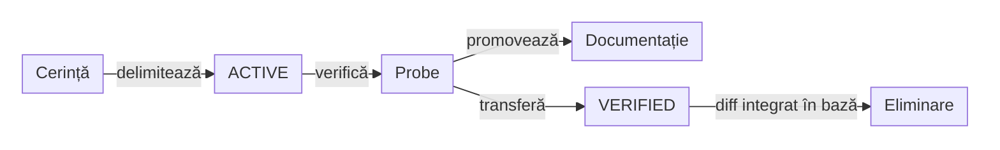

# ATF — registrul de control al schimbărilor de teste

## Pe scurt

Registrul păstrează controalele tehnice `VERIFIED` necesare diferenței Git
față de baza revizuirii. Secțiunile vizibile explică scopul, rolurile și regulile;
înregistrările cu SHA-uri, path-uri și comenzi sunt colapsate la final.

| Întrebarea cititorului | Unde găsește răspunsul |
|---|---|
| Ce comportament mai trebuie corectat? | [Registrul feedback-urilor](feedback/README.md): cerință, lacună, criteriu și dovadă lipsă |
| Ce modificare de teste este încă în lucru? | blocurile `ACTIVE` din feedback-ul ownerului, indexate în [registrul feedback-urilor](feedback/README.md) |
| Ce diferență verificată mai trebuie urmărită până la integrare? | [Controale tehnice verificate](#controale-tehnice-verificate): numai `VERIFIED` |
| Cum verifică efectiv guvernanța? | [README ATF Tests](../atf-tests/README.md#guvernanța-schimbării-testelor): schemă, reguli executabile și CI |

## Scop business

Schimbarea unui test trebuie să păstreze încrederea în comportamentul verificat.
Controlul tehnic leagă schimbarea de cerința sa și de o probă reproductibilă.

| Obiectiv | Rezultat urmărit | Criteriu de acceptare |
|---|---|---|
| Încredere în regresii | modificările păstrează contractul sau explică schimbarea lui | cerință explicită și probe relevante, inclusiv negative |
| Revizuire clară | motivul, perimetrul și dovada pot fi urmărite împreună | un singur control eligibil per path și baseline |
| Documentație actuală | cititorul distinge comportamentul livrat de lucrul rămas | contract la owner, lacune în feedback, control Git temporar |

Aceste obiective sunt contextul registrului. Cerințele funcționale concrete și
prioritatea lor rămân la ownerul domeniului, indexate în
[registrul feedback-urilor](feedback/README.md).

## Context și responsabilități

| Nivel | Întrebarea | Responsabil și rezultat |
|---|---|---|
| Nevoie business | De ce este necesar comportamentul? | ownerul produsului/consumerului: rezultat dorit și prioritate |
| Cerință / contract | Ce trebuie să facă sistemul? | ownerul domeniului: criterii în feedback, apoi contract stabil în documentația proprie |
| Regulă | Ce invariantă trebuie păstrată? | ownerul modulului/guvernanței: regulă documentată și guard executabil |
| Probă de acceptare | Cum demonstrăm comportamentul? | ownerul testului: unit, component, integration sau E2E potrivit criteriului |
| Control al schimbării | Ce diferență Git acoperim? | autorul schimbării: baseline, path-uri exacte, motiv, expirare și comandă Maven |
| Integrare | Când eliminăm înregistrarea? | integratorul: verifică diferența față de noua bază și păstrează contractul la owner |

Un rol poate fi îndeplinit de aceeași persoană; deciziile și dovezile rămân
distincte. `VERIFIED` descrie verificarea incrementului tehnic, iar acceptanța
business se decide separat pe criteriile cerinței.

## Reguli de folosire

| Regulă | Aplicare |
|---|---|
| Perimetru exact | un control acoperă numai path-urile declarate și baza Git rezolvată; ștergerile cer `allowDelete: true` |
| Transfer unic | la trecerea în `VERIFIED`, mută intrarea din feedback-ul ownerului în acest baseline; păstrează ID-ul și evită dublarea ownerilor eligibili |
| Dovadă separată | `proof` declară o comandă; gate-ul verifică schema și eligibilitatea, fără să execute comanda sau să certifice rezultatul ei |
| Stare locală | verificarea unui increment permite promovarea lui; cerința funcțională rămâne deschisă cât timp mai are criterii neîndeplinite |
| Ieșire din registru | elimină controlul când diff-ul față de baza folosită de gate nu mai conține schimbările acoperite; un commit nou singur nu este suficient |
| Reconciliere | expirarea sau un baseline diferit cer revizuirea controlului și a dovezii; nu se prelungește ori rebazează automat |

Mutarea sau redenumirea unui test schimbă path-ul protejat: nu se înlocuiește
automat vechea cale cu cea nouă și nu se adaugă wildcard-uri. Înregistrarea
`VERIFIED` păstrează setul exact de path-uri aprobat pentru baza ei; noul path
ori o ștergere necesită un control exact, activ și autorizat în feedback. Câmpul
`proof` este o comandă de reproducere propusă, nu rezultatul unei execuții și nu
o permisiune suplimentară.

Schema câmpurilor și protecția exactă a fișierelor sunt definite o singură dată
în [guvernanța schimbării testelor](../atf-tests/README.md#guvernanța-schimbării-testelor).
Parserul citește blocurile `testChanges` din toate documentele Markdown din
`docs/feedback` și din acest baseline; controalele active rămân lângă feedback-ul
ownerului, fără un registru separat.

## Ciclul de viață



<details>
<summary><strong>Legendă — acceptanță, transfer și eliminare</strong></summary>

- `ACTIVE` urmărește schimbarea în lucru în feedback-ul documentului ownerului.
- Probele relevante verifică perimetrul schimbării; contractul demonstrat se
  promovează înaintea eliminării lacunei corespunzătoare din feedback.
- `VERIFIED` păstrează numai controlul incrementului verificat care încă apare
  în diff; transferul nu închide automat întreaga cerință funcțională.
- Dacă diff-ul nu mai cere controlul, intrarea se elimină direct; etapa
  `VERIFIED` nu este o arhivă obligatorie.
- Documentația stabilă rămâne la owner după eliminarea înregistrării tehnice.

Etichetele scurte păstrează următorul sens:

| În schemă | Sens complet |
|---|---|
| Cerință | Cerință și criteriu |
| ACTIVE | Control ACTIVE în feedback-ul ownerului |
| Probe | Probe relevante |
| Documentație | Documentația ownerului |
| VERIFIED | Control VERIFIED |
| Eliminare | Eliminare din registru |
| verifică | verifică incrementul |
| promovează | promovează contractul |
| transferă | transferă controlul |

</details>

## Controale tehnice verificate

<details>
<summary><strong>Registru YAML — controale VERIFIED și perimetrele lor exacte</strong></summary>

```yaml
testChanges:
  - id: AUTOEX-STORE-AVAILABILITY-12
    status: VERIFIED
    base: 9b0860bfc734df570c7512b76aa5dbb559527b7d
    expires: 2026-11-25
    reason: Adaugă numai recuperare bounded pentru pagina queue-full pe document GET observat, origin și rute de citire validate. Păstrează toate scenariile și aserțiunile E2E; nu repetă click-uri, POST, operații de cont, coș sau plată. Probe componente pentru recuperare și epuizare, origin străin, element absent și non-replay, plus configurare strictă.
    proof: mvn -pl atf-test-auto-ex,atf-tests -am "-Dtest=AutoExComponentSuite,WholeAtfGovernanceSuiteTest" "-Datf.governance.testChanges.baseRef=9b0860bfc734df570c7512b76aa5dbb559527b7d" "-Datf.test.heap.max=384m" "-Dsurefire.failIfNoSpecifiedTests=false" test
    paths:
      - atf-test-auto-ex/src/test/java/atf/ui/tests/autoex/component/navigation/AutoExAvailabilityFixture.java
      - atf-test-auto-ex/src/test/java/atf/ui/tests/autoex/component/navigation/AutoExStoreAvailabilityComponentTest.java
      - atf-test-auto-ex/src/test/java/atf/ui/tests/autoex/component/configuration/AutoExConfigurationLoaderComponentTest.java
      - atf-test-auto-ex/src/test/resources/atf-auto-ex.yaml
  - id: CONSUMER-SHOP-API-TEST-11
    status: VERIFIED
    base: 9b0860bfc734df570c7512b76aa5dbb559527b7d
    expires: 2026-11-25
    reason: Mută cele două contracte API și fixture-ul în namespace-ul canonic api.network, păstrând cele 19 metode și decodarea query-ului. Fixture-ul introduce observații prin inspectorul public; o probă nouă distinge query-ul redactat la captură de path-ul și query-ul valorii convertite. Recorderul runtime devine privat; fațada mapperului convertește observații și execuții Core, fără a expune callback-ul sau aliasul intern. Suita păstrează selecția și guvernanța protejează granița nouă; preia unic guard-ul de la CONSUMER-AUTOEX-RUNTIME-10 la aceeași bază.
    proof: mvn -pl atf-test-practice-shop,atf-tests -am "-Dtest=ShopComponentSuite,WholeAtfGovernanceSuiteTest" "-Datf.governance.testChanges.baseRef=9b0860bfc734df570c7512b76aa5dbb559527b7d" "-Datf.test.heap.max=384m" "-Dsurefire.failIfNoSpecifiedTests=false" test
    paths:
      - atf-tests/src/test/java/atf/api/tests/governance/consumers/ConsumerModuleArchitectureGovernanceTest.java
  - id: CONSUMER-AUTOEX-RUNTIME-10
    status: VERIFIED
    base: 9b0860bfc734df570c7512b76aa5dbb559527b7d
    expires: 2026-11-24
    reason: Mutare explicită AutoEx runtime în main cu port de finalizare și adaptor JUnit subțire; păstrează selecțiile, pașii și aserțiunile business, mapping-ul observat și cleanup-ul Kit. Scope-urile Maven rămân neschimbate; probe noi pentru erori primare/secundare, mapper și publicare din DOM local. Guard-ul cere noua graniță fără allowlist.
    proof: mvn -pl atf-test-auto-ex,atf-tests -am "-Dtest=AutoExComponentSuite,WholeAtfGovernanceSuiteTest" "-Datf.governance.testChanges.baseRef=9b0860bfc734df570c7512b76aa5dbb559527b7d" "-Datf.test.heap.max=384m" "-Dsurefire.failIfNoSpecifiedTests=false" test
    allowDelete: true
    paths:
      - atf-test-auto-ex/src/test/java/atf/ui/autoex/support/AutoExConsoleBridge.java
      - atf-test-auto-ex/src/test/java/atf/ui/autoex/support/AutoExCustomerApiSetup.java
      - atf-test-auto-ex/src/test/java/atf/ui/autoex/support/AutoExE2eExtension.java
      - atf-test-auto-ex/src/test/java/atf/ui/autoex/support/AutoExE2eRun.java
      - atf-test-auto-ex/src/test/java/atf/ui/autoex/support/AutoExEvidenceProfile.java
      - atf-test-auto-ex/src/test/java/atf/ui/autoex/support/AutoExProjectRoot.java
      - atf-test-auto-ex/src/test/java/atf/ui/tests/autoex/api/AutoExApiContractReportExtension.java
      - atf-test-auto-ex/src/test/java/atf/ui/tests/autoex/component/AutoExEvidenceProfileComponentTest.java
      - atf-test-auto-ex/src/test/java/atf/ui/tests/autoex/component/lifecycle/AutoExRunLifecycleAdapterComponentTest.java
      - atf-test-auto-ex/src/test/java/atf/ui/tests/autoex/component/lifecycle/AutoExRuntimeBoundaryComponentTest.java
      - atf-test-auto-ex/src/test/java/atf/ui/tests/autoex/e2e/AutoExAccountUiE2eTest.java
      - atf-test-auto-ex/src/test/java/atf/ui/tests/autoex/e2e/AutoExCartUiE2eTest.java
      - atf-test-auto-ex/src/test/java/atf/ui/tests/autoex/e2e/AutoExExistingCustomerUiApiE2eTest.java
      - atf-test-auto-ex/src/test/java/atf/ui/tests/autoex/e2e/AutoExPurchaseUiApiE2eTest.java
      - atf-test-auto-ex/src/test/java/atf/ui/tests/autoex/e2e/AutoExPurchaseUiE2eTest.java
      - atf-test-auto-ex/src/test/java/atf/ui/tests/autoex/e2e/AutoExPurchaseUiFinalScreenshotE2eTest.java
      - atf-test-auto-ex/src/test/java/atf/ui/tests/autoex/extension/AutoExE2eExtension.java
      - atf-test-auto-ex/src/test/java/atf/ui/tests/autoex/extension/AutoExEvidenceProfileAdapter.java
      - atf-test-auto-ex/src/test/java/atf/ui/tests/autoex/extension/AutoExRunFactory.java
      - atf-test-auto-ex/src/test/java/atf/ui/tests/autoex/extension/AutoExRunLifecycleAdapter.java
  - id: CONSUMER-ACCOUNT-SCOPE-02
    status: VERIFIED
    base: 9b0860bfc734df570c7512b76aa5dbb559527b7d
    expires: 2026-11-26
    reason: Implementează scope-ul explicit și mutarea factory-urilor runtime cerute direct în feedback; păstrează întregul contract anterior ConsumerModuleArchitectureGovernanceTest și îi preia ownership-ul unic de control, păstrează probele Shop de cont, adaugă lifecycle real Jupiter și întărește main fără JUnit/Kit, fără relaxarea pragurilor sau a opt-in-ului extern.
    proof: mvn -pl atf-test-kit,atf-test-practice-shop,atf-tests -am "-Dtest=ScopedTestValueTest,TestRunScopeComponentTest,ShopComponentSuite,WholeAtfGovernanceSuiteTest" "-Datf.governance.testChanges.baseRef=9b0860bfc734df570c7512b76aa5dbb559527b7d" "-Dsurefire.failIfNoSpecifiedTests=false" test
    paths:
      - atf-test-kit/pom.xml
      - atf-test-kit/src/test/java/atf/api/testkit/scope/ScopedTestValueTest.java
      - atf-test-kit/src/test/java/atf/api/testkit/scope/TestRunScopeComponentTest.java
  - id: REPORT-OBSERVED-OWNER-LIVE-08
    status: VERIFIED
    base: 9b0860bfc734df570c7512b76aa5dbb559527b7d
    expires: 2026-11-24
    reason: Verifică sursa observată/configurată, absența versus captura lipsă și JSON null literal, ownerul API/UI, exchange-urile surori și indicele exact Open in Tests. Include capturi în audit și păstrarea whitespace-ului la sursa UI, sanitizare, semnătură și publisher; păstrează toate cazurile anterioare și baza revizuită explicit. Păstrează lanțul PRIMARY/SECONDARY, quoting-ul independent de ordinea headerelor și ownerul explicit în markup; extragerea duratelor este comună, fără majorarea bugetului de assets.
    proof: mvn -pl atf-reporting-tests,atf-test-auto-ex,atf-test-practice-shop,atf-tests -am "-Dtest=UiNetworkBodyFidelityComponentTest,UiNetworkInspectorComponentTest,AtfReportingUnitSuite,AtfReportingComponentSuite,AtfReportingIntegrationSuite,UiFailureReportContractTest,ShopComponentSuite,AutoExComponentSuite,WholeAtfGovernanceSuiteTest" "-Datf.governance.testChanges.baseRef=9b0860bfc734df570c7512b76aa5dbb559527b7d" "-Datf.test.heap.max=384m" "-Dsurefire.failIfNoSpecifiedTests=false" test
    paths:
      - atf-reporting-tests/src/test/java/atf/api/reporting/api/request/ReportRequestHeadersTest.java
      - atf-reporting-tests/src/test/java/atf/api/reporting/api/request/ObservedRequestEvidenceComponentTest.java
      - atf-reporting-tests/src/test/java/atf/api/reporting/support/request/ObservedRequestFixture.java
      - atf-reporting-tests/src/test/java/atf/api/reporting/ui/validation/UiApiValidationContractComponentTest.java
      - atf-reporting-tests/src/test/java/atf/api/reporting/api/evidence/ApiBodyMediaComponentTest.java
      - atf-reporting-tests/src/test/java/atf/api/reporting/api/evidence/ApiWhitespaceBodyComponentTest.java
      - atf-reporting-tests/src/test/java/atf/api/reporting/extent/session/ExtentReportFailureProjectionContractTest.java
      - atf-reporting-tests/src/test/java/atf/api/reporting/extent/session/ExtentReportSessionContractTest.java
      - atf-reporting-tests/src/test/java/atf/api/reporting/ui/ExtentReportUiFailureEvidenceTest.java
      - atf-reporting-tests/src/test/java/atf/api/reporting/runtime/core/ExtentReportRuntimeScriptTest.java
      - atf-reporting-tests/src/test/java/atf/ui/tests/extent/support/inspection/parity/ApiExchangeParityProbe.java
      - atf-ui/src/test/java/atf/api/ui/network/UiNetworkBodyFidelityComponentTest.java
      - atf-reporting-tests/src/test/java/atf/ui/tests/extent/support/inspection/reconciliation/UiApiVerdictProjectionProbe.java
  - id: REPORT-OBSERVED-OWNER-07
    status: VERIFIED
    base: 5eb3fd3cb099fc67b49be3c17de564db63755db7
    expires: 2026-11-24
    reason: Verifică sursa observată/configurată, absența versus captura lipsă și JSON null literal, ownerul API/UI, exchange-urile surori și indicele exact Open in Tests. Include capturi în audit și păstrarea whitespace-ului la sursa UI, sanitizare, semnătură și publisher; păstrează toate cazurile anterioare și baza revizuită explicit. Păstrează lanțul PRIMARY/SECONDARY, quoting-ul independent de ordinea headerelor și ownerul explicit în markup; extragerea duratelor este comună, fără majorarea bugetului de assets.
    proof: mvn -pl atf-reporting-tests -am "-Dtest=UiNetworkBodyFidelityComponentTest,UiNetworkInspectorComponentTest,AtfReportingUnitSuite,AtfReportingComponentSuite,AtfReportingIntegrationSuite,UiFailureReportContractTest" "-Datf.test.heap.max=384m" "-Dsurefire.failIfNoSpecifiedTests=false" test
    paths:
      - atf-reporting-tests/src/test/java/atf/api/reporting/api/request/ReportRequestHeadersTest.java
      - atf-reporting-tests/src/test/java/atf/api/reporting/api/request/ObservedRequestEvidenceComponentTest.java
      - atf-reporting-tests/src/test/java/atf/api/reporting/support/request/ObservedRequestFixture.java
      - atf-reporting-tests/src/test/java/atf/api/reporting/ui/validation/UiApiValidationContractComponentTest.java
      - atf-reporting-tests/src/test/java/atf/api/reporting/api/evidence/ApiBodyMediaComponentTest.java
      - atf-reporting-tests/src/test/java/atf/api/reporting/api/evidence/ApiWhitespaceBodyComponentTest.java
      - atf-reporting-tests/src/test/java/atf/api/reporting/extent/session/ExtentReportFailureProjectionContractTest.java
      - atf-reporting-tests/src/test/java/atf/api/reporting/extent/session/ExtentReportSessionContractTest.java
      - atf-reporting-tests/src/test/java/atf/api/reporting/ui/ExtentReportUiFailureEvidenceTest.java
      - atf-reporting-tests/src/test/java/atf/api/reporting/runtime/core/ExtentReportRuntimeScriptTest.java
      - atf-reporting-tests/src/test/java/atf/ui/tests/extent/support/inspection/parity/ApiExchangeParityProbe.java
      - atf-ui/src/test/java/atf/api/ui/network/UiNetworkBodyFidelityComponentTest.java
      - atf-reporting-tests/src/test/java/atf/ui/tests/extent/support/inspection/reconciliation/UiApiVerdictProjectionProbe.java
      - atf-test-auto-ex/src/test/java/atf/ui/autoex/support/AutoExE2eRun.java
  - id: REPORT-BODY-AUDITOR-OWNER-09
    status: VERIFIED
    base: 9b0860bfc734df570c7512b76aa5dbb559527b7d
    expires: 2026-11-24
    reason: Revizuire explicită a auditorului body față de baza comună live 9b0860b; distinge absența confirmată de captură lipsă și null literal, acoperă JSON fallback fără relaxarea controalelor. Cele trei probe existente ObservedRequestEvidenceComponentTest, ObservedRequestFixture și UiApiVerdictProjectionProbe păstrează ownerul unic REPORT-OBSERVED-OWNER-LIVE-08 și includ întăririle pentru QUERY, retry și headere reale.
    proof: mvn -pl atf-reporting-tests,atf-tests -am "-Dtest=AtfReportingUnitSuite,AtfReportingComponentSuite,AtfReportingIntegrationSuite,WholeAtfGovernanceSuiteTest" "-Datf.governance.testChanges.baseRef=9b0860bfc734df570c7512b76aa5dbb559527b7d" "-Dsurefire.failIfNoSpecifiedTests=false" test
    paths:
      - atf-reporting-tests/src/test/java/atf/api/reporting/api/request/ObservedBodyAuditComponentTest.java
      - atf-reporting-tests/src/test/java/atf/api/reporting/api/contract/ApiReportContractAuditorTest.java
      - atf-reporting-tests/src/test/java/atf/api/reporting/support/request/LiveClientHeaderProbe.java
      - atf-reporting-tests/src/test/java/atf/api/reporting/html/contract/HtmlReportStaticContractTest.java
      - atf-reporting-tests/src/test/java/atf/api/reporting/ui/audit/section/CategoriesAndEvidenceSectionValidatorTest.java
      - atf-reporting-tests/src/test/java/atf/ui/tests/extent/support/audit/api/ApiJsonEvidenceAuditor.java
      - atf-reporting-tests/src/test/java/atf/ui/tests/extent/support/audit/mock/MockReportContractAuditor.java
      - atf-reporting-tests/src/test/java/atf/ui/tests/extent/support/locators/ReportEvidenceLocators.java
      - atf-reporting-tests/src/test/java/atf/ui/tests/extent/support/locators/ReportUiLocators.java
      - atf-reporting-tests/src/test/java/atf/ui/tests/extent/support/section/extract/ApiJsonEvidenceExtractor.java
  - id: AUTOEX-DELETE-DIAGNOSTICS-02
    status: VERIFIED
    base: 9b0860bfc734df570c7512b76aa5dbb559527b7d
    expires: 2026-11-26
    reason: Păstrează cazurile existente și verifică exact o navigare GET de document într-un snapshot complet, distinct de totalul evenimentelor browser; orice request observat continuă să interzică replay-ul. Cazurile negative rămân FAIL, iar cele două E2E business verifică ștergerea la 70%, inclusiv Close JavaScript după vignette natural, fără trafic sau reclamă fabricate.
    proof: mvn -pl atf-test-auto-ex,atf-tests -am "-Dtest=AutoExAccountDeletionSafetyComponentTest,AutoExAccountUiE2eTest,AutoExExistingCustomerUiApiE2eTest,WholeAtfGovernanceSuiteTest" "-Datf.autoex.e2e.enabled=true" "-Datf.governance.testChanges.baseRef=9b0860bfc734df570c7512b76aa5dbb559527b7d" "-Dsurefire.failIfNoSpecifiedTests=false" test
    paths:
      - atf-test-auto-ex/src/test/java/atf/ui/tests/autoex/component/journey/AutoExAccountDeletionSafetyComponentTest.java
  - id: CONSUMER-REPORTING-INTEGRATION-06
    status: VERIFIED
    base: 9b0860bfc734df570c7512b76aa5dbb559527b7d
    expires: 2026-11-24
    allowDelete: true
    reason: Revizuire separată a diferenței față de commitul live integrat; păstrează migrarea API tipizată și probele noi de cleanup, mută numai suportul neutru și probele la owner și elimină aliasurile de suite fără pierderea selecției; nu rebazează controalele existente și nu relaxează pragurile.
    proof: mvn -pl atf-tests,atf-test-practice-shop,atf-test-auto-ex -am "-Dtest=WholeAtfGovernanceSuiteTest,ShopComponentSuite,AutoExComponentSuite" "-Datf.governance.testChanges.baseRef=9b0860bfc734df570c7512b76aa5dbb559527b7d" "-Dsurefire.failIfNoSpecifiedTests=false" test
    paths:
      - atf-reporting-tests/src/test/java/atf/api/reporting/api/ApiManualReplayProjectionTest.java
      - atf-reporting-tests/src/test/java/atf/api/reporting/extent/time/ReportingTimestampComponentTest.java
      - atf-reporting-tests/src/test/java/atf/api/reporting/ui/failure/UiSetupFailureEvidenceComponentTest.java
      - atf-reporting/src/test/java/atf/api/reporting/standalone/ReportingTimestampComponentTest.java
      - atf-test-auto-ex/src/test/java/atf/ui/autoex/support/AutoExScreenAuditObservations.java
      - atf-test-auto-ex/src/test/java/atf/ui/tests/autoex/api/AutoExApiAccountCleanup.java
      - atf-test-auto-ex/src/test/java/atf/ui/tests/autoex/api/AutoExApiLiveContractTest.java
      - atf-test-auto-ex/src/test/java/atf/ui/tests/autoex/api/AutoExApiReadOnlyLiveContractTest.java
      - atf-test-auto-ex/src/test/java/atf/ui/tests/autoex/api/AutoExApiResponseAssertions.java
      - atf-test-auto-ex/src/test/java/atf/ui/tests/autoex/component/api/AutoExApiAccountCleanupComponentTest.java
      - atf-test-auto-ex/src/test/java/atf/ui/tests/autoex/component/api/AutoExApiContractReportPublisherComponentTest.java
      - atf-test-auto-ex/src/test/java/atf/ui/tests/autoex/component/api/AutoExApiResponseAssertionsComponentTest.java
      - atf-test-auto-ex/src/test/java/atf/ui/tests/autoex/suites/AutoExApiComponentSuite.java
      - atf-test-auto-ex/src/test/java/atf/ui/tests/autoex/suites/AutoExApiLiveSuite.java
      - atf-test-auto-ex/src/test/java/atf/ui/tests/autoex/suites/AutoExApiReadOnlyLiveSuite.java
      - atf-test-auto-ex/src/test/java/atf/ui/tests/autoex/suites/AutoExBusinessSuite.java
      - atf-test-auto-ex/src/test/java/atf/ui/tests/autoex/suites/AutoExE2eSuite.java
      - atf-test-auto-ex/src/test/java/atf/ui/tests/autoex/suites/AutoExPurchaseSuite.java
      - atf-test-auto-ex/src/test/java/atf/ui/tests/autoex/support/api/AutoExApiTestSupport.java
      - atf-test-kit/src/test/java/atf/api/testkit/AtfTestLayerArchitectureTest.java
      - atf-test-kit/src/test/java/atf/api/testkit/lifecycle/ArmedCleanupTest.java
      - atf-test-kit/src/test/java/atf/api/testkit/lifecycle/CloseOnceResourceTest.java
      - atf-tests/src/test/java/atf/api/tests/governance/WholeAtfGovernanceSuiteTest.java
      - atf-tests/src/test/java/atf/api/tests/governance/layers/AtfTestLayerArchitectureTest.java
      - atf-tests/src/test/java/atf/api/tests/governance/layers/ConsumerSuiteCoverageGovernanceTest.java
      - atf-ui/src/test/java/atf/api/ui/audit/UiScreenAuditTest.java
  - id: REPORT-INVALID-CAPTURE-03
    status: VERIFIED
    base: b9b1325c28d665be6289bb2cf9286666513e7a05
    expires: 2026-11-24
    reason: Adaugă payload-uri Base64 invalide și non-PNG în matricea Extent/fallback, fără a elimina cazurile integrate în paralel; verifică absența linkurilor false și păstrarea cauzei originale.
    proof: mvn -pl atf-reporting-tests -am "-Dtest=UiAuditLifecycleTest,ReportEvidenceProfileIntegrationTest,ReportScreenshotTest" "-Dsurefire.failIfNoSpecifiedTests=false" test
    paths:
      - atf-reporting-tests/src/test/java/atf/api/reporting/ui/UiAuditLifecycleTest.java
  - id: REPORT-CLIENT-METADATA-01
    status: VERIFIED
    base: a23c76e662516504f55a4369c58ca98bbf2f26ec
    expires: 2026-10-30
    reason: Verify the generic System Client fallback is neutral when consumer metadata is absent.
    proof: mvn -pl atf-reporting-tests -am "-Dtest=ReportEnvironmentSnapshotTest" "-Dsurefire.failIfNoSpecifiedTests=false" test
    paths:
      - atf-reporting-tests/src/test/java/atf/api/reporting/configuration/ReportEnvironmentSnapshotTest.java
  - id: AUTOEX-EXISTING-CUSTOMER-DELETE-01
    status: VERIFIED
    base: 5eb3fd3cb099fc67b49be3c17de564db63755db7
    expires: 2026-11-24
    reason: Adaugă self-service-ul real login/delete și pregătirea API-only cu cleanup armat înainte de create, fără reclame fabricate sau replay. Modificările adaptorului și factory-ului live rămân la controalele existente AUTOEX-VOCABULARY-01 și AUTOEX-CONTRACT-VOCABULARY-02, revalidate de aceeași probă; acceptanța vignette rămâne distinctă.
    proof: mvn -pl atf-test-auto-ex,atf-tests -am "-Dtest=AutoExComponentSuite,AutoExAccountUiE2eTest,AutoExExistingCustomerUiApiE2eTest,WholeAtfGovernanceSuiteTest" "-Datf.autoex.e2e.enabled=true" "-Datf.governance.testChanges.baseRef=5eb3fd3cb099fc67b49be3c17de564db63755db7" "-Dsurefire.failIfNoSpecifiedTests=false" test
    paths:
      - atf-test-auto-ex/src/test/java/atf/ui/autoex/support/AutoExCustomerApiSetup.java
      - atf-test-auto-ex/src/test/java/atf/ui/tests/autoex/e2e/AutoExExistingCustomerUiApiE2eTest.java
  - id: CONSUMER-REPORTING-RECONCILE-05
    status: VERIFIED
    base: a1dd0c3a9de6912e48e17c8e3724addd0fe77bfc
    expires: 2026-11-24
    allowDelete: true
    reason: Revizuire explicită pe commitul live nou; păstrează migrarea API tipizată și toate aserțiunile, extrage lifecycle neutru în Kit și audit neutru în UI, mută probele neutre în Reporting Tests și întărește selecția completă fără excepții suplimentare.
    proof: mvn -pl atf-reporting-tests -am test; mvn -pl atf-tests,atf-test-practice-shop,atf-test-auto-ex -am "-Dtest=WholeAtfGovernanceSuiteTest,ShopComponentSuite,AutoExComponentSuite" "-Datf.governance.testChanges.baseRef=a1dd0c3a9de6912e48e17c8e3724addd0fe77bfc" "-Dsurefire.failIfNoSpecifiedTests=false" test; mvn -pl atf-reporting-tests -am "-Dtest=ExtentReportAssetCleanupTest,ExtentReportSessionContractTest,UiFailureReportContractTest" "-Dsurefire.failIfNoSpecifiedTests=false" test
    paths:
      - atf-reporting-tests/src/test/java/atf/api/reporting/api/ApiManualReplayProjectionTest.java
      - atf-reporting-tests/src/test/java/atf/api/reporting/api/auth/ApiAuthenticationSchemaContractTest.java
      - atf-reporting-tests/src/test/java/atf/api/reporting/api/evidence/ApiBodyArtifactFixture.java
      - atf-reporting-tests/src/test/java/atf/api/reporting/api/evidence/ApiBodyMediaComponentTest.java
      - atf-reporting-tests/src/test/java/atf/api/reporting/extent/session/ExtentReportSessionContractTest.java
      - atf-reporting-tests/src/test/java/atf/api/reporting/extent/time/ReportingTimestampComponentTest.java
      - atf-reporting-tests/src/test/java/atf/api/reporting/markup/ExtentReportAssetCleanupTest.java
      - atf-reporting-tests/src/test/java/atf/api/reporting/support/publication/CleanupPublicationFixture.java
      - atf-reporting-tests/src/test/java/atf/api/reporting/ui/ExtentReportUiEvidencePublishingTest.java
      - atf-reporting-tests/src/test/java/atf/api/reporting/ui/failure/UiSetupFailureEvidenceComponentTest.java
      - atf-reporting-tests/src/test/java/atf/api/reporting/ui/network/NetworkInspectorSummaryRoleTest.java
      - atf-reporting-tests/src/test/java/atf/api/reporting/ui/profile/ReportEvidenceProfileIntegrationTest.java
      - atf-reporting-tests/src/test/java/atf/api/reporting/ui/validation/UiApiValidationContractComponentTest.java
      - atf-reporting-tests/src/test/java/atf/api/reporting/ui/validation/UiApiValidationFixtures.java
      - atf-reporting-tests/src/test/java/atf/ui/tests/extent/component/inspection/network/NetworkCaptureEvidenceTest.java
      - atf-reporting-tests/src/test/java/atf/ui/tests/extent/component/inspection/retry/ApiRetryProjectionContractTest.java
      - atf-reporting-tests/src/test/java/atf/ui/tests/extent/support/inspection/disclosure/ExtentReportDisclosureProbe.java
      - atf-reporting-tests/src/test/java/atf/ui/tests/extent/support/inspection/layout/ScrollableTableReportFixture.java
      - atf-reporting-tests/src/test/java/atf/ui/tests/extent/support/inspection/parity/ApiExchangeParityProbe.java
      - atf-reporting/src/test/java/atf/api/reporting/standalone/ReportingTimestampComponentTest.java
      - atf-test-auto-ex/src/test/java/atf/ui/autoex/support/AutoExE2eRun.java
      - atf-test-auto-ex/src/test/java/atf/ui/autoex/support/AutoExScreenAuditObservations.java
      - atf-test-auto-ex/src/test/java/atf/ui/tests/autoex/api/AutoExApiAccountCleanup.java
      - atf-test-auto-ex/src/test/java/atf/ui/tests/autoex/api/AutoExApiContractReportExtension.java
      - atf-test-auto-ex/src/test/java/atf/ui/tests/autoex/api/AutoExApiLiveContractTest.java
      - atf-test-auto-ex/src/test/java/atf/ui/tests/autoex/api/AutoExApiReadOnlyLiveContractTest.java
      - atf-test-auto-ex/src/test/java/atf/ui/tests/autoex/api/AutoExApiResponseAssertions.java
      - atf-test-auto-ex/src/test/java/atf/ui/tests/autoex/component/AutoExEvidenceProfileComponentTest.java
      - atf-test-auto-ex/src/test/java/atf/ui/tests/autoex/component/api/AutoExApiAccountCleanupComponentTest.java
      - atf-test-auto-ex/src/test/java/atf/ui/tests/autoex/component/api/AutoExApiContractReportPublisherComponentTest.java
      - atf-test-auto-ex/src/test/java/atf/ui/tests/autoex/component/api/AutoExApiResponseAssertionsComponentTest.java
      - atf-test-auto-ex/src/test/java/atf/ui/tests/autoex/suites/AutoExApiComponentSuite.java
      - atf-test-auto-ex/src/test/java/atf/ui/tests/autoex/suites/AutoExApiLiveSuite.java
      - atf-test-auto-ex/src/test/java/atf/ui/tests/autoex/suites/AutoExApiReadOnlyLiveSuite.java
      - atf-test-auto-ex/src/test/java/atf/ui/tests/autoex/suites/AutoExBusinessSuite.java
      - atf-test-auto-ex/src/test/java/atf/ui/tests/autoex/suites/AutoExE2eSuite.java
      - atf-test-auto-ex/src/test/java/atf/ui/tests/autoex/suites/AutoExPurchaseSuite.java
      - atf-test-auto-ex/src/test/java/atf/ui/tests/autoex/support/api/AutoExApiTestSupport.java
      - atf-test-kit/src/test/java/atf/api/testkit/AtfTestLayerArchitectureTest.java
      - atf-test-kit/src/test/java/atf/api/testkit/lifecycle/ArmedCleanupTest.java
      - atf-test-kit/src/test/java/atf/api/testkit/lifecycle/CloseOnceResourceTest.java
      - atf-tests/src/test/java/atf/api/tests/governance/WholeAtfGovernanceSuiteTest.java
      - atf-tests/src/test/java/atf/api/tests/governance/consumers/ConsumerModuleArchitectureGovernanceTest.java
      - atf-tests/src/test/java/atf/api/tests/governance/layers/AtfTestLayerArchitectureTest.java
      - atf-tests/src/test/java/atf/api/tests/governance/layers/ConsumerSuiteCoverageGovernanceTest.java
      - atf-ui/src/test/java/atf/api/ui/audit/UiScreenAuditTest.java
  - id: REPORT-ASSET-CLEANUP-LOCK-05
    status: VERIFIED
    base: 5eb3fd3cb099fc67b49be3c17de564db63755db7
    expires: 2026-11-24
    reason: Probează ambele forme de lock Windows, epuizarea bounded și întreruperea, fără a schimba plafonul cleanup-ului sau a ignora erorile de publicare. Revizuirea exactă a fișierului confirmă același conținut de bază în 5eb3fd3 și b9b1325; controlul folosește baza comună a gate-ului, fără extindere de path-uri; promovarea urmează execuția probelor.
    proof: mvn -pl atf-reporting-tests -am "-Dtest=ExtentReportAssetCleanupTest,AtfReportingComponentSuite,UiFailureReportContractTest" "-Dsurefire.failIfNoSpecifiedTests=false" test
    paths:
      - atf-reporting-tests/src/test/java/atf/api/reporting/markup/ExtentReportAssetCleanupTest.java
  - id: REPORT-FAILURE-CLIENT-COMPONENT-04
    status: VERIFIED
    base: 7b365028ac8356960614e35023556e757311e633
    expires: 2026-11-24
    reason: Păstrează cazurile originale și cele integrate în paralel; adaugă matricea politicilor, snapshot-uri Extent/fallback și cazul fără acțiuni, păstrând Client exact o dată și starea capturii într-un vocabular tipizat.
    proof: mvn -pl atf-reporting-tests -am "-Dtest=AtfReportingComponentSuite" "-Dsurefire.failIfNoSpecifiedTests=false" test
    paths:
      - atf-reporting-tests/src/test/java/atf/api/reporting/ui/UiAuditLifecycleTest.java
      - atf-reporting-tests/src/test/java/atf/api/reporting/extent/session/ExtentReportSessionContractTest.java
  - id: UI-API-TYPED-ONLY-01
    status: VERIFIED
    base: 5eb3fd3cb099fc67b49be3c17de564db63755db7
    expires: 2026-11-23
    reason: Cerere directa de eliminare a caii legacy UI_API; migrare mecanica a probelor si test component/guard pentru modelul tipizat unic, fara relaxarea contractelor.
    proof: mvn -pl atf-reporting-tests,atf-test-practice-shop,atf-test-auto-ex,atf-tests -am "-Dtest=UiApiValidationContractComponentTest,AtfReportingComponentSuite,ShopComponentSuite,AutoExComponentSuite,WholeAtfGovernanceSuiteTest" "-Datf.governance.testChanges.baseRef=5eb3fd3cb099fc67b49be3c17de564db63755db7" "-Dsurefire.failIfNoSpecifiedTests=false" test
    paths:
      - atf-reporting-tests/src/test/java/atf/api/reporting/ui/validation/UiApiValidationFixtures.java
      - atf-reporting-tests/src/test/java/atf/api/reporting/ui/profile/ReportEvidenceProfileIntegrationTest.java
      - atf-reporting-tests/src/test/java/atf/api/reporting/ui/ExtentReportUiEvidencePublishingTest.java
      - atf-reporting-tests/src/test/java/atf/ui/tests/extent/support/inspection/layout/ScrollableTableReportFixture.java
      - atf-reporting-tests/src/test/java/atf/ui/tests/extent/support/inspection/disclosure/ExtentReportDisclosureProbe.java
      - atf-reporting-tests/src/test/java/atf/api/reporting/api/auth/ApiAuthenticationSchemaContractTest.java
  - id: AUTOEX-DELETE-AFTER-AD-01
    status: VERIFIED
    base: 5eb3fd3cb099fc67b49be3c17de564db63755db7
    expires: 2026-11-23
    reason: Verifica siguranta continuarii dupa reclama fara request de stergere pornit; inventarul exact include cele doua clase noi fara relaxarea pragului. Diff-ul celor trei path-uri este identic fata de bazele revizuite 5eb3fd3 si 7b36502.
    proof: mvn "-pl=atf-test-auto-ex,atf-tests" -am "-Dtest=AutoExComponentSuite,AutoExAccountUiE2eTest,AutoExBusinessSuite,AutoExPurchaseUiApiE2eTest,WholeAtfGovernanceSuiteTest" "-Datf.autoex.e2e.enabled=true" "-Datf.governance.testChanges.baseRef=5eb3fd3cb099fc67b49be3c17de564db63755db7" "-Dsurefire.failIfNoSpecifiedTests=false" test
    paths:
      - atf-test-auto-ex/src/test/java/atf/ui/tests/autoex/component/journey/AutoExAccountDeletionSafetyComponentTest.java
      - atf-test-auto-ex/src/test/java/atf/ui/tests/autoex/e2e/AutoExAccountUiE2eTest.java
      - atf-tests/src/test/java/atf/api/tests/governance/AtfPackageCohesionGovernanceTest.java
  - id: REPORT-OPEN-GAPS-COMPONENT-03
    status: VERIFIED
    base: 5eb3fd3cb099fc67b49be3c17de564db63755db7
    expires: 2026-11-23
    reason: Păstrează toate cazurile Network la ownerul UI component, reclasifică publicarea HTML ca probă componentă și verifică motivul capturii și Client neutru sau explicit redactat. Ștergerea vechiului path Network este deja autorizată de UI-NETWORK-CAPTURE-PROOFS-01.
    proof: mvn -pl atf-reporting-tests -am "-Dtest=AtfReportingComponentSuite,ExtentReportUiFailureEvidenceTest" "-Dsurefire.failIfNoSpecifiedTests=false" test
    paths:
      - atf-reporting-tests/src/test/java/atf/ui/tests/extent/component/inspection/network/NetworkCaptureEvidenceTest.java
      - atf-reporting-tests/src/test/java/atf/ui/tests/extent/support/locators/network/ReportNetworkCaptureLocators.java
      - atf-reporting-tests/src/test/java/atf/api/reporting/ui/UiAuditLifecycleTest.java
  - id: REPORT-NATIVE-CLOCK-LAYER-03
    status: VERIFIED
    base: 5eb3fd3cb099fc67b49be3c17de564db63755db7
    expires: 2026-11-23
    reason: Înregistrează exact proba nativă ReportingTimestampComponentTest în inventarul standalone finit, fără a permite alte importuri sau a extinde allowlist-ul browser.
    proof: mvn -pl atf-test-kit -am test
    paths:
      - atf-test-kit/src/test/java/atf/api/testkit/AtfTestLayerArchitectureTest.java
      - atf-reporting/src/test/java/atf/api/reporting/standalone/ReportingTimestampComponentTest.java
  - id: UI-JAVASCRIPT-CLICK-01
    status: VERIFIED
    base: 5eb3fd3cb099fc67b49be3c17de564db63755db7
    expires: 2026-11-23
    reason: Integreaza activarea DOM explicita cu postconditie atomica si probe neutre la ownerul UI; inlocuieste fallback-ul AutoEx 100 cu profilul 70 fara schimbarea click-urilor business.
    proof: mvn "-pl=atf-test-auto-ex,atf-tests" -am "-Dtest=PlaywrightJavaScriptClickComponentTest,PlaywrightActionSequenceTest,PlaywrightUiSessionTest,AutoExComponentSuite,AutoExBusinessSuite,AutoExPurchaseUiApiE2eTest,WholeAtfGovernanceSuiteTest" "-Datf.autoex.e2e.enabled=true" "-Datf.governance.testChanges.baseRef=5eb3fd3cb099fc67b49be3c17de564db63755db7" "-Dsurefire.failIfNoSpecifiedTests=false" test
    paths:
      - atf-ui/src/test/java/atf/api/ui/playwright/PlaywrightJavaScriptClickComponentTest.java
      - atf-ui/src/test/resources/atf/ui/playwright/javascript-click.html
      - atf-test-auto-ex/src/test/resources/atf-auto-ex.yaml
  - id: API-BODY-SECURITY-COMPONENT-02
    status: VERIFIED
    base: 5eb3fd3cb099fc67b49be3c17de564db63755db7
    expires: 2026-11-23
    reason: Verifica probele live pentru redactarea multipart si fidelitatea whitespace la ownerul Reporting, cu fixture neutra comuna, fara eliminarea sau relaxarea asertiunilor existente.
    proof: mvn -pl atf-reporting-tests -am "-Dtest=ApiMultipartBodyComponentTest,ApiWhitespaceBodyComponentTest" "-Dsurefire.failIfNoSpecifiedTests=false" test
    paths:
      - atf-reporting-tests/src/test/java/atf/api/reporting/api/evidence/ApiBodyArtifactFixture.java
      - atf-reporting-tests/src/test/java/atf/api/reporting/api/evidence/ApiMultipartBodyComponentTest.java
  - id: UI-NETWORK-CAPTURE-PROOFS-01
    status: VERIFIED
    base: 5eb3fd3cb099fc67b49be3c17de564db63755db7
    expires: 2026-11-23
    allowDelete: true
    reason: Probe owner pentru selectie inainte de body si buget, overflow, cursor, redactare si completitudine; elimina helperul generic si proba lui din AutoEx.
    proof: mvn -pl atf-ui,atf-reporting-tests,atf-test-auto-ex,atf-tests -am "-Dtest=UiNetworkInspectorComponentTest,NetworkCaptureEvidenceTest,AutoExComponentSuite,AutoExPurchaseUiApiE2eTest,WholeAtfGovernanceSuiteTest" "-Datf.autoex.e2e.enabled=true" "-Datf.governance.testChanges.baseRef=5eb3fd3cb099fc67b49be3c17de564db63755db7" "-Dsurefire.failIfNoSpecifiedTests=false" test
    paths:
      - atf-ui/src/test/java/atf/api/ui/network/UiNetworkInspectorComponentTest.java
      - atf-reporting-tests/src/test/java/atf/api/reporting/ui/network/NetworkCaptureEvidenceTest.java
      - atf-test-auto-ex/src/test/java/atf/ui/autoex/support/AutoExApiTrafficWindow.java
      - atf-test-auto-ex/src/test/java/atf/ui/tests/autoex/component/journey/AutoExPurchaseBusinessComponentTest.java
  - id: UI-NETWORK-CAPTURE-CHECKS-01
    status: VERIFIED
    base: 5eb3fd3cb099fc67b49be3c17de564db63755db7
    expires: 2026-11-23
    allowDelete: true
    reason: Pastreaza aprobarea probelor de selectie si completitudine din incrementul live; proba generica de fereastra este consolidata la ownerul UI.
    proof: mvn -pl atf-ui,atf-reporting-tests,atf-test-auto-ex -am "-Dtest=UiNetworkInspectionConfigurationTest,UiNetworkInspectorComponentTest,NetworkInspectorSummaryRoleTest,NetworkCaptureEvidenceTest,AutoExComponentSuite,AutoExPurchaseUiApiE2eTest" "-Datf.autoex.e2e.enabled=true" "-Dsurefire.failIfNoSpecifiedTests=false" test
    paths:
      - atf-ui/src/test/java/atf/api/ui/config/UiNetworkInspectionConfigurationTest.java
      - atf-test-auto-ex/src/test/java/atf/ui/tests/autoex/component/AutoExApiTrafficWindowComponentTest.java
      - atf-reporting-tests/src/test/java/atf/api/reporting/ui/network/NetworkInspectorSummaryRoleTest.java
  - id: AUTOEX-VOCABULARY-01
    status: VERIFIED
    base: 5eb3fd3cb099fc67b49be3c17de564db63755db7
    expires: 2026-11-23
    reason: Centralizează identitatea AutoEx, originea fixture, metodele HTTP, MIME-ul form și câmpurile wire; păstrează oracolul independent și probează override-ul URL, encoding-ul și parametrii intenționat omiși.
    proof: mvn -pl atf-test-auto-ex,atf-tests -am "-Dtest=AutoExComponentSuite,AutoExApiReadOnlyLiveSuite,AtfPackageCohesionGovernanceTest,ConsumerModuleArchitectureGovernanceTest" "-Datf.autoex.api.readonly.live.enabled=true" "-Dsurefire.failIfNoSpecifiedTests=false" test
    paths:
      - atf-test-auto-ex/src/test/java/atf/ui/tests/autoex/component/AutoExEvidenceProfileComponentTest.java
      - atf-test-auto-ex/src/test/java/atf/ui/tests/autoex/component/api/AutoExApiContractComponentTest.java
      - atf-test-auto-ex/src/test/java/atf/ui/tests/autoex/component/api/AutoExApiContractReportPublisherComponentTest.java
      - atf-test-auto-ex/src/test/java/atf/ui/tests/autoex/component/configuration/AutoExConfigurationLoaderComponentTest.java
      - atf-test-auto-ex/src/test/java/atf/ui/tests/autoex/support/AutoExApiFixture.java
  - id: AUTOEX-CONTRACT-VOCABULARY-02
    status: VERIFIED
    base: 5eb3fd3cb099fc67b49be3c17de564db63755db7
    expires: 2026-11-23
    reason: Continuă revizuirea vocabularului AutoEx cu rezultate API typed, verdicturi UI comune, localizare search semantică și limite de diagnostic; path-urile deja deținute de AUTOEX-VOCABULARY-01 rămân acolo și sunt revalidate de aceeași probă.
    proof: mvn -pl atf-test-auto-ex,atf-tests -am "-Dtest=AutoExComponentSuite,AutoExApiReadOnlyLiveSuite,AtfPackageCohesionGovernanceTest,ConsumerModuleArchitectureGovernanceTest" "-Datf.autoex.api.readonly.live.enabled=true" "-Dsurefire.failIfNoSpecifiedTests=false" test
    paths:
      - atf-test-auto-ex/src/test/java/atf/ui/tests/autoex/api/AutoExApiLiveContractTest.java
      - atf-test-auto-ex/src/test/java/atf/ui/tests/autoex/api/AutoExApiResponseAssertions.java
      - atf-test-auto-ex/src/test/java/atf/ui/tests/autoex/api/AutoExApiContractReportExtension.java
      - atf-test-auto-ex/src/test/java/atf/ui/tests/autoex/component/AutoExCatalogAssertionsComponentTest.java
      - atf-test-auto-ex/src/test/java/atf/ui/tests/autoex/component/AutoExStoreAssertionsComponentTest.java
  - id: TEST-LAYER-DECLARATIONS-01
    status: VERIFIED
    base: 5eb3fd3cb099fc67b49be3c17de564db63755db7
    expires: 2026-11-23
    allowDelete: true
    reason: Declară nivelul real al probelor existente, separă meta-adnotările de fixture și păstrează testul browser retry la ownerul UI component fără relaxarea guvernanței.
    proof: mvn -pl atf-console,atf-core,atf-ui,atf-reporting-tests,atf-test-practice-shop,atf-tests -am "-Dtest=AtfConsoleTestExtensionIntegrationTest,AtfReportPathOptInTest,ThrowableDiagnosticsTest,ApiBodyEvidenceTest,AuthProfilesTest,AtfConsoleEventInteropTest,ExtentUnifiedFlowMultipleScreenshotTest,ShopE2eContextEvidenceProfileTest,CssStringEscaperTest,HtmlElementTest,ApiRetryProjectionContractTest,WholeAtfGovernanceSuiteTest" "-Datf.governance.testChanges.baseRef=5eb3fd3cb099fc67b49be3c17de564db63755db7" "-Dsurefire.failIfNoSpecifiedTests=false" test
    paths:
      - atf-console/src/test/java/atf/api/console/junit/AtfConsoleTestExtensionIntegrationTest.java
      - atf-console/src/test/java/atf/api/console/junit/AtfReportPathOptInTest.java
      - atf-core/src/test/java/atf/api/core/diagnostics/ThrowableDiagnosticsTest.java
      - atf-core/src/test/java/atf/api/core/http/ApiBodyEvidenceTest.java
      - atf-core/src/test/java/atf/api/core/http/auth/AuthProfilesTest.java
      - atf-core/src/test/java/atf/api/core/reporting/AtfConsoleEventInteropTest.java
      - atf-reporting-tests/src/test/java/atf/api/reporting/ui/ExtentUnifiedFlowMultipleScreenshotTest.java
      - atf-ui/src/test/java/atf/api/ui/dom/CssStringEscaperTest.java
      - atf-ui/src/test/java/atf/api/ui/dom/HtmlElementTest.java
      - atf-test-kit/src/test/java/atf/api/testkit/reporting/AtfReportPathPolicyResolverTest.java
      - atf-test-kit/src/test/java/atf/api/testkit/reporting/TestReportPathOwner.java
      - atf-test-kit/src/test/java/atf/api/testkit/reporting/TestDisabledReportPathOwner.java
      - atf-reporting-tests/src/test/java/atf/api/reporting/api/retry/ApiRetryProjectionContractTest.java
      - atf-reporting-tests/src/test/java/atf/ui/tests/extent/component/inspection/retry/ApiRetryProjectionContractTest.java
  - id: AUTOEX-CART-SESSION-01
    status: VERIFIED
    base: 0f6a95265024a78c20754d5c18937d24434a2d2d
    expires: 2026-11-23
    reason: Adauga povesti business reale pentru recalcularea cosului si continuitatea dupa login, pastrand cleanup-ul identitatii si suite API separate.
    proof: mvn "-pl=atf-test-auto-ex,atf-tests" -am "-Dtest=TestRunInitializationTest,FailureAwareCleanupTest,PlaywrightUiSessionTest,AutoExComponentSuite,AutoExBusinessSuite,AutoExApiReadOnlyLiveSuite,AutoExApiLiveSuite,WholeAtfGovernanceSuiteTest" "-Datf.autoex.e2e.enabled=true" "-Datf.autoex.api.readonly.live.enabled=true" "-Datf.autoex.api.live.enabled=true" "-Datf.governance.testChanges.baseRef=0f6a95265024a78c20754d5c18937d24434a2d2d" "-Dsurefire.failIfNoSpecifiedTests=false" test
    paths:
      - atf-test-auto-ex/src/test/java/atf/ui/autoex/support/AutoExE2eRun.java
      - atf-test-auto-ex/src/test/java/atf/ui/tests/autoex/api/AutoExApiLiveContractTest.java
      - atf-test-auto-ex/src/test/java/atf/ui/tests/autoex/e2e/AutoExCartUiE2eTest.java
      - atf-test-auto-ex/src/test/java/atf/ui/tests/autoex/suites/AutoExApiComponentSuite.java
      - atf-test-auto-ex/src/test/java/atf/ui/tests/autoex/suites/AutoExBusinessSuite.java
  - id: UI-FRAME-ZOOM-01
    status: VERIFIED
    base: 0f6a95265024a78c20754d5c18937d24434a2d2d
    expires: 2026-11-23
    reason: Separa zoom-ul documentului principal de iframe si probeaza geometria pointerului la scara nativa in ownerul UI, fara reclama sau site artificial AutoEx.
    proof: mvn "-pl=atf-test-auto-ex,atf-tests" -am "-Dtest=TestRunInitializationTest,FailureAwareCleanupTest,PlaywrightUiSessionTest,AutoExComponentSuite,AutoExBusinessSuite,AutoExApiReadOnlyLiveSuite,AutoExApiLiveSuite,WholeAtfGovernanceSuiteTest" "-Datf.autoex.e2e.enabled=true" "-Datf.autoex.api.readonly.live.enabled=true" "-Datf.autoex.api.live.enabled=true" "-Datf.governance.testChanges.baseRef=0f6a95265024a78c20754d5c18937d24434a2d2d" "-Dsurefire.failIfNoSpecifiedTests=false" test
    paths:
      - atf-ui/src/test/java/atf/api/ui/playwright/PlaywrightUiSessionTest.java
  - id: CONSUMER-PROOF-CONSOLIDATION-01
    status: VERIFIED
    base: 0f6a95265024a78c20754d5c18937d24434a2d2d
    expires: 2026-11-23
    reason: Completează probele neutre și cazurile negative fără a dubla contractele consolidate live; păstrează DTO-urile și siguranța artifactelor consumer.
    proof: mvn -pl atf-test-kit,atf-reporting-tests,atf-test-practice-shop,atf-test-auto-ex,atf-tests -am -Dtest=FailureAwareCleanupTest,TestRunInitializationTest,ApiRetryProjectionContractTest,ApiManualReplayProjectionTest,ReportPhaseDiagnosticPublicationComponentTest,ApiAuthenticationSchemaContractTest,ReportEvidenceProfileTest,ShopComponentSuite,AutoExComponentSuite,AtfReportingComponentSuite,WholeAtfGovernanceSuiteTest -Datf.governance.testChanges.baseRef=0f6a95265024a78c20754d5c18937d24434a2d2d -Dsurefire.failIfNoSpecifiedTests=false test
    paths:
      - atf-test-kit/src/test/java/atf/api/testkit/lifecycle/FailureAwareCleanupTest.java
      - atf-reporting-tests/src/test/java/atf/api/reporting/api/auth/ApiAuthenticationSchemaContractTest.java
      - atf-reporting-tests/src/test/java/atf/api/reporting/diagnostic/ReportPhaseDiagnosticPublicationComponentTest.java
  - id: CONSUMER-NEUTRAL-PROOFS-02
    status: VERIFIED
    base: 0f6a95265024a78c20754d5c18937d24434a2d2d
    expires: 2026-11-23
    allowDelete: true
    reason: Promoveaza initializarea generica si probele rollback in Test Kit; consolideaza captura si retry la Reporting Tests, pastrand maparea si securitatea artifactelor consumer si intarind ownership-ul.
    proof: mvn -pl atf-test-practice-shop,atf-test-auto-ex,atf-reporting-tests,atf-tests -am "-Dtest=TestRunInitializationTest,FailureAwareCleanupTest,ReportEvidenceProfileTest,ApiRetryProjectionContractTest,ApiManualReplayProjectionTest,ApiAuthenticationSchemaContractTest,UiScreenshotPolicyIntegrationTest,ShopComponentSuite,AutoExComponentSuite,WholeAtfGovernanceSuiteTest" "-Dsurefire.failIfNoSpecifiedTests=false" "-Datf.governance.testChanges.baseRef=0f6a95265024a78c20754d5c18937d24434a2d2d" test
    paths:
      - atf-test-kit/src/test/java/atf/api/testkit/lifecycle/TestRunInitializationTest.java
      - atf-test-auto-ex/src/test/java/atf/ui/autoex/support/lifecycle/AutoExE2eInitialization.java
      - atf-test-auto-ex/src/test/java/atf/ui/tests/autoex/component/lifecycle/AutoExE2eInitializationComponentTest.java
      - atf-reporting-tests/src/test/java/atf/api/reporting/evidence/profile/ReportEvidenceProfileTest.java
      - atf-reporting-tests/src/test/java/atf/api/reporting/api/retry/ApiRetryProjectionContractTest.java
      - atf-reporting-tests/src/test/java/atf/api/reporting/api/ApiManualReplayProjectionTest.java
      - atf-test-auto-ex/src/test/java/atf/ui/tests/autoex/component/api/AutoExApiContractReportPublisherComponentTest.java
      - atf-tests/src/test/java/atf/api/tests/governance/consumers/ConsumerModuleArchitectureGovernanceTest.java
  - id: AUTOEX-PURCHASE-DEPTH-01
    status: VERIFIED
    base: 0f6a95265024a78c20754d5c18937d24434a2d2d
    expires: 2026-11-23
    reason: Valideaza propagarea completa a adreselor si comenzii, clientul si suma facturii, cu diagnostic business si recuperare cleanup pastrand cauza initiala.
    proof: mvn -pl atf-test-auto-ex,atf-tests -am "-Dtest=AutoExComponentSuite,AutoExPurchaseUiE2eTest,WholeAtfGovernanceSuiteTest" "-Datf.autoex.e2e.enabled=true" "-Datf.governance.testChanges.baseRef=0f6a95265024a78c20754d5c18937d24434a2d2d" "-Dsurefire.failIfNoSpecifiedTests=false" test
    paths:
      - atf-test-auto-ex/src/test/java/atf/ui/tests/autoex/component/journey/AutoExPurchaseBusinessComponentTest.java
  - id: CONSOLE-COMPOSITION-BOUNDARY-02
    status: VERIFIED
    base: 0f6a95265024a78c20754d5c18937d24434a2d2d
    expires: 2026-11-22
    allowDelete: true
    reason: Eliminarea dependentei Console catre Reporting; fabrica neutra Core si probe exhaustive in composition root, pastrand testele lifecycle existente si corectand importurile lor.
    proof: mvn -pl atf-reporting-tests,atf-test-practice-shop,atf-test-auto-ex,atf-tests -am "-Dtest=AtfConsole*Test,AtfReportPathOptInTest,ShopComponentSuite,AutoExComponentSuite,ExtentReportSessionLifecycleTest,ReportEvidenceProfileIntegrationTest,WholeAtfGovernanceSuiteTest" "-Dsurefire.failIfNoSpecifiedTests=false" "-Datf.governance.testChanges.baseRef=0f6a95265024a78c20754d5c18937d24434a2d2d" test
    paths:
      - atf-console/pom.xml
      - atf-console/src/test/java/atf/api/console/reporting/AtfReportingConsoleSinkAdapterTest.java
      - atf-core/src/test/java/atf/api/core/reporting/AtfConsoleEventInteropTest.java
      - atf-test-auto-ex/src/test/java/atf/ui/autoex/support/AutoExConsoleBridge.java
      - atf-reporting-tests/src/test/java/atf/api/tests/support/console/AtfConsoleBridge.java
      - atf-reporting-tests/src/test/java/atf/api/tests/support/console/AtfConsoleBridgeVocabularyTest.java
      - atf-reporting-tests/src/test/java/atf/api/reporting/extent/session/ExtentReportSessionLifecycleTest.java
      - atf-reporting-tests/src/test/java/atf/ui/tests/extent/support/inspection/reconciliation/UiApiVerdictProjectionProbe.java
  - id: CORE-HTTP-VOCABULARY-01
    status: VERIFIED
    base: 521135291e642194294f9734ee1410ede0f19ef6
    expires: 2026-11-21
    reason: Probe existente pentru vocabularul HTTP comun extras in paralel; verificare fara modificarea implementarii sau a testelor.
    proof: mvn -pl atf-core -am -Dtest=ApiUrisTest,HttpHeaderProfilesTest -Dsurefire.failIfNoSpecifiedTests=false test
    paths:
      - atf-core/src/test/java/atf/api/core/http/protocol/ApiUrisTest.java
      - atf-core/src/test/java/atf/api/core/http/protocol/HttpHeaderProfilesTest.java
  - id: REPORT-AUDIT-RECONCILIATION-01
    status: VERIFIED
    base: 521135291e642194294f9734ee1410ede0f19ef6
    expires: 2026-11-21
    reason: Reconciliere stricta a campurilor si query, navigarea fazei, pastrarea istoricului la captura si deschiderea imaginii deduplicate cu sursa colapsata.
    proof: mvn -pl atf-reporting-tests -am -Dtest=ApiReportContractAuditorTest,ApiReportRenderedEvidenceComponentTest,ExtentReportDisclosureBrowserComponentTest,ReportAssetSizeBudgetTest,SelectedApiTestsReportUiTest -Dsurefire.failIfNoSpecifiedTests=false test
    paths:
      - atf-reporting-tests/src/test/java/atf/api/reporting/api/contract/ApiReportContractAuditorTest.java
      - atf-reporting-tests/src/test/java/atf/ui/tests/extent/component/audit/ApiReportRenderedEvidenceComponentTest.java
      - atf-reporting-tests/src/test/java/atf/ui/tests/extent/support/inspection/reconciliation/ApiReportRenderedEvidenceProbe.java
      - atf-reporting-tests/src/test/java/atf/ui/tests/extent/support/locators/ReportEvidenceLocators.java
      - atf-reporting-tests/src/test/java/atf/ui/tests/extent/support/locators/ReportTreeLocators.java
      - atf-reporting-tests/src/test/java/atf/ui/tests/extent/support/audit/api/ApiReportContractValidation.java
      - atf-reporting-tests/src/test/java/atf/ui/tests/extent/support/section/extract/EvidenceSectionExtractor.java
      - atf-reporting-tests/src/test/java/atf/ui/tests/extent/support/audit/ReportAuditContext.java
      - atf-reporting-tests/src/test/java/atf/ui/tests/extent/support/lifecycle/UiAuditFlow.java
      - atf-reporting-tests/src/test/java/atf/ui/tests/extent/support/section/module/ExtentSectionAuditModule.java
      - atf-reporting-tests/src/test/java/atf/ui/tests/extent/component/inspection/ExtentReportDisclosureBrowserComponentTest.java
      - atf-reporting-tests/src/test/java/atf/ui/tests/extent/support/inspection/disclosure/ExtentReportDisclosureProbe.java
  - id: CONSOLE-DEFAULTS-01
    status: VERIFIED
    base: 521135291e642194294f9734ee1410ede0f19ef6
    expires: 2026-11-21
    reason: Detalii implicite la consola UI/API cu override YAML si wiring verificabil.
    proof: mvn -pl atf-console,atf-reporting-tests,atf-tests,atf-test-practice-shop -am -Dtest=AtfConsoleConfigurationLoaderTest,AtfConsoleReporterTest,ReportingTestConsoleTest,ApiModuleFactoryTest,ConsoleDefaultsGovernanceTest,ShopConsoleTelemetryTest -Dsurefire.failIfNoSpecifiedTests=false test
    paths:
      - atf-console/src/test/java/atf/api/console/AtfConsoleConfigurationLoaderTest.java
      - atf-console/src/test/java/atf/api/console/AtfConsoleReporterTest.java
      - atf-reporting-tests/src/test/java/atf/api/tests/support/console/ReportingTestConsole.java
      - atf-reporting-tests/src/test/java/atf/api/tests/support/console/ReportingTestConsoleTest.java
      - atf-reporting-tests/src/test/java/atf/api/tests/support/junit/ApiTestFixture.java
      - atf-reporting-tests/src/test/java/atf/api/execution/ApiModuleFactory.java
      - atf-reporting-tests/src/test/java/atf/api/execution/ApiModuleFactoryTest.java
      - atf-reporting-tests/src/test/java/atf/ui/tests/extent/support/api/ApiReportAuditSetup.java
      - atf-tests/src/test/java/atf/api/tests/governance/console/ConsoleDefaultsGovernanceTest.java
  - id: TEST-CHANGE-GOVERNANCE-01
    status: VERIFIED
    base: 521135291e642194294f9734ee1410ede0f19ef6
    expires: 2026-11-21
    reason: Guvernanta explicita a schimbarilor testelor si probe negative ale politicii.
    proof: mvn -pl atf-tests -am -Dtest=WholeAtfGovernanceSuiteTest -Datf.governance.testChanges.baseRef=521135291e642194294f9734ee1410ede0f19ef6 -Dsurefire.failIfNoSpecifiedTests=false test
    paths:
      - atf-tests/pom.xml
      - atf-tests/src/test/java/atf/api/tests/governance/WholeAtfGovernanceSuiteTest.java
      - atf-tests/src/test/java/atf/api/tests/governance/changes/TestChangeRequest.java
      - atf-tests/src/test/java/atf/api/tests/governance/changes/FeedbackTestChangeRequests.java
      - atf-tests/src/test/java/atf/api/tests/governance/changes/GitTestChanges.java
      - atf-tests/src/test/java/atf/api/tests/governance/changes/TestChangePolicy.java
      - atf-tests/src/test/java/atf/api/tests/governance/changes/TestChangeGovernanceTest.java
      - atf-tests/src/test/java/atf/api/tests/governance/changes/TestChangePolicyTest.java
      - atf-tests/src/test/java/atf/api/tests/governance/changes/GitTestChangesTest.java
      - atf-tests/src/test/java/atf/api/tests/governance/documentation/DocumentationTargetGovernanceTest.java
      - atf-reporting-tests/src/test/java/atf/ui/tests/extent/README.md
  - id: REPORT-AUDIT-INPUT-01
    status: VERIFIED
    base: 521135291e642194294f9734ee1410ede0f19ef6
    expires: 2026-11-21
    reason: Verificarea schimbarilor existente pentru selectia inputului auditului UI.
    proof: mvn -pl atf-reporting-tests -am -Dtest=ReportAuditInputsTest,AtfTestLayerArchitectureTest,FailureEvidenceFlowTest,ReportNavigationAggregationFlowTest,StaticUiExtentReportContractTest,DeclarativeUiTestArchitectureTest,UiTestLayerArchitectureTest -Dsurefire.failIfNoSpecifiedTests=false test
    paths:
      - atf-reporting-tests/src/test/java/atf/ui/tests/extent/e2e/failure/FailureEvidenceFlowTest.java
      - atf-reporting-tests/src/test/java/atf/ui/tests/extent/e2e/navigation/ReportNavigationAggregationFlowTest.java
      - atf-reporting-tests/src/test/java/atf/ui/tests/extent/e2e/uireport/StaticUiExtentReportContractTest.java
      - atf-reporting-tests/src/test/java/atf/ui/tests/extent/support/audit/ReportAuditInputs.java
      - atf-reporting-tests/src/test/java/atf/ui/tests/extent/support/uireport/browser/UiReportContractFixture.java
      - atf-reporting-tests/src/test/java/atf/ui/tests/extent/component/audit/ReportAuditInputsTest.java
      - atf-reporting-tests/src/test/java/atf/ui/tests/extent/support/uireport/browser/UiReportContractInputFactory.java
      - atf-reporting-tests/src/test/java/atf/ui/tests/extent/support/locators/ReportScreenValidationLocators.java
      - atf-reporting-tests/src/test/java/atf/ui/tests/extent/support/section/extract/ScreenValidationSectionExtractor.java
  - id: REPORT-EVIDENCE-STATIC-GATE-01
    status: VERIFIED
    base: 521135291e642194294f9734ee1410ede0f19ef6
    expires: 2026-11-21
    reason: Contractul structural trebuie sa respinga zone UI/API absente chiar daca selectorii exista in CSS.
    proof: mvn -pl atf-reporting-tests -am -Dtest=ReportEvidenceStyleContractTest -Dsurefire.failIfNoSpecifiedTests=false test
    paths:
      - atf-reporting-tests/src/test/java/atf/api/reporting/evidence/ReportEvidenceStyleContractTest.java
  - id: UI-CHECKPOINT-CONTEXT-01
    status: VERIFIED
    base: 521135291e642194294f9734ee1410ede0f19ef6
    expires: 2026-11-21
    reason: Contextul intern al checkpoint-ului UI nu trebuie publicat ca request HTTP sintetic.
    proof: mvn -pl atf-reporting-tests -am -Dtest=UiCheckpointEvidenceProjectionTest,ExtentReportUiEvidencePublishingTest,ExtentReportDisclosureBrowserComponentTest -Dsurefire.failIfNoSpecifiedTests=false test
    paths:
      - atf-reporting-tests/src/test/java/atf/api/reporting/ui/contract/UiCheckpointEvidenceProjectionTest.java
      - atf-reporting-tests/src/test/java/atf/api/reporting/ui/ExtentReportUiEvidencePublishingTest.java
  - id: TEST-LAYER-COMPOSITION-01
    status: VERIFIED
    base: 521135291e642194294f9734ee1410ede0f19ef6
    expires: 2026-11-21
    reason: Inventarul recunoaste stratul canonic prin adnotari compuse fara sa relaxeze unicitatea.
    proof: mvn -pl atf-test-kit -am -Dtest=AtfTestLayerArchitectureTest test
    paths:
      - atf-test-kit/src/test/java/atf/api/testkit/AtfTestLayerArchitectureTest.java
  - id: REPORT-DISCLOSURE-CONTRACT-01
    status: VERIFIED
    base: 521135291e642194294f9734ee1410ede0f19ef6
    expires: 2026-11-21
    reason: Guard-ul static trebuie sa verifice helper-ul live pentru toate panourile directe.
    proof: mvn -pl atf-reporting-tests -am -Dtest=ExtentReportInteractionContractTest,ExtentReportDisclosureBrowserComponentTest -Dsurefire.failIfNoSpecifiedTests=false test
    paths:
      - atf-reporting-tests/src/test/java/atf/api/reporting/extent/session/ExtentReportInteractionContractTest.java
  - id: REPORT-TABLE-ALLOCATION-01
    status: VERIFIED
    base: 521135291e642194294f9734ee1410ede0f19ef6
    expires: 2026-11-21
    reason: Reconcilierea bugetului integrat reutilizeaza canvas si clasificarea antetelor; guard-ul verifica noul mecanism fara praguri relaxate.
    proof: mvn -pl atf-reporting-tests -am -Dtest=ReportAssetSizeInventoryTest,ReportAssetSizeBudgetTest,ValidationTableLayoutComponentTest,TableViewportBrowserComponentTest -Dsurefire.failIfNoSpecifiedTests=false test
    paths:
      - atf-reporting-tests/src/test/java/atf/ui/tests/extent/component/layout/ValidationTableLayoutComponentTest.java
  - id: TABLE-VIEWPORT-01
    status: VERIFIED
    base: 521135291e642194294f9734ee1410ede0f19ef6
    expires: 2026-11-21
    reason: Politica comuna de viewport pentru orice tabel de date, inclusiv SETUP si assertions.
    proof: mvn -pl atf-reporting-tests -am -Dtest=ReportTableViewportComponentTest,TableViewportBrowserComponentTest,AtfReportEvidenceCssTest,AtfReportOverviewCssTest,CategoryCardinalityBrowserFixtureTest,ReportApiViewportParityComponentTest -Dsurefire.failIfNoSpecifiedTests=false test
    paths:
      - atf-reporting-tests/src/test/java/atf/api/reporting/markup/table/ReportTableViewportComponentTest.java
      - atf-reporting-tests/src/test/java/atf/api/reporting/theme/css/AtfReportOverviewCssTest.java
      - atf-reporting-tests/src/test/java/atf/ui/tests/extent/component/inspection/table/TableViewportBrowserComponentTest.java
      - atf-reporting-tests/src/test/java/atf/ui/tests/extent/support/inspection/table/TableViewportReportFixture.java
      - atf-reporting-tests/src/test/java/atf/ui/tests/extent/support/inspection/table/TableViewportProbe.java
      - atf-reporting-tests/src/test/java/atf/ui/tests/extent/support/locators/table/TableViewportLocators.java
  - id: REPORT-UI-OUTPUT-01
    status: VERIFIED
    base: 521135291e642194294f9734ee1410ede0f19ef6
    expires: 2026-11-21
    reason: Separarea configurarii output UI pentru limita de opt clase, fara schimbarea comportamentului sau a validarilor E2E.
    proof: mvn -pl atf-reporting-tests,atf-tests -am -Dtest=UiReportSubdirectoryTest,SelectedApiTestsReportUiTest,WholeAtfGovernanceSuiteTest -Datf.governance.testChanges.baseRef=521135291e642194294f9734ee1410ede0f19ef6 -Dsurefire.failIfNoSpecifiedTests=false test
    allowDelete: true
    paths:
      - atf-reporting-tests/src/test/java/atf/ui/tests/extent/support/config/UiReportSubdirectory.java
      - atf-reporting-tests/src/test/java/atf/ui/tests/extent/support/config/UiReportSubdirectoryTest.java
      - atf-reporting-tests/src/test/java/atf/ui/tests/extent/support/config/ReportingTestResources.java
      - atf-reporting-tests/src/test/java/atf/ui/tests/extent/support/config/output/UiReportSubdirectory.java
      - atf-reporting-tests/src/test/java/atf/ui/tests/extent/support/config/output/UiReportOutputDirectory.java
      - atf-reporting-tests/src/test/java/atf/ui/tests/extent/support/config/output/UiReportSubdirectoryTest.java
      - atf-reporting-tests/src/test/java/atf/ui/tests/extent/e2e/configurable/CategoryCardinalityBrowserFixtureTest.java
      - atf-reporting-tests/src/test/java/atf/ui/tests/extent/e2e/failure/UiFailureReportContractTest.java
      - atf-reporting-tests/src/test/java/atf/ui/tests/extent/e2e/section/SelectedApiTestsReportUiTest.java
  - id: REPORT-EXCHANGE-PARITY-01
    status: VERIFIED
    base: 521135291e642194294f9734ee1410ede0f19ef6
    expires: 2026-11-21
    reason: Expandare semantica globala si aceeasi proiectie a capturii API cu durate necunoscute explicite.
    proof: mvn -pl atf-reporting-tests,atf-test-practice-shop -am -Dtest=ReportBulkDisclosureComponentTest,ReportTransportTimingTest,ApiExchangeParityComponentTest,ApiReplayRedactionBoundaryTest,ShopComponentSuite -Dsurefire.failIfNoSpecifiedTests=false test
    paths:
      - atf-reporting-tests/src/test/java/atf/ui/tests/extent/component/inspection/ReportBulkDisclosureComponentTest.java
      - atf-reporting-tests/src/test/java/atf/ui/tests/extent/support/inspection/disclosure/ReportBulkDisclosureProbe.java
      - atf-reporting-tests/src/test/java/atf/ui/tests/extent/support/locators/disclosure/ReportBulkDisclosureLocators.java
      - atf-reporting-tests/src/test/java/atf/api/reporting/api/timing/ReportTransportTimingTest.java
      - atf-reporting-tests/src/test/java/atf/api/reporting/api/evidence/ApiReplayRedactionBoundaryTest.java
      - atf-reporting-tests/src/test/java/atf/ui/tests/extent/component/inspection/ApiExchangeParityComponentTest.java
      - atf-reporting-tests/src/test/java/atf/ui/tests/extent/support/inspection/parity/ApiExchangeParityProbe.java
      - atf-reporting-tests/src/test/java/atf/ui/tests/extent/support/locators/parity/ApiExchangeParityLocators.java
      - atf-reporting-tests/src/test/java/atf/api/reporting/api/acceptance/ApiAcceptancePublisher.java
      - atf-reporting-tests/src/test/java/atf/api/reporting/support/CoreReportPortsAdapter.java
  - id: REPORT-DISCLOSURE-ARIA-01
    status: VERIFIED
    base: 521135291e642194294f9734ee1410ede0f19ef6
    expires: 2026-11-21
    reason: Disclosure-urile native Java trebuie sa sincronizeze open si aria-expanded inclusiv in copia selectata.
    proof: mvn -pl atf-reporting-tests -am -Dtest=EvidenceDisclosureAriaComponentTest,ExtentReportDisclosureBrowserComponentTest -Dsurefire.failIfNoSpecifiedTests=false test
    paths:
      - atf-reporting-tests/src/test/java/atf/ui/tests/extent/component/inspection/EvidenceDisclosureAriaComponentTest.java
      - atf-reporting-tests/src/test/java/atf/ui/tests/extent/support/inspection/disclosure/EvidenceDisclosureAriaProbe.java
  - id: API-AUTH-SCHEMA-01
    status: VERIFIED
    base: 521135291e642194294f9734ee1410ede0f19ef6
    expires: 2026-11-21
    reason: Schema auth comuna trebuie sa pastreze distinct profilul si mecanismul dupa redactare.
    proof: mvn -pl atf-reporting-tests,atf-test-practice-shop -am -Dtest=ApiAuthenticationSchemaContractTest,ReportAuthObservationTest,ExtentReportUiEvidencePublishingTest,ShopComponentSuite -Dsurefire.failIfNoSpecifiedTests=false test
    paths:
      - atf-reporting-tests/src/test/java/atf/api/reporting/api/auth/ApiAuthenticationSchemaContractTest.java
      - atf-reporting-tests/src/test/java/atf/api/reporting/api/ReportAuthObservationTest.java
  - id: REPORT-API-UNIFORMITY-01
    status: VERIFIED
    base: 521135291e642194294f9734ee1410ede0f19ef6
    expires: 2026-11-21
    reason: Control tehnic pentru decuparea dovezilor API/UI, ownership-ul verdictelor si interactiunile comune.
    proof: mvn -pl atf-reporting-tests -am -Dtest=ReportPhaseDiagnosticTest,ReportPhaseAuditBrowserComponentTest,ExtentReportRuntimeTestsComponentTest,HtmlReportViewsTest,AtfReportMarkupTest,ExtentReportRuntimeScriptTest,ExtentReportRuntimeNavigationComponentTest,ExtentReportDisclosureBrowserComponentTest,ReportApiViewportParityComponentTest,AtfReportEvidenceCssTest,ReportEvidenceMarkupTest,ExtentReportSessionContractTest,HtmlReportSessionTest,AtfReportSemanticSnapshotTest,ExtentReportUiEvidenceRenderingTest,ExtentReportUiFailureEvidenceTest -Dsurefire.failIfNoSpecifiedTests=false test
    paths:
      - atf-reporting-tests/src/test/java/atf/api/reporting/html/HtmlReportViewsTest.java
      - atf-reporting-tests/src/test/java/atf/api/reporting/markup/AtfReportMarkupTest.java
      - atf-reporting-tests/src/test/java/atf/api/reporting/runtime/core/ExtentReportRuntimeScriptTest.java
      - atf-reporting-tests/src/test/java/atf/api/reporting/runtime/tests/ExtentReportRuntimeTestsComponentTest.java
      - atf-reporting-tests/src/test/java/atf/api/reporting/runtime/section/ExtentReportRuntimeNavigationComponentTest.java
      - atf-reporting-tests/src/test/java/atf/ui/tests/extent/component/inspection/ReportApiViewportParityComponentTest.java
      - atf-reporting-tests/src/test/java/atf/ui/tests/extent/support/inspection/viewport/ReportApiViewportProbe.java
      - atf-reporting-tests/src/test/java/atf/ui/tests/extent/support/locators/disclosure/ReportDisclosureLocators.java
      - atf-reporting-tests/src/test/java/atf/api/reporting/theme/evidence/AtfReportEvidenceCssTest.java
      - atf-reporting-tests/src/test/java/atf/api/reporting/evidence/markup/ReportEvidenceMarkupTest.java
      - atf-reporting-tests/src/test/java/atf/api/reporting/extent/session/ExtentReportSessionContractTest.java
      - atf-reporting-tests/src/test/java/atf/api/reporting/html/HtmlReportSessionTest.java
      - atf-reporting-tests/src/test/java/atf/api/reporting/semantic/AtfReportSemanticSnapshotTest.java
      - atf-reporting-tests/src/test/java/atf/api/reporting/ui/ExtentReportUiEvidenceRenderingTest.java
      - atf-reporting-tests/src/test/java/atf/api/reporting/ui/ExtentReportUiFailureEvidenceTest.java
      - atf-reporting-tests/src/test/java/atf/api/reporting/diagnostic/ReportPhaseDiagnosticTest.java
      - atf-reporting-tests/src/test/java/atf/ui/tests/extent/component/inspection/ReportPhaseAuditBrowserComponentTest.java
      - atf-reporting-tests/src/test/java/atf/ui/tests/extent/support/inspection/diagnostic/ReportPhaseAuditProbe.java
      - atf-reporting-tests/src/test/java/atf/ui/tests/extent/support/locators/diagnostic/ReportPhaseAuditLocators.java
  - id: PLATFORM-REUSABLE-VOCABULARY-01
    status: VERIFIED
    base: 521135291e642194294f9734ee1410ede0f19ef6
    expires: 2026-11-21
    reason: Centralizează autentificarea, diagnosticul și vocabularul DOM reutilizabil la ownerii atf-core și atf-ui, cu consumatori și guard de ownership verificabili.
    proof: mvn -pl atf-core,atf-ui,atf-reporting-tests,atf-tests -am -Dtest=ThrowableDiagnosticsTest,AuthProfilesTest,HtmlElementTest,ApiReportRenderedEvidenceComponentTest,ConstantsOwnershipGovernanceTest -Dsurefire.failIfNoSpecifiedTests=false test
    paths:
      - atf-core/src/test/java/atf/api/core/diagnostics/ThrowableDiagnosticsTest.java
      - atf-core/src/test/java/atf/api/core/http/auth/AuthProfilesTest.java
      - atf-ui/src/test/java/atf/api/ui/dom/HtmlElementTest.java
      - atf-reporting-tests/src/test/java/atf/ui/tests/extent/support/inspection/failure/FailureTransportEvidenceInspector.java
      - atf-reporting-tests/src/test/java/atf/ui/tests/extent/support/section/extract/ApiJsonEvidenceExtractor.java
      - atf-tests/src/test/java/atf/api/tests/governance/ConstantsOwnershipGovernanceTest.java
  - id: ANN-INFRA-EXTRACTION-01
    status: VERIFIED
    base: da4327b5dea8476b719779da055d445d8b2d4e48
    expires: 2026-11-21
    reason: Extrage output setup și document targets în TestKit cu probe de rezolvare și integrare; boundary-ul de filesystem este verificat prin symlink sau junction.
    proof: mvn -pl atf-test-kit,atf-reporting-tests,atf-tests -am -Dtest=ReportOutputDirectoryTest,AtfUiConfigurationLoaderTest,UiReportSubdirectoryTest,WholeAtfGovernanceSuiteTest -Datf.governance.testChanges.baseRef=da4327b5dea8476b719779da055d445d8b2d4e48 -Dsurefire.failIfNoSpecifiedTests=false test
    allowDelete: true
    paths:
      - atf-test-kit/src/test/java/atf/api/testkit/output/ReportOutputDirectoryTest.java
      - atf-test-kit/src/test/java/atf/api/testkit/output/ReportOutputSymlinkFixture.java
      - atf-reporting-tests/src/test/java/atf/ui/tests/extent/support/config/AtfUiConfigurationLoaderTest.java
      - atf-reporting-tests/src/test/java/atf/ui/tests/extent/support/config/output/UiReportSubdirectoryTest.java
      - atf-reporting-tests/src/test/java/atf/ui/tests/extent/support/uireport/browser/UiReportContractInputFactory.java
      - atf-reporting-tests/src/test/java/atf/ui/tests/extent/support/failure/UiFailureReportFactory.java
      - atf-reporting-tests/src/test/java/atf/ui/tests/extent/support/audit/ReportAuditContext.java
      - atf-reporting-tests/src/test/java/atf/ui/tests/extent/support/section/runtime/SectionAuditPreconditions.java
      - atf-reporting-tests/src/test/java/atf/api/tests/support/ApiScenarioSetupCatalog.java
      - atf-reporting-tests/src/test/java/atf/ui/tests/extent/support/api/ApiReportSetupDeclarations.java
      - atf-reporting-tests/src/test/java/atf/ui/tests/extent/component/plan/ApiSelectionMockPublisherComponentTest.java
      - atf-reporting-tests/src/test/java/atf/ui/tests/extent/component/plan/ApiScenarioManifestTest.java
      - atf-reporting-tests/src/test/java/atf/ui/tests/extent/component/architecture/DeclarativeUiTestArchitectureTest.java
      - atf-reporting-tests/src/test/java/atf/api/tests/support/ApiScenarioSetupCatalogTest.java
      - atf-reporting-tests/src/test/java/atf/ui/tests/extent/support/config/UiConfiguration.java
  - id: ANN-CONSOLE-MESSAGES-01
    status: VERIFIED
    base: da4327b5dea8476b719779da055d445d8b2d4e48
    expires: 2026-11-22
    reason: Implementează policy typed AtfConsoleMessages și aplică printr-un singur sink în Shop UI/API și Reporting API tests.
    proof: mvn "-pl=atf-test-kit,atf-console,atf-reporting-tests,atf-test-practice-shop,atf-tests" -am "-Dtest=AtfConsoleMessagePolicyResolverTest,AtfConsoleMessagePolicyTest,AtfConsoleTestExtensionIntegrationTest,UsersApiTests,RequestVariantsApiTests,ApiHeadersAndEdgeCasesTests,ShopApiContractReportComponentTest,ShopPurchaseE2eTest,ShopUiOnlyPurchaseE2eTest,ShopUiOnlySingleFlowPurchaseE2eTest,WholeAtfGovernanceSuiteTest" "-Datf.governance.testChanges.baseRef=da4327b5dea8476b719779da055d445d8b2d4e48" "-Dsurefire.failIfNoSpecifiedTests=false" test
    paths:
      - atf-console/pom.xml
      - atf-test-kit/src/test/java/atf/api/testkit/console/AtfConsoleMessagePolicyResolverTest.java
      - atf-console/src/test/java/atf/api/console/junit/AtfConsoleMessagePolicyTest.java
      - atf-reporting-tests/src/test/java/atf/api/tests/api/headers/ApiHeadersAndEdgeCasesTests.java
      - atf-reporting-tests/src/test/java/atf/api/tests/api/requests/RequestVariantsApiTests.java
      - atf-reporting-tests/src/test/java/atf/api/tests/support/junit/ApiResourceTestBase.java
      - atf-console/src/test/java/atf/api/console/junit/AtfConsoleTestLifecycleTest.java
      - atf-console/src/test/java/atf/api/console/junit/AtfConsoleTestExtensionIntegrationTest.java
  - id: REPORTING-LIVE-SURFACE-01
    status: VERIFIED
    base: da4327b5dea8476b719779da055d445d8b2d4e48
    expires: 2026-11-22
    reason: Verifică suprafața live de failure evidence, locatori și component tests ale raportării fără a separa implementarea de contractul browser observabil.
    proof: mvn -pl atf-reporting-tests,atf-tests -am -Dtest=ExtentReportRuntimeEvidenceComponentTest,ExtentReportUiFailureEvidenceTest,FailureEvidenceFlowTest,CategoryCardinalityBrowserFixtureTest,ReportUiLocatorsTest,ApiReportRenderedEvidenceComponentTest,WholeAtfGovernanceSuiteTest -Datf.governance.testChanges.baseRef=da4327b5dea8476b719779da055d445d8b2d4e48 -Dsurefire.failIfNoSpecifiedTests=false test
    paths:
      - atf-reporting-tests/src/test/java/atf/api/reporting/runtime/evidence/ExtentReportRuntimeEvidenceComponentTest.java
      - atf-reporting-tests/src/test/java/atf/ui/tests/extent/e2e/configurable/CategoryCardinalityBrowserFixtureTest.java
      - atf-reporting-tests/src/test/java/atf/ui/tests/extent/support/failure/UiFailureReportDynamicEngine.java
      - atf-reporting-tests/src/test/java/atf/ui/tests/extent/support/inspection/failure/UiFailureReportInspector.java
      - atf-reporting-tests/src/test/java/atf/ui/tests/extent/support/locators/ReportScreenValidationLocators.java
      - atf-reporting-tests/src/test/java/atf/ui/tests/extent/support/locators/ReportEvidenceLocators.java
      - atf-reporting-tests/src/test/java/atf/ui/tests/extent/support/locators/ReportTreeLocators.java
      - atf-reporting-tests/src/test/java/atf/ui/tests/extent/support/locators/ReportUiLocators.java
  - id: AUTOEX-MODULE-BASE-01
    status: VERIFIED
    base: da4327b5dea8476b719779da055d445d8b2d4e48
    expires: 2026-11-22
    reason: Un singur purchase journey de business este expus prin profile UI, UI+API și screenshot final; probele component și API live rămân suite distincte, iar corelări UI/API nu sunt inventate.
    proof: mvn "-pl=atf-test-auto-ex" -am "-Dtest=AutoExComponentSuite,AutoExPurchaseSuite" "-Datf.autoex.e2e.enabled=true" "-Dsurefire.failIfNoSpecifiedTests=false" test
    paths:
      - pom.xml
      - atf-test-auto-ex/pom.xml
      - atf-test-auto-ex/src/test/resources/atf-auto-ex.yaml
      - atf-test-auto-ex/src/test/java/atf/ui/autoex/config/AutoExConfiguration.java
      - atf-test-auto-ex/src/test/java/atf/ui/autoex/config/AutoExConfigurationLoader.java
      - atf-test-auto-ex/src/test/java/atf/ui/autoex/locator/AutoExRoutes.java
      - atf-test-auto-ex/src/test/java/atf/ui/autoex/locator/AutoExSelectors.java
      - atf-test-auto-ex/src/test/java/atf/ui/autoex/page/AccountPage.java
      - atf-test-auto-ex/src/test/java/atf/ui/autoex/page/AutoExPage.java
      - atf-test-auto-ex/src/test/java/atf/ui/autoex/page/CartPage.java
      - atf-test-auto-ex/src/test/java/atf/ui/autoex/page/CheckoutPage.java
      - atf-test-auto-ex/src/test/java/atf/ui/autoex/page/HomePage.java
      - atf-test-auto-ex/src/test/java/atf/ui/autoex/page/ProductPage.java
      - atf-test-auto-ex/src/test/java/atf/ui/autoex/page/ProductsPage.java
      - atf-test-auto-ex/src/test/java/atf/ui/autoex/support/AutoExConsoleBridge.java
      - atf-test-auto-ex/src/test/java/atf/ui/autoex/support/AutoExE2eExtension.java
      - atf-test-auto-ex/src/test/java/atf/ui/autoex/support/AutoExE2eRun.java
      - atf-test-auto-ex/src/test/java/atf/ui/autoex/support/AutoExPurchaseJourney.java
      - atf-test-auto-ex/src/test/java/atf/ui/autoex/support/AutoExProjectRoot.java
      - atf-test-auto-ex/src/test/java/atf/ui/autoex/support/AutoExTestAccount.java
      - atf-test-auto-ex/src/test/java/atf/ui/autoex/page/PrivacyChoicesPage.java
      - atf-test-auto-ex/src/test/java/atf/ui/autoex/support/AutoExVignetteHandler.java
      - atf-test-auto-ex/src/test/java/atf/ui/tests/autoex/e2e/AutoExPurchaseE2eTest.java
      - atf-tests/src/test/java/atf/api/tests/governance/documentation/DocumentationTargetGovernanceTest.java
  - id: REPORT-LARGE-ARTIFACT-01
    status: VERIFIED
    base: 521135291e642194294f9734ee1410ede0f19ef6
    expires: 2026-11-21
    reason: Verificarea bugetului JVM configurabil si a integritatii dovezilor din rapoarte voluminoase.
    proof: mvn -pl atf-reporting-tests -am -Dtest=ExtentReportFinalizerBoundaryTest,LargeReportPublicationComponentTest -Dsurefire.failIfNoSpecifiedTests=false test
    paths:
      - pom.xml
      - atf-reporting-tests/src/test/java/atf/api/reporting/extent/session/ExtentReportFinalizerBoundaryTest.java
      - atf-reporting-tests/src/test/java/atf/api/reporting/extent/publication/LargeReportPublicationComponentTest.java
      - atf-reporting-tests/src/test/java/atf/api/reporting/support/publication/LargeReportPublicationProbe.java
  - id: ANN-CHANNEL-01
    status: VERIFIED
    base: 521135291e642194294f9734ee1410ede0f19ef6
    expires: 2026-11-21
    reason: Canal typed rezolvat si aplicat la adaptoarele Shop cu test neutru si preflight.
    proof: mvn -pl atf-test-kit,atf-test-practice-shop,atf-reporting-tests,atf-tests -am -Dtest=AtfTestChannelResolverTest,ShopE2eTestSupportTest,ShopArchitectureTest,UiThenDisclosureSanityTest,WholeAtfGovernanceSuiteTest -Datf.governance.testChanges.baseRef=521135291e642194294f9734ee1410ede0f19ef6 -Dsurefire.failIfNoSpecifiedTests=false test
    paths:
      - atf-test-kit/src/test/java/atf/api/testkit/channel/AtfTestChannelResolverTest.java
      - atf-reporting-tests/src/test/java/atf/ui/tests/extent/e2e/sanity/UiThenDisclosureSanityTest.java
      - atf-reporting-tests/src/test/java/atf/ui/tests/extent/e2e/ExtentReportingE2eSuite.java
```

</details>

<details>
<summary><strong>Controale verificate — Timeline și inspecția duratelor</strong></summary>

```yaml
testChanges:
  - id: REPORT-TIMELINE-PROJECTION-21
    status: VERIFIED
    base: 77a297d9273eae12934c0d62a5a11784deeffe85
    expires: 2026-11-26
    reason: Probe componente pentru totalul și graficul Timeline din duratele canonice ale claselor, cu valori native învechite, zero, fallback, nume duplicate și refresh idempotent; păstrează cazurile existente și bazele revizuite, fără relaxarea contractului de durată.
    proof: mvn -pl atf-reporting-tests,atf-tests -am "-Dtest=OverviewDurationProjectionComponentTest,ExtentReportDurationRuntimeComponentTest,ExtentReportRuntimeScriptTest,ReportAssetSizeBudgetTest,ApiReportRenderedEvidenceComponentTest,WholeAtfGovernanceSuiteTest" "-Datf.governance.testChanges.baseRef=77a297d9273eae12934c0d62a5a11784deeffe85" "-Dsurefire.failIfNoSpecifiedTests=false" test
    paths:
      - atf-reporting-tests/src/test/java/atf/reporting/runtime/core/ExtentReportDurationRuntimeComponentTest.java
      - atf-reporting-tests/src/test/java/atf/ui/tests/extent/component/inspection/duration/OverviewDurationProjectionComponentTest.java
      - atf-reporting-tests/src/test/java/atf/ui/tests/extent/support/inspection/duration/OverviewDurationProjectionProbe.java
      - atf-reporting-tests/src/test/resources/atf/reporting/fixtures/overview-duration.html
      - atf-reporting-tests/src/test/resources/atf/reporting/fixtures/overview-duration.js
      - atf-reporting-tests/src/test/java/atf/ui/tests/extent/support/inspection/duration/ApiReportDurationProjectionAuditor.java
      - atf-reporting-tests/src/test/java/atf/ui/tests/extent/support/inspection/duration/ApiReportDurationDomInspector.java
      - atf-reporting-tests/src/test/resources/atf/reporting/inspection/duration-projections.js
  - id: REPORT-TIMELINE-REVIEW-22
    status: VERIFIED
    base: 490a0f274d71ec4bb288b01655e60f768daa74ba
    expires: 2026-11-26
    reason: Probe componente pentru totalul și graficul Timeline din duratele canonice ale claselor, cu valori native învechite, zero, fallback, nume duplicate și refresh idempotent; păstrează cazurile existente și bazele revizuite, fără relaxarea contractului de durată.
    proof: mvn -pl atf-reporting-tests,atf-tests -am "-Dtest=OverviewDurationProjectionComponentTest,ExtentReportDurationRuntimeComponentTest,ExtentReportRuntimeScriptTest,ReportAssetSizeBudgetTest,ApiReportRenderedEvidenceComponentTest,WholeAtfGovernanceSuiteTest" "-Datf.governance.testChanges.baseRef=490a0f274d71ec4bb288b01655e60f768daa74ba" "-Dsurefire.failIfNoSpecifiedTests=false" test
    paths:
      - atf-reporting-tests/src/test/java/atf/reporting/runtime/core/ExtentReportDurationRuntimeComponentTest.java
      - atf-reporting-tests/src/test/java/atf/ui/tests/extent/component/inspection/duration/OverviewDurationProjectionComponentTest.java
      - atf-reporting-tests/src/test/java/atf/ui/tests/extent/support/inspection/duration/OverviewDurationProjectionProbe.java
      - atf-reporting-tests/src/test/resources/atf/reporting/fixtures/overview-duration.html
      - atf-reporting-tests/src/test/resources/atf/reporting/fixtures/overview-duration.js
      - atf-reporting-tests/src/test/java/atf/ui/tests/extent/support/inspection/duration/ApiReportDurationProjectionAuditor.java
      - atf-reporting-tests/src/test/java/atf/ui/tests/extent/support/inspection/duration/ApiReportDurationDomInspector.java
      - atf-reporting-tests/src/test/resources/atf/reporting/inspection/duration-projections.js
  - id: REPORT-TIMELINE-MIGRATION-23
    status: VERIFIED
    base: 9d444354620b904f736302a2217f35e38ee5a875
    expires: 2026-11-26
    reason: Probe componente pentru totalul și graficul Timeline din duratele canonice ale claselor, cu valori native învechite, zero, fallback, nume duplicate și refresh idempotent; păstrează cazurile existente și bazele revizuite, fără relaxarea contractului de durată.
    proof: mvn -pl atf-reporting-tests,atf-tests -am "-Dtest=OverviewDurationProjectionComponentTest,ExtentReportDurationRuntimeComponentTest,ExtentReportRuntimeScriptTest,ReportAssetSizeBudgetTest,ApiReportRenderedEvidenceComponentTest,WholeAtfGovernanceSuiteTest" "-Datf.governance.testChanges.baseRef=9d444354620b904f736302a2217f35e38ee5a875" "-Dsurefire.failIfNoSpecifiedTests=false" test
    paths:
      - atf-reporting-tests/src/test/java/atf/ui/tests/extent/component/inspection/duration/OverviewDurationProjectionComponentTest.java
      - atf-reporting-tests/src/test/java/atf/ui/tests/extent/support/inspection/duration/OverviewDurationProjectionProbe.java
      - atf-reporting-tests/src/test/resources/atf/reporting/fixtures/overview-duration.html
      - atf-reporting-tests/src/test/resources/atf/reporting/fixtures/overview-duration.js
      - atf-reporting-tests/src/test/resources/atf/reporting/inspection/duration-projections.js
```

</details>

<details>
<summary><strong>Controale verificate — namespace-uri și separarea consumerilor</strong></summary>

```yaml
testChanges:
  - id: GOV-NAMESPACE-MATCH-02
    status: VERIFIED
    base: 490a0f274d71ec4bb288b01655e60f768daa74ba
    expires: 2026-11-26
    reason: Probe negative pe surse controlate pentru importuri, tipuri calificate, mutarea fișierelor și escape-uri Unicode Java; păstrează restricțiile boundary, exclude doar exemplele din comentarii și literali și respinge sursele cu escape invalid.
    proof: mvn -pl atf-core,atf-reporting-tests,atf-tests -am "-Dtest=AtfJavaSourceReferencesTest,ArchitectureModuleBoundaryTest,ApiTestBoundaryArchitectureTest,WholeAtfGovernanceSuiteTest" "-Datf.governance.testChanges.baseRef=490a0f274d71ec4bb288b01655e60f768daa74ba" "-Dsurefire.failIfNoSpecifiedTests=false" test
    paths:
      - atf-core/src/test/java/atf/core/files/AtfJavaSourceReferencesTest.java
      - atf-reporting-tests/src/test/java/atf/reporting/api/tests/architecture/ApiTestBoundaryArchitectureTest.java
      - atf-tests/src/test/java/atf/api/tests/governance/ArchitectureModuleBoundaryTest.java
      - atf-tests/src/test/java/atf/api/tests/governance/AtfGovernanceTestSupport.java
  - id: GOV-NAMESPACE-REVIEW-16
    status: VERIFIED
    base: 9d444354620b904f736302a2217f35e38ee5a875
    expires: 2026-11-25
    reason: Probe negative executabile pentru namespace-uri Java, import normal/static/wildcard, package, FQCN și mutări. Comentariile și literalii sunt exemple, nu dependențe; referința reală adiacentă rămâne interzisă. Guard-ul business este întărit, fără excepții sau praguri noi.
    proof: mvn -pl atf-test-auto-ex,atf-test-practice-shop,atf-reporting-tests,atf-tests -am "-Dtest=AutoExComponentSuite,ShopComponentSuite,AtfReportingUnitSuite,AtfReportingComponentSuite,AtfReportingIntegrationSuite,WholeAtfGovernanceSuiteTest,AtfUiEvidenceResolverTest,AtfJavaSourceReferencesTest" "-Datf.governance.testChanges.baseRef=9d444354620b904f736302a2217f35e38ee5a875" "-Dsurefire.failIfNoSpecifiedTests=false" "-Datf.test.heap.max=768m" test
    paths:
      - atf-core/src/test/java/atf/core/files/AtfJavaSourceReferencesTest.java
      - atf-reporting-tests/src/test/java/atf/reporting/api/tests/architecture/ApiTestBoundaryArchitectureTest.java
      - atf-tests/src/test/java/atf/api/tests/governance/ArchitectureModuleBoundaryTest.java
      - atf-tests/src/test/java/atf/api/tests/governance/AtfGovernanceTestSupport.java
      - atf-tests/src/test/java/atf/api/tests/governance/AtfPackageCohesionGovernanceTest.java
      - atf-tests/src/test/java/atf/api/tests/governance/consumers/ConsumerModuleArchitectureGovernanceTest.java
  - id: GOV-NAMESPACE-MIGRATION-13
    status: VERIFIED
    base: 9d444354620b904f736302a2217f35e38ee5a875
    expires: 2026-11-25
    allowDelete: true
    reason: Reconciliere explicită a migrării namespace-urilor și rădăcinilor deja integrate față de baza originală, fără rebazare. Inventarul vechi-nou păstrează metodele și aserțiunile; include exact ambele capete ale mutărilor, documentația din sursele de test și POM-urile afectate. Controalele existente rămân la bazele lor, iar proba cross-phase are owner separat.
    proof: mvn -pl atf-test-auto-ex,atf-test-practice-shop,atf-reporting-tests,atf-tests -am "-Dtest=AutoExComponentSuite,ShopComponentSuite,AtfReportingUnitSuite,AtfReportingComponentSuite,AtfReportingIntegrationSuite,WholeAtfGovernanceSuiteTest,AtfUiEvidenceResolverTest,AtfJavaSourceReferencesTest" "-Datf.governance.testChanges.baseRef=9d444354620b904f736302a2217f35e38ee5a875" "-Dsurefire.failIfNoSpecifiedTests=false" "-Datf.test.heap.max=768m" test
    paths:
      - atf-console/src/test/java/atf/api/console/AtfConsoleConfigurationLoaderTest.java
      - atf-console/src/test/java/atf/api/console/AtfConsoleReporterTest.java
      - atf-console/src/test/java/atf/api/console/ConsoleLifecycleStateTest.java
      - atf-console/src/test/java/atf/api/console/junit/AtfConsoleMessagePolicyTest.java
      - atf-console/src/test/java/atf/api/console/junit/AtfConsoleTestExtensionIntegrationTest.java
      - atf-console/src/test/java/atf/api/console/junit/AtfConsoleTestLifecycleTest.java
      - atf-console/src/test/java/atf/api/console/junit/AtfReportPathOptInTest.java
      - atf-console/src/test/java/atf/console/AtfConsoleConfigurationLoaderTest.java
      - atf-console/src/test/java/atf/console/AtfConsoleReporterTest.java
      - atf-console/src/test/java/atf/console/ConsoleLifecycleStateTest.java
      - atf-console/src/test/java/atf/console/junit/AtfConsoleMessagePolicyTest.java
      - atf-console/src/test/java/atf/console/junit/AtfConsoleTestExtensionIntegrationTest.java
      - atf-console/src/test/java/atf/console/junit/AtfConsoleTestLifecycleTest.java
      - atf-console/src/test/java/atf/console/junit/AtfReportPathOptInTest.java
      - atf-core/src/test/java/atf/api/core/ApiTransportPolicyTest.java
      - atf-core/src/test/java/atf/api/core/AtfDurationParserTest.java
      - atf-core/src/test/java/atf/api/core/AuthenticationAndRetryTest.java
      - atf-core/src/test/java/atf/api/core/ConfigurationContractTest.java
      - atf-core/src/test/java/atf/api/core/CoreContractTest.java
      - atf-core/src/test/java/atf/api/core/ExecutionResilienceTest.java
      - atf-core/src/test/java/atf/api/core/ReportStatusAggregatorTest.java
      - atf-core/src/test/java/atf/api/core/config/AtfModuleConfigurationLoaderTest.java
      - atf-core/src/test/java/atf/api/core/config/module
      - atf-core/src/test/java/atf/api/core/diagnostics/ThrowableDiagnosticsTest.java
      - atf-core/src/test/java/atf/api/core/files/AtfFileTreeTest.java
      - atf-core/src/test/java/atf/api/core/files/AtfJavaSourceInventoryTest.java
      - atf-core/src/test/java/atf/api/core/files/AtfPathLocatorTest.java
      - atf-core/src/test/java/atf/api/core/http/ApiBodyEvidenceTest.java
      - atf-core/src/test/java/atf/api/core/http/ApiExecutorConsoleTelemetryTest.java
      - atf-core/src/test/java/atf/api/core/http/ApiUrlBuilderTest.java
      - atf-core/src/test/java/atf/api/core/http/JsonBodyPolicyTest.java
      - atf-core/src/test/java/atf/api/core/http/RetryAfterParserTest.java
      - atf-core/src/test/java/atf/api/core/http/auth/AuthProfilesTest.java
      - atf-core/src/test/java/atf/api/core/http/execution/ApiExecutionTimePolicyTest.java
      - atf-core/src/test/java/atf/api/core/http/protocol/ApiUrisTest.java
      - atf-core/src/test/java/atf/api/core/http/protocol/HttpHeaderProfilesTest.java
      - atf-core/src/test/java/atf/api/core/http/transport/ApiLiveTransportCatalogTest.java
      - atf-core/src/test/java/atf/api/core/lifecycle/ApiScenarioPhaseExecutorTest.java
      - atf-core/src/test/java/atf/api/core/lifecycle/CleanupRegistryTest.java
      - atf-core/src/test/java/atf/api/core/reporting/AtfConsoleEventInteropTest.java
      - atf-core/src/test/java/atf/api/core/reporting/AtfDurationFormatterTest.java
      - atf-core/src/test/java/atf/api/core/reporting/contract/AtfReportStatusTest.java
      - atf-core/src/test/java/atf/api/core/routing/ApiPathTemplateTest.java
      - atf-core/src/test/java/atf/api/core/security/RedactionStrategiesTest.java
      - atf-core/src/test/java/atf/api/core/sync/AtfPromotionGuardTest.java
      - atf-core/src/test/java/atf/api/core/testing/api/ApiScenarioSelectionTest.java
      - atf-core/src/test/java/atf/api/core/testing/http/RecordingApiTransportTest.java
      - atf-core/src/test/java/atf/api/core/ui/AtfUiActionRecordTest.java
      - atf-core/src/test/java/atf/core/ApiTransportPolicyTest.java
      - atf-core/src/test/java/atf/core/AtfDurationParserTest.java
      - atf-core/src/test/java/atf/core/AuthenticationAndRetryTest.java
      - atf-core/src/test/java/atf/core/ConfigurationContractTest.java
      - atf-core/src/test/java/atf/core/CoreContractTest.java
      - atf-core/src/test/java/atf/core/ExecutionResilienceTest.java
      - atf-core/src/test/java/atf/core/ReportStatusAggregatorTest.java
      - atf-core/src/test/java/atf/core/config/AtfModuleConfigurationLoaderTest.java
      - atf-core/src/test/java/atf/core/config/module
      - atf-core/src/test/java/atf/core/diagnostics/ThrowableDiagnosticsTest.java
      - atf-core/src/test/java/atf/core/files/AtfFileTreeTest.java
      - atf-core/src/test/java/atf/core/files/AtfJavaSourceInventoryTest.java
      - atf-core/src/test/java/atf/core/files/AtfPathLocatorTest.java
      - atf-core/src/test/java/atf/core/http/ApiBodyEvidenceTest.java
      - atf-core/src/test/java/atf/core/http/ApiExecutorConsoleTelemetryTest.java
      - atf-core/src/test/java/atf/core/http/ApiUrlBuilderTest.java
      - atf-core/src/test/java/atf/core/http/JsonBodyPolicyTest.java
      - atf-core/src/test/java/atf/core/http/RetryAfterParserTest.java
      - atf-core/src/test/java/atf/core/http/auth/AuthProfilesTest.java
      - atf-core/src/test/java/atf/core/http/execution/ApiExecutionTimePolicyTest.java
      - atf-core/src/test/java/atf/core/http/protocol/ApiUrisTest.java
      - atf-core/src/test/java/atf/core/http/protocol/HttpHeaderProfilesTest.java
      - atf-core/src/test/java/atf/core/http/transport/ApiLiveTransportCatalogTest.java
      - atf-core/src/test/java/atf/core/lifecycle/ApiScenarioPhaseExecutorTest.java
      - atf-core/src/test/java/atf/core/lifecycle/CleanupRegistryTest.java
      - atf-core/src/test/java/atf/core/reporting/AtfConsoleEventInteropTest.java
      - atf-core/src/test/java/atf/core/reporting/AtfDurationFormatterTest.java
      - atf-core/src/test/java/atf/core/reporting/contract/AtfReportStatusTest.java
      - atf-core/src/test/java/atf/core/routing/ApiPathTemplateTest.java
      - atf-core/src/test/java/atf/core/security/RedactionStrategiesTest.java
      - atf-core/src/test/java/atf/core/sync/AtfPromotionGuardTest.java
      - atf-core/src/test/java/atf/core/testing/api/ApiScenarioSelectionTest.java
      - atf-core/src/test/java/atf/core/testing/http/RecordingApiTransportTest.java
      - atf-core/src/test/java/atf/core/ui/AtfUiActionRecordTest.java
      - atf-debug-ui/src/test/java/atf/api/debugui/AtfDebugUiLauncherParallelTest.java
      - atf-debug-ui/src/test/java/atf/api/debugui/DebugUiMemoryPolicyTest.java
      - atf-debug-ui/src/test/java/atf/api/debugui/DebugUiParallelStartupTest.java
      - atf-debug-ui/src/test/java/atf/api/debugui/DebugUiServerTest.java
      - atf-debug-ui/src/test/java/atf/debugui/AtfDebugUiLauncherParallelTest.java
      - atf-debug-ui/src/test/java/atf/debugui/DebugUiMemoryPolicyTest.java
      - atf-debug-ui/src/test/java/atf/debugui/DebugUiParallelStartupTest.java
      - atf-debug-ui/src/test/java/atf/debugui/DebugUiServerTest.java
      - atf-mock/src/test/java/atf/api/mock/AtfMockTransportTest.java
      - atf-mock/src/test/java/atf/api/mock/MockRequestBodyModeTest.java
      - atf-mock/src/test/java/atf/api/mock/MockRouteIdentityTest.java
      - atf-mock/src/test/java/atf/api/mock/fixtures/MockTransportTestFixtures.java
      - atf-mock/src/test/java/atf/mock/AtfMockTransportTest.java
      - atf-mock/src/test/java/atf/mock/MockRequestBodyModeTest.java
      - atf-mock/src/test/java/atf/mock/MockRouteIdentityTest.java
      - atf-mock/src/test/java/atf/mock/fixtures/MockTransportTestFixtures.java
      - atf-reporting-tests/src/test/java/atf/api/execution/ApiBootstrap.java
      - atf-reporting-tests/src/test/java/atf/api/execution/ApiBootstrapTest.java
      - atf-reporting-tests/src/test/java/atf/api/execution/ApiModule.java
      - atf-reporting-tests/src/test/java/atf/api/execution/ApiModuleFactory.java
      - atf-reporting-tests/src/test/java/atf/api/execution/ApiModuleFactoryTest.java
      - atf-reporting-tests/src/test/java/atf/api/execution/ApiScenarioLifecycleRunnerTest.java
      - atf-reporting-tests/src/test/java/atf/api/execution/ApiTransportBinding.java
      - atf-reporting-tests/src/test/java/atf/api/execution/WriteRouteContractTest.java
      - atf-reporting-tests/src/test/java/atf/api/execution/model/PostRequest.java
      - atf-reporting-tests/src/test/java/atf/api/execution/model/PostResponse.java
      - atf-reporting-tests/src/test/java/atf/api/execution/model/UserRequest.java
      - atf-reporting-tests/src/test/java/atf/api/execution/model/UserResponse.java
      - atf-reporting-tests/src/test/java/atf/api/execution/routing/ApiRoutes.java
      - atf-reporting-tests/src/test/java/atf/api/execution/routing/RouteCatalogTest.java
      - atf-reporting-tests/src/test/java/atf/api/execution/routing/RoutePaths.java
      - atf-reporting-tests/src/test/java/atf/api/execution/service/PostsService.java
      - atf-reporting-tests/src/test/java/atf/api/execution/service/UsersService.java
      - atf-reporting-tests/src/test/java/atf/api/reporting/api/ApiManualReplayProjectionTest.java
      - atf-reporting-tests/src/test/java/atf/api/reporting/api/ApiManualReplayTest.java
      - atf-reporting-tests/src/test/java/atf/api/reporting/api/ReportAuthObservationTest.java
      - atf-reporting-tests/src/test/java/atf/api/reporting/api/ReportModelAdaptersTest.java
      - atf-reporting-tests/src/test/java/atf/api/reporting/api/ReportRequestSignatureTest.java
      - atf-reporting-tests/src/test/java/atf/api/reporting/api/acceptance/ApiAcceptancePlanBuilder.java
      - atf-reporting-tests/src/test/java/atf/api/reporting/api/acceptance/ApiAcceptancePublisher.java
      - atf-reporting-tests/src/test/java/atf/api/reporting/api/auth/ApiAuthenticationSchemaContractTest.java
      - atf-reporting-tests/src/test/java/atf/api/reporting/api/contract/ApiReportArtifactAuditTest.java
      - atf-reporting-tests/src/test/java/atf/api/reporting/api/contract/ApiReportContractAuditorTest.java
      - atf-reporting-tests/src/test/java/atf/api/reporting/api/contract/ApiReportJsonEvidenceAuditorTest.java
      - atf-reporting-tests/src/test/java/atf/api/reporting/api/contract/MockApiReportIntegrationTest.java
      - atf-reporting-tests/src/test/java/atf/api/reporting/api/evidence/ApiBodyArtifactFixture.java
      - atf-reporting-tests/src/test/java/atf/api/reporting/api/evidence/ApiBodyMediaComponentTest.java
      - atf-reporting-tests/src/test/java/atf/api/reporting/api/evidence/ApiMultipartBodyComponentTest.java
      - atf-reporting-tests/src/test/java/atf/api/reporting/api/evidence/ApiReplayRedactionBoundaryTest.java
      - atf-reporting-tests/src/test/java/atf/api/reporting/api/evidence/ApiWhitespaceBodyComponentTest.java
      - atf-reporting-tests/src/test/java/atf/api/reporting/api/request/ObservedBodyAuditComponentTest.java
      - atf-reporting-tests/src/test/java/atf/api/reporting/api/request/ObservedRequestEvidenceComponentTest.java
      - atf-reporting-tests/src/test/java/atf/api/reporting/api/request/ReportRequestHeadersTest.java
      - atf-reporting-tests/src/test/java/atf/api/reporting/api/timing/ReportTransportTimingTest.java
      - atf-reporting-tests/src/test/java/atf/api/reporting/artifact/ReportArtifactIdentityTest.java
      - atf-reporting-tests/src/test/java/atf/api/reporting/artifact/ReportArtifactInspectorTest.java
      - atf-reporting-tests/src/test/java/atf/api/reporting/artifact/contract/ReportArtifactContractChecksTest.java
      - atf-reporting-tests/src/test/java/atf/api/reporting/artifact/contract/ReportArtifactContractGroupsTest.java
      - atf-reporting-tests/src/test/java/atf/api/reporting/asset/ReportAssetCompactorTest.java
      - atf-reporting-tests/src/test/java/atf/api/reporting/asset/ReportAssetContractTest.java
      - atf-reporting-tests/src/test/java/atf/api/reporting/asset/ReportAssetSizeBudgetTest.java
      - atf-reporting-tests/src/test/java/atf/api/reporting/asset/ReportAssetSizeInventoryTest.java
      - atf-reporting-tests/src/test/java/atf/api/reporting/audit/CrossTabReconcilerTest.java
      - atf-reporting-tests/src/test/java/atf/api/reporting/audit/ReportAuditChecksTest.java
      - atf-reporting-tests/src/test/java/atf/api/reporting/audit/ReportAuditSnapshotTest.java
      - atf-reporting-tests/src/test/java/atf/api/reporting/audit/RetryEvidenceValidatorTest.java
      - atf-reporting-tests/src/test/java/atf/api/reporting/audit/ValidationResultConvergenceTest.java
      - atf-reporting-tests/src/test/java/atf/api/reporting/audit/ValidationResultTest.java
      - atf-reporting-tests/src/test/java/atf/api/reporting/browser/StaticHtmlScreenshotAdapter.java
      - atf-reporting-tests/src/test/java/atf/api/reporting/browser/StaticHtmlScreenshotAdapterTest.java
      - atf-reporting-tests/src/test/java/atf/api/reporting/configuration/AtfReportConfigurationLoaderTest.java
      - atf-reporting-tests/src/test/java/atf/api/reporting/configuration/ReportEnvironmentSnapshotTest.java
      - atf-reporting-tests/src/test/java/atf/api/reporting/contract/AtfReportStatusTest.java
      - atf-reporting-tests/src/test/java/atf/api/reporting/diagnostic/ReportPhaseDiagnosticPublicationComponentTest.java
      - atf-reporting-tests/src/test/java/atf/api/reporting/diagnostic/ReportPhaseDiagnosticTest.java
      - atf-reporting-tests/src/test/java/atf/api/reporting/evidence/ExtentReportAssetsTest.java
      - atf-reporting-tests/src/test/java/atf/api/reporting/evidence/ReportEvidenceStyleContractTest.java
      - atf-reporting-tests/src/test/java/atf/api/reporting/evidence/ReportEvidenceTableTest.java
      - atf-reporting-tests/src/test/java/atf/api/reporting/evidence/ReportScreenshotPolicyTest.java
      - atf-reporting-tests/src/test/java/atf/api/reporting/evidence/ReportTraceMetadataRenderingTest.java
      - atf-reporting-tests/src/test/java/atf/api/reporting/evidence/markup/ReportEvidenceJsonFormatterTest.java
      - atf-reporting-tests/src/test/java/atf/api/reporting/evidence/markup/ReportEvidenceMarkupTest.java
      - atf-reporting-tests/src/test/java/atf/api/reporting/evidence/profile/ReportEvidenceProfileTest.java
      - atf-reporting-tests/src/test/java/atf/api/reporting/extent/architecture/ExtentReportContractCohesionArchitectureTest.java
      - atf-reporting-tests/src/test/java/atf/api/reporting/extent/publication/LargeReportPublicationComponentTest.java
      - atf-reporting-tests/src/test/java/atf/api/reporting/extent/session/ExtentNodeLifecycleTest.java
      - atf-reporting-tests/src/test/java/atf/api/reporting/extent/session/ExtentReportClassMetadataTest.java
      - atf-reporting-tests/src/test/java/atf/api/reporting/extent/session/ExtentReportFailureProjectionContractTest.java
      - atf-reporting-tests/src/test/java/atf/api/reporting/extent/session/ExtentReportFinalizerBoundaryTest.java
      - atf-reporting-tests/src/test/java/atf/api/reporting/extent/session/ExtentReportInteractionContractTest.java
      - atf-reporting-tests/src/test/java/atf/api/reporting/extent/session/ExtentReportNavigationContractTest.java
      - atf-reporting-tests/src/test/java/atf/api/reporting/extent/session/ExtentReportSessionContractTest.java
      - atf-reporting-tests/src/test/java/atf/api/reporting/extent/session/ExtentReportSessionLifecycleTest.java
      - atf-reporting-tests/src/test/java/atf/api/reporting/extent/time/ReportingTimestampComponentTest.java
      - atf-reporting-tests/src/test/java/atf/api/reporting/governance/AtfReportingApiFixtureSuite.java
      - atf-reporting-tests/src/test/java/atf/api/reporting/governance/AtfReportingComponentSuite.java
      - atf-reporting-tests/src/test/java/atf/api/reporting/governance/AtfReportingIntegrationSuite.java
      - atf-reporting-tests/src/test/java/atf/api/reporting/governance/AtfReportingUiAuditSuite.java
      - atf-reporting-tests/src/test/java/atf/api/reporting/governance/AtfReportingUnitSuite.java
      - atf-reporting-tests/src/test/java/atf/api/reporting/governance/ReportingCoverageMatrixTest.java
      - atf-reporting-tests/src/test/java/atf/api/reporting/html/HtmlReportComponentContractTest.java
      - atf-reporting-tests/src/test/java/atf/api/reporting/html/HtmlReportNavigationScriptTest.java
      - atf-reporting-tests/src/test/java/atf/api/reporting/html/HtmlReportSemanticDocumentTest.java
      - atf-reporting-tests/src/test/java/atf/api/reporting/html/HtmlReportSemanticSnapshotMapperTest.java
      - atf-reporting-tests/src/test/java/atf/api/reporting/html/HtmlReportSessionTest.java
      - atf-reporting-tests/src/test/java/atf/api/reporting/html/HtmlReportViewsTest.java
      - atf-reporting-tests/src/test/java/atf/api/reporting/html/contract/HtmlReportStaticContractTest.java
      - atf-reporting-tests/src/test/java/atf/api/reporting/html/script/HtmlReportScriptBuilderTest.java
      - atf-reporting-tests/src/test/java/atf/api/reporting/markup/AtfReportAssetTest.java
      - atf-reporting-tests/src/test/java/atf/api/reporting/markup/AtfReportHtmlVocabularyTest.java
      - atf-reporting-tests/src/test/java/atf/api/reporting/markup/AtfReportMarkupTest.java
      - atf-reporting-tests/src/test/java/atf/api/reporting/markup/ExtentReportAssetCleanupTest.java
      - atf-reporting-tests/src/test/java/atf/api/reporting/markup/ExtentReportCategoryMarkupTest.java
      - atf-reporting-tests/src/test/java/atf/api/reporting/markup/ExtentReportMarkupContractTest.java
      - atf-reporting-tests/src/test/java/atf/api/reporting/markup/ReportRendererParityTest.java
      - atf-reporting-tests/src/test/java/atf/api/reporting/markup/table/ReportTableViewportComponentTest.java
      - atf-reporting-tests/src/test/java/atf/api/reporting/model/ReportExecutionModelTest.java
      - atf-reporting-tests/src/test/java/atf/api/reporting/model/ReportExecutionProjectionTest.java
      - atf-reporting-tests/src/test/java/atf/api/reporting/model/ReportJsonBodyFormatterTest.java
      - atf-reporting-tests/src/test/java/atf/api/reporting/model/ReportModelTest.java
      - atf-reporting-tests/src/test/java/atf/api/reporting/model/ReportScreenshotTest.java
      - atf-reporting-tests/src/test/java/atf/api/reporting/model/ReportTagNormalizerTest.java
      - atf-reporting-tests/src/test/java/atf/api/reporting/publication/ReportPublicationCoordinatorTest.java
      - atf-reporting-tests/src/test/java/atf/api/reporting/publication/ReportStagingWorkspaceTest.java
      - atf-reporting-tests/src/test/java/atf/api/reporting/runtime/core/ExtentReportDurationRuntimeComponentTest.java
      - atf-reporting-tests/src/test/java/atf/api/reporting/runtime/core/ExtentReportRuntimeModuleTest.java
      - atf-reporting-tests/src/test/java/atf/api/reporting/runtime/core/ExtentReportRuntimeScriptTest.java
      - atf-reporting-tests/src/test/java/atf/api/reporting/runtime/core/ExtentReportRuntimeVocabularyTest.java
      - atf-reporting-tests/src/test/java/atf/api/reporting/runtime/evidence/ExtentReportRuntimeEvidenceComponentTest.java
      - atf-reporting-tests/src/test/java/atf/api/reporting/runtime/failure/ExtentReportFailureRuntimeComponentTest.java
      - atf-reporting-tests/src/test/java/atf/api/reporting/runtime/performance/ReportRuntimePerformanceComponentTest.java
      - atf-reporting-tests/src/test/java/atf/api/reporting/runtime/section/ExtentReportRuntimeNavigationComponentTest.java
      - atf-reporting-tests/src/test/java/atf/api/reporting/runtime/section/ExtentReportRuntimeOverviewComponentTest.java
      - atf-reporting-tests/src/test/java/atf/api/reporting/runtime/tests/ExtentReportRuntimeTestsComponentTest.java
      - atf-reporting-tests/src/test/java/atf/api/reporting/semantic/ApiOperationDescriptorContractTest.java
      - atf-reporting-tests/src/test/java/atf/api/reporting/semantic/AtfGherkinKeywordTest.java
      - atf-reporting-tests/src/test/java/atf/api/reporting/semantic/AtfReportSemanticSnapshotTest.java
      - atf-reporting-tests/src/test/java/atf/api/reporting/support/ApiReportTestUrls.java
      - atf-reporting-tests/src/test/java/atf/api/reporting/support/CoreReportPortsAdapter.java
      - atf-reporting-tests/src/test/java/atf/api/reporting/support/CssContractSupport.java
      - atf-reporting-tests/src/test/java/atf/api/reporting/support/MockApiReportContractFixtures.java
      - atf-reporting-tests/src/test/java/atf/api/reporting/support/MockApiReportExecution.java
      - atf-reporting-tests/src/test/java/atf/api/reporting/support/ReportTestScreenshots.java
      - atf-reporting-tests/src/test/java/atf/api/reporting/support/TestReportPaths.java
      - atf-reporting-tests/src/test/java/atf/api/reporting/support/failurecorrelation/UiFailureCorrelationFixture.java
      - atf-reporting-tests/src/test/java/atf/api/reporting/support/publication/CleanupPublicationFixture.java
      - atf-reporting-tests/src/test/java/atf/api/reporting/support/publication/LargeReportPublicationProbe.java
      - atf-reporting-tests/src/test/java/atf/api/reporting/support/request/LiveClientHeaderProbe.java
      - atf-reporting-tests/src/test/java/atf/api/reporting/support/request/ObservedRequestFixture.java
      - atf-reporting-tests/src/test/java/atf/api/reporting/test/AtfModuleTest.java
      - atf-reporting-tests/src/test/java/atf/api/reporting/test/AtfModuleTestCondition.java
      - atf-reporting-tests/src/test/java/atf/api/reporting/theme/AtfFallbackThemeTest.java
      - atf-reporting-tests/src/test/java/atf/api/reporting/theme/AtfReportCategoryThemeTest.java
      - atf-reporting-tests/src/test/java/atf/api/reporting/theme/AtfReportFailsLayoutCssTest.java
      - atf-reporting-tests/src/test/java/atf/api/reporting/theme/AtfReportFailsStatusCssTest.java
      - atf-reporting-tests/src/test/java/atf/api/reporting/theme/AtfReportFailsThemeTest.java
      - atf-reporting-tests/src/test/java/atf/api/reporting/theme/AtfReportTestsWarningStatusCssTest.java
      - atf-reporting-tests/src/test/java/atf/api/reporting/theme/css/AtfReportCssBuilderTest.java
      - atf-reporting-tests/src/test/java/atf/api/reporting/theme/css/AtfReportOverviewCssTest.java
      - atf-reporting-tests/src/test/java/atf/api/reporting/theme/css/AtfReportThemeCompositionTest.java
      - atf-reporting-tests/src/test/java/atf/api/reporting/theme/css/AtfReportThemeResponsiveCssTest.java
      - atf-reporting-tests/src/test/java/atf/api/reporting/theme/css/AtfReportThemeScenarioCssTest.java
      - atf-reporting-tests/src/test/java/atf/api/reporting/theme/evidence/AtfReportEvidenceCssTest.java
      - atf-reporting-tests/src/test/java/atf/api/reporting/theme/evidence/AtfUiEvidenceCssTest.java
      - atf-reporting-tests/src/test/java/atf/api/reporting/theme/tokens/AtfReportColorsTest.java
      - atf-reporting-tests/src/test/java/atf/api/reporting/theme/tokens/AtfReportCssSelectorsTest.java
      - atf-reporting-tests/src/test/java/atf/api/reporting/theme/tokens/AtfReportThemeTokensTest.java
      - atf-reporting-tests/src/test/java/atf/api/reporting/ui/ExtentReportUiEvidencePublishingTest.java
      - atf-reporting-tests/src/test/java/atf/api/reporting/ui/ExtentReportUiEvidenceRenderingTest.java
      - atf-reporting-tests/src/test/java/atf/api/reporting/ui/ExtentReportUiFailureEvidenceTest.java
      - atf-reporting-tests/src/test/java/atf/api/reporting/ui/ExtentReportUiScreenshotContractTest.java
      - atf-reporting-tests/src/test/java/atf/api/reporting/ui/ExtentUnifiedFlowMultipleScreenshotTest.java
      - atf-reporting-tests/src/test/java/atf/api/reporting/ui/UiAuditLifecycleTest.java
      - atf-reporting-tests/src/test/java/atf/api/reporting/ui/UiExtentReportSessionCompositionTest.java
      - atf-reporting-tests/src/test/java/atf/api/reporting/ui/UiFallbackFailureEvidenceTest.java
      - atf-reporting-tests/src/test/java/atf/api/reporting/ui/audit/category/CategoryFilterContractTest.java
      - atf-reporting-tests/src/test/java/atf/api/reporting/ui/audit/plan/ExtentSectionGherkinTest.java
      - atf-reporting-tests/src/test/java/atf/api/reporting/ui/audit/plan/ReportProjectionTest.java
      - atf-reporting-tests/src/test/java/atf/api/reporting/ui/audit/plan/SectionAuditSpecPlanTest.java
      - atf-reporting-tests/src/test/java/atf/api/reporting/ui/audit/result/SectionAuditResultTest.java
      - atf-reporting-tests/src/test/java/atf/api/reporting/ui/audit/runtime/SectionAuditCheckExecutorTest.java
      - atf-reporting-tests/src/test/java/atf/api/reporting/ui/audit/runtime/SectionAuditCheckPolicyTest.java
      - atf-reporting-tests/src/test/java/atf/api/reporting/ui/audit/section/CategoriesAndEvidenceSectionValidatorTest.java
      - atf-reporting-tests/src/test/java/atf/api/reporting/ui/audit/section/FailsSectionValidatorTest.java
      - atf-reporting-tests/src/test/java/atf/api/reporting/ui/audit/section/OverviewSectionValidatorTest.java
      - atf-reporting-tests/src/test/java/atf/api/reporting/ui/audit/section/ReportProjectionValidatorTest.java
      - atf-reporting-tests/src/test/java/atf/api/reporting/ui/audit/section/ScreenValidationSectionValidatorTest.java
      - atf-reporting-tests/src/test/java/atf/api/reporting/ui/contract/ReportUiContractTest.java
      - atf-reporting-tests/src/test/java/atf/api/reporting/ui/contract/UiCheckpointEvidenceProjectionTest.java
      - atf-reporting-tests/src/test/java/atf/api/reporting/ui/contract/UiReportArtifactContractTest.java
      - atf-reporting-tests/src/test/java/atf/api/reporting/ui/contract/UiReportContractSpecTest.java
      - atf-reporting-tests/src/test/java/atf/api/reporting/ui/contract/UiReportContractValidatorTest.java
      - atf-reporting-tests/src/test/java/atf/api/reporting/ui/failure/UiCheckpointFailureTest.java
      - atf-reporting-tests/src/test/java/atf/api/reporting/ui/failure/UiFailureReportSpecTest.java
      - atf-reporting-tests/src/test/java/atf/api/reporting/ui/failure/UiSetupFailureEvidenceComponentTest.java
      - atf-reporting-tests/src/test/java/atf/api/reporting/ui/model/ReportSectionModelTest.java
      - atf-reporting-tests/src/test/java/atf/api/reporting/ui/network/NetworkInspectorSummaryRoleTest.java
      - atf-reporting-tests/src/test/java/atf/api/reporting/ui/network/ReportNetworkInspectorTest.java
      - atf-reporting-tests/src/test/java/atf/api/reporting/ui/profile/ReportEvidenceProfileIntegrationTest.java
      - atf-reporting-tests/src/test/java/atf/api/reporting/ui/screenshot/UiScreenshotPolicyIntegrationTest.java
      - atf-reporting-tests/src/test/java/atf/api/reporting/ui/support/ExtentReportUiEvidenceTestSupport.java
      - atf-reporting-tests/src/test/java/atf/api/reporting/ui/validation/UiApiValidationContractComponentTest.java
      - atf-reporting-tests/src/test/java/atf/api/reporting/ui/validation/UiApiValidationFixtures.java
      - atf-reporting-tests/src/test/java/atf/api/tests/api/ApiRouteCoverageMatrixTest.java
      - atf-reporting-tests/src/test/java/atf/api/tests/api/data/ApiFixtureData.java
      - atf-reporting-tests/src/test/java/atf/api/tests/api/data/ApiFixtureDataTest.java
      - atf-reporting-tests/src/test/java/atf/api/tests/api/flows/ApiFlowAssertions.java
      - atf-reporting-tests/src/test/java/atf/api/tests/api/flows/ApiFlowAssertionsTest.java
      - atf-reporting-tests/src/test/java/atf/api/tests/api/flows/ApiRequestFlowFixtures.java
      - atf-reporting-tests/src/test/java/atf/api/tests/api/flows/ApiRequestFlowScenarios.java
      - atf-reporting-tests/src/test/java/atf/api/tests/api/flows/ApiRequestFlowsTests.java
      - atf-reporting-tests/src/test/java/atf/api/tests/api/headers/ApiHeaderRoutes.java
      - atf-reporting-tests/src/test/java/atf/api/tests/api/headers/ApiHeadersAndEdgeCaseScenarios.java
      - atf-reporting-tests/src/test/java/atf/api/tests/api/headers/ApiHeadersAndEdgeCasesTests.java
      - atf-reporting-tests/src/test/java/atf/api/tests/api/lifecycle/LifecycleApiScenarios.java
      - atf-reporting-tests/src/test/java/atf/api/tests/api/negative/ApiNegativeMatrixTests.java
      - atf-reporting-tests/src/test/java/atf/api/tests/api/negative/ApiNegativeRoutes.java
      - atf-reporting-tests/src/test/java/atf/api/tests/api/negative/ApiNegativeScenarios.java
      - atf-reporting-tests/src/test/java/atf/api/tests/api/posts/PostsApiScenarios.java
      - atf-reporting-tests/src/test/java/atf/api/tests/api/posts/PostsApiTests.java
      - atf-reporting-tests/src/test/java/atf/api/tests/api/requests/RequestVariantRoutes.java
      - atf-reporting-tests/src/test/java/atf/api/tests/api/requests/RequestVariantsApiScenarios.java
      - atf-reporting-tests/src/test/java/atf/api/tests/api/requests/RequestVariantsApiTests.java
      - atf-reporting-tests/src/test/java/atf/api/tests/api/users/UsersApiScenarios.java
      - atf-reporting-tests/src/test/java/atf/api/tests/api/users/UsersApiTests.java
      - atf-reporting-tests/src/test/java/atf/api/tests/architecture/ApiTestBoundaryArchitectureTest.java
      - atf-reporting-tests/src/test/java/atf/api/tests/architecture/ArchitectureTestSupport.java
      - atf-reporting-tests/src/test/java/atf/api/tests/support/ApiBootstrapConfigurationLoaderTest.java
      - atf-reporting-tests/src/test/java/atf/api/tests/support/ApiScenarioSetupCatalogTest.java
      - atf-reporting-tests/src/test/java/atf/api/tests/support/ApiTestResources.java
      - atf-reporting-tests/src/test/java/atf/api/tests/support/console/AtfConsoleBridge.java
      - atf-reporting-tests/src/test/java/atf/api/tests/support/console/AtfConsoleBridgeTest.java
      - atf-reporting-tests/src/test/java/atf/api/tests/support/console/AtfConsoleBridgeVocabularyTest.java
      - atf-reporting-tests/src/test/java/atf/api/tests/support/console/ReportingTestConsole.java
      - atf-reporting-tests/src/test/java/atf/api/tests/support/console/ReportingTestConsoleTest.java
      - atf-reporting-tests/src/test/java/atf/api/tests/support/junit/ApiAcceptanceFixtureSupportTest.java
      - atf-reporting-tests/src/test/java/atf/api/tests/support/junit/ApiReportTestContext.java
      - atf-reporting-tests/src/test/java/atf/api/tests/support/junit/ApiResourceTestBase.java
      - atf-reporting-tests/src/test/java/atf/api/tests/support/junit/ApiTestFixture.java
      - atf-reporting-tests/src/test/java/atf/api/tests/support/junit/AtfExtentReportTestExtension.java
      - atf-reporting-tests/src/test/java/atf/api/tests/support/setup/ApiScenarioSetupCatalog.java
      - atf-reporting-tests/src/test/java/atf/reporting/api/ApiManualReplayProjectionTest.java
      - atf-reporting-tests/src/test/java/atf/reporting/api/ApiManualReplayTest.java
      - atf-reporting-tests/src/test/java/atf/reporting/api/ReportAuthObservationTest.java
      - atf-reporting-tests/src/test/java/atf/reporting/api/ReportModelAdaptersTest.java
      - atf-reporting-tests/src/test/java/atf/reporting/api/ReportRequestSignatureTest.java
      - atf-reporting-tests/src/test/java/atf/reporting/api/acceptance/ApiAcceptancePlanBuilder.java
      - atf-reporting-tests/src/test/java/atf/reporting/api/acceptance/ApiAcceptancePublisher.java
      - atf-reporting-tests/src/test/java/atf/reporting/api/auth/ApiAuthenticationSchemaContractTest.java
      - atf-reporting-tests/src/test/java/atf/reporting/api/contract/ApiReportArtifactAuditTest.java
      - atf-reporting-tests/src/test/java/atf/reporting/api/contract/ApiReportContractAuditorTest.java
      - atf-reporting-tests/src/test/java/atf/reporting/api/contract/ApiReportJsonEvidenceAuditorTest.java
      - atf-reporting-tests/src/test/java/atf/reporting/api/contract/MockApiReportIntegrationTest.java
      - atf-reporting-tests/src/test/java/atf/reporting/api/evidence/ApiBodyArtifactFixture.java
      - atf-reporting-tests/src/test/java/atf/reporting/api/evidence/ApiBodyMediaComponentTest.java
      - atf-reporting-tests/src/test/java/atf/reporting/api/evidence/ApiMultipartBodyComponentTest.java
      - atf-reporting-tests/src/test/java/atf/reporting/api/evidence/ApiReplayRedactionBoundaryTest.java
      - atf-reporting-tests/src/test/java/atf/reporting/api/evidence/ApiWhitespaceBodyComponentTest.java
      - atf-reporting-tests/src/test/java/atf/reporting/api/execution/ApiBootstrap.java
      - atf-reporting-tests/src/test/java/atf/reporting/api/execution/ApiBootstrapTest.java
      - atf-reporting-tests/src/test/java/atf/reporting/api/execution/ApiModule.java
      - atf-reporting-tests/src/test/java/atf/reporting/api/execution/ApiModuleFactory.java
      - atf-reporting-tests/src/test/java/atf/reporting/api/execution/ApiModuleFactoryTest.java
      - atf-reporting-tests/src/test/java/atf/reporting/api/execution/ApiScenarioLifecycleRunnerTest.java
      - atf-reporting-tests/src/test/java/atf/reporting/api/execution/ApiTransportBinding.java
      - atf-reporting-tests/src/test/java/atf/reporting/api/execution/WriteRouteContractTest.java
      - atf-reporting-tests/src/test/java/atf/reporting/api/execution/model/PostRequest.java
      - atf-reporting-tests/src/test/java/atf/reporting/api/execution/model/PostResponse.java
      - atf-reporting-tests/src/test/java/atf/reporting/api/execution/model/UserRequest.java
      - atf-reporting-tests/src/test/java/atf/reporting/api/execution/model/UserResponse.java
      - atf-reporting-tests/src/test/java/atf/reporting/api/execution/routing/ApiRoutes.java
      - atf-reporting-tests/src/test/java/atf/reporting/api/execution/routing/RouteCatalogTest.java
      - atf-reporting-tests/src/test/java/atf/reporting/api/execution/routing/RoutePaths.java
      - atf-reporting-tests/src/test/java/atf/reporting/api/execution/service/PostsService.java
      - atf-reporting-tests/src/test/java/atf/reporting/api/execution/service/UsersService.java
      - atf-reporting-tests/src/test/java/atf/reporting/api/request/ObservedBodyAuditComponentTest.java
      - atf-reporting-tests/src/test/java/atf/reporting/api/request/ObservedRequestEvidenceComponentTest.java
      - atf-reporting-tests/src/test/java/atf/reporting/api/request/ReportRequestHeadersTest.java
      - atf-reporting-tests/src/test/java/atf/reporting/api/tests/api/ApiRouteCoverageMatrixTest.java
      - atf-reporting-tests/src/test/java/atf/reporting/api/tests/api/data/ApiFixtureData.java
      - atf-reporting-tests/src/test/java/atf/reporting/api/tests/api/data/ApiFixtureDataTest.java
      - atf-reporting-tests/src/test/java/atf/reporting/api/tests/api/flows/ApiFlowAssertions.java
      - atf-reporting-tests/src/test/java/atf/reporting/api/tests/api/flows/ApiFlowAssertionsTest.java
      - atf-reporting-tests/src/test/java/atf/reporting/api/tests/api/flows/ApiRequestFlowFixtures.java
      - atf-reporting-tests/src/test/java/atf/reporting/api/tests/api/flows/ApiRequestFlowScenarios.java
      - atf-reporting-tests/src/test/java/atf/reporting/api/tests/api/flows/ApiRequestFlowsTests.java
      - atf-reporting-tests/src/test/java/atf/reporting/api/tests/api/headers/ApiHeaderRoutes.java
      - atf-reporting-tests/src/test/java/atf/reporting/api/tests/api/headers/ApiHeadersAndEdgeCaseScenarios.java
      - atf-reporting-tests/src/test/java/atf/reporting/api/tests/api/headers/ApiHeadersAndEdgeCasesTests.java
      - atf-reporting-tests/src/test/java/atf/reporting/api/tests/api/lifecycle/LifecycleApiScenarios.java
      - atf-reporting-tests/src/test/java/atf/reporting/api/tests/api/negative/ApiNegativeMatrixTests.java
      - atf-reporting-tests/src/test/java/atf/reporting/api/tests/api/negative/ApiNegativeRoutes.java
      - atf-reporting-tests/src/test/java/atf/reporting/api/tests/api/negative/ApiNegativeScenarios.java
      - atf-reporting-tests/src/test/java/atf/reporting/api/tests/api/posts/PostsApiScenarios.java
      - atf-reporting-tests/src/test/java/atf/reporting/api/tests/api/posts/PostsApiTests.java
      - atf-reporting-tests/src/test/java/atf/reporting/api/tests/api/requests/RequestVariantRoutes.java
      - atf-reporting-tests/src/test/java/atf/reporting/api/tests/api/requests/RequestVariantsApiScenarios.java
      - atf-reporting-tests/src/test/java/atf/reporting/api/tests/api/requests/RequestVariantsApiTests.java
      - atf-reporting-tests/src/test/java/atf/reporting/api/tests/api/users/UsersApiScenarios.java
      - atf-reporting-tests/src/test/java/atf/reporting/api/tests/api/users/UsersApiTests.java
      - atf-reporting-tests/src/test/java/atf/reporting/api/tests/architecture/ArchitectureTestSupport.java
      - atf-reporting-tests/src/test/java/atf/reporting/api/tests/support/ApiBootstrapConfigurationLoaderTest.java
      - atf-reporting-tests/src/test/java/atf/reporting/api/tests/support/ApiScenarioSetupCatalogTest.java
      - atf-reporting-tests/src/test/java/atf/reporting/api/tests/support/ApiTestResources.java
      - atf-reporting-tests/src/test/java/atf/reporting/api/tests/support/console/AtfConsoleBridge.java
      - atf-reporting-tests/src/test/java/atf/reporting/api/tests/support/console/AtfConsoleBridgeTest.java
      - atf-reporting-tests/src/test/java/atf/reporting/api/tests/support/console/AtfConsoleBridgeVocabularyTest.java
      - atf-reporting-tests/src/test/java/atf/reporting/api/tests/support/console/ReportingTestConsole.java
      - atf-reporting-tests/src/test/java/atf/reporting/api/tests/support/console/ReportingTestConsoleTest.java
      - atf-reporting-tests/src/test/java/atf/reporting/api/tests/support/junit/ApiAcceptanceFixtureSupportTest.java
      - atf-reporting-tests/src/test/java/atf/reporting/api/tests/support/junit/ApiReportTestContext.java
      - atf-reporting-tests/src/test/java/atf/reporting/api/tests/support/junit/ApiResourceTestBase.java
      - atf-reporting-tests/src/test/java/atf/reporting/api/tests/support/junit/ApiTestFixture.java
      - atf-reporting-tests/src/test/java/atf/reporting/api/tests/support/junit/AtfExtentReportTestExtension.java
      - atf-reporting-tests/src/test/java/atf/reporting/api/tests/support/setup/ApiScenarioSetupCatalog.java
      - atf-reporting-tests/src/test/java/atf/reporting/api/timing/ReportTransportTimingTest.java
      - atf-reporting-tests/src/test/java/atf/reporting/artifact/ReportArtifactIdentityTest.java
      - atf-reporting-tests/src/test/java/atf/reporting/artifact/ReportArtifactInspectorTest.java
      - atf-reporting-tests/src/test/java/atf/reporting/artifact/contract/ReportArtifactContractChecksTest.java
      - atf-reporting-tests/src/test/java/atf/reporting/artifact/contract/ReportArtifactContractGroupsTest.java
      - atf-reporting-tests/src/test/java/atf/reporting/asset/ReportAssetCompactorTest.java
      - atf-reporting-tests/src/test/java/atf/reporting/asset/ReportAssetContractTest.java
      - atf-reporting-tests/src/test/java/atf/reporting/asset/ReportAssetSizeBudgetTest.java
      - atf-reporting-tests/src/test/java/atf/reporting/asset/ReportAssetSizeInventoryTest.java
      - atf-reporting-tests/src/test/java/atf/reporting/audit/CrossTabReconcilerTest.java
      - atf-reporting-tests/src/test/java/atf/reporting/audit/ReportAuditChecksTest.java
      - atf-reporting-tests/src/test/java/atf/reporting/audit/ReportAuditSnapshotTest.java
      - atf-reporting-tests/src/test/java/atf/reporting/audit/RetryEvidenceValidatorTest.java
      - atf-reporting-tests/src/test/java/atf/reporting/audit/ValidationResultConvergenceTest.java
      - atf-reporting-tests/src/test/java/atf/reporting/audit/ValidationResultTest.java
      - atf-reporting-tests/src/test/java/atf/reporting/browser/StaticHtmlScreenshotAdapter.java
      - atf-reporting-tests/src/test/java/atf/reporting/browser/StaticHtmlScreenshotAdapterTest.java
      - atf-reporting-tests/src/test/java/atf/reporting/configuration/AtfReportConfigurationLoaderTest.java
      - atf-reporting-tests/src/test/java/atf/reporting/contract/AtfReportStatusTest.java
      - atf-reporting-tests/src/test/java/atf/reporting/diagnostic/ReportPhaseDiagnosticPublicationComponentTest.java
      - atf-reporting-tests/src/test/java/atf/reporting/diagnostic/ReportPhaseDiagnosticTest.java
      - atf-reporting-tests/src/test/java/atf/reporting/evidence/ExtentReportAssetsTest.java
      - atf-reporting-tests/src/test/java/atf/reporting/evidence/ReportEvidenceStyleContractTest.java
      - atf-reporting-tests/src/test/java/atf/reporting/evidence/ReportEvidenceTableTest.java
      - atf-reporting-tests/src/test/java/atf/reporting/evidence/ReportScreenshotPolicyTest.java
      - atf-reporting-tests/src/test/java/atf/reporting/evidence/ReportTraceMetadataRenderingTest.java
      - atf-reporting-tests/src/test/java/atf/reporting/evidence/markup/ReportEvidenceJsonFormatterTest.java
      - atf-reporting-tests/src/test/java/atf/reporting/evidence/markup/ReportEvidenceMarkupTest.java
      - atf-reporting-tests/src/test/java/atf/reporting/evidence/profile/ReportEvidenceProfileTest.java
      - atf-reporting-tests/src/test/java/atf/reporting/extent/architecture/ExtentReportContractCohesionArchitectureTest.java
      - atf-reporting-tests/src/test/java/atf/reporting/extent/publication/LargeReportPublicationComponentTest.java
      - atf-reporting-tests/src/test/java/atf/reporting/extent/session/ExtentNodeLifecycleTest.java
      - atf-reporting-tests/src/test/java/atf/reporting/extent/session/ExtentReportClassMetadataTest.java
      - atf-reporting-tests/src/test/java/atf/reporting/extent/session/ExtentReportFailureProjectionContractTest.java
      - atf-reporting-tests/src/test/java/atf/reporting/extent/session/ExtentReportFinalizerBoundaryTest.java
      - atf-reporting-tests/src/test/java/atf/reporting/extent/session/ExtentReportInteractionContractTest.java
      - atf-reporting-tests/src/test/java/atf/reporting/extent/session/ExtentReportNavigationContractTest.java
      - atf-reporting-tests/src/test/java/atf/reporting/extent/session/ExtentReportSessionContractTest.java
      - atf-reporting-tests/src/test/java/atf/reporting/extent/session/ExtentReportSessionLifecycleTest.java
      - atf-reporting-tests/src/test/java/atf/reporting/extent/time/ReportingTimestampComponentTest.java
      - atf-reporting-tests/src/test/java/atf/reporting/governance/AtfReportingApiFixtureSuite.java
      - atf-reporting-tests/src/test/java/atf/reporting/governance/AtfReportingComponentSuite.java
      - atf-reporting-tests/src/test/java/atf/reporting/governance/AtfReportingIntegrationSuite.java
      - atf-reporting-tests/src/test/java/atf/reporting/governance/AtfReportingUiAuditSuite.java
      - atf-reporting-tests/src/test/java/atf/reporting/governance/AtfReportingUnitSuite.java
      - atf-reporting-tests/src/test/java/atf/reporting/governance/ReportingCoverageMatrixTest.java
      - atf-reporting-tests/src/test/java/atf/reporting/html/HtmlReportComponentContractTest.java
      - atf-reporting-tests/src/test/java/atf/reporting/html/HtmlReportNavigationScriptTest.java
      - atf-reporting-tests/src/test/java/atf/reporting/html/HtmlReportSemanticDocumentTest.java
      - atf-reporting-tests/src/test/java/atf/reporting/html/HtmlReportSemanticSnapshotMapperTest.java
      - atf-reporting-tests/src/test/java/atf/reporting/html/HtmlReportSessionTest.java
      - atf-reporting-tests/src/test/java/atf/reporting/html/HtmlReportViewsTest.java
      - atf-reporting-tests/src/test/java/atf/reporting/html/ReportRendererParityTest.java
      - atf-reporting-tests/src/test/java/atf/reporting/html/contract/HtmlReportStaticContractTest.java
      - atf-reporting-tests/src/test/java/atf/reporting/html/script/HtmlReportScriptBuilderTest.java
      - atf-reporting-tests/src/test/java/atf/reporting/markup/AtfReportAssetTest.java
      - atf-reporting-tests/src/test/java/atf/reporting/markup/AtfReportHtmlVocabularyTest.java
      - atf-reporting-tests/src/test/java/atf/reporting/markup/AtfReportMarkupTest.java
      - atf-reporting-tests/src/test/java/atf/reporting/markup/ExtentReportAssetCleanupTest.java
      - atf-reporting-tests/src/test/java/atf/reporting/markup/ExtentReportCategoryMarkupTest.java
      - atf-reporting-tests/src/test/java/atf/reporting/markup/ExtentReportMarkupContractTest.java
      - atf-reporting-tests/src/test/java/atf/reporting/markup/table/ReportTableViewportComponentTest.java
      - atf-reporting-tests/src/test/java/atf/reporting/model/ReportExecutionModelTest.java
      - atf-reporting-tests/src/test/java/atf/reporting/model/ReportExecutionProjectionTest.java
      - atf-reporting-tests/src/test/java/atf/reporting/model/ReportJsonBodyFormatterTest.java
      - atf-reporting-tests/src/test/java/atf/reporting/model/ReportModelTest.java
      - atf-reporting-tests/src/test/java/atf/reporting/model/ReportScreenshotTest.java
      - atf-reporting-tests/src/test/java/atf/reporting/model/ReportTagNormalizerTest.java
      - atf-reporting-tests/src/test/java/atf/reporting/publication/ReportPublicationCoordinatorTest.java
      - atf-reporting-tests/src/test/java/atf/reporting/publication/ReportStagingWorkspaceTest.java
      - atf-reporting-tests/src/test/java/atf/reporting/runtime/core/ExtentReportDurationRuntimeComponentTest.java
      - atf-reporting-tests/src/test/java/atf/reporting/runtime/core/ExtentReportRuntimeModuleTest.java
      - atf-reporting-tests/src/test/java/atf/reporting/runtime/core/ExtentReportRuntimeScriptTest.java
      - atf-reporting-tests/src/test/java/atf/reporting/runtime/core/ExtentReportRuntimeVocabularyTest.java
      - atf-reporting-tests/src/test/java/atf/reporting/runtime/evidence/ExtentReportRuntimeEvidenceComponentTest.java
      - atf-reporting-tests/src/test/java/atf/reporting/runtime/failure/ExtentReportFailureRuntimeComponentTest.java
      - atf-reporting-tests/src/test/java/atf/reporting/runtime/performance/ReportRuntimePerformanceComponentTest.java
      - atf-reporting-tests/src/test/java/atf/reporting/runtime/section/ExtentReportRuntimeNavigationComponentTest.java
      - atf-reporting-tests/src/test/java/atf/reporting/runtime/section/ExtentReportRuntimeOverviewComponentTest.java
      - atf-reporting-tests/src/test/java/atf/reporting/runtime/tests/ExtentReportRuntimeTestsComponentTest.java
      - atf-reporting-tests/src/test/java/atf/reporting/semantic/ApiOperationDescriptorContractTest.java
      - atf-reporting-tests/src/test/java/atf/reporting/semantic/AtfGherkinKeywordTest.java
      - atf-reporting-tests/src/test/java/atf/reporting/semantic/AtfReportSemanticSnapshotTest.java
      - atf-reporting-tests/src/test/java/atf/reporting/support/ApiReportTestUrls.java
      - atf-reporting-tests/src/test/java/atf/reporting/support/CoreReportPortsAdapter.java
      - atf-reporting-tests/src/test/java/atf/reporting/support/CssContractSupport.java
      - atf-reporting-tests/src/test/java/atf/reporting/support/MockApiReportContractFixtures.java
      - atf-reporting-tests/src/test/java/atf/reporting/support/MockApiReportExecution.java
      - atf-reporting-tests/src/test/java/atf/reporting/support/ReportTestScreenshots.java
      - atf-reporting-tests/src/test/java/atf/reporting/support/TestReportPaths.java
      - atf-reporting-tests/src/test/java/atf/reporting/support/failurecorrelation/UiFailureCorrelationFixture.java
      - atf-reporting-tests/src/test/java/atf/reporting/support/publication/CleanupPublicationFixture.java
      - atf-reporting-tests/src/test/java/atf/reporting/support/publication/LargeReportPublicationProbe.java
      - atf-reporting-tests/src/test/java/atf/reporting/support/request/LiveClientHeaderProbe.java
      - atf-reporting-tests/src/test/java/atf/reporting/support/request/ObservedRequestFixture.java
      - atf-reporting-tests/src/test/java/atf/reporting/test/AtfModuleTest.java
      - atf-reporting-tests/src/test/java/atf/reporting/test/AtfModuleTestCondition.java
      - atf-reporting-tests/src/test/java/atf/reporting/theme/AtfFallbackThemeTest.java
      - atf-reporting-tests/src/test/java/atf/reporting/theme/AtfReportCategoryThemeTest.java
      - atf-reporting-tests/src/test/java/atf/reporting/theme/AtfReportFailsLayoutCssTest.java
      - atf-reporting-tests/src/test/java/atf/reporting/theme/AtfReportFailsStatusCssTest.java
      - atf-reporting-tests/src/test/java/atf/reporting/theme/AtfReportFailsThemeTest.java
      - atf-reporting-tests/src/test/java/atf/reporting/theme/AtfReportTestsWarningStatusCssTest.java
      - atf-reporting-tests/src/test/java/atf/reporting/theme/css/AtfReportCssBuilderTest.java
      - atf-reporting-tests/src/test/java/atf/reporting/theme/css/AtfReportOverviewCssTest.java
      - atf-reporting-tests/src/test/java/atf/reporting/theme/css/AtfReportThemeCompositionTest.java
      - atf-reporting-tests/src/test/java/atf/reporting/theme/css/AtfReportThemeResponsiveCssTest.java
      - atf-reporting-tests/src/test/java/atf/reporting/theme/css/AtfReportThemeScenarioCssTest.java
      - atf-reporting-tests/src/test/java/atf/reporting/theme/evidence/AtfReportEvidenceCssTest.java
      - atf-reporting-tests/src/test/java/atf/reporting/theme/evidence/AtfUiEvidenceCssTest.java
      - atf-reporting-tests/src/test/java/atf/reporting/theme/tokens/AtfReportColorsTest.java
      - atf-reporting-tests/src/test/java/atf/reporting/theme/tokens/AtfReportCssSelectorsTest.java
      - atf-reporting-tests/src/test/java/atf/reporting/theme/tokens/AtfReportThemeTokensTest.java
      - atf-reporting-tests/src/test/java/atf/reporting/ui/ExtentReportUiEvidencePublishingTest.java
      - atf-reporting-tests/src/test/java/atf/reporting/ui/ExtentReportUiEvidenceRenderingTest.java
      - atf-reporting-tests/src/test/java/atf/reporting/ui/ExtentReportUiFailureEvidenceTest.java
      - atf-reporting-tests/src/test/java/atf/reporting/ui/ExtentReportUiScreenshotContractTest.java
      - atf-reporting-tests/src/test/java/atf/reporting/ui/ExtentUnifiedFlowMultipleScreenshotTest.java
      - atf-reporting-tests/src/test/java/atf/reporting/ui/UiAuditLifecycleTest.java
      - atf-reporting-tests/src/test/java/atf/reporting/ui/UiExtentReportSessionCompositionTest.java
      - atf-reporting-tests/src/test/java/atf/reporting/ui/UiFallbackFailureEvidenceTest.java
      - atf-reporting-tests/src/test/java/atf/reporting/ui/audit/category/CategoryFilterContractTest.java
      - atf-reporting-tests/src/test/java/atf/reporting/ui/audit/plan/ExtentSectionGherkinTest.java
      - atf-reporting-tests/src/test/java/atf/reporting/ui/audit/plan/ReportProjectionTest.java
      - atf-reporting-tests/src/test/java/atf/reporting/ui/audit/plan/SectionAuditSpecPlanTest.java
      - atf-reporting-tests/src/test/java/atf/reporting/ui/audit/result/SectionAuditResultTest.java
      - atf-reporting-tests/src/test/java/atf/reporting/ui/audit/runtime/SectionAuditCheckExecutorTest.java
      - atf-reporting-tests/src/test/java/atf/reporting/ui/audit/runtime/SectionAuditCheckPolicyTest.java
      - atf-reporting-tests/src/test/java/atf/reporting/ui/audit/section/CategoriesAndEvidenceSectionValidatorTest.java
      - atf-reporting-tests/src/test/java/atf/reporting/ui/audit/section/FailsSectionValidatorTest.java
      - atf-reporting-tests/src/test/java/atf/reporting/ui/audit/section/OverviewSectionValidatorTest.java
      - atf-reporting-tests/src/test/java/atf/reporting/ui/audit/section/ReportProjectionValidatorTest.java
      - atf-reporting-tests/src/test/java/atf/reporting/ui/audit/section/ScreenValidationSectionValidatorTest.java
      - atf-reporting-tests/src/test/java/atf/reporting/ui/contract/ReportUiContractTest.java
      - atf-reporting-tests/src/test/java/atf/reporting/ui/contract/UiCheckpointEvidenceProjectionTest.java
      - atf-reporting-tests/src/test/java/atf/reporting/ui/contract/UiReportArtifactContractTest.java
      - atf-reporting-tests/src/test/java/atf/reporting/ui/contract/UiReportContractSpecTest.java
      - atf-reporting-tests/src/test/java/atf/reporting/ui/contract/UiReportContractValidatorTest.java
      - atf-reporting-tests/src/test/java/atf/reporting/ui/failure/UiCheckpointFailureTest.java
      - atf-reporting-tests/src/test/java/atf/reporting/ui/failure/UiFailureReportSpecTest.java
      - atf-reporting-tests/src/test/java/atf/reporting/ui/failure/UiSetupFailureEvidenceComponentTest.java
      - atf-reporting-tests/src/test/java/atf/reporting/ui/model/ReportSectionModelTest.java
      - atf-reporting-tests/src/test/java/atf/reporting/ui/network/NetworkInspectorSummaryRoleTest.java
      - atf-reporting-tests/src/test/java/atf/reporting/ui/network/ReportNetworkInspectorTest.java
      - atf-reporting-tests/src/test/java/atf/reporting/ui/profile/ReportEvidenceProfileIntegrationTest.java
      - atf-reporting-tests/src/test/java/atf/reporting/ui/screenshot/UiScreenshotPolicyIntegrationTest.java
      - atf-reporting-tests/src/test/java/atf/reporting/ui/support/ExtentReportUiEvidenceTestSupport.java
      - atf-reporting-tests/src/test/java/atf/reporting/ui/validation/UiApiValidationContractComponentTest.java
      - atf-reporting-tests/src/test/java/atf/reporting/ui/validation/UiApiValidationFixtures.java
      - atf-reporting-tests/src/test/java/atf/ui/tests/extent/README.md
      - atf-reporting-tests/src/test/java/atf/ui/tests/extent/component/architecture/ApiReportAuditSetupTest.java
      - atf-reporting-tests/src/test/java/atf/ui/tests/extent/component/architecture/ApiReportCompositionBoundaryArchitectureTest.java
      - atf-reporting-tests/src/test/java/atf/ui/tests/extent/component/architecture/ApiReportDurationCompositionArchitectureTest.java
      - atf-reporting-tests/src/test/java/atf/ui/tests/extent/component/architecture/ApiReportUiArchitectureTest.java
      - atf-reporting-tests/src/test/java/atf/ui/tests/extent/component/architecture/DeclarativeUiTestArchitectureTest.java
      - atf-reporting-tests/src/test/java/atf/ui/tests/extent/component/architecture/E2eSuiteBudgetArchitectureTest.java
      - atf-reporting-tests/src/test/java/atf/ui/tests/extent/component/architecture/UiSelectorBoundaryArchitectureTest.java
      - atf-reporting-tests/src/test/java/atf/ui/tests/extent/component/architecture/UiTestLayerArchitectureTest.java
      - atf-reporting-tests/src/test/java/atf/ui/tests/extent/component/audit/ApiReportRenderedEvidenceComponentTest.java
      - atf-reporting-tests/src/test/java/atf/ui/tests/extent/component/audit/CategoryOutcomeFlowAuditorTest.java
      - atf-reporting-tests/src/test/java/atf/ui/tests/extent/component/audit/OverviewScreenValidatorTest.java
      - atf-reporting-tests/src/test/java/atf/ui/tests/extent/component/audit/OverviewSecondaryContractValidatorTest.java
      - atf-reporting-tests/src/test/java/atf/ui/tests/extent/component/audit/ReportAuditInputsTest.java
      - atf-reporting-tests/src/test/java/atf/ui/tests/extent/component/audit/UiApiVerdictProjectionComponentTest.java
      - atf-reporting-tests/src/test/java/atf/ui/tests/extent/component/audit/UiFailureCorrelationComponentTest.java
      - atf-reporting-tests/src/test/java/atf/ui/tests/extent/component/config/UiReportEnvironmentSnapshotFactoryTest.java
      - atf-reporting-tests/src/test/java/atf/ui/tests/extent/component/inspection/ApiExchangeParityComponentTest.java
      - atf-reporting-tests/src/test/java/atf/ui/tests/extent/component/inspection/ApiReportDurationArchitectureTest.java
      - atf-reporting-tests/src/test/java/atf/ui/tests/extent/component/inspection/ApiReportDurationProjectionPolicyTest.java
      - atf-reporting-tests/src/test/java/atf/ui/tests/extent/component/inspection/EvidenceDisclosureAriaComponentTest.java
      - atf-reporting-tests/src/test/java/atf/ui/tests/extent/component/inspection/ExtentReportDisclosureBrowserComponentTest.java
      - atf-reporting-tests/src/test/java/atf/ui/tests/extent/component/inspection/ReportApiViewportParityComponentTest.java
      - atf-reporting-tests/src/test/java/atf/ui/tests/extent/component/inspection/ReportBulkDisclosureComponentTest.java
      - atf-reporting-tests/src/test/java/atf/ui/tests/extent/component/inspection/ReportPhaseAuditBrowserComponentTest.java
      - atf-reporting-tests/src/test/java/atf/ui/tests/extent/component/inspection/duration/ApiReportDurationProjectionPolicy.java
      - atf-reporting-tests/src/test/java/atf/ui/tests/extent/component/inspection/network/NetworkCaptureEvidenceTest.java
      - atf-reporting-tests/src/test/java/atf/ui/tests/extent/component/inspection/retry/ApiRetryProjectionContractTest.java
      - atf-reporting-tests/src/test/java/atf/ui/tests/extent/component/inspection/table/TableViewportBrowserComponentTest.java
      - atf-reporting-tests/src/test/java/atf/ui/tests/extent/component/layout/ValidationTableLayoutComponentTest.java
      - atf-reporting-tests/src/test/java/atf/ui/tests/extent/component/locators/ReportUiLocatorsTest.java
      - atf-reporting-tests/src/test/java/atf/ui/tests/extent/component/plan/ApiScenarioManifest.java
      - atf-reporting-tests/src/test/java/atf/ui/tests/extent/component/plan/ApiScenarioManifestTest.java
      - atf-reporting-tests/src/test/java/atf/ui/tests/extent/component/plan/ApiSelectionMockPublisherComponentTest.java
      - atf-reporting-tests/src/test/java/atf/ui/tests/extent/component/plan/UiReportAuditSpec.java
      - atf-reporting-tests/src/test/java/atf/ui/tests/extent/component/section/architecture/DomInspectorMigrationBoundaryTest.java
      - atf-reporting-tests/src/test/java/atf/ui/tests/extent/component/section/architecture/ExtractionValidationConvergenceTest.java
      - atf-reporting-tests/src/test/java/atf/ui/tests/extent/component/section/architecture/SectionAuditArchitectureGuardTest.java
      - atf-reporting-tests/src/test/java/atf/ui/tests/extent/component/section/contract/SectionAuditRegistryTest.java
      - atf-reporting-tests/src/test/java/atf/ui/tests/extent/component/section/contract/SectionSourceResolverTest.java
      - atf-reporting-tests/src/test/java/atf/ui/tests/extent/component/support/ReportAuditInputsTest.java
      - atf-reporting-tests/src/test/java/atf/ui/tests/extent/component/support/ReportingTestResourcesIdeLaunchTest.java
      - atf-reporting-tests/src/test/java/atf/ui/tests/extent/component/support/ReportingTestResourcesTest.java
      - atf-reporting-tests/src/test/java/atf/ui/tests/extent/e2e/ExtentReportingE2eSuite.java
      - atf-reporting-tests/src/test/java/atf/ui/tests/extent/e2e/configurable/CategoryCardinalityBrowserFixtureTest.java
      - atf-reporting-tests/src/test/java/atf/ui/tests/extent/e2e/failure/FailureEvidenceFlowTest.java
      - atf-reporting-tests/src/test/java/atf/ui/tests/extent/e2e/failure/UiFailureReportContractTest.java
      - atf-reporting-tests/src/test/java/atf/ui/tests/extent/e2e/navigation/ReportNavigationAggregationFlowTest.java
      - atf-reporting-tests/src/test/java/atf/ui/tests/extent/e2e/sanity/UiThenDisclosureSanityTest.java
      - atf-reporting-tests/src/test/java/atf/ui/tests/extent/e2e/section/SelectedApiTestsReportUiTest.java
      - atf-reporting-tests/src/test/java/atf/ui/tests/extent/e2e/uireport/StaticUiExtentReportContractTest.java
      - atf-reporting-tests/src/test/java/atf/ui/tests/extent/support/api/ApiReportAuditSetup.java
      - atf-reporting-tests/src/test/java/atf/ui/tests/extent/support/api/ApiReportExplorationFlow.java
      - atf-reporting-tests/src/test/java/atf/ui/tests/extent/support/api/ApiReportSetupDeclarations.java
      - atf-reporting-tests/src/test/java/atf/ui/tests/extent/support/api/ApiReportUiContractFlow.java
      - atf-reporting-tests/src/test/java/atf/ui/tests/extent/support/api/ApiReportUiFlow.java
      - atf-reporting-tests/src/test/java/atf/ui/tests/extent/support/api/ApiReportUiTestProfile.java
      - atf-reporting-tests/src/test/java/atf/ui/tests/extent/support/audit/ReportAuditContext.java
      - atf-reporting-tests/src/test/java/atf/ui/tests/extent/support/audit/ReportAuditInputSource.java
      - atf-reporting-tests/src/test/java/atf/ui/tests/extent/support/audit/ReportAuditInputs.java
      - atf-reporting-tests/src/test/java/atf/ui/tests/extent/support/audit/ReportUiActionAdapters.java
      - atf-reporting-tests/src/test/java/atf/ui/tests/extent/support/audit/api/ApiJsonEvidenceAuditor.java
      - atf-reporting-tests/src/test/java/atf/ui/tests/extent/support/audit/api/ApiReportContractValidation.java
      - atf-reporting-tests/src/test/java/atf/ui/tests/extent/support/audit/api/ApiReportContractValidationTest.java
      - atf-reporting-tests/src/test/java/atf/ui/tests/extent/support/audit/mock/MockReportContractAuditor.java
      - atf-reporting-tests/src/test/java/atf/ui/tests/extent/support/audit/screen/ApiReportDurationAuditor.java
      - atf-reporting-tests/src/test/java/atf/ui/tests/extent/support/audit/screen/CategoryFilterAuditor.java
      - atf-reporting-tests/src/test/java/atf/ui/tests/extent/support/audit/screen/CategoryOutcomeFlowAuditor.java
      - atf-reporting-tests/src/test/java/atf/ui/tests/extent/support/audit/screen/ExistingReportStructureAuditor.java
      - atf-reporting-tests/src/test/java/atf/ui/tests/extent/support/audit/screen/OverviewScreenValidator.java
      - atf-reporting-tests/src/test/java/atf/ui/tests/extent/support/audit/screen/OverviewSecondaryContractValidator.java
      - atf-reporting-tests/src/test/java/atf/ui/tests/extent/support/audit/screen/ReportStyleValidator.java
      - atf-reporting-tests/src/test/java/atf/ui/tests/extent/support/config/ApiReportEnvironmentSnapshotFactory.java
      - atf-reporting-tests/src/test/java/atf/ui/tests/extent/support/config/AtfUiConfigurationLoader.java
      - atf-reporting-tests/src/test/java/atf/ui/tests/extent/support/config/AtfUiConfigurationLoaderTest.java
      - atf-reporting-tests/src/test/java/atf/ui/tests/extent/support/config/ReportingTestResources.java
      - atf-reporting-tests/src/test/java/atf/ui/tests/extent/support/config/UiConfiguration.java
      - atf-reporting-tests/src/test/java/atf/ui/tests/extent/support/config/UiConfigurationYamlReader.java
      - atf-reporting-tests/src/test/java/atf/ui/tests/extent/support/config/environment/UiReportEnvironmentSnapshotFactory.java
      - atf-reporting-tests/src/test/java/atf/ui/tests/extent/support/config/output/UiReportSubdirectoryTest.java
      - atf-reporting-tests/src/test/java/atf/ui/tests/extent/support/configurable/CategoryCardinalityReportFixtures.java
      - atf-reporting-tests/src/test/java/atf/ui/tests/extent/support/data/UiTestData.java
      - atf-reporting-tests/src/test/java/atf/ui/tests/extent/support/failure/UiFailureReportDynamicEngine.java
      - atf-reporting-tests/src/test/java/atf/ui/tests/extent/support/failure/UiFailureReportFactory.java
      - atf-reporting-tests/src/test/java/atf/ui/tests/extent/support/failure/UiFailureReportFixture.java
      - atf-reporting-tests/src/test/java/atf/ui/tests/extent/support/inspection/diagnostic/ReportPhaseAuditProbe.java
      - atf-reporting-tests/src/test/java/atf/ui/tests/extent/support/inspection/disclosure/EvidenceDisclosureAriaProbe.java
      - atf-reporting-tests/src/test/java/atf/ui/tests/extent/support/inspection/disclosure/ExtentReportDisclosureProbe.java
      - atf-reporting-tests/src/test/java/atf/ui/tests/extent/support/inspection/disclosure/ReportBulkDisclosureProbe.java
      - atf-reporting-tests/src/test/java/atf/ui/tests/extent/support/inspection/duration/ApiReportDurationDomInspector.java
      - atf-reporting-tests/src/test/java/atf/ui/tests/extent/support/inspection/duration/ApiReportDurationInspector.java
      - atf-reporting-tests/src/test/java/atf/ui/tests/extent/support/inspection/duration/ApiReportDurationProjectionAuditor.java
      - atf-reporting-tests/src/test/java/atf/ui/tests/extent/support/inspection/duration/ApiReportDurationResponsiveInspector.java
      - atf-reporting-tests/src/test/java/atf/ui/tests/extent/support/inspection/failure/FailureFlowInspector.java
      - atf-reporting-tests/src/test/java/atf/ui/tests/extent/support/inspection/failure/FailureTransportEvidenceInspector.java
      - atf-reporting-tests/src/test/java/atf/ui/tests/extent/support/inspection/failure/UiFailureReportInspector.java
      - atf-reporting-tests/src/test/java/atf/ui/tests/extent/support/inspection/layout/ScrollableApiAggregateReportFixture.java
      - atf-reporting-tests/src/test/java/atf/ui/tests/extent/support/inspection/layout/ScrollableTableReportFixture.java
      - atf-reporting-tests/src/test/java/atf/ui/tests/extent/support/inspection/layout/ScrollableTableViewportBrowserProbe.java
      - atf-reporting-tests/src/test/java/atf/ui/tests/extent/support/inspection/parity/ApiExchangeParityProbe.java
      - atf-reporting-tests/src/test/java/atf/ui/tests/extent/support/inspection/projection/ApiReportStatusBadgeGeometryAuditor.java
      - atf-reporting-tests/src/test/java/atf/ui/tests/extent/support/inspection/projection/ReportProjectionMatrixInspector.java
      - atf-reporting-tests/src/test/java/atf/ui/tests/extent/support/inspection/reconciliation/ApiReportRenderedEvidenceProbe.java
      - atf-reporting-tests/src/test/java/atf/ui/tests/extent/support/inspection/reconciliation/UiApiVerdictProjectionProbe.java
      - atf-reporting-tests/src/test/java/atf/ui/tests/extent/support/inspection/reconciliation/UiFailureCorrelationProbe.java
      - atf-reporting-tests/src/test/java/atf/ui/tests/extent/support/inspection/table/TableViewportProbe.java
      - atf-reporting-tests/src/test/java/atf/ui/tests/extent/support/inspection/table/TableViewportReportFixture.java
      - atf-reporting-tests/src/test/java/atf/ui/tests/extent/support/inspection/viewport/ReportApiViewportProbe.java
      - atf-reporting-tests/src/test/java/atf/ui/tests/extent/support/lifecycle/UiAuditFlow.java
      - atf-reporting-tests/src/test/java/atf/ui/tests/extent/support/locators/ReportCategoryLocators.java
      - atf-reporting-tests/src/test/java/atf/ui/tests/extent/support/locators/ReportEvidenceLocators.java
      - atf-reporting-tests/src/test/java/atf/ui/tests/extent/support/locators/ReportFailureLocators.java
      - atf-reporting-tests/src/test/java/atf/ui/tests/extent/support/locators/ReportLocatorSupport.java
      - atf-reporting-tests/src/test/java/atf/ui/tests/extent/support/locators/ReportPageLocators.java
      - atf-reporting-tests/src/test/java/atf/ui/tests/extent/support/locators/ReportScreenValidationLocators.java
      - atf-reporting-tests/src/test/java/atf/ui/tests/extent/support/locators/ReportTreeLocators.java
      - atf-reporting-tests/src/test/java/atf/ui/tests/extent/support/locators/ReportUiLocators.java
      - atf-reporting-tests/src/test/java/atf/ui/tests/extent/support/locators/diagnostic/ReportPhaseAuditLocators.java
      - atf-reporting-tests/src/test/java/atf/ui/tests/extent/support/locators/disclosure/ReportDisclosureLocators.java
      - atf-reporting-tests/src/test/java/atf/ui/tests/extent/support/locators/table/TableViewportLocators.java
      - atf-reporting-tests/src/test/java/atf/ui/tests/extent/support/navigation/ExistingReportUiFlow.java
      - atf-reporting-tests/src/test/java/atf/ui/tests/extent/support/navigation/ReportNavigationFlow.java
      - atf-reporting-tests/src/test/java/atf/ui/tests/extent/support/navigation/ThenDisclosureFlow.java
      - atf-reporting-tests/src/test/java/atf/ui/tests/extent/support/performance/ReportRuntimePerformanceBrowserProbe.java
      - atf-reporting-tests/src/test/java/atf/ui/tests/extent/support/sanity/UiThenDisclosureReportFixtures.java
      - atf-reporting-tests/src/test/java/atf/ui/tests/extent/support/section/extract/ApiJsonEvidenceExtractor.java
      - atf-reporting-tests/src/test/java/atf/ui/tests/extent/support/section/extract/ApiReportStructureExtractor.java
      - atf-reporting-tests/src/test/java/atf/ui/tests/extent/support/section/extract/CategoriesSectionExtractor.java
      - atf-reporting-tests/src/test/java/atf/ui/tests/extent/support/section/extract/EvidenceSectionExtractor.java
      - atf-reporting-tests/src/test/java/atf/ui/tests/extent/support/section/extract/FilterSectionExtractor.java
      - atf-reporting-tests/src/test/java/atf/ui/tests/extent/support/section/extract/OverviewSectionExtractor.java
      - atf-reporting-tests/src/test/java/atf/ui/tests/extent/support/section/extract/ScreenValidationSectionExtractor.java
      - atf-reporting-tests/src/test/java/atf/ui/tests/extent/support/section/extract/VisualEvidenceSectionExtractor.java
      - atf-reporting-tests/src/test/java/atf/ui/tests/extent/support/section/fixtures/MissingApiSetupDeclaration.java
      - atf-reporting-tests/src/test/java/atf/ui/tests/extent/support/section/module/CategoriesSectionAuditModule.java
      - atf-reporting-tests/src/test/java/atf/ui/tests/extent/support/section/module/EvidenceSectionAuditModule.java
      - atf-reporting-tests/src/test/java/atf/ui/tests/extent/support/section/module/ExtentSectionAuditModule.java
      - atf-reporting-tests/src/test/java/atf/ui/tests/extent/support/section/module/FailsSectionAuditModule.java
      - atf-reporting-tests/src/test/java/atf/ui/tests/extent/support/section/module/OverviewSectionAuditModule.java
      - atf-reporting-tests/src/test/java/atf/ui/tests/extent/support/section/module/ScreenValidationSectionAuditModule.java
      - atf-reporting-tests/src/test/java/atf/ui/tests/extent/support/section/module/SectionAuditRegistry.java
      - atf-reporting-tests/src/test/java/atf/ui/tests/extent/support/section/module/TestsSectionAuditModule.java
      - atf-reporting-tests/src/test/java/atf/ui/tests/extent/support/section/publish/ExtentSectionAuditPublisher.java
      - atf-reporting-tests/src/test/java/atf/ui/tests/extent/support/section/publish/SectionAuditPublisher.java
      - atf-reporting-tests/src/test/java/atf/ui/tests/extent/support/section/runtime/SectionAuditDynamicEngine.java
      - atf-reporting-tests/src/test/java/atf/ui/tests/extent/support/section/runtime/SectionAuditFixture.java
      - atf-reporting-tests/src/test/java/atf/ui/tests/extent/support/section/runtime/SectionAuditPreconditions.java
      - atf-reporting-tests/src/test/java/atf/ui/tests/extent/support/section/source/ReportSourceResolver.java
      - atf-reporting-tests/src/test/java/atf/ui/tests/extent/support/uireport/UiReportContractDynamicEngine.java
      - atf-reporting-tests/src/test/java/atf/ui/tests/extent/support/uireport/browser/UiReportContractFixture.java
      - atf-reporting-tests/src/test/java/atf/ui/tests/extent/support/uireport/browser/UiReportContractInputFactory.java
      - atf-reporting-tests/src/test/java/atf/ui/tests/extent/support/uireport/browser/UiReportNavigationFlow.java
      - atf-reporting-tests/src/test/java/atf/ui/tests/extent/support/uireport/browser/UiReportStyleValidator.java
      - atf-reporting-tests/src/test/java/atf/ui/tests/extent/support/uireport/browser/UiReportTabInspector.java
      - atf-reporting-tests/src/test/java/atf/ui/tests/extent/support/uireport/contract/UiReportInput.java
      - atf-reporting-tests/src/test/java/atf/ui/tests/extent/support/uireport/contract/UiReportInputResolver.java
      - atf-reporting/pom.xml
      - atf-reporting/src/test/java/atf/api/reporting/standalone/ReportingStandaloneContractTest.java
      - atf-reporting/src/test/java/atf/api/reporting/standalone/ReportingStandaloneDependencyTest.java
      - atf-reporting/src/test/java/atf/api/reporting/standalone/ReportingStandaloneEnvironmentSnapshotTest.java
      - atf-reporting/src/test/java/atf/api/reporting/standalone/ReportingStandaloneEvidenceLayoutTest.java
      - atf-reporting/src/test/java/atf/reporting/standalone/ReportingStandaloneContractTest.java
      - atf-reporting/src/test/java/atf/reporting/standalone/ReportingStandaloneEnvironmentSnapshotTest.java
      - atf-reporting/src/test/java/atf/reporting/standalone/ReportingStandaloneEvidenceLayoutTest.java
      - atf-test-auto-ex/src/test/java/atf/autoex/tests/api/AutoExApiContractReportExtension.java
      - atf-test-auto-ex/src/test/java/atf/autoex/tests/api/AutoExApiLiveContractTest.java
      - atf-test-auto-ex/src/test/java/atf/autoex/tests/api/AutoExApiReadOnlyLiveContractTest.java
      - atf-test-auto-ex/src/test/java/atf/autoex/tests/component/AutoExAccountCleanupDecisionComponentTest.java
      - atf-test-auto-ex/src/test/java/atf/autoex/tests/component/AutoExCatalogAssertionsComponentTest.java
      - atf-test-auto-ex/src/test/java/atf/autoex/tests/component/AutoExPrivacyConsentHandlerComponentTest.java
      - atf-test-auto-ex/src/test/java/atf/autoex/tests/component/AutoExPurchaseTraceStepTest.java
      - atf-test-auto-ex/src/test/java/atf/autoex/tests/component/AutoExStoreAssertionsComponentTest.java
      - atf-test-auto-ex/src/test/java/atf/autoex/tests/component/api/AutoExApiContractComponentTest.java
      - atf-test-auto-ex/src/test/java/atf/autoex/tests/component/api/AutoExApiContractReportPublisherComponentTest.java
      - atf-test-auto-ex/src/test/java/atf/autoex/tests/component/api/AutoExApiResponseAssertionsComponentTest.java
      - atf-test-auto-ex/src/test/java/atf/autoex/tests/component/api/AutoExCatalogApiPreconditionComponentTest.java
      - atf-test-auto-ex/src/test/java/atf/autoex/tests/component/journey/AutoExAccountDeletionSafetyComponentTest.java
      - atf-test-auto-ex/src/test/java/atf/autoex/tests/component/journey/AutoExCheckoutAddressComponentTest.java
      - atf-test-auto-ex/src/test/java/atf/autoex/tests/component/journey/AutoExPurchaseBusinessComponentTest.java
      - atf-test-auto-ex/src/test/java/atf/autoex/tests/component/lifecycle/AutoExRunLifecycleAdapterComponentTest.java
      - atf-test-auto-ex/src/test/java/atf/autoex/tests/component/lifecycle/AutoExRuntimeBoundaryComponentTest.java
      - atf-test-auto-ex/src/test/java/atf/autoex/tests/component/navigation/AutoExAvailabilityFixture.java
      - atf-test-auto-ex/src/test/java/atf/autoex/tests/component/navigation/AutoExStoreAvailabilityComponentTest.java
      - atf-test-auto-ex/src/test/java/atf/autoex/tests/e2e/AutoExAccountUiE2eTest.java
      - atf-test-auto-ex/src/test/java/atf/autoex/tests/e2e/AutoExCartUiE2eTest.java
      - atf-test-auto-ex/src/test/java/atf/autoex/tests/e2e/AutoExExistingCustomerUiApiE2eTest.java
      - atf-test-auto-ex/src/test/java/atf/autoex/tests/e2e/AutoExPurchaseUiApiE2eTest.java
      - atf-test-auto-ex/src/test/java/atf/autoex/tests/e2e/AutoExPurchaseUiE2eTest.java
      - atf-test-auto-ex/src/test/java/atf/autoex/tests/e2e/AutoExPurchaseUiFinalScreenshotE2eTest.java
      - atf-test-auto-ex/src/test/java/atf/autoex/tests/extension/AutoExE2eExtension.java
      - atf-test-auto-ex/src/test/java/atf/autoex/tests/extension/AutoExRunLifecycleAdapter.java
      - atf-test-auto-ex/src/test/java/atf/autoex/tests/suites/AutoExApiLiveSuite.java
      - atf-test-auto-ex/src/test/java/atf/autoex/tests/suites/AutoExComponentSuite.java
      - atf-test-auto-ex/src/test/java/atf/autoex/tests/suites/AutoExE2eSuite.java
      - atf-test-auto-ex/src/test/java/atf/autoex/tests/support/AutoExApiFixture.java
      - atf-test-auto-ex/src/test/java/atf/autoex/tests/support/api/AutoExApiTestSupport.java
      - atf-test-auto-ex/src/test/java/atf/ui/tests/autoex/api/AutoExApiContractReportExtension.java
      - atf-test-auto-ex/src/test/java/atf/ui/tests/autoex/api/AutoExApiLiveContractTest.java
      - atf-test-auto-ex/src/test/java/atf/ui/tests/autoex/api/AutoExApiReadOnlyLiveContractTest.java
      - atf-test-auto-ex/src/test/java/atf/ui/tests/autoex/component/AutoExAccountCleanupDecisionComponentTest.java
      - atf-test-auto-ex/src/test/java/atf/ui/tests/autoex/component/AutoExCatalogAssertionsComponentTest.java
      - atf-test-auto-ex/src/test/java/atf/ui/tests/autoex/component/AutoExEvidenceProfileComponentTest.java
      - atf-test-auto-ex/src/test/java/atf/ui/tests/autoex/component/AutoExPrivacyConsentHandlerComponentTest.java
      - atf-test-auto-ex/src/test/java/atf/ui/tests/autoex/component/AutoExPurchaseTraceStepTest.java
      - atf-test-auto-ex/src/test/java/atf/ui/tests/autoex/component/AutoExStoreAssertionsComponentTest.java
      - atf-test-auto-ex/src/test/java/atf/ui/tests/autoex/component/api/AutoExApiContractComponentTest.java
      - atf-test-auto-ex/src/test/java/atf/ui/tests/autoex/component/api/AutoExApiContractReportPublisherComponentTest.java
      - atf-test-auto-ex/src/test/java/atf/ui/tests/autoex/component/api/AutoExApiResponseAssertionsComponentTest.java
      - atf-test-auto-ex/src/test/java/atf/ui/tests/autoex/component/api/AutoExCatalogApiPreconditionComponentTest.java
      - atf-test-auto-ex/src/test/java/atf/ui/tests/autoex/component/configuration/AutoExConfigurationLoaderComponentTest.java
      - atf-test-auto-ex/src/test/java/atf/ui/tests/autoex/component/journey/AutoExAccountDeletionSafetyComponentTest.java
      - atf-test-auto-ex/src/test/java/atf/ui/tests/autoex/component/journey/AutoExCheckoutAddressComponentTest.java
      - atf-test-auto-ex/src/test/java/atf/ui/tests/autoex/component/journey/AutoExPurchaseBusinessComponentTest.java
      - atf-test-auto-ex/src/test/java/atf/ui/tests/autoex/component/lifecycle/AutoExRunLifecycleAdapterComponentTest.java
      - atf-test-auto-ex/src/test/java/atf/ui/tests/autoex/component/lifecycle/AutoExRuntimeBoundaryComponentTest.java
      - atf-test-auto-ex/src/test/java/atf/ui/tests/autoex/e2e/AutoExAccountUiE2eTest.java
      - atf-test-auto-ex/src/test/java/atf/ui/tests/autoex/e2e/AutoExCartUiE2eTest.java
      - atf-test-auto-ex/src/test/java/atf/ui/tests/autoex/e2e/AutoExExistingCustomerUiApiE2eTest.java
      - atf-test-auto-ex/src/test/java/atf/ui/tests/autoex/e2e/AutoExPurchaseUiApiE2eTest.java
      - atf-test-auto-ex/src/test/java/atf/ui/tests/autoex/e2e/AutoExPurchaseUiE2eTest.java
      - atf-test-auto-ex/src/test/java/atf/ui/tests/autoex/e2e/AutoExPurchaseUiFinalScreenshotE2eTest.java
      - atf-test-auto-ex/src/test/java/atf/ui/tests/autoex/extension/AutoExE2eExtension.java
      - atf-test-auto-ex/src/test/java/atf/ui/tests/autoex/extension/AutoExEvidenceProfileAdapter.java
      - atf-test-auto-ex/src/test/java/atf/ui/tests/autoex/extension/AutoExRunFactory.java
      - atf-test-auto-ex/src/test/java/atf/ui/tests/autoex/extension/AutoExRunLifecycleAdapter.java
      - atf-test-auto-ex/src/test/java/atf/ui/tests/autoex/suites/AutoExApiLiveSuite.java
      - atf-test-auto-ex/src/test/java/atf/ui/tests/autoex/suites/AutoExComponentSuite.java
      - atf-test-auto-ex/src/test/java/atf/ui/tests/autoex/suites/AutoExE2eSuite.java
      - atf-test-auto-ex/src/test/java/atf/ui/tests/autoex/support/AutoExApiFixture.java
      - atf-test-auto-ex/src/test/java/atf/ui/tests/autoex/support/api/AutoExApiTestSupport.java
      - atf-test-auto-ex/src/test/resources/atf-auto-ex.yaml
      - atf-test-kit/src/test/java/atf/api/testkit/channel/AtfTestChannelResolverTest.java
      - atf-test-kit/src/test/java/atf/api/testkit/config/AtfTestKitConfigurationLoaderTest.java
      - atf-test-kit/src/test/java/atf/api/testkit/config/AtfTestSelectionTest.java
      - atf-test-kit/src/test/java/atf/api/testkit/console/AtfConsoleMessagePolicyResolverTest.java
      - atf-test-kit/src/test/java/atf/api/testkit/evidence/AtfUiEvidenceContractTest.java
      - atf-test-kit/src/test/java/atf/api/testkit/files/AtfTestResourceReaderTest.java
      - atf-test-kit/src/test/java/atf/api/testkit/lifecycle/ArmedCleanupTest.java
      - atf-test-kit/src/test/java/atf/api/testkit/lifecycle/AtfE2eActivationPolicyTest.java
      - atf-test-kit/src/test/java/atf/api/testkit/lifecycle/CloseOnceResourceTest.java
      - atf-test-kit/src/test/java/atf/api/testkit/lifecycle/FailureAwareCleanupTest.java
      - atf-test-kit/src/test/java/atf/api/testkit/lifecycle/TestRunInitializationTest.java
      - atf-test-kit/src/test/java/atf/api/testkit/output/ReportOutputDirectoryTest.java
      - atf-test-kit/src/test/java/atf/api/testkit/output/ReportOutputSymlinkFixture.java
      - atf-test-kit/src/test/java/atf/api/testkit/reporting/AtfReportPathPolicyResolverTest.java
      - atf-test-kit/src/test/java/atf/api/testkit/reporting/TestDisabledReportPathOwner.java
      - atf-test-kit/src/test/java/atf/api/testkit/reporting/TestReportPathOwner.java
      - atf-test-kit/src/test/java/atf/api/testkit/scope/ScopedTestValueTest.java
      - atf-test-kit/src/test/java/atf/api/testkit/scope/TestRunScopeComponentTest.java
      - atf-test-kit/src/test/java/atf/testkit/channel/AtfTestChannelResolverTest.java
      - atf-test-kit/src/test/java/atf/testkit/config/AtfTestKitConfigurationLoaderTest.java
      - atf-test-kit/src/test/java/atf/testkit/config/AtfTestSelectionTest.java
      - atf-test-kit/src/test/java/atf/testkit/console/AtfConsoleMessagePolicyResolverTest.java
      - atf-test-kit/src/test/java/atf/testkit/evidence/AtfUiEvidenceContractTest.java
      - atf-test-kit/src/test/java/atf/testkit/files/AtfTestResourceReaderTest.java
      - atf-test-kit/src/test/java/atf/testkit/lifecycle/ArmedCleanupTest.java
      - atf-test-kit/src/test/java/atf/testkit/lifecycle/AtfE2eActivationPolicyTest.java
      - atf-test-kit/src/test/java/atf/testkit/lifecycle/CloseOnceResourceTest.java
      - atf-test-kit/src/test/java/atf/testkit/lifecycle/FailureAwareCleanupTest.java
      - atf-test-kit/src/test/java/atf/testkit/lifecycle/TestRunInitializationTest.java
      - atf-test-kit/src/test/java/atf/testkit/output/ReportOutputDirectoryTest.java
      - atf-test-kit/src/test/java/atf/testkit/output/ReportOutputSymlinkFixture.java
      - atf-test-kit/src/test/java/atf/testkit/reporting/AtfReportPathPolicyResolverTest.java
      - atf-test-kit/src/test/java/atf/testkit/reporting/TestDisabledReportPathOwner.java
      - atf-test-kit/src/test/java/atf/testkit/reporting/TestReportPathOwner.java
      - atf-test-kit/src/test/java/atf/testkit/scope/ScopedTestValueTest.java
      - atf-test-kit/src/test/java/atf/testkit/scope/TestRunScopeComponentTest.java
      - atf-tests/src/test/java/atf/api/tests/governance/ArchitectureOwnershipBoundaryTest.java
      - atf-tests/src/test/java/atf/api/tests/governance/AtfGovernanceRules.java
      - atf-tests/src/test/java/atf/api/tests/governance/AtfSourceReadabilityGovernanceTest.java
      - atf-tests/src/test/java/atf/api/tests/governance/ConstantsOwnershipGovernanceTest.java
      - atf-tests/src/test/java/atf/api/tests/governance/WholeAtfGovernanceSuiteTest.java
      - atf-tests/src/test/java/atf/api/tests/governance/changes/GitTestChangesTest.java
      - atf-tests/src/test/java/atf/api/tests/governance/changes/TestChangeGovernanceTest.java
      - atf-tests/src/test/java/atf/api/tests/governance/changes/TestChangePolicy.java
      - atf-tests/src/test/java/atf/api/tests/governance/changes/TestChangePolicyTest.java
      - atf-tests/src/test/java/atf/api/tests/governance/console/ConsoleDefaultsGovernanceTest.java
      - atf-tests/src/test/java/atf/api/tests/governance/documentation/DocumentationDiagramGovernanceTest.java
      - atf-tests/src/test/java/atf/api/tests/governance/documentation/DocumentationProseGovernanceTest.java
      - atf-tests/src/test/java/atf/api/tests/governance/documentation/DocumentationReadmeStructureGovernanceTest.java
      - atf-tests/src/test/java/atf/api/tests/governance/documentation/DocumentationStyleGovernanceTest.java
      - atf-tests/src/test/java/atf/api/tests/governance/documentation/DocumentationTargetGovernanceTest.java
      - atf-tests/src/test/java/atf/api/tests/governance/documentation/DynamicPathDocumentationArchitectureTest.java
      - atf-tests/src/test/java/atf/api/tests/governance/layers/AtfTestLayerArchitectureTest.java
      - atf-tests/src/test/java/atf/api/tests/governance/layers/ConsumerSuiteCoverageGovernanceTest.java
      - atf-tests/src/test/java/atf/ui/tests/support/reporting/ReportUiActionAdapters.java
      - atf-ui/src/test/java/atf/api/ui/audit/UiScreenAuditTest.java
      - atf-ui/src/test/java/atf/api/ui/config/UiBrowserConfigurationTest.java
      - atf-ui/src/test/java/atf/api/ui/config/UiNetworkInspectionConfigurationTest.java
      - atf-ui/src/test/java/atf/api/ui/config/UiRetryPolicyTest.java
      - atf-ui/src/test/java/atf/api/ui/dom/CssStringEscaperTest.java
      - atf-ui/src/test/java/atf/api/ui/dom/HtmlElementTest.java
      - atf-ui/src/test/java/atf/api/ui/network/UiNetworkBodyFidelityComponentTest.java
      - atf-ui/src/test/java/atf/api/ui/network/UiNetworkInspectorComponentTest.java
      - atf-ui/src/test/java/atf/api/ui/playwright/PlaywrightActionSequenceTest.java
      - atf-ui/src/test/java/atf/api/ui/playwright/PlaywrightJavaScriptClickComponentTest.java
      - atf-ui/src/test/java/atf/api/ui/playwright/PlaywrightUiSessionTest.java
      - atf-ui/src/test/java/atf/api/ui/playwright/UiScreenValidationTest.java
      - atf-ui/src/test/java/atf/ui/audit/UiScreenAuditTest.java
      - atf-ui/src/test/java/atf/ui/config/UiBrowserConfigurationTest.java
      - atf-ui/src/test/java/atf/ui/config/UiNetworkInspectionConfigurationTest.java
      - atf-ui/src/test/java/atf/ui/config/UiRetryPolicyTest.java
      - atf-ui/src/test/java/atf/ui/dom/CssStringEscaperTest.java
      - atf-ui/src/test/java/atf/ui/dom/HtmlElementTest.java
      - atf-ui/src/test/java/atf/ui/network/UiNetworkBodyFidelityComponentTest.java
      - atf-ui/src/test/java/atf/ui/network/UiNetworkInspectorComponentTest.java
      - atf-ui/src/test/java/atf/ui/playwright/PlaywrightActionSequenceTest.java
      - atf-ui/src/test/java/atf/ui/playwright/PlaywrightJavaScriptClickComponentTest.java
      - atf-ui/src/test/java/atf/ui/playwright/PlaywrightUiSessionTest.java
      - atf-ui/src/test/java/atf/ui/playwright/UiScreenValidationTest.java
      - atf-validation/src/test/java/atf/api/validation/ResponseContractReporterTest.java
      - atf-validation/src/test/java/atf/api/validation/ResponseContractTest.java
      - atf-validation/src/test/java/atf/api/validation/ValidationFailureEvidenceTest.java
      - atf-validation/src/test/java/atf/api/validation/ValidationOutcomePolicyTest.java
      - atf-validation/src/test/java/atf/api/validation/ValidationTableTest.java
      - atf-validation/src/test/java/atf/api/validation/ai/AiEvaluationEvaluatorTest.java
      - atf-validation/src/test/java/atf/api/validation/contract/ResponseContractRuleSetTest.java
      - atf-validation/src/test/java/atf/validation/ResponseContractReporterTest.java
      - atf-validation/src/test/java/atf/validation/ResponseContractTest.java
      - atf-validation/src/test/java/atf/validation/ValidationFailureEvidenceTest.java
      - atf-validation/src/test/java/atf/validation/ValidationOutcomePolicyTest.java
      - atf-validation/src/test/java/atf/validation/ValidationTableTest.java
      - atf-validation/src/test/java/atf/validation/ai/AiEvaluationEvaluatorTest.java
      - atf-validation/src/test/java/atf/validation/contract/ResponseContractRuleSetTest.java
  - id: CONSUMER-CART-QUERY-20
    status: VERIFIED
    base: 77a297d9273eae12934c0d62a5a11784deeffe85
    expires: 2026-11-26
    reason: Completează proba readback-ului cu query de cantitate redactat, păstrând vecinii cu produs prefixat, metodă greșită și document. Demonstrează regresia înaintea fixului și acceptarea căii URI exacte după fix, fără replay sau relaxarea selecției.
    proof: mvn -pl atf-test-auto-ex,atf-tests -am "-Dtest=AutoExRuntimeBoundaryComponentTest,WholeAtfGovernanceSuiteTest" "-Datf.governance.testChanges.baseRef=77a297d9273eae12934c0d62a5a11784deeffe85" "-Dsurefire.failIfNoSpecifiedTests=false" test
    paths:
      - atf-test-auto-ex/src/test/java/atf/autoex/tests/component/lifecycle/AutoExRuntimeBoundaryComponentTest.java
  - id: CONSUMER-INVOICE-IO-19
    status: VERIFIED
    base: 77a297d9273eae12934c0d62a5a11784deeffe85
    expires: 2026-11-26
    reason: După integrarea paralelă, proba facturii testează citirea reală a fișierului prin nume și Path; adaptorul Playwright rămâne în Page Object. Păstrează cele patru cazuri și toate aserțiunile, fără import Playwright în componenta de IO și fără relaxarea guard-ului.
    proof: mvn -pl atf-test-auto-ex,atf-tests -am "-Dtest=AutoExInvoiceComponentTest,WholeAtfGovernanceSuiteTest" "-Datf.governance.testChanges.baseRef=77a297d9273eae12934c0d62a5a11784deeffe85" "-Dsurefire.failIfNoSpecifiedTests=false" test
    paths:
      - atf-test-auto-ex/src/test/java/atf/autoex/tests/component/journey/AutoExInvoiceComponentTest.java
  - id: CONSUMER-CART-ACCOUNT-14
    status: VERIFIED
    base: 9d444354620b904f736302a2217f35e38ee5a875
    expires: 2026-11-25
    reason: Pilot business pentru observația coșului, gate fail-fast înainte de checkout și păstrarea cauzei la eșec de publicare; owner de cont per execuție, comun instanțelor Page Object. Nu elimină scenarii ori aserțiuni E2E.
    proof: mvn -pl atf-test-auto-ex,atf-test-practice-shop,atf-reporting-tests,atf-tests -am "-Dtest=AutoExComponentSuite,ShopComponentSuite,AtfReportingUnitSuite,AtfReportingComponentSuite,AtfReportingIntegrationSuite,WholeAtfGovernanceSuiteTest,AtfUiEvidenceResolverTest,AtfJavaSourceReferencesTest" "-Datf.governance.testChanges.baseRef=9d444354620b904f736302a2217f35e38ee5a875" "-Dsurefire.failIfNoSpecifiedTests=false" "-Datf.test.heap.max=768m" test
    paths:
      - atf-test-auto-ex/src/test/java/atf/autoex/tests/component/journey/AutoExInvoiceComponentTest.java
      - atf-test-auto-ex/src/test/java/atf/autoex/tests/component/journey/AutoExCartDomComponentTest.java
      - atf-test-auto-ex/src/test/java/atf/autoex/tests/component/journey/AutoExAccountLifecycleComponentTest.java
      - atf-test-auto-ex/src/test/java/atf/autoex/tests/component/journey/AutoExCartFlowComponentTest.java
  - id: CONSUMER-EVIDENCE-PLAN-15
    status: VERIFIED
    base: 9d444354620b904f736302a2217f35e38ee5a875
    expires: 2026-11-25
    reason: Configurare independentă a axelor evidence și rezolvare de adnotări directe/compuse înainte de resurse; Overview comun fidel fraților. Păstrează probele existente și adaugă cazuri de moștenire, conflict și valori mixte.
    proof: mvn -pl atf-test-auto-ex,atf-test-practice-shop,atf-reporting-tests,atf-tests -am "-Dtest=AutoExComponentSuite,ShopComponentSuite,AtfReportingUnitSuite,AtfReportingComponentSuite,AtfReportingIntegrationSuite,WholeAtfGovernanceSuiteTest,AtfUiEvidenceResolverTest,AtfJavaSourceReferencesTest" "-Datf.governance.testChanges.baseRef=9d444354620b904f736302a2217f35e38ee5a875" "-Dsurefire.failIfNoSpecifiedTests=false" "-Datf.test.heap.max=768m" test
    paths:
      - atf-reporting-tests/src/test/java/atf/reporting/ui/profile/UiActionDetailsIsolationComponentTest.java
      - atf-reporting-tests/src/test/java/atf/reporting/configuration/ReportEnvironmentSnapshotTest.java
      - atf-test-auto-ex/src/test/java/atf/autoex/tests/component/AutoExEvidenceProfileComponentTest.java
      - atf-test-auto-ex/src/test/java/atf/autoex/tests/component/configuration/AutoExConfigurationLoaderComponentTest.java
      - atf-test-auto-ex/src/test/java/atf/autoex/tests/extension/AutoExEvidenceProfileAdapter.java
      - atf-test-auto-ex/src/test/java/atf/autoex/tests/extension/AutoExRunFactory.java
      - atf-test-kit/src/test/java/atf/testkit/evidence/AtfUiEvidenceResolverTest.java
  - id: CONSUMER-EVIDENCE-CURRENT-17
    status: VERIFIED
    base: 490a0f274d71ec4bb288b01655e60f768daa74ba
    expires: 2026-11-26
    reason: Probe suplimentare pentru portul UI restrâns, factura observată și gate-ul pur, corelarea exactă GET/XHR a coșului, configurația evidence și izolarea detaliilor per scenariu în Extent și fallback; păstrează selecțiile E2E și controalele existente la bazele lor.
    proof: mvn -pl atf-test-auto-ex,atf-test-practice-shop,atf-reporting-tests,atf-tests -am "-Dtest=AutoExComponentSuite,ShopComponentSuite,AtfReportingUnitSuite,AtfReportingComponentSuite,AtfReportingIntegrationSuite,WholeAtfGovernanceSuiteTest,AtfUiEvidenceResolverTest,AtfJavaSourceReferencesTest" "-Datf.governance.testChanges.baseRef=490a0f274d71ec4bb288b01655e60f768daa74ba" "-Dsurefire.failIfNoSpecifiedTests=false" "-Datf.test.heap.max=768m" test
    paths:
      - atf-reporting-tests/src/test/java/atf/reporting/configuration/ReportEnvironmentSnapshotTest.java
      - atf-reporting-tests/src/test/java/atf/reporting/ui/profile/UiActionDetailsIsolationComponentTest.java
      - atf-test-auto-ex/src/test/java/atf/autoex/tests/component/AutoExEvidenceProfileComponentTest.java
      - atf-test-auto-ex/src/test/java/atf/autoex/tests/component/journey/AutoExCartDomComponentTest.java
      - atf-test-auto-ex/src/test/java/atf/autoex/tests/component/journey/AutoExInvoiceComponentTest.java
      - atf-test-auto-ex/src/test/java/atf/autoex/tests/component/lifecycle/AutoExRuntimeBoundaryComponentTest.java
      - atf-test-auto-ex/src/test/java/atf/autoex/tests/extension/AutoExEvidenceProfileAdapter.java
      - atf-test-auto-ex/src/test/java/atf/autoex/tests/extension/AutoExRunFactory.java
      - atf-test-kit/src/test/java/atf/testkit/evidence/AtfUiEvidenceResolverTest.java
      - atf-tests/src/test/java/atf/api/tests/governance/consumers/ConsumerModuleArchitectureGovernanceTest.java
  - id: REPORTING-LAUNCHER-REVIEW-18
    status: VERIFIED
    base: 9d444354620b904f736302a2217f35e38ee5a875
    expires: 2026-11-26
    reason: Revizuiește noua probă de discovery față de baza originală a migrării; aliasul existent este deja acoperit de controlul migrării, iar controlul paralel al launcherului rămâne la baza lui. Proba nu deschide browser și nu modifică selecțiile E2E.
    proof: mvn -pl atf-reporting-tests,atf-tests -am "-Dtest=ReportingUiLauncherSelectionTest,WholeAtfGovernanceSuiteTest" "-Datf.governance.testChanges.baseRef=9d444354620b904f736302a2217f35e38ee5a875" "-Dsurefire.failIfNoSpecifiedTests=false" test
    paths:
      - atf-reporting-tests/src/test/java/atf/reporting/governance/ReportingUiLauncherSelectionTest.java
  - id: CONSUMER-E2E-COMPOSED-DECLARATION-22
    status: VERIFIED
    base: fdbafdbaa4bdf617c9fd103ba0b917cc2efdc766
    expires: 2026-11-26
    reason: Compune numai infrastructura repetată a celor șase E2E AutoEx; păstrează canalele, evidence-ul local, ordinea, lista suitei și lansarea din IntelliJ, probate prin adnotarea reală a consumerului.
    proof: mvn -pl atf-test-auto-ex,atf-tests -am "-Dtest=AutoExComponentSuite,WholeAtfGovernanceSuiteTest" "-Datf.governance.testChanges.baseRef=fdbafdbaa4bdf617c9fd103ba0b917cc2efdc766" "-Dsurefire.failIfNoSpecifiedTests=false" test
    paths:
      - atf-test-auto-ex/src/test/java/atf/autoex/tests/component/AutoExEvidenceProfileComponentTest.java
      - atf-test-auto-ex/src/test/java/atf/autoex/tests/e2e/AutoExAccountUiE2eTest.java
      - atf-test-auto-ex/src/test/java/atf/autoex/tests/e2e/AutoExCartUiE2eTest.java
      - atf-test-auto-ex/src/test/java/atf/autoex/tests/e2e/AutoExExistingCustomerUiApiE2eTest.java
      - atf-test-auto-ex/src/test/java/atf/autoex/tests/e2e/AutoExPurchaseUiApiE2eTest.java
      - atf-test-auto-ex/src/test/java/atf/autoex/tests/e2e/AutoExPurchaseUiE2eTest.java
      - atf-test-auto-ex/src/test/java/atf/autoex/tests/e2e/AutoExPurchaseUiFinalScreenshotE2eTest.java
      - atf-test-auto-ex/src/test/java/atf/autoex/tests/extension/AutoExE2eTest.java
  - id: REPORT-PATH-WIRING-05
    status: VERIFIED
    base: 3219ef1ff546369d00a006cfc7434644251c6f9a
    expires: 2026-11-26
    reason: Păstrează oracolele existente; explicitează override-ul direct și păstrează conflictul meta fără override. Adaugă probe pe adaptoarele reale pentru publicare finală, lifecycle dinamic și owneri comuni, fără relaxarea inventarului ori activarea raportării unit. Observarea sincronă a stdout aparține Console, cu restaurare inclusiv la excepție.
    proof: mvn -pl atf-test-kit,atf-console,atf-test-auto-ex,atf-test-practice-shop,atf-reporting-tests,atf-tests -am "-Dtest=AtfReportPathPolicyResolverTest,AtfReportPathOptInTest,AtfConsoleReporterTest,AtfConsoleTestExtensionIntegrationTest,AtfReportPathLifecycleIntegrationTest,AtfConsoleOutputCaptureTest,AutoExReportPathComponentTest,AutoExE2eReportPathComponentTest,ShopReportPathComponentTest,ExtentReportSessionLifecycleTest,ComponentAssertionStepReportTest,AssertionAuditPublicationComponentTest,AutoExApiReportScopeComponentTest,ShopE2eTestSupportTest,WholeAtfGovernanceSuiteTest,DocumentationAnchorGovernanceTest" "-Datf.governance.testChanges.baseRef=3219ef1ff546369d00a006cfc7434644251c6f9a" "-Dsurefire.failIfNoSpecifiedTests=false" test
    paths:
      - atf-test-kit/src/test/java/atf/testkit/reporting/AtfReportPathPolicyResolverTest.java
      - atf-console/src/test/java/atf/console/junit/AtfReportPathLifecycleIntegrationTest.java
      - atf-console/src/test/java/atf/console/capture/AtfConsoleOutputCaptureTest.java
      - atf-test-auto-ex/src/test/java/atf/autoex/tests/extension/AutoExExtentTestExtension.java
      - atf-test-auto-ex/src/test/java/atf/autoex/tests/extension/AutoExRunFactory.java
      - atf-test-auto-ex/src/test/java/atf/autoex/tests/component/reporting/AutoExReportPathComponentTest.java
      - atf-test-auto-ex/src/test/java/atf/autoex/tests/component/reporting/AutoExE2eReportPathComponentTest.java
  - id: REPORT-PREVIEW-LIVE-REVIEW-06
    status: VERIFIED
    base: e311d1d4305ba850876ae54faf1dbe0acec62bc0
    expires: 2026-11-26
    reason: Revizuiește explicit cele patru probe adăugate în live după snapshot; păstrează controlul lor original cu baza 3219 fără rebazare. Probele trec pe compoziția reconciliată, inclusiv 240/18, secret peste limită, redacție, Fails și verdict integral; nu schimbă oracole, selecții sau guard-uri.
    proof: mvn -pl atf-reporting-tests,atf-tests -am "-Dtest=ReportingPreviewBudgetTest,LegacyPreviewBudgetComponentTest,UiFailureCorrelationComponentTest,WholeAtfGovernanceSuiteTest" "-Datf.governance.testChanges.baseRef=e311d1d4305ba850876ae54faf1dbe0acec62bc0" "-Dsurefire.failIfNoSpecifiedTests=false" test
    paths:
      - atf-reporting-tests/src/test/java/atf/reporting/evidence/markup/ReportingPreviewBudgetTest.java
      - atf-reporting-tests/src/test/java/atf/ui/tests/extent/component/preview/LegacyPreviewBudgetComponentTest.java
      - atf-reporting-tests/src/test/java/atf/ui/tests/extent/support/inspection/preview/LegacyPreviewBudgetProbe.java
      - atf-reporting-tests/src/test/java/atf/ui/tests/extent/support/locators/preview/ReportPreviewLocators.java
  - id: BOUNDED-PREVIEW-SEARCH-01
    status: VERIFIED
    base: e311d1d4305ba850876ae54faf1dbe0acec62bc0
    expires: 2026-11-26
    reason: Adaugă probe pentru bugetul total al preview-ului, redacție înaintea tăierii, context FAIL și click unic cu postcondiție; adaptează intenționat portul de catalog al testului existent, păstrând ordinea business și oracolele. Agregarea componentelor existentă este verificată fără a modifica guvernanța sau selecțiile canonice. Proba de setup cere contextul capturat cu secvență, țintă, timp și așteptare; mesajul nativ rămâne într-un diagnostic INFO separat, cu aceleași verificări de redactare și fără dump brut.
    proof: mvn -pl atf-test-auto-ex,atf-test-practice-shop,atf-ui,atf-reporting-tests,atf-tests -am "-Dtest=AssertionPreviewBudgetTest,BoundedFailureEvidenceComponentTest,UiSetupFailureEvidenceComponentTest,PlaywrightClickPostconditionComponentTest,AutoExSearchReadinessComponentTest,AutoExPagePortsComponentTest,AutoExComponentReportScopeComponentTest,ShopComponentReportScopeComponentTest,WholeAtfGovernanceSuiteTest" "-Datf.governance.testChanges.baseRef=e311d1d4305ba850876ae54faf1dbe0acec62bc0" "-Dsurefire.failIfNoSpecifiedTests=false" test
    paths:
      - atf-reporting-tests/src/test/java/atf/reporting/markup/AssertionPreviewBudgetTest.java
      - atf-reporting-tests/src/test/java/atf/reporting/ui/preview/BoundedFailureEvidenceComponentTest.java
      - atf-reporting-tests/src/test/java/atf/reporting/ui/failure/UiSetupFailureEvidenceComponentTest.java
      - atf-ui/src/test/java/atf/ui/playwright/PlaywrightClickPostconditionComponentTest.java
      - atf-test-auto-ex/src/test/java/atf/autoex/tests/component/pages/AutoExSearchReadinessComponentTest.java
      - atf-test-auto-ex/src/test/java/atf/autoex/tests/component/pages/AutoExPagePortsComponentTest.java
  - id: TIMING-LIVE-REVIEW-07
    status: VERIFIED
    base: e311d1d4305ba850876ae54faf1dbe0acec62bc0
    expires: 2026-11-26
    reason: Revizuiește exact delta live a timing-ului și adaptarea probelor de markup la proiecția comună. Păstrează timpul execuției distinct de publicare, cazurile zero/necunoscut, invocările izolate, totalurile și fontul lizibil al valorilor; verifică probele browser, consumerii și cele trei contracte existente, fără modificarea guard-urilor.
    proof: mvn -pl atf-test-kit,atf-test-auto-ex,atf-test-practice-shop,atf-reporting-tests,atf-tests -am "-Dtest=InvocationTimerTest,ComponentPhaseTimingExtensionComponentTest,ReportPhaseTimingTest,ReportPhaseTimingComponentTest,AutoExComponentPhaseTimingComponentTest,ShopComponentPhaseTimingComponentTest,ExtentReportSessionContractTest,ExtentReportRuntimeScriptTest,AtfReportEvidenceCssTest,WholeAtfGovernanceSuiteTest" "-Datf.governance.testChanges.baseRef=e311d1d4305ba850876ae54faf1dbe0acec62bc0" "-Dsurefire.failIfNoSpecifiedTests=false" test
    paths:
      - atf-reporting-tests/src/test/java/atf/reporting/extent/session/ExtentReportSessionContractTest.java
      - atf-reporting-tests/src/test/java/atf/reporting/runtime/core/ExtentReportRuntimeScriptTest.java
      - atf-reporting-tests/src/test/java/atf/reporting/theme/evidence/AtfReportEvidenceCssTest.java
      - atf-reporting-tests/src/test/java/atf/reporting/timing/ReportPhaseTimingTest.java
      - atf-reporting-tests/src/test/java/atf/ui/tests/extent/component/timing/ReportPhaseTimingComponentTest.java
      - atf-reporting-tests/src/test/java/atf/ui/tests/extent/support/locators/timing/ReportPhaseTimingLocators.java
      - atf-test-auto-ex/src/test/java/atf/autoex/tests/component/reporting/AutoExComponentPhaseTimingComponentTest.java
      - atf-test-auto-ex/src/test/java/atf/autoex/tests/extension/AutoExExtentTestExtension.java
      - atf-test-kit/src/test/java/atf/testkit/assertions/ComponentPhaseTimingExtensionComponentTest.java
      - atf-test-kit/src/test/java/atf/testkit/timing/InvocationTimerTest.java
  - id: COMPONENT-SCOPE-AND-SELECTORS-01
    status: VERIFIED
    base: 3219ef1ff546369d00a006cfc7434644251c6f9a
    expires: 2026-11-26
    reason: Agregă numai sesiunea componentelor la ownerul class/suite, păstrează auditul per invocare și constructorul Reporting owned, restaurează inventarul complet al suitei Shop și întărește parserul împotriva comentariilor fără relaxarea acoperirii; adaugă probe de lifecycle, parametrizare, paralelism, notificare și regresii adiacente; aliniază proba scriptului la ownerul component și centralizează selectorii probelor de randare, fără relaxarea guard-urilor.
    proof: mvn -pl atf-test-auto-ex,atf-test-practice-shop,atf-reporting-tests,atf-tests -am "-Dtest=AutoExComponentSuite,ShopComponentSuite,ScopedTestResourceTest,ScopedComponentAuditExtensionComponentTest,AtfJavaSourceReferencesTest,AssertionAuditRunComponentTest,ExtentReportSessionContractTest,ReportUiLocatorsTest,UiSelectorBoundaryArchitectureTest,ComponentAssertionStepReportTest,NarrowEvidenceReadabilityComponentTest,ReportTableViewportComponentTest,ReportApiViewportParityComponentTest,TableViewportBrowserComponentTest,ReportAssetSizeInventoryTest,WholeAtfGovernanceSuiteTest" "-Datf.governance.testChanges.baseRef=3219ef1ff546369d00a006cfc7434644251c6f9a" "-Dsurefire.failIfNoSpecifiedTests=false" test
    paths:
      - atf-reporting-tests/src/test/java/atf/ui/tests/extent/support/locators/readability/ReportReadabilityLocators.java
      - atf-reporting-tests/src/test/java/atf/reporting/extent/session/ExtentReportSessionContractTest.java
      - atf-reporting-tests/src/test/java/atf/ui/tests/extent/support/locators/diagnostic/ReportPhaseAuditLocators.java
      - atf-reporting-tests/src/test/java/atf/reporting/audit/AssertionAuditRunComponentTest.java
      - atf-test-auto-ex/src/test/java/atf/autoex/tests/component/reporting/AutoExComponentReportScopeComponentTest.java
      - atf-test-kit/src/test/java/atf/testkit/assertions/ScopedComponentAuditExtensionComponentTest.java
      - atf-test-kit/src/test/java/atf/testkit/scope/ScopedTestResourceTest.java
      - atf-core/src/test/java/atf/core/files/AtfJavaSourceReferencesTest.java
      - atf-test-auto-ex/src/test/java/atf/autoex/tests/extension/AutoExComponentTest.java

      - atf-test-auto-ex/src/test/java/atf/autoex/tests/suites/AutoExComponentSuite.java
      - atf-tests/src/test/java/atf/api/tests/governance/consumers/ConsumerModuleArchitectureGovernanceTest.java
      - atf-tests/src/test/java/atf/api/tests/governance/layers/ConsumerSuiteCoverageGovernanceTest.java
  - id: DOC-LINK-ANCHOR-01
    status: VERIFIED
    base: 3219ef1ff546369d00a006cfc7434644251c6f9a
    expires: 2026-11-26
    reason: Întărește rezolvarea linkurilor README fără relaxarea regulilor existente; adaugă probe negative pentru fragment dispărut, Unicode, duplicate și exemple fenced.
    proof: mvn -pl atf-tests -am "-Dtest=DocumentationAnchorGovernanceTest,DocumentationTargetGovernanceTest,WholeAtfGovernanceSuiteTest" "-Datf.governance.testChanges.baseRef=3219ef1ff546369d00a006cfc7434644251c6f9a" "-Dsurefire.failIfNoSpecifiedTests=false" test
    paths:
      - atf-tests/src/test/java/atf/api/tests/governance/documentation/DocumentationReadmeStructureGovernanceTest.java
      - atf-tests/src/test/java/atf/api/tests/governance/documentation/DocumentationAnchorGovernanceTest.java
      - atf-tests/src/test/java/atf/api/tests/governance/documentation/links/MarkdownAnchorIndex.java
  - id: UI-LOCATOR-NATIVE-01
    status: VERIFIED
    base: 3219ef1ff546369d00a006cfc7434644251c6f9a
    expires: 2026-11-26
    reason: Adaugă probe browser pentru absență tranzitorie/permanentă, unicitate, document și țintă înlocuite; păstrează toate probele anterioare. Click/fill/select folosesc unicitatea și bugetul nativ; selectul fără confirmare este FAIL fără replay, iar limita driverului rămâne explicit deschisă.
    proof: mvn -pl atf-ui,atf-test-auto-ex,atf-tests -am "-Dtest=PlaywrightLocatorReadinessComponentTest,PlaywrightActionSequenceTest,PlaywrightJavaScriptClickComponentTest,AutoExCheckoutReadinessComponentTest,WholeAtfGovernanceSuiteTest" "-Datf.governance.testChanges.baseRef=3219ef1ff546369d00a006cfc7434644251c6f9a" "-Dsurefire.failIfNoSpecifiedTests=false" test
    paths:
      - atf-ui/src/test/java/atf/ui/playwright/PlaywrightLocatorReadinessComponentTest.java
      - atf-ui/src/test/resources/atf/ui/playwright/locator-readiness.html
  - id: UI-FRAME-POINTER-METADATA-01
    status: VERIFIED
    base: 490a0f274d71ec4bb288b01655e60f768daa74ba
    expires: 2026-11-26
    reason: Afirmă în proba Reporting viewportul și scala CSS efectiv rezolvate prin override; nu confundă această metadata cu repararea coordonatelor pointerului în iframe.
    proof: mvn -pl atf-reporting-tests,atf-tests -am "-Dtest=UiReportEnvironmentSnapshotFactoryTest,WholeAtfGovernanceSuiteTest" "-Datf.governance.testChanges.baseRef=490a0f274d71ec4bb288b01655e60f768daa74ba" "-Dsurefire.failIfNoSpecifiedTests=false" test
    paths:
      - atf-reporting-tests/src/test/java/atf/ui/tests/extent/component/config/UiReportEnvironmentSnapshotFactoryTest.java
  - id: REPORT-RAW-PREVIEW-05
    status: VERIFIED
    base: 3219ef1ff546369d00a006cfc7434644251c6f9a
    expires: 2026-11-26
    reason: Adaugă probe pentru porturile UI directe și proiecția Fails în Extent/fallback. Bugetul include elipsa, redactarea precede limitarea, limitele 240/18 sunt propagate prin disclosure, iar verdictul integral și bugetul JSON sunt păstrate; nu modifică probele existente sau plafoanele asset-urilor.
    proof: mvn -pl atf-reporting-tests,atf-tests -am "-Dtest=ReportingPreviewBudgetTest,LegacyPreviewBudgetComponentTest,HtmlReportSessionTest,ExtentReportSessionLifecycleTest,ReportEvidenceJsonFormatterTest,ComponentAssertionStepReportTest,UiFailureCorrelationComponentTest,WholeAtfGovernanceSuiteTest" "-Datf.governance.testChanges.baseRef=3219ef1ff546369d00a006cfc7434644251c6f9a" "-Dsurefire.failIfNoSpecifiedTests=false" test
    paths:
      - atf-reporting-tests/src/test/java/atf/reporting/evidence/markup/ReportingPreviewBudgetTest.java
      - atf-reporting-tests/src/test/java/atf/ui/tests/extent/component/preview/LegacyPreviewBudgetComponentTest.java
      - atf-reporting-tests/src/test/java/atf/ui/tests/extent/support/inspection/preview/LegacyPreviewBudgetProbe.java
      - atf-reporting-tests/src/test/java/atf/ui/tests/extent/support/locators/preview/ReportPreviewLocators.java
  - id: REPORT-NARROW-READABILITY-02
    status: VERIFIED
    base: 3219ef1ff546369d00a006cfc7434644251c6f9a
    expires: 2026-11-26
    reason: Adaugă probe nominale și negative pentru celule etichetate la lățimea panoului; păstrează limitele de scroll, lipsa overflow-ului și valorile. Pe suprafața mobilă, etichetele repetate înlocuiesc numai antetul vizual sticky, iar verificarea existentă cere eticheta fiecărei celule; desktop-ul păstrează antetul sticky.
    proof: mvn -pl atf-reporting-tests,atf-tests -am "-Dtest=NarrowEvidenceReadabilityComponentTest,ReportTableViewportComponentTest,ReportApiViewportParityComponentTest,TableViewportBrowserComponentTest,ReportAssetSizeInventoryTest,ComponentAssertionStepReportTest,WholeAtfGovernanceSuiteTest" "-Datf.governance.testChanges.baseRef=3219ef1ff546369d00a006cfc7434644251c6f9a" "-Dsurefire.failIfNoSpecifiedTests=false" test
    paths:
      - atf-reporting-tests/src/test/java/atf/ui/tests/extent/component/readability/NarrowEvidenceReadabilityComponentTest.java
      - atf-reporting-tests/src/test/java/atf/ui/tests/extent/support/inspection/readability/NarrowEvidenceReadabilityProbe.java
      - atf-reporting-tests/src/test/java/atf/ui/tests/extent/support/inspection/readability/NarrowEvidenceFailureFixture.java
      - atf-reporting-tests/src/test/java/atf/ui/tests/extent/support/inspection/table/TableViewportProbe.java
      - atf-reporting-tests/src/test/java/atf/ui/tests/extent/support/inspection/viewport/ReportApiViewportProbe.java
  - id: REPORT-ASSET-ASSERTION-DISCLOSURE-01
    status: VERIFIED
    base: 466a045e95a7336b183a7d75e0b369f8deb3082c
    expires: 2026-11-26
    reason: Rebugetează explicit numai plafoanele depășite de inventarul sursă și de disclosure-ul tipizat al aserțiunilor; păstrează CSS și totalul nativ și probează publicarea compactată.
    proof: mvn -pl atf-reporting-tests,atf-tests -am "-Dtest=ReportAssetSizeInventoryTest,ComponentAssertionStepReportTest,ExtentReportDisclosureBrowserComponentTest,WholeAtfGovernanceSuiteTest" "-Dsurefire.failIfNoSpecifiedTests=false" test
    paths:
      - atf-reporting-tests/src/test/java/atf/reporting/asset/ReportAssetSizeInventoryTest.java
  - id: REPORT-COMPONENT-ASSERTION-STEP-01
    status: VERIFIED
    base: 466a045e95a7336b183a7d75e0b369f8deb3082c
    expires: 2026-11-26
    reason: Verifică disclosure-ul Extent pentru faze goale și noduri cu evidence, plus pasul tipizat de aserțiuni în Extent și fallback; FAIL păstrează ownerul component, valorile exacte și deep-link-ul către tabel, fără request HTTP sintetic.
    proof: mvn -pl atf-reporting-tests,atf-tests -am "-Dtest=ComponentAssertionStepReportTest,ExtentReportDisclosureBrowserComponentTest,WholeAtfGovernanceSuiteTest" "-Dsurefire.failIfNoSpecifiedTests=false" test
    paths:
      - atf-reporting-tests/src/test/java/atf/ui/tests/extent/README.md
      - atf-reporting-tests/src/test/java/atf/ui/tests/extent/component/inspection/ExtentReportDisclosureBrowserComponentTest.java
      - atf-reporting-tests/src/test/java/atf/ui/tests/extent/support/inspection/disclosure/ExtentReportDisclosureProbe.java
      - atf-reporting-tests/src/test/java/atf/ui/tests/extent/component/assertions/ComponentAssertionStepReportTest.java
      - atf-reporting-tests/src/test/java/atf/ui/tests/extent/support/locators/diagnostic/ReportPhaseAuditLocators.java
  - id: REPORTING-LAUNCHER-06
    status: VERIFIED
    base: 490a0f274d71ec4bb288b01655e60f768daa74ba
    expires: 2026-11-26
    reason: Declară ExtentReportingE2eSuite drept gate UI canonic și păstrează vechiul launcher ca alias compatibil; proba de discovery compară metodele și template-urile parametrizate fără browser ori reducerea selecției.
    proof: mvn -pl atf-reporting-tests,atf-tests -am "-Dtest=ReportingUiLauncherSelectionTest,WholeAtfGovernanceSuiteTest" "-Datf.governance.testChanges.baseRef=490a0f274d71ec4bb288b01655e60f768daa74ba" "-Dsurefire.failIfNoSpecifiedTests=false" test
    paths:
      - atf-reporting-tests/src/test/java/atf/reporting/governance/AtfReportingUiAuditSuite.java
      - atf-reporting-tests/src/test/java/atf/reporting/governance/ReportingUiLauncherSelectionTest.java
  - id: REPORT-UNIFIED-TABLES-01
    status: VERIFIED
    base: 9d444354620b904f736302a2217f35e38ee5a875
    expires: 2026-11-26
    reason: Adaugă numai probe componente noi pentru agregarea UI-only cross-phase, paritatea Extent/fallback, captură terminală, policy fără captură și regresiile failure/UI+API; testele existente rămân intacte.
    proof: mvn -pl atf-reporting-tests,atf-tests -am "-Dtest=UiCrossPhaseCompactFlowComponentTest,ReportEvidenceProfileIntegrationTest,ExtentUnifiedFlowMultipleScreenshotTest,WholeAtfGovernanceSuiteTest" "-Datf.governance.testChanges.baseRef=9d444354620b904f736302a2217f35e38ee5a875" "-Dsurefire.failIfNoSpecifiedTests=false" test
    paths:
      - atf-reporting-tests/src/test/java/atf/reporting/ui/profile/UiCrossPhaseCompactFlowComponentTest.java
  - id: REPORT-UI-FAILURE-CORRELATION-10
    status: VERIFIED
    base: 9b0860bfc734df570c7512b76aa5dbb559527b7d
    expires: 2026-11-25
    reason: Corelare explicită prin identitatea aserțiunii UI publicate în scenariul curent; probe neutre pentru propagare directă și wrapped, excepții independente, identități egale ca text, canale distincte și cleanup; păstrează toate cazurile anterioare. Corelarea AutoEx este păstrată de runtime-ul main; mutarea și probele consumerului sunt urmărite separat de CONSUMER-AUTOEX-RUNTIME-10.
    proof: mvn -pl atf-reporting-tests,atf-test-auto-ex,atf-tests -am "-Dtest=AtfReportingUnitSuite,AtfReportingComponentSuite,AtfReportingIntegrationSuite,AutoExComponentSuite,WholeAtfGovernanceSuiteTest" "-Datf.governance.testChanges.baseRef=9b0860bfc734df570c7512b76aa5dbb559527b7d" "-Dsurefire.failIfNoSpecifiedTests=false" test
    paths:
      - atf-reporting-tests/src/test/java/atf/reporting/ui/failure/UiCheckpointFailureTest.java
      - atf-reporting-tests/src/test/java/atf/reporting/support/failurecorrelation/UiFailureCorrelationFixture.java
      - atf-reporting-tests/src/test/java/atf/ui/tests/extent/support/inspection/reconciliation/UiFailureCorrelationProbe.java
      - atf-reporting-tests/src/test/java/atf/ui/tests/extent/support/api/ApiReportUiFlow.java
      - atf-reporting-tests/src/test/java/atf/ui/tests/extent/component/audit/UiFailureCorrelationComponentTest.java
  - id: REPORT-LIVE-CONTROL-04
    status: VERIFIED
    base: b9b1325c28d665be6289bb2cf9286666513e7a05
    expires: 2026-11-24
    allowDelete: true
    reason: Revizuiește explicit diff-ul curent al relocării Network cu toate cele cinci cazuri și fațada de locatori, al probei Client și al inventarului finit standalone. Nu modifică guard-urile; reexecută probele pentru baza curentă, fără rebazarea automată a controalelor anterioare.
    proof: mvn -pl atf-reporting-tests,atf-test-kit -am "-Dtest=AtfReportingComponentSuite,AtfTestLayerArchitectureTest" "-Dsurefire.failIfNoSpecifiedTests=false" test
    paths:
      - atf-reporting-tests/src/test/java/atf/reporting/extent/session/ExtentReportSessionContractTest.java
      - atf-reporting-tests/src/test/java/atf/reporting/ui/network/NetworkCaptureEvidenceTest.java
      - atf-reporting-tests/src/test/java/atf/ui/tests/extent/component/inspection/network/NetworkCaptureEvidenceTest.java
      - atf-reporting-tests/src/test/java/atf/ui/tests/extent/support/locators/network/ReportNetworkCaptureLocators.java
      - atf-test-kit/src/test/java/atf/testkit/AtfTestLayerArchitectureTest.java
  - id: SHOP-CAPTURE-01
    status: VERIFIED
    base: 0f6a95265024a78c20754d5c18937d24434a2d2d
    expires: 2026-10-30
    reason: Probează agregarea fazelor Shop, ownership-ul API și cazul setup eșuat fără body ori screenshot terminal.
    proof: mvn -pl atf-reporting-tests,atf-test-practice-shop -am "-Dtest=ShopComponentSuite,ReportEvidenceProfileIntegrationTest,ExtentUnifiedFlowMultipleScreenshotTest" "-Dsurefire.failIfNoSpecifiedTests=false" test
    paths:
      - atf-reporting-tests/src/test/java/atf/reporting/ui/profile/ReportEvidenceProfileIntegrationTest.java
  - id: REPORT-UI-ACTION-REDACTION-01
    status: VERIFIED
    base: a23c76e662516504f55a4369c58ca98bbf2f26ec
    expires: 2026-10-30
    reason: Prove card/CVC redaction before UI evidence recording, including exception and diagnostic trace paths, plus the rendered HTML artifact.
    proof: mvn -pl atf-ui -am "-Dtest=PlaywrightActionSequenceTest" "-Dsurefire.failIfNoSpecifiedTests=false" test; mvn -pl atf-reporting-tests -am "-Dtest=ExtentReportUiEvidenceRenderingTest,ReportEnvironmentSnapshotTest" "-Dsurefire.failIfNoSpecifiedTests=false" test
    paths:
      - atf-ui/src/test/java/atf/ui/playwright/PlaywrightActionSequenceTest.java
      - atf-reporting-tests/src/test/java/atf/reporting/ui/ExtentReportUiEvidenceRenderingTest.java
  - id: COMPONENT-PHASE-TIMING-01
    status: VERIFIED
    base: 3219ef1ff546369d00a006cfc7434644251c6f9a
    expires: 2026-11-26
    reason: Adaugă probe cu ceas monoton controlat pentru fazele Kit și ieșirile FAIL/SKIP/lifecycle, paritate semantică și browser Extent/fallback fără dublarea publicării, plus adaptorul consumer AutoEx. Shop are probă omoloagă în modulul său; nu relaxează bugetele asset-urilor, plafonul 240 sau probele existente ale scope-ului suitei.
    proof: mvn -pl atf-test-kit,atf-reporting-tests,atf-test-auto-ex,atf-test-practice-shop,atf-tests -am "-Dtest=InvocationTimerTest,ComponentPhaseTimingExtensionComponentTest,ReportPhaseTimingTest,ReportPhaseTimingComponentTest,AutoExComponentSuite,ShopComponentSuite,WholeAtfGovernanceSuiteTest" "-Datf.governance.testChanges.baseRef=3219ef1ff546369d00a006cfc7434644251c6f9a" "-Dsurefire.failIfNoSpecifiedTests=false" test
    paths:
      - atf-test-kit/src/test/java/atf/testkit/timing/InvocationTimerTest.java
      - atf-test-kit/src/test/java/atf/testkit/assertions/ComponentPhaseTimingExtensionComponentTest.java
      - atf-reporting-tests/src/test/java/atf/reporting/timing/ReportPhaseTimingTest.java
      - atf-reporting-tests/src/test/java/atf/ui/tests/extent/component/timing/ReportPhaseTimingComponentTest.java
      - atf-reporting-tests/src/test/java/atf/ui/tests/extent/support/locators/timing/ReportPhaseTimingLocators.java
      - atf-test-auto-ex/src/test/java/atf/autoex/tests/component/reporting/AutoExComponentPhaseTimingComponentTest.java
  - id: REPORT-ADJACENT-ORACLES-07
    status: VERIFIED
    base: 3219ef1ff546369d00a006cfc7434644251c6f9a
    expires: 2026-11-26
    reason: Aliniază trei probe existente cu implementarea live fără a schimba producția pentru oracle. Duratele necunoscute și sursele execuție/publicare păstrează gate-uri de structură; valorile, precedence și lipsa dublării sunt probate în browser. Indexul Fails păstrează DURATION exclusiv pentru API prin helperul comun; CSS protejează containerul, fontul comun lizibil și border zero fără declarații redundante, respingând vechea regulă 8px. Celelalte cazuri, bugetele și controalele rămân intacte.
    proof: mvn -pl atf-reporting-tests,atf-tests -am "-Dtest=AtfReportingUnitSuite,ExtentReportSessionContractTest,ReportPhaseTimingComponentTest,OverviewDurationProjectionComponentTest,NarrowEvidenceReadabilityComponentTest,LegacyPreviewBudgetComponentTest,WholeAtfGovernanceSuiteTest" "-Datf.governance.testChanges.baseRef=3219ef1ff546369d00a006cfc7434644251c6f9a" "-Dsurefire.failIfNoSpecifiedTests=false" test
    paths:
      - atf-reporting-tests/src/test/java/atf/reporting/runtime/core/ExtentReportRuntimeScriptTest.java
      - atf-reporting-tests/src/test/java/atf/reporting/theme/evidence/AtfReportEvidenceCssTest.java
  - id: COMPONENT-EXECUTION-DIAGNOSTIC-08
    status: VERIFIED
    base: e311d1d4305ba850876ae54faf1dbe0acec62bc0
    expires: 2026-11-26
    reason: Adaugă probe pentru erori și aborturi ascunse de handler-ele JUnit, cu aceeași cauză și durată măsurată. Randarea separă diagnosticul de comparațiile PASS, omite câmpurile HTTP fără request și păstrează fazele goale fără expandare, 42 de rânduri accesibile și plafonul 240 în Extent/fallback. Se verifică și adaptoarele reale Shop/AutoEx individual și prin suită; nu se relaxează probele anterioare.
    proof: mvn -pl atf-test-kit,atf-reporting-tests,atf-test-auto-ex,atf-test-practice-shop,atf-tests -am "-Dtest=HandledComponentFailureComponentTest,ComponentExecutionDiagnosticReportTest,AutoExComponentPhaseTimingComponentTest,ShopComponentPhaseTimingComponentTest,AutoExComponentReportScopeComponentTest,ShopComponentReportScopeComponentTest,WholeAtfGovernanceSuiteTest" "-Datf.governance.testChanges.baseRef=e311d1d4305ba850876ae54faf1dbe0acec62bc0" "-Dsurefire.failIfNoSpecifiedTests=false" test
    paths:
      - atf-test-kit/src/test/java/atf/testkit/assertions/HandledComponentFailureComponentTest.java
      - atf-reporting-tests/src/test/java/atf/ui/tests/extent/component/timing/ComponentExecutionDiagnosticReportTest.java
      - atf-reporting-tests/src/test/java/atf/ui/tests/extent/support/locators/diagnostic/ComponentDiagnosticLocators.java
  - id: CORE-TERMINAL-EXECUTION-EVIDENCE-02
    status: VERIFIED
    base: f5214994b4516c5ad1ecdad2e36b4866ee0d2a70
    expires: 2026-11-28
    reason: >-
      Reproduce pierderea istoricului 503 urmat de eroare terminală și introduce
      snapshot imutabil, fără response fabricat. Păstrează cauza, anularea,
      întreruperea, deadline-ul și numărul de dispatch-uri; probele verifică
      adaptoarele ambilor consumeri, Extent/fallback, disclosure, redactare
      înaintea plafonului 240 și compatibilitatea constructorilor existenți.
    proof: mvn -pl atf-core,atf-test-auto-ex,atf-test-practice-shop,atf-reporting-tests,atf-tests -am "-Dtest=ApiTerminalExecutionEvidenceTest,TerminalExecutionProjectionTest,AutoExTerminalExecutionComponentTest,ShopTerminalExecutionComponentTest,TerminalApiExecutionReportTest,WholeAtfGovernanceSuiteTest" "-Datf.governance.testChanges.baseRef=f5214994b4516c5ad1ecdad2e36b4866ee0d2a70" "-Dsurefire.failIfNoSpecifiedTests=false" test
    paths:
      - atf-core/src/test/java/atf/core/http/execution/ApiTerminalExecutionEvidenceTest.java
      - atf-reporting-tests/src/test/java/atf/ui/tests/extent/component/execution/TerminalApiExecutionReportTest.java
      - atf-reporting-tests/src/test/java/atf/ui/tests/extent/support/locators/execution/TerminalExecutionLocators.java
      - atf-reporting-tests/src/test/java/atf/reporting/api/execution/terminal/TerminalExecutionProjectionTest.java
      - atf-test-auto-ex/src/test/java/atf/autoex/tests/component/api/AutoExTerminalExecutionComponentTest.java
      - atf-test-auto-ex/src/test/java/atf/autoex/tests/api/AutoExApiContractReportExtension.java
  - id: UI-BACKEND-RECOVERY-POLICY-02
    status: VERIFIED
    base: 74143eeb0c5260aada147fedf67212dc05834eb1
    expires: 2026-11-27
    reason: >-
      Adaugă politică YAML și adnotare neutră pentru reobservare BE read-only:
      master OFF, allowlist semantic, captură pasivă opt-in, deadline unic,
      corelare pe scope și refuz explicit fără replay de business.
      Probele browser și adaptoarele ambilor consumeri verifică dispatch unic,
      refuz/epuizare, INFO și aserțiuni auditabile; păstrează testele anterioare.
    proof: mvn -pl atf-test-kit,atf-ui,atf-test-auto-ex,atf-test-practice-shop,atf-reporting-tests,atf-tests -am "-Dtest=AtfUiRecoveryResolverTest,UiRecoveryConfigurationTest,UiRecoveryLoopTest,UiBackendRecoveryComponentTest,AutoExBackendRecoveryComponentTest,ShopBackendRecoveryComponentTest,BackendRecoveryObservationReportTest,ComponentAssertionStepReportTest,WholeAtfGovernanceSuiteTest" "-Datf.governance.testChanges.baseRef=74143eeb0c5260aada147fedf67212dc05834eb1" "-Dsurefire.failIfNoSpecifiedTests=false" test
    paths:
      - atf-reporting-tests/src/test/java/atf/ui/tests/extent/component/recovery/BackendRecoveryObservationReportTest.java
      - atf-test-kit/src/test/java/atf/testkit/recovery/AtfUiRecoveryResolverTest.java
      - atf-ui/src/test/java/atf/ui/config/recovery/UiRecoveryConfigurationTest.java
      - atf-ui/src/test/java/atf/ui/recovery/UiRecoveryLoopTest.java
      - atf-ui/src/test/java/atf/ui/recovery/browser/RecoveryBrowserFixture.java
      - atf-ui/src/test/java/atf/ui/recovery/browser/UiBackendRecoveryComponentTest.java
      - atf-test-auto-ex/src/test/java/atf/autoex/tests/component/recovery/AutoExBackendRecoveryComponentTest.java
      - atf-test-auto-ex/src/test/java/atf/autoex/tests/extension/AutoExRunFactory.java
      - atf-test-auto-ex/src/test/resources/atf-auto-ex.yaml
  - id: COMPONENT-DIAGNOSTIC-LIVE-RECONCILE-09
    status: VERIFIED
    base: 74143eeb0c5260aada147fedf67212dc05834eb1
    expires: 2026-11-27
    reason: >-
      Reconciliere explicită a probelor deja prezente în live la începutul
      incrementului BE. Păstrează controlul original fără rebazare și verifică
      handler-ele JUnit, diagnosticul fără HTTP, timing-ul și disclosure-urile
      pe compoziția nouă, fără schimbarea oracolelor sau a guvernanței.
    proof: mvn -pl atf-test-kit,atf-test-auto-ex,atf-reporting-tests,atf-tests -am "-Dtest=HandledComponentFailureComponentTest,AutoExComponentPhaseTimingComponentTest,ComponentExecutionDiagnosticReportTest,WholeAtfGovernanceSuiteTest" "-Datf.governance.testChanges.baseRef=74143eeb0c5260aada147fedf67212dc05834eb1" "-Dsurefire.failIfNoSpecifiedTests=false" test
    paths:
      - atf-test-auto-ex/src/test/java/atf/autoex/tests/component/reporting/AutoExComponentPhaseTimingComponentTest.java
      - atf-reporting-tests/src/test/java/atf/ui/tests/extent/component/timing/ComponentExecutionDiagnosticReportTest.java
      - atf-reporting-tests/src/test/java/atf/ui/tests/extent/support/locators/diagnostic/ComponentDiagnosticLocators.java
      - atf-test-kit/src/test/java/atf/testkit/assertions/HandledComponentFailureComponentTest.java
  - id: CONSUMER-COHESION-INVENTORY-01
    status: VERIFIED
    base: 466a045e95a7336b183a7d75e0b369f8deb3082c
    expires: 2026-11-26
    reason: Actualizează inventarul exact al pachetului journey AutoEx cu AutoExAccountJourney deja prezent în sursele main; păstrează limita de coeziune și verificările tuturor pachetelor.
    proof: mvn -pl atf-tests -am "-Dtest=AtfPackageCohesionGovernanceTest,WholeAtfGovernanceSuiteTest" "-Dsurefire.failIfNoSpecifiedTests=false" test
    paths:
      - atf-tests/src/test/java/atf/api/tests/governance/AtfPackageCohesionGovernanceTest.java
  - id: CONSUMER-CHECKOUT-READINESS-06
    status: VERIFIED
    base: 3219ef1ff546369d00a006cfc7434644251c6f9a
    expires: 2026-11-26
    reason: Adaugă probe browser locale pentru checkout întârziat, absent și ambiguu, după failure live matched 0 cu butonul prezent în captura ulterioară; păstrează clickul unic, comparațiile business și lipsa replay-ului mutațiilor.
    proof: mvn -pl atf-test-auto-ex,atf-tests -am "-Dtest=AutoExCheckoutReadinessComponentTest,AutoExCartDomComponentTest,AutoExPurchaseUiAdapterComponentTest,WholeAtfGovernanceSuiteTest" "-Datf.governance.testChanges.baseRef=3219ef1ff546369d00a006cfc7434644251c6f9a" "-Dsurefire.failIfNoSpecifiedTests=false" test
    paths:
      - atf-test-auto-ex/src/test/java/atf/autoex/tests/component/purchase/AutoExCheckoutReadinessComponentTest.java
  - id: REPORT-TEST-README-STYLE-11
    status: VERIFIED
    base: f5214994b4516c5ad1ecdad2e36b4866ee0d2a70
    expires: 2026-11-28
    reason: >-
      Păstrează reconcilierea stilului Mermaid și inventarul README-ului de test.
      Clarifică suprafețele timeout: contextul capturat în Fails și mesajul nativ
      redactat în Audit observations din Tests, cu identitate și backlink păstrate.
      Nu modifică teste Java, selecții sau reguli de guvernanță.
    proof: mvn -pl atf-reporting-tests,atf-tests -am "-Dtest=UiFailureReportContractTest,UiTimeoutReportComponentTest,WholeAtfGovernanceSuiteTest,DocumentationAnchorGovernanceTest" "-Datf.governance.testChanges.baseRef=f5214994b4516c5ad1ecdad2e36b4866ee0d2a70" "-Dsurefire.failIfNoSpecifiedTests=false" test
    paths:
      - atf-reporting-tests/src/test/java/atf/ui/tests/extent/README.md
  - id: REPORT-VERDICT-RECONCILIATION-12
    status: VERIFIED
    base: f5214994b4516c5ad1ecdad2e36b4866ee0d2a70
    expires: 2026-11-28
    reason: >-
      Probează reconcilierea dovezilor FAIL/SKIP/INFO/WARNING cu statusul callerului,
      request-urile imbricate, snapshot-ul și ambele renderere fără reevaluare.
      Adaugă componenta standalone cerută explicit și numai numele ei în inventarul
      finit, păstrând celelalte nume, boundary-ul fără dependențe ATF și toate
      guard-urile. Probele browser noi păstrează 240, disclosure-urile și Fails,
      inclusiv UNIFIED_FLOW peste faze. Invalidează callback-ul amânat de deschidere
      după navigare mai nouă, pointer sau tastatură, păstrând bugetele asset-urilor.
      Normalizează selectorii terminal execution
      deja prezenți în live la forma atribut, fără schimbarea elementelor selectate;
      păstrează guard-ul de locatori și nu relaxează oracole existente. Fișierul
      TerminalExecutionLocators păstrează controlul exact CORE-TERMINAL-EXECUTION-EVIDENCE-02;
      nu dublează ownerul eligibil pentru aceeași bază.
      Controlul exact al inventarului Layer este transferat la CODE-SOURCE-READABILITY-03,
      cu numele standalone finite păstrate și verificate de aceeași suită whole-ATF.
    proof: mvn -pl atf-reporting-tests,atf-tests -am "-Dtest=ReportingStandaloneVerdictComponentTest,ReportingVerdictProjectionComponentTest,AtfReportSemanticSnapshotTest,ComponentAssertionStepReportTest,LegacyPreviewBudgetComponentTest,WholeAtfGovernanceSuiteTest" "-Datf.governance.testChanges.baseRef=f5214994b4516c5ad1ecdad2e36b4866ee0d2a70" "-Dsurefire.failIfNoSpecifiedTests=false" test
    paths:
      - atf-reporting/src/test/java/atf/reporting/standalone/ReportingStandaloneVerdictComponentTest.java
      - atf-reporting-tests/src/test/java/atf/ui/tests/extent/component/verdict/ReportingVerdictProjectionComponentTest.java
      - atf-reporting-tests/src/test/java/atf/ui/tests/extent/support/locators/verdict/VerdictReportLocators.java
  - id: REPORT-TIMEOUT-CONTRACT-ALIGNMENT-13
    status: VERIFIED
    base: f5214994b4516c5ad1ecdad2e36b4866ee0d2a70
    expires: 2026-11-28
    reason: "Aliniază oracolul timeout la contractul existent: context typed în acțiune și Fails, mesajul nativ și redactarea în Audit observations. Păstrează verificarea timeout-ului și a credențialelor, extinde absența secretelor la întregul HTML și adaugă probe componente Extent/fallback la 240/18, cause/suppressed, timp măsurat distinct de deadline-ul nativ, owner, backlink, tastatură și oracol negativ. Nu relaxează selecții sau plafoane."
    proof: mvn -pl atf-reporting-tests,atf-tests -am "-Dtest=UiFailureReportContractTest,UiTimeoutReportComponentTest,UiFailureContextComponentTest,UiFailureContextTest,WholeAtfGovernanceSuiteTest" "-Datf.governance.testChanges.baseRef=f5214994b4516c5ad1ecdad2e36b4866ee0d2a70" "-Dsurefire.failIfNoSpecifiedTests=false" test
    paths:
      - atf-reporting-tests/src/test/java/atf/ui/tests/extent/support/inspection/failure/UiFailureReportInspector.java
      - atf-reporting-tests/src/test/java/atf/reporting/ui/failurecontext/UiTimeoutReportFixture.java
      - atf-reporting-tests/src/test/java/atf/ui/tests/extent/component/failurecontext/UiTimeoutReportComponentTest.java
      - atf-reporting-tests/src/test/java/atf/ui/tests/extent/support/inspection/failurecontext/UiTimeoutReportProbe.java
      - atf-reporting-tests/src/test/java/atf/ui/tests/extent/support/locators/failurecontext/ReportFailureContextLocators.java
  - id: REPORT-FAILURE-CONTEXT-04
    status: VERIFIED
    base: e311d1d4305ba850876ae54faf1dbe0acec62bc0
    expires: 2026-11-26
    reason: "Pune contextul primei dovezi UI FAIL înaintea diagnosticului lung și păstrează Throwable-ul, cauzele/suppressed și verdictul. Adaugă probe nominale/negative și browser Extent/fallback la 240/18, inclusiv diagnostic al fazei, Fails și backlink. UiAuditLifecycleTest cere exact trei rânduri în loc de două: acțiune, noul diagnostic primar INFO și captura existentă; UiFallbackFailureEvidenceTest cere în Fails acțiunea/ținta/timpul, păstrând verificările mesajului original în Tests și ale redactării. Nu relaxează plafoane sau selecții."
    proof: mvn -pl atf-reporting-tests,atf-tests -am "-Dtest=UiFailureContextTest,UiFailureContextReportTest,UiFailureContextComponentTest,UiAuditLifecycleTest,UiFallbackFailureEvidenceTest,UiApiVerdictProjectionComponentTest,LegacyPreviewBudgetComponentTest,ReportAssetSizeInventoryTest,WholeAtfGovernanceSuiteTest" "-Datf.governance.testChanges.baseRef=e311d1d4305ba850876ae54faf1dbe0acec62bc0" "-Dsurefire.failIfNoSpecifiedTests=false" test
    paths:
      - atf-reporting-tests/src/test/java/atf/reporting/ui/failurecontext/UiFailureContextFixture.java
      - atf-reporting-tests/src/test/java/atf/reporting/ui/failurecontext/UiFailureContextReportTest.java
      - atf-reporting-tests/src/test/java/atf/reporting/ui/failure/UiFailureContextTest.java
      - atf-reporting-tests/src/test/java/atf/ui/tests/extent/component/failurecontext/UiFailureContextComponentTest.java
      - atf-reporting-tests/src/test/java/atf/ui/tests/extent/support/inspection/failurecontext/UiFailureContextProbe.java
      - atf-reporting-tests/src/test/java/atf/ui/tests/extent/support/locators/failurecontext/ReportFailureContextLocators.java
      - atf-reporting-tests/src/test/java/atf/reporting/ui/UiAuditLifecycleTest.java
      - atf-reporting-tests/src/test/java/atf/reporting/ui/UiFallbackFailureEvidenceTest.java
  - id: REPORT-ASSET-CLEANUP-COMPONENT-06
    status: VERIFIED
    base: 5eb3fd3cb099fc67b49be3c17de564db63755db7
    expires: 2026-11-24
    reason: Adaugă numai fixture-ul Spark offline pentru două cazuri componente ale pipeline-ului de publicare; probele existente ale cleanup-ului și sesiunii păstrează controalele lor exacte, fără dublare de owner sau rebazare automată.
    proof: mvn -pl atf-reporting-tests -am "-Dtest=ExtentReportAssetCleanupTest,ExtentReportSessionContractTest,UiTimeoutReportComponentTest,UiFailureReportContractTest" "-Dsurefire.failIfNoSpecifiedTests=false" test
    paths:
      - atf-reporting-tests/src/test/java/atf/reporting/support/publication/CleanupPublicationFixture.java
  - id: CODE-SOURCE-READABILITY-03
    status: VERIFIED
    base: f5214994b4516c5ad1ecdad2e36b4866ee0d2a70
    expires: 2026-11-28
    reason: >-
      Reunește inventarul main/test declarat în POM, inclusiv layout-urile Shop,
      fără relaxarea nivelurilor, numelor standalone sau excepțiilor existente.
      Extinde detecția invocațiilor la namespace-urile ATF actuale prin lexerul
      comun și probează rădăcini configurate/default, suprapuneri, output exclus,
      cale invalidă, constructori, apeluri multiline, comentarii și literale.
      Cele patru ajustări de call site folosesc importuri normale, fără oracole schimbate.
      Fișierul Layer are acest unic owner pentru baza curentă, transferat din
      controlul verdictului; TerminalExecutionProjectionTest păstrează controlul
      CORE-TERMINAL-EXECUTION-EVIDENCE-02 și primește numai import normal.
    proof: mvn -pl atf-test-practice-shop,atf-reporting-tests,atf-tests -am "-Dtest=ShopOrderValidationComponentTest,ShopCheckoutOrderCorrelationComponentTest,ShopCheckoutPaymentCorrelationComponentTest,ShopApiAssertionsTest,ShopApiNetworkJournalTest,ShopCheckoutFlowComponentTest,StaticUiExtentReportContractTest,UiFailureReportContractTest,TerminalExecutionProjectionTest,WholeAtfGovernanceSuiteTest,DocumentationAnchorGovernanceTest" "-Datf.governance.testChanges.baseRef=f5214994b4516c5ad1ecdad2e36b4866ee0d2a70" "-Dsurefire.failIfNoSpecifiedTests=false" test
    paths:
      - atf-tests/src/test/java/atf/api/tests/governance/AtfSourceReadabilityGovernanceTest.java
      - atf-tests/src/test/java/atf/api/tests/governance/layers/AtfJavaSourceInventory.java
      - atf-tests/src/test/java/atf/api/tests/governance/layers/AtfTestLayerArchitectureTest.java
      - atf-reporting-tests/src/test/java/atf/ui/tests/extent/e2e/uireport/StaticUiExtentReportContractTest.java
      - atf-reporting-tests/src/test/java/atf/ui/tests/extent/support/navigation/ReportNavigationFlow.java
      - atf-reporting-tests/src/test/java/atf/ui/tests/extent/support/section/runtime/SectionAuditFixture.java
      - atf-reporting-tests/src/test/java/atf/ui/tests/extent/support/inspection/failure/FailureFlowInspector.java

  - id: CODE-SOURCE-READABILITY-04
    status: VERIFIED
    base: 9c13cdb004b8f00d275c239fea3856af529b3cf0
    expires: 2026-11-28
    reason: >-
      Revede separat diferența rămasă după commitul live al dovezilor terminale și verdicturilor.
      Păstrează controlul CODE-SOURCE-READABILITY-03 la baza lui originală; nu îl rebazează.
      Acoperă același inventar comun și lexerul pentru lizibilitate, cu numele standalone,
      excepțiile și oracolele existente păstrate. Cele cinci call site-uri Reporting
      folosesc importuri normale; TerminalExecutionProjectionTest nu schimbă nicio comparație.
    proof: mvn -pl atf-tests -am "-Dtest=WholeAtfGovernanceSuiteTest,DocumentationAnchorGovernanceTest" "-Datf.governance.testChanges.baseRef=9c13cdb004b8f00d275c239fea3856af529b3cf0" "-Dsurefire.failIfNoSpecifiedTests=false" test
    paths:
      - atf-tests/src/test/java/atf/api/tests/governance/AtfSourceReadabilityGovernanceTest.java
      - atf-tests/src/test/java/atf/api/tests/governance/layers/AtfJavaSourceInventory.java
      - atf-tests/src/test/java/atf/api/tests/governance/layers/AtfTestLayerArchitectureTest.java
      - atf-reporting-tests/src/test/java/atf/ui/tests/extent/e2e/uireport/StaticUiExtentReportContractTest.java
      - atf-reporting-tests/src/test/java/atf/ui/tests/extent/support/navigation/ReportNavigationFlow.java
      - atf-reporting-tests/src/test/java/atf/ui/tests/extent/support/section/runtime/SectionAuditFixture.java
      - atf-reporting-tests/src/test/java/atf/ui/tests/extent/support/inspection/failure/FailureFlowInspector.java
      - atf-reporting-tests/src/test/java/atf/reporting/api/execution/terminal/TerminalExecutionProjectionTest.java


  - id: REPORT-SCOPE-ATOMICITY-14
    status: VERIFIED
    base: f5214994b4516c5ad1ecdad2e36b4866ee0d2a70
    expires: 2026-11-28
    reason: Adaugă regresii prin porturile publice Extent/fallback pentru completări repetate, mutații tardive, copii deschiși, close idempotent, FAIL la scope incomplet și consola best-effort. Refuzul păstrează snapshot-ul și permite publicarea; nu relaxează oracole sau plafoane.
    proof: mvn -pl atf-reporting-tests,atf-tests -am "-Dtest=ReportScopeAtomicityComponentTest,AtfReportSemanticSnapshotTest,ExtentReportSessionLifecycleTest,WholeAtfGovernanceSuiteTest" "-Datf.governance.testChanges.baseRef=f5214994b4516c5ad1ecdad2e36b4866ee0d2a70" "-Dsurefire.failIfNoSpecifiedTests=false" test
    paths:
      - atf-reporting-tests/src/test/java/atf/reporting/lifecycle/ReportScopeAtomicityComponentTest.java
  - id: REPORT-REQUEST-UI-EVIDENCE-16
    status: VERIFIED
    base: f5214994b4516c5ad1ecdad2e36b4866ee0d2a70
    expires: 2026-11-28
    reason: Probează în browser setup-ul prin fațada publică Extent/fallback la 240/18. Acțiunile, comparațiile și captura sunt inspectabile; redactarea precede plafonul, verdictul evaluat dincolo de preview rămâne FAIL chiar cu caller PASS, iar tastatura și absența HTTP fabricat sunt verificate.
    proof: mvn -pl atf-reporting-tests -am "-Dtest=UiSetupFallbackParityComponentTest,AtfReportSemanticSnapshotTest,ReportScopeAtomicityComponentTest,UiAuditLifecycleTest,LegacyPreviewBudgetComponentTest" "-Dsurefire.failIfNoSpecifiedTests=false" test
    paths:
      - atf-reporting-tests/src/test/java/atf/ui/tests/extent/component/lifecycle/UiSetupFallbackParityComponentTest.java
  - id: REPORT-E2E-PHASE-TIMING-15
    status: VERIFIED
    base: f5214994b4516c5ad1ecdad2e36b4866ee0d2a70
    expires: 2026-11-28
    reason: Adaugă probe cu ceas controlat pentru fazele UI, excluderea capturilor/publicării și propagarea prin fațada UI. Instrumentează numai adaptorul lifecycle Shop existent, păstrând narațiunea business, oracolele, numărul de module și limita 240.
    proof: mvn -pl atf-reporting-tests,atf-test-auto-ex,atf-test-practice-shop,atf-tests -am "-Dtest=UiPhaseExecutionTest,UiPhaseTimingLifecycleComponentTest,ReportPhaseTimingComponentTest,AutoExRuntimeBoundaryComponentTest,ShopE2eContextEvidenceProfileTest,WholeAtfGovernanceSuiteTest" "-Datf.governance.testChanges.baseRef=f5214994b4516c5ad1ecdad2e36b4866ee0d2a70" "-Dsurefire.failIfNoSpecifiedTests=false" test
    paths:
      - atf-reporting-tests/src/test/java/atf/reporting/ui/timing/UiPhaseExecutionTest.java
      - atf-reporting-tests/src/test/java/atf/reporting/ui/timing/UiPhaseTimingLifecycleComponentTest.java
  - id: REPORT-LIFECYCLE-CURRENT-BASE-17
    status: VERIFIED
    base: 9c13cdb004b8f00d275c239fea3856af529b3cf0
    expires: 2026-11-28
    reason: >-
      Revede cele patru probe noi față de commitul live curent, fără rebazarea
      controalelor 14/15/16. Păstrează refuzul fără mutație, close recuperabil,
      timing-ul explicit și setup-ul Extent/fallback la 240/18; oracolele și
      numărul de module rămân aceleași. Adaptorul Shop păstrează excepția
      documentată de la testChanges și este verificat separat.
    proof: mvn -pl atf-reporting-tests,atf-tests -am "-Dtest=ReportScopeAtomicityComponentTest,UiPhaseExecutionTest,UiPhaseTimingLifecycleComponentTest,UiSetupFallbackParityComponentTest,WholeAtfGovernanceSuiteTest,DocumentationAnchorGovernanceTest" "-Datf.governance.testChanges.baseRef=9c13cdb004b8f00d275c239fea3856af529b3cf0" "-Dsurefire.failIfNoSpecifiedTests=false" test
    paths:
      - atf-reporting-tests/src/test/java/atf/reporting/lifecycle/ReportScopeAtomicityComponentTest.java
      - atf-reporting-tests/src/test/java/atf/reporting/ui/timing/UiPhaseExecutionTest.java
      - atf-reporting-tests/src/test/java/atf/reporting/ui/timing/UiPhaseTimingLifecycleComponentTest.java
      - atf-reporting-tests/src/test/java/atf/ui/tests/extent/component/lifecycle/UiSetupFallbackParityComponentTest.java


  - id: REPORT-SCOPE-RECOVERY-15
    status: VERIFIED
    base: 9c13cdb004b8f00d275c239fea3856af529b3cf0
    expires: 2026-11-28
    reason: >-
      Adaugă probe complementare după reconcilierea live: refuz fără mutații în Extent/fallback,
      payload invalid, copii deschiși, close FAIL, consolă best-effort, erori de publicare și
      înlocuirea agregatului fără drift. Păstrează controalele existente și limita 240.
    proof: mvn -pl atf-reporting-tests,atf-test-practice-shop,atf-tests -am "-Dtest=ReportingScopeAtomicityComponentTest,ReportScopeAtomicityComponentTest,ExtentReportSessionLifecycleTest,UiAuditLifecycleTest,ReportingCoverageMatrixTest,ReportingVerdictProjectionComponentTest,ReportPhaseTimingComponentTest,LegacyPreviewBudgetComponentTest,ShopOrderEvidenceComponentTest,ShopCheckoutOrderCorrelationComponentTest,WholeAtfGovernanceSuiteTest,DocumentationAnchorGovernanceTest" "-Datf.governance.testChanges.baseRef=9c13cdb004b8f00d275c239fea3856af529b3cf0" "-Dsurefire.failIfNoSpecifiedTests=false" test
    paths:
      - atf-reporting-tests/src/test/java/atf/reporting/lifecycle/ReportingScopeAtomicityComponentTest.java
      - atf-reporting-tests/src/test/java/atf/reporting/lifecycle/ScopeAtomicityFixture.java
  - id: REPORT-ORDER-CURRENT-BASE-19
    status: VERIFIED
    base: 0a0998e2b5ba584a6cc97c30f4bb2b12074ab22e
    expires: 2026-11-28
    reason: >-
      Revede aceleași surse după commitul live al lifecycle-ului și politicilor de evidence.
      Păstrează controalele REPORT-SCOPE-RECOVERY-15 și AUTOEX-READINESS-FIXTURE-18 la baza
      lor originală, fără rebazare. Acoperă noile probe complementare Reporting și numai
      separarea pregătirii DOM de deadline-ul negativ AutoEx de 60 ms; toate oracolele rămân.
    proof: mvn -pl atf-reporting-tests,atf-test-auto-ex,atf-tests -am "-Dtest=ReportingScopeAtomicityComponentTest,AutoExCheckoutReadinessComponentTest,WholeAtfGovernanceSuiteTest,DocumentationAnchorGovernanceTest" "-Datf.governance.testChanges.baseRef=0a0998e2b5ba584a6cc97c30f4bb2b12074ab22e" "-Dsurefire.failIfNoSpecifiedTests=false" test
    paths:
      - atf-reporting-tests/src/test/java/atf/reporting/lifecycle/ReportingScopeAtomicityComponentTest.java
      - atf-reporting-tests/src/test/java/atf/reporting/lifecycle/ScopeAtomicityFixture.java
      - atf-test-auto-ex/src/test/java/atf/autoex/tests/component/purchase/AutoExCheckoutReadinessComponentTest.java
  - id: AUTOEX-READINESS-FIXTURE-18
    status: VERIFIED
    base: 9c13cdb004b8f00d275c239fea3856af529b3cf0
    expires: 2026-11-28
    reason: >-
      Separă pregătirea DOM de deadline-ul probei negative, după timeout observat la setContent
      înaintea acțiunii verificate. Menține exact 60 ms pentru readiness, refuzul absent/ambiguu,
      clickul unic și aceleași comparații; nu schimbă logica framework-ului ori oracolele.
    proof: mvn -pl atf-test-auto-ex,atf-tests -am "-Dtest=AutoExCheckoutReadinessComponentTest,WholeAtfGovernanceSuiteTest,DocumentationAnchorGovernanceTest" "-Datf.governance.testChanges.baseRef=9c13cdb004b8f00d275c239fea3856af529b3cf0" "-Dsurefire.failIfNoSpecifiedTests=false" test
    paths:
      - atf-test-auto-ex/src/test/java/atf/autoex/tests/component/purchase/AutoExCheckoutReadinessComponentTest.java

  - id: REPORT-README-NAVIGATION-22
    status: VERIFIED
    base: 0a0998e2b5ba584a6cc97c30f4bb2b12074ab22e
    expires: 2026-11-12
    reason: "Improve the protected Extent README navigation, ownership wording, live-source proof links and measured column-allocation contract without changing tests or governed rules."
    proof: 'mvn -B -pl atf-tests -am "-Dtest=WholeAtfGovernanceSuiteTest,DocumentationAnchorGovernanceTest" "-Datf.governance.testChanges.baseRef=0a0998e2b5ba584a6cc97c30f4bb2b12074ab22e" "-Dsurefire.failIfNoSpecifiedTests=false" test'
    paths:
      - atf-reporting-tests/src/test/java/atf/ui/tests/extent/README.md

  - id: REPORT-TABLE-COLUMNS-21
    status: VERIFIED
    base: 0a0998e2b5ba584a6cc97c30f4bb2b12074ab22e
    expires: 2026-11-28
    reason: Păstrează antetele vizibile și celulele în coloane conform corecției explicite a utilizatorului. Înlocuiește oracolul vertical cu geometrie de coloane și scroll local accesibil, păstrând fonturile, valorile, plafonul, verdictul și probele negative existente.
    proof: mvn -pl atf-reporting-tests,atf-tests -am "-Dtest=EvidenceColumnSizingComponentTest,ValidationTableLayoutComponentTest,TableViewportBrowserComponentTest,NarrowEvidenceReadabilityComponentTest,ReportApiViewportParityComponentTest,AtfReportEvidenceCssTest,ReportAssetSizeInventoryTest,ComponentAssertionStepReportTest,LegacyPreviewBudgetComponentTest,WholeAtfGovernanceSuiteTest" "-Dsurefire.failIfNoSpecifiedTests=false" test
    paths:
      - atf-reporting-tests/src/test/java/atf/ui/tests/extent/support/inspection/table/TableViewportProbe.java
      - atf-reporting-tests/src/test/java/atf/ui/tests/extent/support/inspection/readability/NarrowEvidenceReadabilityProbe.java
      - atf-reporting-tests/src/test/java/atf/ui/tests/extent/support/inspection/viewport/ReportApiViewportProbe.java
      - atf-reporting-tests/src/test/java/atf/ui/tests/extent/support/inspection/layout/ScrollableTableViewportBrowserProbe.java
      - atf-reporting-tests/src/test/java/atf/reporting/theme/evidence/AtfReportEvidenceCssTest.java
      - atf-reporting-tests/src/test/java/atf/ui/tests/extent/component/layout/ValidationTableLayoutComponentTest.java
      - atf-reporting-tests/src/test/java/atf/ui/tests/extent/support/inspection/layout/ValidationTableLayoutInspector.java
      - atf-reporting-tests/src/test/java/atf/ui/tests/extent/component/layout/EvidenceColumnSizingComponentTest.java
      - atf-reporting-tests/src/test/java/atf/ui/tests/extent/support/inspection/layout/EvidenceColumnSizingProbe.java

  - id: QUERY-CONTRACT-SAFETY-24
    status: VERIFIED
    base: 7e36b49c67d7a8035bbf4e75c53a812cd4ff3e90
    expires: 2026-11-12
    reason: "Preserve query multiplicity and reject contradictory request evidence; associate the selected contract with its exact source without changing report display or layout."
    proof: 'mvn -B -pl atf-reporting-tests,atf-tests -am "-Dtest=ReportQueryContractComponentTest,MockQueryAssociationComponentTest,ApiReportContractAuditorTest,ReportModelAdaptersTest,QueryFailureReportComponentTest,WholeAtfGovernanceSuiteTest,DocumentationAnchorGovernanceTest" "-Datf.governance.testChanges.baseRef=7e36b49c67d7a8035bbf4e75c53a812cd4ff3e90" "-Dsurefire.failIfNoSpecifiedTests=false" test'
    paths:
      - atf-reporting-tests/src/test/java/atf/reporting/api/query/ReportQueryContractComponentTest.java
      - atf-reporting-tests/src/test/java/atf/reporting/api/query/MockQueryAssociationComponentTest.java
      - atf-reporting-tests/src/test/java/atf/ui/tests/extent/support/audit/mock/MockReportContractAuditor.java
      - atf-reporting-tests/src/test/java/atf/ui/tests/extent/component/verdict/QueryFailureReportComponentTest.java
      - atf-reporting-tests/src/test/java/atf/ui/tests/extent/support/audit/query/QueryFailureReportProbe.java
      - atf-reporting-tests/src/test/java/atf/ui/tests/extent/support/locators/query/QueryReportLocators.java

  - id: BOUNDARY-FAILURE-SAFETY-25
    status: VERIFIED
    base: 7e36b49c67d7a8035bbf4e75c53a812cd4ff3e90
    expires: 2026-11-12
    reason: "Preserve functional failure, refuse invalid callbacks and restore owned contexts without changing report display."
    proof: 'mvn -B -pl atf-debug-ui,atf-validation,atf-tests -am "-Dtest=ApiDiagnosticIsolationTest,ValidationProtocolTest,NestedConsoleContextIntegrationTest,DebugUiShutdownComponentTest,WholeAtfGovernanceSuiteTest,DocumentationAnchorGovernanceTest" "-Datf.governance.testChanges.baseRef=7e36b49c67d7a8035bbf4e75c53a812cd4ff3e90" "-Dsurefire.failIfNoSpecifiedTests=false" test'
    paths:
      - atf-core/src/test/java/atf/core/http/diagnostics/ApiDiagnosticIsolationTest.java
      - atf-validation/src/test/java/atf/validation/protocol/ValidationProtocolTest.java
      - atf-console/src/test/java/atf/console/junit/NestedConsoleContextIntegrationTest.java
      - atf-debug-ui/src/test/java/atf/debugui/DebugUiShutdownComponentTest.java

  - id: REPORT-PUBLISHED-TABLE-AUDIT-26
    status: VERIFIED
    base: 7e36b49c67d7a8035bbf4e75c53a812cd4ff3e90
    expires: 2026-11-28
    reason: >-
      Adaugă probe de componentă pentru publicații UI/API/UI+API, inventar exact,
      valori și verdicte independente, geometrie și controale negative pe toate
      suprafețele de date, inclusiv rail-ul Fails și antetele tehnice transformate
      vizual prin CSS. Păstrează alocarea acceptată, limita 240 și cele 12 module.
    proof: mvn -pl atf-reporting-tests,atf-tests -am "-Dtest=PublishedEvidenceTableComponentTest,EvidenceColumnSizingComponentTest,NarrowEvidenceReadabilityComponentTest,TableViewportBrowserComponentTest,AtfReportFailsThemeTest,WholeAtfGovernanceSuiteTest,DocumentationAnchorGovernanceTest" "-Datf.governance.testChanges.baseRef=7e36b49c67d7a8035bbf4e75c53a812cd4ff3e90" "-Dsurefire.failIfNoSpecifiedTests=false" test
    paths:
      - atf-reporting-tests/src/test/java/atf/ui/tests/extent/component/layout/PublishedEvidenceTableComponentTest.java
      - atf-reporting-tests/src/test/java/atf/ui/tests/extent/support/inspection/table/PublishedEvidenceTableFixture.java
      - atf-reporting-tests/src/test/java/atf/ui/tests/extent/support/inspection/table/PublishedEvidenceTableProbe.java
      - atf-reporting-tests/src/test/java/atf/ui/tests/extent/support/inspection/table/PublishedEvidenceTableOracle.java
      - atf-reporting-tests/src/test/java/atf/ui/tests/extent/support/inspection/table/PublishedEvidenceTableMeasurements.java
      - atf-reporting-tests/src/test/java/atf/ui/tests/extent/support/locators/table/PublishedEvidenceTableLocators.java
      - atf-reporting-tests/src/test/java/atf/reporting/theme/AtfReportFailsThemeTest.java
      - atf-reporting-tests/src/test/java/atf/ui/tests/extent/support/inspection/table/PublishedEvidenceTableMutation.java

  - id: SHOP-CATALOG-BOUNDED-READ-28
    status: VERIFIED
    base: 0baa54b3ec94a74352ecc190cef4dba78e3158a4
    expires: 2026-11-28
    reason: >-
      Probează încărcarea inițială cu un singur deadline, GET home numai după o
      eroare tranzitorie confirmată și metoda/corpul QUERY originale. Extinde
      proiecția CatalogInputs numai cu endpointul typed; păstrează izolarea
      checkout-ului, gate-urile business, verdictul, limita 240 și cele 12 module.
    proof: mvn -pl atf-test-practice-shop,atf-tests -am "-Dtest=ShopCatalogReadinessComponentTest,PlaywrightReadinessBudgetComponentTest,ShopCatalogPurchaseFlowComponentTest,ShopPurchaseStageInputsComponentTest,ShopBackendRecoveryComponentTest,PlaywrightClickPostconditionComponentTest,PlaywrightLocatorReadinessComponentTest,WholeAtfGovernanceSuiteTest,DocumentationAnchorGovernanceTest" "-Datf.governance.testChanges.baseRef=0baa54b3ec94a74352ecc190cef4dba78e3158a4" "-Dsurefire.failIfNoSpecifiedTests=false" test
    paths:
      - atf-ui/src/test/java/atf/ui/playwright/PlaywrightReadinessBudgetComponentTest.java

  - id: AUTOEX-OVERVIEW-NARRATIVE-PARITY-01
    status: VERIFIED
    base: 0baa54b3ec94a74352ecc190cef4dba78e3158a4
    expires: 2026-11-28
    reason: >-
      Reproduce metadatele AutoEx limitate la browser și verifică proiecția
      configurației efective per scenariu, inclusiv Mixed în raportul partajat.
      Secvența Gherkin păstrează aceleași propoziții în checkpoint și Scenario
      correlation, fără a schimba ordinea, verdictul, capturile sau plafonul 240.
      Primitivele de raportare rămân în Reporting, rezoluția neutră în Kit,
      iar mapping-ul aplicației în main la consumer.
      Regresia cart păstrează verdicturile independente UI/API pentru HTTP 503,
      request eșuat și răspuns absent, cu prima ancoră WHEN și continuări AND.
      Guvernanța cere mapperul pur System în main, fără duplicat în test și
      fără dependențe JUnit/Kit; contextul lifecycle rămâne în test.
      Același boundary verifică delegarea achiziției Shop la factory-urile main,
      cu sink și environment explicite, fără rezolvare JVM ascunsă.
    proof: mvn -pl atf-reporting-tests,atf-test-auto-ex,atf-test-practice-shop,atf-tests -am "-Dtest=ReportUiEnvironmentTest,ReportGherkinSequenceTest,AutoExSystemMetadataComponentTest,AutoExE2eOverviewNarrativeComponentTest,ShopReportSystemMetadataTest,AutoExRuntimeBoundaryComponentTest,WholeAtfGovernanceSuiteTest" "-Datf.governance.testChanges.baseRef=0baa54b3ec94a74352ecc190cef4dba78e3158a4" "-Dsurefire.failIfNoSpecifiedTests=false" test
    paths:
      - atf-reporting-tests/src/test/java/atf/reporting/configuration/ui/ReportUiEnvironmentTest.java
      - atf-reporting-tests/src/test/java/atf/reporting/gherkin/ReportGherkinSequenceTest.java
      - atf-test-auto-ex/src/test/java/atf/autoex/tests/component/reporting/system/AutoExSystemMetadataComponentTest.java
      - atf-test-auto-ex/src/test/java/atf/autoex/tests/component/reporting/system/AutoExE2eOverviewNarrativeComponentTest.java
      - atf-test-auto-ex/src/test/java/atf/autoex/tests/extension/AutoExRunFactory.java
      - atf-test-auto-ex/src/test/java/atf/autoex/tests/component/lifecycle/AutoExRuntimeBoundaryComponentTest.java
      - atf-tests/src/test/java/atf/api/tests/governance/consumers/ConsumerModuleArchitectureGovernanceTest.java

  - id: PROMOTION-PREFLIGHT-SAFETY-28
    status: VERIFIED
    base: 0baa54b3ec94a74352ecc190cef4dba78e3158a4
    expires: 2026-11-12
    reason: Refuse an incomplete approved staging plan before every live write, preserving conflict checks and per-file atomicity.
    proof: mvn -B -pl atf-core,atf-tests -am "-Dtest=AtfPromotionPreflightTest,AtfPromotionGuardTest,WholeAtfGovernanceSuiteTest,DocumentationAnchorGovernanceTest" "-Datf.governance.testChanges.baseRef=0baa54b3ec94a74352ecc190cef4dba78e3158a4" "-Dsurefire.failIfNoSpecifiedTests=false" test
    paths:
      - atf-core/src/test/java/atf/core/sync/AtfPromotionPreflightTest.java

  - id: UI-REQUEST-DELIVERY-29
    status: VERIFIED
    base: 0baa54b3ec94a74352ecc190cef4dba78e3158a4
    expires: 2026-11-12
    reason: Preserve observed request-start ownership and isolate runtime subscriber failures without fabricating HTTP evidence or changing retention verdicts.
    proof: mvn -B -pl atf-ui,atf-tests -am "-Dtest=UiNetworkDeliveryComponentTest,UiRequestIdentityComponentTest,UiNetworkInspectorComponentTest,WholeAtfGovernanceSuiteTest,DocumentationAnchorGovernanceTest" "-Datf.governance.testChanges.baseRef=0baa54b3ec94a74352ecc190cef4dba78e3158a4" "-Dsurefire.failIfNoSpecifiedTests=false" test
    paths:
      - atf-ui/src/test/java/atf/ui/network/UiNetworkInspectorComponentTest.java
      - atf-ui/src/test/java/atf/ui/network/delivery/UiNetworkDeliveryComponentTest.java
      - atf-ui/src/test/java/atf/ui/network/identity/UiRequestIdentityComponentTest.java

  - id: AUTOEX-CHECKOUT-OWNER-30
    status: VERIFIED
    base: 0baa54b3ec94a74352ecc190cef4dba78e3158a4
    expires: 2026-11-12
    reason: Require the owned customer and current cart before the single checkout activation, preserving independent assertions and failure precedence.
    proof: mvn -B -pl atf-test-auto-ex,atf-tests -am "-Dtest=AutoExCheckoutAccessComponentTest,AutoExCheckoutUiGateComponentTest,AutoExPurchaseTraceStepTest,WholeAtfGovernanceSuiteTest,DocumentationAnchorGovernanceTest" "-Datf.governance.testChanges.baseRef=0baa54b3ec94a74352ecc190cef4dba78e3158a4" "-Dsurefire.failIfNoSpecifiedTests=false" test
    paths:
      - atf-test-auto-ex/src/test/java/atf/autoex/tests/component/purchase/AutoExCheckoutAccessComponentTest.java
      - atf-test-auto-ex/src/test/java/atf/autoex/tests/component/purchase/AutoExCheckoutUiGateComponentTest.java
      - atf-test-auto-ex/src/test/java/atf/autoex/tests/component/AutoExPurchaseTraceStepTest.java

  - id: REPORT-UI-PUBLICATION-CAUSE-32
    status: VERIFIED
    base: fce4b045a04b01dee020e7cf0e283e50d805d808
    expires: 2026-11-28
    reason: >-
      Injectează separat erori de body, complete și close în porturile publice,
      inclusiv aceeași instanță și Error, fără repetarea publicării.
      Verifică și independent identitatea request-ului live, cu probe Shop
      guest/autentificat și adaptoare Page/inspector, fără replay ori timeout mai mare.
    proof: mvn -pl atf-ui,atf-reporting-tests,atf-test-practice-shop,atf-test-auto-ex,atf-tests -am "-Dtest=UiPublicationFailureComponentTest,UiNetworkRequestIdentityComponentTest,ShopOrderRequestStartComponentTest,AutoExRuntimeBoundaryComponentTest,WholeAtfGovernanceSuiteTest" "-Datf.governance.testChanges.baseRef=fce4b045a04b01dee020e7cf0e283e50d805d808" "-Dsurefire.failIfNoSpecifiedTests=false" test
    paths:
      - atf-reporting-tests/src/test/java/atf/reporting/ui/publication/UiPublicationFailureComponentTest.java
      - atf-ui/src/test/java/atf/ui/network/UiNetworkRequestIdentityComponentTest.java

  - id: REPORT-PREVIEW-CONFIGURATION-37
    status: VERIFIED
    base: addd434eaeec7a67fa58eb85256b843ae30c3db5
    expires: 2026-11-29
    reason: >-
      Verifică bugetul implicit și configurat în colector și renderer, cu
      valoarea efectivă în System, individual și prin suită, fără verdict din preview.
    proof: mvn -B -pl atf-reporting-tests,atf-test-auto-ex,atf-test-practice-shop,atf-tests -am "-Dtest=ReportingPreviewConfigurationComponentTest,ReportingCoverageMatrixTest,AutoExComponentReportScopeComponentTest,ShopComponentReportScopeComponentTest,WholeAtfGovernanceSuiteTest,DocumentationAnchorGovernanceTest" "-Datf.governance.testChanges.baseRef=addd434eaeec7a67fa58eb85256b843ae30c3db5" "-Dsurefire.failIfNoSpecifiedTests=false" test
    paths:
      - atf-reporting-tests/src/test/java/atf/reporting/ui/preview/ReportingPreviewConfigurationComponentTest.java
      - atf-reporting-tests/src/test/java/atf/reporting/governance/ReportingCoverageMatrixTest.java
      - atf-test-auto-ex/src/test/java/atf/autoex/tests/extension/AutoExExtentTestExtension.java
      - atf-test-auto-ex/src/test/java/atf/autoex/tests/component/reporting/AutoExComponentReportScopeComponentTest.java

```

</details>

### Observarea identității, cleanup și navigare

Controalele leagă probele independente de readiness, eliberarea resurselor și
revenirea la comparația originală de perimetrul exact al revizuirii.

<details>
<summary><strong>Registru YAML — atașare indivizibilă și probe de boundary extinse</strong></summary>

```yaml
testChanges:
  - id: UI-CAPTURE-ATTACH-38
    status: VERIFIED
    base: ddba3dee4dd4ecd544a8b1c22d31bae226eed5cf
    expires: 2026-11-29
    reason: Extinde proba existentă cu refuzul capturii înaintea ultimei înscrieri, close reentrant la fiecare hook, eșec înainte/după înscriere și toate cauzele rollback direct suppressed. Comportamentul live anterior este refuzat în cinci cazuri.
    proof: mvn -B -pl atf-ui,atf-test-auto-ex,atf-reporting-tests,atf-test-practice-shop,atf-tests -am "-Dtest=UiNetworkLifecycleComponentTest,AutoExCustomerIdentityObservationComponentTest,UiPublicationFailureComponentTest,UiFailurePublicationComponentTest,AutoExComponentReportScopeComponentTest,ShopComponentReportScopeComponentTest,WholeAtfGovernanceSuiteTest" "-Datf.governance.testChanges.baseRef=ddba3dee4dd4ecd544a8b1c22d31bae226eed5cf" "-Dsurefire.failIfNoSpecifiedTests=false" test
    paths:
      - atf-ui/src/test/java/atf/ui/network/lifecycle/UiNetworkLifecycleComponentTest.java
  - id: AUTOEX-IDENTITY-DEADLINE-38
    status: VERIFIED
    base: ddba3dee4dd4ecd544a8b1c22d31bae226eed5cf
    expires: 2026-11-29
    reason: Extinde fixture-ul și testul existent cu owner străin întârziat și vizibilitate după deadline. Expected-ul nu înlocuiește observația, iar ambele refuzuri păstrează zero activări fără timeout mărit.
    proof: mvn -B -pl atf-ui,atf-test-auto-ex,atf-reporting-tests,atf-test-practice-shop,atf-tests -am "-Dtest=UiNetworkLifecycleComponentTest,AutoExCustomerIdentityObservationComponentTest,UiPublicationFailureComponentTest,UiFailurePublicationComponentTest,AutoExComponentReportScopeComponentTest,ShopComponentReportScopeComponentTest,WholeAtfGovernanceSuiteTest" "-Datf.governance.testChanges.baseRef=ddba3dee4dd4ecd544a8b1c22d31bae226eed5cf" "-Dsurefire.failIfNoSpecifiedTests=false" test
    paths:
      - atf-test-auto-ex/src/test/java/atf/autoex/tests/component/pages/AutoExCustomerIdentityObservationComponentTest.java
      - atf-test-auto-ex/src/test/java/atf/autoex/tests/support/identity/AutoExCustomerIdentityFixture.java
  - id: REPORT-PUBLICATION-ACQUISITION-38
    status: VERIFIED
    base: ddba3dee4dd4ecd544a8b1c22d31bae226eed5cf
    expires: 2026-11-29
    reason: Extinde matricea publică la failure delegat, achiziția fiecărui scope, aceeași instanță Error și erori distincte de cleanup copil/părinte. Păstrează cazurile directe și protocolul live comun fără implementare paralelă.
    proof: mvn -B -pl atf-ui,atf-test-auto-ex,atf-reporting-tests,atf-test-practice-shop,atf-tests -am "-Dtest=UiNetworkLifecycleComponentTest,AutoExCustomerIdentityObservationComponentTest,UiPublicationFailureComponentTest,UiFailurePublicationComponentTest,AutoExComponentReportScopeComponentTest,ShopComponentReportScopeComponentTest,WholeAtfGovernanceSuiteTest" "-Datf.governance.testChanges.baseRef=ddba3dee4dd4ecd544a8b1c22d31bae226eed5cf" "-Dsurefire.failIfNoSpecifiedTests=false" test
    paths:
      - atf-reporting-tests/src/test/java/atf/reporting/ui/publication/UiPublicationFailureComponentTest.java
```

</details>


<details>
<summary><strong>Registru YAML — controale VERIFIED pentru cele trei priorități</strong></summary>

```yaml
testChanges:
  - id: AUTOEX-IDENTITY-OBSERVATION-37
    status: VERIFIED
    base: addd434eaeec7a67fa58eb85256b843ae30c3db5
    expires: 2026-11-06
    reason: Protejează observația bounded a identității prin pagina reală, refuzul identității străine sau indisponibile și activarea unică a checkout-ului. Păstrează cele cinci comparații ale gate-ului și scenariile existente. Adaugă probe browser pentru text întârziat, document înlocuit și identitate străină întârziată, păstrând deadline-ul și activarea unică. Clarifică mesajele auditabile ale comparațiilor existente din gate-ul checkout, fără schimbarea valorilor, ordinii sau numărului evaluărilor.
    proof: mvn "-Dtest=AutoExCustomerIdentityObservationComponentTest,AutoExCheckoutUiGateComponentTest,UiNetworkLifecycleComponentTest,UiFailurePublicationComponentTest,PublishedFailureNavigationComponentTest,PublishedFailureNavigationEdgeComponentTest,WholeAtfGovernanceSuiteTest" "-Datf.governance.testChanges.baseRef=addd434eaeec7a67fa58eb85256b843ae30c3db5" "-Datf.test.heap.max=384m" "-Dsurefire.failIfNoSpecifiedTests=false" test
    paths:
      - atf-test-auto-ex/src/test/java/atf/autoex/tests/component/pages/AutoExCustomerIdentityObservationComponentTest.java
      - atf-test-auto-ex/src/test/java/atf/autoex/tests/support/identity/AutoExCustomerIdentityFixture.java
      - atf-test-auto-ex/src/test/java/atf/autoex/tests/component/purchase/AutoExCheckoutUiGateComponentTest.java
  - id: UI-CAPTURE-CLEANUP-32
    status: VERIFIED
    base: addd434eaeec7a67fa58eb85256b843ae30c3db5
    expires: 2026-11-06
    reason: Probe independente pentru atașare parțială, toate dezabonările, callback-uri după close și conservarea RuntimeException/Error fără self-suppression. Acoperă și timeline-ul folosit direct, rollback-ul propriei înscrieri și refuzul accesării unui Response de browser după close.
    proof: mvn "-Dtest=AutoExCustomerIdentityObservationComponentTest,AutoExCheckoutUiGateComponentTest,UiNetworkLifecycleComponentTest,UiFailurePublicationComponentTest,PublishedFailureNavigationComponentTest,PublishedFailureNavigationEdgeComponentTest,WholeAtfGovernanceSuiteTest" "-Datf.governance.testChanges.baseRef=addd434eaeec7a67fa58eb85256b843ae30c3db5" "-Datf.test.heap.max=384m" "-Dsurefire.failIfNoSpecifiedTests=false" test
    paths:
      - atf-ui/src/test/java/atf/ui/network/lifecycle/UiNetworkLifecycleComponentTest.java
  - id: REPORT-FAILURE-OWNERSHIP-NAVIGATION-37
    status: VERIFIED
    base: addd434eaeec7a67fa58eb85256b843ae30c3db5
    expires: 2026-11-06
    reason: Protejează publisherul de failure direct și delegat prin porturi fără cleanup în cascadă și navigarea exactă în SETUP/TEST BODY/TEARDOWN pentru UI/API/component, inclusiv controale negative și tastatură. Extinde navigarea la diagnostice typed fără comparații și fallback cu diagnostice intercalate, preview configurat, reload și oracole negative. Reconcilierea păstrează matricea publică de achiziție/cleanup extinsă live, verificată și la baza acestui audit.
    proof: mvn "-Dtest=AutoExCustomerIdentityObservationComponentTest,AutoExCheckoutUiGateComponentTest,UiNetworkLifecycleComponentTest,UiFailurePublicationComponentTest,UiPublicationFailureComponentTest,PublishedFailureNavigationComponentTest,PublishedFailureNavigationEdgeComponentTest,WholeAtfGovernanceSuiteTest" "-Datf.governance.testChanges.baseRef=addd434eaeec7a67fa58eb85256b843ae30c3db5" "-Datf.test.heap.max=384m" "-Dsurefire.failIfNoSpecifiedTests=false" test
    paths:
      - atf-reporting-tests/src/test/java/atf/reporting/ui/publication/UiPublicationFailureComponentTest.java
      - atf-reporting-tests/src/test/java/atf/reporting/ui/publication/UiFailurePublicationComponentTest.java
      - atf-reporting-tests/src/test/java/atf/ui/tests/extent/component/failurecontext/PublishedFailureNavigationComponentTest.java
```

</details>

## Controlul corecției coșului și facturii

<details>
<summary><strong>Control tehnic — confirmare cauzală și download măsurat</strong></summary>

Shop păstrează probele la ownerul său; controlul YAML enumeră numai căile
protejate AutoEx/UI, conform `TestChangePolicy.protectedPath(...)`.

```yaml
testChanges:
  - id: CONSUMER-CART-INVOICE-40
    status: VERIFIED
    base: addd434eaeec7a67fa58eb85256b843ae30c3db5
    expires: 2026-11-30
    reason: Probe deterministe pentru confirmarea request-ului de coș după o singură activare și recuperarea exclusivă a GET-ului facturii queue-full în deadline-ul inițial. Fixture-ul quantity primește un răspuns HTTP real controlat, păstrând assertions existente; backlink-ul compară exact fragmentul URI decodat și ordinalul, inclusiv ID-ul fallback encodat; Download păstrează cauza, timing-ul și cleanup-ul listenerului, fără replay de mutații.
    proof: mvn -B "-Dtest=ShopCartAcknowledgementComponentTest,ShopProductQuantityComponentTest,ShopOrderRequestStartComponentTest,AutoExInvoiceDownloadComponentTest,AutoExPagePortsComponentTest,PlaywrightDownloadComponentTest,WholeAtfGovernanceSuiteTest,DocumentationAnchorGovernanceTest" "-Datf.governance.testChanges.baseRef=addd434eaeec7a67fa58eb85256b843ae30c3db5" "-Dsurefire.failIfNoSpecifiedTests=false" test
    paths:
      - atf-test-auto-ex/src/test/java/atf/autoex/tests/component/pages/AutoExInvoiceDownloadComponentTest.java
      - atf-test-auto-ex/src/test/java/atf/autoex/tests/support/invoice/AutoExInvoiceDownloadFixture.java
      - atf-ui/src/test/java/atf/ui/playwright/download/PlaywrightDownloadComponentTest.java
      - atf-ui/src/test/java/atf/ui/tests/support/download/UiDownloadPortFixture.java
```

</details>

<details>
<summary><strong>Control tehnic — părinții destinației în preflight</strong></summary>

```yaml
testChanges:
  - id: CORE-PROMOTION-PARENTS-41
    status: VERIFIED
    base: addd434eaeec7a67fa58eb85256b843ae30c3db5
    expires: 2026-11-30
    reason: Extinde proba publică de preflight cu părinte fișier existent sau schimbat după captură, inclusiv ancestor intermediar; păstrează toate sursele și fișierele live la refuz, fără creare de părinți în preflight sau tranzacție pretinsă pentru lot.
    proof: mvn -B -pl atf-core,atf-test-practice-shop,atf-tests -am "-Dtest=AtfPromotionPreflightTest,AtfPromotionGuardTest,ShopLegacyMarkerComponentTest,WholeAtfGovernanceSuiteTest,DocumentationAnchorGovernanceTest" "-Datf.governance.testChanges.baseRef=addd434eaeec7a67fa58eb85256b843ae30c3db5" "-Dsurefire.failIfNoSpecifiedTests=false" test
    paths:
      - atf-core/src/test/java/atf/core/sync/AtfPromotionPreflightTest.java
```

</details>

<details>
<summary><strong>Control YAML — verdict terminal și dovadă nested</strong></summary>

```yaml
testChanges:
  - id: REPORT-TERMINAL-EXCHANGE-39
    status: VERIFIED
    base: ddba3dee4dd4ecd544a8b1c22d31bae226eed5cf
    expires: 2026-11-13
    reason: Refuză un exchange fără răspuns și fără verdict explicit ori aserțiuni evaluate. Probele negative detectează succesul implicit și pierderea copilului API; Extent și fallback păstrează diagnosticul, istoricul, vecinii PASS și bugetul configurat prin toate căile UI.
    proof: mvn -B -pl atf-reporting-tests,atf-test-auto-ex,atf-test-practice-shop,atf-tests -am "-Dtest=ReportingStandaloneVerdictComponentTest,UiTerminalExchangeReportComponentTest,UiApiValidationContractComponentTest,TerminalExecutionProjectionTest,TerminalApiExecutionReportTest,AutoExComponentReportScopeComponentTest,ShopComponentReportScopeComponentTest,WholeAtfGovernanceSuiteTest,DocumentationAnchorGovernanceTest" "-Datf.governance.testChanges.baseRef=ddba3dee4dd4ecd544a8b1c22d31bae226eed5cf" "-Dsurefire.failIfNoSpecifiedTests=false" test
    paths:
      - atf-reporting/src/test/java/atf/reporting/standalone/ReportingStandaloneVerdictComponentTest.java
      - atf-reporting-tests/src/test/java/atf/reporting/support/execution/UiTerminalExchangeFixture.java
      - atf-reporting-tests/src/test/java/atf/ui/tests/extent/component/execution/UiTerminalExchangeReportComponentTest.java
      - atf-reporting-tests/src/test/java/atf/ui/tests/extent/support/locators/execution/UiTerminalExchangeLocators.java
      - atf-reporting-tests/src/test/java/atf/ui/tests/extent/support/inspection/execution/UiTerminalExchangeProbe.java
```

</details>

<details>
<summary><strong>Control tehnic — revalidarea facturii și download-ului la HEAD</strong></summary>

```yaml
testChanges:
  - id: CONSUMER-CART-INVOICE-40-HEAD
    status: VERIFIED
    base: ddba3dee4dd4ecd544a8b1c22d31bae226eed5cf
    expires: 2026-11-13
    reason: Revalidează la baza HEAD probele live nemodificate pentru factura AutoEx și download-ul Playwright, integrate în timpul incrementului Reporting. Cele șapte cazuri invoice și opt cazuri download trec cu biblioteca actualizată; controlul bazei inițiale este păstrat separat, fără suprascrierea surselor consumerilor.
    proof: mvn -B -pl atf-ui,atf-test-auto-ex,atf-tests -am "-Dtest=PlaywrightDownloadComponentTest,AutoExInvoiceDownloadComponentTest,WholeAtfGovernanceSuiteTest,DocumentationAnchorGovernanceTest" "-Datf.governance.testChanges.baseRef=ddba3dee4dd4ecd544a8b1c22d31bae226eed5cf" "-Dsurefire.failIfNoSpecifiedTests=false" test
    paths:
      - atf-test-auto-ex/src/test/java/atf/autoex/tests/component/pages/AutoExInvoiceDownloadComponentTest.java
      - atf-test-auto-ex/src/test/java/atf/autoex/tests/support/invoice/AutoExInvoiceDownloadFixture.java
      - atf-ui/src/test/java/atf/ui/playwright/download/PlaywrightDownloadComponentTest.java
      - atf-ui/src/test/java/atf/ui/tests/support/download/UiDownloadPortFixture.java
```

</details>

<details>
<summary><strong>Control YAML — verdict terminal la baza revizuirii</strong></summary>

```yaml
testChanges:
  - id: REPORT-TERMINAL-EXCHANGE-39-REVIEW
    status: VERIFIED
    base: addd434eaeec7a67fa58eb85256b843ae30c3db5
    expires: 2026-11-13
    reason: Refuză un exchange fără răspuns și fără verdict explicit ori aserțiuni evaluate. Probele negative detectează succesul implicit și pierderea copilului API; Extent și fallback păstrează diagnosticul, istoricul, vecinii PASS și bugetul configurat prin toate căile UI.
    proof: mvn -B -pl atf-reporting-tests,atf-test-auto-ex,atf-test-practice-shop,atf-tests -am "-Dtest=ReportingStandaloneVerdictComponentTest,UiTerminalExchangeReportComponentTest,UiApiValidationContractComponentTest,TerminalExecutionProjectionTest,TerminalApiExecutionReportTest,AutoExComponentReportScopeComponentTest,ShopComponentReportScopeComponentTest,WholeAtfGovernanceSuiteTest,DocumentationAnchorGovernanceTest" "-Datf.governance.testChanges.baseRef=addd434eaeec7a67fa58eb85256b843ae30c3db5" "-Dsurefire.failIfNoSpecifiedTests=false" test
    paths:
      - atf-reporting/src/test/java/atf/reporting/standalone/ReportingStandaloneVerdictComponentTest.java
      - atf-reporting-tests/src/test/java/atf/reporting/support/execution/UiTerminalExchangeFixture.java
      - atf-reporting-tests/src/test/java/atf/ui/tests/extent/component/execution/UiTerminalExchangeReportComponentTest.java
      - atf-reporting-tests/src/test/java/atf/ui/tests/extent/support/locators/execution/UiTerminalExchangeLocators.java
      - atf-reporting-tests/src/test/java/atf/ui/tests/extent/support/inspection/execution/UiTerminalExchangeProbe.java
```

</details>

<details>
<summary><strong>Control tehnic — select înlocuit înaintea activării native</strong></summary>

```yaml
testChanges:
  - id: UI-NATIVE-SELECT-CONTINUITY-42
    status: VERIFIED
    base: addd434eaeec7a67fa58eb85256b843ae30c3db5
    expires: 2026-11-30
    reason: Probe browser pentru observație read-only înaintea unicei selecții native, inclusiv select dezactivat, ascuns, opțiune întârziată, fieldset/ARIA, frame și document înlocuite. Contractul vechi de FAIL la înlocuire unică devine succes confirmat; ambiguitatea și rezultatul nativ gol rămân FAIL fără replay. Păstrează cauza, redacția, label-ul nativ și deadline-ul inițial, fără actualizare de driver.
    proof: mvn -B -pl atf-ui,atf-tests -am "-Dtest=PlaywrightSelectContinuityComponentTest,PlaywrightLocatorReadinessComponentTest,PlaywrightActionSequenceTest,PlaywrightReadinessBudgetComponentTest,WholeAtfGovernanceSuiteTest,DocumentationAnchorGovernanceTest" "-Datf.governance.testChanges.baseRef=addd434eaeec7a67fa58eb85256b843ae30c3db5" "-Dsurefire.failIfNoSpecifiedTests=false" test
    paths:
      - atf-ui/src/test/java/atf/ui/playwright/PlaywrightLocatorReadinessComponentTest.java
      - atf-ui/src/test/java/atf/ui/playwright/PlaywrightActionSequenceTest.java
      - atf-ui/src/test/java/atf/ui/playwright/selection/PlaywrightSelectContinuityComponentTest.java
      - atf-ui/src/test/java/atf/ui/tests/support/selection/SelectContinuityFixture.java
      - atf-ui/src/test/java/atf/ui/tests/support/selection/SelectContinuityBrowser.java
      - atf-ui/src/test/resources/atf/ui/playwright/select-continuity.html
```

</details>

## Control tehnic verificat — ancorele documentației

<details>
<summary><strong>Control tehnic — ancorele atlaselor și documentelor</strong></summary>

```yaml
testChanges:
  - id: DOC-ATLAS-LINKS-42
    status: VERIFIED
    base: addd434eaeec7a67fa58eb85256b843ae30c3db5
    expires: 2026-11-30
    reason: Extinde verificarea linkurilor și fragmentelor la toate documentele docs, cu titlu redenumit și excluderea output-urilor probate negativ; păstrează parserul Unicode și include probele în suita whole-ATF.
    proof: mvn -B -pl atf-tests -am "-Dtest=DocumentationLinkGovernanceTest,DocumentationAnchorGovernanceTest,WholeAtfGovernanceSuiteTest" "-Datf.governance.testChanges.baseRef=addd434eaeec7a67fa58eb85256b843ae30c3db5" "-Dsurefire.failIfNoSpecifiedTests=false" test
    paths:
      - atf-tests/src/test/java/atf/api/tests/governance/documentation/DocumentationGovernanceSupport.java
      - atf-tests/src/test/java/atf/api/tests/governance/documentation/links/DocumentationLinkGovernanceTest.java
      - atf-tests/src/test/java/atf/api/tests/governance/documentation/links/DocumentationLocalLinks.java
      - atf-tests/src/test/java/atf/api/tests/governance/documentation/DocumentationReadmeStructureGovernanceTest.java
      - atf-tests/src/test/java/atf/api/tests/governance/documentation/DocumentationAnchorGovernanceTest.java
      - atf-tests/src/test/java/atf/api/tests/governance/documentation/DocumentationTargetGovernanceTest.java
```

</details>

## Control tehnic verificat — ownership diagnostic

<details>
<summary><strong>Control tehnic — diagnostic generic la Reporting</strong></summary>

```yaml
testChanges:
  - id: REPORT-DIAGNOSTIC-OWNER-43
    status: VERIFIED
    base: addd434eaeec7a67fa58eb85256b843ae30c3db5
    expires: 2026-11-30
    reason: Mută descrierea generică a grafului de excepții AutoEx/Shop la Reporting și probele neutre la Reporting Tests, păstrând verificările adaptoarelor reale, redacția înainte de 240 și publicarea Extent/fallback fără reguli business în bibliotecă.
    proof: mvn -B -pl atf-reporting-tests,atf-test-auto-ex,atf-test-practice-shop,atf-tests -am "-Dtest=ReportFailureDescriptionTest,ReportFailureDescriptionComponentTest,AutoExApiContractReportPublisherComponentTest,AutoExTerminalExecutionComponentTest,ShopTerminalExecutionComponentTest,WholeAtfGovernanceSuiteTest" "-Datf.governance.testChanges.baseRef=addd434eaeec7a67fa58eb85256b843ae30c3db5" "-Dsurefire.failIfNoSpecifiedTests=false" test
    paths:
      - atf-test-auto-ex/src/test/java/atf/autoex/tests/api/AutoExApiContractReportExtension.java
      - atf-test-auto-ex/src/test/java/atf/autoex/tests/component/api/AutoExApiContractReportPublisherComponentTest.java
      - atf-reporting-tests/src/test/java/atf/reporting/evidence/diagnostic/ReportFailureDescriptionTest.java
      - atf-reporting-tests/src/test/java/atf/reporting/evidence/diagnostic/ReportFailureDescriptionComponentTest.java
```

</details>

## Control tehnic verificat — lifecycle observeri UI și Shop

<details>
<summary><strong>Control tehnic — lifecycle observeri</strong></summary>

```yaml
testChanges:
  - id: UI-OBSERVER-LIFECYCLE-39
    status: VERIFIED
    base: addd434eaeec7a67fa58eb85256b843ae30c3db5
    expires: 2026-11-29
    reason: Probe negative noi pentru cleanup complet, cauza primară, erori identice și distincte, atașare parțială și callback-uri inerte. Compune același scope runtime UI în observerul pasiv și catalogul Shop, fără schimbări în Reporting, fără eliminarea testelor și fără relaxarea contractelor ori a deadline-urilor.
    proof: mvn -pl atf-test-practice-shop,atf-test-auto-ex,atf-tests -am "-Dtest=UiListenerScopeComponentTest,UiRecoveryObserverLifecycleComponentTest,ShopCatalogLifecycleComponentTest,ShopPostalLookupComponentTest,PlaywrightSelectContinuityComponentTest,ShopCatalogReadinessComponentTest,ShopBackendRecoveryComponentTest,AutoExBackendRecoveryComponentTest,WholeAtfGovernanceSuiteTest" "-Datf.governance.testChanges.baseRef=addd434eaeec7a67fa58eb85256b843ae30c3db5" "-Datf.test.heap.max=384m" "-Dsurefire.failIfNoSpecifiedTests=false" test
    paths:
      - atf-ui/src/test/java/atf/ui/playwright/lifecycle/UiListenerScopeComponentTest.java
      - atf-ui/src/test/java/atf/ui/playwright/recovery/UiRecoveryObserverLifecycleComponentTest.java
```

</details>

## Control tehnic verificat — geometria nativă a contextului UI

<details>
<summary><strong>Control tehnic — geometrie nativă a contextului</strong></summary>

```yaml
testChanges:
  - id: UI-NATIVE-VIEWPORT-GEOMETRY-44
    status: VERIFIED
    base: addd434eaeec7a67fa58eb85256b843ae30c3db5
    expires: 2026-11-30
    reason: Înlocuiește zoom-ul CSS injectat cu scalarea nativă a contextului, cu viewport CSS și DPR explicite. Păstrează zoomPercent, dimensiunile cerute ale capturii și driverul; documentează rotunjirea nativă. Probe independente pentru pointer trusted, focus, tastatură, captură și refuzul overlay-ului în frame-uri reale same/cross-origin, fără force, dispatch sau replay. Contractele vechi ale scriptului se înlocuiesc cu probe ale comportamentului fără mutarea DOM-ului. Extinde ownerul existent PlaywrightUiSessionTest cu 16 probe independente de achiziție/close pentru RuntimeException și Error, resurse returnate cu succes, ordinea release-ului, cauze distincte și self-suppression. Păstrează cele patru probe native și pragul de opt clase fără excepție nouă.
    proof: mvn -pl atf-test-practice-shop,atf-test-auto-ex,atf-tests -am "-Dtest=UiViewportScaleTest,PlaywrightPointerGeometryComponentTest,PlaywrightUiSessionTest,PlaywrightJavaScriptClickComponentTest,AutoExPointerGeometryComponentTest,ShopPointerGeometryComponentTest,AutoExSystemMetadataComponentTest,ShopReportSystemMetadataTest,AutoExE2eOverviewNarrativeComponentTest,WholeAtfGovernanceSuiteTest" "-Datf.governance.testChanges.baseRef=addd434eaeec7a67fa58eb85256b843ae30c3db5" "-Datf.test.heap.max=384m" "-Dsurefire.failIfNoSpecifiedTests=false" test
    paths:
      - atf-ui/src/test/java/atf/ui/config/geometry/UiViewportScaleTest.java
      - atf-ui/src/test/java/atf/ui/playwright/PlaywrightUiSessionTest.java
      - atf-ui/src/test/java/atf/ui/playwright/PlaywrightJavaScriptClickComponentTest.java
      - atf-test-auto-ex/src/test/java/atf/autoex/tests/component/geometry/AutoExPointerGeometryComponentTest.java
      - atf-test-auto-ex/src/test/java/atf/autoex/tests/support/geometry/AutoExPointerGeometryFixture.java
      - atf-test-auto-ex/src/test/java/atf/autoex/tests/component/reporting/system/AutoExSystemMetadataComponentTest.java
```

</details>

## Control tehnic verificat — documentul produsului AutoEx

<details>
<summary><strong>Control tehnic — tranziție de produs bounded</strong></summary>

```yaml
testChanges:
  - id: CONSUMER-PRODUCT-DOCUMENT-51
    status: VERIFIED
    base: addd434eaeec7a67fa58eb85256b843ae30c3db5
    expires: 2026-11-30
    reason: Tranziția produsului confirmă documentul GET și numele configurat după un click unic. Captura istorică demonstrează pagina Cloudflare 520; recuperarea compune politica read-only existentă în deadline-ul acțiunii. Păstrează refuzul POST/originii/rutei nesigure, lipsa ori produsul greșit și FAIL la epuizare; portul paginii declară intenția business, fără click sau mutație repetată. Observațiile 520/525/queue-full sunt INFO, nu PASS business. Reclama post-click folosește Close explicit în același deadline, cu un singur pointer de produs, refuzul lipsei/ambiguității și fără dublarea timing-ului. Snapshot-ul DOM citește identitatea și textul într-o singură rezolvare, fără expected ori parsarea mesajului; refuză heading-ul ambiguu și recuperează queue-full întârziat cu whitespace normalizat, păstrând cele 1100 ms ale probei. Deadline-ul și epuizarea după observații succesive sunt transferate în ObservationBudgetComponentTest prin ownerul real clickAndAwait; browserul nu mai folosește cursa slow-520 ori pragul wall-clock ca oracle temporal. Pregătirea fără input și deadline-urile 1100/3000 ms rămân explicite.
    proof: mvn -B -pl atf-test-auto-ex,atf-tests -am "-Dtest=AutoExProductTransitionComponentTest,AutoExPagePortsComponentTest,AutoExSearchReadinessComponentTest,AutoExStoreAvailabilityComponentTest,AutoExInvoiceDownloadComponentTest,WholeAtfGovernanceSuiteTest,DocumentationAnchorGovernanceTest" "-Datf.governance.testChanges.baseRef=addd434eaeec7a67fa58eb85256b843ae30c3db5" "-Dsurefire.failIfNoSpecifiedTests=false" test
    paths:
      - atf-test-auto-ex/src/test/java/atf/autoex/tests/component/pages/AutoExPagePortsComponentTest.java
      - atf-test-auto-ex/src/test/java/atf/autoex/tests/component/pages/AutoExProductTransitionComponentTest.java
      - atf-test-auto-ex/src/test/java/atf/autoex/tests/support/product/AutoExProductTransitionSite.java
```

</details>

## Controlul consolidării Reporting

<details>
<summary><strong>Control tehnic — publicare neutră, query privat și JAR fizic</strong></summary>

```yaml
testChanges:
  - id: REPORT-CONSOLIDATION-50
    status: VERIFIED
    base: addd434eaeec7a67fa58eb85256b843ae30c3db5
    expires: 2026-11-13
    reason: Extrage publicarea si sumarul neutru in Reporting, conserva perechile query disponibile si amprenta opaca a capturii redactate, protejeaza redactarea semantica si navigarea cauzei terminale. Guard-ul inspecteaza modulul propriu, fara reactor artificial. Probele adaptorului raman la consumer, fara relaxarea guvernantei. Controlul negativ ascunde faza independent de display-ul navigarii, iar backlink-ul deschide direct tabelul original.
    proof: mvn -B -pl atf-reporting-tests,atf-test-auto-ex,atf-test-practice-shop,atf-tests -am "-Dtest=*JsonEvidence*Test,*ObservedQuery*Test,*AssertionAuditStep*Test,ReportAssertionSummaryTest,ReportingNumericConfigurationTest,ReportingStandalone*Test,StandaloneBoundaryRulesTest,ReportingLibraryDistributionIntegrationTest,TerminalFailure*Test,ReportRequestSignatureTest,ReportModelAdaptersTest,ExtentReportSessionContractTest,UiApiVerdictProjectionComponentTest,ReportUiLocatorsTest,PublishedFailureNavigation*Test,ComponentAssertionStepReportTest,*ComponentReportScopeComponentTest,*ComponentPhaseTimingComponentTest,WholeAtfGovernanceSuiteTest,DocumentationAnchorGovernanceTest" "-Datf.governance.testChanges.baseRef=addd434eaeec7a67fa58eb85256b843ae30c3db5" "-Dsurefire.failIfNoSpecifiedTests=false" test
    paths:
      - atf-ui/src/test/java/atf/ui/network/UiObservedQueryFingerprintComponentTest.java
      - atf-reporting-tests/src/test/java/atf/ui/tests/extent/component/assertions/ComponentAssertionStepReportTest.java
      - atf-reporting-tests/src/test/java/atf/reporting/api/execution/terminal/TerminalFailureIndexComponentTest.java
      - atf-reporting-tests/src/test/java/atf/reporting/api/query/ObservedQueryEvidenceComponentTest.java
      - atf-reporting-tests/src/test/java/atf/reporting/audit/AssertionAuditStepComponentTest.java
      - atf-reporting-tests/src/test/java/atf/reporting/configuration/ReportingNumericConfigurationTest.java
      - atf-reporting-tests/src/test/java/atf/reporting/distribution/DistributionProcesses.java
      - atf-reporting-tests/src/test/java/atf/reporting/evidence/diagnostic/ReportAssertionSummaryTest.java
      - atf-reporting-tests/src/test/java/atf/reporting/security/JsonEvidenceRedactionComponentTest.java
      - atf-reporting-tests/src/test/java/atf/reporting/security/JsonEvidenceRedactorTest.java
      - atf-reporting-tests/src/test/java/atf/reporting/support/failurecorrelation/TerminalFailureFixture.java
      - atf-reporting-tests/src/test/java/atf/ui/tests/extent/component/failurecontext/TerminalFailureNavigationComponentTest.java
      - atf-reporting-tests/src/test/java/atf/ui/tests/extent/support/inspection/failurenavigation/TerminalFailureIndexProbe.java
      - atf-reporting-tests/src/test/java/atf/ui/tests/extent/support/locators/terminal/TerminalFailureLocators.java
      - atf-reporting/src/test/java/atf/reporting/standalone/StandaloneBoundaryRules.java
      - atf-reporting/src/test/java/atf/reporting/standalone/StandaloneBoundaryRulesTest.java
      - atf-test-auto-ex/src/test/java/atf/autoex/tests/component/api/AutoExObservedQueryComponentTest.java
      - atf-reporting-tests/src/test/java/atf/reporting/extent/session/ExtentReportSessionContractTest.java
```

</details>

## Control tehnic verificat — pregătirea gate-ului de geometrie

[Contractul fixture-ului UI](../atf-ui/README.md#gate-ul-fixture-ului-de-geometrie)
separă pregătirea de activarea unică; păstrează bugetele și oracolele native.

<details>
<summary><strong>Control tehnic verificat — pregătire și pointer independente</strong></summary>

```yaml
testChanges:
  - id: UI-GEOMETRY-PREPARATION-52
    status: VERIFIED
    base: addd434eaeec7a67fa58eb85256b843ae30c3db5
    expires: 2026-11-30
    reason: Separă documentele inițializate, trei observații egale ale layout-ului și captura nativă de unicul pointer trusted. Păstrează 850ms, toate scalele/frame-urile, refuzurile overlay/disabled/detached, documentele standards/quirks și markerii pixel independenți. Preia path-urile fixture/matrice din controlul 44; probează inițializarea întârziată, layout-ul permanent instabil și consumul nereînnoit al celor 5s de navigare. Fără force, trial click, activare DOM, retry ori modificarea driverului.
    proof: mvn -B -pl atf-test-auto-ex,atf-test-practice-shop,atf-tests -am "-Dtest=PlaywrightPointerGeometryComponentTest,PointerGeometryPreparationComponentTest,UiViewportScaleTest,PlaywrightUiSessionTest,PlaywrightJavaScriptClickComponentTest,UiListenerScopeComponentTest,UiRecoveryObserverLifecycleComponentTest,ShopCatalogLifecycleComponentTest,AutoExPointerGeometryComponentTest,ShopPointerGeometryComponentTest,WholeAtfGovernanceSuiteTest" "-Datf.governance.testChanges.baseRef=addd434eaeec7a67fa58eb85256b843ae30c3db5" "-Datf.test.heap.max=384m" "-Dsurefire.failIfNoSpecifiedTests=false" test
    paths:
      - atf-ui/src/test/java/atf/ui/playwright/geometry/PlaywrightPointerGeometryComponentTest.java
      - atf-ui/src/test/java/atf/ui/playwright/geometry/PointerGeometryPreparationComponentTest.java
      - atf-ui/src/test/java/atf/ui/tests/support/geometry/PointerGeometryFixture.java
```

</details>

## Control tehnic verificat — ownerul probei de compactare

[UI](../atf-ui/README.md#inspectorul-de-rețea--limită-generică-de-responsabilitate)
verifică prezentarea; [Shop](../atf-test-practice-shop/README.md#boundary-ul-probelor-api)
verifică datele coșului și activarea reală. Excepția Shop din testChanges
nu înlocuiește review-ul ori proba comportamentală.

<details>
<summary><strong>Control tehnic verificat — oracole și ownerul probei</strong></summary>

```yaml
testChanges:
  - id: CONSUMER-OBSERVATION-OWNERSHIP-53
    status: VERIFIED
    base: addd434eaeec7a67fa58eb85256b843ae30c3db5
    expires: 2026-11-30
    reason: Mută compactarea neutră de la Shop la UI și probează jurnalul raw, 201→500, politica dezactivată și repetițiile neconsecutive cu oracole independente. Shop păstrează read-back-ul după cursor și numără activările/request-urile reale exact, inclusiv zero numai pentru absent; elimină STAMP și projectRoot private nefolosite. Păstrează timeout-urile, verdictul și excepția Shop din testChanges; singurul path protejat nou al incrementului este proba UI.
    proof: mvn -B -pl atf-test-practice-shop,atf-tests -am "-Dtest=UiNetworkPresentationStreamComponentTest,UiNetworkInspectorComponentTest,ShopUiNetworkSettlementComponentTest,ShopCartAcknowledgementComponentTest,ShopE2eContextEvidenceProfileTest,WholeAtfGovernanceSuiteTest" "-Datf.governance.testChanges.baseRef=addd434eaeec7a67fa58eb85256b843ae30c3db5" "-Datf.test.heap.max=384m" "-Dsurefire.failIfNoSpecifiedTests=false" test
    paths:
      - atf-ui/src/test/java/atf/ui/network/UiNetworkPresentationStreamComponentTest.java
```

</details>

## Controlul selectorilor de navigare

<details>
<summary><strong>Control tehnic — celule selectate la ownerul locatorilor</strong></summary>

```yaml
testChanges:
  - id: REPORT-CONSUMER-SELECTORS-52
    status: VERIFIED
    base: addd434eaeec7a67fa58eb85256b843ae30c3db5
    expires: 2026-11-13
    reason: Inlocuieste selectia celulelor din inspector cu fatada locatorilor existenta, pastrand exact randul, verdictul, geometria si controalele negative. Guard-ul nu este relaxat; consumerul binar pastreaza aceleasi probe.
    proof: mvn -B -pl atf-reporting-tests,atf-tests -am "-Dtest=UiSelectorBoundaryArchitectureTest,PublishedFailureNavigationComponentTest,PublishedFailureNavigationEdgeComponentTest,WholeAtfGovernanceSuiteTest" "-Datf.governance.testChanges.baseRef=addd434eaeec7a67fa58eb85256b843ae30c3db5" "-Dsurefire.failIfNoSpecifiedTests=false" test
    paths:
      - atf-reporting-tests/src/test/java/atf/ui/tests/extent/support/inspection/failurenavigation/FailureNavigationProbe.java
```

</details>

## Determinism, readiness și contracte documentare

<details>
<summary><strong>Control tehnic — CORE-CANCELLATION-TEST-51</strong></summary>

```yaml
testChanges:
  - id: CORE-CANCELLATION-TEST-51
    status: VERIFIED
    base: addd434eaeec7a67fa58eb85256b843ae30c3db5
    expires: 2026-11-30
    reason: Confirmă intrarea transportului prin barieră și transferă orice rezultat/eroare a workerului prin FutureTask către JUnit. Păstrează timeout-ul API de 2s și join-ul bounded de 1s; verifică separat zero-dispatch, future-ul predat anulat și snapshot-ul terminal, fără sleep de sincronizare.
    proof: mvn -B -pl atf-core -am "-Dtest=ExecutionResilienceTest,ApiTerminalExecutionEvidenceTest" "-Dsurefire.failIfNoSpecifiedTests=false" test
    paths:
      - atf-core/src/test/java/atf/core/ExecutionResilienceTest.java
```

</details>

<details>
<summary><strong>Control tehnic — DOC-FACTUAL-CONTRACT-35</strong></summary>

```yaml
testChanges:
  - id: DOC-FACTUAL-CONTRACT-35
    status: VERIFIED
    base: addd434eaeec7a67fa58eb85256b843ae30c3db5
    expires: 2026-11-30
    reason: Adaugă un guard restrâns pentru numărul declarat al modulelor și scope-ul Kit din matricea arhitecturii, comparate independent cu POM-urile reale. Mutanții modifică numai documentul, inclusiv lipsa și duplicarea afirmației. Extinde suita whole-ATF fără relaxarea guard-urilor existente și preia exact path-ul suitei din controlul DOC-ATLAS-LINKS-42 la aceeași bază.
    proof: mvn -B -pl atf-tests -am "-Dtest=DocumentedBuildContractTest,WholeAtfGovernanceSuiteTest" "-Datf.governance.testChanges.baseRef=addd434eaeec7a67fa58eb85256b843ae30c3db5" "-Dsurefire.failIfNoSpecifiedTests=false" test
    paths:
      - atf-tests/src/test/java/atf/api/tests/governance/documentation/factual/DocumentedBuildContracts.java
      - atf-tests/src/test/java/atf/api/tests/governance/documentation/factual/DocumentedBuildContractTest.java
```

</details>

<details>
<summary><strong>Control tehnic — UI-READINESS-REUSE-30</strong></summary>

```yaml
testChanges:
  - id: UI-READINESS-REUSE-30
    status: VERIFIED
    base: addd434eaeec7a67fa58eb85256b843ae30c3db5
    expires: 2026-11-30
    reason: Unifică numai compoziția INFO reutilizată de cele două adaptoare și separă observația pasivă Shop de decizia de refresh. Păstrează toate testele existente, endpoint-urile, metodele GET/QUERY vs GET/HEAD, limitele și expected-urile; noua probă neutră verifică INFO, sursa politicii și cauza originală, fără dispatch ori PASS implicit.
    proof: mvn -B -pl atf-test-practice-shop,atf-test-auto-ex,atf-tests -am "-Dtest=ObservationBudgetComponentTest,UiRecoveryRecordingComponentTest,UiBackendRecoveryComponentTest,UiRecoveryObserverLifecycleComponentTest,PlaywrightReadinessBudgetComponentTest,ShopCatalogReadinessComponentTest,ShopCatalogLifecycleComponentTest,ShopBackendRecoveryComponentTest,AutoExBackendRecoveryComponentTest,AutoExSearchReadinessComponentTest,AutoExStoreAvailabilityComponentTest,WholeAtfGovernanceSuiteTest" "-Datf.governance.testChanges.baseRef=addd434eaeec7a67fa58eb85256b843ae30c3db5" "-Dsurefire.failIfNoSpecifiedTests=false" test
    paths:
      - atf-ui/src/test/java/atf/ui/playwright/recovery/UiRecoveryRecordingComponentTest.java
```

</details>

<details>
<summary><strong>Control tehnic — CONSUMER-PROFILE-SMOKE-52</strong></summary>

```yaml
testChanges:
  - id: CONSUMER-PROFILE-SMOKE-52
    status: VERIFIED
    base: addd434eaeec7a67fa58eb85256b843ae30c3db5
    expires: 2026-11-30
    reason: Adaugă o componentă cu browser real și HTTP loopback 500/200, lansată prin extensia E2E reală. Verifică failure individual UI/UI_API și failure urmat de succes în profil opus, cu context și localStorage izolate, un GET per invocare, verdict original, captură și un HTML per lansare; păstrează selecțiile business și toate probele existente. Markerii verdictului și captura se verifică în markup fără scripturi/stiluri, cu control negativ care păstrează runtime-ul.
    proof: mvn -B -pl atf-test-auto-ex -am "-Dtest=AutoExEvidenceProfileIsolationComponentTest,AutoExEvidenceProfileComponentTest,AutoExRunLifecycleAdapterComponentTest" "-Dsurefire.failIfNoSpecifiedTests=false" test
    paths:
      - atf-test-auto-ex/src/test/java/atf/autoex/tests/component/reporting/AutoExEvidenceProfileIsolationComponentTest.java
```

</details>

## Control tehnic verificat — pregătire body-only


## Control tehnic verificat — setup cont, confirmare comandă/coș și cleanup pe profile AutoEx

<details>
<summary><strong>Control tehnic — failure business și proprietatea contului</strong></summary>

```yaml
testChanges:
  - id: AUTOEX-ORDER-REJECTION-PROFILES
    status: VERIFIED
    base: addd434eaeec7a67fa58eb85256b843ae30c3db5
    expires: 2026-11-30
    reason: Extinde fixture-ul browser local și matricea UI/UI_API pentru înregistrarea contului prin AccountPage, failure după setup, confirmarea comenzii și gate-ul coșului, prin validator/checkpoint și pagina/adaptorul/flow-ul reale. Înregistrarea armează cleanup-ul prin acțiunea reală; identitatea străină refuză ștergerea, păstrând cauza primară și eroarea secundară, inclusiv diagnosticul cleanup-ului în HTML după publicarea capturii inițiale. Păstrează probele queue-full, foreign identity și refuzul de replay. Verifică POST unic, oprirea înaintea checkout-ului invalid, cauza și snapshot-ul, captura anterioară cleanup-ului, ștergerea owned și contextul proaspăt ulterior. Oracolul statusului inspectează markup fără scripturi/stiluri. Nu reduce selecția E2E și nu modifică Reporting.
    proof: mvn -pl atf-test-auto-ex,atf-test-practice-shop,atf-tests -am "-Dtest=AutoExAccountCleanupRecoveryComponentTest,ShopE2eContextEvidenceProfileTest,WholeAtfGovernanceSuiteTest" "-Datf.governance.testChanges.baseRef=addd434eaeec7a67fa58eb85256b843ae30c3db5" "-Dsurefire.failIfNoSpecifiedTests=false" "-Datf.test.heap.max=384m" test
    paths:
      - atf-test-auto-ex/src/test/java/atf/autoex/tests/component/navigation/AutoExCleanupBrowserFixture.java
      - atf-test-auto-ex/src/test/java/atf/autoex/tests/component/navigation/AutoExAccountCleanupRecoveryComponentTest.java
```

</details>

<details>
<summary><strong>Control tehnic — CONSUMER-PURCHASE-PORT-55</strong></summary>

```yaml
testChanges:
  - id: CONSUMER-PURCHASE-PORT-55
    status: VERIFIED
    base: addd434eaeec7a67fa58eb85256b843ae30c3db5
    expires: 2026-11-30
    reason: Aliniază dublura Purchase cu intenția typed openFirstProduct introdusă de tranziția produsului, verificând produsul configurat și o singură delegare. Păstrează toate oracolele business, refuzul mutației și timeout-ul real al modalului; adaugă refuzul tranziției cu aceeași cauză și fără checkpoint ori add ulterior.
    proof: mvn -B -pl atf-test-auto-ex,atf-tests -am "-Dtest=AutoExProductTransitionComponentTest,AutoExPurchaseUiAdapterComponentTest,AutoExPagePortsComponentTest,WholeAtfGovernanceSuiteTest,DocumentationAnchorGovernanceTest" "-Datf.governance.testChanges.baseRef=addd434eaeec7a67fa58eb85256b843ae30c3db5" "-Dsurefire.failIfNoSpecifiedTests=false" test
    paths:
      - atf-test-auto-ex/src/test/java/atf/autoex/tests/component/purchase/AutoExPurchaseUiAdapterComponentTest.java
```

</details>

<details>
<summary><strong>Control tehnic — UI-CLICK-DEADLINE-56</strong></summary>

```yaml
testChanges:
  - id: UI-CLICK-DEADLINE-56
    status: VERIFIED
    base: addd434eaeec7a67fa58eb85256b843ae30c3db5
    expires: 2026-11-30
    reason: Preia exact proba ObservationBudget din controlul UI-READINESS-REUSE-30, păstrând limita de coeziune a pachetului. Separă ceasul monoton al clickAndAwait prin constructori package-private; producția folosește System.nanoTime. Probează bugetul comun 1100 ms, epuizare în pointer, la revenirea callback-ului și după observații succesive, cauza originală și o singură activare. În browser, cazul slow-520 și pragurile wall-clock sunt înlocuite de această dovadă deterministă; oracolele document/produs/request rămân la consumer, cu timeout neschimbat și pregătire fără input.
    proof: mvn -pl atf-test-auto-ex,atf-tests -am "-Dtest=ObservationBudgetComponentTest,AutoExProductTransitionComponentTest,WholeAtfGovernanceSuiteTest" "-Datf.governance.testChanges.baseRef=addd434eaeec7a67fa58eb85256b843ae30c3db5" "-Dsurefire.failIfNoSpecifiedTests=false" test
    paths:
      - atf-ui/src/test/java/atf/ui/playwright/ObservationBudgetComponentTest.java
```

</details>

<details>
<summary><strong>Control tehnic — CONSUMER-BUSINESS-FAILURES-55</strong></summary>

```yaml
testChanges:
  - id: CONSUMER-BUSINESS-FAILURES-55
    status: VERIFIED
    base: addd434eaeec7a67fa58eb85256b843ae30c3db5
    expires: 2026-11-30
    reason: Adaugă probe negative Account/Cart/Purchase UI/UI_API, individual și prin suită, cu journey real, expected independent, captură originală și contoare distincte pentru evenimente browser și navigări business. Probează timeout-urile efectiv trimise browserului pentru două recuperări GET în același buget și refuză reînnoirea prin mutant separat. Corectează listenerul de ștergere pentru query-uri browser cu pipe, probând traficul extern, owned și redirectul fără pierderea cauzei. Actualizează inventarul exact și întărește capabilitățile portului Account; păstrează selecțiile, toate guard-urile și excepția Git Shop. Citirea HTML în probele de acceptanță exclude scripturi/stiluri pentru a nu confunda selectorul FAIL cu dovada publicată; controlul negativ al artifactului păstrează JavaScript-ul. Extinde recalcularea/removal guest și eroarea generică după checkpoint PASS cu cleanup owned. Oracolul per invocare corelează verdict/cauză/captură identificabilă; mutanții locali refuză captura lipsă/reasociată, verdictul schimbat și cauza străină fără replay remote. Închide injecția unui fault neatins înaintea cleanup-ului; proba parcurge toate cele șase puncte, iar mutantul care omite închiderea este respins de citirea independentă de ownership.
    proof: mvn -B -pl atf-ui,atf-test-auto-ex,atf-test-practice-shop,atf-tests -am "-Dtest=ObservationBudgetComponentTest,AutoExBusinessFaultComponentTest,ShopBusinessFaultComponentTest,ShopE2eContextEvidenceProfileTest,AutoExAccountDeletionSafetyComponentTest,AutoExAccountCleanupRecoveryComponentTest,AutoExReadOnlyBudgetBoundaryComponentTest,AutoExPagePortsComponentTest,AutoExProductTransitionComponentTest,AutoExPurchaseUiAdapterComponentTest,WholeAtfGovernanceSuiteTest" "-Datf.governance.testChanges.baseRef=addd434eaeec7a67fa58eb85256b843ae30c3db5" "-Datf.test.heap.max=384m" "-Dsurefire.failIfNoSpecifiedTests=false" test
    paths:
      - atf-test-auto-ex/src/test/java/atf/autoex/tests/support/business/AutoExBusinessFault.java
      - atf-test-auto-ex/src/test/java/atf/autoex/tests/component/business/AutoExBusinessFaultComponentTest.java
      - atf-test-auto-ex/src/test/java/atf/autoex/tests/e2e/failures/AutoExBusinessFailureAcceptance.java
      - atf-test-auto-ex/src/test/java/atf/autoex/tests/e2e/failures/AutoExBusinessArtifactAudit.java
      - atf-test-auto-ex/src/test/java/atf/autoex/tests/support/product/AutoExBorrowedBudgetProbe.java
      - atf-test-auto-ex/src/test/java/atf/autoex/tests/component/navigation/AutoExReadOnlyBudgetBoundaryComponentTest.java
      - atf-tests/src/test/java/atf/api/tests/governance/AtfPackageCohesionGovernanceTest.java
```

</details>

<details>
<summary><strong>Control tehnic — REPORT-JAR-QUALITY-54</strong></summary>

```yaml
testChanges:
  - id: REPORT-JAR-QUALITY-54
    status: VERIFIED
    base: addd434eaeec7a67fa58eb85256b843ae30c3db5
    expires: 2026-11-13
    reason: Cerinta explicita de a corecta Reporting si Reporting Tests la producator si a sincroniza consumerul binar. Pastreaza toate oracolele; auditul sursei se executa nativ la producator, iar runtime-ul si consumerul Maven folosesc JAR-ul real. Repara refuzul constructorului, selectia dovezii si fixture-urile fara relaxarea pragurilor sau excluderea testelor.
    proof: mvn -B -pl atf-reporting-tests,atf-tests -am "-Dtest=AtfReportingUnitSuite,AtfReportingComponentSuite,AtfReportingIntegrationSuite,WholeAtfGovernanceSuiteTest" "-Datf.governance.testChanges.baseRef=addd434eaeec7a67fa58eb85256b843ae30c3db5" "-Dsurefire.failIfNoSpecifiedTests=false" test
    paths:
      - atf-tests/src/test/java/atf/api/tests/governance/layers/AtfTestLayerArchitectureTest.java
      - atf-reporting-tests/src/test/java/atf/ui/tests/extent/README.md
      - atf-reporting-tests/src/test/java/atf/ui/tests/extent/support/locators/table/PublishedEvidenceTableLocators.java
      - atf-reporting-tests/src/test/java/atf/reporting/ui/audit/section/FailsSectionValidatorTest.java
      - atf-reporting-tests/src/test/java/atf/ui/tests/extent/support/section/extract/ApiReportStructureExtractor.java
      - atf-reporting-tests/src/test/java/atf/ui/tests/extent/support/inspection/failure/FailureFlowInspector.java
      - atf-reporting-tests/src/test/java/atf/ui/tests/extent/support/locators/failurenavigation/FailureJourneyLocators.java
      - atf-reporting-tests/src/test/java/atf/ui/tests/extent/support/section/module/FailsSectionAuditModule.java
      - atf-reporting-tests/src/test/java/atf/ui/tests/extent/component/layout/EvidenceTableVisibilityComponentTest.java
      - atf-reporting-tests/src/test/java/atf/reporting/support/navigation/FailureLinkIdentity.java
      - atf-reporting-tests/src/test/java/atf/reporting/support/navigation/FailureLinkIdentityTest.java
      - atf-reporting-tests/src/test/java/atf/ui/tests/extent/support/inspection/reconciliation/UiApiVerdictProjectionProbe.java
      - atf-reporting/pom.xml
      - atf-reporting-tests/src/test/java/atf/ui/tests/extent/support/locators/diagnostic/ReportPhaseAuditLocators.java
      - atf-reporting-tests/src/test/java/atf/reporting/extent/session/ExtentReportConstructionComponentTest.java
      - atf-reporting-tests/src/test/java/atf/reporting/runtime/core/ExtentReportRuntimeModuleTest.java
      - atf-reporting-tests/src/test/java/atf/reporting/runtime/core/ExtentReportDurationRuntimeComponentTest.java
      - atf-reporting-tests/src/test/java/atf/reporting/theme/css/AtfReportThemeCompositionTest.java
      - atf-reporting-tests/src/test/java/atf/reporting/ui/UiExtentReportSessionCompositionTest.java
      - atf-reporting/src/test/java/atf/reporting/standalone/source/ReportingSourceArchitectureTest.java
      - atf-reporting/src/test/java/atf/reporting/standalone/source/ReportingModuleSource.java
      - atf-reporting/src/test/java/atf/reporting/standalone/ReportingStandaloneDependencyTest.java
      - atf-reporting-tests/src/test/java/atf/ui/tests/extent/component/section/architecture/DomInspectorMigrationBoundaryTest.java
      - atf-reporting-tests/src/test/java/atf/reporting/distribution/ReportingDistributionProbe.java
      - atf-reporting-tests/src/test/java/atf/reporting/distribution/ReportingLibraryDistributionIntegrationTest.java
      - atf-reporting-tests/src/test/resources/atf/reporting/distribution/JarConsumer.java.txt
      - atf-reporting-tests/src/test/java/atf/ui/tests/extent/support/config/ReportingTestResources.java
      - atf-reporting-tests/src/test/java/atf/ui/tests/extent/support/config/AtfUiConfigurationLoaderTest.java
      - atf-reporting-tests/src/test/java/atf/ui/tests/extent/component/support/ReportingTestResourcesIdeLaunchTest.java
      - atf-reporting-tests/src/test/java/atf/reporting/extent/session/ExtentReportFailureProjectionContractTest.java
      - atf-reporting-tests/src/test/java/atf/reporting/runtime/core/ExtentReportRuntimeScriptTest.java
      - atf-reporting-tests/src/test/java/atf/reporting/runtime/section/ExtentReportRuntimeNavigationComponentTest.java
      - atf-reporting-tests/src/test/java/atf/reporting/ui/UiFallbackFailureEvidenceTest.java
      - atf-reporting-tests/src/test/java/atf/reporting/ui/ExtentReportUiScreenshotContractTest.java
      - atf-reporting-tests/src/test/java/atf/ui/tests/extent/support/inspection/reconciliation/UiFailureCorrelationProbe.java
      - atf-reporting-tests/src/test/java/atf/ui/tests/extent/support/inspection/diagnostic/ReportPhaseAuditProbe.java
      - atf-reporting-tests/src/test/java/atf/ui/tests/extent/component/timing/ComponentExecutionDiagnosticReportTest.java
      - atf-reporting-tests/src/test/java/atf/ui/tests/extent/support/locators/verdict/VerdictReportLocators.java
```

</details>

<details>
<summary><strong>Control tehnic — REPORT-METADATA-PLACEMENT-J3</strong></summary>

```yaml
testChanges:
  - id: REPORT-METADATA-PLACEMENT-J3
    status: VERIFIED
    base: addd434eaeec7a67fa58eb85256b843ae30c3db5
    expires: 2026-11-13
    allowDelete: true
    reason: Separa cele doua oracole existente pentru metadatele afisate ale clasei de probele mutatiilor sesiunii. Pastreaza continutul testelor si descoperirea prin suita unit; locul eliberat permite proba package-private a refuzului constructorului fara exceptie de coeziune.
    proof: mvn -B -pl atf-reporting-tests,atf-tests -am "-Dtest=AtfReportingUnitSuite,WholeAtfGovernanceSuiteTest" "-Datf.governance.testChanges.baseRef=addd434eaeec7a67fa58eb85256b843ae30c3db5" "-Dsurefire.failIfNoSpecifiedTests=false" test
    paths:
      - atf-reporting-tests/src/test/java/atf/reporting/extent/session/ExtentReportClassMetadataTest.java
      - atf-reporting-tests/src/test/java/atf/reporting/extent/metadata/ExtentReportClassMetadataTest.java
```

</details>

<details>
<summary><strong>Control tehnic — REPORT-NAVIGATION-RECONCILIATION-47</strong></summary>

```yaml
testChanges:
  - id: REPORT-NAVIGATION-RECONCILIATION-47
    status: VERIFIED
    base: ddba3dee4dd4ecd544a8b1c22d31bae226eed5cf
    expires: 2026-11-13
    reason: Urmareste diferenta fata de baza proprie pentru navigarea typed si diagnostice. Markerii publici, parsarea backlink-ului si locatorii expliciti protejeaza identitatea dovezii; criteriul 47 pastreaza separat diagnosticele, multi-screenshot si containment-ul fallback inca nedemonstrate complet.
    proof: mvn -B -pl atf-reporting-tests -am "-Dtest=PublishedFailureNavigationComponentTest,PublishedFailureNavigationEdgeComponentTest,ReportUiLocatorsTest,ExtentReportSessionContractTest" "-Dsurefire.failIfNoSpecifiedTests=false" test
    paths:
      - atf-reporting-tests/src/test/java/atf/reporting/support/failurecorrelation/FailureNavigationFixture.java
      - atf-reporting-tests/src/test/java/atf/ui/tests/extent/support/locators/failurenavigation/FailureNavigationLocators.java
      - atf-reporting-tests/src/test/java/atf/ui/tests/extent/component/failurecontext/PublishedFailureNavigationEdgeComponentTest.java
      - atf-reporting-tests/src/test/java/atf/ui/tests/extent/support/inspection/failurenavigation/FailureNavigationEdgeProbe.java
```

</details>

<details>
<summary><strong>Control tehnic — REPORT-ORIGINAL-ROW-ORDINAL-J4</strong></summary>

```yaml
testChanges:
  - id: REPORT-ORIGINAL-ROW-ORDINAL-J4
    status: VERIFIED
    base: addd434eaeec7a67fa58eb85256b843ae30c3db5
    expires: 2026-11-13
    reason: Reproduce pe raportul AutoEx ca ordinalul 2 selecteaza copia derivata a primei erori. Adauga doua grupuri UI omonime cu cate un singur FAIL, fara comparatie PASS care sa impiedice crearea sumarului; verifica dovada originala, ordinea inversa, reload si bugetele 18/240. Nu extinde timpii sau pragurile.
    proof: mvn -B -pl atf-reporting-tests -am "-Dtest=PublishedFailureNavigationComponentTest,PublishedFailureNavigationEdgeComponentTest,ReportAssetSizeInventoryTest" "-Dsurefire.failIfNoSpecifiedTests=false" test
    paths:
      - atf-reporting-tests/src/test/java/atf/reporting/support/failurecorrelation/FailureNavigationFixture.java
      - atf-reporting-tests/src/test/java/atf/ui/tests/extent/support/locators/failurenavigation/FailureNavigationLocators.java
      - atf-reporting-tests/src/test/java/atf/ui/tests/extent/component/failurecontext/PublishedFailureNavigationEdgeComponentTest.java
```

</details>


## Control tehnic verificat — ATF-GOVERNANCE-PERIMETER-61

<details>
<summary><strong>Control YAML — aceeași suită pentru sursă și JAR</strong></summary>

```yaml
testChanges:
  - id: ATF-GOVERNANCE-PERIMETER-61
    status: VERIFIED
    base: addd434eaeec7a67fa58eb85256b843ae30c3db5
    expires: 2026-11-20
    reason: Cerința explicită sincronizează din J1 guvernanța source/binary și păstrează controalele producătorului. Repară țintele documentare și mutantul numeric, verifică manifestul/POM-ul/CodeSource-ul și dependențele reale ale JAR-ului, cu probe negative pentru module/artefacte alterate și aceeași selecție whole-ATF.
    proof: mvn -B -pl atf-tests -am "-Dtest=WholeAtfGovernanceSuiteTest" "-Datf.governance.testChanges.baseRef=addd434eaeec7a67fa58eb85256b843ae30c3db5" "-Datf.test.heap.max=384m" "-Dsurefire.failIfNoSpecifiedTests=false" test
    paths:
      - atf-tests/src/test/java/atf/api/tests/governance/AtfGovernanceTestSupport.java
      - atf-tests/src/test/java/atf/api/tests/governance/distribution/DeploymentFixture.java
      - atf-tests/src/test/java/atf/api/tests/governance/distribution/README.md
```

</details>

<details>
<summary><strong>Control tehnic — CONSUMER-ACCEPTANCE-SCOPE-58</strong></summary>

```yaml
testChanges:
  - id: CONSUMER-ACCEPTANCE-SCOPE-58
    status: VERIFIED
    base: addd434eaeec7a67fa58eb85256b843ae30c3db5
    expires: 2026-11-30
    reason: Extrage numai override-ul scoped și colectarea artifactelor după caracterizarea CLI-urilor Shop/AutoEx. Callerul păstrează launcherul, filtrul și politica business; Kit nu primește dependențe Launcher/Reporting/Playwright. Probe unitare pentru succes, aceeași cauză RuntimeException/Error, restaurare present/absent și eșec de colectare fără proprietate scursă.
    proof: mvn -B -pl atf-test-kit,atf-test-auto-ex,atf-test-practice-shop,atf-tests -am "-Dtest=ScopedAcceptanceRunTest,PlaywrightUiSessionTest,AutoExBusinessFaultComponentTest,ShopBusinessFaultComponentTest,WholeAtfGovernanceSuiteTest,DocumentationAnchorGovernanceTest" "-Datf.governance.testChanges.baseRef=addd434eaeec7a67fa58eb85256b843ae30c3db5" "-Datf.test.heap.max=256m" "-Dsurefire.failIfNoSpecifiedTests=false" test
    paths:
      - atf-test-kit/src/test/java/atf/testkit/lifecycle/ScopedAcceptanceRunTest.java
```

</details>


## Control tehnic verificat — REPORT-UNIFIED-BODY-61

<details>
<summary><strong>Control YAML — proiecția body-only și regresiile JAR</strong></summary>

```yaml
testChanges:
  - id: REPORT-UNIFIED-BODY-61
    status: VERIFIED
    base: addd434eaeec7a67fa58eb85256b843ae30c3db5
    expires: 2026-11-13
    reason: Cerinta explicita de a reproduce raportul Shop single-flow in producator, cu teste de componenta si contract, apoi de a valida si distribui un JAR nou in consumerul plat. Pastreaza capturile la FAIL, toate oracolele, pragurile si preview-ul implicit 240; adauga matricea body-only si diagnosticul geometric al regresiei fallback observate.
    proof: mvn -B -pl atf-reporting-tests,atf-test-practice-shop,atf-tests -am "-Dtest=UiCrossPhaseCompactFlowComponentTest,BodyOnlyUnifiedFlowComponentTest,ShopE2eContextEvidenceProfileTest,PublishedFailureNavigationEdgeComponentTest,WholeAtfGovernanceSuiteTest" "-Datf.governance.testChanges.baseRef=addd434eaeec7a67fa58eb85256b843ae30c3db5" "-Dsurefire.failIfNoSpecifiedTests=false" test
    paths:
      - atf-reporting-tests/src/test/java/atf/reporting/ui/profile/UiCrossPhaseCompactFlowComponentTest.java
      - atf-reporting-tests/src/test/java/atf/reporting/support/flow/BodyOnlyUnifiedFlowFixture.java
      - atf-reporting-tests/src/test/java/atf/ui/tests/extent/component/flow/BodyOnlyUnifiedFlowComponentTest.java
      - atf-reporting-tests/src/test/java/atf/ui/tests/extent/support/inspection/flow/BodyOnlyUnifiedFlowProbe.java
      - atf-reporting-tests/src/test/java/atf/ui/tests/extent/support/locators/flow/BodyOnlyUnifiedFlowLocators.java
      - atf-reporting-tests/src/test/java/atf/ui/tests/extent/support/inspection/failurenavigation/FailureNavigationEdgeProbe.java
```

</details>


## Control tehnic verificat — REPORT-FLAT-CONSUMER-62

<details>
<summary><strong>Control YAML — guvernanța distribuției plate</strong></summary>

```yaml
testChanges:
  - id: REPORT-FLAT-CONSUMER-62
    status: VERIFIED
    base: addd434eaeec7a67fa58eb85256b843ae30c3db5
    expires: 2026-11-13
    reason: Path-ul suitei whole-ATF este preluat de DOC-UI-GEOMETRY-62 la aceeași bază; selecțiile de deployment se păstrează. Cerinta explicita livreaza JAR/POM direct in lib si retrage Reporting Tests din J1 dupa gate. Pastreaza sursa completa, toate controalele de provenienta si dependente si oracolele negative; accepta numai catalogul final explicit si harness-ul temporar declarat.
    proof: mvn -B -pl atf-tests -am "-Dtest=WholeAtfGovernanceSuiteTest" "-Datf.governance.testChanges.baseRef=addd434eaeec7a67fa58eb85256b843ae30c3db5" "-Dsurefire.failIfNoSpecifiedTests=false" test
    paths:
      - atf-tests/src/test/java/atf/api/tests/governance/distribution/GovernanceDeployment.java
      - atf-tests/src/test/java/atf/api/tests/governance/distribution/GovernanceDeploymentTest.java
      - atf-tests/src/test/java/atf/api/tests/governance/distribution/ReportingGovernanceSurface.java
      - atf-tests/src/test/java/atf/api/tests/governance/distribution/ReportingGovernanceSurfaceTest.java
      - atf-tests/src/test/java/atf/api/tests/governance/distribution/BinaryReportingFixture.java
      - atf-tests/src/test/java/atf/api/tests/governance/ArchitectureModuleBoundaryTest.java
      - atf-tests/src/test/java/atf/api/tests/governance/ArchitectureOwnershipBoundaryTest.java
      - atf-tests/src/test/java/atf/api/tests/governance/ConstantsOwnershipGovernanceTest.java
      - atf-tests/src/test/java/atf/api/tests/governance/console/ConsoleDefaultsGovernanceTest.java
      - atf-tests/src/test/java/atf/api/tests/governance/consumers/ConsumerModuleArchitectureGovernanceTest.java
      - atf-tests/src/test/java/atf/api/tests/governance/distribution/ReportingHarnessOwnership.java
      - atf-tests/src/test/java/atf/api/tests/governance/distribution/ReportingHarnessOwnershipTest.java
```

</details>

<details>
<summary><strong>Control tehnic — DOC-UI-GEOMETRY-62</strong></summary>

```yaml
testChanges:
  - id: DOC-UI-GEOMETRY-62
    status: VERIFIED
    base: addd434eaeec7a67fa58eb85256b843ae30c3db5
    expires: 2026-11-30
    reason: Extinde prevenirea factuală selectivă la geometria UI și YAML-ul consumerilor, fără parser universal ori dependență către Reporting Tests. Compară implicitul generic cu modelul executabil și configurația livrată cu YAML-ul live; probele negative modifică numai documentul și păstrează source, linie, declared și observed în diagnostic. Extinde suita canonică, păstrează selecțiile de deployment deja livrate și preia exact path-ul suitei la baza curentă, fără controale eligibile duplicate. Nu relaxează niciun gate existent.
    proof: mvn -B -pl atf-tests -am "-Dtest=DocumentedUiGeometryContractTest,DocumentedBuildContractTest,WholeAtfGovernanceSuiteTest" "-Datf.governance.testChanges.baseRef=addd434eaeec7a67fa58eb85256b843ae30c3db5" "-Dsurefire.failIfNoSpecifiedTests=false" test
    paths:
      - atf-tests/src/test/java/atf/api/tests/governance/WholeAtfGovernanceSuiteTest.java
      - atf-tests/src/test/java/atf/api/tests/governance/documentation/factual/DocumentedUiGeometryContracts.java
      - atf-tests/src/test/java/atf/api/tests/governance/documentation/factual/DocumentedUiGeometryContractTest.java
```

</details>

<details>
<summary><strong>Control tehnic — AUTOEX-INVOICE-TOKEN-67</strong></summary>

```yaml
testChanges:
  - id: AUTOEX-INVOICE-TOKEN-67
    status: VERIFIED
    base: 4f6bd353bf23f499a1268e811116b5627522306c
    expires: 2026-11-30
    reason: Păstrează cele patru cazuri existente și adaugă negative pentru clauza monetară completă, inclusiv sufixe, fracții suplimentare și spații interne. Oracolul independent cere numai Invoice amount FAIL, actual fidel în model și în ambii adaptori; nominalele păstrează prefixul valutar, scala BigDecimal și punctuația propoziției. Testele noi refuză implementarea anterioară, folosesc citirea reală UTF-8 și aserțiuni auditate, fără relaxarea selecțiilor, replay sau modificarea Reporting.
    proof: mvn -B -pl atf-test-auto-ex -am "-Dtest=AutoExInvoiceComponentTest" "-Datf.governance.testChanges.baseRef=4f6bd353bf23f499a1268e811116b5627522306c" "-Dsurefire.failIfNoSpecifiedTests=false" test
    paths:
      - atf-test-auto-ex/src/test/java/atf/autoex/tests/component/journey/AutoExInvoiceComponentTest.java
```

</details>

## Control tehnic verificat — REPORT-FLOW-CONTEXT-65

<details>
<summary><strong>Control verificat — REPORT-FLOW-CONTEXT-65</strong></summary>

```yaml
testChanges:
  - id: REPORT-FLOW-CONTEXT-65
    status: VERIFIED
    base: addd434eaeec7a67fa58eb85256b843ae30c3db5
    expires: 2026-11-20
    reason: Cerinta explicita reanalizeaza Reporting live si pastreaza regresiile in producator inaintea distribuirii JAR. Caracterizeaza independent contextul UI per faza, HTTP real, PASS/FAIL si expandarea assertions; reproduce containment-ul titlurilor fallback si pastreaza controlul negativ care readuce nowrap. Foloseste locatorii in forma atributelor ceruta de guvernanta si proba API cu markeri contradictorii si compact. Nu relaxeaza praguri, timpi, preview-ul 240 sau inventarul existent.
    proof: mvn -B -pl atf-reporting-tests -am "-Dtest=UnifiedFlowProvenanceFieldsTest,PhaseUnifiedFlowContextComponentTest,PhaseUnifiedFlowComponentTest,FallbackLongTitleComponentTest,UiSelectorBoundaryArchitectureTest,ReportUiLocatorsTest" "-Dsurefire.failIfNoSpecifiedTests=false" test
    paths:
      - atf-reporting-tests/src/test/java/atf/reporting/evidence/UnifiedFlowProvenanceFieldsTest.java
      - atf-reporting-tests/src/test/java/atf/reporting/support/flow/PhaseUnifiedFlowFixture.java
      - atf-reporting-tests/src/test/java/atf/reporting/support/navigation/FallbackLongTitleFixture.java
      - atf-reporting-tests/src/test/java/atf/reporting/ui/profile/PhaseUnifiedFlowContextComponentTest.java
      - atf-reporting-tests/src/test/java/atf/ui/tests/extent/component/flow/PhaseUnifiedFlowComponentTest.java
      - atf-reporting-tests/src/test/java/atf/ui/tests/extent/component/layout/FallbackLongTitleComponentTest.java
      - atf-reporting-tests/src/test/java/atf/ui/tests/extent/support/inspection/flow/PhaseUnifiedFlowProbe.java
      - atf-reporting-tests/src/test/java/atf/ui/tests/extent/support/inspection/navigation/FallbackLongTitleProbe.java
      - atf-reporting-tests/src/test/java/atf/ui/tests/extent/support/locators/navigation/FallbackLongTitleLocators.java
```

</details>


## Control tehnic verificat — J0-REFERENCE-GOVERNANCE-76

<details>
<summary><strong>Control YAML — referința J0 păstrează distribuția minimă</strong></summary>

```yaml
testChanges:
  - id: J0-REFERENCE-GOVERNANCE-76
    status: VERIFIED
    base: 9dd12b4bc195691bd99e2bb01e4bbfaf93aff7d6
    expires: 2026-11-20
    reason: Cerința explicită mută referința din demo2 în atf_j0. Copia J0 omitea incrementul lean deja verificat în J1; sincronizarea celor cinci clase și a README-ului păstrează hash-urile JAR/POM, catalogul native în proveniența unică, POM embedded, CodeSource, jdeps și toate probele negative. Include cele două cazuri noi pentru perechea minimă și catalogul lipsă după rehash; fără ștergeri, selecții reduse sau oracole relaxate.
    proof: mvn -B -pl atf-tests -am "-Dtest=WholeAtfGovernanceSuiteTest" "-Datf.governance.testChanges.baseRef=9dd12b4bc195691bd99e2bb01e4bbfaf93aff7d6" "-Dsurefire.failIfNoSpecifiedTests=false" test
    paths:
      - atf-tests/src/test/java/atf/api/tests/governance/distribution/BinaryReportingFixture.java
      - atf-tests/src/test/java/atf/api/tests/governance/distribution/ReportingGovernanceSurface.java
      - atf-tests/src/test/java/atf/api/tests/governance/distribution/ReportingGovernanceSurfaceTest.java
```

</details>


## Control tehnic verificat — J0-CORE-CONSUMERS-SYNC-78

<details>
<summary><strong>Control YAML — Core reconciliat și profil foundation explicit</strong></summary>

```yaml
testChanges:
  - id: J0-CORE-CONSUMERS-SYNC-78
    status: VERIFIED
    base: 9dd12b4bc195691bd99e2bb01e4bbfaf93aff7d6
    expires: 2026-11-20
    reason: Cerința explicită reconciliază Core și păstrează J2 fără Shop/AutoEx, pe Git-ul său existent. Profilul foundation este declarat în POM, cu 8 module și 9 numai pentru harness-ul TMP; profilul implicit journeys rămâne cu 10/11, iar producătorul cu 12. Sunt refuzate profilul necunoscut, override-ul sursei, un modul comun lipsă, directoarele și namespace-urile shadow. Guard-urile păstrează integral probele modulelor declarate; excluderile explicite sunt validate, iar mutanții de suite, scope și geometrie rămân activi prin fixture-uri independente în TMP. Masca literală și comparația FAIL înainte de preview au regresii la owner. Nu elimină teste și nu relaxează selecții, praguri, timeout-uri sau oracole.
    proof: mvn -B -pl atf-core,atf-tests,atf-test-auto-ex,atf-test-practice-shop,atf-reporting-tests -am "-Dtest=RedactionStrategiesTest,CoreContractTest,WholeAtfGovernanceSuiteTest,AutoExInvoiceComponentTest,ShopConfigurationTest,ShopApiBodyRedactionReportTest,CoreRedactionPublicationComponentTest" "-Datf.governance.testChanges.baseRef=9dd12b4bc195691bd99e2bb01e4bbfaf93aff7d6" "-Dsurefire.failIfNoSpecifiedTests=false" test
    paths:
      - atf-tests/src/test/java/atf/api/tests/governance/AtfPackageCohesionGovernanceTest.java
      - atf-tests/src/test/java/atf/api/tests/governance/consumers/ConsumerModuleArchitectureGovernanceTest.java
      - atf-tests/src/test/java/atf/api/tests/governance/console/ConsoleDefaultsGovernanceTest.java
      - atf-tests/src/test/java/atf/api/tests/governance/layers/ConsumerSuiteCoverageGovernanceTest.java
      - atf-tests/src/test/java/atf/api/tests/governance/documentation/factual/DocumentedBuildContracts.java
      - atf-tests/src/test/java/atf/api/tests/governance/documentation/factual/DocumentedBuildContractTest.java
      - atf-tests/src/test/java/atf/api/tests/governance/documentation/factual/DocumentedUiGeometryContractTest.java
      - atf-tests/src/test/java/atf/api/tests/governance/distribution/GovernanceDeploymentTest.java
      - atf-core/src/test/java/atf/core/security/RedactionStrategiesTest.java
      - atf-reporting-tests/src/test/java/atf/reporting/security/CoreRedactionPublicationComponentTest.java
```

</details>


<details>
<summary><strong>Control tehnic — CORE-BOUNDARY-HARDENING-79</strong></summary>

```yaml
testChanges:
  - id: CORE-BOUNDARY-HARDENING-79
    status: VERIFIED
    base: 9dd12b4bc195691bd99e2bb01e4bbfaf93aff7d6
    expires: 2026-11-30
    reason: Cerința explicită reconciliază măștile literale și diagnosticul quoted, MIME-ul, headerele efective și vocabularul HTTP independent de locale. Păstrează cazurile existente; negativele independente refuză sursa anterioară, comparația precede redacția și nicio cerere nu este repetată.
    proof: mvn -B -pl atf-core,atf-mock,atf-validation,atf-debug-ui,atf-tests -am "-Dtest=WholeAtfGovernanceSuiteTest,RedactionStrategiesTest,QuotedAuthorizationRedactionTest,MediaTypesTest,HttpClientRequestHeadersTest,AuthProfilesTest,ResponseContractRuleSetTest,MockMediaTypeContractTest,DebugUiServerTest" "-Datf.governance.testChanges.baseRef=9dd12b4bc195691bd99e2bb01e4bbfaf93aff7d6" "-Dsurefire.failIfNoSpecifiedTests=false" test
    paths:
      - atf-core/src/test/java/atf/core/http/auth/AuthProfilesTest.java
      - atf-core/src/test/java/atf/core/http/request/MediaTypesTest.java
      - atf-core/src/test/java/atf/core/http/transport/HttpClientRequestHeadersTest.java
      - atf-core/src/test/java/atf/core/security/QuotedAuthorizationRedactionTest.java
      - atf-mock/src/test/java/atf/mock/MockMediaTypeContractTest.java
      - atf-validation/src/test/java/atf/validation/contract/ResponseContractRuleSetTest.java
```

</details>


<details>
<summary><strong>Control tehnic — DEBUG-URI-IMPLEMENTATION-81</strong></summary>

```yaml
testChanges:
  - id: DEBUG-URI-IMPLEMENTATION-81
    status: VERIFIED
    base: 9dd12b4bc195691bd99e2bb01e4bbfaf93aff7d6
    expires: 2026-11-30
    reason: Păstrează traversarea refuzată și adaugă identități distincte plus/spațiu/procent, GET și HEAD, target malformat și decodare unică. Fixture-ul nu mai scrie un outside.txt comun în TMP; timeout-ul bounded aparține numai socketului probei.
    proof: mvn -B -pl atf-core,atf-mock,atf-validation,atf-debug-ui,atf-tests -am "-Dtest=WholeAtfGovernanceSuiteTest,RedactionStrategiesTest,QuotedAuthorizationRedactionTest,MediaTypesTest,HttpClientRequestHeadersTest,AuthProfilesTest,ResponseContractRuleSetTest,MockMediaTypeContractTest,DebugUiServerTest" "-Datf.governance.testChanges.baseRef=9dd12b4bc195691bd99e2bb01e4bbfaf93aff7d6" "-Dsurefire.failIfNoSpecifiedTests=false" test
    paths:
      - atf-debug-ui/src/test/java/atf/debugui/DebugUiServerTest.java
```

</details>


<details>
<summary><strong>Control tehnic — GOV-SOURCE-INVENTORY-80</strong></summary>

```yaml
testChanges:
  - id: GOV-SOURCE-INVENTORY-80
    status: VERIFIED
    base: 9dd12b4bc195691bd99e2bb01e4bbfaf93aff7d6
    expires: 2026-11-30
    reason: Separă descoperirea POM de sursa Java declarată și reconciliază explicit oracolul care ascundea package-uri legale. Proba compilează patru surse, cere setul exact și patru încălcări detectate; output-ul modulului rămâne exclus, fără relaxarea pragurilor sau selecțiilor.
    proof: mvn -B -pl atf-core,atf-mock,atf-validation,atf-debug-ui,atf-tests -am "-Dtest=WholeAtfGovernanceSuiteTest,RedactionStrategiesTest,QuotedAuthorizationRedactionTest,MediaTypesTest,HttpClientRequestHeadersTest,AuthProfilesTest,ResponseContractRuleSetTest,MockMediaTypeContractTest,DebugUiServerTest" "-Datf.governance.testChanges.baseRef=9dd12b4bc195691bd99e2bb01e4bbfaf93aff7d6" "-Dsurefire.failIfNoSpecifiedTests=false" test
    paths:
      - atf-tests/src/test/java/atf/api/tests/governance/AtfSourceReadabilityGovernanceTest.java
      - atf-tests/src/test/java/atf/api/tests/governance/layers/AtfJavaSourceInventory.java
```

</details>


<details>
<summary><strong>Control tehnic — AUTOEX-AUDIT-CREDENTIALS-85</strong></summary>

```yaml
testChanges:
  - id: AUTOEX-AUDIT-CREDENTIALS-85
    status: VERIFIED
    base: 9dd12b4bc195691bd99e2bb01e4bbfaf93aff7d6
    expires: 2026-11-30
    reason: Auditul raportului a identificat parole sintetice publicate de comparațiile formularului. Oracolul păstrează egalitatea integrală a map-ului original, cu layout/câmpuri nesensibile separat de rezultatul boolean complet. Nu relaxează transportul ori valoarea așteptată; negativele refuză mismatch, absență, gol neașteptat și casing incorect, cu mesaje fără credentiale.
    proof: mvn -B -pl atf-test-auto-ex -am "-Dtest=AutoExApiContractComponentTest,AutoExApiContractReportPublisherComponentTest,AutoExInvoiceComponentTest" "-Dsurefire.failIfNoSpecifiedTests=false" test
    paths:
      - atf-test-auto-ex/src/test/java/atf/autoex/tests/component/api/AutoExApiContractComponentTest.java
```

</details>


<details>
<summary><strong>Control tehnic — CORE-LIB-C1-J0</strong></summary>

```yaml
testChanges:
  - id: CORE-LIB-C1-J0
    status: VERIFIED
    base: 9dd12b4bc195691bd99e2bb01e4bbfaf93aff7d6
    expires: 2026-11-30
    reason: Publică Core parentless C1 cu sursa și nativele păstrate în J0; consumatorii verifică binarul real și păstrează probele negative, cataloagele și controalele de ownership.
    proof: mvn -B -pl atf-tests -am "-Dtest=WholeAtfGovernanceSuiteTest" "-Dsurefire.failIfNoSpecifiedTests=false" test
    paths:
      - atf-core/pom.xml
      - atf-tests/src/test/java/atf/api/tests/governance/ArchitectureModuleBoundaryTest.java
      - atf-tests/src/test/java/atf/api/tests/governance/ArchitectureOwnershipBoundaryTest.java
      - atf-tests/src/test/java/atf/api/tests/governance/AtfGovernanceTestSupport.java
      - atf-tests/src/test/java/atf/api/tests/governance/ConstantsOwnershipGovernanceTest.java
      - atf-tests/src/test/java/atf/api/tests/governance/distribution/GovernanceDeployment.java
      - atf-tests/src/test/java/atf/api/tests/governance/distribution/README.md
      - atf-tests/src/test/java/atf/api/tests/governance/WholeAtfGovernanceSuiteTest.java
      - atf-tests/src/test/java/atf/api/tests/governance/distribution/core/BinaryCoreFixture.java
      - atf-tests/src/test/java/atf/api/tests/governance/distribution/core/CoreGovernanceSurface.java
      - atf-tests/src/test/java/atf/api/tests/governance/distribution/core/CoreGovernanceSurfaceTest.java
```

</details>

<details>
<summary><strong>Control tehnic — CORE-DEADLINE-OWNERSHIP-C1</strong></summary>

```yaml
testChanges:
  - id: CORE-DEADLINE-OWNERSHIP-C1
    status: VERIFIED
    base: 9dd12b4bc195691bd99e2bb01e4bbfaf93aff7d6
    expires: 2026-11-30
    reason: Înlocuiește presupunerea de dispatch într-un buget wall-clock cu două probe deterministe pe seam-ul existent; păstrează anularea future-ului deținut și refuzul anulării celui nepreluat, plus snapshot, deadline și zero răspuns inventat.
    proof: mvn -B -pl atf-core -am "-Dtest=ExecutionResilienceTest,ApiTerminalExecutionEvidenceTest" "-Dsurefire.failIfNoSpecifiedTests=false" test
    paths:
      - atf-core/src/test/java/atf/core/ExecutionResilienceTest.java
      - atf-core/src/test/java/atf/core/http/execution/ApiTerminalExecutionEvidenceTest.java
```

</details>

<details>
<summary><strong>Control tehnic verificat — REPORT-OBSERVATION-J7</strong></summary>

```yaml
testChanges:
  - id: REPORT-OBSERVATION-J7
    status: VERIFIED
    base: dfce0ac2162bfe13ba654d97ccaa765cb25aa7f0
    expires: 2026-11-30
    reason: Introduce observații neutre non-transport, preview 240 și redacție; probează Extent/fallback, glyph-uri imbricate independente, keyboard și scroll complet, plus gate pe JAR fizic. Nu relaxează assertions sau verdicturi.
    proof: 'mvn -pl atf-reporting-tests -am "-Dtest=ReportObservationBrowserComponentTest,ReportObservationComponentTest,ReportBulkDisclosureComponentTest,AssertionAuditStepComponentTest,AssertionPreviewBudgetTest" "-Dsurefire.failIfNoSpecifiedTests=false" test'
    paths:
      - atf-reporting/src/test/java/atf/reporting/standalone/ReportingStandaloneObservationTest.java
      - atf-reporting-tests/src/test/java/atf/reporting/audit/ReportObservationComponentTest.java
      - atf-reporting-tests/src/test/java/atf/reporting/audit/ReportObservationBrowserComponentTest.java
      - atf-reporting-tests/src/test/java/atf/reporting/support/observation/ObservationBrowserProbe.java
      - atf-reporting-tests/src/test/resources/atf/reporting/distribution/JarConsumer.java.txt
```

</details>

<details>
<summary><strong>Control tehnic verificat — CONTRACTS-J0-96</strong></summary>

```yaml
testChanges:
  - id: CONTRACTS-J0-96
    status: VERIFIED
    base: 79f1575e2e87319ce8935f9486d5392859009c5f
    expires: 2026-11-30
    reason: Reconcilează Validation strict din candidatul J2 la owner/consumer, cu missing-null-document invalid distincte și subset de schemă refuzat explicit; adaugă toleranța numerică denumită în Kit, fără relaxarea verdicturilor ori a preview-ului 240. Sincronizează inventarul finit J7 cu testul standalone Observation deja publicat; păstrează egalitatea exactă și limita de coeziune.
    proof: 'mvn -B -ntp -pl atf-validation,atf-tests -am "-Dtest=JsonPresenceContractTest,JsonSchemaContractTest,AuditedAssertionsTest,AtfTestLayerArchitectureTest,TestChangeGovernanceTest" "-Dsurefire.failIfNoSpecifiedTests=false" test'
    paths:
      - atf-tests/src/test/java/atf/api/tests/governance/layers/AtfTestLayerArchitectureTest.java
      - atf-test-kit/src/test/java/atf/testkit/assertions/AuditedAssertionsTest.java
      - atf-validation/src/test/java/atf/validation/JsonPresenceContractTest.java
      - atf-validation/src/test/java/atf/validation/JsonSchemaContractTest.java
      - atf-validation/src/test/java/atf/validation/scalar/JsonScalarEqualityContractTest.java
```

</details>

<details>
<summary><strong>Control verificat — MIME-CORE-J0</strong></summary>

```yaml
testChanges:
  - id: MIME-CORE-J0
    status: VERIFIED
    base: 79f1575e2e87319ce8935f9486d5392859009c5f
    expires: 2026-11-30
    reason: Adoptă clasificarea MIME prin Core la owner și consumeri; păstrează contains literal. Probele Core disting înainte/după dispatch la 10 ms, cu clock controlat, snapshot, anulare și cauza diagnosticului originale; fără schimbarea implementării Core, a Reporting, a modulelor ori a preview-ului 240.
    proof: 'mvn -B -ntp -pl atf-core,atf-validation -am "-Dtest=ApiDiagnosticIsolationTest,ApiTerminalExecutionEvidenceTest,JsonMediaTypeContractTest" "-Dsurefire.failIfNoSpecifiedTests=false" test'
    paths:
      - atf-validation/src/test/java/atf/validation/media/JsonMediaTypeContractTest.java
      - atf-core/src/test/java/atf/core/http/diagnostics/ApiDiagnosticIsolationTest.java
      - atf-core/src/test/java/atf/core/http/execution/ApiTerminalExecutionEvidenceTest.java
```

</details>


<details>
<summary><strong>Control verificat — MIME-LIVE-J0</strong></summary>

```yaml
testChanges:
  - id: MIME-LIVE-J0
    status: VERIFIED
    base: 28c98a4bd0b1ef852e9aed2a91bc6f2bad61ca6a
    expires: 2026-11-30
    reason: Revalidează aceleași schimbări MIME și probe Core după commit-ul live concurent; sursele verificate sunt neschimbate. Păstrează controalele istorice la bazele originale, fără Reporting source sau teste generice noi.
    proof: 'mvn -B -ntp -pl atf-core,atf-validation,atf-tests -am "-Dtest=ApiDiagnosticIsolationTest,ApiTerminalExecutionEvidenceTest,JsonMediaTypeContractTest,TestChangeGovernanceTest,Documentation*Test" "-Dsurefire.failIfNoSpecifiedTests=false" test'
    paths:
      - atf-validation/src/test/java/atf/validation/media/JsonMediaTypeContractTest.java
      - atf-core/src/test/java/atf/core/http/diagnostics/ApiDiagnosticIsolationTest.java
      - atf-core/src/test/java/atf/core/http/execution/ApiTerminalExecutionEvidenceTest.java
```

</details>

<details>
<summary><strong>Control VERIFIED — disclosure API fallback</strong></summary>

```yaml
testChanges:
  - id: REPORT-FALLBACK-VALIDATION-DISCLOSURE-99
    status: VERIFIED
    base: 79f1575e2e87319ce8935f9486d5392859009c5f
    expires: 2026-11-30
    reason: Reproduce API fallback J7 fără disclosure și păstrează regresii mock neutre; PASS/FAIL/WARNING, individual/agregat, Fails, keyboard, preview 240 și mutanți per owner și reasocierea verdictului media refuzată per rând. Extent păstrează controlul său pe validation; fără cod Eventuate în renderer. Baseline-ul JS admite doar costul ARIA măsurat de 394 bytes, iar ownerul fallback are limită explicită și mutant de un byte refuzat.
    proof: mvn -B -pl atf-reporting-tests,atf-tests -am "-Dtest=ApiValidationDisclosureComponentTest,ReportingStandalone*Test,ReportAssetSizeInventoryTest,TestChangeGovernanceTest,AtfTestLayerArchitectureTest" "-Datf.governance.testChanges.baseRef=79f1575e2e87319ce8935f9486d5392859009c5f" "-Dsurefire.failIfNoSpecifiedTests=false" "-Datf.test.heap.max=384m" test
    paths:
      - atf-reporting-tests/src/test/java/atf/ui/tests/extent/component/inspection/validation/ApiValidationDisclosureComponentTest.java
      - atf-reporting-tests/src/test/java/atf/ui/tests/extent/support/inspection/disclosure/ApiValidationDisclosureFixture.java
      - atf-reporting-tests/src/test/java/atf/ui/tests/extent/support/locators/disclosure/ApiValidationDisclosureLocators.java
      - atf-reporting-tests/src/test/java/atf/reporting/asset/ReportAssetSizeInventoryTest.java
      - atf-reporting/src/test/java/atf/reporting/standalone/validation/ReportingStandaloneValidationDisclosureTest.java
```

</details>


<details>
<summary><strong>Control verificat — Reporting J8 după reconcilierea live</strong></summary>

```yaml
testChanges:
  - id: REPORT-J8-LIVE-ATF-J0
    status: VERIFIED
    base: 28c98a4bd0b1ef852e9aed2a91bc6f2bad61ca6a
    expires: 2026-11-30
    reason: Revalidează schimbările J8 după commit-ul concurent al consumerului, păstrând controalele istorice la bazele originale. Catalogul finit include Observation și ValidationDisclosure, fără wildcard; fixture-ul J2 pregătește payload-ul înaintea deadline-ului neschimbat de 250 ms. Assertions, preview 240, modulele și pragurile de guvernanță sunt păstrate.
    proof: mvn -B -pl atf-tests -am "-Dtest=TestChangeGovernanceTest,AtfTestLayerArchitectureTest,Documentation*Test" "-Datf.governance.testChanges.baseRef=28c98a4bd0b1ef852e9aed2a91bc6f2bad61ca6a" "-Dsurefire.failIfNoSpecifiedTests=false" test
    paths:
      - atf-reporting-tests/src/test/java/atf/ui/tests/extent/component/inspection/validation/ApiValidationDisclosureComponentTest.java
      - atf-reporting-tests/src/test/java/atf/ui/tests/extent/support/inspection/disclosure/ApiValidationDisclosureFixture.java
      - atf-reporting-tests/src/test/java/atf/ui/tests/extent/support/locators/disclosure/ApiValidationDisclosureLocators.java
      - atf-reporting-tests/src/test/java/atf/reporting/asset/ReportAssetSizeInventoryTest.java
      - atf-reporting/src/test/java/atf/reporting/standalone/validation/ReportingStandaloneValidationDisclosureTest.java
      - atf-tests/src/test/java/atf/api/tests/governance/layers/AtfTestLayerArchitectureTest.java
```

</details>


<details>
<summary><strong>Control verificat — KIT-BODY-J0</strong></summary>

```yaml
testChanges:
  - id: KIT-BODY-J0
    status: VERIFIED
    base: 3237d2b363a98e08949ab0426551e010e014a3a4
    expires: 2026-11-30
    reason: Adaugă politica neutră opt-in TEST BODY, cu comparație structurală actual=0 la lipsa auditului; păstrează implicit ANY_PHASE, verdicturile FAIL/SKIP, cauza originală și preview 240. Nativele permanente sunt la owner Kit, fără Reporting ori ASR.
    proof: 'mvn -B -ntp -pl atf-test-kit test'
    paths:
      - atf-test-kit/src/test/java/atf/testkit/assertions/TestBodyAssertionRequirementTest.java
      - atf-test-kit/src/test/java/atf/testkit/assertions/TestBodyAssertionRequirementComponentTest.java
```

</details>

<details>
<summary><strong>Control VERIFIED — regresii Core JSON și C2</strong></summary>

```yaml
testChanges:
  - id: CORE-JSON-C2-REGRESSION
    status: VERIFIED
    base: 3237d2b363a98e08949ab0426551e010e014a3a4
    expires: 2026-11-30
    reason: Reproduce documentele incomplete și pierderea numerică/duplicatelor pe Core C1, înaintea corecției C2. Păstrează politica null separată, POST/PUT JSON înainte de submission și request-urile form/text explicite; nativele se verifică pe sursă și JAR, fără praguri relaxate.
    proof: mvn -B -pl atf-core -am "-Dtest=JsonCompleteDocumentTest,JsonRedactionFidelityTest,JsonWriteBoundaryTest" "-Dsurefire.failIfNoSpecifiedTests=false" test
    paths:
      - atf-core/src/test/java/atf/core/json/JsonCompleteDocumentTest.java
      - atf-core/src/test/java/atf/core/security/json/JsonRedactionFidelityTest.java
      - atf-core/src/test/java/atf/core/http/request/json/JsonWriteBoundaryTest.java
```

</details>

<details>
<summary><strong>Control VERIFIED — MOCK-JSON-C2-CONTRACT</strong></summary>

```yaml
testChanges:
  - id: MOCK-JSON-C2-CONTRACT
    status: VERIFIED
    base: 3237d2b363a98e08949ab0426551e010e014a3a4
    expires: 2026-11-30
    reason: Reconcilează probele stricte J2 la ownerul comun și adaugă expected independent pentru precizie numerică și scalarul YAML. Păstrează null sintactic, egalitatea tipurilor și wire body; fără praguri relaxate.
    proof: mvn -B -pl atf-mock -am "-Dsurefire.failIfNoSpecifiedTests=false" test
    paths:
      - atf-mock/src/test/java/atf/mock/json/MockJsonFixtureComponentTest.java
      - atf-mock/src/test/java/atf/mock/json/MockJsonCatalogComponentTest.java
      - atf-mock/src/test/java/atf/mock/json/MockNumericContractComponentTest.java
```

</details>

<details>
<summary><strong>Control VERIFIED — REPORT-JSON-J9-CONTRACT</strong></summary>

```yaml
testChanges:
  - id: REPORT-JSON-J9-CONTRACT
    status: VERIFIED
    base: 3237d2b363a98e08949ab0426551e010e014a3a4
    expires: 2026-11-30
    reason: Probe native și browser pentru tokenuri numerice și duplicate, Extent și fallback individual/agregat, verdicturi independente de preview 240 și operare mouse/Enter/Space. Oracolul refuză mutanți de rotunjire sau pierdere de câmp; niciun expected nu provine din formatter.
    proof: mvn -B -pl atf-reporting-tests,atf-tests -am "-Dtest=ReportingStandaloneJsonFidelityTest,JsonEvidenceFidelityComponentTest,ApiValidationDisclosureComponentTest,AtfTestLayerArchitectureTest" "-Dsurefire.failIfNoSpecifiedTests=false" test
    paths:
      - atf-reporting/src/test/java/atf/reporting/standalone/json/ReportingStandaloneJsonFidelityTest.java
      - atf-reporting-tests/src/test/java/atf/ui/tests/extent/component/inspection/json/JsonEvidenceFidelityComponentTest.java
      - atf-reporting-tests/src/test/java/atf/ui/tests/extent/support/inspection/json/JsonEvidenceFixture.java
      - atf-reporting-tests/src/test/java/atf/ui/tests/extent/support/locators/json/JsonEvidenceLocators.java
      - atf-tests/src/test/java/atf/api/tests/governance/layers/AtfTestLayerArchitectureTest.java
```

</details>

<details>
<summary><strong>Control VERIFIED — Kit assertion requirement</strong></summary>

```yaml
testChanges:
  - id: KIT-REQUIREMENT-COHESION-ATF-J0
    status: VERIFIED
    base: 3237d2b363a98e08949ab0426551e010e014a3a4
    expires: 2026-11-30
    reason: Separă semantic regresiile assertion requirement prin API-ul public Kit, păstrând integral cele zece cazuri și fixture-urile negative controlate prin Launcher. Pragul opt nu este relaxat; numele claselor și selecțiile finite rămân stabile.
    proof: mvn -B -pl atf-test-kit -am test
    paths:
      - atf-test-kit/src/test/java/atf/testkit/assertions/requirements/TestBodyAssertionRequirementTest.java
      - atf-test-kit/src/test/java/atf/testkit/assertions/requirements/TestBodyAssertionRequirementComponentTest.java
```

</details>

<details>
<summary><strong>Reporting J10 — disclosure local și guvernanță</strong></summary>

Regresia refuză J9 și verifică sursa/JAR-ul J10. Contractele stabile sunt la
[Reporting](../atf-reporting/README.md#taguri-și-compatibilitate-binară) și la
[harness](../atf-reporting-tests/README.md#regresii-disclosure-și-abi-j10).

```yaml
testChanges:
  - id: REPORT-SIBLING-GOVERNANCE-J10
    status: VERIFIED
    base: ac9b5f608378ed1b0f73ab45080dab22c24f003e
    expires: 2026-11-30
    allowDelete: true
    reason: Reproduce resetarea vecinilor pe J9, mută semantic probele observation fără alterarea assertions, guvernează separat fațada binară deprecated prin inventar exact și negative pentru orice clasă suplimentară. Nu mărește pragul opt și nu elimină API public.
    proof: mvn -B -pl atf-reporting-tests,atf-tests -am "-Dtest=SiblingDisclosureStateComponentTest,ReportingStandaloneTagCompatibilityTest,AtfPackageCohesionGovernanceTest,AtfSourceReadabilityGovernanceTest,TestChangeGovernanceTest,AtfTestLayerArchitectureTest" "-Dsurefire.failIfNoSpecifiedTests=false" test
    paths:
      - atf-reporting-tests/src/test/java/atf/reporting/distribution/tags/ReportingTagBinaryCompatibilityTest.java
      - atf-reporting-tests/src/test/java/atf/reporting/runtime/section/ExtentReportRuntimeNavigationComponentTest.java
      - atf-reporting/src/test/java/atf/reporting/standalone/tags/ReportingStandaloneTagCompatibilityTest.java
      - atf-reporting-tests/src/test/java/atf/ui/tests/extent/component/inspection/disclosure/SiblingDisclosureStateComponentTest.java
      - atf-reporting-tests/src/test/java/atf/ui/tests/extent/support/locators/disclosure/SiblingDisclosureLocators.java
      - atf-reporting-tests/src/test/java/atf/reporting/audit/ReportObservationComponentTest.java
      - atf-reporting-tests/src/test/java/atf/reporting/observation/ReportObservationComponentTest.java
      - atf-reporting-tests/src/test/java/atf/reporting/audit/ReportObservationBrowserComponentTest.java
      - atf-reporting-tests/src/test/java/atf/reporting/observation/ReportObservationBrowserComponentTest.java
      - atf-tests/src/test/java/atf/api/tests/governance/AtfPackageCohesionGovernanceTest.java
      - atf-tests/src/test/java/atf/api/tests/governance/layers/AtfTestLayerArchitectureTest.java
```

</details>

<details>
<summary><strong>Reporting J11 — System și index fallback</strong></summary>

```yaml
testChanges:
  - id: REPORT-FALLBACK-PRESENTATION-J11
    status: VERIFIED
    base: 6455454ce4a1dd5063e68f38fb832bcab813068d
    expires: 2026-11-30
    reason: Probe permanente neutre pentru paritatea System și indexul fallback, cu oracole DOM vizibile, contrast, tastatură și mutanți refuzați; fără Android, ASR ori HTTP fictiv.
    proof: mvn -B -pl atf-reporting-tests -am "-Dtest=ReportSystemMetadataComponentTest,FallbackIndexPresentationComponentTest" "-Dsurefire.failIfNoSpecifiedTests=false" test
    paths:
      - atf-reporting-tests/src/test/java/atf/ui/tests/extent/support/presentation/PresentationReportFixture.java
      - atf-reporting-tests/src/test/java/atf/ui/tests/extent/component/presentation/ReportSystemMetadataComponentTest.java
      - atf-reporting-tests/src/test/java/atf/ui/tests/extent/component/presentation/FallbackIndexPresentationComponentTest.java
      - atf-reporting/src/test/java/atf/reporting/standalone/ReportingStandaloneEnvironmentSnapshotTest.java
```

</details>

<details>
<summary><strong>Reporting J12 — inspector, timing și assertions</strong></summary>

```yaml
testChanges:
  - id: REPORT-INSPECTION-TIMING-J12
    status: VERIFIED
    base: 6455454ce4a1dd5063e68f38fb832bcab813068d
    expires: 2026-11-30
    reason: Regresii permanente pentru profil explicit, refuzul rezultatelor de inspecție incomplete, timing capturat separat și indicator vizibil; fără relaxarea nominalelor sau a limitei 240.
    proof: mvn -B -pl atf-reporting-tests -am "-Dtest=ReportArtifactProfileComponentTest,RecordedPublicationTimingComponentTest,AssertionIndicatorComponentTest" "-Dsurefire.failIfNoSpecifiedTests=false" test
    paths:
      - atf-reporting-tests/src/test/java/atf/reporting/runtime/core/ExtentReportRuntimeScriptTest.java
      - atf-tests/src/test/java/atf/api/tests/governance/layers/AtfTestLayerArchitectureTest.java
      - atf-reporting/pom.xml
      - atf-reporting/src/test/java/atf/reporting/standalone/artifact/ReportingStandaloneInspectionResultTest.java
      - atf-reporting/src/test/java/atf/reporting/standalone/timing/ReportingStandaloneTransportTimingTest.java
      - atf-reporting/src/test/java/atf/reporting/standalone/artifact/ReportingStandaloneArtifactProfileTest.java
      - atf-reporting-tests/src/test/java/atf/ui/tests/extent/component/inspection/profile/ReportArtifactProfileComponentTest.java
      - atf-reporting-tests/src/test/java/atf/ui/tests/extent/support/inspection/ArtifactProfileFixture.java
      - atf-reporting-tests/src/test/java/atf/ui/tests/extent/component/timing/RecordedPublicationTimingComponentTest.java
      - atf-reporting-tests/src/test/java/atf/ui/tests/extent/component/presentation/AssertionIndicatorComponentTest.java
```

</details>

<details>
<summary><strong>Control verificat — CORE-C3-NATIVE-128</strong></summary>

```yaml
testChanges:
  - id: CORE-C3-NATIVE-128
    status: VERIFIED
    base: 17ee3e6a12226e580ef46e987dc86283217f3501
    expires: 2026-11-30
    reason: Adoptă profilul explicit și corecțiile Core cerute, păstrând oracolele independente, nominalele și controalele negative; fără praguri relaxate sau surse shadow.
    proof: mvn -B -f atf-core/pom.xml test
    paths:
      - atf-core/src/test/java/atf/core/http/ApiExecutorConsoleRedactionTest.java
      - atf-core/src/test/java/atf/core/http/transport/HttpClientCancellationTest.java
      - atf-core/src/test/java/atf/core/http/transport/HttpClientReadCancellationTest.java
      - atf-core/src/test/java/atf/core/security/json/JsonPublicStringRedactionTest.java
```

</details>

<details>
<summary><strong>Control verificat — CORE-C3-REPORTING-PROJECTION-129</strong></summary>

```yaml
testChanges:
  - id: CORE-C3-REPORTING-PROJECTION-129
    status: VERIFIED
    base: 17ee3e6a12226e580ef46e987dc86283217f3501
    expires: 2026-11-30
    reason: Adoptă profilul explicit și corecțiile Core cerute, păstrând oracolele independente, nominalele și controalele negative; fără praguri relaxate sau surse shadow.
    proof: mvn -B -pl atf-reporting-tests -am "-Dtest=CoreConsoleProjectionComponentTest,CoreRedactionPublicationComponentTest,JsonEvidenceRedactionComponentTest,JsonEvidenceFidelityComponentTest" "-Dsurefire.failIfNoSpecifiedTests=false" test
    paths:
      - atf-reporting-tests/src/test/java/atf/reporting/security/CoreConsoleProjectionComponentTest.java
```

</details>

<details>
<summary><strong>Control verificat — Reporting J13</strong></summary>

```yaml
testChanges:
  - id: REPORT-PUBLICATION-FULL-VALUES-J13
    status: VERIFIED
    base: 17ee3e6a12226e580ef46e987dc86283217f3501
    expires: 2026-11-30
    reason: Reproduce OOM la volum capturat și pierderea scalarilor ACTION/OBSERVE după preview; păstrează toate PNG-urile, verdicturile, pragurile existente și limita 240. Probe permanente sursă/JAR, neutre fără replay consumer; oracol streaming la heap implicit și assertions bounded separate de celula ACTION completă.
    proof: mvn -B -pl atf-reporting-tests,atf-tests -am "-Dtest=UiFullValueComponentTest,UiFullValueBrowserComponentTest,UiPhaseObservationComponentTest,CapturedVolumePublicationComponentTest,ReportingStandaloneInlinePayloadTest,BoundedFailureEvidenceComponentTest,AtfTestLayerArchitectureTest" "-Dsurefire.failIfNoSpecifiedTests=false" test
    paths:
      - atf-tests/src/test/java/atf/api/tests/governance/layers/AtfTestLayerArchitectureTest.java
      - atf-reporting/src/test/java/atf/reporting/standalone/publication/ReportingStandaloneInlinePayloadTest.java
      - atf-reporting-tests/src/test/java/atf/reporting/ui/preview/BoundedFailureEvidenceComponentTest.java
      - atf-reporting-tests/src/test/java/atf/reporting/ui/values/UiFullValueComponentTest.java
      - atf-reporting-tests/src/test/java/atf/ui/tests/extent/component/values/UiFullValueBrowserComponentTest.java
      - atf-reporting-tests/src/test/java/atf/reporting/ui/values/UiPhaseObservationComponentTest.java
      - atf-reporting-tests/src/test/java/atf/reporting/support/values/UiFullValueFixture.java
      - atf-reporting-tests/src/test/java/atf/reporting/support/publication/CapturedVolumeProbe.java
      - atf-reporting-tests/src/test/java/atf/reporting/support/publication/VolumeEvidenceSnapshot.java
      - atf-reporting-tests/src/test/java/atf/reporting/extent/publication/CapturedVolumePublicationComponentTest.java
```

</details>

<details>
<summary><strong>Control verificat — Reporting J14</strong></summary>

```yaml
testChanges:
  - id: REPORT-UI-ROW-FIDELITY-J14
    status: VERIFIED
    base: 17ee3e6a12226e580ef46e987dc86283217f3501
    expires: 2026-11-30
    reason: Reproduce pierderea whitespace și politica divergentă de redacție; refactorizează numai proiecția comună UI, cu preview 240, verdict/ordinal și screenshot conservate, fără reevaluare business.
    proof: mvn -B -pl atf-reporting-tests -am "-Dtest=ReportingStandaloneContractTest,UiRowProjectionComponentTest,UiRowProjectionBrowserComponentTest,UiFullValueComponentTest,UiFullValueBrowserComponentTest" "-Dsurefire.failIfNoSpecifiedTests=false" test
    paths:
      - atf-reporting/src/test/java/atf/reporting/standalone/ReportingStandaloneContractTest.java
      - atf-reporting-tests/src/test/java/atf/reporting/ui/values/UiRowProjectionComponentTest.java
      - atf-reporting-tests/src/test/java/atf/reporting/support/values/UiRowEvidenceFixture.java
      - atf-reporting-tests/src/test/java/atf/ui/tests/extent/component/values/UiRowProjectionBrowserComponentTest.java
```

Probe sursă/JAR și auditul celor două renderere: [J14](ATF_Reporting_J14_Verification.md).

</details>
