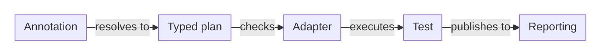

<a id="atf--test-infrastructure-annotations"></a>
<a id="atf--adnotări-de-infrastructură-pentru-teste"></a>
# ATF — test infrastructure annotations

This document describes the API implemented in `atf-test-kit` and how consumers apply it. The Kit provides declarations and neutral resolution; the consumer owns resources, execution, and evidence publication.

<a id="at-a-glance"></a>
<a id="pe-scurt"></a>
## At a glance

| Axis | API / package | Responsibility |
|---|---|---|
| Level and JUnit tag | `AtfUnitTest`, `AtfComponentTest`, `AtfIntegrationTest`, `AtfE2eTest` | one executable level per class |
| Channel | `channel.AtfTestChannel`, `TestChannel`, `AtfTestChannelResolver`, `TestChannelPlan` | selects `UI`, `API`, or `UI_API` and checks support |
| Console messages | `AtfConsoleMessages`, `console.AtfConsoleMessagePolicyResolver` | typed `INHERIT`, `DETAILS`, `SUMMARY`, `OFF` policy; `atf-console` applies it on top of YAML |
| UI evidence | `evidence.AtfUiEvidence`, `AtfUiEvidenceResolver`, `AtfUiEvidencePlan` | resolves neutral axes; the consumer reads YAML and maps the plan to a Reporting profile |
| E2E activation | `lifecycle.AtfE2eActivationPolicy` | resolves signals already read by the extension; does not read YAML, JVM properties, or the IDE marker, and creates no resources |
| Report path | `reporting.AtfReportPath`, `AtfReportPathPolicyResolver` | opt-in for notification of the absolute path after publication; independent of console details |
| Execution ownership | `scope.TestRunScope`, `ScopedTestValue<T>` | implicit `class` scope or explicit `suite` scope; the resource owner decides closure or cleanup |
| UI output | `output.UiReportSubdirectory`, `ProjectRelativeUiReportDirectory`, `ReportOutputDirectory` | directory relative to the UI base or project |
| API setup | `setup.api.ApiScenarioSetup`, `ApiTestRef` | exact methods or consumer-defined families |
| Documentation | `documentation.DocumentationTarget` and its repeatable container | documents selected for the consumer's validators |

The common prefix is `atf.testkit`. The Kit defines a test infrastructure API, but Maven scope is a property of each dependency edge in the POM, not of the annotation. `atf-reporting` remains usable independently of Test Kit.

| Live consumer | Scopes in POM | Observed reason / limit |
|---|---|---|
| `atf-core`, `atf-mock`, `atf-validation`, `atf-ui`, `atf-debug-ui` | `test` | using Test Kit vocabulary in samples and test adapters |
| `atf-test-auto-ex`, `atf-test-practice-shop`, `atf-tests`, `atf-reporting-tests` | `test` | Test Kit vocabulary in samples and adapters JUnit; the runtime of the consumers in the main does not import Kit |
| `atf-console` | `optional` + `compile` | JUnit extension of `src/main` reads annotations and policy resolvers; API remains test infrastructure |

Do not infer scope from the module name or annotation. For a packaging change, check `pom.xml`, imports in `src/main`/`src/test`, and the architecture guard together; do not change scope just to make the table look uniform. The dependency map is in [ATF Architecture](ATF_Architecture.md), and the Practice Shop case is detailed in the [consumer README](../atf-test-practice-shop/README.md).

<a id="composition-and-roles"></a>
<a id="compoziție-și-roluri"></a>
## Composition and roles



<details>
<summary><strong>Legend — who decides and who executes</strong></summary>

- TestKit owns the vocabulary and resolves the selection.
- The consumer supplies the project root, UI base, API catalog, and available
  capabilities; it opens and closes resources.
- The test verifies the observed result through the domain contracts.
- Reporting projects the evidence and verdicts received through its ports.
- Annotations do not grant permission for registration, purchase, or live calls;
  these policies remain explicit in the consumer.

The short labels shall be kept as follows:

| In diagram | Full meaning |
|---|---|
| Annotation | Annotation on a test |
| Typed plan | Typed selection |
| Adapter | Consumer adapter |
| Test | Test and validations |
| checks | checks support |
| publishes to | publishes evidence |

</details>

<a id="level-channel-and-tags"></a>
<a id="nivel-canal-și-tag-uri"></a>
## Level, channel, and tags

| Declaration | Effect |
|---|---|
| `@AtfUnitTest` | unit level and `@Tag("unit")` |
| `@AtfComponentTest` | component level and `@Tag("component")` |
| `@AtfIntegrationTest` | integration level and `@Tag("integration")` |
| `@AtfE2eTest` | E2E level and `@Tag("e2e")` |
| `@AtfTestChannel(UI)` | channel selected for the adapter; does not add a JUnit tag |
| Additional JUnit tags | consumer-defined local selection |
| Extent labels / Categories | metadata published by the consumer; not produced automatically by the channel resolver |

The level selects the pyramid layer; the channel selects the execution type. `@AtfE2eTest` can be used as a meta-annotation to compose repeated consumer infrastructure; the channel and scenario-specific policy remain declared on the concrete test. A browser audit of an API report uses the `UI` channel because it verifies the report page; API setup remains a separate prerequisite.

```java
import atf.testkit.AtfE2eTest;
import atf.testkit.channel.AtfTestChannel;
import atf.testkit.output.ProjectRelativeUiReportDirectory;

import static atf.testkit.channel.TestChannel.UI;

@AtfE2eTest
@AtfTestChannel(UI)
@ProjectRelativeUiReportDirectory("artifacts/reports/ui/e2e")
class ReportAuditTest {
    // Composition root-ul consumatorului aplică selecțiile înaintea execuției.
}
```

The example shows the declarations; the consumer must read and apply them. The Kit does not automatically register a JUnit extension or browser.

<a id="channel-resolution"></a>
<a id="rezolvarea-canalului"></a>
### Channel resolution

| Situation | Implemented behavior |
|---|---|
| Concrete class and meta-annotations | all declarations at that level are analyzed |
| Identical values at the same level | the same effective selection |
| Different values at the same level | `IllegalStateException` with the conflicting type and values |
| No local declaration | search the superclass hierarchy, starting with the nearest class |
| Subclass override | subclass selection takes precedence over the parent declaration |
| Cycles among meta-annotations | traversal is bounded by visited types |
| Interfaces and enclosing classes | not implicit sources of selection |
| No declaration in the hierarchy | `Optional.empty()`; the adapter decides legacy compatibility |
| Channel unsupported by the adapter | `TestChannelPlan.requireSupported(...)` fails before resources are created |

`TestChannelPlan` is immutable and retains the channel and class that declared it. The contract is per class; there is no per-method channel override.

<a id="current-consumers"></a>
<a id="consumatorii-actuali"></a>
### Current consumers

| Consumer | Application |
|---|---|
| Shop E2E | accepts `UI` and `UI_API`; maps the selection to a local profile; rejects a conflict with a different explicit profile |
| Shop API audit | requires the `API` channel before installing call capture |
| Reporting Tests | UI robot composition refuses a declared channel different from `UI` |

In Shop, `UI_API` requires a non-empty binding, an active inspector, and an allowlist before browser startup. `UI` removes API evidence selection; YAML retains control of screenshots and external permissions.

<a id="console-message-policy"></a>
<a id="politica-mesajelor-de-consolă"></a>
### Console message policy

`@AtfConsoleMessages` is a per-class declaration, neutral with respect to the formatter and stdout. `AtfConsoleTestExtension` resolves the policy before the test; UI/API adapters reuse the active sink through `AtfConsoleTestContext.configuredSink()`. This keeps events in the same formatter and prevents duplicates.

```java
@AtfConsoleMessages(AtfConsoleMessages.Policy.DETAILS)
@ExtendWith(AtfConsoleTestExtension.class)
class ApiContractTest { }
```

| Policy | Effect |
|---|---|
| `INHERIT` | keeps `reporting.console` from YAML and the existing fallback |
| `DETAILS` | keeps lifecycle events and enables details if the global console is enabled |
| `SUMMARY` | keeps lifecycle/verdict and suppresses detail/code events |
| `OFF` | suppresses the projection for the current class |

YAML deactivation (`reporting.console.enabled: false`) remains authoritative; even `DETAILS` does not reactivate it. Meta-annotated declarations are supported, a subclass can override its superclass, and different policies at the same level fail before execution. Without an annotation, behavior is unchanged.

- `@TestFactory` does not receive lifecycle callbacks for each child; use `AtfConsoleTestContext.dynamicTest(owner, name, body)` when you need a policy and verdict per child.

<a id="declared-be-recovery"></a>
<a id="recuperare-be-declarată"></a>
## Declared BE recovery

`@AtfUiRecovery` from `atf.testkit.recovery` applies to a class, method, or composed annotation. The declaration does not activate recovery when YAML is OFF.

```java
@AtfUiRecovery(AtfUiRecovery.Mode.READ_ONLY)
class CatalogChecks {
    @AtfUiRecovery(AtfUiRecovery.Mode.DISABLED)
    void irreversibleOperation() { }
}
```

The neutral resolver fixes the mode and source before resources are created in the AutoEx/Shop extensions. The nearest class sets the base, the method narrows it, and conflicts at the same level are rejected.

<details>
<summary><strong>Limits and probes</strong></summary>

- CONFIGURED preserves YAML; READ_ONLY does not expand the allowlist or deadline and does not reopen a DISABLED class.
- An explicit CONFIGURED declaration on the nearest class resets the base to YAML instead of the parent; on a method, it preserves the class base.
- The resulting policy is immutable per invocation, including parameterized tests and suites; components do not receive global retry behavior.
- `AtfUiRecoveryResolverTest` and the `AutoExBackendRecoveryComponentTest` / `ShopBackendRecoveryComponentTest` probes protect precedence and YAML binding.
- Exact keys and passive capture are documented in [UI](../atf-ui/README.md#backend-recovery-through-passive-observation), [AutoEx](../atf-test-auto-ex/README.md#catalog-be-policy), and [Shop](../atf-test-practice-shop/README.md#catalog-be-policy).

</details>

<a id="ui-evidence-intent"></a>
<a id="intenția-de-ui-evidence"></a>
## UI evidence intent

`@AtfUiEvidence` is a class-level declaration in `atf-test-kit`. It separates flow shape, screenshot policy, and action details. It does not start a browser, capture images, or publish evidence.

```java
@AtfUiEvidence(
        flow = AtfUiEvidenceFlow.UNIFIED_FLOW,
        screenshots = AtfUiScreenshotPolicy.FINAL_ONLY)
class PurchaseE2eTest { }
```

| Axis | Values | Resolution |
|---|---|---|
| `flow` | `CONFIGURED`, `SCREEN_CHECKPOINTS`, `UNIFIED_FLOW` | `CONFIGURED` preserves the consumer profile's shape; explicit values select separate checkpoints or a single flow |
| `screenshots` | `CONFIGURED`, `EACH_CHECKPOINT`, `FINAL_ONLY`, `FAILURE_ONLY`, `FINAL_AND_FAILURE`, `NONE` | `CONFIGURED` preserves the consumer/YAML policy; an explicit value overrides it only for that class |
| `actionDetails` | `CONFIGURED`, `INCLUDED_COLLAPSED`, `SUMMARY_ONLY` | inherits the base or selects the scenario disclosure; actions remain recorded |

Ownership rules:

- the annotation has `RUNTIME` retention and `TYPE`/`ANNOTATION_TYPE` targets; there is no per-method selection;
- `AtfUiEvidenceResolver` builds the immutable plan before resources are created; the adapter maps neutral values to its reporting profile; `atf-test-kit` does not depend on `atf-reporting`;
- the resolver searches for the nearest declaring class, including meta-annotations. Complementary explicit axes are combined; conflicts on the same axis fail. A fully `CONFIGURED` local declaration returns to the base. Interfaces and enclosing classes are not implicit sources, and the harness is not installed automatically;
- local annotations such as `ShopE2eTestSupport.WithE2eHarness` retain consumer-specific resources and options (for example, the harness and action details), without duplicating the shared axes;
- the Test Kit test checks the target, retention, and defaults, while consumer component tests check the mapping; this is not a renderer test or a real browser capture test.

Mapping the annotation is the consumer adapter's responsibility:

| Consumer | Implemented effect |
|---|---|
| AutoEx | applies all axes over `reports.evidence`; screenshots omitted from YAML inherit Reporting defaults |
| Shop | applies all axes over `reporting`; an explicit conflict with the harness fails. Each scenario's profile remains distinct from the shared Overview |

- If the annotation is absent, all axes remain at the consumer configuration.
- Mapping and shared report lifecycle are documented in the
  [Shop README](../atf-test-practice-shop/README.md#shared-report--consumer-state).
- `ShopE2eContextEvidenceProfileTest` checks the explicit profile and phase aggregation;
  `ReportEvidenceProfileIntegrationTest` checks generic scenario isolation.
- Live suite reduction has separate criteria in
  [consumer business acceptance](ATF_Testing_Guide.md#individual-and-suite-business-acceptance).

<a id="opt-in-to-the-report-path"></a>
<a id="opt-in-pentru-calea-raportului"></a>
## Opt in to the report path

`@AtfReportPath` is disabled by default and can be declared directly or as a meta-annotation.

- At the nearest class level, a direct declaration takes precedence over
  meta-annotations; `@AtfReportPath(AtfReportPath.Policy.DISABLED)` disables the E2E default while preserving the infrastructure.
- Without a direct declaration, conflicting meta-policies fail fast; when no
  local policy exists, the superclass is checked and then `DISABLED` is applied.
- Only `reporting.console.enabled` can suppress the message globally;
  `@AtfConsoleMessages(OFF)` does not remove report-path opt-in.
- `AtfReportPathOptIn` includes every owner of the shared artifact;
  at least one active owner requires a single final notification.

| Run | Declaration and notification |
|---|---|
| AutoEx / Shop component | explicit opt-in on the Jupiter class; the adapter connects the session's final event |
| AutoEx / Shop E2E | the composed marker enables notification; a direct `DISABLED` declaration opts out |
| AutoEx API | per-class sink or owner aggregation in the suite report |
| Platform suite | selects classes; an annotation on the launcher does not become policy for the selected classes |
| Unit test | the annotation does not create a report or change the layer's obligations |

- In IntelliJ, the declaration remains on the test class, including when launching a method.
- After `close()`, the console prints `[ATF] Extent report: <absolute-report-path>`
  only if the final file exists; `flush()` and failed publication do not emit the notification.
- The path is not truncated to 240 characters; the assertion preview limit is unchanged.
- `AtfConsoleMessages` keeps its conflict rules; the direct precedence described
  above belongs to the `AtfReportPath` policy.

<a id="ownership-per-class-or-run"></a>
<a id="ownership-per-clasă-sau-execuție"></a>
## Ownership per class or run

`TestRunScope` reads the JUnit parameter `atf.test.run.scope`: `class` is the default, while `suite` must be declared explicitly. The class name or textual JUnit ID does not select the scope.

| Consumer | Current application | Closing |
|---|---|---|
| AutoEx API | the suite shares one report; an individual class keeps its own report | the adapter registers the resource in the owner's Store |
| AutoEx/Shop components | an individual class has one report; canonical suites declare `suite` explicitly | `ScopedTestResource` closes the session; invocations close only the borrowed scenario |
| Authenticated Shop account | the suite can reuse the explicitly prepared synthetic identity | release the reference; do not delete the remote account |

`ScopedTestValue.close()` forgets the value without closing the stored or deleting a borrowed resource. The neutral contract and the evidence are at [Test Kit](../atf-test-kit/README.md#valori-cu-ownership-per-clasă-sau-execuție); the consumer retains the resource policy and the limits of external mutations. `ScopedTestResource.close()` closes the purchased object once; this is the right contract for class / suite-owned report session.

<a id="ui-directories-with-distinct-anchors"></a>
<a id="directoare-ui-cu-ancore-distincte"></a>
## UI directories with distinct anchors

The consumer calls `ReportOutputDirectory.resolve(projectRoot, uiReportBase, owner)`. The resolver calculates and validates the destination; directory creation and file publication belong to the consumer.

| Declaration | Destination |
|---|---|
| `@UiReportSubdirectory("a/b")` | `<ui-report-base>/a/b` |
| `@ProjectRelativeUiReportDirectory("a/b")` | `<project-root>/a/b` |
| No declaration or `null` owner | the supplied UI base, absolute and normalized |

- The concrete class precedes its superclass; meta-annotations are traversed too.
- Identical selections are accepted; different declarations at the same level
  conflict, including declarations with different anchors.
- Empty, URI, UNC, absolute, drive-relative, and anchor-escaping values are
  rejected; the result cannot be the anchor itself.
- Existing ancestors are checked with `toRealPath`; the Windows symlink probe
  requires an environment that permits link creation.
- The Kit does not discover the project or reorder YAML options.

Reporting tests first search for the reactor root in the ancestors of the UI resource located, by `atf-reporting/pom.xml` marker, then in the beginning of the starting directory; the absence of the marker is explicitly error. Provides `<project-root>/artifacts/reports/ui` base. In this composition, that base replace the UI directory located from YAML; `atf.ui.report` selects the audit input.

E2E-uri Reporting declares the project-relative director `artifacts/reports/ui/e2e`. In staging, the project is the external checkout; annotation does not reroute the output to the live project.

Manual smoke testing of IntelliJ composition is required only for relevant changes:

- Play the working directory suite at the reactor root and at
  `atf-reporting` according to [Extent Suite Guide](../atf-reporting-tests/src/test/java/atf/ui/tests/extent/README.md#rulare-directă-din-intellij);
- component tests verify deterministic path resolution separately, but do not
  launch IntelliJ.

<a id="api-setup-and-documentation"></a>
<a id="setup-api-și-documentație"></a>
## API setup and documentation

| Declaration | What the Kit provides | What the consumer applies |
|---|---|---|
| `ApiScenarioSetup(tests = ...)` | list of exact references | resolves the owner/method and validates the catalog |
| `ApiTestRef(owner = ..., method = ...)` | typed reference to the selected class and method | checks existence and executability |
| `ApiScenarioSetup(families = ...)` | family names | fallback when exact selection is absent |
| `DocumentationTarget("module/README.md")` | repeatable RUNTIME declaration on a class | validates the path and runs the validators |

In Reporting Tests, the exact references are priority over families; the catalogue, mock and execution remain in the consumer module. `ApiScenarioSelection` remains neutral in Core; annotation statements are in TestKit, without Core's dependence on the kit.

`ApiScenarioSetup` and `DocumentationTarget` do not use the compositional channel/output resolvers. Do not infer generic support for meta-annotations, superclasses, or per-method overrides for them.

<a id="probes-and-acceptance-limits"></a>
<a id="probe-și-limite-de-acceptanță"></a>
## Probes and acceptance limits

| Boundary | Existing probes | Limitation |
|---|---|---|
| Level / tag | `AtfTestLayerArchitectureTest` | classify the test sources; do not certify the Extent Output |
| Console | `AtfConsoleMessagePolicyResolverTest`, `AtfConsoleMessagePolicyTest`, Shop E2E / API and API resource tests | policy, precedence, conflict, global override and deterministic consumers; competition / dynamic lifecycle remains a separate sample |
| Channel and activation | `AtfTestChannelResolverTest`, `AtfE2eActivationPolicyTest`, `ShopE2eTestSupportTest`, `ShopApiCallAuditPreflightTest`, `ConsumerModuleArchitectureGovernanceTest` | neutral solution UI / API / UI_API and prior to activation are proven separately; the extensions retain consumer signals. Parity of the report and the ownership of the verdicts belong to Reporting, not the resolver |
| UI evidence | `AtfUiEvidenceContractTest`, `AtfUiEvidenceResolverTest`, `AutoExEvidenceProfileComponentTest`, `ShopE2eContextEvidenceProfileTest`, `ReportEvidenceProfileIntegrationTest` | the resolver and the consumer mappings have their own evidence; the aggregation over the phases is eighty-in Reporting, and the equivalence of all business profiles remains a separate criterion for the consumer |
| Ownership | `TestRunScopeComponentTest`, `AutoExApiReportScopeComponentTest`, `ShopAccountScopeComponentTest` | explicit scopes, successive isolates and release to the owner; shared reference does not grant mutation permission or remote cleanup |
| Report path | `AtfReportPathPolicyResolverTest`, `AtfReportPathOptInTest`, `AtfConsoleTestExtensionIntegrationTest` | Absence / eighty-in / override, meta annotations, conflict and aggregation for the owner report |
| Output | `ReportOutputDirectoryTest`, `UiReportSubdirectoryTest`, `AtfUiConfigurationLoaderTest` | Anchors, inheritance / composition, cycles, conflicts, invalid paths and working external directory; container is proven by symlink when allowed and directory junction as Windows fallback |
| Setup | `ApiScenarioSetupCatalogTest`, `ApiScenarioManifestTest`, `ApiSelectionMockPublisherComponentTest` | local selection and composition, without external services |
| Documentation | `DocumentationTargetGovernanceTest` and the whole- ATF suite | Repeatable declaration selects the same validator |
| Local browser | `UiThenDisclosureSanityTest`, `ApiReportRenderedEvidenceComponentTest`, `SelectedApiTestsReportUiTest` | Disclosure, mock / field / query reconciliation and phase navigation; does not certify IntelliJ or the entire API / UI_API integration |

The selection of channels is a closed contract; reopening requires a new consumer or regression. Parity and verdicts have evidence at the [Reporting Tests](../atf-reporting-tests/README.md) owner; verified Git controls are in [baseline](ATF_Test_Changes_Baseline.md#controale-tehnice-verificate). For evidence and layout, normative contracts remain [Reporting](ATF_Reporting_Contract.md), [display/layout](ATF_Reporting_Display_Contract.md) and [evidence catch](ATF_Evidence_Capture_Contract.md).
