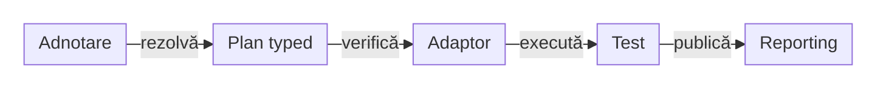

# ATF — adnotări de infrastructură pentru teste

Acest document descrie API-ul implementat în `atf-test-kit` și aplicarea lui
de către consumatori. Kit-ul furnizează declarații și rezolvare neutră;
consumatorul deține resursele, execuția și publicarea dovezilor.

## Pe scurt

| Axă | API / package | Responsabilitate |
|---|---|---|
| Nivel și tag JUnit | `AtfUnitTest`, `AtfComponentTest`, `AtfIntegrationTest`, `AtfE2eTest` | un singur nivel executabil per clasă |
| Canal | `channel.AtfTestChannel`, `TestChannel`, `AtfTestChannelResolver`, `TestChannelPlan` | selecție `UI`, `API` sau `UI_API` și verificarea suportului |
| Mesaje consolă | `AtfConsoleMessages`, `console.AtfConsoleMessagePolicyResolver` | politică typed `INHERIT`, `DETAILS`, `SUMMARY`, `OFF`; `atf-console` o aplică peste YAML |
| UI evidence | `evidence.AtfUiEvidence`, `AtfUiEvidenceResolver`, `AtfUiEvidencePlan` | rezolvă axele neutre; consumerul citește YAML-ul și mapează planul către profilul Reporting |
| Activare E2E | `lifecycle.AtfE2eActivationPolicy` | rezolvă semnalele deja citite de extensie; nu citește YAML, proprietăți JVM sau markerul IDE și nu creează resurse |
| Calea raportului | `reporting.AtfReportPath`, `AtfReportPathPolicyResolver` | opt-in pentru notificarea căii absolute după publicare; independentă de detaliile consolei |
| Ownership al execuției | `scope.TestRunScope`, `ScopedTestValue<T>` | scope `class` implicit sau `suite` explicit; ownerul resursei decide închiderea ori cleanup-ul |
| Output UI | `output.UiReportSubdirectory`, `ProjectRelativeUiReportDirectory`, `ReportOutputDirectory` | director relativ la baza UI sau la proiect |
| Setup API | `setup.api.ApiScenarioSetup`, `ApiTestRef` | metode exacte sau familii definite de consumator |
| Documentație | `documentation.DocumentationTarget` și containerul repeatable | documente selectate pentru validatoarele consumatorului |

Prefixul comun este `atf.testkit`. Kit-ul definește API de infrastructură a
testelor, însă scope-ul Maven este o proprietate a fiecărei muchii din POM, nu a
adnotării. `atf-reporting` rămâne utilizabil independent de Test Kit.

| Consumator live | Scope în POM | Motiv / limită observată |
|---|---|---|
| `atf-core`, `atf-mock`, `atf-validation`, `atf-ui`, `atf-debug-ui` | `test` | folosesc vocabularul Test Kit în probe și adaptoare de test |
| `atf-test-auto-ex`, `atf-test-practice-shop`, `atf-tests`, `atf-reporting-tests` | `test` | folosesc vocabularul Test Kit în probe și adaptoare JUnit; runtime-ul consumerilor din main nu importă Kit |
| `atf-console` | `optional` + `compile` | extensia JUnit din `src/main` citește adnotări și policy resolvers; API-ul rămâne infrastructură de test |

Nu deduce scope-ul din numele modulului sau din adnotare. Pentru o schimbare de
ambalare, verifică simultan `pom.xml`, importurile din `src/main`/`src/test` și
guard-ul de arhitectură; nu modifica scope-ul doar pentru a face tabelul să pară
uniform. Harta dependențelor este în [ATF Architecture](ATF_Architecture.md),
iar cazul Practice Shop este detaliat în [README-ul consumerului](../atf-test-practice-shop/README.md).

## Compoziție și roluri



<details>
<summary><strong>Legendă — cine decide și cine execută</strong></summary>

- TestKit deține vocabularul și rezolvarea selecției.
- Consumatorul furnizează rădăcina proiectului, baza UI, catalogul API și
  capabilitățile disponibile; deschide și închide resursele.
- Testul verifică rezultatul observat prin contractele domeniului.
- Reporting proiectează dovezile și verdictele primite prin porturile sale.
- Adnotările nu acordă permisiuni pentru registration, purchase sau apeluri
  live; aceste politici rămân explicite la consumator.

Etichetele scurte păstrează următorul sens:

| În schemă | Sens complet |
|---|---|
| Adnotare | Adnotare pe test |
| Plan typed | Selecție typed |
| Adaptor | Adaptorul consumatorului |
| Test | Test și validări |
| verifică | verifică suportul |
| publică | publică dovezi |

</details>

## Nivel, canal și tag-uri

| Declarație | Efect |
|---|---|
| `@AtfUnitTest` | nivel unit și `@Tag("unit")` |
| `@AtfComponentTest` | nivel component și `@Tag("component")` |
| `@AtfIntegrationTest` | nivel integration și `@Tag("integration")` |
| `@AtfE2eTest` | nivel E2E și `@Tag("e2e")` |
| `@AtfTestChannel(UI)` | canal selectat pentru adaptor; nu adaugă un tag JUnit |
| Tag-uri suplimentare JUnit | selecție locală definită de consumator |
| Etichete Extent / Categories | metadata publicată de consumator; nu rezultă automat din resolverul canalului |

Nivelul selectează stratul piramidei; canalul selectează tipul execuției.
`@AtfE2eTest` poate fi folosit ca meta-adnotare pentru compoziția infrastructurii
repetate a unui consumer; canalul și politica specifică scenariului rămân
declarate pe testul concret. Auditul browser al unui raport API are canalul
`UI`, deoarece verifică pagina raportului; setup-ul API rămâne o precondiție
separată.

```java
import atf.testkit.AtfE2eTest;
import atf.testkit.channel.AtfTestChannel;
import atf.testkit.output.ProjectRelativeUiReportDirectory;

import static atf.testkit.channel.TestChannel.UI;

@AtfE2eTest
@AtfTestChannel(UI)
@ProjectRelativeUiReportDirectory("artifacts/reports/ui/e2e")
class ReportAuditTest {
    // Composition root-ul consumatorului aplică selecțiile înaintea execuției.
}
```

Exemplul prezintă declarațiile; consumatorul trebuie să le citească și să le
aplice. Kit-ul nu înregistrează automat o extensie JUnit sau un browser.

### Rezolvarea canalului

| Situație | Comportament implementat |
|---|---|
| Clasă concretă și meta-adnotări | toate declarațiile acelui nivel sunt analizate |
| Valori identice pe același nivel | aceeași selecție efectivă |
| Valori diferite pe același nivel | `IllegalStateException` cu tipul și valorile conflictuale |
| Fără declarație locală | căutare în superclass, de la cel mai apropiat |
| Override pe subclasă | selecția subclasei precedă declarația părintelui |
| Cicluri între meta-adnotări | traversare delimitată prin tipurile vizitate |
| Interfețe și clase enclosing | nu sunt surse implicite de selecție |
| Fără declarație în ierarhie | `Optional.empty()`; adaptorul decide compatibilitatea legacy |
| Canal nesuportat de adaptor | `TestChannelPlan.requireSupported(...)` eșuează înaintea resurselor |

`TestChannelPlan` este imutabil și păstrează canalul și clasa care l-a declarat.
Contractul este per clasă; nu există override de canal per metodă.

### Consumatorii actuali

| Consumator | Aplicare |
|---|---|
| Shop E2E | acceptă `UI` și `UI_API`; transformă selecția în profil local; refuză conflictul cu un profil explicit diferit |
| Shop API audit | cere canal `API` înaintea instalării capturii apelurilor |
| Reporting Tests | composition root-ul UI refuză un canal declarat diferit de `UI` |

În Shop, `UI_API` cere binding nevid, inspector activ și allowlist înaintea
browserului. `UI` elimină selecția dovezilor API; YAML-ul păstrează controlul
capturilor și permisiunilor externe.

### Politica mesajelor de consolă

`@AtfConsoleMessages` este o declarație per clasă, neutră față de formatter și
stdout. `AtfConsoleTestExtension` rezolvă politica înaintea testului; adaptorii
UI/API reutilizează sink-ul activ prin `AtfConsoleTestContext.configuredSink()`.
Astfel, evenimentele rămân în același formatter și nu se dublează.

```java
@AtfConsoleMessages(AtfConsoleMessages.Policy.DETAILS)
@ExtendWith(AtfConsoleTestExtension.class)
class ApiContractTest { }
```

| Politică | Efect |
|---|---|
| `INHERIT` | păstrează `reporting.console` din YAML și fallback-ul existent |
| `DETAILS` | păstrează lifecycle-ul și activează detaliile dacă consola globală este enabled |
| `SUMMARY` | păstrează lifecycle-ul/verdictul și suprimă evenimentele detail/code |
| `OFF` | suprimă proiecția pentru clasa curentă |

Dezactivarea YAML (`reporting.console.enabled: false`) rămâne autoritară; nici
`DETAILS` nu o reactivează. Declarațiile meta-adnotate sunt acceptate,
subclasa poate suprascrie superclass-ul, iar politicile diferite la același
nivel eșuează înaintea execuției. Fără adnotare, comportamentul nu se schimbă.

- `@TestFactory` nu primește callbacks de lifecycle pentru fiecare copil; folosește `AtfConsoleTestContext.dynamicTest(owner, name, body)` când ai nevoie de policy și verdict per copil.

## Recuperare BE declarată

`@AtfUiRecovery` din `atf.testkit.recovery` se aplică pe clasă, metodă sau
adnotare compusă. Declarația nu activează recuperarea când YAML-ul este OFF.

```java
@AtfUiRecovery(AtfUiRecovery.Mode.READ_ONLY)
class CatalogChecks {
    @AtfUiRecovery(AtfUiRecovery.Mode.DISABLED)
    void irreversibleOperation() { }
}
```

Resolverul neutru fixează modul și sursa înaintea resurselor în extensiile
AutoEx/Shop. Clasa apropiată stabilește baza, metoda restrânge și conflictele
de același nivel sunt respinse.

<details>
<summary><strong>Limite și probe</strong></summary>

- CONFIGURED păstrează YAML; READ_ONLY nu extinde allowlist-ul ori deadline-ul
  și nu redeschide o clasă DISABLED.
- Un CONFIGURED explicit pe clasa apropiată reia baza YAML în locul părintelui;
  pe metodă păstrează baza clasei.
- Politica rezultată este imutabilă per invocare, inclusiv pentru parametrizare
  și suite; componentele nu primesc retry global.
- `AtfUiRecoveryResolverTest` și probele `AutoExBackendRecoveryComponentTest` /
  `ShopBackendRecoveryComponentTest` protejează precedența și binding-ul YAML.
- Cheile exacte și capturarea pasivă sunt la [UI](../atf-ui/README.md#recuperare-be-prin-observație-pasivă),
  [AutoEx](../atf-test-auto-ex/README.md#politica-be-a-catalogului) și
  [Shop](../atf-test-practice-shop/README.md#politica-be-a-catalogului).

</details>

## Intenția de UI evidence

`@AtfUiEvidence` este o declarație class-level în `atf-test-kit`. Separă forma
flow-ului, politica de captură și detaliile acțiunilor. Nu pornește browserul,
nu capturează imagini și nu publică evidence.

```java
@AtfUiEvidence(
        flow = AtfUiEvidenceFlow.UNIFIED_FLOW,
        screenshots = AtfUiScreenshotPolicy.FINAL_ONLY)
class PurchaseE2eTest { }
```

| Axă | Valori | Rezolvare |
|---|---|---|
| `flow` | `CONFIGURED`, `SCREEN_CHECKPOINTS`, `UNIFIED_FLOW` | `CONFIGURED` păstrează forma din profilul consumerului; valorile explicite aleg checkpoint-uri separate sau un singur flow |
| `screenshots` | `CONFIGURED`, `EACH_CHECKPOINT`, `FINAL_ONLY`, `FAILURE_ONLY`, `FINAL_AND_FAILURE`, `NONE` | `CONFIGURED` păstrează politica consumerului/YAML; o valoare explicită o suprascrie numai pentru clasa respectivă |
| `actionDetails` | `CONFIGURED`, `INCLUDED_COLLAPSED`, `SUMMARY_ONLY` | moștenește baza sau alege disclosure-ul scenariului; acțiunile rămân înregistrate |

Reguli de ownership:

- adnotarea are retenție `RUNTIME` și target `TYPE`/`ANNOTATION_TYPE`; nu există selecție per
  metodă;
- `AtfUiEvidenceResolver` construiește planul imutabil înainte de resurse;
  adaptorul mapează valorile neutre în profilul său de raportare; `atf-test-kit` nu
  depinde de `atf-reporting`;
- resolverul caută cea mai apropiată clasă declarantă, inclusiv meta-adnotări.
  Axele explicite complementare se combină; conflictele aceleiași axe eșuează.
  Declarația locală complet `CONFIGURED` revine la bază. Interfețele și clasele
  enclosing nu sunt surse implicite și nu există instalare automată a harness-ului;
- adnotările locale, precum `ShopE2eTestSupport.WithE2eHarness`, păstrează
  resursele și opțiunile specifice consumerului (de exemplu harness-ul și
  detaliile acțiunilor), fără să dubleze axele comune;
- testul Test Kit verifică target-ul, retenția și valorile implicite, iar testele
  componente ale consumerilor verifică mapping-ul; nu este un test de renderer
  sau de captură reală în browser.

Mapping-ul adnotării este responsabilitatea adaptorului consumer:

| Consumer | Efect implementat |
|---|---|
| AutoEx | aplică toate axele peste `reports.evidence`; capturile absente în YAML moștenesc Reporting |
| Shop | aplică toate axele peste `reporting`; conflictul explicit cu harness-ul eșuează. Profilul fiecărui scenariu și Overview-ul comun rămân distincte |

- Adnotarea absentă lasă toate axele la configurația consumerului.
- Mapping-ul și lifecycle-ul raportului partajat sunt documentate în
  [README-ul Shop](../atf-test-practice-shop/README.md#raport-partajat--starea-consumerului).
- `ShopE2eContextEvidenceProfileTest` verifică profilul explicit și agregarea fazelor;
  `ReportEvidenceProfileIntegrationTest` verifică izolarea generică a scenariilor.
- Reducerea suitei live are criterii distincte în
  [acceptanța business a consumerilor](ATF_Testing_Guide.md#acceptanța-business-individual-și-prin-suită).

## Opt-in pentru calea raportului

`@AtfReportPath` este dezactivată implicit și poate fi declarată direct sau ca meta-adnotare.

- La cel mai apropiat nivel de clasă, declarația directă câștigă față de meta-adnotări;
  `@AtfReportPath(AtfReportPath.Policy.DISABLED)` dezactivează default-ul E2E, păstrând infrastructura.
- Fără declarație directă, meta-politicile opuse eșuează fail-fast; fără politică
  locală se caută superclass-ul, apoi se aplică `DISABLED`.
- Numai `reporting.console.enabled` poate suprima global mesajul;
  `@AtfConsoleMessages(OFF)` nu șterge opt-in-ul pentru cale.
- `AtfReportPathOptIn` include fiecare owner al artifactului comun;
  cel puțin un owner activ cere o singură notificare finală.

| Rulare | Declarație și notificare |
|---|---|
| Componentă AutoEx / Shop | opt-in explicit pe clasa Jupiter; adaptorul conectează evenimentul final al sesiunii |
| E2E AutoEx / Shop | markerul compus activează notificarea; declarația directă `DISABLED` oferă opt-out |
| API AutoEx | sink per clasă sau agregare a ownerilor în raportul suitei |
| Suită Platform | selectează clasele; adnotarea pe launcher nu devine politică a claselor selectate |
| Test unit | adnotarea nu creează un raport și nu schimbă obligațiile layer-ului |

- În IntelliJ, declarația rămâne pe clasa testului inclusiv la lansarea unei metode.
- După `close()`, consola afișează `[ATF] Extent report: <absolute-report-path>`
  numai dacă fișierul final există; `flush()` și publicarea eșuată nu emit notificarea.
- Calea nu este trunchiată la 240 de caractere; limita preview-ului aserțiunilor rămâne neschimbată.
- `AtfConsoleMessages` își păstrează regulile de conflict; precedența directă
  de mai sus aparține politicii `AtfReportPath`.

## Ownership per clasă sau execuție

`TestRunScope` citește parametrul JUnit `atf.test.run.scope`: `class` este implicit,
iar `suite` trebuie declarat explicit. Numele clasei ori ID-ul textual JUnit nu aleg scope-ul.

| Consumer | Aplicare curentă | Închidere |
|---|---|---|
| API AutoEx | suita partajează un raport; clasa individuală păstrează raport propriu | adaptorul înregistrează resursa în Store-ul ownerului |
| Componente AutoEx/Shop | clasa individuală are un raport; suitele canonice declară `suite` explicit | `ScopedTestResource` închide sesiunea; invocările închid numai scenariul împrumutat |
| Cont autentificat Shop | suita poate reutiliza identitatea sintetică pregătită explicit | se eliberează referința; nu se șterge contul remote |

`ScopedTestValue.close()` uită valoarea, fără să închidă obiectul stocat sau să
șteargă o resursă împrumutată. Contractul neutru și probele sunt la
[Test Kit](../atf-test-kit/README.md#valori-cu-ownership-per-clasă-sau-execuție);
consumerul păstrează politica resursei și limitele mutațiilor externe.
`ScopedTestResource.close()` închide obiectul achiziționat o singură dată;
acesta este contractul potrivit pentru sesiunea de raport deținută de clasă/suită.

## Directoare UI cu ancore distincte

Consumatorul apelează `ReportOutputDirectory.resolve(projectRoot, uiReportBase, owner)`.
Resolverul calculează și verifică destinația; crearea directorului și publicarea
fișierului aparțin consumatorului.

| Declarație | Destinație |
|---|---|
| `@UiReportSubdirectory("a/b")` | `<ui-report-base>/a/b` |
| `@ProjectRelativeUiReportDirectory("a/b")` | `<project-root>/a/b` |
| Fără declarație sau owner `null` | baza UI primită, absolută și normalizată |

- Clasa concretă precedă superclass-ul; se traversează și meta-adnotările.
- Selecțiile identice sunt acceptate; declarațiile diferite la același nivel
  sunt conflict, inclusiv cele cu ancore diferite.
- Valorile goale, URI, UNC, absolute, drive-relative și ieșirea din ancoră
  sunt respinse; rezultatul nu poate fi însăși ancora.
- Strămoșii existenți sunt verificați prin `toRealPath`; proba symlink Windows
  are nevoie de un mediu care permite crearea linkului.
- Kit-ul nu descoperă proiectul și nu reordonează opțiunile YAML.

Reporting Tests caută mai întâi rădăcina reactorului în strămoșii resursei UI
încărcate, prin markerul `atf-reporting/pom.xml`, apoi în strămoșii directorului
de pornire; absența markerului este eroare explicită. Furnizează baza
`<project-root>/artifacts/reports/ui`. În această compoziție, acea bază înlocuiește
directorul UI încărcat din YAML; `atf.ui.report` selectează inputul auditului.

E2E-urile Reporting declară directorul project-relative
`artifacts/reports/ui/e2e`. În staging, proiectul este checkout-ul extern;
adnotarea nu redirecționează output-ul în proiectul live.

Smoke-testul manual al compoziției IntelliJ este necesar numai la schimbări
relevante:

- rulează suitele cu working directory la root-ul reactorului și la
  `atf-reporting`, conform [ghidului suitei Extent](../atf-reporting-tests/src/test/java/atf/ui/tests/extent/README.md#rulare-directă-din-intellij);
- testele componente verifică separat rezolvarea deterministă a căilor, dar nu
  lansează IntelliJ.

## Setup API și documentație

| Declarație | Ce oferă kit-ul | Ce aplică consumatorul |
|---|---|---|
| `ApiScenarioSetup(tests = ...)` | lista de referințe exacte | rezolvă owner/metodă și validează catalogul |
| `ApiTestRef(owner = ..., method = ...)` | referință typed la clasa și metoda selectată | verifică existența și executabilitatea |
| `ApiScenarioSetup(families = ...)` | nume de familii | fallback când selecția exactă lipsește |
| `DocumentationTarget("module/README.md")` | declarație repeatable RUNTIME pe clasă | verifică path-ul și execută validatoarele |

În Reporting Tests, referințele exacte au prioritate față de familii;
catalogul, mock-ul și executarea rămân în modulul consumator.
`ApiScenarioSelection` rămâne model neutru în Core; declarațiile de adnotare
sunt în TestKit, fără dependență Core main către kit.

`ApiScenarioSetup` și `DocumentationTarget` nu folosesc resolverele
compoziționale ale canalului/output-ului. Nu se deduce pentru ele un suport
generic de meta-adnotări, superclass sau override per metodă.

## Probe și limite de acceptanță

| Boundary | Probe existente | Limită |
|---|---|---|
| Nivel / tag | `AtfTestLayerArchitectureTest` | clasifică sursele de teste; nu certifică output-ul Extent |
| Consolă | `AtfConsoleMessagePolicyResolverTest`, `AtfConsoleMessagePolicyTest`, Shop E2E/API și API resource tests | policy, precedență, conflict, override global și consumatori deterministici; concurența/lifecycle dinamic rămâne o probă separată |
| Canal și activare | `AtfTestChannelResolverTest`, `AtfE2eActivationPolicyTest`, `ShopE2eTestSupportTest`, `ShopApiCallAuditPreflightTest`, `ConsumerModuleArchitectureGovernanceTest` | rezolvarea neutră UI/API/UI_API și precedența activării sunt probate separat; extensiile păstrează semnalele consumerului. Paritatea raportului și ownership-ul verdictelor aparțin Reporting, nu resolverului |
| UI evidence | `AtfUiEvidenceContractTest`, `AtfUiEvidenceResolverTest`, `AutoExEvidenceProfileComponentTest`, `ShopE2eContextEvidenceProfileTest`, `ReportEvidenceProfileIntegrationTest` | resolverul și mapping-ul consumerilor au probe proprii; agregarea peste faze este opt-in Reporting, iar echivalența tuturor profilelor business rămâne criteriu distinct la consumer |
| Ownership | `TestRunScopeComponentTest`, `AutoExApiReportScopeComponentTest`, `ShopAccountScopeComponentTest` | scope explicit, lansări succesive izolate și eliberare la owner; referința partajată nu acordă permisiune de mutație sau cleanup remote |
| Calea raportului | `AtfReportPathPolicyResolverTest`, `AtfReportPathOptInTest`, `AtfConsoleTestExtensionIntegrationTest` | absență/opt-in/override, meta-adnotări, conflict și agregare pentru report owner |
| Output | `ReportOutputDirectoryTest`, `UiReportSubdirectoryTest`, `AtfUiConfigurationLoaderTest` | ancore, inheritance/compoziție, cicluri, conflicte, path-uri invalide și working directory extern; containment-ul este probat prin symlink când e permis și directory junction ca fallback Windows |
| Setup | `ApiScenarioSetupCatalogTest`, `ApiScenarioManifestTest`, `ApiSelectionMockPublisherComponentTest` | selecție și compoziție locală, fără servicii externe |
| Documentație | `DocumentationTargetGovernanceTest` și suita whole-ATF | declarația repeatable selectează aceleași validatoare |
| Browser local | `UiThenDisclosureSanityTest`, `ApiReportRenderedEvidenceComponentTest`, `SelectedApiTestsReportUiTest` | disclosure, reconciliere mock/câmpuri/query și navigarea fazei; nu certifică launcherul IntelliJ sau întreaga integrare API/UI_API |

Selecția canalelor este un contract închis; redeschiderea cere un consumer nou
sau o regresie. Paritatea și verdicturile au probe la ownerul
[Reporting Tests](../atf-reporting-tests/README.md); controalele Git verificate sunt în
[baseline](ATF_Test_Changes_Baseline.md#controale-tehnice-verificate).
Pentru dovezi și layout, contractele normative rămân
[Reporting](ATF_Reporting_Contract.md), [display/layout](ATF_Reporting_Display_Contract.md)
și [captura evidence](ATF_Evidence_Capture_Contract.md).
