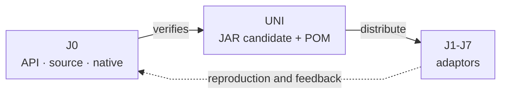

# Test Kit - common library

## At a glance

J0 holds the code API, the natives, packaging and feedback Test Kit. J1 -J7 keeps the field adapters and oracles and consumes a single JAR / POM pair directly in `lib`, with local guide and root origin; implementation governance remains in J0.

## Contract retained

| Surface | Use and limit |
|---|---|
| `@AtfUnitTest`, `@AtfComponentTest`, `@AtfIntegrationTest`, `@AtfE2eTest` | Classes the test; level annotation does not publish a Extent report on its own. |
| `RecordedAssertions` | Evaluates by JUnit; the adapter injects the sanitizer before preview. The default limit is 240; the stored values are not an integral archive. |
| `ComponentAuditExtension`, `ComponentAuditAdapter` | Neutral protocol for phases, comparisons and cleanup; the consumer provides the factory and publication in Reporting. |
| Lifecycle and scope | Resources per invoicing, rollback and case retention; no browser, broker, ADB or ASR in Kit. |
| Configuration and resolvers | Typed policies for channel, evidence, console and output; actual configuration and selection belong to the consumer. |
| Resources | `readResourceUtf8` also reads JAR entries; `requiredPath` requires a real file. Do not confuse a URL resource with a disk path. |
| Executable guides | Optional application for compiling examples on JAR / POM; JDK / Maven when checking, do not start processes when simply using annotations. |

The joint session and the invoicing projection are already API Reporting: [AssertionAuditRun / AssertionAuditReport](../lib/README.Reporting.md#scope-și-integrare). The adapter mapping Kit's result; Reporting implementation remains in its library.

<strong>Legend - same library, distinct acceptances</strong>

- The edges describe delivery and maintenance; do not introduce new modules or business dependence.
- After adoption, the source and the Kit nations remain only in J0. Consumers check the physical binary and their own oracles.
- Reporting receives the adapter data; Kit does not depend on the renderer and does not capture the screen.

## Maintenance and distribution

1. Reconcile the differences live and keep API joint. POM published becomes independent of parent, with explicit vendor versions, JDK 21 and reproducible build.
2. Check the natives and same contracts on JAR, without Kit sources on the classpath; keep the runtime metadata of annotations, original causes, scopes and limits.
3. Please declare Kit version separate from reactor version. Use `test` for product; the main adapters of test modules can declare `compile` justified without propagating in application. Console keeps `optional compile`.
4. Adapt Maven / IntelliJ, scripts, policies and governance prior to the removal of the module. The source verification belongs to J0; the consumerchecks API, CodeSource / hash, inventory and absence of parallel copies.
5. Distribute the same pair checked and keep the background history. `lib` contains only the current version of each library; the Kit Guide enters the exact inventory with its mate.

Console keeps the optional Kit dependency in its publication; the consumer explicitly declares the Kit version. The compatibility of the bridgework is checked on JAR. Changing POM Console requires a new coordination without rewriting the existing publication.

Runner keeps JUnit Jupiter engine in its test dependencies; Kit exposes API without automatically supplying the engineer or a launcher for the application.

## Acceptance of each consumer

| Consumer | Required sample and limit |
|---|---|
| J1 — web | Shop / AutoEx component, individual and suite, lifecycle and collapse assertions; capture remains at UI. |
| J2 — messaging | SQL / Eventuate components and explicit Extent / fallback profile; without browser modules or default broker certification. |
| J3 — speech | Lifecycle / configuration components and fixture reporting adapter; no models, registration or acceptance of ASR assumed. |
| J4 — Android | Comparison by phase, cleanup and the PNG publicist provided; physical acceptance ADB remains distinct. |
| J5 — Rentz | Engine and adaptor components, TMP script and own governance; without the introduction of withdrawn Whist modules. |
| J6 — Hold’em | Bootstrap Maven in lib and offline integration into holdem-app; libraries are test- scoped, and the five domain modules remain independent. |
| J7 — Chess Lab | Bootstrap Maven of lib and its own acceptance for binary pairs and component reports. |

A controlled FAIL remains FAIL with the same cause and comparisons. An undiscovered test, a failed container or a parallel source does not qualify for migration. No acceptance shall be transferred between projects.

## Local JAR Guide

Each `lib/README.TestKit.md` is the local contract, sufficient without access to J0: correct dependency and scopes, annotations, a compiled example, lifecycle, configuration and limits of the preview. Explain explicitly that the publication of Extent requires the consumer adaptor. Examples are checked on the distributed pair without parallel sources.

- `GuideBundle.publish` explicitly checks the five libraries. KitLibraryGuideIT proposes the example and the compiling / bootstrap controls on the selected pair.
- Pure units retain their policy; migration does not require component reporting / E2E.

The shooter sends maintenance and findings to [Kit feedback from J0](feedback/ATF_Common_Test_Support_Feedback.md). Safe pre-vision retention remains open; the preview- compliant with the limit without breaking the Unicode pairs and has permanent regression.
