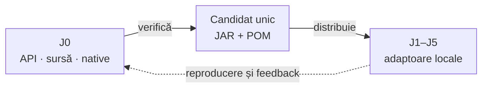

# Test Kit — pregătirea bibliotecii comune

## Pe scurt

J0 este owner pentru cod, API, teste native, împachetare și feedback Test Kit. J1–J5 păstrează adaptoarele și acceptanța domeniului lor. Kit este încă modul sursă în aceste proiecte; ținta este o singură pereche JAR/POM direct în `lib`, cu ghid local de utilizare și proveniență la rădăcină.

## Contractul păstrat

| Suprafață | Utilizare și limită |
|---|---|
| `@AtfUnitTest`, `@AtfComponentTest`, `@AtfIntegrationTest`, `@AtfE2eTest` | Clasifică testul; adnotarea de nivel nu publică singură un raport Extent. |
| `RecordedAssertions` | Evaluează prin JUnit; adaptorul injectează sanitizer-ul înainte de preview. Limita implicită este 240; valorile stocate nu reprezintă o arhivă integrală. |
| `ComponentAuditExtension`, `ComponentAuditAdapter` | Protocol neutru pentru faze, comparații și cleanup; consumerul furnizează fabrica și publicarea în Reporting. |
| Lifecycle și scope | Resurse per invocare, rollback și păstrarea cauzei; fără browser, broker, ADB ori ASR în Kit. |
| Configurație și resolvere | Politici typed pentru canal, evidence, consolă și output; configurația efectivă și selecția aparțin consumerului. |
| Resurse | `readResourceUtf8` citește și intrări JAR; `requiredPath` cere un fișier real. Nu confundați un resource URL cu o cale pe disc. |
| Ghiduri executabile | Utilitare opționale pentru compilarea exemplelor pe JAR/POM; cer JDK/Maven la verificare, nu pornesc procese la simpla utilizare a adnotărilor. |

Sesiunea comună și proiecția invocării sunt deja API Reporting: [AssertionAuditRun / AssertionAuditReport](../lib/README.Reporting.md#scope-și-integrare). Adaptorul mapează rezultatul Kit; implementarea Reporting rămâne în biblioteca sa.

<strong>Legendă — aceeași bibliotecă, acceptanțe distincte</strong>

- Muchiile descriu livrarea și mentenanța; nu introduc module noi sau dependențe către business.
- După adopție, sursa și nativele Kit rămân numai în J0. Consumerii verifică binarul fizic și propriile oracole.
- Reporting primește datele adaptorului; Kit nu depinde de renderer și nu capturează ecranul.

## Migrarea controlată

1. Reconciliați diferențele live și păstrați API-ul comun. POM-ul publicat devine independent de parent, cu versiuni vendor explicite, JDK 21 și build reproductibil.
2. Verificați nativele și aceleași contracte pe JAR, fără surse Kit pe classpath; păstrați metadata runtime a adnotărilor, cauzele originale, scope-urile și limitele existente.
3. Declarați versiunea Kit separat de versiunea reactorului. Folosiți `test` pentru produs; adaptoarele din main ale modulelor de test pot declara `compile` justificat, fără propagare în aplicație. Console păstrează `optional compile`.
4. Adaptați bootstrap-ul Maven/IntelliJ, scripturile, politicile și guvernanța înainte de eliminarea modulului. Verificarea sursei aparține J0; consumerul verifică API, CodeSource/hash, inventar și lipsa copiilor paralele.
5. Distribuiți aceeași pereche verificată și păstrați istoricul provenienței. `lib` conține numai versiunea curentă a fiecărei biblioteci; ghidul Kit intră în inventarul exact împreună cu perechea sa.

Console publicat declară în prezent Kit opțional cu versiune `SNAPSHOT`. Compatibilitatea cu Kit publicat se demonstrează explicit; schimbarea POM-ului Console cere o coordonată nouă, fără rescrierea publicației existente.

Runnerul păstrează motorul JUnit Jupiter în dependențele sale de test; Kit expune API-ul, fără să furnizeze automat engine-ul sau un lansator pentru aplicație.

## Acceptanța fiecărui consumer

| Consumer | Probă necesară și limită |
|---|---|
| J1 — web | Componentă Shop/AutoEx, individual și suită, lifecycle și aserțiuni colapsabile; capturarea rămâne la UI. |
| J2 — mesagerie | Componente SQL/Eventuate și profilul explicit Extent/fallback; fără module browser ori certificare implicită a brokerului. |
| J3 — speech | Componente de lifecycle/configurație și adaptorul de raportare cu fixture; fără modele, înregistrare sau acceptanță ASR presupusă. |
| J4 — Android | Comparații pe faze, cleanup și publisherul cu PNG furnizat; acceptanța fizică ADB rămâne distinctă. |
| J5 — Rentz | Componentele motorului și adaptorului, scriptul TMP și guvernanța proprie; fără introducerea modulelor Whist retrase. |

Un FAIL controlat rămâne FAIL cu aceeași cauză și aceleași comparații. Un test nedescoperit, un container eșuat sau o sursă paralelă nu califică migrarea. Nicio acceptanță nu se transferă între proiecte.

## Ghidul local al JAR-ului

La adopție, fiecare `lib/README.TestKit.md` trebuie să fie suficient fără acces la J0: dependență și scope corecte, adnotări, un exemplu compilat, lifecycle, configurare și limitele preview-ului. Explicați explicit că publicarea Extent cere adaptorul consumerului. Exemplele se verifică pe perechea distribuită, fără surse paralele.

- `GuideBundle.publish` instalează în prezent patru biblioteci; poarta Kit extinde explicit inventarul și verifică încărcarea din perechea distribuită.
- Unitățile pure păstrează politica lor; migrarea nu le impune raportarea de componentă/E2E.

Footerul trimite mentenanța și constatările către [feedback-ul Kit din J0](feedback/ATF_Common_Test_Support_Feedback.md). Cerințele active, inclusiv Unicode și retenția înainte de preview, rămân acolo; acest contract nu le declară rezolvate.
