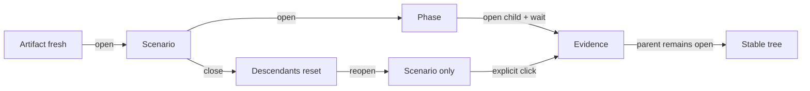

# Ghid de testare ATF — straturi, responsabilități și dovezi

## Pe scurt

Ghidul explică unde aparține un test, cum alegem cel mai mic nivel care poate
dovedi comportamentul și cum trecem de la o verificare locală la proof de
compoziție sau randare. Matricea reflectă adnotările executabile din codul live;
nu este un obiectiv de a umple fiecare celulă și nu conține count-uri de teste.

## Traseul canonic al unei verificări

```mermaid
flowchart LR
    Requirement["cerință observabilă"] -->|identifică| Owner["modul owner"]
    Owner -->|delimitează| Boundary["boundary de test"]
    Boundary -->|alege cel mai mic proof| Layer["unit / component / integration / E2E"]
    Layer -->|folosește| Setup["setup typed și controlat"]
    Setup -->|exercită| Contract["comportament public"]
    Contract -->|produce| Evidence["assertions și evidence"]
    Evidence -. dacă depinde de browser .-> Browser["artifact randat și interacțiune"]
```



<details>
<summary><strong>Legendă — cum se citește traseul</strong></summary>

- nivelul se alege după boundary-ul care trebuie dovedit, nu după pachet sau
  numele clasei;
- setup-ul este un fixture, config typed, fake sau adapter explicit;
- testul afirmă un rezultat observabil la API-ul public al ownerului;
- proof-ul în browser este necesar numai pentru comportamente de DOM, layout,
  navigation ori interacțiune; nu înlocuiește testele lower-level.

</details>

## Alegerea nivelului

| Nivel | Alege-l când verifici | Setup tipic | Nu îl folosi pentru |
|---|---|---|---|
| `unit` | policy, model, formatter, parser sau validator pur | input typed și dependențe locale | browser, server sau colaborare între module |
| `component` | contractul unui modul ori adapter, cu boundary-urile vecine izolate | fake/mock, fixture sau artifact local | o călătorie completă prin aplicație |
| `integration` | colaborarea reală dintre mai multe componente/module | fixture determinist și reactor `-am` | fiecare invariant deja dovedit la nivel inferior |
| `e2e` | comportamentul care depinde de browser și journey-ul vizibil | browser și config explicit; extern numai opt-in | logică pură, fiecare variantă de date sau înlocuirea suitei lower-level |

`support` nu este un nivel executabil. Fixture-urile, builder-ele, locators,
loader-ele și adapters rămân auxiliare; metoda de test deține assertion-ul și
clasa executabilă declară exact o adnotare `@AtfUnitTest`, `@AtfComponentTest`,
`@AtfIntegrationTest` sau `@AtfE2eTest`.

Canalul `UI`/`API`/`UI_API` este separat de nivel și de tag-urile JUnit.
API-ul implementat pentru canale, output, setup și documentație este în
[Adnotări de infrastructură pentru teste](ATF_Test_Infrastructure_Annotations.md).

### Auditul componentelor consumerilor

În AutoEx și Shop, componentele folosesc markerul consumerului și publică
verificările evaluate în pasul standard `Component assertions`. Testele unit
nu au această obligație; probele rendererului rămân o categorie separată în Reporting Tests.

- `AuditedAssertions` și `RecordedAssertions` păstrează evaluarea JUnit unică;
  politica de rezultat, fazele și plafonul implicit de 240 de caractere sunt la
  [Test Kit](../atf-test-kit/README.md#comparații-junit-cu-dovadă-neutră).
- Un test componentă reușit cere o verificare auditată; un diagnostic sau un pas
  HTTP fabricat nu înlocuiește comparația. Așteptările rămân independente de observații.
- Lansarea individuală și suita folosesc același adaptor al aplicației;
  validările Extent/fallback și interacțiunea disclosure-ului sunt probate la
  [Reporting Tests](../atf-reporting-tests/README.md).

Sesiunea comună aparține clasei sau suitei declarate; scenariul, comparațiile
și timing-ul măsurat rămân per invocare. Publicarea finală și notificarea căii
urmează închiderea ownerului, după existența artifactului.

| Contract verificat | Owner al probei | Probă de regresie |
|---|---|---|
| Resursă și audit izolat | Kit | `ScopedTestResourceTest`, `ScopedComponentAuditExtensionComponentTest` |
| Scenariu împrumutat și close unic | Reporting Tests | `AssertionAuditRunComponentTest` |
| Metodă/clasă/suită și lansări repetate | Consumer | `AutoExComponentReportScopeComponentTest`, `ShopComponentReportScopeComponentTest` |
| Selectori executabili și comentarii excluse | Core + ATF Tests | `AtfJavaSourceReferencesTest`, `ConsumerSuiteCoverageGovernanceTest` |

Contractul sesiunii și al thread-ului de publicare rămâne la
[Reporting](../atf-reporting/README.md#sesiunea-comună-a-componentelor);
inventarul testelor și politica schimbării lor rămân la
[ATF Tests](../atf-tests/README.md#guvernanța-schimbării-testelor).

## Matricea detaliată module × nivel de testare

Celulele arată doar nivelurile care există în suitele executabile curente.
`—` nu cere crearea unei suite sau a unui director artificial.

| Modul | Unit | Component | Integration | E2E | Owner și scopul principal |
|---|:---:|:---:|:---:|:---:|---|
| [`atf-core`](../atf-core/README.md) | ✅ | — | — | — | contracte neutre și politici reutilizabile |
| [`atf-validation`](../atf-validation/README.md) | ✅ | ✅ | — | — | reguli de validare și rezultate typed |
| [`atf-console`](../atf-console/README.md) | ✅ | — | ✅ | — | policy/formatter unitare; integrarea extension-ului cu Jupiter real |
| [`atf-mock`](../atf-mock/README.md) | — | ✅ | — | — | transport fake și comportament determinist |
| [`atf-ui`](../atf-ui/README.md) | ✅ | ✅ | — | — | policy și adapter Playwright generic |
| [`atf-debug-ui`](../atf-debug-ui/README.md) | — | ✅ | — | — | server și launcher read-only pentru inspecție |
| [`atf-reporting`](../atf-reporting/README.md) | — | — | — | — | excepție: suite standalone fără adnotări sau dependențe ATF |
| [`atf-reporting-tests`](../atf-reporting-tests/README.md) | ✅ | ✅ | ✅ | ✅ | composition și proof pentru librăria reporting |
| [`atf-test-practice-shop`](../atf-test-practice-shop/README.md) | ✅ | ✅ | ✅ | ✅ | consumer: contracte, API, flow-uri și journey browser |
| [`atf-test-auto-ex`](../atf-test-auto-ex/README.md) | — | ✅ | ✅ | ✅ | consumer: purchase journey în profile UI distincte, probe component și API live opt-in |
| [`atf-tests`](../atf-tests/README.md) | — | ✅ | ✅ | — | boundary și guvernanță whole-reactor |
| [`atf-test-kit`](../atf-test-kit/README.md) | ✅ | ✅ | — | — | vocabularul layer-elor și contractele test-only |

Guard-ul reflectă ownerii fără a falsifica structura reactorului:

- `atf-reporting` este `standalone-independent`; testele sale rulează în modulul
  propriu și nu sunt suite cu adnotări de layer în reactor;
- `AtfTestLayerArchitectureTest` verifică excepția și cere o adnotare per test
  executabil din reactor;
- matricea acestui ghid navighează către owneri; nu duplică validatorul pe celulă.

AutoEx are suite distincte pentru component, purchase E2E și API live.
Rularea business uzuală selectează direct `AutoExPurchaseUiE2eTest`, o singură
cumpărare. `AutoExE2eSuite` păstrează gate-ul UI complet, inclusiv profilele existente;
selecțiile de evidence nu reprezintă intenții business independente.

Suitele API live sunt opt-in; nu se includ ca precondiție pentru rularea UI obișnuită.

### Owner-ul testului: business, adaptor sau infrastructură

Numele clasei și faptul că un test produce HTML nu stabilesc owner-ul. Se mută
invariantul, nu fixture-ul și nici testul întreg:

| Ce afirmă testul | Owner | Ce rămâne local în consumer |
|---|---|---|
| regulile aplicației, traseele UI/API, payload-ul și propagarea datelor | [`atf-test-practice-shop`](../atf-test-practice-shop/README.md#limita-dintre-testele-shop-și-testele-reporting) / [`atf-test-auto-ex`](../atf-test-auto-ex/README.md#suite-și-variante-de-evidence) | toate probele business, inclusiv cele cu mock; mock-ul izolează transportul, nu schimbă owner-ul |
| traducerea contractului aplicației în portul public Reporting | consumerul care deține adaptorul | intenția/titlul business, asocierea așteptării la exchange, statusul specific și politica locală de redactare |
| semantica generică a modelului, lifecycle-ului, publisherului, markup-ului, tabelelor, disclosure-urilor, CSS/JS ori browserului raportului | [`atf-reporting-tests`](../atf-reporting-tests/README.md#regula-limitelor-de-responsabilitate) (sau testele standalone ale `atf-reporting`, după boundary) | probe neutre, fără dependență de Shop/AutoEx |
| API-uri și lifecycle-uri reutilizabile strict test-only: adnotări, resolver-e, clasificare și primitive generice | [`atf-test-kit`](../atf-test-kit/README.md#regula-de-promovare-a-testelor-reutilizabile) | aplicația păstrează fixture-ul, lifecycle-ul și adaptarea de business; Kit-ul nu preia aserțiuni business sau teste Reporting |

O probă poate rămâne consumer-owned chiar dacă publică un artifact: trebuie să
verifice exclusiv contractul adaptorului aplicației și să folosească snapshot-ul
semantic sau rezultatul typed pentru acea mapare. Structura DOM/HTML, CSS,
formatul disclosures, retry rendering și alte invariants independente se testează
o singură dată, cu fixture generică, la ownerul Reporting. Test Kit nu este un
loc general de mutare a testelor: nu depinde de Reporting, Playwright sau codul
consumerilor; candidatele se promovează numai dacă sunt primitive de infrastructură
neutră, nu doar pentru că sunt folosite de două aplicații.

### Reducerea suitei fără pierdere de acoperire

| Gate principal per consumer | Selecție |
|---|---|
| Component/local | toate testele locale, inclusiv cele din pachete de suport pentru acces package-private |
| UI E2E | toate clasele UI păstrate; o clasă intră o singură dată |
| API live | contractele HTTP reale, cu opt-in read-only/mutații independente |

`ConsumerSuiteCoverageGovernanceTest` verifică inventarul real față de aceste
trei selecții. Suitele redundante se elimină, nu testele care arată un gap.

- Comparați invariantul, inputul și calea exercitată, nu numele testelor ori
  numărul de aserțiuni. Două teste care ating aceeași rută pot verifica reguli diferite.
- Păstrați în consumer o probă pentru adaptarea datelor și wiring-ul local;
  mutați la owner proba generică și cazurile sale negative, cu fixture neutră.
- Ștergeți o copie numai după identificarea probei echivalente și rularea
  ambelor granițe; pentru teste se aplică
  [controlul schimbării](../atf-tests/README.md#guvernanța-schimbării-testelor).
- Numărați separat scenariile business, canalele și profilele de evidence.
  `UI_API` poate exercita o precondiție sau o corelare absentă din `UI`;
  simpla schimbare a capturii/grupării nu adaugă un caz business.
- Testele cu transport controlat protejează clientul și contractele aplicației.
  Confirmarea serverului și a fluxului real rămâne în probele live opt-in;
  succesul fixture-ului nu certifică persistența ori semantica remote.

### Contractul refactorizării E2E

Testul exprimă povestea; runtime-ul execută capabilitățile, iar adaptorul JUnit
rezolvă numai declarația și lifecycle-ul. Aceasta este ținta simplificării;
nu descrie o mutare deja aplicată harness-urilor curente.

| Zonă | Conținut urmărit | Limită |
|---|---|---|
| Consumer `src/test` | teste business, suite și adaptor minim de execuție | fără infrastructură generică duplicată |
| Consumer `src/main` | pagini, flow-uri, contracte și runtime reutilizabil specific aplicației | fără JUnit/Kit introduse prin mutare mecanică |
| Modulele ATF existente | primitive neutre în Kit, browser în UI, model/publicare în Reporting | fără modul nou sau dependențe circulare |

- Păstrează trei gate-uri principale per consumer: local, UI E2E și API live;
  o politică de captură nu justifică o suită sau un journey copiat.
- Modelele UI per checkpoint, UI cu o captură finală și UI+API folosesc aceeași
  poveste completă; gruparea `UNIFIED_FLOW` nu dezactivează validările intermediare.
- Rezolvă separat canalul, gruparea, capturile și detaliile acțiunilor;
  `CONFIGURED` trebuie să moștenească o bază reală, nu un default ascuns.
- Captura de succes se leagă de starea pasului sau de confirmarea terminală;
  captura de failure rămâne controlată separat prin politică.
- Contul partajat are owner și scope explicite; ordinea suitei nu substituie
  setup-ul, iar un eșec al raportului nu împiedică eliberarea registrului.
- Factory-urile fără JUnit/Kit pot aparține runtime-ului aplicației:
  `ShopBrowserCaptureProvider` și `ShopScreenshotPolicy` sunt în main Shop;
  contextul browser/report și metadata de rulare rămân în test.
- Nici numărul mic de linii, nici un director `support` gol nu sunt dovadă de
  calitate; comparați assertions, ownership, failure-path și selecția efectivă.

Contractul generic de evidence este în
[ATF Evidence Capture](ATF_Evidence_Capture_Contract.md); diferențele live și
condițiile înaintea mutărilor sunt în
[feedback-ul consumerilor](feedback/ATF_Consumer_Business_Test_Focus_Feedback.md).

### Separarea flow-urilor business, UI și a validărilor

Arhitectura de mai jos ghidează migrarea pe operații. AutoEx livrează pilotul
review coș → gate → checkout prin `AutoExCartFlow` și `AutoExCartPort`, cu
snapshot pur, adaptor UI și mapper de evidence. Ownerul contului este per
execuție, comun instanțelor Page Object.

Restul Shop/AutoEx nu este declarat
migrat doar pentru că această operație este separată.

```text
Test E2E: precondiție → intenție business → rezultat așteptat
  BusinessFlow: ordinea operațiilor și regulile aplicației
    UiFlow: tranziții între ecrane pentru o operație
      Acțiune UI compusă: pagină/componentă + locatori
        PlaywrightActionSequence: o operație atomică instrumentată
  Validatori: snapshot observat + expected independent → rezultat tipizat
  Adaptor evidence: rezultat + interval de acțiuni/exchange-uri → raport
```

Traseul arată responsabilități, nu impune o clasă pentru fiecare nivel sau
click. Se păstrează fațada existentă și se extrage numai o responsabilitate
care poate fi probată separat.

| Boundary țintă | Contract și dovadă minimă |
|---|---|
| Test → business | scenariu cu input explicit și assertion terminală; testul nu construiește locatori ori markup |
| Business → UI | port mic, specific aplicației; componenta probează ordinea, datele și oprirea la failure cu vecini controlați |
| UI flow → pagină/componentă | acțiuni semantice compuse și sincronizare explicită; nu primește întregul harness, raport sau configurație |
| Pagină → Playwright | operațiile folosesc fațada instrumentată existentă; proba locală verifică target-ul, rezultatul și erorile |
| Validare → rezultat | așteptarea este independentă de observație; cazuri nominale, mismatch și stare incompletă, fără verdict calculat din textul raportului |
| Rezultat → evidence | adaptorul păstrează identitatea checkpoint-ului, ordinea acțiunilor și exchange-ul cauzal; probe la consumer pentru mapping și la Reporting pentru proiecție |

- Se separă sincronizarea tehnică, contractul ecranului și regula business;
  validările intermediare rămân fail-fast, iar testul păstrează oracolul terminal.
- Capturile, canalul UI/API și compactarea schimbă dovezile publicate, nu ramura
  business. O diferență reală de checkout primește o strategie explicită.
- Acțiunile de creare cont, coș, comandă și cleanup nu se reiau ca efect al unei
  recuperări de afișare sau al eșecului publisherului; cauza inițială se păstrează.
- Primul increment este o operație delimitată, de exemplu adăugarea în coș;
  autentificarea și cleanup-ul se migrează după demonstrarea acestui boundary.

Flow-urile și paginile specifice rămân la consumer. UI deține instrumentarea
browserului, Reporting deține proiecția, iar Kit primește numai primitive neutre,
fără vocabularul aplicației sau un motor generic de workflow.

Acceptanța implementării este urmărită o singură dată în
[feedback-ul consumerilor](feedback/ATF_Consumer_Business_Test_Focus_Feedback.md#consumer-flow-layers-09--business-traseu-ui-și-validare-separate).

<details>
<summary><strong>Porturi, snapshot-uri și validări în arhitectura țintă</strong></summary>

Portul poate avea un rol precum `PurchaseOperations`; acesta este un nume
orientativ, nu un API livrat. Nu expune Run/Context, configurația completă ori
un `Object` care ascunde aceleași dependențe.

### Validările sunt independente și executate la momentul potrivit

| Categorie | Owner | Rezultat și moment |
|---|---|---|
| Tehnică UI | operația / UI Flow | control vizibil/activ, navigare sau modal confirmat; înainte de citire ori continuare |
| Contract de ecran | cititor DOM + validator de snapshot | structură, câmpuri și identitate observate; validatorul nu navighează și nu publică |
| Business | validator pur + gate în Business Flow | produs, cantitate, preț/total, client, comandă și factură; înaintea următoarei mutații dependente |
| API suplimentară | validator API și adaptor de evidence | compară request/response observate; verdict distinct de cel UI, sub checkpoint-ul cauzal |

- Snapshot-ul nu își completează valorile lipsă din expected. Cantitățile,
  sumele și identitățile au tipuri și proveniență explicite; validarea nu
  folosește preview-ul trunchiat al raportului ca observație completă.
- În profilul compact se schimbă publicarea, nu momentul gate-urilor.
  Verificarea finală confirmă comanda/factura, fără a înlocui validările intermediare.
- Evaluați contractele neutre existente din Core/Validation înainte de un nou
  model de verdict. Business-ul nu importă publisheri, Extent/HTML, JUnit ori Playwright.

</details>

### Inventarul executabil după mutări și reclasificare

- Rulați entry point-urile reale ale suitelor, fără selectarea încă o dată a
  claselor incluse; altfel aceeași probă poate fi numărată de două ori.
- Comparați identitățile `clasă + metodă + invocare parametrizată`, nu numai
  totalurile. Pentru un rename/package move, documentați maparea vechi → nou
  și verificați păstrarea cazurilor și aserțiunilor.
- Legați XML-urile Surefire de clasele raportate în logul acelei execuții;
  fișierele rămase de la o selecție anterioară nu intră în inventarul curent.
- `ShopComponentSuite` include intenționat și pachete unit/support;
  `AutoExComponentSuite` selectează pachetul component;
  `AtfReportingComponentSuite` cere tag-ul `component` și exclude clasele Suite.
- Probele unit/integration mutate rămân verificate separat la owner, inclusiv
  Test Kit; absența lor din component suite este corectă numai cu dovadă de
  execuție în layer-ul declarat.
- Nu compensați un test pierdut printr-un test nou fără legătură; comparați
  cazurile dispărute și echivalența invariantului înainte de ștergerea copiei.

Gate-ul comun se rulează în staging extern, fără trafic business live:

```text
mvn -pl atf-test-practice-shop,atf-test-auto-ex,atf-reporting-tests -am "-Dtest=ShopComponentSuite,AutoExComponentSuite,AtfReportingComponentSuite" "-Dsurefire.failIfNoSpecifiedTests=false" test
```

## Traseul UI/API și ce verifică testele

Contractul checkpoint-ului mixt este deținut de
[ATF Reporting Contract](ATF_Reporting_Contract.md#dovezile-unei-cereri):

- o propoziție Gherkin are copii frați `UI validation` și `API validation`;
- exchange-urile reale apar numai sub `API validation`;
- journey inspectorul indexează sumarul, fără să cloneze lista request-urilor.

| Zonă | Invariant urmărit | Proof potrivit |
|---|---|---|
| checkpoint Gherkin | o singură propoziție semantică deține validările UI și API | integration pentru compoziție; E2E pentru arborele randat |
| `UI validation` | assertions observate în browser rămân distincte de verdictul transportului | component pentru publisher; E2E numai pentru DOM/interacțiune |
| `API validation` | fiecare exchange păstrează `Request → Response → Execution`; retry-ul rămâne în execution evidence | component pentru format și publisher; integration pentru exchange-ul selectat |
| typed trace ledger | identitatea, ordinea și corelarea leagă schimbul de checkpoint-ul care l-a cauzat | unit/component pentru model și mapping; integration pentru cauzalitate |
| journey aggregate | auth, correlation, counters, signatures și diagnostics sunt rezumate bounded, fără body duplicat | unit/component pentru aggregate; browser proof pentru disclosures și collapse |
| `Overview / System` | rămâne configurație operațională allowlist-uită, nu jurnal de pași ori payload | component pentru snapshot și contract; nu E2E dacă nu se verifică randarea |

Nu se testează două proiecții prin duplicarea aceluiași payload. Trace-ul per
checkpoint deține exchange-ul canonical; inspectorul grupează numai faptele
necesare navigării și nu înlocuiește request/response details. Pentru ownerul
consumer, configurație și lifecycle, continuă în README-ul Practice Shop; pentru
renderer, markup și disclosure, continuă în README-ul `atf-reporting-tests`.

### Precondiții E2E și `SETUP`

Pregătirea contului, sesiunii sau fixture-ului este separată de acțiunea de
business. O declarație typed selectează sursa; setup-ul trebuie să treacă înainte
ca `TEST BODY` să înceapă.

```text
SETUP
├─ GIVEN <sursă / precondiție pregătită>
│  ├─ Setup evidence: CHECK / EXPECTED / ACTUAL / RESULT
│  └─ API validation → exchange canonical (numai dacă este selectat)
├─ AND <precondiție confirmată>
└─ PASS → TEST BODY
   └─ o propoziție Gherkin → UI validation + API validation (frați)
```

- `Setup evidence` explică ce a fost selectat, ce s-a observat și dacă faza
  următoare poate porni; nu este substitut pentru request/response;
- `REUSE_FIXTURE` trebuie să spună că fixture-ul a fost selectat, nu că s-a
  creat un cont nou; orice mod de creare trebuie să fie explicit;
- o mutație externă incertă nu se reexecută automat fără un contract de
  idempotency; reutilizarea unei resurse are scope declarat și testat la acel
  scope;
- `UI validation` și `API validation` exprimă dovezi diferite pentru aceeași
  propoziție de business; nu dubla titlul Gherkin pentru a le separa;
- diagnosticele runtime nu devin pași Gherkin și nu schimbă verdictul business.

- Store-ul și extensiile JUnit rămân în test. Runtime-ul aplicației poate deține
  browser/report în main prin porturi explicite, fără JUnit sau Test Kit.
- AutoEx separă `AutoExE2eRun`/`AutoExReportSession` de factory-ul și adaptorul
  JUnit; Shop păstrează `ShopE2eContext` în test. Ownerul rezultă din contract
  și dependențe, nu din numele directorului `support`.
- `FailureAwareCleanup` din `atf-test-kit` oferă cleanup neutru, închidere inversă
  și agregarea erorilor.
- `TestRunInitialization` deține achiziția cu factory-uri și rollback-ul
  handle-urilor returnate; proba neutră nu pornește UI sau Reporting.
- `TestRunScope` din Kit rezolvă explicit `class` sau `suite` prin parametrul
  JUnit `atf.test.run.scope`; ownership-ul aparține Store-ului real, nu unui
  cache static ori numelui suitei. `ScopedTestValue` păstrează eșecul achiziției
  și interzice replay-ul implicit.
- Eliberarea unei referințe nu înseamnă ștergerea resursei remote. Declarați
  separat păstrarea contului creat și împrumutul fixture-ului; confirmați login-ul
  fiecărei sesiuni în `SETUP`. Probele Jupiter verifică lifecycle-ul, iar E2E-ul
  verifică înregistrarea și purchase-ul real.
- Consumerul furnizează factory-urile și callback-urile specifice; fiecare
  factory garantează cleanup-ul propriei achiziții parțiale înainte de returnare.
- `CloseOnceResource` și `ArmedCleanup` separă închiderea o singură dată de
  compensarea care poate fi reîncercată explicit; politicile nu se confundă.
- Cursorul și snapshot-ul folosesc API-ul existent `UiNetworkInspector` din
  `atf-ui`; consumerul stabilește baseline-ul cauzal. Auditul `UiScreenAudit`
  are același owner, fără o a doua implementare în Kit.
- `AutoExPurchaseSession` rămâne API intern al runtime-ului consumer; nu este
  precedent pentru un port generic în Kit. Separarea sa în porturi locale mici
  este o țintă distinctă de mutarea source-set-ului deja livrată.
- Boundary-ul AutoEx este descris în [README-ul Automation Exercise](../atf-test-auto-ex/README.md),
  iar regula cross-consumer în [README-ul Test Kit](../atf-test-kit/README.md).

Forma raportului și ownership-ul fiecărei dovezi sunt normative în
[ATF Reporting Contract](ATF_Reporting_Contract.md#dovezile-configurării-inițiale).

### Stabilitatea secțiunilor expandabile — verificare în browser

Stabilitatea se probează ca tranziție de stare a arborelui, nu doar prin
prezența textului în HTML:



<details>
<summary><strong>Legendă — starea arborelui de disclosure</strong></summary>

- interacțiunea cu un copil păstrează părintele deschis;
- închiderea scenariului închide descendenții;
- redeschiderea arată doar containerul, până la un click explicit.

</details>

| Nivel | Ce demonstrează |
|---|---|
| component/interaction | panel, `aria-expanded`, glyph și starea părinte-copil rămân sincronizate; închiderea scenariului resetează descendenții |
| browser pe artifact fresh | după normalizarea întârziată părintele rămâne deschis; redeschiderea scenariului nu deschide automat copiii |

Detaliile normative și pașii browser-proof sunt în
[contractul de raportare](ATF_Reporting_Contract.md). Acest gate se aplică
schimbărilor de disclosure/navigare; nu justifică un E2E nou pentru fiecare
variație de conținut.

| Probă de regresie existentă | Limită demonstrată |
|---|---|
| `ExtentReportDisclosureBrowserComponentTest` | request cu dovezi proprii și validare copil; mouse/Enter/Space, ARIA și ambele corpuri; titlu UI personalizat și checkpoint fără tabel HTTP sintetic |
| `ReportApiViewportParityComponentTest` | metadate request și retry: conținut scurt Extent, scurt/lung fallback, viewport standard/îngust, scroll local și antet sticky |
| `ReportEvidenceStyleContractTest` | eliminarea disclosure-urilor cu stylesheet-ul păstrat este respinsă; clasele din CSS/JS nu sunt dovadă de conținut |

Aceste probe nu certifică automat toate proiecțiile sau verdictul local al
fiecărui exchange. Matricea contractelor și probelor aparține
[Reporting Tests](../atf-reporting-tests/README.md); lacunele active rămân în
[registrul feedback-urilor](feedback/README.md), separat de controalele tehnice.

## Principii pentru teste scurte și plug-and-play

- un test are o intenție principală și numește comportamentul, nu mecanismul
  intern;
- setup-ul repetabil intră în fixture/builder-ul ownerului, iar scenariile
  selectabile folosesc configurație și adnotări typed existente;
- fake-ul dovedește contractul determinist; un test cu HTTP live dovedește
  integrarea externă numai când este explicit opt-in și are fixture valid;
- assertions verifică efectul public și explică diferența expected/actual;
  nu se copiază aceeași suită la fiecare layer doar pentru count;
- importurile statice sunt potrivite pentru assertions și DSL-uri neambigue;
  wildcard imports și static imports care ascund ownerul sunt evitate;
- layer-ul vine din adnotarea clasei, în timp ce pachetul organizează domeniul;
- codul `support` nu deține verdict executabil și nu introduce lifecycle ascuns.

Regulile detaliate despre OOP, fixtures, importuri, package cohesion și
anti-duplication sunt în [bunele practici de cod](README_Atf_CodeBestPractices.md).
Contractele test-only și adnotările sunt în [`atf-test-kit`](../atf-test-kit/README.md).

## Rulare și dovada randată

| Scop | Comandă de bază |
|---|---|
| un test țintit într-un modul și dependențele sale | `mvn -pl <modul> -am "-Dtest=<ClasaTest>" "-Dsurefire.failIfNoSpecifiedTests=false" test` |
| suitea whole-ATF | `mvn -pl atf-tests -am "-Dtest=WholeAtfGovernanceSuiteTest" "-Dsurefire.failIfNoSpecifiedTests=false" test` |
| librăria `atf-reporting` izolată | `mvn -f atf-reporting/pom.xml test` |
| Practice Shop — contracte selectate | `mvn -pl atf-test-practice-shop -am "-Dtest=ShopConfigurationTest,ShopCheckoutConfigurationTest" "-Dsurefire.failIfNoSpecifiedTests=false" test` |
| boundary-uri Shop/AutoEx whole-ATF | `mvn -pl atf-tests -am "-Dtest=ConsumerModuleArchitectureGovernanceTest" "-Dsurefire.failIfNoSpecifiedTests=false" test` |

Aceste comenzi descriu selecția, nu autorizează build în checkout-ul cu procese
active. Pentru staging extern, source sync, execuții E2E și promovare, urmează
[Build and Execution Safety](ATF_Build_And_Execution_Safety.md). E2E-urile
Practice Shop care ating un serviciu extern se rulează numai cu precondiția și
opt-in-ul documentate de owner.

| Afirmație | Dovada minimă |
|---|---|
| HTML, CSS, JavaScript, disclosure sau ordine vizuală | component test pentru markup și contract |
| randare sau interacțiune | artifact fresh verificat în ATF Debug/TAB MCP, conform [gate-ului](README_Atf_BestPractices.md) |
| run vechi sau nume de artifact | nu reprezintă dovadă permanentă |

## Criterii de finalizare

- [ ] testul este plasat în modulul ownerului și declară un singur layer;
- [ ] nivelul ales este cel mai mic care poate dovedi cerința;
- [ ] setup-ul și datele sunt typed, locale și reutilizate numai în ownerul lor;
- [ ] assertion-ul verifică un rezultat public, fără duplicarea logicii lower-level;
- [ ] testele modulelor și guard-urile de reactor relevante trec în staging sigur;
- [ ] dacă cerința este vizuală, artifactul fresh este verificat prin interacțiune;
- [ ] regula stabilă este documentată în README-ul ownerului, iar feedback-ul
      păstrează numai limita rămasă.

## Unde continui

| Întrebare | Document owner |
|---|---|
| care este boundary-ul unui modul? | [ATF Architecture](ATF_Architecture.md) |
| cum se adaugă un test API? | [ATF API Test Guide](ATF_Api_Test_Guide.md) |
| ce formă are evidence-ul și raportul? | [ATF Reporting Contract](ATF_Reporting_Contract.md) |
| unde sunt testate flows și config-ul Practice Shop? | [Practice Shop README](../atf-test-practice-shop/README.md) |
| ce protejează suita whole-reactor? | [ATF Tests README](../atf-tests/README.md) |
| cum se execută build-ul fără a afecta rulări active? | [Build and Execution Safety](ATF_Build_And_Execution_Safety.md) |
