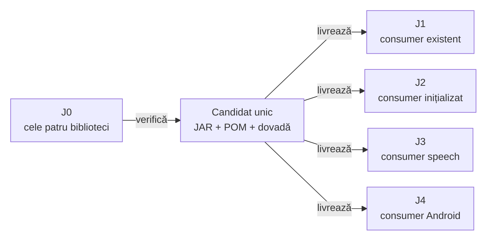

# ATF — referința J0 și sincronizarea consumerilor

[Owner, feedback și sincronizare](../lib/README.md) descrie contractul celor patru biblioteci; această pagină păstrează protocolul workspace-urilor.

## Pe scurt

`atf_j0` deține codul, testele și feedback-ul Core, Reporting, Console și Mock; `demo2` rămâne istoric.
Implementările Core/Reporting/Console/Mock și toate testele lor native rămân aici; fiecare destinație
primește și verifică livrarea potrivită propriului deployment.

| Workspace | Rol | Suprafață existentă |
|---|---|---|
| `atf_j0` | sursă Core/Reporting/Console/Mock, teste native și `atf-reporting-tests`; referință pentru contractele comune | 12 module sursă; Core și guvernanța comune reconciliate |
| `atf_j1` | testarea AutoEx și Shop; consumer Core/Reporting/Console/Mock prin JAR | 7 module journeys; patru perechi JAR/POM în lib și acceptanță proprie |
| `atf_j2` | WIP: framework și teste Kafka/mesagerie, fără module browser ori Shop/AutoEx | 6 module sursă, inclusiv SQL; Core/Reporting/Console/Mock JAR; componente Eventuate MOCK; Kafka remote și clientul Java de infrastructură validate în incrementul J2; clientul/observerul framework-ului rămâne WIP |
| `atf_j4` | consumer Android/ADB, patru module; Core/Reporting/Console/Mock JAR | independent binary adoption, with complete captured PNG evidence; E2E device rămâne la J4 |
| `atf_j3` | consumer speech, cinci module sursă; Core/Reporting/Console/Mock prin JAR | Core/Reporting in lib și acceptanță proprie, fără module web ori mesagerie |
| `atf_j5` | WIP Rentz: trei module Maven, inclusiv motorul local; Kit sursă | patru perechi în lib preluate din J4; identitatea adopției și acceptanța J5 se califică distinct |
| `demo2` | historical source workspace | nu mai este destinație activă de mentenanță sau sync |

J1 poate avea schimbări comune în lucru. Referința J0 nu autorizează
suprascrierea lor: reconcilierea compară baza, diferența și proba fiecărui owner.

## Direcția livrării

<strong>Legendă — un candidat, acceptanțe distincte</strong>

- Sursa include implementarea, assets, probele native și regresiile cu mock/browser.
- Candidatul este construit o dată din snapshot-ul verificat; aceeași pereche
  JAR/POM este oferită destinațiilor, fără rebuild separat sub aceeași versiune.
- Fiecare muchie de livrare cere propria acceptanță. J2 are un Git separat,
  păstrat la baza sa existentă; profilul Eventuate exclude explicit Shop/AutoEx, UI și Debug UI, iar configurațiile lui evoluează separat.
- J3 primește aceleași patru perechi de biblioteci, cu acceptanță proprie; nu păstrează surse Core ori harness Reporting.
- J4 păstrează adaptoarele Android, configurațiile și acceptanța fizică; primește aceeași pereche Reporting, fără sursa sau harness-ul J0.
- Muchiile sunt livrări și probe, nu dependențe Maven ori module suplimentare.

## Alegerea workspace-ului

| Schimbare | Owner și limită |
|---|---|
| renderer, assets și regresii generice Reporting | J0; probele native și harness-ul rămân lângă implementare |
| scenarii, fixture-uri și adaptoare AutoEx/Shop | J1; copiile din reactorul J0 rămân consumatori ai sursei, fără owner concurent |
| contracte pentru cozi și mesaje | J2, cu propriul catalog și bootstrap; nu moștenește automat scenariile web din J1 |
| infrastructură comună | ownerul comportamentului și consumatorii afectați; reconciliere selectivă, fără mirror sau proprietate exclusivă asupra întregului ATF |

J2 este WIP: trei componente verifică oracole MOCK, iar Setup configurează
Kafka în Podman prin scripturi. Clientul Kafka Java și acceptanța reală
rămân distincte; infrastructura copiată nu le demonstrează.

## Ce se propagă

| Schimbare în referință | Livrare către fiecare consumer | Dovadă necesară |
|---|---|---|
| Reporting Java, assets, API sau POM | versiune nouă, JAR/POM și proveniență; documentele de adopție | native, regresii permanente și gate pe JAR-ul fizic |
| Core Java, API sau POM | versiune Core nouă, pereche JAR/POM și proveniență; sursa și nativele rămân în J0 | native și contracte pe JAR, guvernanță și acceptanță distinctă J1/J2 |
| numai regresii Reporting | testele rămân în J0; se verifică relevanța pentru versiunea consumată | reproducere negativă și acceptanță pe binarul afectat; fără copierea harness-ului în live |
| other shared source modules (Kit, Validation, UI) or Shop/AutoEx adapters | numai sursele și probele selectate pentru același comportament | comparație cu schimbările locale și testele ownerului; un JAR Reporting nou nu este implicit necesar |
| documentație ori mutarea referinței | contracte și linkuri adaptate deployment-ului | guvernanță documentară; fără versiune binară nouă numai pentru redenumirea directorului |

- `lib` păstrează o singură versiune per bibliotecă: câte un JAR/POM direct în folder.
  Hash-urile și catalogul native sunt în `library-provenance.json`, la rădăcină.
- POM-urile reactorului, `.git`, bazele `testChanges`, configurațiile locale,
  cache-urile, output-urile și rapoartele nu se copiază prin mirror.
- Feedback-ul Core/Reporting/Console/Mock și Test Kit are owner în J0; cerințele comune nonbibliotecă sunt coordonate în J1. [Test Kit](ATF_Test_Kit_Library.md) este în pregătire pentru distribuție în J1–J5; modulele sursă rămân până la acceptanță. Feedback-ul unei implementări comune
  se închide în alt deployment numai după sincronizarea și proba codului său.

## Protocolul fiecărui increment

1. Capturează snapshot-ul J0 și bazele fiecărei destinații; inventariază separat
   schimbările locale. Declarația unei ținte nu dovedește că ea există ca proiect.
2. Creează staging propriu în TMP. Pentru linkurile între checkout-uri, păstrează
   numele surorilor `atf_j0`, `atf_j1` și `atf_j2`. Folosește câte un cache Maven TMP per consumer binar pentru execuții paralele.
3. Repară la owner și păstrează regresia permanentă. O problemă generică de
   randare, verdict ori expandare primește probă în `atf-reporting-tests`.
4. Pentru un candidat Reporting, construiește și verifică snapshot-ul fixat;
   rulează harness-ul pe JAR-ul real în consumerul TMP. Nu construi din nou
   sursa vecină pentru a satisface contractul binar.
5. Verifică separat fiecare consumer: bootstrap Maven/IDE, tranzitive,
   CodeSource/hash, guvernanță și adaptoarele afectate. Schimbările de raport
   cer Extent/fallback, timing, assertions colapsabile, expandări și limita 240.
6. Promovează numai fișierele reconciliate prin [guard-ul Core](../atf-core/README.md#manifest-și-promovare-guarded).
   Dacă o țintă diferă de baseline, oprește acea promovare și revalidează diferența.
7. Recitește livrabilele live și consemnează starea fiecărei ținte. Un J1 verde
   nu devine dovadă pentru J2, iar promovarea per fișier nu este o tranzacție
   atomică distribuită între proiecte.

## Proveniență și relocare

| Informație | Regula de păstrare |
|---|---|
| owner curent | `maintenanceReference` indică J0 și țintele de mentenanță |
| existing build | `producerDirectory`, commit-ul, hash-urile și acceptanța descriu execuția originală; nu se rescriu ca și cum ar fi rulat în J0 |
| următorul build | înregistrează snapshot-ul efectiv din J0 și acceptanțele executate, without inheriting earlier execution results |
| diferențe CRLF/LF | se explică separat; echivalența textuală nu substituie hash-ul byte cu byte al unui artifact sau al intrărilor publicate |
| controale Git | baze reale per checkout; controalele istorice nu se rebazează prin înlocuire de text |

Build-ul și promovarea urmează [procesul izolat](ATF_Build_And_Execution_Safety.md).
Contractul inventarului este la [ownerul guvernanței](../atf-tests/README.md#inventarul-comun-al-surselor-java).

| Boundary comun | Contract și limită |
|---|---|
| Core | mască literală și diagnostic Authorization quoted/trunchiat; comparația integrală precede redacția și preview-ul |
| MIME și headere | negative distincte, o singură expediere; fiecare destinație verifică snapshot-ul propriu |
| sursă versus binar | acceptanța Core nu rescrie proveniența Reporting și nu certifică brokerul real |

Domeniile consumerilor sunt distincte: J1 deține scenariile web AutoEx/Shop,
iar J2 este destinat cozilor și mesajelor. Acceptanța MOCK verifică integrarea ATF și Reporting; scenariile de broker au contracte și probe proprii.

Acceptanța J2 Eventuate și limita hostului sunt în [dovada consumerului](../../atf_j2/docs/ATF_J2_Verification.md); instalarea prerequisites nu certifică engine ori broker.

## J2 fără module browser — perimetru distinct

J2 declară șase module sursă: platforma, SQL, Setup, Eventuate și guvernanța; Core și Reporting sunt biblioteci externe.
[Scope-ul J2](../../atf_j2/docs/ATF_J2_Scope.md) delimitează contractul fără
UI/Debug sau Playwright; retragerea este implementată în checkout-ul J2.

Nu restaurați modulele browser prin sync. Atlasele, README-urile și feedback-urile
rămân adaptate domeniului fiecărui deployment; contractele comune se reconciliază
selectiv, iar backlog-ul Reporting și cel web rămân la ownerii J0/J1.

## Core ca bibliotecă — owner și deployment

J0 păstrează sursa și testele native Core; reactorul sursă are în continuare 12 module.
[Contractul Core](ATF_Core_Consumer.md) separă sursa, publicarea și acceptanțele J1/J2/J3.
Testele native se păstrează în J0, iar acceptanța pe binar rulează în TMP.

## Release evidence retention

- Project README files, atlases and `docs` describe current contracts and ownership; they do not accumulate per-release library improvement narratives or verification notes.
- Keep one current verification note per library in its producer packaging stage, beside the effective publication POM. Builds, logs and HTML evidence stay in owned TMP.
- Consumer `library-provenance.json` records the current coordinate, hashes, original `buildStage` and `currentAcceptance.evidence` location. Consumer `lib` retains the latest Core, Reporting, Console and Mock JAR/POM pairs plus its dedicated README; no release notes are stored there.
- Superseded notes are retired after their durable contracts have been reconciled. Historical build/test facts and original evidence paths remain provenance, explicitly marked as retired; they are not current document targets or fresh acceptance.

Each current note is retained with its matching package; its coordinate and JAR/POM hashes must match the distributed pair. Documentation maintenance alone neither rebuilds a library nor repeats its recorded tests.
