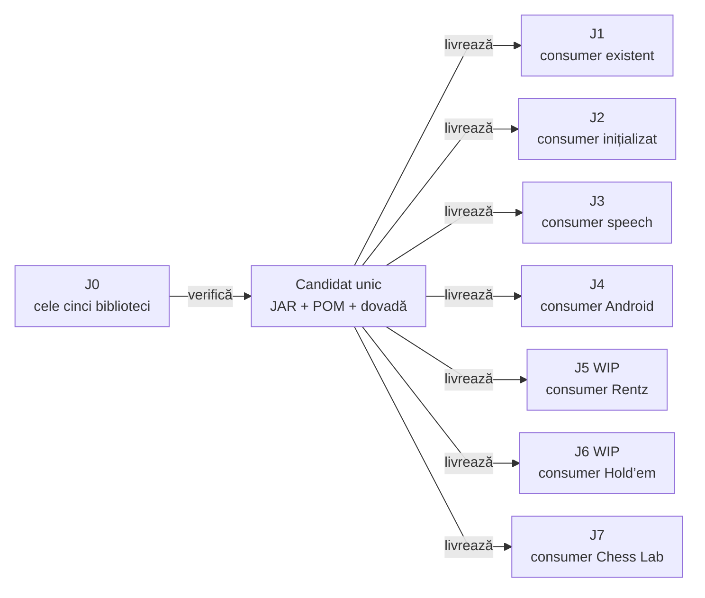
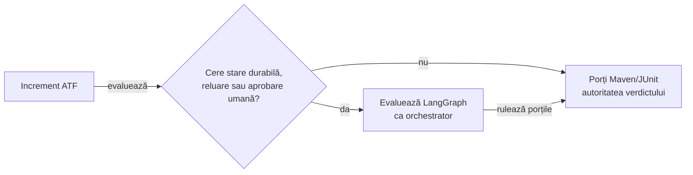

# ATF — referința J0 și sincronizarea consumerilor

[Owner, feedback și sincronizare](../lib/README.md) descrie contractul celor cinci biblioteci; această pagină păstrează protocolul workspace-urilor.

## Pe scurt

`atf_j0` deține codul, testele și feedback-ul Core, Reporting, Console, Mock și Test Kit; `demo2` rămâne istoric. Implementările Core/Reporting/Console/Mock/Test Kit și toate testele lor native rămân aici; fiecare destinație primește și verifică livrarea potrivită propriului deployment.

| Workspace | Rol | Suprafață existentă |
|---|---|---|
| `atf_j0` | sursă Core/Reporting/Console/Mock/Test Kit, teste native și `atf-reporting-tests`; referință pentru contractele comune | 12 module sursă; Core și guvernanța comune reconciliate |
| `atf_j1` | testarea AutoEx și Shop; consumer Core/Reporting/Console/Mock/Test Kit prin JAR | 6 module journeys; cinci perechi JAR/POM în lib și acceptanță proprie |
| `atf_j2` | WIP: framework și teste Kafka/mesagerie, fără module browser ori Shop/AutoEx | 5 module sursă, inclusiv SQL; Core/Reporting/Console/Mock/Test Kit JAR; componente Eventuate MOCK; Kafka remote și clientul Java de infrastructură validate în incrementul J2; clientul/observerul framework-ului rămâne WIP |
| `atf_j4` | consumer Android/ADB, trei module; Core/Reporting/Console/Mock/Test Kit JAR | independent binary adoption, with complete captured PNG evidence; E2E device rămâne la J4 |
| `atf_j3` | consumer speech, patru module sursă; Core/Reporting/Console/Mock/Test Kit prin JAR | Core/Reporting in lib și acceptanță proprie, fără module web ori mesagerie |
| `atf_j5` | Rentz Lab, cu motor local și suită Maven | cinci perechi JAR/POM în `lib`. Calificarea motorului și a aplicației Android aparține J5. |
| `atf_j6` | Hold’em Lab, cu motor, AI, arenă și aplicație Android | bootstrap Maven din `lib`. Evaluarea offline și calificarea APK-ului aparțin J6. |
| `atf_j7` | Chess Lab, consumator al celor cinci biblioteci | bootstrap Maven din perechile JAR/POM din `lib` și calificare proprie a motorului, a rapoartelor și a APK-ului |
| `demo2` | historical source workspace | nu mai este destinație activă de mentenanță sau sync |

J1 poate avea schimbări comune în lucru. Referința J0 nu autorizează suprascrierea lor: reconcilierea compară baza, diferența și proba fiecărui owner.

## Direcția livrării

<strong>Legendă — un candidat, acceptanțe distincte</strong>

- Sursa include implementarea, assets, probele native și regresiile cu mock/browser.
- Candidatul este construit o dată din snapshot-ul verificat; aceeași pereche
  JAR/POM este oferită destinațiilor, fără rebuild separat sub aceeași versiune.
- Fiecare muchie de livrare cere propria acceptanță. J2 are un Git separat,
  păstrat la baza sa existentă; profilul Eventuate exclude explicit Shop/AutoEx, UI și Debug UI, iar configurațiile lui evoluează separat.
- J3 primește aceleași cinci perechi de biblioteci, cu acceptanță proprie; nu păstrează surse Core ori harness Reporting.
- J4 păstrează adaptoarele Android, configurațiile și acceptanța fizică; primește aceeași pereche Reporting, fără sursa sau harness-ul J0.
- Muchiile sunt livrări și probe, nu dependențe Maven ori module suplimentare.

## Alegerea workspace-ului

| Schimbare | Owner și limită |
|---|---|
| renderer, assets și regresii generice Reporting | J0; probele native și harness-ul rămân lângă implementare |
| scenarii, fixture-uri și adaptoare AutoEx/Shop | J1; copiile din reactorul J0 rămân consumatori ai sursei, fără owner concurent |
| contracte pentru cozi și mesaje | J2, cu propriul catalog și bootstrap; nu moștenește automat scenariile web din J1 |
| infrastructură comună | ownerul comportamentului și consumatorii afectați; reconciliere selectivă, fără mirror sau proprietate exclusivă asupra întregului ATF |

J2 este WIP: trei componente verifică oracole MOCK, iar Setup configurează Kafka în Podman prin scripturi. Clientul Kafka Java și acceptanța reală rămân distincte; infrastructura copiată nu le demonstrează.

## Ce se propagă

| Schimbare în referință | Livrare către fiecare consumer | Dovadă necesară |
|---|---|---|
| Reporting Java, assets, API sau POM | versiune nouă, JAR/POM și proveniență; documentele de adopție | native, regresii permanente și gate pe JAR-ul fizic |
| Core Java, API sau POM | versiune Core nouă, pereche JAR/POM și proveniență; sursa și nativele rămân în J0 | native și contracte pe JAR, guvernanță și acceptanță distinctă în fiecare consumer afectat J1–J7 |
| numai regresii Reporting | testele rămân în J0; se verifică relevanța pentru versiunea consumată | reproducere negativă și acceptanță pe binarul afectat; fără copierea harness-ului în live |
| Test Kit, Console sau Mock | versiune nouă și pereche JAR/POM în J1–J7; sursa și nativele rămân în J0 | native, contracte pe JAR și acceptanța fiecărui consumer |
| surse comune Validation/UI sau adaptoare Shop/AutoEx | numai sursele și probele selectate pentru același comportament | comparație cu schimbările locale și testele ownerului; un JAR Reporting nou nu este implicit necesar |
| documentație ori mutarea referinței | contracte și linkuri adaptate deployment-ului | guvernanță documentară; fără versiune binară nouă numai pentru redenumirea directorului |

- `lib` păstrează o singură versiune per bibliotecă: câte un JAR/POM direct în folder.
  Hash-urile și catalogul native sunt în `library-provenance.json`, la rădăcină.
- POM-urile reactorului, `.git`, bazele `testChanges`, configurațiile locale,
  cache-urile, output-urile și rapoartele nu se copiază prin mirror.
- Feedback-ul Core/Reporting/Console/Mock/Test Kit are owner în J0; cerințele comune nonbibliotecă sunt coordonate în J1. [Test Kit](ATF_Test_Kit_Library.md) este distribuit ca bibliotecă în J1–J7; sursa și nativele rămân în J0. Feedback-ul unei implementări comune
  se închide în alt deployment numai după sincronizarea și proba codului său.

## Protocolul fiecărui increment

```mermaid
%%{init: {"themeVariables":{"fontSize":"15px"},"themeCSS":".nodeLabel, .nodeLabel p { font-size: 15px !important; line-height: 1.35 !important; } .edgeLabel, .edgeLabel p { font-size: 12px !important; font-weight: 400 !important; line-height: 1.2 !important; } .edgeLabel .labelBkg, .edgeLabel p { background: transparent !important; } .edgeLabel foreignObject { transform: translateY(-18px); overflow: visible; } .node rect { rx: 6px; ry: 6px; }","flowchart":{"curve":"linear","nodeSpacing":24,"rankSpacing":32,"padding":8,"diagramPadding":16}}}%%
flowchart LR
    Feedback["Feedback<br/>trigger și criteriu"] -->|delimitează| Owner["Owner<br/>J0 source"]
    Owner -->|izolează| Stage["TMP stage"]
    Stage -->|probează| OwnerTests["Teste native<br/>ale ownerului"]
    OwnerTests -->|gate local| Gate["Whole J0<br/>guvernanță"]
    Gate -->|fără JAR| Reconcile["Cod + docs +<br/>feedback reconciliate"]
    Gate -->|JAR nou| Package["Versiune<br/>JAR + POM"]
    Package -->|boundary| Pair["Acceptanță pereche<br/>J0/J1"]
    Pair -->|la adoptare| J1["Teste native<br/>consumer J1"]
    J1 -->|reconciliere| Reconcile
    Reconcile -->|promovează| Origin["Origin"]
    OwnerTests -.->|gap| Feedback
    Gate -.->|gap| Feedback
    Pair -.->|gap| Feedback
    J1 -.->|gap| Feedback
```

<strong>Legendă — un increment trasabil, cu acceptanță separată</strong>

- Feedback-ul păstrează un trigger și un criteriu de închidere; ownerul rămâne
  la modulul care deține comportamentul.
- Staging-ul probează schimbarea izolată. Codul, testele și documentația se
  reconciliază înainte de promovare.
- Numai o schimbare de bibliotecă produce o pereche nouă JAR/POM. Poarta
  perechii verifică ownership-ul și artefactele; dacă J1 adoptă binarul, testele native J1 verifică separat comportamentul consumerului.
- Muchiile punctate întorc eșecul la feedback cu gap-ul concret; nu închid
  automat cerința la primul gate verde.
- `Origin` primește numai fișierele aprobate și reconciliate, fără output-uri
  generate din staging.

Etichetele scurte păstrează următorul sens:

| În schemă | Sens complet |
|---|---|
| Teste native ale ownerului | dovada comportamentului și a criteriului din feedback |
| Whole J0 guvernanță | controale de arhitectură, source ownership și documentație în reactor |
| Fără JAR | schimbare fără publicare binară, de exemplu teste sau documentație |
| JAR nou | versiune nouă, cu POM-ul publicat și proveniență verificată |
| Acceptanță pereche J0/J1 | boundary-ul sursă/binar și perechile JAR/POM; consumerul documentează bibliotecile |
| Teste native consumer J1 | comportamentul local când o versiune nouă este adoptată |
| Reconciliere | revizie code/doc/feedback, bazele Git și setul exact de fișiere |

1. Capturează snapshot-ul J0 și bazele fiecărei destinații; inventariază separat
   schimbările locale. Declarația unei ținte nu dovedește că ea există ca proiect.
2. Creează staging propriu în TMP. Pentru linkurile între checkout-uri, păstrează
   numele surorilor `atf_j0`, `atf_j1` și `atf_j2`. Folosește câte un cache Maven TMP per consumer binar pentru execuții paralele.
3. Repară la owner și păstrează regresia permanentă. O problemă generică de
   randare, verdict ori expandare primește probă în `atf-reporting-tests`.
4. Pentru un candidat Reporting, construiește și verifică snapshot-ul fixat;
   rulează harness-ul pe JAR-ul real în consumerul TMP. Nu construi din nou sursa vecină pentru a satisface contractul binar.
5. Verifică separat fiecare consumer: bootstrap Maven/IDE, tranzitive,
   CodeSource/hash, guvernanță și adaptoarele afectate. Schimbările de raport cer Extent/fallback, timing, assertions colapsabile, expandări și limita 240.
6. Promovează numai fișierele reconciliate prin [guard-ul Core](../atf-core/README.md#manifest-și-promovare-guarded).
   Dacă o țintă diferă de baseline, oprește acea promovare și revalidează diferența.
7. Recitește livrabilele live și consemnează starea fiecărei ținte. Un J1 verde
   nu devine dovadă pentru J2, iar promovarea per fișier nu este o tranzacție atomică distribuită între proiecte.

## Proveniență și relocare

| Informație | Regula de păstrare |
|---|---|
| owner curent | `maintenanceReference` indică J0 și țintele de mentenanță |
| existing build | `producerDirectory`, commit-ul, hash-urile și acceptanța descriu execuția originală; nu se rescriu ca și cum ar fi rulat în J0 |
| următorul build | înregistrează snapshot-ul efectiv din J0 și acceptanțele executate, without inheriting earlier execution results |
| diferențe CRLF/LF | se explică separat; echivalența textuală nu substituie hash-ul byte cu byte al unui artifact sau al intrărilor publicate |
| controale Git | baze reale per checkout; controalele istorice nu se rebazează prin înlocuire de text |

Build-ul și promovarea urmează [procesul izolat](ATF_Build_And_Execution_Safety.md). Contractul inventarului este la [ownerul guvernanței](../atf-tests/README.md#inventarul-comun-al-surselor-java).

| Boundary comun | Contract și limită |
|---|---|
| Core | mască literală și diagnostic Authorization quoted/trunchiat; comparația integrală precede redacția și preview-ul |
| MIME și headere | negative distincte, o singură expediere; fiecare destinație verifică snapshot-ul propriu |
| sursă versus binar | acceptanța Core nu rescrie proveniența Reporting și nu certifică brokerul real |

Domeniile consumerilor sunt distincte: J1 deține scenariile web AutoEx/Shop, iar J2 este destinat cozilor și mesajelor. Acceptanța MOCK verifică integrarea ATF și Reporting; scenariile de broker au contracte și probe proprii.

Acceptanța J2 Eventuate și limita hostului sunt în [dovada consumerului](../../atf_j2/docs/ATF_J2_Verification.md); instalarea prerequisites nu certifică engine ori broker.

## J2 fără module browser — perimetru distinct

J2 declară cinci module sursă: platforma, SQL, Setup, Eventuate și guvernanța; Core și Reporting sunt biblioteci externe. [Scope-ul J2](../../atf_j2/docs/ATF_J2_Scope.md) delimitează contractul fără UI/Debug sau Playwright; retragerea este implementată în checkout-ul J2.

Nu restaurați modulele browser prin sync. Atlasele, README-urile și feedback-urile rămân adaptate domeniului fiecărui deployment; contractele comune se reconciliază selectiv, iar backlog-ul Reporting și cel web rămân la ownerii J0/J1.

## Core ca bibliotecă — owner și deployment

J0 păstrează sursa și testele native Core; reactorul sursă are în continuare 12 module. [Contractul Core](ATF_Core_Consumer.md) separă sursa și publicarea de acceptanța independentă a fiecărui consumator J1–J7. Testele native se păstrează în J0, iar acceptanța pe binar rulează în TMP.

## Păstrarea dovezilor de release

- Fișierele README, atlasele și `docs` descriu contracte și ownership curente; nu acumulează narațiuni de îmbunătățire sau note de verificare per release.
- Păstrează o notă curentă per bibliotecă în staging-ul de împachetare al producătorului, lângă POM efectiv. Build-urile, logurile și dovezile HTML rămân în TMP propriu.
- `library-provenance.json` al consumerului înregistrează coordonata curentă, hash-urile, `buildStage` original și locația `currentAcceptance.evidence`. `lib` păstrează ultimele perechi Core, Reporting, Console, Mock și Test Kit JAR/POM și propriul README; fără note de release acolo.
- Notele depășite sunt retrase după reconcilierea contractelor durabile. Faptele istorice și căile originale ale dovezilor rămân proveniență, marcate ca retrase; nu sunt ținte curente sau acceptanță nouă.

Fiecare notă curentă rămâne lângă pachetul corespunzător; coordonata și hash-urile JAR/POM trebuie să corespundă perechii distribuite. Mentenanța documentară singură nu reconstruiește biblioteca și nu repetă testele înregistrate.

### Când merită evaluat LangGraph?

Ramurile finite `cu JAR` și `fără JAR` sunt acoperite de suite și feedback;
singure, nu justifică un runtime nou. Reevaluarea are sens când procesul cere
stare durabilă peste întreruperi, aprobare umană sau reluarea controlată a unui
traseu dinamic. Maven/JUnit rămâne autoritatea verdictului testelor.

<strong>Legendă — când orchestrarea are un scop operațional</strong>

- Suitele existente acoperă ramurile finite; Mermaid explică traseul.
- Starea durabilă, revizuirea sau reluarea pot justifica evaluarea unui orchestrator; diagrama nu îl introduce ca dependență.
- Orice orchestrator rulează aceleași porți Maven/JUnit; testele ATF păstrează autoritatea verdictului.

