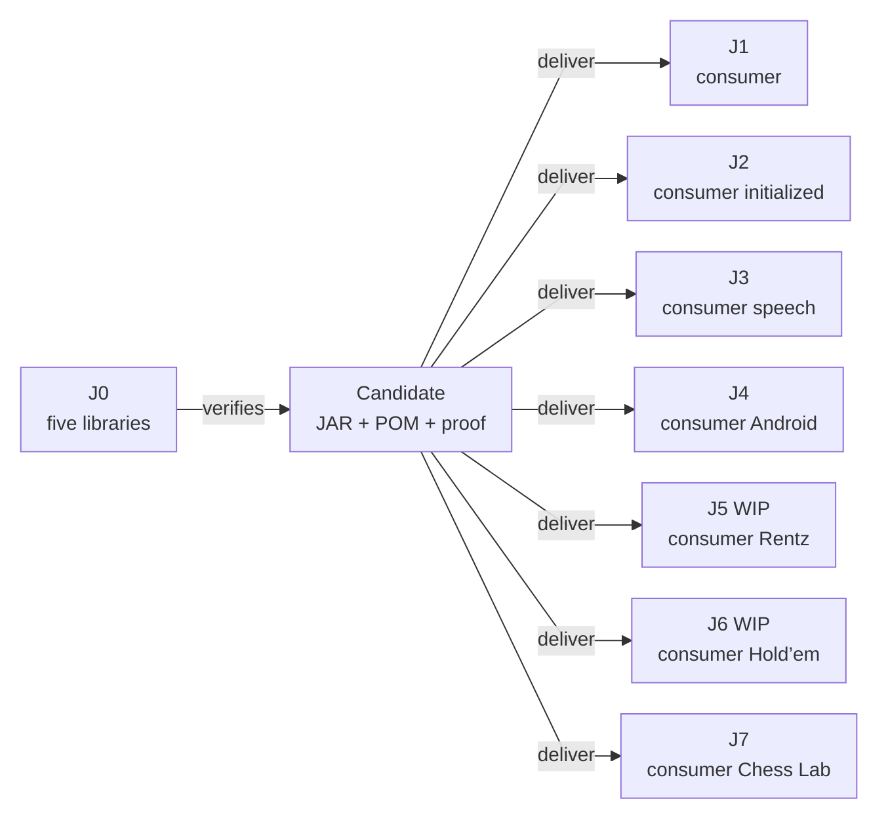
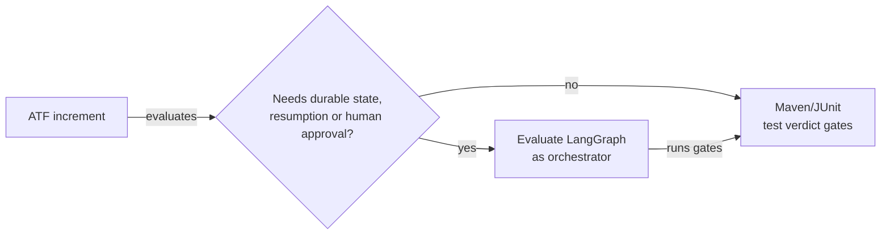

# ATF — J0 reference and consumer synchronization

[Ownership, feedback and synchronization](../lib/README.md) describes the five-library contract; this page owns the workspace protocol.

## At a glance

`atf_j0` owns Core, Reporting, Console, Mock and Test Kit code, tests and feedback; `demo2` remains historical. Their implementations and native tests stay here. Each destination receives and verifies a delivery suited to its own deployment.

| Workspace | Role | Existing area |
|---|---|---|
| `atf_j0` | Core/Reporting/Console/Mock/Test Kit source, native tests and `atf-reporting-tests`; reference for shared contracts | 12 source modules; Core and reconciled joint governance |
| `atf_j1` | AutoEx/Shop testing; binary consumer of Core/Reporting/Console/Mock/Test Kit | 6 journey modules; five JAR/POM pairs in lib and independent acceptance |
| `atf_j2` | WIP: framework and Kafka / messaging tests, without browser modules or Shop / AutoEx | 5 source modules, including SQL; Core/Reporting/Console/Mock/Test Kit JAR; Eventuate MOCK components; remote Kafka and the Java infrastructure client verified in the J2 increment; the framework client/observer remains WIP |
| `atf_j4` | Android/ADB consumer, three modules; Core/Reporting/Console/Mock/Test Kit JAR | independent binary adoption with complete captured PNG evidence; E2E device remains at J4 |
| `atf_j3` | Speech consumer, four source modules; Core / Reporting / Console / Mock / Test Kit by JAR | Core / Reporting in lib and its own acceptance, without web or messaging modules |
| `atf_j5` | Rentz Lab with a local engine and Maven suite | Five JAR/POM pairs in `lib`; J5 owns engine and Android application qualification |
| `atf_j6` | Hold’em Lab with engine, AI, arena and Android application | Maven bootstrap from `lib`; J6 owns offline evaluation and APK qualification |
| `atf_j7` | Chess Lab, consumer of the five libraries | Maven bootstrap from JAR/POM pairs in `lib`; independent engine, report and APK qualification |
| `demo2` | historical source workspace | is no longer an active maintenance destination or sync |

J1 may have shared changes in progress. J0 reference ownership does not authorize overwriting them: reconciliation compares each owner’s base, delta and probe.

## Delivery direction

<strong>Legend - candidate, distinct acceptances</strong>

- The source includes implementation, assets, native samples and regressions with mock / browser.
- Build the candidate once from the verified snapshot; offer the same
  JAR/POM pair to each destination without a separate rebuild under the same version.
- Each delivery edge requires independent acceptance. J2 keeps its own Git
  base; its Eventuate profile explicitly excludes Shop/AutoEx, UI and Debug UI, and its configurations evolve separately.
- J3 receives the same five library pairs with independent acceptance; it retains neither Core source nor the Reporting harness.
- J4 retains Android adapters, physical configurations and acceptance; receives the same Reporting pair without J0 source or harness.
- The edges are deliveries and samples, not Maven dependencies or additional modules.

## Choosing a workspace

| Change | Owner and limit |
|---|---|
| renderer, assets and generic regressions Reporting | J0; native samples and harness remain near implementation |
| AutoEx / Shop scenarios, fixtures and adapters | J1; copies of J0 reactor remain consumers of the source without competing owner |
| contracts for queues and messages | J2 with its own catalog and bootstrap; does not automatically inherit J1 web scenarios |
| joint infrastructure | Owner of behaviour and affected consumers; selective reconciliation, without mirroring or exclusive ownership of the entire ATF |

J2 is WIP: three components check MOCK oracles, and Setup configures Kafka in Podman through scripts. The Kafka Java client and real acceptance remain distinct; copied infrastructure proves neither.

## Delivered changes

| Change in reference | Delivery to each consumer | Required evidence |
|---|---|---|
| Reporting Java, assets, API or POM | new version, JAR / POM and provenance; adoption documents | native, permanent regressions and gate on physical JAR |
| Core Java, API or POM | new Core version, JAR / POM pair and provenance; source and natives remain in J0 | native and contracts on JAR, separate governance and acceptance in each consumer affected J1-J7 |
| Reporting regression only | tests remain in J0; check relevance for the consumed version | negative reproduction and acceptance on affected binary; without copying the harness live |
| Test Kit, Console or Mock | new version and JAR/POM pair in J1–J7; source and native tests remain in J0 | native, contracts on JAR and the acceptance of each consumer |
| Validation / UI or Shop / AutoEx adapters | only sources and samples selected for the same behaviour | comparison with local changes and owner tests; a new JAR Reporting is not by default necessary |
| documentation or reference movement | contracts and links adapted to the deployment | Documentary governance; without new binary version solely for renaming a directory |

- `lib` keeps one version per library: one JAR / POM straight into the folder.
  The native hashes and catalogue are in `library-provenance.json`, at the root.
- POM reactor, `.git`, `testChanges` bases, local configurations,
  caches, outputs and reports are not copied by mirror.
- J0 owns Core/Reporting/Console/Mock/Test Kit feedback; J1 coordinates shared nonlibrary criteria. [Test Kit](ATF_Test_Kit_Library.md) is distributed as a library in J1–J7; source and native tests remain in J0. Feedback on a shared implementation
  be closed in another deployment only after synchronisation and testing its code.

## Increment protocol

```mermaid
%%{init: {"themeVariables":{"fontSize":"15px"},"themeCSS":".nodeLabel, .nodeLabel p { font-size: 15px !important; line-height: 1.35 !important; } .edgeLabel, .edgeLabel p { font-size: 12px !important; font-weight: 400 !important; line-height: 1.2 !important; } .edgeLabel .labelBkg, .edgeLabel p { background: transparent !important; } .edgeLabel foreignObject { transform: translateY(-18px); overflow: visible; } .node rect { rx: 6px; ry: 6px; }","flowchart":{"curve":"linear","nodeSpacing":24,"rankSpacing":32,"padding":8,"diagramPadding":16}}}%%
flowchart LR
    Feedback["Feedback<br/>trigger + criterion"] -->|delimited| Owner["Owner<br/>J0 source"]
    Owner -->|isolate| Stage["TMP stage"]
    Stage -->|Probe| OwnerTests["Owner<br/>native tests"]
    OwnerTests -->|gate local| Gate["Whole J0 <br/>governance"]
    Gate -->|without JAR| Reconcile["Code + docs + <br/>feedback reconciled"]
    Gate -->|New JAR| Package["<br/> JAR + POM"]
    Package -->|boundary| Pair["J0/J1 pair<br/>acceptance"]
    Pair -->|on adoption| J1["Native<br/>consumer J1"]
    J1 -->|reconciliation| Reconcile
    Reconcile -->|promote| Origin["Origin"]
    OwnerTests -.->|gap| Feedback
    Gate -.->|gap| Feedback
    Pair -.->|gap| Feedback
    J1 -.->|gap| Feedback
```

<strong>Legend - a traceable increment with separate acceptance</strong>

- Feedback keeps a trigger and a closing criterion; the owner remains
  to the module that holds the behavior.
- The staggered sample shall be tested for the isolated change.
  They reconcile before the promotion.
- Only a library change produces a new pair JAR / POM.
  The pairs check the ownership and artifacts; if J1 adopts the binary, the native J1 tests check the consumer's behaviour separately.
- The dotted edges turn failure to feedback with the concrete gaping; do not close
  automatic requirement at first green gate.
- `Origin` receives only approved and reconciled files without outputs
  generated from staging.

The short labels shall be kept as follows:

| In the scheme | Full meaning |
|---|---|
| Native Owner Tests | proof of behaviour and the criterion in feedback |
| Whole J0 Governance | architectural controls, source ownership and reactor documentation |
| No JAR | change without binary publication, e.g. tests or documentation |
| New JAR | new version with POM published and verified provenance |
| J0 / J1 pair acceptance | source / binary boundary and JAR / POM pairs; consumer documents libraries |
| Native consumer J1 tests | local behaviour when a new version is adopted |
| Reconciliation | Code revision / doc / feedback, Git bases and exact set of files |

1. Capture the J0 snapshot and each destination’s base; inventory local changes
   separately. Declaring a destination does not establish that it exists as a project.
2. Create owned TMP staging. For links between checkouts, retain the sibling
   names `atf_j0`, `atf_j1` and `atf_j2`. Use a separate TMP Maven cache for each binary consumer when running in parallel.
3. Fix the behavior at its owner and keep a permanent regression. A generic
   rendering, verdict or expansion defect receives a probe in `atf-reporting-tests`.
4. For a Reporting candidate, build and verify the pinned snapshot; run the
   harness against the physical JAR in the TMP consumer. Do not rebuild neighboring source to satisfy the binary contract.
5. Verify each consumer separately: Maven/IDE bootstrap, transitives,
   CodeSource/hash, governance and affected adapters. Report changes require Extent/fallback, timing, collapsible assertions, expansions and the 240 preview limit.
6. Promote only files reconciled via [guard-ul Core](../atf-core/README.md#manifest-și-promovare-guarded).
   If a target differs from baseline, stop that promotion and revalidate the difference.
7. Reread live deliverables and record each destination’s status. A passing J1
   does not prove J2 acceptance; per-file promotion is not a distributed atomic transaction.

## Provenance and relocation

| Information | Storage rule |
|---|---|
| current owner | `maintenanceReference` indicates J0 and maintenance targets |
| existing build | `producerDirectory`, commit, hashes and acceptance describe the original execution; never rewrite them as if that execution ran in J0 |
| next build | record the actual snapshots in J0 and the executed acceptances, without inheriting earlier execution results |
| CRLF / LF differences | Explain them separately; text equivalence does not replace byte-for-byte hashes of an artifact or its published inputs |
| Git controls | actual bases per checkout; historical checks are not based on text replacement |

The building and promotion follow [isolated process](ATF_Build_And_Execution_Safety.md). The inventory contract is at [Owner of governance](../atf-tests/README.md#inventarul-comun-al-surselor-java).

| Boundary joint | Contract and limit |
|---|---|
| Core | literal masking and quoted/truncated Authorization diagnostics; complete comparison precedes redaction and preview |
| MIME and headers | Distinguishing negative, single dispatch; each destination checks its own snapshot |
| source versus binary | Core acceptance does not rewrite the provenance of Reporting and does not certify the actual broker |

The areas of the consumers are distinct: J1 has AutoEx / Shop web scenarios, and J2 is designed for queues and messages. MOCK acceptance checks ATF and Reporting integration; broker scenarios have their own contracts and evidence.

The acceptance of J2 Eventuate and the limit of the host are in [proof of consumption](../../atf_j2/docs/ATF_J2_Verification.md); the installation of prerequisites does not certify the engine or broker.

## J2 without browser modules - distinct perimeter

J2 declares five source modules: the platform, SQL, Setup, Eventuate and governance; Core and Reporting are external libraries. [Scope-ul J2](../../atf_j2/docs/ATF_J2_Scope.md) delimits the contract without UI / Debug or Playwright; withdrawal is implemented in J2 checkout.

Do not restore browser modules via sync. Atlas, README and feedback remain adapted to the domain of each deployment; joint contracts are selectively reconciled and the Reporting and web backlog remain with the J0 / J1 owners.

## Core as library - owner and deployment

J0 retains Core source and native tests; the source reactor still has 12 modules. [Core contract](ATF_Core_Consumer.md) separates source ownership and publication from each J1–J7 consumer's independent acceptance. Native tests remain in J0; binary acceptance runs in TMP.

## Release evidence retention

- Project README files, atlases and `docs` describe current contracts and ownership; they do not accumulate per-release library improvement narratives or verification notes.
- Keep one current verification note per library in its producer packaging stage, beside the effective publication POM. Builds, logs and HTML evidence stay in owned TMP.
- The consumer’s `library-provenance.json` records the current coordinate, hashes, original `buildStage` and `currentAcceptance.evidence` location. `lib` retains the latest Core, Reporting, Console, Mock and Test Kit JAR/POM pairs and its own README; release notes stay outside it.
- Superseded notes are retired after their durable contracts have been reconciled. Historical build/test facts and original evidence paths remain provenance, explicitly marked as retired; they are not current document targets or fresh acceptance.

Each current note is retained with its matching package; its coordinate and JAR/POM hashes must match the distributed pair. Documentation maintenance alone neither rebuilds a library nor repeats its recorded tests.

### When should LangGraph be considered?

The finite branches `with JAR` and `without JAR` are already covered by suites
and feedback; by themselves, they do not justify a new runtime. Reconsider an
orchestrator when the process needs durable state across interruptions, human approval or controlled resumption of a dynamic route. Maven/JUnit remains the
authority for test verdicts.

<strong>Legend — when orchestration has an operational purpose</strong>

- Existing suites cover the finite branches; Mermaid explains the flow.
- Durable state, review or resumption can justify evaluating an orchestrator; the diagram does not introduce it as a dependency.
- Any orchestrator runs the same Maven/JUnit gates; ATF tests retain their verdict authority.

