<a id="atf-java-documentation"></a>
<a id="documentația-atf-java"></a>
# ATF Java documentation

This directory is the index of stable contracts of ATF Java and project designs explicitly marked as proposals.

- architecture and boundaries;
- addition of API tests;
- the reporting contract Extent;
- build, staging and secure sync;
- Active feedback and closing criteria.

The documents describe the framework and its owners, rather than a particular run or artifact.

<a id="at-a-glance"></a>
<a id="pe-scurt"></a>
## At a glance

| For | Read first |
|---|---|
| project orientation | [workspaces](ATF_Workspace_Synchronization.md), then [context atlas](ATF_Context_Atlas.md) |
| contract and owner | [architecture](ATF_Architecture.md), the POM and module README |
| still open problem | [feedback registry](feedback/README.md); contracts delivered remain at the owner |
| Kafka / Podman in J2 | [WIP atlas](../../atf_j2/docs/ATF_Context_Atlas.md); is not a web extension of J1 |

J0 owns Reporting implementation and regressions; J1 owns AutoEx/Shop scenarios. J2 has begun bootstrapping queues and messaging; the [workspace map](ATF_Workspace_Synchronization.md) separates copied infrastructure from messaging contracts and acceptance.

| Level | Documents | Question answered |
|---|---|---|
| workspace and delivery | [ATF_Workspace_Synchronization.md](ATF_Workspace_Synchronization.md) | where is Reporting repaired and how is each consumer validated separately? |
| context progressive | [ATF_Context_Atlas.md](ATF_Context_Atlas.md) | Which contract, entry point and probe should I read before expanding context? |
| Reporting library | [context portable](../atf-reporting/docs/README.md) and [code atlas](../atf-reporting/src/main/java/atf/reporting/README.md) | What enters the JAR, what stays in the consumer, and which probes distinguish adoption from release? |
| map | [ATF_Architecture.md](ATF_Architecture.md), the root README | who owns what and in which direction do dependencies flow? |
| contract | [ATF_Reporting_Contract.md](ATF_Reporting_Contract.md), [ATF_Reporting_Display_Contract.md](ATF_Reporting_Display_Contract.md), module guides | what semantic behavior and what visible form are stable? |
| viewer PNG and return to checkpoint | [inline audit contract](ATF_Inline_Audit_Contract.md) | how do I see the full framework without losing the host, the expansion and the audit position? |
| Inline evidence without external artifacts | [composition contract](ATF_Inline_Audit_Contract.md) | How do we keep facts, comparisons and PNG in the right owner? |
| transverse evidence | [ATF_Evidence_Capture_Contract.md](ATF_Evidence_Capture_Contract.md) | How are flow, policy, source and publisher separated? |
| practice | [README_Atf_BestPractices.md](README_Atf_BestPractices.md) | How do we add code without drift? |
| test | [ATF_Testing_Guide.md](ATF_Testing_Guide.md) | Which layer, module and proof fit the behavior? |
| test infrastructure | [ATF_Test_Infrastructure_Annotations.md](ATF_Test_Infrastructure_Annotations.md) | how do I declare the level, channel, output, setup and documentation? |
| E2E cross-sectional support | README [Test Kit](../atf-test-kit/README.md), [Practice Shop](../atf-test-practice-shop/README.md) and [Automation Exercise](../atf-test-auto-ex/README.md) together with [ATF architecture](ATF_Architecture.md) | Which neutral primitives are reused in Test Kit, and what harness UI remains in the consumer? |
| Proposed design | [ATF_AI_Evaluation_Design.md](ATF_AI_Evaluation_Design.md) | what boundary and target contract are we discussing without declaring them delivered? |
| execution | [ATF_Build_And_Execution_Safety.md](ATF_Build_And_Execution_Safety.md) | How do we work without stopping existing runs? |
| feedback / governance | [feedback/README.md](feedback/README.md), documents active on the owner and [ATF_Test_Changes_Baseline.md](ATF_Test_Changes_Baseline.md) | What observable gap, rule or transitional technical control remains? |

The index keeps the map; details are in the owner document and grow in specificity as we go down to the page.

<a id="core-diagram"></a>
<a id="diagramă-de-bază"></a>
## Core diagram

```mermaid
%%{init: {"themeVariables":{"fontSize":"15px"},"themeCSS":".nodeLabel, .nodeLabel p { font-size: 15px !important; line-height: 1.35 !important; } .edgeLabel, .edgeLabel p { font-size: 12px !important; font-weight: 400 !important; line-height: 1.2 !important; } .edgeLabel .labelBkg, .edgeLabel p { background: transparent !important; } .edgeLabel foreignObject { transform: translateY(-18px); overflow: visible; } .node rect { rx: 6px; ry: 6px; }","flowchart":{"curve":"linear","nodeSpacing":24,"rankSpacing":40,"padding":10,"diagramPadding":16}}}%%
flowchart LR
    Docs["Index"] -->|orientate| Architecture["Architecture"]
    Architecture -->|binds| Guides["Guides"]
    Guides -->|includes| Safety["Build safety"]
    Safety -->|constrains| Practices["Good practices"]
    Practices -->|supplies| Feedback["Feedback"]
```



<details>
<summary><strong>Legend - how to read the documentation map</strong></summary>

- solid arrow shows orientation route in documentation, not an dependency
  between modules;
- `Architecture` fixes modules, boundaries and direction of dependencies;
- `Guides` and contracts describe the stable use of framework;
- `Safety` describes staging, synchronization and execution gates;
- `Practices` describes cross-sectional rules and `Feedback` only keeps gaps
  reproducible and records their ownership. Short labels have the following meanings:

| In the scheme | Full meaning |
|---|---|
| Index | docs index |
| Architecture | architecture |
| Guides | guides + contracts |
| Build safety | build safety |
| Good practices | best practices |
| Feedback | feedback + owner docs |
| orientate | orient towards |

</details>

<a id="recommended-reading-order"></a>
<a id="ordinea-recomandată-de-lectură"></a>
## Recommended reading order

| Purpose | Start documents |
|---|---|
| Guidance and ownership | [Architecture](ATF_Architecture.md) · [README root](../README.md) |
| Writing and stratification of tests | [Test guide](ATF_Testing_Guide.md) · [API Guide](ATF_Api_Test_Guide.md) · [Good code practice](README_Atf_CodeBestPractices.md) |
| Reusable annotations and tags | [The contract implemented](ATF_Test_Infrastructure_Annotations.md) · [TestKit](../atf-test-kit/README.md) |
| Reporting and evidence | [Contract reporting](ATF_Reporting_Contract.md) · [Contract display/layout](ATF_Reporting_Display_Contract.md) · [Contract evidence](ATF_Evidence_Capture_Contract.md) · [README reporting](../atf-reporting/README.md) |
| Consumers and governance | [Practice Shop](../atf-test-practice-shop/README.md) · [AutoEx](../atf-test-auto-ex/README.md) · [ATF Tests](../atf-tests/README.md) · [feedback registry](feedback/README.md) |
| AI Design and implementation | [Reference design](ATF_AI_Evaluation_Design.md) · [implemented comparator](../atf-validation/README.md#comparatorul-ai--contract-implementat) · [active gaps](feedback/README_AI_Evaluation.md) |
| Contribution and operation | [Build safety](ATF_Build_And_Execution_Safety.md) · [Good practices ATF](README_Atf_BestPractices.md) · [Good documentation practices](README_Atf_DocumentationBestPractices.md) |

The complete reading order is kept collapsed below:

<details>
<summary>Full reading order and all documents</summary>

1. [ATF_Architecture.md](ATF_Architecture.md) - modules, dependencies and responsibilities.
2. [../atf-core/README.md](../atf-core/README.md) - neutral kernel, ports
   and common models.
3. [../atf-mock/README.md](../atf-mock/README.md) - deterministic fake transport,
   YAML catalogue and acceptance transport.
4. [../atf-test-kit/README.md](../atf-test-kit/README.md) - test contracts,
   the unit / component / integration / e2e levels and the exception of Console `optional compile`.
5. [../atf-reporting-tests/README.md](../atf-reporting-tests/README.md) — API fixtures,
   the composition root and test lifecycle.
6. [../atf-validation/README.md](../atf-validation/README.md) - validation
   independent and port of publication.
7. [../atf-reporting/README.md](../atf-reporting/README.md) - renderer,
   pure library contracts and component composition suite / E2E for reporting.
8. [../atf-test-practice-shop/README.md](../atf-test-practice-shop/README.md) —
    Practice Shop consumer, configuration, flows and purchase E2E.
9. [../atf-test-auto-ex/README.md](../atf-test-auto-ex/README.md) - Automation Exercise consumer,
    purchase UI profiles and opt-in API contracts.
10. [../atf-tests/README.md](../atf-tests/README.md) - the governance of the entire reactor.
11. [../atf-console/README.md](../atf-console/README.md) - diagnostic projection
   the console and the output contract.
12. [../atf-ui/README.md](../atf-ui/README.md) - generic policies and adaptor
   Playwright.
13. [../atf-reporting-tests/src/test/java/atf/ui/tests/extent/README.md](../atf-reporting-tests/src/test/java/atf/ui/tests/extent/README.md)
   — stable contract for API selection, mock- backed expected project, Extent sections and reusable UI validation.
14. [../atf-debug-ui/README.md](../atf-debug-ui/README.md) - publication
   read-only of a HTML for manual investigation in Playwright / TAB MCP.
15. [ATF_Api_Test_Guide.md](ATF_Api_Test_Guide.md) - minimum steps for a new API test.
16. [ATF_Evidence_Capture_Contract.md](ATF_Evidence_Capture_Contract.md) - contract
    across flow mode, capture policy, source and test level.
17. [ATF_Reporting_Contract.md](ATF_Reporting_Contract.md) - Extent tree,
   the track record, reference guard and rendering rules.
18. [ATF_Reporting_Display_Contract.md](ATF_Reporting_Display_Contract.md) —
    visible hierarchy, layout, disclosures, viewport and browser proof.
19. [ATF_Build_And_Execution_Safety.md](ATF_Build_And_Execution_Safety.md) —
   build, synchronise and validate without stopping existing executions.
20. [README_Atf_BestPractices.md](README_Atf_BestPractices.md) - index of rules;
   [README_Atf_CodeBestPractices.md](README_Atf_CodeBestPractices.md) for code, OOP and testing; [README_Atf_DocumentationBestPractices.md](README_Atf_DocumentationBestPractices.md) for structure, diagrams and legibility.
21. [ATF_Testing_Guide.md](ATF_Testing_Guide.md) - choice of layer, matrix
    modules × layer and suitable proof for UI / API and reporting.
22. [feedback/README.md](feedback/README.md) - ToDo active, closing criteria
    and the register of ownership for API, UI and reporting.
23. [ATF_Test_Changes_Baseline.md](ATF_Test_Changes_Baseline.md) - checks
    transition `VERIFIED` technical, separated from functional requirements.
24. [ATF_AI_Evaluation_Design.md](ATF_AI_Evaluation_Design.md) - target models and
    Boundary decisions for AI evaluation / workflow; design proposed, not inventory of delivered functionalities.
25. [ATF_Test_Infrastructure_Annotations.md](ATF_Test_Infrastructure_Annotations.md) —
    levels and tags, channels, output project-relative, API setup and documentation; contract implemented and evidence limits.

</details>

The module map has one owner: [ATF_Architecture.md](ATF_Architecture.md). This index only provides reading routes and references to detailed contracts.

<a id="change-workflow-for-every-change"></a>
<a id="regula-de-lucru-pentru-orice-schimbare"></a>
## Change workflow for every change

```text
live code and feedback → isolated staging → relevant tests → artifact/UI audit → selective promotion
```

Keep existing runs; do not copy the artifacts generated in sources. Operational details are in [ATF_Build_And_Execution_Safety.md](ATF_Build_And_Execution_Safety.md).

| Status | Regulatory place |
|---|---|
| Stable contract | Owner README and tests |
| Proposed design | [AI design](ATF_AI_Evaluation_Design.md), separate from implementation and score in feedback |
| Gap still open | [feedback registry](feedback/README.md) and the owner's document |
| Closed or dated analysis | Other than regulatory documentation |

Application tests remain on the consumer. Thus, `atf-reporting` can be used as JAR without `atf-reporting-tests` dependence.

<a id="promotional-rule"></a>
<a id="regula-de-promovare"></a>
### Promotional rule

- **when:** a ToDo becomes part of the solution;
- **in README of the owner:** stable contract, ownership and usage mode;
- **in feedback:** remaining limit, closing criterion and required proof;
- **prohibition:** feedback is not the regulatory source for an already delivered capability.

<a id="documentation-rules"></a>
<a id="reguli-de-documentație"></a>
## Documentation rules

- README describes contracts, ownership and reproducible flows.
- Descriptive document names use `ATF_<PascalCase>` with the `ATF` acronym.
  A module has one `README.md`; the feedback index remains `docs/feedback/README.md`.
- Normative README files and module contracts contain no scores, timestamps,
  generated reports or intermediate status names. Priority scores belong in feedback and do not measure stable contract quality.
- Do not store links to generated HTML artifacts; document the output type,
  configurable location and verification criterion.
- Diagrams reflect existing responsibilities and flows; update them with the
  tests when those responsibilities change.
- Code and reports establish behavior; documentation cannot declare a capability
  that lacks an executable probe.
- Verify every visual or navigation change in the HTML artifact and, where
  relevant, through interaction in TAB MCP.

<a id="mandatory-verification-for-the-rated-ui-ratio"></a>
<a id="verificare-obligatorie-pentru-raportul-ui-randat"></a>
<a id="mandatory-verification-of-the-rendered-ui-report"></a>
### Mandatory verification of the rendered UI report

Every hierarchy, CSS, markup, disclosure or evidence change follows the same proof, whether the report is generated dynamically or audited from a static input:

```text
GENERATED_API: setup → API/mock → API report → ATF Debug/browser MCP
STATIC_*:      existing HTML → ATF Debug/browser MCP
                                 ↓
                         UI audit → UI report → ATF Debug/browser MCP
```

- **Browser:** DOM, accessibility tree, computed style, console/network and tables;
- **UI evidence:** expand/collapse, actions/observations/assertions as sibling sections and inline screenshots;
- **API report:** POST/PUT with valid, nonempty request/response JSON reconciled with `ValidationResult`;
- **Verdict:** at least one positive and one negative case.

Build in external staging under `${ATF_STAGING_ROOT}`. Copy the fresh report to `${ATF_REPORT_OUTPUT_DIR}` or its configured UI subdirectory only after verification through ATF Debug UI and browser MCP. Opening the real Windows browser or stopping existing runs is prohibited.

<a id="short-vocabulary"></a>
<a id="vocabular-scurt"></a>
## Short vocabulary

- `test` = product intent verified
- `request` = HTTP exchange and its technical evidence
- `API contract validation` = child of the assessed request, with aggregate table of assertions
- `UI/API validation` = semantic evidence attached to the common Gherkin checkpoint
- `phase` = SETUP, TEST BODY or TEARDOWN; SETUP and TEARDOWN phases are optional
- `scenario` = complete test, with phases and final verdict
- `artifact` = standalone HTML report after session finalization

<a id="how-do-you-check-the-index"></a>
<a id="cum-verifici-indexul"></a>
## How do you check the index

| Question | Authority and evidence |
|---|---|
| Is the document there and the fragment navigable? | [guard-ul README](../atf-tests/src/test/java/atf/api/tests/governance/documentation/DocumentationReadmeStructureGovernanceTest.java) and [Anchor regression](../atf-tests/src/test/java/atf/api/tests/governance/documentation/DocumentationAnchorGovernanceTest.java) |
| Who owns the contract? | [Architecture](ATF_Architecture.md) and POM to the owner; index link does not transfer responsibility |
| Is the rule delivered? | Code and evidence of the owner; [feedback-ul](feedback/README.md) separates the contract's outstanding |

The validity of the links does not certify the semantics of a contract. The gate command and its limits are at [ATF Tests](../atf-tests/README.md#verificare-rapidă).

<a id="core-as-library---owner-and-deployment"></a>
<a id="core-ca-bibliotecă--owner-și-deployment"></a>
## Core as library - owner and deployment

J0 retains Core source and native tests; the source reactor still has 12 modules. [Core contract](ATF_Core_Consumer.md) separates source ownership and publication from each J1–J7 consumer's independent acceptance. Native tests remain in J0; binary acceptance runs in TMP.

## Library distribution contracts

The [distribution contract](ATF_Core_Consumer.md) defines source ownership, flat binary consumption and independent acceptance. Coordinates and hashes are read from consumer provenance; execution notes stay with the packaged library under [evidence retention](ATF_Workspace_Synchronization.md#release-evidence-retention).
