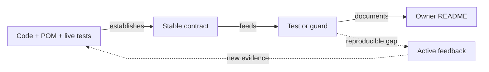

# ATF Best Practices — index and governance

This is the entry point for cross-cutting ATF rules. It does not duplicate coding or editorial rules; it points to the document that owns each contract. Stable contracts are protected by their tests and guards, while feedback remains the dynamic register of gaps.

## At a glance

The rules have three owners: code and architecture, documentation, and dynamic feedback. Each stable rule has a single owner and verifiable evidence.

## Choosing a document

| Question | Owning document | Contents |
|---|---|---|
| How should I design modules, classes, and tests? | [README_Atf_CodeBestPractices.md](README_Atf_CodeBestPractices.md) | OOP, boundaries, models, constants, CSS/JavaScript, test layers |
| How should I choose a layer and prove a change? | [ATF_Testing_Guide.md](ATF_Testing_Guide.md) | module × layer matrix, UI/API proof, and test selection |
| How should I write and maintain documentation? | [README_Atf_DocumentationBestPractices.md](README_Atf_DocumentationBestPractices.md) | structure, diagrams, tables, naming, feedback, and links |
| Which gaps are still active? | [feedback/README.md](feedback/README.md) | ToDos, owners, and closure criteria |
| What is the module architecture? | [ATF_Architecture.md](ATF_Architecture.md) | modules, dependencies, and boundary direction |
| How are builds and synchronization verified? | [ATF_Build_And_Execution_Safety.md](ATF_Build_And_Execution_Safety.md) | staging, builds, browser gate, and live synchronization |

## Shared rule: stable contract, dynamic feedback

<strong>Legend — what stays stable and what gets updated</strong>

- live code and tests are the source of truth;
- the owner's README describes stable behavior;
- the test or guard protects the claim;
- feedback records only what remains to be decided or implemented and can be
  updated, narrowed, or closed dynamically;
- existing normative READMEs and gate tests are not changed incidentally;
  changing them requires a requirement, approval, reason, and new evidence;
- run results do not become permanent documentation.

## Quick checklist

- [ ] I identified the owner before changing code or documentation.
- [ ] The rule appears in exactly one normative document.
- [ ] A test, guard, or verifiable acceptance criterion exists.
- [ ] I did not change a normative README or existing gate without explicit
      scope and approval.
- [ ] I did not add an absolute path, timestamp, artifact name, or test count
      that could become stale.
- [ ] Feedback contains only the remaining gap, not a copy of a closed rule.
- [ ] Links are relative and survive checkout relocation.

For implementation, read the owner's document, then the affected module README. This index should remain short and stable.

## Verifying the rule at its owner

| What changes | Starting proof | Limitation |
|---|---|---|
| Code and boundary | [WholeAtfGovernanceSuiteTest](../atf-tests/src/test/java/atf/api/tests/governance/WholeAtfGovernanceSuiteTest.java) | verifies the governed rule, not every application behavior |
| README and legends | [Documentary validators](README_Atf_DocumentationBestPractices.md#verificarea-editorială-la-owner) | valid structure still requires checking against the live source |
| Protected test | [testChanges policy](../atf-tests/README.md#test-change-governance) | an editorial change does not authorize weakening the test |

Run the gate in [TMP](ATF_Build_And_Execution_Safety.md), using the command in [ATF Tests](../atf-tests/README.md#quick-verification). Do not copy the checklist into every module README; document only its concrete application there.