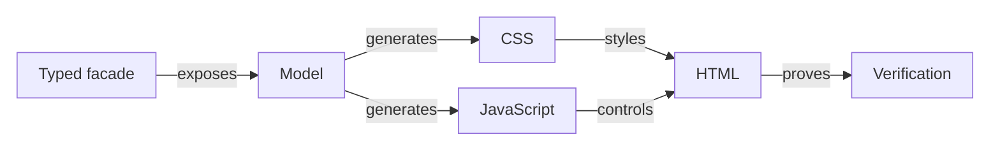

<a id="atf-best-practices--code-and-testing"></a>
<a id="bune-practici-atf--cod-și-testare"></a>
# ATF Best Practices — code and testing

This document owns implementation rules: modules, OOP, models, constants, reporting assets, and test layering. For writing READMEs and feedback, use [README_Atf_DocumentationBestPractices.md](README_Atf_DocumentationBestPractices.md).

<a id="at-a-glance"></a>
<a id="pe-scurt"></a>
## At a glance

**Quick paths:** [ownership](#responsibility-boundaries-and-owners) · [OOP](#oop-and-models) · [layers](#test-structure) · [probes](#code-rule-verification)

ATF code should be easy to read from the boundary down to the details:

```mermaid
%%{init: {"themeVariables":{"fontSize":"15px"},"themeCSS":".nodeLabel, .nodeLabel p { font-size: 15px !important; line-height: 1.35 !important; } .edgeLabel, .edgeLabel p { font-size: 12px !important; font-weight: 400 !important; line-height: 1.2 !important; } .edgeLabel .labelBkg, .edgeLabel p { background: transparent !important; } .edgeLabel foreignObject { transform: translateY(-18px); overflow: visible; } .node rect { rx: 6px; ry: 6px; }","flowchart":{"curve":"linear","nodeSpacing":24,"rankSpacing":40,"padding":10,"diagramPadding":16}}}%%
flowchart LR
    Intent["Intent"] -->|defines| Boundary["Boundary"]
    Boundary -->|shapes| Model["Typed model"]
    Model -->|feeds| Policy["Policy"]
    Policy -->|adapts through| Adapter["Adapter"]
    Adapter -->|produces| Evidence["Evidence"]
```



<details>
<summary><strong>Legend — implementation pipeline</strong></summary>

- intent starts in the test, but the boundary determines the owner;
- the typed model enters a pure policy before reaching an external adapter;
- evidence is verifiable output, not logic hidden in the renderer.
The short labels have the following meanings:

| In the scheme | Full meaning |
|---|---|
| Intent | test intent |
| Boundary | explicit boundary |
| Typed model | typed model |
| Policy | policy / pure validator |
| Adapter | external adapter |
| Evidence | evidence / artifact |

</details>

| Principle | Preferred proof |
|---|---|
| explicit boundary and ownership | architecture guard + compile |
| immutable models and small facades | unit/component |
| modules decoupled through ports | component/integration |
| stable output and assets | contract test + artifact audit |
| minimal, configurable E2E | semantic selection + coverage matrix |

<details>
<summary><strong>Reading map</strong></summary>

- [ownership](#responsibility-boundaries-and-owners), [reusable E2E support](#reusable-e2e-support-without-forced-abstraction), and [protected changes](#protected-contracts-and-controlled-changes);
- [OOP and cohesion](#oop-and-models), [constants](#constants-enums-and-strings), and [static imports](#static-imports);
- [reporting](#reporting-html-css-and-javascript), [test structure](#test-structure), [configuration and paths](#configuration-and-paths), and [console](#console-and-reporting).

</details>

<a id="responsibility-boundaries-and-owners"></a>
<a id="limite-de-responsabilitate-și-proprietari"></a>
## Responsibility boundaries and owners

| Area | Responsibility | Does not own |
|---|---|---|
| `atf-core` | neutral runtime contracts and reusable utilities | Extent, browser, fixture business, lifecycle de test |
| `atf-test-kit` | classification / annotations, cleanup failure-aware and neutral recorder for assertions / facts scoped | Fact verdict, Playwright, browser lifecycle, Extent, consumer profiles or flows |
| `atf-reporting` | models, renderer, assets and contracts reporting standalone | mock, browser and consumer application |
| `atf-mock` | transport / fixture determinist | rendering rules |
| `atf-ui` | Playwright and generic browser policies | actual report configuration |
| `atf-reporting-tests` | consumer, composition root and reforming fixtures | reusable production |
| `atf-tests` | governance whole-reactor | specific product tests or fixtures |

```text
consumer test
  → atf-core ports/policies
  → API/mock/UI adapters
  → atf-reporting
  → HTML/Extent artifact
```

`atf-reporting` must be compilable and consumable independently. Any dependency on mocks, browsers, or application fixtures remains in the consumer's test scope. Legacy compatibility belongs in an owned and tested adapter, not scattered reflection in the renderer.

<a id="reusable-e2e-support-without-forced-abstraction"></a>
<a id="suport-e2e-reutilizabil-fără-abstractizare-forțată"></a>
## Reusable E2E support without forced abstraction

Shop and AutoEx repeat some test responsibilities, but their differences do not justify a new UI module. The first target is much smaller: move only repeated neutral primitives into `atf-test-kit` if they can be tested without a browser or site.

- `atf-test-kit` already owns `TestRunInitialization`, `CloseOnceResource`, `FailureAwareCleanup`, `FailureEvidenceCleanup`, and `ArmedCleanup`; reuse these contracts instead of recreating local initialization or cleanup.
- Shop is the reference model for aligning AutoEx: preserve Shop business contracts, ownership, and auditable evidence, then extract a neutral capability that applies to both consumers. Shop's internal cohesion can improve; this rule does not require copying its selectors or flow into AutoEx.
- Do not put Playwright, `Page`, Extent sessions, screenshot profiles, network inspectors, consumer YAML, or journey vocabulary in the Kit. `atf-ui` already consumes it in test scope; the reverse dependency would create a cycle.
- JUnit extensions that open the browser, report evidence, and close the session are currently adapters in each consumer's `src/test`. The refactoring target is a minimal adapter over capabilities at their owner, not moving the entire extension to main; a shared JUnit helper belongs in the Kit only with a proven neutral contract.
- Code used only by tests does not belong in `src/main` just because a gate classifies every `support` package as reusable; determine ownership from callers, dependencies, and source set.
- `SETUP` and `TEST BODY` can be optional in adapters without imposing the same business sequence on every consumer.
- AutoEx .NET does not consume the Java library; reuse across languages means parallel behavioral contracts, not a shared code dependency.

**Test Kit extraction gate:**

- behavioral tests in Shop and AutoEx for partial acquisition, close-once, and
  multiple teardown failures;
- no imports from `Shop*`, `AutoEx*`, `atf-ui`, or `atf-reporting`;
- if the API requires `Page`, report sessions, config, checkpoints, or
  network semantics, keep it local;
- do not create a new module to hide an unclear contract.

The neutral Boundary of the Common Infrastructure is documented in [README-ul Test Kit](../atf-test-kit/README.md); the source- set and the concrete composition remain in README of each consumer's owner.

<a id="the-test-expresses-intent-main-owns-the-capability"></a>
<a id="testul-exprimă-intenția-main-deține-capabilitatea"></a>
### The test expresses intent; main owns the capability

- Move reusable logic into `src/main` only at its real owner: application runtime in the consumer, browser in UI, model/publication in Reporting, and neutral test infrastructure in the existing Kit.
- Do not move the oracle, artificial fixture, or hidden runner into main just to empty a directory. The `support` name does not determine the source set.
- Keep the test declarative: prerequisite, business action, and observed result; a short method does not justify an `execute()` without a contract or hidden assertions.
- Separate the business story from channel, grouping, and screenshots; a different evidence profile reuses the journey instead of copying it or removing steps.
- Reduce a harness one responsibility at a time, with nominal and failure-path probes; a stable facade keeps tests readable during extraction.
- Keep JUnit-dependent adapters minimal at the execution boundary; extending a shared API must not add UI/Reporting dependencies to the Kit.

The ownership matrix for the delivered runtime explains what can be refactored without moving JUnit infrastructure into application artifacts:

| Responsibility | Live owner | Inputs and boundary |
|---|---|---|
| Shop browser acquisition, journal, and screenshots | `ShopBrowserRuntime` in main | explicit configuration and sink; the harness receives owned resources |
| Opening the Shop report | `ShopRunReportFactory` in main | profile and environment captured by the composition root |
| System metadata | Shop/AutoEx main mappers and `ReportUiEnvironment` in Reporting | effective configuration; no JUnit or Store policy |
| Reported vocabulary | consumer trace and `ReportGherkinSequence` in Reporting | same statements in checkpoint and Scenario correlation; do not move formatting to the Kit |
| Suite selection, fixture, and ownership | consumer adapters in test | JUnit Store, context resolution, and class scope |
| Neutral test cleanup | existing Kit primitives | ordering and causes through callbacks without browser or Extent |

These owners are existing contracts. A new extraction requires both real uses and the negative probes in the gate above; moving classes alone does not prove partial acquisition, scope isolation, or cause preservation.

Business flow, UI flow, composed actions, and atomic Playwright operations have different contracts; validation produces typed results before report projection. Target boundaries and probes are in the [testing guide](ATF_Testing_Guide.md#separating-business-flows-ui-flows-and-validations).

- Decisions for re-use are in [atlas](ATF_Context_Atlas.md#reutilizare-fără-mutarea-politicii-aplicației).
- [Consumer business acceptance](ATF_Testing_Guide.md#individual-and-suite-business-acceptance)
  describes the proof required before reducing a selection.

<a id="protected-contracts-and-controlled-changes"></a>
<a id="contracte-protejate-și-schimbări-controlate"></a>
## Protected contracts and controlled changes

Owner READMEs and existing gate tests are part of the maintenance contract, not incidental cleanup material.

- [ ] Do not delete, weaken, rename, or disable an existing gate just to make a run pass.
- [ ] Changing a gate or normative README requires an explicit requirement,
      approval, reason, and new proof for the changed contract.
- [ ] Trace a failure to its real owner: production, test, fixture,
      renderer, or configuration; do not mask the assertion.
- [ ] Update feedback dynamically during investigation and keep only the
      remaining gap, without turning it into a second source of contract.
- [ ] Promote a closed rule to the owner's README, and remove or archive feedback
      only after the test confirms closure.

<a id="oop-and-models"></a>
<a id="oop-și-modele"></a>
## OOP and models

- [ ] A class has one dominant reason to change.
- [ ] A facade coordinates; it does not read YAML, perform I/O, build HTML, and decide verdicts in the same method.
- [ ] A `record`/POJO represents a stable semantic area: setup, request, response, assertion, evidence, section, or verdict.
- [ ] Run metadata for `Overview/System` uses a typed, allowlisted snapshot (`ReportEnvironmentField`/`ReportEnvironmentSnapshot`); `Map<String,String>` remains only as a compatibility boundary.
- [ ] A builder handles optional values; a validator checks invariants; neither hides external effects.
- [ ] An interface represents a real port that can be observed, replaced, or isolated (`ReportSource`, `ReportValidator`, `BrowserActions`).
- [ ] I/O, transport, browser, and rendering are separate adapters.

Split a class for a semantic boundary—facade, provider, extractor, validator, publisher, or lifecycle—not just because of line count. Do not create `misc` packages or move files mechanically to hit a number.

<a id="package-cohesion--eight-class-threshold"></a>
<a id="coeziunea-pachetelor--pragul-de-opt-clase"></a>
### Package cohesion — eight-class threshold

```text
one package
   ├─ maximum 8 classes
   ├─ one dominant semantic boundary
   └─ above threshold → cohesive split or explicitly reviewed exception
```

- `AtfPackageCohesionGovernanceTest` checks production packages listed in
  `SOURCE_GOVERNED_MODULES` and test packages in every reactor module;
- every module with `src/main/java` sources must be included in the governed
  inventory; `TEST_ONLY_COMPOSITION_MODULES` is reserved for modules without production code;
- an allowlist does not automatically accept a package with more than eight classes;
- an exception needs a semantic reason, an owner, and boundary evidence;
- the guard diagnostic lists the package, count, and concrete classes;
- splits follow responsibilities—`api`, `runtime`, `evidence`,
  `lifecycle`, `support`—not arbitrary file division;
- feedback keeps the hotspot open until a split or reviewed exception
  is demonstrated by a test.

<details>
<summary><strong>Why the threshold is not resolved through mechanical moves</strong></summary>

The eight-class threshold is a signal for navigation and cohesion, not a formatting rule. A large package can hide multiple reasons to change; a good split separates ownership and keeps dependencies readable. Do not create artificial packages or delete classes without evidence that they are unused.
</details>

<a id="constants-enums-and-strings"></a>
<a id="constante-enum-uri-și-string-uri"></a>
## Constants, enums, and strings

Do not repeat stable contract values as raw strings.

| Value type | Recommended owner |
|---|---|
| HTTP method/header/media type | enum or HTTP catalog |
| API route | route catalog owned by the API module |
| application address / fictional origin | canonical consumer identity / fixture only in `src/test` |
| reporting status | `AtfReportStatus` |
| phase, tab, evidence type | Reporting vocabulary |
| CSS class, `id`, `data-*`, DOM role | HTML/UI vocabulary |
| color and spacing | semantic theme token |
| strictly local payload | scenario builder |

- [ ] An enum represents a closed vocabulary and has an explicit conversion to
      renderer text.
- [ ] A constant belongs to its semantic owner, not a global bucket.
- [ ] The canonical address is a `URI` constant; execution uses the configured
      endpoint. A probe with a different origin checks override propagation.
- [ ] Routes and headers come from a catalog, not the concrete test.
- [ ] Build variable text with `String.format` or a typed builder;
      do not concatenate HTML in assertions.
- [ ] Outside wire oracles, keep a literal local only when it names a
      non-reusable edge case.
- [ ] An independent wire oracle may preserve the expected payload and field
      names explicitly; do not generate expected data with the serializer under test.

<a id="static-imports"></a>
<a id="importuri-statice"></a>
### Static imports

Static imports are a reading shortcut, not an ownership shortcut:

- JUnit assertions and stable assertion DSLs (`check`) are allowed;
- named constants from a single semantic fixture are allowed when unambiguous
  (`PRODUCT_NAME`, `QUANTITY`, `COUNTRY`);
- do not statically import wildcard members, business methods, or dynamic values;
- keep enums and contract owners explicit when a name might hide the domain or
  mix two vocabularies.

```java
import static atf.shop.tests.api.support.PracticeShopApiScenarioFixture.PRODUCT_NAME;
import static org.junit.jupiter.api.Assertions.assertEquals;
```

<a id="reporting-html-css-and-javascript"></a>
<a id="raportare-html-css-și-javascript"></a>
## Reporting: HTML, CSS, and JavaScript



<details>
<summary><strong>Legend — assets and visual contract</strong></summary>

- Java composes and exposes tokens; CSS and JavaScript remain native assets
  organized by responsibility;
- the semantic model is the shared source for HTML, CSS, and JavaScript;
- the component contract checks assets, while E2E checks the effect in a browser.
The short labels have the following meanings:

| In diagram | Full meaning |
|---|---|
| Typed facade | typed facade |
| Model | semantic model |
| HTML | HTML artifact |
| Verification | component + browser proof |

</details>

- [ ] Java orchestrates; it does not become a store for inline JavaScript.
- [ ] Split CSS by responsibility: layout, theme, evidence,
      disclosure, and responsive behavior.
- [ ] Split JavaScript by responsibility: DOM contract, disclosure,
      navigation, filters, and controller.
- [ ] Centralize CSS classes, IDs, and `data-*` vocabulary.
- [ ] Test locators should prefer `element[attribute=value]`, `class~=`, and
      `[id=value]` instead of scattered shorthand selectors.
- [ ] Every markup/CSS/JS change has a component test and a fresh artifact
      verified in ATF Debug/browser MCP.

<a id="test-structure"></a>
<a id="structura-testelor"></a>
## Test structure

`support` is an auxiliary area, not a fifth test level. Selection strategy, the module × layer matrix, and suitable proof for each boundary are owned by [ATF_Testing_Guide.md](ATF_Testing_Guide.md); this section keeps conventions for test structure and readability.

```text
src/test/java/<owner>/
├─ <domain-or-feature>/       # organized by behavior
│  └─ *Test.java              # layer declared by annotation
└─ support/                   # fixture, builder, loader, adapter, locator
```

| Level | Verifies | Does not verify |
|---|---|---|
| unit | model, policy, parser, validator, formatter | browser, server, or complete flow |
| component | HTML/CSS/JS fragment, asset, module boundary | complete application |
| integration | collaboration between modules, mock, and Reporting | each assertion already tested below |
| e2e | browser, tabs, filters, clicks, and rendering | every possible combination |
| support | fixture, flow, locator, builder, adapter, or test-scoped harness | its own executable verdict |

- [ ] Each executable class declares exactly one layer by annotation.
- [ ] The annotation is the source of truth; the path is only convention and diagnostic.
- [ ] Do not create empty directories for nonexistent layers.
- [ ] Support does not become an executable layer. The Store and JUnit extension are test-only; the main runtime may own resources through explicit ports, without JUnit/Kit dependencies and with acquisition/cleanup probes.
- [ ] Keep E2E small and configurable; select specific scenarios through typed annotations/configuration.
- [ ] Move exhaustive combinations down to unit/component/integration.

For API, a mock can provide `pass`, `fail`, `warning`, and `skip`. For UI, input can be a static or generated report; validation checks structure and observable rendering without inventing business results.

<details>
<summary><strong>Shape of an elegant, plug-and-play ATF test</strong></summary>

<a id="design-order"></a>
<a id="ordinea-de-proiectare"></a>
### Design order

1. **Choose the layer** — unit, component, integration, or E2E.
2. **Declare intent** — the annotation and typed metadata state what is tested,
   with which transport and prerequisite.
3. **Load input** — resolve configuration/fixture once through a reusable
   loader/harness.
4. **Compose the flow** — the test calls a semantic flow, not locators, a request
   factory, report session, or internal cleanup.
5. **Verify the effect** — `expected` comes from config/fixture, `actual` comes
   from the observed system; assertions are short and real.
6. **Publish evidence** — support attaches actions, observations, and the
   artifact; the test does not rebuild the HTML.
7. **Close through the owner** — the extension/harness closes the browser,
   transport, and session; the test does not add `try/catch/finally`.

<a id="preferred-shape"></a>
<a id="forma-preferată"></a>
### Preferred shape

```text
@layer + metadata
class BusinessJourneyTest {
    @Test
    void configuredJourneyProducesExpectedOutcome() {
        flow.execute(configuredScenario());
        assertObservedOutcome();
    }
}
```

<a id="readability-rules"></a>
<a id="reguli-de-lizibilitate"></a>
### Readability rules

- a test has one failure reason and one dominant result;
- `given → when → then` is visible in method or flow names;
- do not repeat loader/context/locators in each composition root;
- do not use tautological assertions: `check(expected, expected, true)`;
- do not hardcode `true` as proof of an observable property;
- verify routes and state semantically, not with `URL.contains(...)` or text
  copied from the same configuration;
- use `contains` only for smoke text and forbidden-secret checks;
- move variation matrices into component/parameterized tests;
- E2E proves wiring and the business journey; it is not the place for every
  status, body, and selector case;
- use named static imports to improve readability only when ownership remains clear.

<a id="visual-criterion-for-a-good-test"></a>
<a id="criteriu-vizual-pentru-un-test-bun"></a>
### Visual criterion for a good test

```text
metadata → fixture → flow → observed assertions → evidence
```

If the reader sees browser initialization, report directories, request factories, selectors, or cleanup before the flow, the composition root is overloaded and the responsibility should move into a typed harness/support.

</details>

<a id="test-data-and-initial-setup-with-external-effects"></a>
<a id="date-de-test-și-configurare-inițială-cu-efect-extern"></a>
### Test data and initial setup with external effects

An authenticated test separates the account source from the journey it verifies:

- choose the source explicitly through typed configuration/annotation; preflight validates the profile before browser startup and before any mutation;
- fixture reuse and per-run creation are distinct modes; names and evidence must not imply creation when only an existing account was selected;
- account acquisition and session confirmation belong in `SETUP`; the business test starts only after setup PASS;
- send an external creation request once; if its result is uncertain, stop for reconciliation instead of automatically repeating the mutation;
- the reuse key matches the declared scope (method, class-run, or suite), and prove that scope behaviorally, not only with a map test;
- the report summarizes checks in `Setup evidence`, keeps the API exchange separate when collected, and redacts credentials/personal data from actions, assertions, and screenshots.

The consumer owns the E2E contract details; the generic evidence shape belongs to the [ATF Reporting Contract](ATF_Reporting_Contract.md#internal-context-and-scenario-diagnostics).

<a id="configuration-and-paths"></a>
<a id="configurare-și-căi"></a>
## Configuration and paths

- [ ] No absolute paths appear in code, comments, messages, or READMEs.
- [ ] Resolve the root, staging, and output at the configuration/I/O boundary.
- [ ] Module/source-root discovery and generic file traversal belong in `atf-core.files`; tests do not reimplement `locateModuleRoot()`, `sourceFiles()`, `user.dir` traversal, or `Files.walk` for the same responsibility.
- [ ] A generic helper accepts relative markers and explicit exclusions; it does not know concrete modules, product packages, or rules hidden in one test.
- [ ] Add a helper only if the existing API cannot express the contract; then extend the `files` owner instead of copying it into a consumer.
- [ ] YAML configures fixture and runtime; annotations express test selection and semantic intent.
- [ ] Reference output by a logical name or configurable placeholder, never by `Path.toString()` in a permanent report.

<a id="console-and-reporting"></a>
<a id="consolă-și-raportare"></a>
## Console and reporting

Console and UI/API details are enabled by default in Reporting and Shop, including without YAML; opt out explicitly through `reporting.console`. The producer redacts data, `atf-console` formats it, and the projection does not change the verdict. `ConsoleDefaultsGovernanceTest` protects the configuration and composition roots.

Change module tests, support, and their resources only through a structured technical control, except in `atf-test-practice-shop`. Governance checks the baseline SHA, exact control, state, expiration, and probe command; this rule also applies to the governance tests themselves. The procedure and CI setup are in the [atf-tests README](../atf-tests/README.md#test-change-governance).

The separation rule for console and reporting is:

- the `atf-console` module owns the console;
- API/UI/reporting emit structured events and evidence, not diagnostics directly in the renderer;
- an observable step contains an action, target, result, and clear failure cause;
- the verdict belongs to the area that actually failed: action, audit, assertion, or setup.

<details>
<summary><strong>`try/catch` rule: support/runtime versus tests</strong></summary>

<a id="desired-behavior"></a>
<a id="comportamentul-dorit"></a>
### Desired behavior

ATF separates this rule by boundary:

- **support/runtime** — use `try-with-resources` for every session,
  report, or `AutoCloseable` resource;
- **support/parser/config** — allow only a narrowly typed `catch` with context
  and cause; propagate the error or return an explicit `Result`/evidence;
- **tests** — never use ad hoc `try/catch` or `try/finally`;
  the test expresses intent, action, and expected result;
- **teardown/retry** — belongs to a lifecycle helper, runner, or extension, not
  the test body;
- **failure** — do not convert it to `false`, `0`, an empty list, or a fallback.

Prohibited anti-patterns:

```java
try {
    action();
} catch (Exception ignored) {
    // false-green: failure-ul a dispărut
}
```

```java
try {
    return parse(body);
} catch (RuntimeException error) {
    return false; // malformed input devine „nu există”
}
```

Preferred shape in support classes:

```java
try (ExtentReportSession session = ExtentReportSession.openConfigured()) {
    publish(session);
}
```

A parser may convert an error into `Optional`/`Result` only if absence is part of the contract. If input is malformed, the caller must be able to produce a distinct failure. A UI validator may retain an `AtfAssertion` row with FAIL status for an outage, but it must not bypass the status, lose the cause, or let the scenario pass.

Required checklist for a test module:

- [ ] New tests contain no `try/catch` or `try/finally` in the test body.
- [ ] No empty `catch`, `ignored`, `return false/0/empty`, or implicit fallback
      for an execution/configuration exception.
- [ ] Every support catch preserves semantic context, cause, and observable
      verdict; use the narrowest exception type possible.
- [ ] Resource/session/report lifecycle uses `try-with-resources` or a shared
      helper; close failure does not mask the primary failure.
- [ ] Component tests cover malformed input, unavailable selectors, and
      teardown errors where the boundary may encounter them.
- [ ] Use `assertThrows` for expected exceptions; do not write manual
      `try/catch` just to check that a mutation is rejected.

</details>

<a id="change-protocol"></a>
<a id="protocol-de-schimbare"></a>
## Change protocol

- [ ] Re-read the live code and identify the owner.
- [ ] Check whether the affected README or gate is a protected contract; obtain
      scope and explicit approval before changing it.
- [ ] Write the contract test for the proposed change first.
- [ ] Run tests in this order: unit → component → integration → relevant e2e.
- [ ] If rendering changes, generate a fresh artifact and check the DOM,
      computed style, disclosure, overflow, and console errors.
- [ ] Audit each `try/catch/finally` in the diff; justify resource
      management and prove that failures are not swallowed.
- [ ] Synchronize selectively to live; a conflict stops the affected file.
- [ ] Move the stable rule into the owner's README and keep only the
      remaining gap in feedback.

<a id="completion-criteria"></a>
<a id="criterii-de-finalizare"></a>
## Completion criteria

- [ ] Responsibility is clearer than before.
- [ ] The boundary can be replaced through a real interface or adapter.
- [ ] Constants and enums have semantic ownership.
- [ ] CSS/JavaScript have assets and tests separated by responsibility.
- [ ] A lower-level test protects the change; E2E stays minimal.
- [ ] No ad hoc `try` appears in the test body and no exception becomes
      false-green; lifecycle is centralized and fail-safe.
- [ ] The report states precisely what failed.
- [ ] Documentation contains no run data, timestamps, run counts,
      local paths, `file:///` links, or generated artifacts.

<a id="code-rule-verification"></a>
<a id="verificarea-regulilor-de-cod"></a>
## Code-rule verification

| Rule | Executable owner | Proof limitation |
|---|---|---|
| Dependencies and namespaces | [ArchitectureModuleBoundaryTest](../atf-tests/src/test/java/atf/api/tests/governance/ArchitectureModuleBoundaryTest.java) | validates the declared boundary, not the usefulness of every abstraction |
| Responsibility placement | [ArchitectureOwnershipBoundaryTest](../atf-tests/src/test/java/atf/api/tests/governance/ArchitectureOwnershipBoundaryTest.java) | exceptions are explicit; the business verdict remains in the consumer |
| Package cohesion | [AtfPackageCohesionGovernanceTest](../atf-tests/src/test/java/atf/api/tests/governance/AtfPackageCohesionGovernanceTest.java) | an inventory limit does not justify mechanically splitting a class |
| Layer and Java sources | [AtfTestLayerArchitectureTest](../atf-tests/src/test/java/atf/api/tests/governance/layers/AtfTestLayerArchitectureTest.java) | includes roots from the POM; does not demonstrate functional coverage |
| Developer-authored source language | [SourceLanguageGovernanceTest](../atf-tests/src/test/java/atf/api/tests/governance/source/SourceLanguageGovernanceTest.java) and the [Test Kit scanner](../atf-test-kit/src/main/java/atf/testkit/governance/AtfSourceLanguageScanner.java) | catches Romanian diacritics and a curated set of high-confidence Romanian words in identifiers/comments; localized literals and generated roots are out of scope |

### Source-language rule

Write developer-authored Java and JavaScript/MJS identifiers, comments,
Javadocs/docstrings, test names, and technical diagnostics in English. Keep
maintained source and tests byte-identical between `main` and `main_RO`; only
governed documentation prose changes language. Localized product strings,
deliberate fixture/payload values, protocol/API names, chess notation, and
generated output remain test data or external contracts, not source prose.

The shared scanner is a deterministic lexical guard with a reviewed Romanian lexicon.

- It checks identifiers, comments, docstrings, and recognized developer diagnostics.
- It masks localized literals and generated Maven output, except diagnostic-message contexts.
- Findings include source file, line, construct, and matched token.
- Extend the lexicon only with positive and negative fixtures; do not duplicate the scanner or use a diacritic-only grep.

[The whole-ATF command](../atf-tests/README.md#quick-verification) runs in staging. The owner's unit/component tests verify changed behavior; a green governance suite does not replace those probes or report audit.

<a id="module-reassessment-rubric"></a>
<a id="rubrica-reevaluării-modulelor"></a>
## Module reassessment rubric

The module score evaluates delivered code and its probes, separately from the README score, proposal readiness, and backlog priority. The same rubric applies to every module; report reasoned scores in the review channel.

| Attribute | Maximum | What supports the score |
|---|---:|---|
| Correctness | 30 | independent oracle, nominal/negative cases, and refusal without disallowed effects |
| Ownership and OOP | 25 | bounded reasons to change, coherent ports and models, no mechanical moves |
| Testability | 20 | deterministic boundary probes that can reject incorrect behavior |
| Resilience | 15 | primary cause, restored scope, bounded release, and faithful error history |
| Operations | 10 | explicit configuration, auditable execution and output, no hidden resources |

- A false PASS, lost functional cause, scope contamination, or unbounded shutdown reproduced at the declared boundary prevents a score above 91 until the criterion is resolved and verified.
- Closure includes a negative probe that fails on the prior behavior, adjacent regressions, and existing governance; adding a test alone earns no points if the oracle repeats the implementation.
- For consumers and visible reporting changes, verify a relevant case both individually and through the suite, in Extent/fallback where applicable; preserve the single report, timing, assertions, and expansions. Unit tests and Reporting fixtures keep their own categories, without fabricated business artifacts.
- If no gap has been demonstrated, perform targeted revalidation instead of inventing a refactor for points. Module, class, test, or line counts do not substitute for quality or expand the increment's functionality.

Reassessment uses live code after synchronization and probes run in staging; closing checkboxes does not automatically earn points. The rule for [keeping scores in the review channel](README_Atf_DocumentationBestPractices.md#editorial-review-rubric) also applies to this evaluation; do not put a dated scorecard in project contracts.
