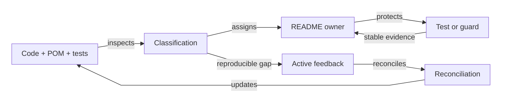

<a id="atf-best-practices--documentation"></a>
<a id="bune-practici-atf--documentație"></a>
# ATF Best Practices — documentation

This document owns the rules for READMEs, diagrams, tables, legends, links, and feedback. Code, OOP, and testing rules are in [README_Atf_CodeBestPractices.md](README_Atf_CodeBestPractices.md).

<a id="at-a-glance--what-a-readme-should-provide"></a>
<a id="pe-scurt--ce-trebuie-să-ofere-un-readme"></a>
## At a glance — what a README should provide

A good README is a navigable map of a contract, not a work log or a copy of the code. The first screen must provide enough orientation; links lead to more detail, but should not be required to understand the purpose.

| Reader's question | Evidence visible on the first screen |
|---|---|
| What is it? | purpose and produced result |
| Who owns it? | owner and responsibility boundary |
| How does it flow? | short diagram, bullets, or minimal table |
| How do I verify it? | test, guard, or observable criterion |
| Where can I learn more? | links to owners and normative documents |

Concision rules:

- the overview explains the product or module before details;
- the diagram shows the main relationship, not an inventory of every class;
- long explanations, exceptions, and secondary tables are collapsible;
- add a new document only when it owns a real boundary or process;
- move stable information to the owner's document instead of leaving it in feedback.

<details>
<summary><strong>Reading map</strong></summary>

- [document ownership and feedback promotion](#document-ownership-and-feedback-promotion), [retaining/deleting feedback](#retaining-and-deleting-feedback), and [review process](#writing-and-review-process);
- [first screen](#recommended-first-screen-structure), [diagrams](#diagrams-one-question-one-perspective), and [tables/bullets/disclosure](#tables-bullets-and-disclosure);
- [link durability](#naming-links-and-durability), [feedback](#feedback-without-noise), and [completion criteria](#completion-criteria).

</details>

<a id="atf-house-style--consistency-without-local-fonts"></a>
<a id="stilul-intern-atf--uniformitate-fără-fonturi-locale"></a>
## ATF house style — consistency without local fonts

README Uniformity is obtained by Semantic Markdown, not CSS or fonts injected into each document:

- font, size, and color belong to the Markdown renderer;
- READMEs use one `#`, `##` sections, progressive subsections, and
  `-` bullets for quick scanning;
- every code or diagram block has a typed fence: `mermaid`, `text`, `java`,
  `xml`, `yaml`, or the example's actual language;
- HTML presentation tags, the `style` attribute, and inline CSS are prohibited;
- express visual style through headings, bullets, minimal tables, diagrams, and
  `<details>`, not presentation markup that depends on one viewer;
- `DocumentationStyleGovernanceTest` protects this rule for all designated
 READMEs and normative Markdown documents, such as `docs/ATF_Architecture.md`; its diagnostic identifies the file, line, rule, and fix.

<a id="document-ownership-and-feedback-promotion"></a>
<a id="responsabilitatea-documentelor-și-promovarea-feedback-ului"></a>
## Document ownership and feedback promotion

Stable documentation and feedback have different cadences. The owner's README describes the validated contract; feedback changes dynamically as evidence appears, TODOs close, or the remaining boundary changes.

<a id="approved-baseline-takes-precedence"></a>
<a id="precedența-baseline-ului-aprobat"></a>
### Approved baseline takes precedence

- the approved root README is the project's editorial and visual baseline;
- best practices must explain and protect this baseline, not reinterpret it retroactively;
- a preference for a new form—for example, `LR` for a new flowchart—does not authorize rewriting an already approved diagram;
- first record any mismatch between the approved README and practice rules in feedback, with evidence and impact; do not resolve it through an implicit choice;
- change the root README, gate tests, or normative contracts only with an explicit requirement, documented reason, approval, and new evidence;
- do not change, disable, or weaken `atf-tests` governance tests to make a README pass; any rule change requires direct feedback, a clear owner, a reason, and a new verifiable criterion.



<details>
<summary><strong>Legend — when each area changes</strong></summary>

- **Live code + POM + tests**: establish what actually exists and which
  boundary is protected;
- **Owner README**: receives the stable rule, ownership, and usage
  after evidence is sufficient;
- **test/guard**: protects the claim and defines the reproducible criterion;
- **active feedback**: records only the gap, owner, priority, closure criterion,
  and missing evidence; it can be updated, reorganized, or closed;
- **evidence** does not automatically become a contract: a report, screenshot,
  or run log remains execution evidence;
- do not change a normative README or existing gate test incidentally;
  changes require a requirement, approval, reason, and new evidence;
- if a governance test fails, fix the target document first; change the test
  only when direct feedback changes the governed rule.

</details>

<a id="retaining-and-deleting-feedback"></a>
<a id="păstrarea-și-ștergerea-feedback-ului"></a>
### Retaining and deleting feedback

Feedback is a backlog of gaps, not a second README or a log of closed decisions. Before deleting a file, reconcile each section against the code, owner test, and normative README:

- move a stable rule into the owner's README before removing its explanation from feedback; keep one normative owner and link to it;
- delete closed sections once the criterion is demonstrated and the necessary contract exists at its owner; do not retain report, artifact, or run history as a substitute for a requirement;
- delete a feedback file only when it contains no unmet criterion and no active control that still needs reconciliation;
- do not delete a module README or stable contract because it has no ToDos: it is usage documentation, not a backlog;
- keep the file if at least one real gap or active `testChanges` control remains, even if the rest can be promoted or removed;
- do not close, rewrite, or delete a `testChanges` control just because it expired or a new commit appeared: compare changes to the baseline and follow the [test changes baseline](ATF_Test_Changes_Baseline.md) and [test governance](../atf-tests/README.md#test-change-governance).

Governance tests remain a protected contract. If the target document fails, fix the document; change the test rule only through direct feedback, a named owner, a reason, and a new criterion, as described in the `atf-tests` README.

<a id="writing-and-review-process"></a>
<a id="procesul-de-redactare-și-revizuire"></a>
## Writing and review process

Every document follows the same loop. Do not start from an old report or mark a TODO resolved just because the text changed.

- [ ] reread the code, POM, tests, and owner's live README;
- [ ] identify the document's question and primary reader;
- [ ] classify each piece of information as a stable contract, active gap, or evidence;
- [ ] write the first screen with a title, orientation, diagram, and verification criterion;
- [ ] choose one normative owner for each rule;
- [ ] move secondary details into `<details>` or the owner's document;
- [ ] check all relative links, naming, and `<details>` boundaries;
- [ ] reconcile feedback with code and tests before closing it.

For architecture reviews, keep a short trace for each claim that could change a technical decision:

```text
claim → live source → README owner → test/guard → executed verification
```

Use the live source that owns each fact:

- `pom.xml` for dependencies, scope, and `optional` propagation;
- public code for API and ownership;
- the test for verified behavior.

A diagram or generated report is a representation or run evidence, not the canonical source. If the source, documentation, and verification disagree, document the drift as a gap; do not turn observed behavior into an intended contract without confirmation.

The verification summary explicitly distinguishes the levels executed:

| Level | What it confirms | What it does not confirm by itself |
|---|---|---|
| static Markdown check | inspected structure, links, and editorial rules | module compilation or behavior |
| governance/component test | the rule checked by that test | other tests or rendering of a real report |
| module build/test | compilation and tests actually included in the command | omitted suites or external environments |
| rendering/UI | artifact appearance and observed scenario | general contract validity or all configurations |

Report the command and level actually run; mark `passed`, `not run`, and `blocked` separately. A documented command, artifact path, or test omitted because a prerequisite was missing is not evidence of a pass.

A document is ready when the reader can decide where to continue without searching other READMEs for its purpose, owner, or main boundary.

<a id="recommended-first-screen-structure"></a>
<a id="structura-recomandată-a-primului-ecran"></a>
## Recommended first-screen structure

This order is not an explanation of “how to read” the project; it is a composition rule that makes the document easy to scan:

1. **Clear title** — state the boundary or result described by the document;
2. **Guideline** - `Overview` in English or `Pe scurt` in Romanian, according to the project language, with two-three ideas about purpose, owner and limits;
3. **Primary evidence** — bullets, a diagram, or a short table;
4. **Immediate legend** — if there is a diagram, its single legend follows
   immediately;
5. **Further detail** — contracts, exceptions, and references, collapsed or linked;
6. **Verification criterion** — test, guard, or reproducible procedure.

Spacing and readability rules:

- do not place two primary tables back to back;
- follow an orientation table with a diagram, short explanation, or section
  that serves a different purpose;
- do not put a free-standing paragraph or another table between a diagram and its legend;
- do not hide purpose, owner, boundary, or the primary criterion in
  `<details>`;
- if a secondary table belongs to the same diagram, put it in the
  composite legend instead of a second consecutive legend.

<a id="diagrams-one-question-one-perspective"></a>
<a id="diagrame-o-întrebare-o-perspectivă"></a>
## Diagrams: one question, one perspective

Each diagram must answer one question and have a title that can be understood without context from the preceding section.

| Question | Preferred form | Limitation |
|---|---|---|
| which modules collaborate? | `flowchart LR` | module map and ownership read left to right |
| how does data flow? | `flowchart LR` | input → transformation → output direction must be immediately visible |
| in what order does it execute? | `sequenceDiagram` | essential participants only |
| how does state change? | `stateDiagram-v2` | relevant states and transitions |
| which contract is public? | `classDiagram` | stable ports and models |

Required pattern:

```text
question → brief orientation → diagram → collapsed legend → contract → proof
```

<details>
<summary>Style preference</summary>

- `LR` is the preferred orientation for new flowcharts when modules, ownership, pipeline, or dependencies read naturally from left to right;
- `TB` is acceptable for a grouped map when the main relationship is between levels or boundaries, rather than successive steps;
- in a `TB` map, modules within each group can be arranged horizontally; semantic direction is vertical, while visual reading stays compact in width;
- choose `TB` when it preserves grouping, reduces crossing edges, avoids broken labels, or makes an `LR` version wider and harder to follow;
- do not use `TB` to hide an unsimplified diagram: reduce nodes, group content semantically, and explicitly compare the visual cost of both orientations;
- do not mechanically normalize already approved diagrams to `LR`; their baseline remains valid until an explicit change requirement;
- use `sequenceDiagram` when interaction order matters more than module grouping;
- for a data or evidence flow, avoid a radial map with one central node and many long arrows: build a main left-to-right column first and branch only local details;
- if a node has more than two visible branches, add a local semantic group or split the question into two diagrams; do not let arrows cross the whole map;
- a node carries only the concept needed for the relationship; move modules, classes, technologies, and long lists to the legend or collapsed table;
- avoid large boxes created by multi-line labels: shorten the node, keep one idea per edge, and explain vocabulary immediately after the diagram;
- the reference style is a compact `LR` diagram with short node labels, few links, and an immediate legend that explains branches;
- control visual size separately from semantics: short node labels, reduced font/padding, and full vocabulary in the legend;
- in the root README module map, a node has at most 18 visible characters and does not use `<br>`; an edge has at most 12 characters;
- `DocumentationDiagramGovernanceTest` checks this compactness and dynamically reports the line, limit, and fix when a box becomes disproportionate;
- choose orientation based on the diagram's question and visual cost, not an absolute syntax rule;
- do not artificially widen a horizontal map with secondary nodes;
- arrows have one meaning, explained in the legend;
- for ownership, consumption, or flow relationships, label each edge directly with a short verb (`governs`, `consumes`, `validates`, `publishes`); do not make the reader infer the relationship only from node position;
- an edge label does not repeat node names or become a sentence; details about classes, modules, or scope stay in the collapsed legend;
- edge text is smaller than node text: it explains the relationship without competing with primary concepts;
- diagrams in one README use the same visual baseline—font, padding, density, and arrow style; vary `rankSpacing` only for density or label readability, without changing orientation;
- color is not the only way to distinguish elements;
- classes, methods, and values that do not affect orientation remain in the owner's README or collapsed table.

</details>

<a id="formal-criteria-for-a-tb-exception"></a>
<a id="criteriul-formal-pentru-o-excepție-tb"></a>
### Formal criteria for a `TB` exception

A `TB` diagram is accepted only if all of the following are true:

- the question requires separating groups, layers, or boundaries;
- each group has a short internal composition that reads horizontally;
- the `LR` version would create longer paths, more crossings, or harder-to-follow wrapping;
- the legend explains relationships between levels without mechanically repeating the diagram;
- the reader can identify direction and ownership without zooming or cropping.

<a id="reference-pattern-module-map"></a>
<a id="pattern-de-referință-harta-modulelor"></a>
### Reference pattern: module map

The `Module map` is the positive ATF example because it combines horizontal orientation with controlled detail:

- semantic groups, not a raw Maven inventory;
- few main edges and explicit ownership;
- one main column for consumers → library, with the reusable platform
  aggregated into a single visual node;
- secondary relationships are dotted and local, not a radial web of modules;
- `LR` makes ownership and reading direction visible without turning
  the diagram into a Maven inventory;
- a compact diagram followed immediately by one legend;
- the ownership table appears in the legend for the same visual unit;
- non-production modules—consumers and governance—are set apart;
- local contracts remain in module READMEs.

When reviewing another diagram, do not add nodes just because they exist in code. The diagram's question determines what stays visible.

<a id="tables-bullets-and-disclosure"></a>
<a id="tabele-bullets-și-disclosure"></a>
## Tables, bullets, and disclosure

Bullets are preferred when the information is a list of decisions. A table is preferred when readers need to compare columns or choose an owner.

<a id="visible-prose-rule"></a>
<a id="regula-prozei-vizibile"></a>
### Visible prose rule

In sections meant for quick scanning, readers should be able to scan the information without reading consecutive sentences. Choose the form that best condenses the decision for each section:

- **bullets** — responsibilities, boundaries, rules, criteria, and steps;
- **table** — comparisons between modules, owners, inputs/outputs, or test levels;
- **diagram** — relationships, flows, and boundaries;
- **one short paragraph** — only for the section's purpose and conclusion;
- **`<details>`** — rationale, exceptions, long examples, and secondary tables.

Do not use a block of text to describe a list, relationship, or comparison that can be expressed schematically. If an explanation goes beyond immediate orientation, move it to the collapsed legend or the owner's README; do not overload the first screen to avoid a link.

- [ ] columns are short and semantic: `Owner`, `Input`, `Output`, `Gate`,
      `Verdict`;
- [ ] the table summarizes the schema instead of rebuilding a network of arrows;
- [ ] two primary tables are separated visually and semantically;
- [ ] detail tables, exceptions, and rationale are inside `<details>`;
- [ ] each `<summary>` says what it expands and why it is useful;
- [ ] a blank line follows `<summary>` before bullets, a table, or a paragraph;
      otherwise, the Markdown renderer may combine the content into one line;
- [ ] long text is not placed in a cell that causes overflow;
- [ ] important claims follow the `claim → owner → test/guard` relationship.

`DocumentationProseGovernanceTest` checks this rule in all owner READMEs: a quick-scan paragraph has at most three sentences by default, and a section does not place more than two dense paragraphs consecutively. The thresholds are explicit constants in the test, not a hidden heuristic; if the rule changes, calibrate it there and preserve the same dynamic diagnostic.

For a targeted check, without duplicating the rules in every module:

- `@DocumentationTarget("module/README.md")` selects the document;
- `DocumentationTargetGovernanceTest` calls all documentation validators;
- the path is relative to the project root and can be changed without modifying
  the validators;
- the diagnostic retains the file, line, rule, and minimum fix.

A good legend explains the nodes, arrows, boundaries, and collapsed table for the same diagram. It does not mechanically repeat visible text or become a second architecture document.

For module diagrams:

- each edge expresses one type of relationship and matches the live source;
- if it affects interpretation, the legend distinguishes Maven scopes such as
  `compile`, `test`, `runtime`, and `provided`, as well as `optional` propagation;
- plugins and extensions are not presented as runtime dependencies;
- validate semantics by comparing with the relevant POMs, not with a test that
  rigidly matches the diagram's free-form wording.

<a id="documenting-evidence-by-purpose"></a>
<a id="documentarea-dovezilor-în-funcție-de-scop"></a>
### Documenting evidence by purpose

When a README describes a report, place each fact in the section that conveys its meaning. Use one canonical schema and link to the owner for details instead of copying the full tree into every module:

| Documented fact | Canonical section | Avoid |
|---|---|---|
| prepared precondition or fixture | `SETUP` → `Setup evidence` | `Overview / System` or an invented business step |
| browser observation | checkpoint's Gherkin `UI validation` | mixing the UI verdict with the transport verdict |
| request/response and retry | `API validation` → its exchange | a flat, duplicated trace or a separate Gherkin step |
| journey result | the Gherkin sentence that states the result | repeating the same sentence for UI and API |
| network summary | one terminal aggregate, if required | a second request list or repeated payload |

`SETUP` can include setup with an external effect if explicitly selected; `Setup evidence` summarizes the checks, while actions and exchanges remain separate technical evidence under the causal checkpoint. In a mixed step, `UI validation` and `API validation` are siblings of the same Gherkin sentence. The full contract is owned by [ATF Reporting Contract](ATF_Reporting_Contract.md); the consumer README explains only its configuration.

<a id="project-overview-and-links-to-documentation-owners"></a>
<a id="prezentarea-proiectului-și-legături-către-proprietarii-documentației"></a>
## Project overview and links to documentation owners

The root README must be self-explanatory as a product overview, but it should not contain the internal contracts of every module.

- root: purpose, main flow, module map, governance, and references;
- `docs/README.md`: documentation index and reading order;
- module README: ownership, input/output, boundary, contract, and tests;
- normative document: a cross-cutting contract serving multiple modules; a reusable capability is not hidden in a consumer README or confused with the publisher of a single module;
- feedback: dynamic gaps and closure criteria;
- generated artifacts: temporary evidence, never normative navigation.

Links from the root should naturally answer “where can I learn more?” without introducing a second version of the same map. A good reference has a semantic label and a clear question, not just a path.

<a id="naming-links-and-durability"></a>
<a id="denumiri-linkuri-și-durabilitate"></a>
## Naming, links, and durability

The module README remains `README.md`. Descriptive documents use `ATF_<PascalCase>` or `README_Atf_<PascalCase>`: the acronym may appear in the first segment, and subsequent segments use initial capitalization only.

| Stable and documentable | Volatile and excluded from normative documentation |
|---|---|
| contract, owner, and boundary | date of a check |
| input → output schema | number of tests in a run |
| acceptance criterion | artifact timestamp |
| test/guard that protects the rule | screenshot or generated report |
| configurable placeholder | local path, drive, or temporary URL |

<details>
<summary><strong>Rule for generated artifacts</strong></summary>

- READMEs and normative documents describe the contract and verification
  criterion, not the name of a report produced in a run;
- do not retain links to HTML, screenshots, MCP URLs, or actual artifact
  directories;
- use placeholders such as `<configured-report-file>` or
  `${ATF_REPORT_DIRECTORY}` for output;
- for rendering, document the observable structure—tab, selector, table,
  verdict, or manifest—not a specific generated file;
- feedback may use temporary evidence during investigation, but the rule
  promoted to the README must remain reproducible without that file;
- links to the source, contract, or owner's test are acceptable, not links to
  a run's output.

</details>

- [ ] links are relative and point to an existing destination;
- [ ] the `#section` fragment points to an existing heading, including after promotion
      or deletion of feedback; the file's existence does not validate the anchor;
- [ ] no absolute paths appear in text, comments, or diagrams;
- [ ] there are no `file:///` links, actual report names, or timestamps;
- [ ] `${ATF_STAGING_ROOT}` and `<configured-report-file>` are used only as
      placeholders, not as run values;
- [ ] a rename updates all links and indexes;
- [ ] the ranking includes all active feedback in the declared scope;
      a partially verified criterion does not disappear from the ranking because its text moved;
- [ ] the documentation remains valid after moving the checkout and on the next
      execution.

<a id="feedback-without-noise"></a>
<a id="feedback-fără-zgomot"></a>
## Feedback without noise

Feedback is the only area that is intentionally dynamic. It should not compete with stable READMEs.

- [ ] every ToDo has an owner, priority, reproduction steps, closure criterion, and test level;
- [ ] the description states the observable problem, not a copy of a rule that is already implemented;
- [ ] the backlog score from 1–100 indicates priority and is not confused with a document's editorial score;
- [ ] an editorial score uses declared criteria and evidence from live code, links, ownership, and readability; it is comparative, not an acceptance target and does not replace factual verification; all documents in a ranking use the same rubric and weights;
- [ ] HTML reports, screenshots, timestamps, or run results are not retained as permanent documentation;
- [ ] when a gap is closed, promote the stable rule to the owner's README and remove or justifiably archive the item;
- [ ] before removing a file, check links and `@DocumentationTarget` targets; a target still under governance is reduced to a short index pointing to its owner until the selection is explicitly changed, without weakening tests;
- [ ] if code and tests do not confirm closure, feedback remains open;
- [ ] live/staging conflicts or drift become auditable feedback, not an implicit overwrite.

<a id="editorial-review-rubric"></a>
<a id="rubrica-reviziei-editoriale"></a>
### Editorial review rubric

The editorial score measures the reviewed document, not code readiness or backlog priority. Apply the same rubric to every document in the reviewed set; a score above 90 does not close an unproven ToDo.

| Criterion | Maximum | Evidence to review |
|---|---:|---|
| Factual accuracy | 20 | live sources and tests; the design target is explicitly marked |
| Ownership and boundaries | 20 | one owner, stable contract separate from the gap and technical control |
| Navigation | 20 | valid local files and fragments; promotions leave no stale references |
| Readability | 20 | clear first screen, concise prose, proportionate tables/diagrams and details |
| Verifiability | 20 | reproducible acceptance and evidence boundary; limitations are explicit |

The delivery response identifies the reviewed set, scores, and checks performed. Normative documents retain the rubric and contracts, without dated scores, run histories, or local artifacts.

<a id="completion-criteria"></a>
<a id="criterii-de-finalizare"></a>
## Completion criteria

- [ ] the first screen is self-explanatory;
- [ ] the title and orientation state the document's question;
- [ ] the owner, boundary, and limitation are visible;
- [ ] there is at most one diagram for the same question;
- [ ] the legend immediately follows the diagram and is unique to the visual unit;
- [ ] tables have short columns and do not overflow;
- [ ] links and `<details>` are validated;
- [ ] the contract is in the owner's README, and feedback contains only the gap;
- [ ] the document has been reread alongside the live code.

<a id="owner-editorial-review"></a>
<a id="verificarea-editorială-la-owner"></a>
## Owner editorial review

| Dimension | Native check | What still requires manual review |
|---|---|---|
| Structure | [README Structure](../atf-tests/src/test/java/atf/api/tests/governance/documentation/DocumentationReadmeStructureGovernanceTest.java) | first screen and reader journey |
| Links and fragments | [all governed documents](../atf-tests/src/test/java/atf/api/tests/governance/documentation/links/DocumentationLinkGovernanceTest.java) and [negative checks](../atf-tests/src/test/java/atf/api/tests/governance/documentation/DocumentationAnchorGovernanceTest.java) | meaning of the label and claim next to the link |
| Style and prose | [style](../atf-tests/src/test/java/atf/api/tests/governance/documentation/DocumentationStyleGovernanceTest.java) and [prose](../atf-tests/src/test/java/atf/api/tests/governance/documentation/DocumentationProseGovernanceTest.java) | exact wording, useful density, and first screen |
| Diagrams and legends | [diagram governance](../atf-tests/src/test/java/atf/api/tests/governance/documentation/DocumentationDiagramGovernanceTest.java) | rendering, geometry, and preservation of meaning |
| Factual accuracy | owner code/POM/test, plus [module map](ATF_Architecture.md) | boundary between delivered behavior, executed evidence, and proposal |

Run the [governance](../atf-tests/README.md#quick-verification) command in staging; inspect rendered Markdown artifacts in the MCP tab. The editorial rubric remains the one [above](#editorial-review-rubric), with no thresholds or exceptions introduced for a particular review.

<a id="library-contracts-and-release-history"></a>
<a id="contractele-bibliotecilor-și-istoricul-release-urilor"></a>
## Library contracts and release history

Official documentation describes the current API, ownership, configuration, limitations and verification procedure. Library improvement chronology, old/new release comparisons, dated execution counts and release-specific scorecards belong to packaging evidence or historical provenance.

- Read coordinates and hashes from the consuming POM and provenance; avoid repeating release identifiers throughout contracts and atlases.
- Keep one current verification note per library beside its producer package, with build logs and generated reports in owned TMP.
- Keep active gaps in owner feedback and approved test-change controls in their technical baseline; neither becomes a second release journal.
- Preserve architectural diagrams and legends when removing historical labels; document transport-specific limitations without implying a universal guarantee.

<a id="maintained-language-editions"></a>

<a id="other-including-mixtures-of-mixtures-of-two-or-more-of-the-foregoing-products"></a>
<a id="ediții-de-limbă-întreținute"></a>
## Other, including mixtures of mixtures of two or more of the foregoing products

The main branch contains the English documentation; main _ RO contains the Romanian correspondent. The code and configurations remain identical, except for the language of the documentation declared. Keep the commands, API identifiers, explicit pathways and anchors when translating visible prose and diagrams labels.

The comparator checks the full Markdown inventory, structure, destinations of links and joint implementation. The revised inventories are fixed on Git commits in config / documentation-editions.json; the identity of the current artifacts remains in library-provenance.json.

~~~powershell
node atf-tests/tools/documentation-editions.mjs compare <main-worktree> <main_RO-worktree>
node atf-tests/tools/documentation-editions.mjs inspect <repository> <English-ref> <Romanian-ref>
node atf-tests/tools/documentation-editions.mjs verify <repository> <English-commit>
~~~

Translation does not allow the change of an oracle, the library's co-ordinate or the registered Git base. Language governance includes positive and negative fixtures, and factual controls keep numerical and ownership checks.
