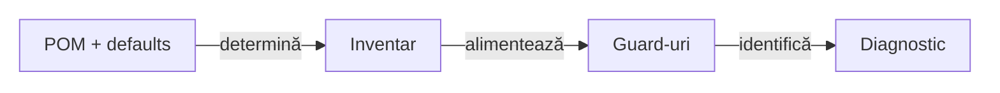

# ATF — mentenanță internă și guvernanța surselor

## Pe scurt

Îmbunătățirile se fac în cele 12 module existente, cu responsabilități și
contracte păstrate. Acest feedback urmărește source roots și namespace-uri omise
de inspecția Java actuală, fără funcționalități noi de framework.

## CODE-SOURCE-ROOTS-01 — importuri duplicate în layout-uri Maven configurate

**Prioritate: 70/100** = impact 24 + lacună 19 + lucrabil 20 + datorie documentară 7.
**Owner:** `atf-tests`, pentru inventarul surselor și verificarea lizibilității.

### Dovadă și efect

- `AtfSourceReadabilityGovernanceTest.projectJavaSourcesDoNotRepeatTheSameImport()`
  enumeră fișierele, dar `isJavaSource()` acceptă numai `/src/main/java/` și
  `/src/test/java/`.
- POM-ul Shop declară `src/main` și `src/test`. Proba cu import duplicat arată
  că ambele rădăcini sunt excluse, deși `inspectDuplicateImports()` detectează
  încălcarea dacă este invocat pentru aceleași fișiere.
- Proba directă a selectorului acceptă layout-ul Maven standard și respinge
  ambele layout-uri Shop. Succesul suitei whole-ATF nu certifică acele surse.
- Inventarul POM-aware există deja în `AtfTestLayerArchitectureTest.sourceFiles()`;
  guard-urile folosesc în prezent criterii diferite pentru aceleași surse.

### Îmbunătățire delimitată

<strong>Legendă — reutilizarea inventarului surselor</strong>

- Diagrama reprezintă corecția propusă, nu un contract deja implementat.
- Suportul comun rămâne în source-set-ul de test al `atf-tests`.
- Layout-ul Shop rămâne configurat în POM; nu se mută sursele pentru a satisface guard-ul.
- Output-urile de build și fișierele din afara rădăcinilor declarate rămân excluse.
Etichetele scurte păstrează următorul sens:

| În schemă | Sens complet |
|---|---|
| POM + defaults | POM + default Maven |
| Inventar | Inventar comun în atf-tests |
| Guard-uri | Guard-uri existente |
| Diagnostic | Fișier + regulă + diagnostic |

- [ ] Reutilizați inventarul existent pentru rădăcinile main/test; extrageți
      suport comun numai în `atf-tests`, dacă este necesar pentru ambii consumatori.
- [ ] Păstrați diagnosticul importului duplicat și excepțiile revizuite existente;
      nu relaxați regulile și nu transformați o omisiune de scanare în allowlist.
- [ ] Probați rădăcinile Maven implicite și configurate, inclusiv ambele layout-uri
      Shop; fiecare fixture cu import duplicat trebuie să fie respins.
- [ ] Verificați fișierul valid, excluderea output-urilor, absența scanării duble
      și diagnosticul pentru o rădăcină invalidă ori ieșită din modul.
- [ ] Revizia testului protejat primește controlul `testChanges` al incrementului;
      probele existente și baza lor nu se rescriu pentru a obține verde.

Proba curentă demonstrează omisiunea inventarului; nu afirmă că există deja
importuri duplicate în sursele Shop live.

## CODE-QUALIFIED-CALLS-02 — namespace-urile actuale ale apelurilor ATF

**Prioritate: 69/100** = impact 24 + lacună 20 + lucrabil 18 + documentare 7.
**Owner:** guard-ul de lizibilitate din `atf-tests`.

`FULLY_QUALIFIED_ATF_INVOCATION` din `AtfSourceReadabilityGovernanceTest`
recunoaște numai prefixul `atf.api.`. În fixture-uri neutre, apelul legacy produce
încălcare, iar `atf.reporting.contract.AtfReportStatus.worst(null, null)` produce
zero încălcări. Namespace-ul curent ocolește astfel politica importurilor normale.

- [ ] Acoperiți namespace-urile ATF actuale la același boundary de reporting tests;
      nu extindeți incidental regula către alte surse sau către oracolele business.
- [ ] Probați apeluri și constructori, variante valide cu import, comentarii și
      literale; păstrați adaptoarele revizuite și excludeți output-urile generate.
- [ ] Reutilizați suportul lexical potrivit și documentați schimbarea regulii,
      cu control exact; o expresie regulată care omite familia actuală nu este guard complet.

## Verificare și limite

Contractele de implementare sunt în [bunele practici de cod](../README_Atf_CodeBestPractices.md),
iar scope-ul curent este în [registrul feedback-urilor](README.md).
Build-ul și probele respectă [staging-ul izolat](../ATF_Build_And_Execution_Safety.md).
