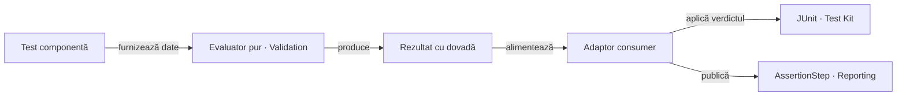

# ATF — teste business simple și suport la owner

## Pe scurt

Ținta este un test scurt care exprimă intenția și un runtime cu responsabilități
clare. Aici rămân numai diferențele față de contractele livrate.

| Contract implementat | Documentație owner |
|---|---|
| Plan evidence configurat pe trei axe, resolver direct/compus și conflicte înaintea resurselor | [Kit](../../atf-test-kit/README.md), [adnotări](../ATF_Test_Infrastructure_Annotations.md) |
| Politică de billing independentă de evidence și metadata rezolvată explicit | [Shop](../../atf-test-practice-shop/README.md#raport-partajat--starea-consumerului) |
| Overview cu valori comune sau mixte, fără a păstra profilul primului frate; detalii de acțiuni per scenariu | [Reporting](../../atf-reporting/README.md) |
| Pilot de coș cu gate pur, port UI restrâns, lifecycle de cont per execuție și factură observată separat de validare | [AutoEx](../../atf-test-auto-ex/README.md) |
| Harness E2E compus fără a ascunde canalul, selecția ori evidence-ul specific | [AutoEx](../../atf-test-auto-ex/README.md#suite-și-variante-de-evidence) |

Probele componente acoperă cazuri pozitive și negative controlate. Ele nu
certifică disponibilitatea magazinelor publice sau migrarea tuturor flow-urilor.

## Ordinea refactorizării

Scorul este prioritate: impact /40 + lacună /30 + lucrabil /20 + datorie
documentară /10. Nu reprezintă o notă a codului sau un rezultat de test.

| ID | Scor /100 | Diferența rămasă |
|---|---:|---|
| `CONSUMER-FLOW-LAYERS-09` | 88 = 36 + 24 + 20 + 8 | extinderea separării business/UI/validare în etapele AutoEx și Shop rămase |
| `CONSUMER-RUNTIME-BOUNDARY-03` | 77 = 31 + 18 + 20 + 8 | responsabilitățile de achiziție, publicare și lifecycle rămase în Shop |
| `CONSUMER-API-SUITE-AUDIT-01` | 74 = 31 + 23 + 14 + 6 | două artifacte API AutoEx fără un audit Extent comun pentru suita live |
| `CONSUMER-SHOP-BILLING-STATE-01` | 71 = 29 + 22 + 14 + 6 | diferență de valoare la billing între suita Shop E2E și lansarea individuală |
| `CONSUMER-COMPONENT-ASSERTIONS-01` | 63 = 25 + 18 + 16 + 4 | evaluator neutru reutilizabil în Validation pentru componente |
| `CONSUMER-E2E-PROFILES-01` | 57 = 24 + 10 + 17 + 6 | reducerea repetării live numai după echivalență demonstrată |

## CONSUMER-API-SUITE-AUDIT-01 — artifactul comun al suitei AutoEx

**Owner:** lifecycle-ul API direct din AutoEx; Reporting furnizează sesiunea și
rendererul Extent existente.

- Cu opt-in-urile read-only și mutativ active, `AutoExApiLiveSuite` rulează două
  clase. Extensia creează și închide o sesiune per clasă: două rapoarte corecte
  individual, fără o vedere unică a verdictului suitei.
- `ShopApiLiveSuite` selectează o singură clasă și publică deja un artifact
  individual, inclusiv când login-ul răspunde cu 401.

- [ ] Definiți ownership-ul unei sesiuni API la scope de suită AutoEx, păstrând
      lansarea unei clase direct din IntelliJ și opt-in-urile independente.
- [ ] Publicați un artifact Extent comun al suitei cu ambele clase, statusurile,
      request-urile și validările sub scenariul corect, plus navigare Fails → Tests;
      fiecare clasă lansată separat trebuie să-și păstreze propriul raport.
- [ ] Probați combinațiile read-only, mutativ și ambele, inclusiv FAIL în una
      dintre clase. Nu mutați evidence HTTP sub un checkpoint UI și nu eliminați
      raportul FAIL când există răspuns HTTP respins.

## CONSUMER-COMPONENT-ASSERTIONS-01 — evaluatorul neutru al componentelor

**Owner al restanței:** Validation pentru evaluarea pură reutilizabilă.
Fațada JUnit și colectarea comună sunt implementate în
[Test Kit](../../atf-test-kit/README.md#comparații-junit-cu-dovadă-neutră);
portul tipizat și randările Extent/fallback aparțin
[Reporting](../../atf-reporting/README.md).

Auditul tuturor componentelor și protecția împotriva unui PASS fără aserțiuni
înregistrate sunt contracte ale [AutoEx](../../atf-test-auto-ex/README.md)
și [Shop](../../atf-test-practice-shop/README.md). Acestea nu mai sunt o migrare
opt-in; testele unit rămân în afara obligației de raportare.

### Direcție de design — evaluare pură și raportare în limita configurată

`AuditedAssertions` și `RecordedAssertions` acoperă comparațiile JUnit ale
componentelor. Un evaluator independent de JUnit se proiectează peste contractele din
[Validation](../../atf-validation/README.md#limita-față-de-auditul-testelor-componente);
un evaluator general de componente nu este încă implementat.

| Owner | Responsabilitate urmărită |
|---|---|
| Testul consumerului | numele verificării, expected-ul independent, actual-ul observat și regula business |
| `atf-validation/src/main/java` | evaluare pură și rezultat imutabil cu verdict, comparație și mesaj; reutilizarea `AtfAssertion`/`ValidationDecision` unde contractul se potrivește |
| `atf-test-kit/src/main/java` | aplicarea politicii JUnit prin valori primitive sau callback-uri; fără dependență către Validation, Core ori Reporting |
| Adaptorul JUnit al consumerului | colectare per metodă, mapping și publicare înaintea propagării erorii; configurația sesiunii rămâne explicită |
| `atf-reporting` / `atf-reporting-tests` | proiecția Extent/fallback și probele neutre de model, browser și disclosure |

Diagrama descrie colaborarea dorită la runtime; nu introduce dependențe Maven.



<details>
<summary><strong>Legendă — direcție de design pentru aserțiuni auditabile</strong></summary>

- Evaluatorul general este propus; fațada Kit și portul `AssertionStep` sunt
  implementate. Nu se introduce un al doilea renderer sau un modul nou.
- Același rezultat al evaluării alimentează verdictul și raportul; compararea
  nu se repetă în publisher și mesajele nu sunt construite direct pentru Extent.
- Core oferă deja un model neutru; Reporting își păstrează contractul standalone,
  iar adaptorul consumerului face conversia între ele.
- Fiecare metodă păstrează artifactul și când este selectată de suită; testele
  unit nu primesc obligația de raportare a componentelor.

</details>

- [ ] Pentru evaluatorul Validation propus, probați un model, un adaptor API și
      un adaptor UI în ambele module,
      cu aceleași comparații în lansare individuală și prin suită; extindeți
      API-ul numai pentru operatorii demonstrați de aceste cazuri.
- [ ] Evaluați comparația pe valorile integrale și păstrați tipurile necesare
      dezambiguizării (`null` față de textul `null`, valori numerice cu tipuri
      diferite); verdictul nu se calculează din preview-ul trunchiat.
- [ ] Păstrați `maxDisplayedCharacters`, implicit 240, pentru preview-ul actual
      și mesajele noului layer; `…` intră în plafon, iar expandarea nu îl anulează.
      Probați pragul implicit, limita configurată și diferența aflată după
      prefixul afișat; mesajul trebuie să explice concis eșecul în același buget.
- [ ] Declarați explicit fail-fast sau colectare; raportați numai comparațiile
      evaluate. Un eșec așteptat prin `assertThrows` trebuie reprezentat prin
      verificarea așteptării, fără un FAIL business artificial în raport.
- [ ] Verificați mesajul, cauza originală, rândul FAIL păstrat înaintea erorii
      JUnit, redacția și izolarea per metodă; în browser, probați ultimul rând,
      mouse/Enter/Space, Fails și revenirea la tabel, inclusiv valori lungi.

## CONSUMER-SHOP-BILLING-STATE-01 — valoarea observată în suita E2E

**Owner:** flow-ul și observația billing din Practice Shop.

- `ShopUiOnlySingleFlowPurchaseE2eTest` a trecut individual înainte și după
  suită, dar a eșuat în `ShopE2eSuite`: checkpoint-ul billing a așteptat
  `Alaska` și a observat `AlaskaAlaska` în câmpul state.
- Raportul comun a păstrat comparația FAIL. O singură suită eșuată nu stabilește
  încă o cauză deterministă a diferenței dintre traseele de execuție.

- [ ] Reproduceți cu suita și clasa individuală, păstrând exact aceeași configurație;
      comparați ordinea acțiunilor, valorile DOM înainte și după lookup-ul postal,
      evenimentele de input și state-ul per scenariu. Nu reintroduceți tastarea
      peste câmpurile pe care lookup-ul Shop le completează.
- [ ] Stabiliți dacă dublarea vine din aplicația publică, din sincronizarea
      lookup-ului sau din adaptor; corectați numai la ownerul dovedit. Păstrați
      expected-ul din fixture și actual-ul citit din UI, fără normalizare care
      ar transforma `AlaskaAlaska` în PASS.
- [ ] Probați aceeași verificare în lansare individuală și prin suită; raportul
      FAIL trebuie să arate comparația și să permită expandarea până la rândul
      exact, iar raportul PASS trebuie să păstreze rândurile de validare.

## CONSUMER-FLOW-LAYERS-09 — business, traseu UI și validare separate

**Owner:** consumerii pentru business și adaptoare; UI, Reporting și Kit pentru
capabilitățile neutre existente. Pilotul nu reprezintă migrarea întregului journey.

Arhitectura țintă și categoriile de validare sunt în
[ghidul oficial](../ATF_Testing_Guide.md#separarea-flow-urilor-business-ui-și-a-validărilor).

| Zonă rămasă | Limita actuală | Criteriul următor |
|---|---|---|
| `ShopPurchaseFlow` / `ShopPurchaseJourneyContext` | selecția Catalog și checkout-ul primesc proiecții de config; checkpoint-urile sunt snapshot-uri imutabile, publicate înaintea gate-ului | păstrați aceste contracte; evaluați separat celelalte flow-uri Shop/AutoEx, fără wrapper per acțiune |
| Etapele AutoEx rămase și etapele Shop | paginile Login/Registration primesc acum URI rezolvat; rămân flow-uri care primesc fațade complete | restrângerea următoarelor dependențe numai după inventarierea operațiilor, păstrând raportarea și ordinea |
| Evidence și cleanup la limita flow-urilor | există publisher și lifecycle comune, dar nu toate traseele au porturi restrânse | păstrarea identității checkpoint-ului, ordinii și cauzei primare |

**Livrat — baseline de migrare (09-A).** Inventarul celor cinci selecții Shop,
cu faze, gate-uri, mutații și ownership, este păstrat în
[README-ul Practice Shop](../../atf-test-practice-shop/README.md#baseline-pentru-separarea-flow-ului).
Selecțiile și aserțiunile rămân neschimbate.

**Livrat — ownership-ul conturilor (09-D).** Shop distinge fixture împrumutat,
cont sintetic nou și scope de clasă/suită; AutoEx păstrează identitatea creată
și lifecycle-ul delete per execuție. Politicile sunt în
[Shop](../../atf-test-practice-shop/README.md#conturile-autentificate) și
[AutoEx](../../atf-test-auto-ex/README.md#coș-și-continuitatea-sesiunii).
- **Livrat — checkout Shop (09-E).** [Coordinatorul pur](../../atf-test-practice-shop/README.md#gate-uri-de-checkout)
  publică și verifică fiecare checkpoint înaintea tranziției următoare; adaptorul
  Playwright deține observațiile UI și API evidence. `ShopCheckoutFlowComponentTest`
  probează ordinea, ambele ramuri de identitate, fail-fast și eșecul publisherului.
  Payment check rămâne distinct de Confirm și de confirmarea finală cu număr `INV-`.
- **Livrat — porturi de pagină AutoEx (09-G, tranșă).** Account, Home și Checkout
  nu mai depind de `AutoExPurchaseSession`; fiecare primește numai portul de care
  are nevoie. `ProductsPage` primește acțiunile UI și produsul așteptat explicit.
  `AutoExPagePortsComponentTest` probează ordinea navigare/prompt/căutare și
  checkout/plată, produsul așteptat și fail-fast offline; testul lifecycle
  folosește portul de cont direct.
- **Livrat — publisher Shop (09-G, tranșă).** `ShopPurchaseCheckpointPublisher`
  izolează formarea și publicarea checkpoint-urilor de contextul UI/config/API;
  componenta verifică FAIL publicat înaintea gate-ului și propagarea intactă a
  erorii sink-ului. Contextul păstrează compoziția resurselor browser/API comune;
  inputurile de configurare sunt restrânse separat pe stage.
- **Livrat — intrări tipizate pe stage Shop (09-G, tranșă).** Catalogul și
  checkout-ul primesc proiecții imutabile distincte; niciunul nu mai primește
  `ShopConfiguration` globală, iar checkout-ul nu expune validatorul Home.
  `ShopPurchaseStageInputsComponentTest` fixează shape-ul; `ShopCheckoutFlowComponentTest`
  și checkpoint-urile imutabile probează ordinea publish/gate. Resursele UI/API
  comune rămân la composition root.
- **Livrat — navigare îngustă pentru contul Shop (09-G, tranșă).** Login și
  Registration primesc URI rezolvat la composition root; testul de componentă
  fixează absența `ShopConfiguration` din API-ul page objects.
- **Livrat — intrare îngustă pentru catalogul Shop (09-G, tranșă).**
  `ShopCatalogFlow` consumă `ShopConfiguration.CatalogSelection`; aceeași probă
  de componentă respinge configurația globală în API-ul flow-ului.
- **Livrat — port UI pentru cart stories AutoEx (09-G, tranșă).**
  `AutoExCartJourney` primește `AutoExCartJourneyPort`, care compune porturile
  UI necesare contului și catalogului, fără checkout sau inspector API.
  `AutoExPurchaseJourney` păstrează precondiția API înaintea căutării pentru
  traseul UI+API; traseul UI-only reutilizează separat `AutoExCatalogSearchPort`.
  `AutoExPagePortsComponentTest` fixează ordinea și absența capabilităților API.
- [ ] **09-G — porturi pentru flow-urile rămase.** Restrângeți dependențele
      din journey-urile AutoEx și etapele Shop rămase, fără wrapper per click.
      Păstrați UI/API frați, fereastra cauzală, captura stării observate și cauza
      de infrastructură; un failure business anterior rămâne primar.
- [ ] **09-H — probe înaintea migrării generale.** Extindeți matricea pilotului
      la fiecare port UI rămas: heading/valoare absentă și timeout trebuie să
      oprească pasul următor fără retry. Gate FAIL, câmpuri coș lipsă, mutația
      incertă a contului AutoEx și failure precedence pentru publication/cleanup
      sunt deja probate în suitele componentă. Guard-ul business respinge
      browser, UI, JUnit și Reporting fără excepții sau praguri mărite.

- **Livrat — eșecuri de observație fail-fast (09-H, tranșă).**
  `AutoExPagePortsComponentTest` probează heading-ul Home absent, timeout-ul
  rezultatului de căutare, timeout-ul identității după login și confirmarea plății
  absentă; un heading de plată absent oprește și completarea cardului. Absența
  heading-ului rezultat după înregistrare păstrează cleanup-ul armat și oprește
  checkpoint-ul/Continue. În fiecare caz, cauza originală se propagă, pasul următor
  nu rulează și acțiunea nu se repetă.
  Matricea celorlalte porturi rămâne deschisă până la probe echivalente.

- **Livrat — păstrarea cauzei primare (09-H, tranșă).**
  `ShopE2eFailureBoundaryTest` forțează eșec business, publicare și close simultan;
  verifică identitatea cauzei primare și ordinea excepțiilor suprimate.
  `AutoExRunLifecycleAdapterComponentTest` probează toate etapele secundare,
  inclusiv cleanup, diagnostics, evidence, browser close și închiderea raportului.
- **Livrat — corelarea mutației de coș AutoEx (07).** `AutoExPurchaseJourney`
  așteaptă schimbul GET XHR/FETCH al click-ului unic, apoi publică transportul și
  starea modalului în checkpoint-ul `CART_ADD`. `AutoExRuntimeBoundaryComponentTest`
  probează 2xx, 503, `requestFailed` și schimb lipsă, plus vecini cu rută, metodă
  sau resource kind diferit; contractul este în
  [README-ul AutoEx](../../atf-test-auto-ex/README.md#boundary-ul-cauzal-pentru-ui_api).
- **Livrat — acoperirea Network Inspector pentru journey-urile E2E AutoEx (07-B).**
  `AutoExE2eSuite` păstrează profile UI-only și include variante UI+API pentru
  Account, Cart, Existing customer și Purchase. Cele patru variante UI+API
  selectează toate rutele DOCUMENT first-party prin
  `@AutoExNetworkDocuments({"/"})`; XHR/FETCH rămân capturate, iar `OTHER` este
  inclus fără body. Asset-urile statice și host-urile terțe rămân excluse.
  Setup-ul API de creare cont este separat de traficul browserului cauzal.
  Diagnosticul purchase a confirmat `GET /download_invoice/1000` cu HTTP 200;
  `ERR_ABORTED` asociat unui attachment 2xx este păstrat ca răspuns HTTP fără
  bytes descărcați. Component testele acoperă `OTHER`, body exclusion și această
  succesiune de download. Gate-ul complet a trecut cu 8 clase/10 teste; cele cinci
  rapoarte UI+API au avut toate `dropped=0` și `in-flight=0`. Captura completă se
  afirmă numai în scope-ul first-party configurat, nu pentru asset-uri sau host-uri terțe.

| Zonă | Responsabilitate |
|---|---|
| Main la consumer | business și modele ale aplicației |
| Test la consumer | fixture-uri, suite și adaptoare JUnit |
| Pachete | maximum 8 clase; extracția comună cere contract demonstrat |

## CONSUMER-RUNTIME-BOUNDARY-03 — mai puțin suport local, nu un harness ascuns

**Owner:** Shop pentru runtime-ul aplicației; Kit/UI/Reporting pentru
capabilitățile neutre. Metadata Shop primește acum inputuri explicite, iar
diferențele de profil sunt agregate corect în raportul partajat.

- [ ] Extrageți din `ShopE2eContext` câte o responsabilitate de achiziție,
      publicare sau lifecycle, păstrând fațada business. Store-ul și
      ParameterResolver-ul rămân la granița JUnit.
- [ ] Reutilizați primitivele Kit existente cu callbacks tipizate, fără
      dependențe Kit către browser, Reporting sau aplicații.
- [ ] Verificați achiziția parțială și eșecul la captură, summary, publish și
      close; cauza inițială și erorile secundare rămân disponibile.
- [ ] Păstrați probele adaptorului și boundary-ul guvernat de
      [ConsumerModuleArchitectureGovernanceTest](../../atf-tests/src/test/java/atf/api/tests/governance/consumers/ConsumerModuleArchitectureGovernanceTest.java),
      fără allowlist sau relaxarea scope-ului Maven.

## CONSUMER-E2E-PROFILES-01 — variantele de evidence și acoperirea business

**Stare: parțial implementat.** Suitele și poveștile E2E sunt păstrate.
Resolverul și probele Extent/fallback permit izolarea politicilor per scenariu;
ele nu demonstrează singure echivalența tuturor adaptoarelor consumerilor.

- **Livrat — inventarul profilurilor AutoEx.** [README-ul modulului](../../atf-test-auto-ex/README.md#profile-uiapi-și-acoperirea-network-inspector)
  mapează Account, Cart și Purchase UI/UI+API la aceleași intrări de journey,
  separă politica de screenshot și păstrează Existing customer distinct pentru
  setup-ul API. Aceasta dovedește reutilizarea codului, nu echivalența rezultatului
  live sau a evidence-ului randat.
- [ ] Înaintea reducerii selecției, demonstrați smoke-ul adaptorului pe succes
      și failure, plus contractele generice `ReportEvidenceProfileIntegrationTest`
      și `UiScreenshotPolicyIntegrationTest`.
- [ ] Păstrați lansarea manuală ori un profil echivalent și opt-in-urile
      independente pentru API read-only/mutații; fără suită pentru fiecare captură.
- [ ] Actualizați inventarul protejat numai după dovada echivalenței;
      `ConsumerSuiteCoverageGovernanceTest` și boundary-urile nu se relaxează
      pentru a ascunde cazuri eliminate.

## Controlul modificărilor

Incrementul se închide conform [ghidului de testare](../ATF_Testing_Guide.md#inventarul-executabil-după-mutări-și-reclasificare)
și [protocolului de staging](../ATF_Build_And_Execution_Safety.md#regula-de-lucru-pentru-orice-schimbare).
Controlul Git de mai jos protejează testele modificate; nu certifică migrarea
flow-urilor rămase.

<details>
<summary><strong>Controale tehnice ale incrementelor</strong></summary>

```yaml
testChanges:
  - id: CONSUMER-COMPONENT-AUDIT-ALL-02
    status: ACTIVE
    base: db5f06c83ede6422b9509350136da9eca6111aa2
    expires: 2026-11-26
    reason: Mută numai apelurile JUnit ale componentelor pe fațada auditabilă comună; păstrează overload-urile, expected/actual și verdictul, excepțiile așteptate și izolarea lansărilor imbricate; adaugă probele neutre și guard-ul fără a relaxa regulile existente.
    proof: mvn -pl atf-test-kit,atf-test-auto-ex,atf-test-practice-shop,atf-tests -am "-Dtest=AuditedAssertionsTest,AuditedAssertionScopeComponentTest,AutoExComponentSuite,ShopComponentSuite,WholeAtfGovernanceSuiteTest" "-Dsurefire.failIfNoSpecifiedTests=false" test
    paths:
      - atf-test-auto-ex/src/test/java/atf/autoex/tests/component/api/AutoExApiContractComponentTest.java
      - atf-test-auto-ex/src/test/java/atf/autoex/tests/component/api/AutoExApiContractReportPublisherComponentTest.java
      - atf-test-auto-ex/src/test/java/atf/autoex/tests/component/api/AutoExApiResponseAssertionsComponentTest.java
      - atf-test-auto-ex/src/test/java/atf/autoex/tests/component/api/AutoExCatalogApiPreconditionComponentTest.java
      - atf-test-auto-ex/src/test/java/atf/autoex/tests/component/AutoExAccountCleanupDecisionComponentTest.java
      - atf-test-auto-ex/src/test/java/atf/autoex/tests/component/AutoExCatalogAssertionsComponentTest.java
      - atf-test-auto-ex/src/test/java/atf/autoex/tests/component/AutoExEvidenceProfileComponentTest.java
      - atf-test-auto-ex/src/test/java/atf/autoex/tests/component/AutoExPrivacyConsentHandlerComponentTest.java
      - atf-test-auto-ex/src/test/java/atf/autoex/tests/component/AutoExPurchaseTraceStepTest.java
      - atf-test-auto-ex/src/test/java/atf/autoex/tests/component/AutoExStoreAssertionsComponentTest.java
      - atf-test-auto-ex/src/test/java/atf/autoex/tests/component/configuration/AutoExConfigurationLoaderComponentTest.java
      - atf-test-auto-ex/src/test/java/atf/autoex/tests/component/journey/AutoExAccountDeletionSafetyComponentTest.java
      - atf-test-auto-ex/src/test/java/atf/autoex/tests/component/journey/AutoExAccountLifecycleComponentTest.java
      - atf-test-auto-ex/src/test/java/atf/autoex/tests/component/journey/AutoExCartDomComponentTest.java
      - atf-test-auto-ex/src/test/java/atf/autoex/tests/component/journey/AutoExCartFlowComponentTest.java
      - atf-test-auto-ex/src/test/java/atf/autoex/tests/component/journey/AutoExCheckoutAddressComponentTest.java
      - atf-test-auto-ex/src/test/java/atf/autoex/tests/component/journey/AutoExInvoiceComponentTest.java
      - atf-test-auto-ex/src/test/java/atf/autoex/tests/component/journey/AutoExPurchaseBusinessComponentTest.java
      - atf-test-auto-ex/src/test/java/atf/autoex/tests/component/lifecycle/AutoExRunLifecycleAdapterComponentTest.java
      - atf-test-auto-ex/src/test/java/atf/autoex/tests/component/lifecycle/AutoExRuntimeBoundaryComponentTest.java
      - atf-test-auto-ex/src/test/java/atf/autoex/tests/component/navigation/AutoExStoreAvailabilityComponentTest.java
      - atf-test-auto-ex/src/test/java/atf/autoex/tests/component/pages/AutoExPagePortsComponentTest.java
      - atf-test-auto-ex/src/test/java/atf/autoex/tests/extension/AutoExExtentTestExtension.java
      - atf-test-kit/src/test/java/atf/testkit/assertions/AuditedAssertionScopeComponentTest.java
      - atf-test-kit/src/test/java/atf/testkit/assertions/AuditedAssertionsTest.java
      - atf-tests/src/test/java/atf/api/tests/governance/consumers/ConsumerModuleArchitectureGovernanceTest.java
  - id: CONSUMER-COHESION-INVENTORY-01
    status: ACTIVE
    base: 466a045e95a7336b183a7d75e0b369f8deb3082c
    expires: 2026-11-26
    reason: Actualizează inventarul exact al pachetului journey AutoEx cu AutoExAccountJourney deja prezent în sursele main; păstrează limita de coeziune și verificările tuturor pachetelor.
    proof: mvn -pl atf-tests -am "-Dtest=AtfPackageCohesionGovernanceTest,WholeAtfGovernanceSuiteTest" "-Dsurefire.failIfNoSpecifiedTests=false" test
    paths:
      - atf-tests/src/test/java/atf/api/tests/governance/AtfPackageCohesionGovernanceTest.java
  - id: CONSUMER-COMPONENT-ASSERTION-STEP-01
    status: ACTIVE
    base: 466a045e95a7336b183a7d75e0b369f8deb3082c
    expires: 2026-11-26
    reason: Conectează comparațiile JUnit evaluate din configurarea AutoEx și Shop la pasul tipizat; recorderul neutru comun este în main Test Kit, iar adaptoarele JUnit păstrează mapping-ul și raportul per metodă.
    proof: mvn -pl atf-test-kit,atf-test-auto-ex,atf-test-practice-shop,atf-tests -am "-Dtest=RecordedAssertionsTest,AutoExConfigurationLoaderComponentTest,ShopConfigurationTest,WholeAtfGovernanceSuiteTest" "-Dsurefire.failIfNoSpecifiedTests=false" test
    paths:
      - atf-test-auto-ex/src/test/java/atf/autoex/tests/component/configuration/AutoExConfigurationLoaderComponentTest.java
      - atf-test-auto-ex/src/test/java/atf/autoex/tests/extension/AutoExExtentTestExtension.java
      - atf-test-kit/src/test/java/atf/testkit/assertions/RecordedAssertionsTest.java
  - id: AUTOEX-CONSUMER-COMPONENT-09
    status: ACTIVE
    base: fdbafdbaa4bdf617c9fd103ba0b917cc2efdc766
    expires: 2026-11-26
    reason: Păstrează probele protejate pentru lifecycle/configurația, porturile de pagină și portul UI al cart stories AutoEx; guard-urile verifică ownership-ul capabilităților și limita de opt clase. ShopComponentSuite rulează în aceeași verificare, iar politica de schimbări îl exclude explicit.
    proof: mvn -pl atf-test-auto-ex,atf-test-practice-shop,atf-tests -am "-Dtest=AutoExComponentSuite,ShopComponentSuite,WholeAtfGovernanceSuiteTest" "-Datf.governance.testChanges.baseRef=fdbafdbaa4bdf617c9fd103ba0b917cc2efdc766" "-Dsurefire.failIfNoSpecifiedTests=false" test
    paths:
      - atf-test-auto-ex/src/test/java/atf/autoex/tests/component/configuration/AutoExConfigurationLoaderComponentTest.java
      - atf-test-auto-ex/src/test/java/atf/autoex/tests/component/journey/AutoExAccountLifecycleComponentTest.java
      - atf-test-auto-ex/src/test/java/atf/autoex/tests/component/journey/AutoExCartFlowComponentTest.java
      - atf-test-auto-ex/src/test/java/atf/autoex/tests/component/pages/AutoExPagePortsComponentTest.java
      - atf-test-auto-ex/src/test/java/atf/autoex/tests/component/lifecycle/AutoExRuntimeBoundaryComponentTest.java
      - atf-tests/src/test/java/atf/api/tests/governance/consumers/ConsumerModuleArchitectureGovernanceTest.java
      - atf-tests/src/test/java/atf/api/tests/governance/AtfPackageCohesionGovernanceTest.java
```

</details>
