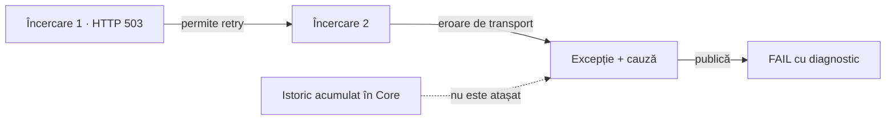

# ATF Core — istoricul execuției la eroare terminală

## Pe scurt

`ApiExecutor` păstrează încercările într-un `ApiExecutionResult` când există un
răspuns final. La o eroare terminală de transport, timeout sau întrerupere,
istoricul acumulat local nu este transportat de excepția publică. Raportul FAIL
poate fi publicat din diagnostic; auditul încercărilor are nevoie de date typed.

## CORE-TERMINAL-EXECUTION-EVIDENCE-01 — snapshot parțial auditabil

**Prioritate:** 86/100 = impact 36 + lacună 25 + lucrabil 18 + documentare 7,
conform [registrului comun](README.md#top-feedback-uri-active).

**Owner:** Core deține rezultatul transportului și deadline-ul; adaptorul
consumerului îl convertește, Reporting îl proiectează, iar Reporting Tests
verifică Extent/fallback.

### Reproducere și cauza verificată

- Un `ApiTransport` determinist întoarce întâi 503, apoi un future eșuat cu
  `IOException`; `RetryPolicy.onStatuses` permite retry-ul răspunsului 503.
- `execute(GET /read)` face două apeluri și aruncă `ApiExecutionException`.
  Cauza terminală este păstrată, iar apelantul nu primește `ApiExecutionResult`.
- [ApiExecutor](../../atf-core/src/main/java/atf/core/http/execution/ApiExecutor.java)
  construiește rezultatul după bucla de retry; ramura terminală aruncă înaintea
  acelei construcții. `retryEvents` și `attemptHistory` rămân variabile locale.
- [ApiExecutionException](../../atf-core/src/main/java/atf/core/http/response/ApiExecutionException.java)
  transportă mesajul și cauza, fără snapshot al execuției. O compoziție care
  consumă numai acest contract nu poate recupera prima încercare HTTP din rezultat.

<strong>Legendă — răspuns HTTP versus eroare de execuție</strong>

503 este răspunsul primei încercări. A doua încercare nu are răspuns HTTP;
statusul ei nu se inventează din excepție. Istoricul trebuie capturat în Core,
înaintea aruncării, și transportat imutabil către apelant. Mesajele consolei
și capturile de rețea independente nu înlocuiesc acest contract public.

### Criterii rămase

- [ ] Expuneți un snapshot typed al execuției eșuate, compatibil cu API-ul
      existent: încercări, retry-uri, timp monoton măsurat, request și provenance.
      Păstrați cauza, întreruperea și anularea; Core nu importă rendererul.
- [ ] Modelați explicit încercarea fără răspuns. Timeout-ul, anularea și
      întreruperea nu primesc un response ori un status HTTP fabricat.
- [ ] Probați 503 → eroare transport, 503 → timeout, anulare în backoff,
      întrerupere și eroare la prima încercare, cu transport și ceas controlate.
      Păstrați probele existente pentru răspuns final, inclusiv non-2xx.
- [ ] Convertiți snapshot-ul la ownerul consumerului și verificați paritatea
      Extent/fallback, ordinea încercărilor și diagnostic versus response.
      Verdictul business, redactarea și bugetele de preview rămân neschimbate.
- [ ] Păstrați politica de retry și numărul apelurilor efectuate; publicarea
      evidence-ului nu reexecută operația business și nu lărgește allowlist-ul.

**Închidere:** reproducerea cu două apeluri expune atât 503-ul inițial, cât și
eroarea terminală fără răspuns, prin contractul public și în raport, fără
reconstrucție din textul excepției sau din loguri.
