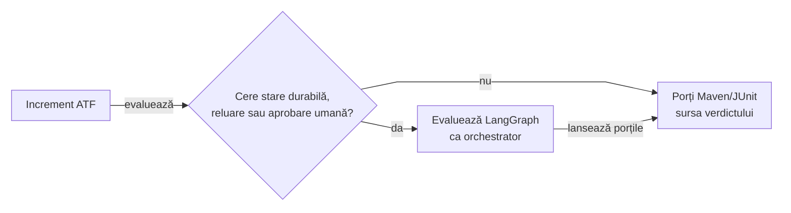

# ATF J0 — feedback pentru mentenanța workspace-urilor

## Pe scurt

`atf-tests` deține regulile whole-reactor și verificarea read-only a perechii
selectate J0/J1. Feedback-ul funcțional rămâne la ownerul codului; această
colecție verifică boundary-urile, documentația și ordinea porților.

## ATF-WORKSPACE-MAINTENANCE-01 — porți explicite și feedback trasabil

**Owner:** `atf-tests`, pentru regulile de reactor și relațiile de workspace.

Succesiunea porților este fixă și deterministă. Maven/JUnit execută suita, iar
diagrama Mermaid explică traseul. Un orchestrator extern precum
[LangGraph](https://docs.langchain.com/oss/python/langgraph/overview) aduce
capabilități pentru procese cu stare persistentă, execuție reluabilă și
intervenție umană; acestea nu sunt cerințe ale fluxului curent.

### Când merită evaluat LangGraph?

Ramurile finite `cu JAR` și `fără JAR` sunt deja descrise de suite și feedback;
singure, nu justifică un runtime nou. Reevaluarea are sens când procesul cere
stare durabilă peste întreruperi, pauze pentru aprobare umană sau reluarea
controlată a unui traseu dinamic. În ambele variante, Maven/JUnit rămâne sursa
verdictului testelor.



<details>
<summary><strong>Legendă — pragul pentru un runtime de orchestrare</strong></summary>

- Ramurile finite sunt acoperite direct de suitele existente; Mermaid explică
  traseul, fără să-l execute.
- Numai nevoia operațională de stare durabilă, aprobare sau reluare justifică
  evaluarea unui orchestrator. Diagrama nu autorizează automat adoptarea lui.
- Chiar dacă este evaluat, orchestratorul lansează aceleași porți Maven/JUnit;
  verdictul rămâne la testele ATF.

</details>

- `WholeAtfGovernanceSuiteTest` păstrează porțile locale J0 pentru arhitectură,
  build, surse și documentație.
- `AtfMaintenanceWorkspacePairGovernanceTest` verifică source/binary ownership,
  cele cinci perechi JAR/POM și documentația J1 prin contractele bibliotecilor,
  fără a cere consumerului să numească workspace-ul producerului.
- `AtfWorkspaceMaintenanceSuite` rulează ambele porți într-o singură comandă;
  testele native ale consumerului rămân criteriul separat la adoptarea unui JAR.
- Diagrama și comenzile sunt guvernate de
  [protocolul workspace-urilor](../ATF_Workspace_Synchronization.md#protocolul-fiecărui-increment)
  și de [catalogul testelor](../../atf-tests/README.md#mentenanța-perechii-j0j1).

**Verificat în staging J0 (2026-11-21):** suita combinată a trecut cu 169
verificări, zero eșecuri, erori sau teste omise, folosind J1 live read-only.
Documentele J1 descriu versiunile și fișierele bibliotecilor, iar feedback-ul
și probele de owner rămân delimitate. O execuție verde nu închide criteriul
comportamental al altui owner.

<details>
<summary><strong>Control tehnic — ATF-WORKSPACE-MAINTENANCE-COLLECTION-CONTROL</strong></summary>

```yaml
testChanges:
  - id: ATF-WORKSPACE-MAINTENANCE-COLLECTION-CONTROL
    status: CLOSED
    base: 58177a8c1e04103f1d160f04eca4b466d2da8381
    expires: 2026-12-21
    reason: Leagă suita de mentenanță, documentația procesului și inspecția artefactelor consumer de un singur gate reproductibil.
    proof: >-
      mvn -B -ntp -pl atf-tests -am "-Dtest=AtfWorkspaceMaintenanceSuite"
      "-Datf.maintenance.j0=$env:ATF_MAINTENANCE_J0"
      "-Datf.maintenance.j1=$env:ATF_MAINTENANCE_J1"
      "-Dsurefire.failIfNoSpecifiedTests=false" test
    paths:
      - atf-tests/src/test/java/atf/api/tests/governance/WholeAtfGovernanceSuiteTest.java
      - atf-tests/src/test/java/atf/api/tests/governance/maintenance/AtfMaintenanceProcessDocumentationGovernanceTest.java
      - atf-tests/src/test/java/atf/api/tests/governance/maintenance/AtfMaintenanceWorkspacePairGovernanceTest.java
      - atf-tests/src/test/java/atf/api/tests/governance/maintenance/AtfMaintenanceWorkspacePairSuite.java
      - atf-tests/src/test/java/atf/api/tests/governance/maintenance/AtfWorkspaceMaintenanceSuite.java
      - atf-tests/src/test/java/atf/libraries/PlatformLibrarySurface.java
```

</details>
