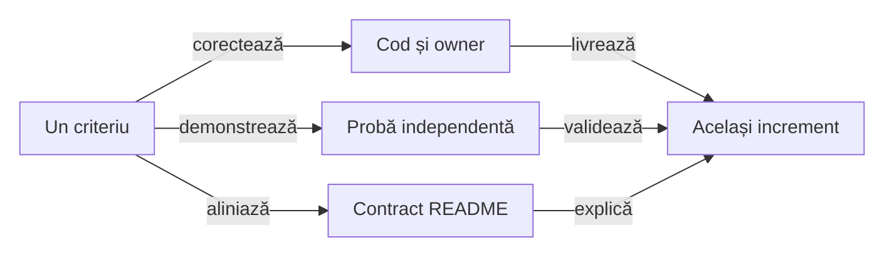

# ATF Reporting — contracte, responsabilități și pregătire JAR

## Pe scurt

Biblioteca poate produce un JAR și poate randa Extent/fallback într-un consumer
extern fără module ATF. Această probă nu închide pregătirea pentru release:
rămân indexarea cauzei terminale în Fails, redactarea JSON incompletă și
un gate de teste care depinde încă de checkout-ul ATF.

`atf-reporting-tests` rămâne modul intern de verificare. Fiecare increment de
mai jos închide împreună codul, ownership-ul, proba și documentația; împachetarea
nu justifică înghețarea unui contract greșit sau rescrierea flow-urilor consumerilor.

## Ordinea pregătirii

Scorul este prioritate: impact /40 + lacună /30 + lucrabil /20 + datorie
documentară /10. Nu este o notă a modulului ori un procent de acoperire.

| ID | Scor /100 | Criteriul care blochează închiderea |
|---|---:|---|
| `REPORT-JSON-REDACTION-40` | 92 = 38 + 28 + 18 + 8 | cheie JSON Unicode și valoare numerică sensibilă rămân în ambele HTML-uri |
| `REPORT-TERMINAL-FAILURE-INDEX-48` | 90 = 36 + 28 + 18 + 8 | FAIL terminal fără assertions are context generic greșit în Fails Extent și lipsește din indexul fallback |
| `REPORT-STANDALONE-ISOLATION-41` | 85 = 32 + 27 + 18 + 8 | modulul copiat singur are trei erori în gate-ul propriu |
| `REPORT-TEST-ORACLES-47` | 83 = 34 + 26 + 16 + 7 | contractul de artifact și oracolele de navigare păstrează forme private vechi; există și un selector shorthand |
| `REPORT-CONFIGURATION-42` | 82 = 30 + 25 + 19 + 8 | fracțiile sunt acceptate și trunchiate contrar contractului de întreg pozitiv |
| `REPORT-PUBLIC-API-43` | 81 = 31 + 24 + 17 + 9 | API-ul susținut, compatibilitatea și capabilitățile adaptoarelor nu sunt delimitate suficient |
| `REPORT-SESSION-CONTRACT-44` | 76 = 28 + 23 + 17 + 8 | flush/publicare, path și threading diferă fără contract comun explicit |
| `REPORT-RELEASE-CONTRACT-45` | 73 = 25 + 22 + 17 + 9 | lipsesc criteriile declarate ale pachetului și versiunii distribuite |
| `REPORT-PORTABLE-DOCS-46` | 72 = 24 + 22 + 17 + 9 | contractele și linkurile README depind încă de documente din afara modulului |
| `REPORT-FLOW-PROJECTION-36` | 62 = 24 + 17 + 16 + 5 | calculul proiecției și protocolul publicării rămân amestecate |



<details>
<summary><strong>Legendă — închiderea comună a codului și documentației</strong></summary>

- Regula observabilă și ownerul decid refactorizarea; numărul de clase sau linii
  nu este un motiv suficient pentru un helper ori modul nou.
- Proba refuză comportamentul anterior și consumă API-ul ori artefactul real.
  README-ul descrie numai rezultatul demonstrat, cu limitele păstrate.
- Un criteriu se închide după reconcilierea celor trei ramuri. Contractul stabil
  se mută la owner, iar controlul testelor în baseline; feedback-ul păstrează numai restanțele.

</details>

## REPORT-JSON-REDACTION-40 — secretul semantic înaintea formatării

**Prioritate: 92/100** = impact 38 + lacună 28 + lucrabil 18 + documentare 8.
**Owner:** [SensitiveDataRedactor](../../atf-reporting/src/main/java/atf/reporting/security/SensitiveDataRedactor.java)
și [ReportEvidenceJsonFormatter](../../atf-reporting/src/main/java/atf/reporting/evidence/markup/ReportEvidenceJsonFormatter.java).

Consumerul JAR publică JSON valid cu cheia `to\u006ben` și un câmp `password`
numeric. Ambele valori sintetice rămân în HTML-ul Extent și fallback, inclusiv
cu body preview dezactivat; câmpul nesensibil de control este păstrat.

- Regex-ul JSON recunoaște numele literal și valoarea string. Formatarea JSON
  ulterioară decodează cheia Unicode după redactare; valoarea numerică nu este mascată.
- Aceasta este o reproducere cu canary sintetic, fără credentiale reale și fără
  transmitere externă. Nu se generalizează la orice input sau la redactorii altor module.

**Același increment:**

- [ ] Tratați cheia semantică și toate formele valorii sensibile înainte de
      formatare/plafon: string, număr, boolean, array și obiect, inclusiv în liste.
      Delimitați JSON valid de textul invalid și păstrați fallback-ul diagnostic sigur.
- [ ] Păstrați politica de replacement și datele nesensibile; nu modificați
      inputul folosit pentru verdict, asociere sau replay. Nu aplicați un regex
      suplimentar numai în HTML-ul final.
- [ ] Probați escape-uri Unicode în chei/valori, nesting, headers și body,
      chei duplicate, input invalid și valori peste buget. Căutați canary-ul în
      întregul artifact, în JSON/replay și în ambele renderere, nu doar într-o celulă.
- [ ] Corectați împreună implementarea și [garanția de proiecție sigură](../../atf-reporting/README.md#proiecția-sigură-a-aserțiunilor);
      documentați precis formatele acoperite și degradarea inputului invalid.

## REPORT-TERMINAL-FAILURE-INDEX-48 — cauza transportului în indexul Fails

**Prioritate: 90/100** = impact 36 + lacună 28 + lucrabil 18 + documentare 8.
**Owner:** [collectorul proiecțiilor](../../atf-reporting/src/main/java/atf/reporting/model/projection/ReportExecutionProjectionAccumulator.java),
proiecția Fails Extent și navigarea către execution evidence.

Consumerul JAR publică trei exchange-uri: PASS `/before`, FAIL `/terminal`
cu IO_ERROR și fără assertions, PASS `/after`.

| Suprafață | Observat în artifactul nou |
|---|---|
| Tests Extent/fallback | diagnosticul redactat și ambele attempts ale terminalului sunt inspectabile; scenariul este FAIL |
| Fails Extent | cauză generică și REQUEST `/after`, deși acel vecin este PASS |
| Fails fallback | `No failed assertions.`; acest FAIL nu este indexat |

- [ ] Proiectați cauza typed din execution evidence atunci când exchange-ul
      este FAIL; statusul explicit și diagnosticul nu trebuie transformate
      într-o aserțiune business fabricată.
- [ ] Păstrați identitatea exchange-ului, tipul și ordinalul dovezii. REQUEST
      și durata provin din aceeași sursă; ultimul vecin cu HTTP nu este fallback
      pentru o cauză terminală fără response.
- [ ] Aliniați indexul Extent/fallback și saltul la execution evidence:
      diagnosticul devine vizibil fără Expand all, inclusiv după reload.
      WARNING/SKIP și un eșec așteptat PASS nu devin failure-uri de index.
- [ ] Probați vecini înainte/după, zero attempts, terminal fără termination,
      assertions FAIL simultane și diagnostice de fază deja publicate, fără
      dublarea aceleiași cauze. Actualizați contractul și atlasul odată cu proba.

## REPORT-STANDALONE-ISOLATION-41 — modulul copiat singur

**Prioritate: 85/100** = impact 32 + lacună 27 + lucrabil 18 + documentare 8.
**Owner:** [ReportingStandaloneDependencyTest](../../atf-reporting/src/test/java/atf/reporting/standalone/ReportingStandaloneDependencyTest.java)
și gate-ul de consum al artefactului în Reporting Tests.

| Probă efectuată | Rezultat | Limită |
|---|---|---|
| `mvn -f atf-reporting/pom.xml package` în snapshot ATF | 19 teste PASS și JAR produs | părinții filesystem conțin încă reactorul |
| același modul copiat singur; `mvn test` | 19 teste, trei ERROR: `Cannot locate ATF project root` | guard-ul caută directorul frate `atf-reporting` și POM-ul rădăcinii |
| consumer extern cu JAR fizic și dependențe runtime | Extent/fallback sunt produse; 54 resurse CSS/JS sunt în JAR | probe de adopție manuale, încă neprotejate de gate-ul canonic |

Classpath-ul consumerului nu include `target/classes`, surse ATF, JUnit sau
Playwright. Boundary-ul runtime autonom este confirmat; autonomia integrală
a build-ului extras rămâne neînchisă.

**Același increment:**

- [ ] Faceți guard-ul să inspecteze propriul modul fără a cere reactorul;
      păstrați toate cele trei refuzuri pentru dependențe și parent ATF.
      Nu săriți testele și nu transformați absența rădăcinii în succes implicit.
- [ ] Automatizați copierea doar a modulului într-un TMP cu nume arbitrar,
      build/package și pornirea unui consumer din alt director, cu JAR și POM reale.
      Includeți un control negativ care detectează resursa lipsă din JAR.
- [ ] Verificați declarațiile POM și rezolvarea dependențelor externe, nu numai
      un classpath alcătuit manual. Oracolele browser rămân la Reporting Tests.
- [ ] Actualizați [limitele standalone](../../atf-reporting/README.md#limitele-librăriei-autonome-și-consumatorul-canonic)
      și comanda de contribuție; separați build în checkout, modul extras și JAR consumat.

## REPORT-TEST-ORACLES-47 — contract observabil în locul formei funcției

**Prioritate: 83/100** = impact 34 + lacună 26 + lucrabil 16 + documentare 7.
**Owner:** [ExtentReportSessionContractTest](../../atf-reporting-tests/src/test/java/atf/reporting/extent/session/ExtentReportSessionContractTest.java)
și [ReportArtifactEvidenceContracts](../../atf-reporting/src/main/java/atf/reporting/artifact/contract/ReportArtifactEvidenceContracts.java),
cu oracolele de navigare din Reporting Tests.

Regresia largă separă forme private învechite de convenții de boundary încă obligatorii:

- Suitele unit/component/integration execută 1.278 de cazuri; 19 failures și
  4 errors rămân în 18 clase. Aceleași cazuri eșuează și în copia live nouă,
  fără corecția terminală; nu sunt clasificate automat drept defecte ale testelor.

| Owner / probă | Neconcordanță de reconciliat |
|---|---|
| `ExtentReportSessionContractTest` | două cazuri caută forme private JavaScript schimbate; eșuează identic și în copia live nouă, iar celelalte 13 trec |
| `ReportArtifactEvidenceContracts` | aceeași semnătură privată produce `failure evidence projection`, inclusiv în `ApiSelectionMockPublisherComponentTest` |
| corelare și verdict UI/API | `href.endsWith("scenario-index=...")` refuză parametrii typed adăugați după index; identitatea completă trebuie păstrată |
| [FailureNavigationLocators](../../atf-reporting-tests/src/test/java/atf/ui/tests/extent/support/locators/failurenavigation/FailureNavigationLocators.java) | shorthand de clasă refuzat și pe live de `ReportUiLocatorsTest`; nu se relaxează guard-ul |
| `FailureNavigationEdgeProbe` | selectori compuși în inspector, refuzați de `UiSelectorBoundaryArchitectureTest`; se păstrează boundary-ul locatorilor |
| diagnostice, screenshot și verdict | probe pentru owner `component`/`execution`, refuzul multi-screenshot, selectori ambigui și accesul la dovada originală cer oracole independente; eșecurile sunt reproduse și pe live |

- [ ] Păstrați intențiile existente: UI/API cu owner corect, câmpuri de transport
      numai unde sunt capturate, toate cauzele și saltul către dovada originală.
      Nu eliminați comparațiile numai pentru a obține verde.
- [ ] Pentru markup, verificați structura semantică publicată. Pentru navigare,
      folosiți DOM-ul real, identitatea scenariului/tipului/ordinalului, tastatura
      și reload; refactorizarea unei funcții private nu trebuie să schimbe oracolul.
- [ ] Aliniați contractul de artifact cu markerii și comportamentul public,
      nu doar testele care îl apelează. Parsarea hash-ului păstrează identitatea
      scenariului și a dovezii, inclusiv în probele de corelare UI/API.
- [ ] Reconciliați cu `PublishedFailureNavigationComponentTest` și
      `PublishedFailureNavigationEdgeComponentTest`, păstrând controale negative
      independente. Migrați ownerul fiecărei comparații fără dublare sau gol de acoperire.
- [ ] Înlocuiți shorthand-ul clasei cu forma explicită `[class~='token']`,
      păstrând selecția exactă și toate probele de navigare existente.
- [ ] Delimitați defectul de implementare de oracolul învechit pentru fiecare
      failure/error reprodus; nu atribuiți automat problemele de owner, screenshot
      ori selecție aceluiași fragment JavaScript și nu slăbiți guard-urile.
- [ ] Rulați iar suitele canonice și actualizați inventarul de probe și controlul
      Git al clasei schimbate. Un increment focalizat trecut nu certifică suita largă.

<details>
<summary><strong>Control YAML — reconcilierea navigării existente în live</strong></summary>

```yaml
testChanges:
  - id: REPORT-NAVIGATION-RECONCILIATION-47
    status: ACTIVE
    base: ddba3dee4dd4ecd544a8b1c22d31bae226eed5cf
    expires: 2026-11-13
    reason: Urmărește diferența live existentă pentru navigarea typed și diagnostice, fără a o suprascrie cu incrementul terminal. Probe browser protejează comportamentul; convenția locatorilor și oracolele statice rămân de reconciliat prin criteriul 47, nu sunt declarate verificate de acest control.
    proof: mvn -B -pl atf-reporting-tests,atf-tests -am "-Dtest=PublishedFailureNavigationComponentTest,PublishedFailureNavigationEdgeComponentTest,ReportUiLocatorsTest,ExtentReportSessionContractTest,WholeAtfGovernanceSuiteTest,DocumentationAnchorGovernanceTest" "-Datf.governance.testChanges.baseRef=ddba3dee4dd4ecd544a8b1c22d31bae226eed5cf" "-Dsurefire.failIfNoSpecifiedTests=false" test
    paths:
      - atf-reporting-tests/src/test/java/atf/reporting/support/failurecorrelation/FailureNavigationFixture.java
      - atf-reporting-tests/src/test/java/atf/ui/tests/extent/support/locators/failurenavigation/FailureNavigationLocators.java
      - atf-reporting-tests/src/test/java/atf/ui/tests/extent/component/failurecontext/PublishedFailureNavigationEdgeComponentTest.java
      - atf-reporting-tests/src/test/java/atf/ui/tests/extent/support/inspection/failurenavigation/FailureNavigationEdgeProbe.java
```

</details>

## REPORT-CONFIGURATION-42 — configurație validată fără conversii ascunse

**Prioritate: 82/100** = impact 30 + lacună 25 + lucrabil 19 + documentare 8.
**Owner:** [AtfReportConfigurationLoader](../../atf-reporting/src/main/java/atf/reporting/configuration/AtfReportConfigurationLoader.java).

`assertionMaxDisplayCharacters: 240.9` este acceptat ca 240, iar
`bodyMaxDisplayCharacters: 10.7` devine 10. `canConvertToInt()` nu cere nod
integral; rezultatul contrazice regula README pentru întregi pozitivi.

- `reporting: 42` este acceptat cu valori implicite. O cheie greșită în secțiunea
  deținută este ignorată; acestea cer o politică explicită, nu o presupunere nouă.
- YAML-ul gol folosește defaults în proba curentă; nu îl clasificăm drept defect.

**Același increment:**

- [ ] Cereți număr integral, interval valid și tip corect pentru secțiunile
      prezente. Păstrați defaults legitime și zero ca body preview nelimitat.
- [ ] Definiți comportamentul cheilor necunoscute numai în secțiunile deținute;
      configurația comună ATF nu este proprietatea exclusivă a Reporting.
      Clarificați și ownerul aplicării câmpului `extent.enabled`.
- [ ] Probați fracții, overflow, string numeric, boolean, secțiune scalar/list,
      cheie greșită, input absent și un override valid. Erorile trebuie să indice
      cheia înaintea creării artifactului; System arată numai valoarea efectivă validă.
- [ ] Aliniați [intrările configurabile](../../atf-reporting/README.md#intrări-și-configurare-în-bibliotecă)
      și [bugetul aserțiunilor](../../atf-reporting/README.md#proiecția-sigură-a-aserțiunilor),
      fără a slăbi documentația ca să accepte trunchierea observată.

## REPORT-PUBLIC-API-43 — suprafață susținută și ownership

**Prioritate: 81/100** = impact 31 + lacună 24 + lucrabil 17 + documentare 9.
**Owner:** fațadele `AtfReportPorts`, `ExtentReportSession`, `HtmlReportSession`,
`UiExtentReportSession`, modelele și adaptoarele publice.

Accesul Java `public` include și implementare: `ReportAssetComposer`,
`ReportPublicationScope`, `ExtentReportTree` și adaptorul timestamp Spark.
Namespace-ul întreg nu poate deveni automat o promisiune de compatibilitate.

- `AtfReportPorts` referă `ReportNetworkInspector.JourneyAggregate`, în timp ce
  inspectorul de proiecție folosește contractele de assertions. Modelul de
  boundary rămâne legat de clasa care calculează sumarul.
- Compatibilitatea `Object`/reflection și numeroasele overload-uri UI sunt
  păstrate în producție. Schimbarea lor cere inventarul apelanților, inclusiv
  main-ul Shop/AutoEx; extragerea nu autorizează ștergerea acestor punți.
- Unele porturi opționale au implementări implicite fără efect. Un adaptor
  extern are nevoie să știe ce evidence este suportat înaintea publicării.

**Același increment:**

- [ ] Delimitați intrări susținute, modele publice, extensii, bridge-uri legacy
      și implementare internă. Inventariați folosirile reale înainte de restrângerea
      vizibilității ori mutarea pachetelor; păstrați punțile necesare.
- [ ] Evaluați separarea modelelor neutre de calculul lor și folosirea
      `UiExtentReportOptions` ca intrare coerentă, cu overload-uri vechi delegante.
      Nu creați clase sau module numai pentru a reduce dimensiunea fișierelor.
- [ ] Stabiliți capabilități și refuzuri explicite pentru adaptoare: timing,
      assertion-step, screenshot, aggregate și nested request. Compatibilitatea
      nu justifică o dovadă cerută și pierdută fără diagnostic.
- [ ] Adăugați verificare source/binary pentru suprafața declarată și un consumer
      extern de referință. Update-ul API-ului, exemplelor și politicii de versiune
      trebuie să aparțină aceleiași revizii.

## REPORT-SESSION-CONTRACT-44 — lifecycle explicit pentru fiecare renderer

**Prioritate: 76/100** = impact 28 + lacună 23 + lucrabil 17 + documentare 8.
**Owner:** [AtfReportPorts.Session](../../atf-reporting/src/main/java/atf/reporting/contract/AtfReportPorts.java),
`ExtentReportSession` și `HtmlReportSession`.

După `flush()`, proba JAR nu găsește fișierul final Extent, dar găsește fallback-ul;
după `close()`, ambele există. Extent folosește workspace și publicare coordonată,
iar fallback scrie direct destinația. Este o diferență observată, nu o reproducere
de pierdere a datelor sau motiv pentru a declara identice cele două renderere.

- Extent normalizează path-ul și verifică thread-ul owner; fallback păstrează
  path-ul primit și nu are același guard. Portul comun nu explică aceste limite.
- Sesiunile neutralizează deja `RuntimeException` din sink-ul diagnostic;
  controlul extern confirmă că acel sink nu oprește pornirea scenariului.

**Același increment:**

- [ ] Declarați semantica `flush`, commit/publicare, `close` repetat, path și
      threading. Alegeți conștient ce este comun și ce rămâne specific rendererului.
- [ ] Dacă se aliniază publicarea fallback, reutilizați protocolul de staging și
      ownership existent numai după probe; fără schimbarea verdictului ori ștergerea
      unui raport anterior la eșecul publicării noi.
- [ ] Probați raport anterior existent, I/O eșuat, close repetat, publicare atomică
      disponibilă/indisponibilă, cauza primară și notificarea diagnostică.
- [ ] Documentați contractul la [publicare](../../atf-reporting/README.md#publicare-și-ieșire)
      și în JavaDoc-ul portului; exemplul de adopție trebuie să aștepte artifactul corect.

## REPORT-RELEASE-CONTRACT-45 — ce conține și ce promite pachetul

**Prioritate: 73/100** = impact 25 + lacună 22 + lucrabil 17 + documentare 9.
**Owner:** [POM Reporting](../../atf-reporting/pom.xml), manifestul de assets și procesul de release.

JAR-ul inspectat conține clasele de producție și toate cele 54 resurse CSS/JS;
loaderul le citește din classpath. Nu este demonstrată o lipsă de asset în
artefactul curent și nu propunem mutarea lor în Java sau într-un modul nou.

- POM-ul fixează compiler/Surefire și dependențele directe, dar nu declară
  explicit versiunea pluginului JAR, artefacte sources/JavaDoc sau metadate
  de licență/SCM ale proiectului. Acestea cer un contract de distribuție decis.
- Adaptorul timestamp citește un template intern Spark și folosește FreeMarker
  tranzitiv. Compatibilitatea Extent și această dependență efectivă trebuie
  urmărite explicit; macro-ul are deja refuz dacă expresia a fost schimbată.

**Același increment:**

- [ ] Definiți Java minim, versiuni susținute, JAR thin/POM, politica pentru
      dependențe directe efectiv folosite și compatibilitatea vendorului.
- [ ] Stabiliți pluginurile release, versionarea, provenance și criteriul de
      reproductibilitate pentru două build-uri forțate, fără a confunda un JAR
      rămas up-to-date cu un al doilea build independent.
- [ ] Verificați conținutul JAR/POM, inventarul assets, lipsa testelor/dependențelor
      ATF din runtime și rezolvarea externă. Decideți sursele/JavaDoc și metadatele
      de distribuție înainte de publicare; fără alegere implicită a licenței proiectului.
- [ ] Documentați instalarea/consumul real și diagnosticul unei incompatibilități
      de runtime ori vendor; `mvn package` verde rămâne doar o parte a acceptanței.

## REPORT-PORTABLE-DOCS-46 — adopție externă și documente transportabile

**Prioritate: 72/100** = impact 24 + lacună 22 + lucrabil 17 + documentare 9.
**Owner:** README Reporting și contractele de raportare din documentația proiectului.

README-ul are peste 1900 de linii și linkuri relative spre directoare părinte,
inclusiv contracte normative din `../docs`. Copierea numai
a modulului păstrează codul, dar nu transportă acei owneri documentari.

- Exemplul minim JAR din README este acum compilat și executat extern, cu un
  control PASS și unul FAIL; nu închide migrarea tuturor contractelor.
- [Atlasul pachetelor](../../atf-reporting/src/main/java/atf/reporting/README.md)
  oferă context local pentru UI, API, modele, renderere, evidence și runtime.
  Linkurile sale către probele interne nu reprezintă încă un pachet documentar de release.
- Inventarul tehnic și instrucțiunile contribuitorilor trebuie să rămână
  accesibile fără a ascunde intrările, verdictul și publicarea cerute de un adopter.

**Același increment:**

- [ ] Inventariați ownerii contractelor și destinația lor după extragere.
      Păstrați o singură definiție normativă, cu linkuri funcționale atât în ATF,
      cât și în livrarea externă; fără duplicarea a două versiuni divergente.
- [ ] Separați traseul de adopție de inventarul maintainerului prin navigare și
      disclosure-uri. Actualizați exemplele odată cu API-ul, nu într-o etapă ulterioară.
- [ ] Verificați din copia izolată README-ul, linkurile, fragmentele compilabile,
      configurația și randarea diagramelor; guard-ul structural nu dovedește adevărul.
- [ ] Mențineți [critica factuală a documentației](ATF_Documentation_Feedback.md)
      ca regulă comună; criteriul de aici deține numai portabilitatea documentației Reporting.

## REPORT-FLOW-PROJECTION-36 — plan de dovezi separat de publicare

**Prioritate: 62/100** = impact 24 + lacună 17 + lucrabil 16 + documentare 5.
**Owner:** Reporting; oracolele neutre și browserul rămân în Reporting Tests.

Extragerea `ApiEvidencePublisher` și conservarea cauzei sunt livrate.
`UiEvidencePublisher.publishUnifiedFlow(...)` și `publishCrossPhaseUnifiedFlow(...)`
reunesc încă selecția propoziției, compactarea, agregarea verdictelor UI/API,
selectarea capturii și deschiderea/închiderea porturilor de publicare.

| Motiv de schimbare | Boundary de păstrat |
|---|---|
| Modificarea grupării checkpoint-urilor | transformare pură peste intrările typed, cu ordine și identitate păstrate |
| Politica screenshot/compact UI-only | decizie Reporting explicită; nicio captură nouă la renderer |
| Failure la body/complete/close | publicare peste porturile existente, cu aceeași cauză și fără repetare |

- [ ] Caracterizați independent rezultatul proiecției pentru o fază și peste
      faze, UI/API/UI+API, compact și necompact. Păstrați faza sursă, titlul,
      ownership-ul, verdictul, ordinea comparațiilor și captura originală.
- [ ] Extrageți numai calculul care poate fi probat fără porturi, HTML ori
      browser, dacă acest lucru separă efectiv motivele de schimbare. Fațada
      rămâne stabilă; nu introduceți un API public, un modul sau o clasă numai
      pentru reducerea numărului de linii.
- [ ] Publicarea consumă rezultatul typed și reutilizează publisherul API și
      protocolul scope-urilor; nu reface decizia din textul compactat și nu
      schimbă păstrarea cauzelor pentru a simplifica bucla.
- [ ] Păstrați `UiCrossPhaseCompactFlowComponentTest`,
      `ExtentUnifiedFlowMultipleScreenshotTest`, `UiPublicationFailureComponentTest`
      și inventarul independent al tabelelor. Probați FAIL/SKIP într-o fază
      intermediară și checkpoint-uri cu API fără UI, nu doar flow-ul final PASS.
- [ ] Comparați Extent/fallback și navigarea între taburi pe același snapshot;
      bugetul configurat, timing-ul, un singur artifact și toate expandările accesibile
      rămân criterii, inclusiv [backlink-ul exact](../../atf-reporting/README.md#revenirea-la-comparația-eșuată).

**Închidere:** politica de grupare poate fi schimbată și probată separat de
protocolul porturilor, cu ieșire observabilă identică și fără evaluări repetate.

## Contracte existente

| Informație | Owner |
|---|---|
| Exchange terminal cu verdict explicit și diagnostic nested în Tests | [Reporting](../../atf-reporting/README.md#execuție-api-terminată-fără-răspuns) |
| Buget configurabil și valoarea efectivă în System | [Reporting](../../atf-reporting/README.md#proiecția-sigură-a-aserțiunilor) |
| Cauza publicării directe și închiderea scope-urilor | [Reporting](../../atf-reporting/README.md#cauza-publicării-și-scope-urile-deținute) |
| Tranziții de scope și refuz fără mutație | [Reporting](../../atf-reporting/README.md#atomicitatea-tranzițiilor-de-scope) |
| Timing explicit, capturi și publicare | [Reporting](../../atf-reporting/README.md#timing-e2e-la-ownerul-runtime) |
| Setup și dovezi UI în fallback | [Reporting](../../atf-reporting/README.md#evidence-ui-și-setup-în-fallback) |
| Coloane dinamice și scroll local | [Reporting](../../atf-reporting/README.md#lizibilitatea-dovezilor-în-panouri-înguste) |
| Probe de compatibilitate și browser | [Reporting Tests](../../atf-reporting-tests/README.md) |
| Inventar UI/API/UI+API și controale negative de randare | [Reporting Tests](../../atf-reporting-tests/README.md#tabele-publicate-și-inventar-independent) |
| Controale Git verificate | [Baseline](../ATF_Test_Changes_Baseline.md#controale-tehnice-verificate) |
| Criterii active ale consumerilor | [Consumer](ATF_Consumer_Business_Test_Focus_Feedback.md) |
| Identitatea query-ului între modele | [Reporting Tests](../../atf-reporting-tests/README.md#fidelitatea-query-ului-și-asocierea-mock) |

Refactorizările păstrează contractele ownerilor de mai sus și urmează
[ghidul de probă](../ATF_Testing_Guide.md#proba-fiecărui-owner-de-resurse).
Reevaluarea folosește [rubrica comună de cod](../README_Atf_CodeBestPractices.md#rubrica-reevaluării-modulelor),
cu randare inspectată și regresiile ownerului trecute în TMP.
