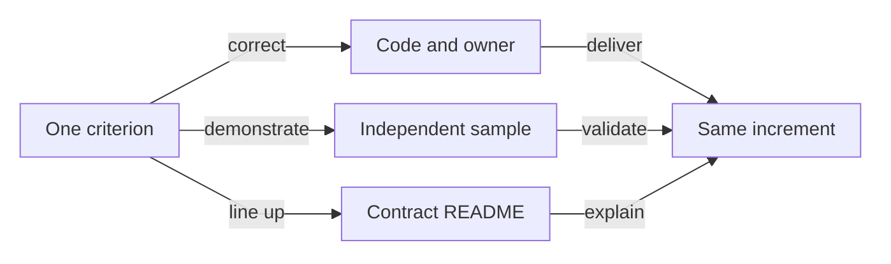

# ATF Reporting - contracts, responsibilities and training JAR

## At a glance

Reporting holds neutral publication, safe summary, typed query and projection of the terminal cause. Isolated source and physical JAR have separate gates in [Reporting Tests](../../atf-reporting-tests/README.md#gate-ul-bibliotecii-distribuite).

- The preparation for the release keeps separate criteria: API sustained,
  The `lib` guide has executable evidence on JAR; expectations, endpoints, business selection and capture Playwright remain with their owners.
- Reporting Tests remains internal mode of verification. Each increment closes
  together the code, the ownership. the sample and the documentation.

[The autonomy contract](../ATF_Inline_Audit_Contract.md#profilul-fără-referințe-externe) describes the inspector's qualification; the collection and delivery of Android remains at the consumer.

## Remaining criteria for consolidation

| Order | Implementation and closing sample | Owner of the Oracle |
|---:|---|---|
| 1 | ports declare their capabilities and their sustained compatibility; no evidence required disappears in a default without effect | JAR consumer and neutral contracts |
| 2 | the flower keeps owner, causes, timing and ordinary forward / over phases | Semantic comparison, Extent / fallback and negative controls |
| 3 | distribution declares API and the Java / supported vendor matrix | release gates and [Reporting Tests](ATF_Reporting_Tests_Feedback.md) |
| 4 | profile can declare and check UI screenshot with owner and explicit action | source / JAR, Extent / fallback and negative controls |

The refused builder releases the publication, and the renderer lifecycle is at [contract of the session](../../atf-reporting/README.md#publicare-și-ieșire). Assesses respect the executive inventory; these samples do not automatically close the external release.

Each extraction retains the facade and the compatibility required for real callers. Justify the reason for the change and the independent sample; a new class or a moving package does not constitute an improvement of architecture alone.

## REPORT-OBSERVATION-CONTRACT - the domain of the artifact validator

**Priority: 72/100** = impact 29 + 20 + Labored 16 + 7 documentation. **Owner:** profile and inspector in Reporting; fixture and controls in Reporting Tests.

- **Existing coverage.** `ReportArtifactProfile` says labels, verdicts
  and the independent observation/assertion inventory without HTTP in Extent and fallback. `ReportArtifactProfileComponentTest` rejects omitted rows, degraded status, moved evidence and an incorrect renderer. [The inspector's contract](../../atf-reporting/README.md#inspecția-artifactului-cu-intenție-explicită)
- **PNG references.** `ReportArtifactResources` and `ScreenshotReferenceComponentTest`
  check canon references and octets. Binding the catch to the independent intent of a scenario remains open.
- **Lacuna.** for `uiValidation` with `AtfUiEvidenceSource.OBSERVE`, profile
  must declare the action, the owner, the caption and identity of PNG. The inspector must confront the catch with the stated step, in a browser-free test, HTTP or Android.

- Extend the profile with a printed UI proof only if it keeps the inventory
  independent of HTML and explicitly links the action, the owner and the image caption.
- By JAR physical, publish Extent and fallback from a local setup with
  `OBSERVE`, `uiValidation` and PNG controlled; do not invent requests or steps.
- Negative controls remove image, change reference / caption, replace
  PNG bytes either link the catch to another owner; they must be rejected separately. Use two valid PNG catches and change them between two `OBSERVE` actions, keeping the labels and inventory of resources. Check that the diagnosis indicates the affected action and the identity of the expected image.
- Keep existing checks for generic observations, comparisons,
  A new UI rule does not relax the generic contract and does not derive the expectations from the HTML inspected.

**Closure:** intended PNG is independent of the ratio and JAR inspects the same UI evidence in both renderers and refuses each mutant.

## Order of preparation

The audit of the source structure belongs to the manufacturer's building. Runtime samples and external Maven consumption check the same library as JAR; the contracts delivered are to their owners and the register only keeps the criteria still open.

- The following provisions are decided by the following increment.
  [THEIR OWNERS](#contracte-existente)-related; a focused gate does not automatically close the API compatibility or prepare the entire release.
- The score is priority: impact / 40 + lacuna / 30 + actionability / 20 + debt
  Documentary / 10. It is not a module note or a percentage coverage.

| ID | Score / 100 | Closure blocking criterion |
|---|---:|---|
| [REPORT-SQL-STEPS-116](#report-sql-steps-116--query-uri-și-rezultate-auditabile) | 88 = 35 + 26 + 18 + 9 | neutral SQL steps, query / binds and results with independent budgets; adoption of J2 after release |
| [REPORT-UI-ASSERTION-FULL-EVIDENCE-133](ATF_Android_UI_Reporting_Feedback.md#report-ui-assertion-full-evidence-133--valori-lungi-capturate-înainte-de-preview) | 88 — existing criterion | full UI values captured before caller preview; source/JAR owner and redaction proof remain separate |
| `REPORT-PUBLIC-API-43` | 81 = 31 + 24 + 17 + 9 | API supported, compatibility and adaptor capabilities are not sufficiently delimited |
| [Reporting Tests](ATF_Reporting_Tests_Feedback.md#report-test-audit-60--o-dovadă-identificabilă-pentru-fiecare-scenariu) | 80 = 31 + 24 + 18 + 7 | separate criterion of consumption: oracle per scenario and container fallback |
| `REPORT-RELEASE-CONTRACT-45` | 73 = 25 + 22 + 17 + 9 | Runtime / vendor matrix, repeater and external metadata are not yet a complete policy |
| `REPORT-OBSERVATION-CONTRACT` | 72 = 29 + 20 + 16 + 7 | profile declares generic observations, but not UI validation with screen shot and identity PNG |
| [REPORT-FALLBACK-RESULT-WIDTH-101](#report-fallback-result-width-101--regresie-geometrică-pentru-badge) | 64 = 24 + 19 + 15 + 6 | Absence of a geometric oracle of WARNING badge in RESULT cell |
| `REPORT-FLOW-PROJECTION-36` | 62 = 24 + 17 + 16 + 5 | the calculation of the projection and publication protocol remain mixed |
| [REPORT-DISTRIBUTION-METADATA-140](#report-distribution-metadata-140--bind-optional-adoption-paths) | P2; unscored | permanent negative for stale optional consumerDistribution paths; current bytes are already correct |
| [REPORT-COMPONENT-FRAGMENTS](#report-component-fragments--costul-multor-corpuri-mici) | P2 | neutral measurement for many small bodies with complete evidence inventory |

<strong>Legend - joint closure of code and documentation</strong>

- Observed rule and owner decide to refactor; number of classes or lines
  Not a reason enough for a helper times the new way.
- The sample refuses previous behavior and consumes API or actual artifact.
  README describes only the demonstrated result with the limits kept.
- A criterion closes after the reconciliation of the three branches.
  Moves to the owner and testing control in baseline; feedback only retains backups.

## REPORT-PUBLIC-API-43 - sustained area and ownership

**Priority: 81/100** = impact 31 + 24 + Laboble 17 + 9 documentation. **Owner:** facades `AtfReportPorts`, `ExtentReportSession`, `HtmlReportSession`, `UiExtentReportSession`, public models and adapters.

Java `public` access also includes implementation: `ReportAssetComposer`, `ReportPublicationScope`, `ExtentReportTree` and the Spark timestamp adapter. The whole Namespace cannot automatically become a promise of compatibility.

- `AtfReportPorts` refers to `ReportNetworkInspector.JourneyAggregate`, while
  Projective inspector uses the assertions contracts. Boundary model remains linked to the class that calculates the summary.
- `Object` / reflection compatibility and numerous UI overloads are
  retained in production. Their change requires the inventory of callers, including the Shop / AutoEx hand; extraction does not authorise the deletion of these decks.
- Some optional ports have default implementation without effect. An adapter
  external needs to know what evidence is being borne prior to publication.
- `ReportAuditSnapshot.Failures` has five components for causes and scenarios
  Distinguishing. Legacy builder and binary symbols are kept; a four-component Java pattern record requires adaptation to repetition, tested separately with `javac`. Explicate the evolution of records in supported API.

**Same increment:**

- [ ] Distinguish sustained inputs, public models, extensions, legacy bridges
      and internal implementation. Inventory real uses before narrowing visibility or moving packages; keep the necessary decks.
- [ ] Evaluate the separation of neutral models from their calculation and use
      `UiExtentReportOptions` as a coherent input with old delegation overloads. Do not create classes or modules only to reduce the size of files.
- [ ] Set explicit capabilities and refusals for adapters: timing,
      Assertion- step, screenshot, UI action, execution, aggregate and nested request. The sample distinguishes the evidence published by explicit refusal of a mandatory capability.
- [ ] Automatise the compatibility of the supported area and the policy of the versions.
      The external consumption and binary comparison of the increment exist; they do not automatically declare support for each public Java class.
- [ ] Set a signed, automatically readable contract for symbols
      supported, compatibility decks and mandatory capabilities. On the JAR / POM previous and candidate pairs, run separately the already compiled caller and its recompilation. A supported overload removed and an adapter that accepts a mandatory capability without publishing the proof must fail explicitly. A replaced internal symbol without sustained caller remains positive control. Confront the verdict with HTML produced through public ports. [Ports](../../atf-reporting/src/main/java/atf/reporting/contract/AtfReportPorts.java)

## REPORT-RELEASE-CONTRACT-45 - what contains and what promises the package

**Priority: 73/100** = impact 25 + 22 + Laboble 17 + 9 documentation. **Owner:** [POM Reporting](../../atf-reporting/pom.xml), the asset manifest and release process.

JAR inspected contains the production classes and all CSS / JS resources in the finished manifest; the loader reads them from the classSPath. No lack of asset is demonstrated in the current artifact and we do not propose moving them to Java or in a new module.

- POM fixes compiler / Surefire / JAR, archive timestamp and dependencies
  direct, including FreeMarker. Sources / JavaDoc and license metadata / SCM require yet another explicit decision for external distribution.
- The Timestamp Adapter reads an internal Spark template. Compatibility
  Extent must be followed; the mackerel refuses to express the changed vendor.

The library inventory verifies JAR / POM distributed, hash and provenance; the executable guide probes the binary consumer.Evidence of the current package, indicated in [provenance of consumption](../../../atf_j1/library-provenance.json), records two clean buildings with the same JAR / POM. It remains the automatic operator maintained at the owner and the explicit compatibility policy and metadata.

**Same increment:**

- [ ] Declare Java / vendor matrix and sustained version policy. POM
      current declares Java 21, JAR thin and direct dependencies; compatibility for each runtime / vendor must have its own sample.
- [ ] Automated to the owner a removable gate release: two clean buildings
      The operator maintained in the owner shall resume the native and source samples / JAR and verify the built-in POM and the identity of the entries, independently of the TMP scripts.
- [ ] When restarting the package qualification, check the identity of the toolchain and
      The components refuse the receipt produced with another runtime or other classpath and accept the same evidence being moved between two external directors.[Relocation check](../ATF_Build_And_Execution_Safety.md)
- [ ] Decide the Sources / JavaDoc distribution and SCM metadata / license without a
      deduct a license; solve POM published in an external consumer before promoting the version.

The consumer guide is delivered in `lib` and verified by `ReportingLibraryGuideIT` on JAR physically, in a standstill without Core, Kit or manufacturer's source. The installation, examples and preview of 240 have a contract in [README for use](../../lib/README.Reporting.md); detailed internal documentation remains at the owner in J0.

The distribution gate checks Extent and fallback evidence after the move and refuses the missing report, HTML replaced and the receipt from another run. The historical verdict remains separate from the status of the check. [Contract and permanent evidence](../../atf-reporting-tests/README.md#receipt-portabil-pentru-dovezile-publicării)

## REPORT-FLOW-PROJECTION-36 - separate evidence plan for publication

**Priority: 62/100** = impact 24 + gap 17 + feasibility 16 + documentation 5. **Owner:** Reporting; neutral oracles and browser checks remain in Reporting Tests.

`ApiEvidencePublisher` extraction and case preservation are delivered. `UiEvidencePublisher.publishUnifiedFlow(...)` and `publishCrossPhaseUnifiedFlow(...)` still bring together the selection of sentence, compaction, aggregation of UI / API verdicts, selection of catch and opening / closing of publication ports.

| Reason for change | Boundary to keep |
|---|---|
| Change in checkpoints | pure transformation over typed inputs with orders and identity retained |
| Screenshot / compact UI-only policy | explicit Reporting decision; no new catch on renderer |
| Failure la body/complete/close | publication over existing ports, with the same cause and without repetition |

- [ ] Features independently the projection result for a phase and over
      Phase UI / API / UI + API, compact and non-compact. Keep source phase, title, ownership.verdict, order of comparison and original capture.
- [ ] Withdraw only the calculation that can be tested without ports, HTML times
      browser, if this effectively separates the reasons for change. The facade remains stable; do not enter a public API, a module or a class only to reduce the number of lines.
- [ ] Publication consumes typed result and reuses the API Publisher and
      the protocol of the scopes; do not remake the decision from the compact text and do not change the preservation of the causes to simplify the loop.
- `UiCrossPhaseCompactFlowComponentTest` regressions,
  `ExtentUnifiedFlowMultipleScreenshotTest` and `UiPublicationFailureComponentTest` already exist and remain protected; they do not close the projection extraction separately.
- [ ] Provoke FAIL / SKIP in an intermediate phase and checkpoints with API without
      UI, not just the final PASS, in both renderere and JAR candidates.
- [ ] Compare Extent / fallback and navigation between the tables on the same snapshot;
      The budget configured, the timing, a single artifact and all accessible expansions remain criteria, including [backlink-ul exact](../../atf-reporting/README.md#revenirea-la-comparația-eșuată).

**Closure:** the grouping policy can be changed and tested separately from port protocol, with identical observable output and without repeated assessments.

[Recovery observations](../../atf-reporting/README.md#decizii-be-fără-verdict-de-succes-implicit) retain INFO separately from assertions and verdict. Deferred IntelliJ acceptance stays with the [consumer owner](../../../atf_j1/docs/feedback/ATF_Reporting_Feedback.md#j1-recovery-runner-trace-2026-11-21); the neutral browser matrix remains an independent [Reporting Tests criterion](ATF_Reporting_Tests_Feedback.md#report-test-audit-60--o-dovadă-identificabilă-pentru-fiecare-scenariu).

## Contract owners

[Reporting](../../atf-reporting/README.md) owns runtime contracts and [Reporting Tests](../../atf-reporting-tests/README.md) owns generic regression procedures. Refactoring preserves those contracts and follows the [resource-owner probe rule](../ATF_Testing_Guide.md#proba-fiecărui-owner-de-resurse); this backlog retains only the remaining criteria.

## REPORT-FALLBACK-RESULT-WIDTH-101 - geometric regression for badge

**Priority: 64/100** = impact 24 + 19 + Laboble 15 + documentation 6. **Owner:** Reporting for layout; Reporting tests for neutral component.

The J7 report retains a historical witness: the RESULT column measured about 56,9 px and the Warning badge 61,8 px, with slight overflow at a 1280 px viewport. Current source has dynamic allocation and browser geometry checks for other families, but the permanent allocation fixture does not publish WARNING in RESULT. The older witness does not establish a defect in current source or JAR.

- [ ] Extend the existing geometry fixture with PASS / FAIL / WARNING and header
      long synthetic; measure stylised content, cell and table in Extent and fallback at normal and narrow width.
- [ ] Refuse a mutant who only restricts RESULT under the badge, with the verdicts
      keep the wrapping, the four columns, the 240 preview and access to the last comparison; do not mask the overflow.

**Closure:** current geometry is demonstrated on both renderers, and the mutant is denied independently of the verdict. No new test class is required if the existing fixture can hold this sample.

<strong>Reproductive consumer - without renderer change</strong>

- Increment TMP atf-j2-media-cd3973d608; media-matrix/fallback-media-warning.html.
- HTML SHA-256: 59cccb14ff23d6fcb659591510e1e982e9a3b315f04a89b799bc2fe0d29f1ed4.
- JAR J7 SHA-256: 569d2babe6b9ec091cb1df6e1207110c611327ea15f1521955e847c837d9eb2a.
- Browser: Tests, four rows; Content- Type JSON has WARNING and the other three PASS.
- DOM measured: RESULT clientWidth 56, scrollWidth 65; badge width 61,8; table width 869,6 and scrollWidth 877.
- The Receipt of values / verdicts passes; it does not certify geometry, which requires regression of dedicated component.

J8 revalidation keeps 101 criterion open: on the medium-warning ratio J2, TAB MCP measured at the Viewport 1280 px RESULT 56,99 px and badge Warning 61,79 px (clientWidth 56, scrollWidth 65) The collapse and verdicts are correct; the neutral geometric regression required remains distinct from the discrete tests.

## REPORT-SQL-STEPS-116 - queries and auditorials

**Priority: 88/100** = impact 35 + gap 26 + feasibility 18 + documentation 9. **Owner:** Reporting own the neutral contract and both renderers; Reporting Tests owns [evidence](ATF_Reporting_Tests_Feedback.md#report-test-sql-steps-116--probe-dedicate-sql). This is a requested increment, without a delivered implementation or JAR version.

J2 now has eight source modules, by explicitly adding the required atf-sql JDK-ally library: template, binds typed, orderly metadata and cells captured from the same execution. The old SqlEffectsSnapshot projection remains separate; the new public adapter for the time being JSON observations without the SQL semantic table.

- AtfReportPorts.Phase does not have a semantic SQL step.
- The typed query already in Reporting describes URI HTTP parameters, not SQL interrogations.

| Responsibility | Contract required |
|---|---|
| consumer JDBC | capture a single execution, query template, orderly and typed binds, schematic and rows before closing resources |
| Reporting | receives immutable facts and publishes the SQL collapse step at the same semantic level as UI / API without conducting queries |
| assertions | Full comparison and verdict remain with the evaluator; same standard area with four columns and default 240 preview |
| distribution | API with explicit capability and documented compatibility; JAR / POM and J2 acceptance after J0 release |

Do not enter H2 / JDBC driver or Eventuate dependencies into Reporting. Do not keep Connection, Statement or ResultSet and do not resume the query, COUNT or comparison to complete the report. Expectees and business policy remain on the consumer.

<strong>Contract of facts and rendering SQL</strong>

- A ID execution connects phase, query, parameters, results, timing and
  the cause; the same titles with different bindings do not allow association by text.
- Query template and bindings are separated; do not build SQL executable by
  interpolation. Binds keep position / name, type, NULL and sensitivity policy; connection is an opaque alias without URL with credentials.
- The scheme is an orderly list of the order, label and type.
  do not become the Map keys that lose columns; the rows retain order and multiplication.
- NULL, null text, empty string, binary and exact numbers are distinct.
  BigDecimal and the whole sea do not pass through Double; the editorial and pretty- print respects [the number contract delivered](../../atf-reporting/src/main/java/atf/reporting/security/README.md).
- Separate failed / cancelled execution, completely empty result, partial capture and
  The total unknown number remains unknown without additional COUNT; a cut result is not shown as zero complete rows.
- A expected SQL error may be a PASS test; the observation does not invent any
  The verdict. Unintercepted failure remains FAIL; the caller and publication do not replace the original cause and do not cause rephrase.
- The explicit timing separates the execution / capture of the publication, keeping the unknown
  Do not close the contract of execution captured by a calculated duration of HTML.
- Query, bindings, Results and Assertions have accessible disclosures and owner
  Extent and fallback keep dynamic columns on the available width, scroll up to the last column / row, Enter / Space and Fails to the original step.
- A legitimate SQL-only profile does not receive fictional HTTP for the inspector;
  J12 explicit profile is declared to call; the legacy call remains strict.

### Configurable budgets for SQL payload

The following values are proposed default for the new contract, not properties already available in J9. Query and results have independent configurations; the 240 limit of the previews of the assertions remains unchanged.

| Budget | Proposed default | Unit and application |
|---|---:|---|
| query | 4.096 | Visible characters for the execution template |
| bind-uri | 2.048 | cumulative visible characters for execution parameters |
| results | 16.384 | cumulative visible characters for the schematic and all the cells of an execution; not per cell |
| payload SQL variable per ratio | 1.048.576 | serialized UTF-16 units for query / bindings / schema / cells / omissions including copies DOM / JSON and escaping; assets and standard identity / verdict metadata are excluded |

- Count the preview in code points Unicode after the editorial and formatting;
  cutting keeps valid graphics / surrogates and does not exceed the chosen limit. The separate serialized budget prevents the amplification by escaping or children DOM.
- Validate configuration prior to publication: whole positive, no overflow,
  value-gap or default deactivation of the ceiling; capture the policy immutably when creating the session. The final names and accepted intervals are API J0.
- Maximum numbers include the marker and omitting indicators in the area
  Tapered. Book valid HTML structure, ID and minimal bound diagnosis; do not cut HTML / JSON serialized in the middle of the tag or value.
- An exhaustion explicitly indicates displayed / original when the original is known,
  How many lines / columns are omitted and the reason. Trunking of catch and presentation remain distinct; the full verdict is not reassessed on preview.
- Cumulative ceiling has deterministic accounting per session and reservation
  prior to serialization, including on competing publication. After exhaustion do not repeat a bulky marker for each step; book a bounded summary for omissions and keep your identity / verdict in standard metadata.
- Prohibiting full payload hidden in script, attributes, DOM, base64 times
  search index. A link to a complete external artifact requires explicit policy, hash and own editorial; no full version is automatically included in HTML.
- Redact before measuring in all channels. Template and Bindars
  be explicitly sensitive to the source; a regex does not certify the deletion of all secret literature from any SQL dialect.

**Closure:** model and public capability, validated limits, Extent and fallback yields and neutral components above pass on source and JAR physical. Publish the compatibility and provenance of the candidate; then J2 captures query / bindings and adopts separately the contract with the actual witness H2. Until then, generic observations remain the delivered behaviour; This application does not certify SQL LIVE.

### SQL producer boundary

The [J2 SQL contract](../../../atf_j2/atf-sql/README.md) owns typed capture and execution identity; Reporting receives a neutral projection without JDBC, H2 or consumer-module dependencies. Preserve the separate SQL budgets above and preview 240; neutral renderer fixtures certify neither saga behavior nor SQL dialects, and J2 adoption requires independent acceptance.

## Diagnostic bound al assertions - criterion separate from verdict

The [safe assertion contract](../../atf-reporting/README.md#proiecția-sigură-a-aserțiunilor) preserves the original verdict and preview 240. A bounded caller value cannot reconstruct a missing suffix; [criterion 133](ATF_Android_UI_Reporting_Feedback.md#report-ui-assertion-full-evidence-133--valori-lungi-capturate-înainte-de-preview) owns the remaining capture/disclosure boundary.

## REPORT-DISTRIBUTION-METADATA-140 — bind optional adoption paths

**Priority: P2. Owner:** Reporting release/provenance in J0; deployment guards remain with their consumers.

The J17 closing audit corrected stale J16 jar/pom paths in the current consumerDistribution objects of J1–J3. Native coordinates, hashes, Maven loading and binary behavior were already correct.

- [ ] Add a permanent negative fixture with valid coordinate/hash and physical
      JAR, but a stale optional consumerDistribution.jar or .pom path.
- [ ] Require those fields, when present, to match the declared flat pair;
      preserve the distinct J4 libraries/files schema and historical records.

The current metadata is corrected; the remaining criterion is guard coverage, without a renderer change, new module or new library version.

## REPORT-COMPONENT-FRAGMENTS - cost of many small bodies

**P2 · owner Reporting.** The consumer holds the partition of the input.

- **Simptom.** Complete J4 aggregation produced `OutOfMemoryError` in `StringWriter`/FreeMarker with a 768 MiB heap. Smaller publications passed.
- **Incoming.** Full text has been divided into many short bodies. The algorithmic cause and complexity remain to be demonstrated.
- **Provenence.** Receipt not locally available at
  `whist_back/maintenance/20261106-component-suite-aggregation/qualified-components/run.json`.

- [ ] Compare the same text and the same claims with small and large parts, on frozen input: characters, body count / nodes, heap, duration and octets HTML. Control separately the technical inventory of sources of mandatory comparison data.
- [ ] Qualify a budget or an explicit refusal prior to memory exhaustion, without eliminating comparisons, changing the verdict or trunking the mandatory values. Do not increase the default 240 preview- to mask the problem.
- [ ] Sharing the hashish manifestation and larger parts are input optimizations of the consumer; they do not prove that the renderer is qualified for any body cardinality. Generic natives and packaging stay here.

[Literal profile labels](../../atf-reporting/README.md#titluri-și-etichete-ale-profilului), [explicit inspection](../../atf-reporting/README.md#inspecția-artifactului-cu-intenție-explicită) and [screenshot return behavior](../ATF_Inline_Audit_Contract.md#full-image-viewer-target) are documented at their owners.
