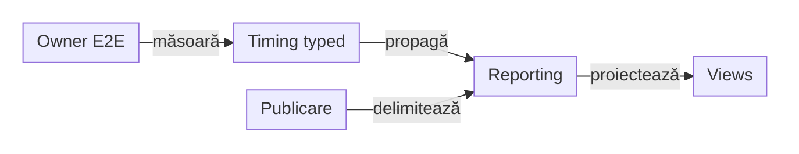

# ATF Reporting — lifecycle și timing E2E

## Pe scurt

Contextul typed, valorile redactate și timing-ul măsurat sunt documentate la
[Reporting](../../atf-reporting/README.md). Consistența verdictului este normată
la owner; rămân atomicitatea tranzițiilor de scope și timing-ul explicit E2E.
Controalele demonstrate aparțin
[baseline-ului](../ATF_Test_Changes_Baseline.md#controale-tehnice-verificate).

## REPORT-SCOPE-ATOMICITY-11 — refuz fără mutație parțială

**Prioritate: 80/100** = impact 32 + lacună 23 + lucrabil 18 + documentare 7.
**Owner:** Reporting pentru tranzițiile publice și modelele celor două renderere;
Reporting Tests pentru probele de compatibilitate.

- La portul fallback, completați un request PASS, apoi încercați `complete(FAIL)`.
  A doua completare aruncă `IllegalStateException`, dar `model.complete(status)`
  rulează înaintea guard-ului semantic. `HtmlReportSession.close()` refuză ulterior
  publicarea cu `Fallback semantic snapshot drift between execution model and recorder`.
- Extent respinge aceeași operație înaintea mutației și poate publica raportul
  inițial PASS. Proba este locală și nu execută transport sau business.
- Guard-ul final fallback funcționează: cazul nu demonstrează publicarea unui
  artifact contradictoriu. Lacuna este refuzul tardiv după mutația parțială.

- [ ] Reutilizați o singură decizie de lifecycle înaintea mutației modelului,
      recorderului și contorilor; nu mascați diferența la `close()` sau în JavaScript.
- [ ] Definiți consecvent `complete` repetat, `close` înainte/după complete și
      închiderea părintelui cu copii deschiși. Un refuz păstrează starea anterioară.
- [ ] Probați porturile publice Extent/fallback, request-uri imbricate, erori de
      publicare și cauza primară; un copil FAIL păstrează politica de verdict separată.
- [ ] Păstrați o singură publicare, scope-ul suitei, plafoanele și totalurile;
      testele acestei regresii aparțin Reporting Tests, cu control exact.

**Închidere:** aceeași operație validă ori respinsă produce aceeași tranziție
și permite publicarea stării valide anterioare, fără rollback în renderer.

## REPORT-E2E-PHASE-TIMING-01 — execuția E2E separată de agregarea dovezilor

**Prioritate: 78/100** = impact 32 + lacună 21 + lucrabil 18 + datorie documentară 7.
**Owner:** Reporting pentru propagarea timing-ului prin fațada UI; runtime-urile
main AutoEx/Shop pentru intervalele business și Reporting Tests pentru randare.

### Dovadă și reproducere

- Purchase UI+API AutoEx și guest UI+API Shop au trecut individual și prin
  suitele canonice filtrate la același caz, cu un singur HTML per lansare.
- Fazele folosesc `data-duration-source="aggregated"`, fără metadata
  `data-atf-execution-duration-ms`. Suma pașilor și proiecțiile sunt coerente,
  dar diferă de intervalul nativ Extent păstrat separat.
- `UiExtentReportSession.UiPhase` nu expune încă `executionTiming(...)`, deși
  portul `AtfReportPorts.Phase` și modelul `ReportPhaseTiming` există pentru componente.
- Assertion-urile, valorile redactate de maximum 240, tastatura și scroll-ul până
  la ultimul rând sunt păstrate; această lacună privește proveniența timpului E2E.

1. În staging nou, lansați `AutoExPurchaseUiApiE2eTest` și `ShopPurchaseE2eTest`
   individual, cu opt-in-urile și datele demo existente.
2. Lansați `AutoExE2eSuite` și `ShopE2eSuite` cu un `PostDiscoveryFilter` limitat
   la `MethodSource` al aceleiași clase; verificați exact un test pornit și un HTML.
3. În TAB MCP, comparați sursa fazei, suma copiilor și durata nativă înainte și
   după expandare, apoi Tests/Category/Overview; timpul procesului rămâne separat.

### Abordare și criteriu de închidere

<strong>Legendă — ținta propusă pentru timing-ul E2E</strong>

- Diagrama descrie cerința rămasă; probele remote nu implementează acest contract.
- Runtime-ul deține intervalul business; Kit rămâne neutru, fără browser sau renderer.
- Reporting propagă aceeași valoare în Extent și fallback, fără sumarea publicării peste execuție.
- Durata HTTP necapturată rămâne necunoscută, independent de timpul fazei.
Etichetele scurte păstrează următorul sens:

| În schemă | Sens complet |
|---|---|
| Owner E2E | Runtime E2E owner |
| Timing typed | Timing typed de fază |
| Views | Tests / Category / Overview |
| Publicare | Publicare și transport |
| măsoară | măsoară monoton |
| propagă | propagă prin fațada UI |
| proiectează | proiectează o dată |
| delimitează | păstrează surse distincte |

- [ ] Propagați timing-ul typed prin `UiPhase` și lifecycle-ul UI, apoi măsurați
      fazele E2E la ownerul runtime; fără a introduce logică de suport în testele business.
- [ ] Delimitați achiziția, execuția business, capturile, publicarea checkpoint-urilor
      și flush-ul final; explicați separat costurile incluse și excluse.
- [ ] Probați cu ceas controlat succesul, FAIL, abortul, setup-ul incomplet și
      teardown-ul eșuat; zero măsurat și timpul necunoscut rămân distincte.
- [ ] Verificați Extent/fallback și proiecțiile fără dublare, individual și prin
      suită, inclusiv redeschiderea cu tastatura și izolarea scenariilor-surori.
- [ ] Păstrați raportul unic, assertion-urile și plafonul 240; nu înlocuiți timing-ul
      componentelor sau durata HTTP cu timpul total al procesului ori al publicării.

O suită filtrată la un caz probează ruta de lansare și ownerul artifactului;
nu certifică interacțiunile dintre toate clasele suitei sau echivalența profilelor UI-only.
