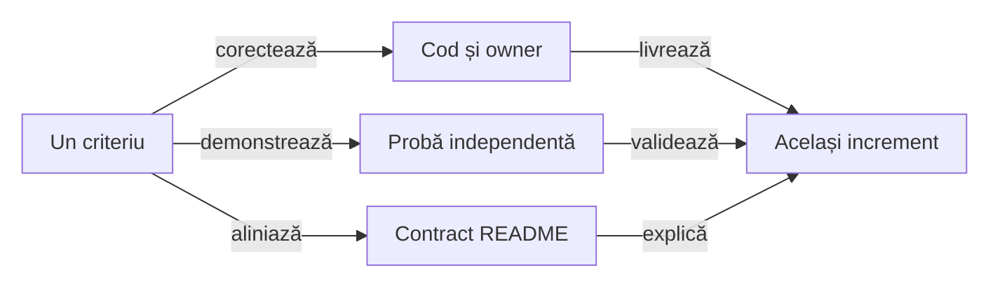

# ATF Reporting — contracte, responsabilități și pregătire JAR

## Pe scurt

Reporting deține publicarea neutră, sumarul sigur, query-ul typed și proiecția
cauzei terminale. Sursa izolată și JAR-ul fizic au gate separat în
[Reporting Tests](../../atf-reporting-tests/README.md#gate-ul-bibliotecii-distribuite).

- Pregătirea pentru release păstrează criterii distincte: API susținut,
  lifecycle, distribuție și documentație portabilă. Expected-urile, endpoint-urile,
  selecția business și captura Playwright rămân la ownerii lor.
- Reporting Tests rămâne modul intern de verificare. Fiecare increment închide
  împreună codul, ownership-ul, proba și documentația.

## Ordinea pregătirii

Incrementul JAR în lucru repară refuzul constructorului, bugetul assets și
regresiile reproduse. Auditul structurii sursei rămâne la build-ul producătorului;
probele runtime și consumerul Maven extern verifică aceeași bibliotecă și ca JAR.
Niciun test nu este dezactivat, iar pragurile de layout și preview rămân în vigoare.

<details>
<summary><strong>Control YAML — lifecycle și gate-uri sursă/JAR</strong></summary>

```yaml
testChanges:
  - id: REPORT-JAR-QUALITY-54
    status: ACTIVE
    base: addd434eaeec7a67fa58eb85256b843ae30c3db5
    expires: 2026-11-13
    reason: Cerinta explicita de a corecta Reporting si Reporting Tests la producator si a sincroniza consumerul binar. Pastreaza toate oracolele; auditul sursei se executa nativ la producator, iar runtime-ul si consumerul Maven folosesc JAR-ul real. Repara refuzul constructorului, selectia dovezii si fixture-urile fara relaxarea pragurilor sau excluderea testelor.
    proof: mvn -B -pl atf-reporting-tests,atf-tests -am "-Dtest=AtfReportingUnitSuite,AtfReportingComponentSuite,AtfReportingIntegrationSuite,WholeAtfGovernanceSuiteTest" "-Datf.governance.testChanges.baseRef=addd434eaeec7a67fa58eb85256b843ae30c3db5" "-Dsurefire.failIfNoSpecifiedTests=false" test
    paths:
      - atf-reporting-tests/src/test/java/atf/ui/tests/extent/README.md
      - atf-reporting-tests/src/test/java/atf/ui/tests/extent/support/locators/table/PublishedEvidenceTableLocators.java
      - atf-reporting-tests/src/test/java/atf/reporting/ui/audit/section/FailsSectionValidatorTest.java
      - atf-reporting-tests/src/test/java/atf/ui/tests/extent/support/section/extract/ApiReportStructureExtractor.java
      - atf-reporting-tests/src/test/java/atf/ui/tests/extent/support/inspection/failure/FailureFlowInspector.java
      - atf-reporting-tests/src/test/java/atf/ui/tests/extent/support/locators/failurenavigation/FailureJourneyLocators.java
      - atf-reporting-tests/src/test/java/atf/ui/tests/extent/support/section/module/FailsSectionAuditModule.java
      - atf-reporting-tests/src/test/java/atf/ui/tests/extent/component/layout/EvidenceTableVisibilityComponentTest.java
      - atf-reporting-tests/src/test/java/atf/reporting/support/navigation/FailureLinkIdentity.java
      - atf-reporting-tests/src/test/java/atf/reporting/support/navigation/FailureLinkIdentityTest.java
      - atf-reporting-tests/src/test/java/atf/ui/tests/extent/support/inspection/reconciliation/UiApiVerdictProjectionProbe.java
      - atf-reporting/pom.xml
      - atf-reporting-tests/src/test/java/atf/ui/tests/extent/support/locators/diagnostic/ReportPhaseAuditLocators.java
      - atf-reporting-tests/src/test/java/atf/reporting/extent/session/ExtentReportConstructionComponentTest.java
      - atf-reporting-tests/src/test/java/atf/reporting/runtime/core/ExtentReportRuntimeModuleTest.java
      - atf-reporting-tests/src/test/java/atf/reporting/runtime/core/ExtentReportDurationRuntimeComponentTest.java
      - atf-reporting-tests/src/test/java/atf/reporting/theme/css/AtfReportThemeCompositionTest.java
      - atf-reporting-tests/src/test/java/atf/reporting/ui/UiExtentReportSessionCompositionTest.java
      - atf-reporting/src/test/java/atf/reporting/standalone/ReportingSourceArchitectureTest.java
      - atf-reporting/src/test/java/atf/reporting/standalone/ReportingModuleSource.java
      - atf-reporting/src/test/java/atf/reporting/standalone/ReportingStandaloneDependencyTest.java
      - atf-reporting-tests/src/test/java/atf/ui/tests/extent/component/section/architecture/DomInspectorMigrationBoundaryTest.java
      - atf-reporting-tests/src/test/java/atf/reporting/distribution/ReportingDistributionProbe.java
      - atf-reporting-tests/src/test/java/atf/reporting/distribution/ReportingLibraryDistributionIntegrationTest.java
      - atf-reporting-tests/src/test/resources/atf/reporting/distribution/JarConsumer.java.txt
      - atf-reporting-tests/src/test/java/atf/ui/tests/extent/support/config/ReportingTestResources.java
      - atf-reporting-tests/src/test/java/atf/ui/tests/extent/support/config/AtfUiConfigurationLoaderTest.java
      - atf-reporting-tests/src/test/java/atf/ui/tests/extent/component/support/ReportingTestResourcesIdeLaunchTest.java
      - atf-reporting-tests/src/test/java/atf/reporting/extent/session/ExtentReportFailureProjectionContractTest.java
      - atf-reporting-tests/src/test/java/atf/reporting/runtime/core/ExtentReportRuntimeScriptTest.java
      - atf-reporting-tests/src/test/java/atf/reporting/runtime/section/ExtentReportRuntimeNavigationComponentTest.java
      - atf-reporting-tests/src/test/java/atf/reporting/ui/UiFallbackFailureEvidenceTest.java
      - atf-reporting-tests/src/test/java/atf/reporting/ui/ExtentReportUiScreenshotContractTest.java
      - atf-reporting-tests/src/test/java/atf/ui/tests/extent/support/inspection/reconciliation/UiFailureCorrelationProbe.java
      - atf-reporting-tests/src/test/java/atf/ui/tests/extent/support/inspection/diagnostic/ReportPhaseAuditProbe.java
      - atf-reporting-tests/src/test/java/atf/ui/tests/extent/component/timing/ComponentExecutionDiagnosticReportTest.java
      - atf-reporting-tests/src/test/java/atf/ui/tests/extent/support/locators/verdict/VerdictReportLocators.java
```

</details>


- Restanțele de mai jos decid următorul increment. Contractele livrate sunt
  legate la [ownerii lor](#contracte-existente); un gate focalizat nu închide
  automat compatibilitatea API sau pregătirea întregului release.
- Scorul este prioritate: impact /40 + lacună /30 + lucrabil /20 + datorie
  documentară /10. Nu este o notă a modulului ori un procent de acoperire.

| ID | Scor /100 | Criteriul care blochează închiderea |
|---|---:|---|
| `REPORT-SESSION-CONTRACT-44` | 86 = 33 + 26 + 19 + 8 | constructorul refuzat lasă un workspace cu lease activ; lifecycle-ul rendererelor cere contract explicit |
| `REPORT-TEST-ORACLES-47` | 83 = 34 + 26 + 16 + 7 | restanțe de oracole pentru diagnostice/screenshot și containment-ul navigării fallback |
| `REPORT-PUBLIC-API-43` | 81 = 31 + 24 + 17 + 9 | API-ul susținut, compatibilitatea și capabilitățile adaptoarelor nu sunt delimitate suficient |
| `REPORT-RELEASE-CONTRACT-45` | 73 = 25 + 22 + 17 + 9 | lipsesc criteriile declarate ale pachetului și versiunii distribuite |
| `REPORT-PORTABLE-DOCS-46` | 72 = 24 + 22 + 17 + 9 | contractele și linkurile README depind încă de documente din afara modulului |
| `REPORT-FLOW-PROJECTION-36` | 62 = 24 + 17 + 16 + 5 | calculul proiecției și protocolul publicării rămân amestecate |



<details>
<summary><strong>Legendă — închiderea comună a codului și documentației</strong></summary>

- Regula observabilă și ownerul decid refactorizarea; numărul de clase sau linii
  nu este un motiv suficient pentru un helper ori modul nou.
- Proba refuză comportamentul anterior și consumă API-ul ori artefactul real.
  README-ul descrie numai rezultatul demonstrat, cu limitele păstrate.
- Un criteriu se închide după reconcilierea celor trei ramuri. Contractul stabil
  se mută la owner, iar controlul testelor în baseline; feedback-ul păstrează numai restanțele.

</details>

## REPORT-TEST-ORACLES-47 — contract observabil în locul formei funcției

**Prioritate: 83/100** = impact 34 + lacună 26 + lucrabil 16 + documentare 7.
**Owner:** probele de compoziție și browser din Reporting Tests.

Contractul artifactului verifică markerii publici typed și navigarea, nu corpul
unei funcții JavaScript. Parsarea backlink-ului păstrează scenariul indiferent
de parametrii suplimentari; locatorii expliciți rămân la ownerul lor.

- `ExtentReportSessionContractTest`, `ReportUiLocatorsTest` și
  `UiApiVerdictProjectionComponentTest` verifică markerii și identitatea.
- `PublishedFailureNavigationComponentTest` și `PublishedFailureNavigationEdgeComponentTest`
  protejează navigarea. Controlul negativ ascunde dovada originală;
  reload trebuie să o facă accesibilă.

| Restanță delimitată | Probă de închidere |
|---|---|
| diagnostice, screenshot și verdict | reconciliați separat cazurile pentru owner `component`/`execution`, refuzul multi-screenshot și selectorii ambigui; clasificați fiecare defect de implementare sau oracol |
| refuzul screenshot-ului multiplu | `ExtentReportUiScreenshotContractTest` adaugă a doua captură distinctă înaintea `assertThrows`; `ExtentRequestScope.screenshot` validează imediat candidatul, astfel refuzul scapă oracolului plasat la `complete` |
| diagnosticul componentei | `ComponentExecutionDiagnosticReportTest` așteaptă owner `component`, iar indexul publică `execution`; reconciliați regula cu natura cauzei, fără redenumire pentru verde |
| două diagnostice cu aceeași etichetă | după setup AutoEx și refuzul cleanup-ului owned, `Fails` distinge cauzele și publică `failure-ordinal=2`, dar `Open in Tests` expandează prima eroare, lăsând cleanup-ul colapsat. Reprodus în Extent UI_API cu două grupuri `Failure evidence` / `Failure cause`; expandarea manuală păstrează diagnosticul corect. Proba de închidere selectează al doilea diagnostic, verifică exact cauza și grupul deschis, apoi reload și sensul invers; fără rezolvare numai după titlul comun |
| root-ul fixture-urilor în consumer binar | `ReportingTestResources` cere POM-ul producției Reporting; resursele testelor trebuie să identifice modulul lor fără sursa bibliotecii |
| backlink-ul timeout-ului UI fallback | `UiFallbackFailureEvidenceTest` cere `href="#<scenarioId>"`, dar artifactul publică `#test-id=<id>&failure-ordinal=1`; auditul TAB ajunge la scenariul, faza și comparația corecte. Înlocuiți oracolul literal cu identitatea parsată și proba de navigare, păstrând controalele negative pentru scenariu străin și parametri suplimentari |
| starea asincronă după backlink | așteptați bounded scenariul țintă deschis; vizibilitatea tabului Tests singură nu dovedește finalizarea navigării |
| fallback cu titlu lung | eticheta `repeat-520 — controlled FAIL with one native pointer activation` depășește sidebar-ul la 1280; verificați containment-ul și accesul real |

- [ ] Probați fallback cu titlu lung, text fără spații și scenarii surori la 1280
      și într-un panou îngust. Păstrați identitatea și tastatura, fără suprapunere
      peste articol sau înlocuirea măsurătorii browser printr-un control CSS.
- [ ] Păstrați ownerul UI/API, toate cauzele și dovada originală. Comparațiile
      nu se elimină pentru a obține verde; expected-ul rămâne independent.
- [ ] Reexecutați suitele canonice pentru inventarul rezidual înaintea închiderii.
      Gate-ul focalizat nu certifică toate testele de diagnostic și screenshot;
      rezultatele și logurile datate rămân în TMP, nu devin contract README.
- [ ] Separați probele care inspectează sursa producătorului de regresiile
      runtime ale JAR-ului. Păstrați comparațiile și verificați CodeSource-ul;
      consumerul nu aduce sursa Reporting numai pentru a satisface un fixture.
<details>
<summary><strong>Control YAML — reconcilierea navigării existente în live</strong></summary>

```yaml
testChanges:
  - id: REPORT-NAVIGATION-RECONCILIATION-47
    status: ACTIVE
    base: ddba3dee4dd4ecd544a8b1c22d31bae226eed5cf
    expires: 2026-11-13
    reason: Urmareste diferenta fata de baza proprie pentru navigarea typed si diagnostice. Markerii publici, parsarea backlink-ului si locatorii expliciti protejeaza identitatea dovezii; criteriul 47 pastreaza separat diagnosticele, multi-screenshot si containment-ul fallback inca nedemonstrate complet.
    proof: mvn -B -pl atf-reporting-tests,atf-tests -am "-Dtest=PublishedFailureNavigationComponentTest,PublishedFailureNavigationEdgeComponentTest,ReportUiLocatorsTest,ExtentReportSessionContractTest,WholeAtfGovernanceSuiteTest,DocumentationAnchorGovernanceTest" "-Datf.governance.testChanges.baseRef=ddba3dee4dd4ecd544a8b1c22d31bae226eed5cf" "-Dsurefire.failIfNoSpecifiedTests=false" test
    paths:
      - atf-reporting-tests/src/test/java/atf/reporting/support/failurecorrelation/FailureNavigationFixture.java
      - atf-reporting-tests/src/test/java/atf/ui/tests/extent/support/locators/failurenavigation/FailureNavigationLocators.java
      - atf-reporting-tests/src/test/java/atf/ui/tests/extent/component/failurecontext/PublishedFailureNavigationEdgeComponentTest.java
      - atf-reporting-tests/src/test/java/atf/ui/tests/extent/support/inspection/failurenavigation/FailureNavigationEdgeProbe.java
```

</details>

## REPORT-PUBLIC-API-43 — suprafață susținută și ownership

**Prioritate: 81/100** = impact 31 + lacună 24 + lucrabil 17 + documentare 9.
**Owner:** fațadele `AtfReportPorts`, `ExtentReportSession`, `HtmlReportSession`,
`UiExtentReportSession`, modelele și adaptoarele publice.

Accesul Java `public` include și implementare: `ReportAssetComposer`,
`ReportPublicationScope`, `ExtentReportTree` și adaptorul timestamp Spark.
Namespace-ul întreg nu poate deveni automat o promisiune de compatibilitate.

- `AtfReportPorts` referă `ReportNetworkInspector.JourneyAggregate`, în timp ce
  inspectorul de proiecție folosește contractele de assertions. Modelul de
  boundary rămâne legat de clasa care calculează sumarul.
- Compatibilitatea `Object`/reflection și numeroasele overload-uri UI sunt
  păstrate în producție. Schimbarea lor cere inventarul apelanților, inclusiv
  main-ul Shop/AutoEx; extragerea nu autorizează ștergerea acestor punți.
- Unele porturi opționale au implementări implicite fără efect. Un adaptor
  extern are nevoie să știe ce evidence este suportat înaintea publicării.

**Același increment:**

- [ ] Delimitați intrări susținute, modele publice, extensii, bridge-uri legacy
      și implementare internă. Inventariați folosirile reale înainte de restrângerea
      vizibilității ori mutarea pachetelor; păstrați punțile necesare.
- [ ] Evaluați separarea modelelor neutre de calculul lor și folosirea
      `UiExtentReportOptions` ca intrare coerentă, cu overload-uri vechi delegante.
      Nu creați clase sau module numai pentru a reduce dimensiunea fișierelor.
- [ ] Stabiliți capabilități și refuzuri explicite pentru adaptoare: timing,
      assertion-step, screenshot, aggregate și nested request. Compatibilitatea
      nu justifică o dovadă cerută și pierdută fără diagnostic.
- [ ] Adăugați verificare source/binary pentru suprafața declarată și un consumer
      extern de referință. Update-ul API-ului, exemplelor și politicii de versiune
      trebuie să aparțină aceleiași revizii.

## REPORT-SESSION-CONTRACT-44 — lifecycle explicit pentru fiecare renderer

**Prioritate: 86/100** = impact 33 + lacună 26 + lucrabil 19 + documentare 8.
**Owner:** [AtfReportPorts.Session](../../atf-reporting/src/main/java/atf/reporting/contract/AtfReportPorts.java),
`ExtentReportSession` și `HtmlReportSession`.

Proba Java consumă JAR-ul izolat, cu runtime-ul său Maven. Constructorul Extent
cu `detailsMode=null` aruncă `NullPointerException` după achiziția publicației;
workspace-ul rămas are încă lease-ul blocat în același proces.

| Boundary observat | Rezultat | Cerință |
|---|---|---|
| argument refuzat la constructor | director și lease active după excepție | validare înaintea I/O și rollback al achiziției parțiale |
| `flush()` cu raport anterior | Extent păstrează anteriorul; fallback îl înlocuiește | moment de publicare declarat per renderer |
| acces secvențial din alt thread | Extent refuză; fallback acceptă | confinement ori sincronizare explicite |

După `flush()`, proba JAR nu găsește fișierul final Extent, dar găsește fallback-ul;
după `close()`, ambele există. Extent folosește workspace și publicare coordonată,
iar fallback scrie direct destinația. Este o diferență observată, nu o reproducere
de pierdere a datelor sau motiv pentru a declara identice cele două renderere.

- Extent normalizează path-ul și verifică thread-ul owner; fallback păstrează
  path-ul primit și nu are același guard. Portul comun nu explică aceste limite.
- Sesiunile neutralizează deja `RuntimeException` din sink-ul diagnostic;
  controlul extern confirmă că acel sink nu oprește pornirea scenariului.

**Același increment:**

- [ ] Validați toate argumentele înaintea achiziției. Dacă inițializarea
      vendorului, assets sau arborelui eșuează ulterior, eliberați publicația
      deja deținută și păstrați cauza primară, inclusiv pentru `Error`.
- [ ] Probați constructor refuzat înainte/după achiziție, asset lipsă și
      refuz de cleanup. Workspace-ul nu rămâne cu lease activ, iar raportul
      anterior este păstrat; succesul transferă ownership-ul exact o dată.
- [ ] Declarați semantica `flush`, commit/publicare, `close` repetat, path și
      threading. Alegeți conștient ce este comun și ce rămâne specific rendererului.
- [ ] Dacă se aliniază publicarea fallback, reutilizați protocolul de staging și
      ownership existent numai după probe; fără schimbarea verdictului ori ștergerea
      unui raport anterior la eșecul publicării noi.
- [ ] Probați raport anterior existent, I/O eșuat, close repetat, publicare atomică
      disponibilă/indisponibilă, cauza primară și notificarea diagnostică.
- [ ] Documentați contractul la [publicare](../../atf-reporting/README.md#publicare-și-ieșire)
      și în JavaDoc-ul portului; exemplul de adopție trebuie să aștepte artifactul corect.

## REPORT-RELEASE-CONTRACT-45 — ce conține și ce promite pachetul

**Prioritate: 73/100** = impact 25 + lacună 22 + lucrabil 17 + documentare 9.
**Owner:** [POM Reporting](../../atf-reporting/pom.xml), manifestul de assets și procesul de release.

JAR-ul inspectat conține clasele de producție și toate cele 54 resurse CSS/JS;
loaderul le citește din classpath. Nu este demonstrată o lipsă de asset în
artefactul curent și nu propunem mutarea lor în Java sau într-un modul nou.

- POM-ul fixează compiler/Surefire și dependențele directe, dar nu declară
  explicit versiunea pluginului JAR, artefacte sources/JavaDoc sau metadate
  de licență/SCM ale proiectului. Acestea cer un contract de distribuție decis.
- Adaptorul timestamp citește un template intern Spark și folosește FreeMarker
  tranzitiv. Compatibilitatea Extent și această dependență efectivă trebuie
  urmărite explicit; macro-ul are deja refuz dacă expresia a fost schimbată.

Două build-uri forțate `clean package` cu aceleași surse și aceeași toolchain
au produs bytes identici. Restanța privește toolchain-ul declarat și gate-ul
automat de release, împreună cu metadatele și dependențele efectiv susținute.

`ReportAssetSizeInventoryTest` deține pragurile executabile și inventarul
nativ/publicat. Recalculați depășirile din resursele sursei și ale JAR-ului
curente; numerele unei rulări anterioare nu sunt baseline normativ. Verificați
identitatea resurselor înainte de a clasifica o diferență drept oracol învechit.

- [ ] Reduceți depășirea la ownerul compoziției, păstrând toate suprafețele,
      navigarea typed și oracolele browser. Pragurile nu cresc automat pentru
      a accepta incrementul; orice reevaluare cere motiv și măsurare independente.

**Același increment:**

- [ ] Definiți Java minim, versiuni susținute, JAR thin/POM, politica pentru
      dependențe directe efectiv folosite și compatibilitatea vendorului.
- [ ] Stabiliți pluginurile release, versionarea, provenance și criteriul de
      reproductibilitate pentru două build-uri forțate, fără a confunda un JAR
      rămas up-to-date cu un al doilea build independent.
- [ ] Verificați conținutul JAR/POM, inventarul assets, lipsa testelor/dependențelor
      ATF din runtime și rezolvarea externă. Decideți sursele/JavaDoc și metadatele
      de distribuție înainte de publicare; fără alegere implicită a licenței proiectului.
- [ ] Documentați instalarea/consumul real și diagnosticul unei incompatibilități
      de runtime ori vendor; `mvn package` verde rămâne doar o parte a acceptanței.

## REPORT-PORTABLE-DOCS-46 — adopție externă și documente transportabile

**Prioritate: 72/100** = impact 24 + lacună 22 + lucrabil 17 + documentare 9.
**Owner:** README Reporting și contractele de raportare din documentația proiectului.

README-ul are linkuri relative spre directoare părinte, inclusiv contracte
normative din `../docs`. Copierea numai
a modulului păstrează codul, dar nu transportă acei owneri documentari.

- Exemplul minim JAR din README este acum compilat și executat extern, cu un
  control PASS și unul FAIL; nu închide migrarea tuturor contractelor.
- [Atlasul pachetelor](../../atf-reporting/src/main/java/atf/reporting/README.md)
  oferă context local pentru UI, API, modele, renderere, evidence și runtime.
  Linkurile sale către probele interne nu reprezintă încă un pachet documentar de release.
- [Contextul portabil](../../atf-reporting/docs/README.md) are numai destinații
  interne modulului și explică separat sursa izolată, JAR-ul thin, POM-ul și
  autonomia HTML. Această intrare este pregătită; portabilitatea tuturor
  README-urilor și includerea în distribuție rămân deschise.
- Inventarul tehnic și instrucțiunile contribuitorilor trebuie să rămână
  accesibile fără a ascunde intrările, verdictul și publicarea cerute de un adopter.

**Același increment:**

- [ ] Inventariați ownerii contractelor și destinația lor după extragere.
      Păstrați o singură definiție normativă, cu linkuri funcționale atât în ATF,
      cât și în livrarea externă; fără duplicarea a două versiuni divergente.
- [ ] Separați traseul de adopție de inventarul maintainerului prin navigare și
      disclosure-uri. Actualizați exemplele odată cu API-ul, nu într-o etapă ulterioară.
- [ ] Verificați din copia izolată README-ul, linkurile, fragmentele compilabile,
      configurația și randarea diagramelor; guard-ul structural nu dovedește adevărul.
- [ ] Mențineți [critica factuală a documentației](ATF_Documentation_Feedback.md)
      ca regulă comună; criteriul de aici deține numai portabilitatea documentației Reporting.

## REPORT-FLOW-PROJECTION-36 — plan de dovezi separat de publicare

**Prioritate: 62/100** = impact 24 + lacună 17 + lucrabil 16 + documentare 5.
**Owner:** Reporting; oracolele neutre și browserul rămân în Reporting Tests.

Extragerea `ApiEvidencePublisher` și conservarea cauzei sunt livrate.
`UiEvidencePublisher.publishUnifiedFlow(...)` și `publishCrossPhaseUnifiedFlow(...)`
reunesc încă selecția propoziției, compactarea, agregarea verdictelor UI/API,
selectarea capturii și deschiderea/închiderea porturilor de publicare.

| Motiv de schimbare | Boundary de păstrat |
|---|---|
| Modificarea grupării checkpoint-urilor | transformare pură peste intrările typed, cu ordine și identitate păstrate |
| Politica screenshot/compact UI-only | decizie Reporting explicită; nicio captură nouă la renderer |
| Failure la body/complete/close | publicare peste porturile existente, cu aceeași cauză și fără repetare |

- [ ] Caracterizați independent rezultatul proiecției pentru o fază și peste
      faze, UI/API/UI+API, compact și necompact. Păstrați faza sursă, titlul,
      ownership-ul, verdictul, ordinea comparațiilor și captura originală.
- [ ] Extrageți numai calculul care poate fi probat fără porturi, HTML ori
      browser, dacă acest lucru separă efectiv motivele de schimbare. Fațada
      rămâne stabilă; nu introduceți un API public, un modul sau o clasă numai
      pentru reducerea numărului de linii.
- [ ] Publicarea consumă rezultatul typed și reutilizează publisherul API și
      protocolul scope-urilor; nu reface decizia din textul compactat și nu
      schimbă păstrarea cauzelor pentru a simplifica bucla.
- [ ] Păstrați `UiCrossPhaseCompactFlowComponentTest`,
      `ExtentUnifiedFlowMultipleScreenshotTest`, `UiPublicationFailureComponentTest`
      și inventarul independent al tabelelor. Probați FAIL/SKIP într-o fază
      intermediară și checkpoint-uri cu API fără UI, nu doar flow-ul final PASS.
- [ ] Comparați Extent/fallback și navigarea între taburi pe același snapshot;
      bugetul configurat, timing-ul, un singur artifact și toate expandările accesibile
      rămân criterii, inclusiv [backlink-ul exact](../../atf-reporting/README.md#revenirea-la-comparația-eșuată).

**Închidere:** politica de grupare poate fi schimbată și probată separat de
protocolul porturilor, cu ieșire observabilă identică și fără evaluări repetate.

## Contracte existente


| Informație | Owner |
|---|---|
| Exchange terminal în Tests/Fails și backlink către execution evidence | [Reporting](../../atf-reporting/README.md#execuție-api-terminată-fără-răspuns) |
| JSON semantic, canary-uri și degradarea inputului invalid | [Security](../../atf-reporting/src/main/java/atf/reporting/security/README.md) |
| YAML strict și defaults legitime | [Reporting](../../atf-reporting/README.md#intrări-și-configurare-în-bibliotecă) |
| Sursa izolată și JAR-ul fizic consumat extern | [Reporting Tests](../../atf-reporting-tests/README.md#gate-ul-bibliotecii-distribuite) |
| Buget configurabil și valoarea efectivă în System | [Reporting](../../atf-reporting/README.md#proiecția-sigură-a-aserțiunilor) |
| Cauza publicării directe și închiderea scope-urilor | [Reporting](../../atf-reporting/README.md#cauza-publicării-și-scope-urile-deținute) |
| Tranziții de scope și refuz fără mutație | [Reporting](../../atf-reporting/README.md#atomicitatea-tranzițiilor-de-scope) |
| Timing explicit, capturi și publicare | [Reporting](../../atf-reporting/README.md#timing-e2e-la-ownerul-runtime) |
| Setup și dovezi UI în fallback | [Reporting](../../atf-reporting/README.md#evidence-ui-și-setup-în-fallback) |
| Coloane dinamice și scroll local | [Reporting](../../atf-reporting/README.md#lizibilitatea-dovezilor-în-panouri-înguste) |
| Probe de compatibilitate și browser | [Reporting Tests](../../atf-reporting-tests/README.md) |
| Inventar UI/API/UI+API și controale negative de randare | [Reporting Tests](../../atf-reporting-tests/README.md#tabele-publicate-și-inventar-independent) |
| Controale Git verificate | [Baseline](../ATF_Test_Changes_Baseline.md#controale-tehnice-verificate) |
| Criterii active ale consumerilor | [Consumer](ATF_Consumer_Business_Test_Focus_Feedback.md) |
| Identitatea query-ului între modele | [Reporting Tests](../../atf-reporting-tests/README.md#fidelitatea-query-ului-și-asocierea-mock) |

Refactorizările păstrează contractele ownerilor de mai sus și urmează
[ghidul de probă](../ATF_Testing_Guide.md#proba-fiecărui-owner-de-resurse).
Reevaluarea folosește [rubrica comună de cod](../README_Atf_CodeBestPractices.md#rubrica-reevaluării-modulelor),
cu randare inspectată și regresiile ownerului trecute în TMP.
