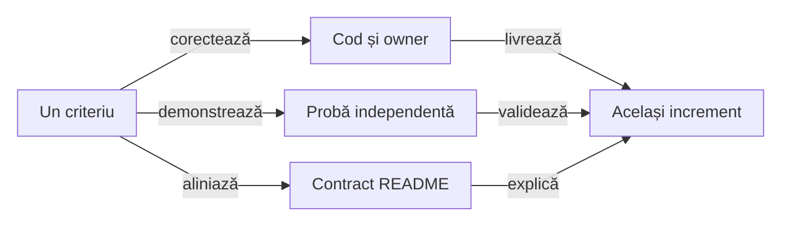

# ATF Reporting — contracte, responsabilități și pregătire JAR

## Pe scurt

Reporting deține publicarea neutră, sumarul sigur, query-ul typed și proiecția
cauzei terminale. Sursa izolată și JAR-ul fizic au gate separat în
[Reporting Tests](../../atf-reporting-tests/README.md#gate-ul-bibliotecii-distribuite).

- Pregătirea pentru release păstrează criterii distincte: API susținut,
  distribuție și documentație portabilă. Expected-urile, endpoint-urile,
  selecția business și captura Playwright rămân la ownerii lor.
- Reporting Tests rămâne modul intern de verificare. Fiecare increment închide
  împreună codul, ownership-ul, proba și documentația.

## Criterii rămase pentru consolidare

| Ordine | Implementare și probă de închidere | Owner al oracolului |
|---:|---|---|
| 1 | porturile declară capabilitățile și compatibilitatea susținută; nicio dovadă cerută nu dispare într-un default fără efect | consumer JAR și contracte neutre |
| 2 | proiecția recovery și flow-ul păstrează owner, cauze, timing și ordinal înainte/peste faze | comparație semantică, Extent/fallback și controale negative |
| 3 | distribuția declară API-ul, matricea vendor și documentele transportabile | gate de release și [Reporting Tests](ATF_Reporting_Tests_Feedback.md) |

Constructorul refuzat eliberează publicația, iar lifecycle-ul rendererelor este
la [contractul sesiunii](../../atf-reporting/README.md#publicare-și-ieșire).
Assets respectă inventarul executabil; aceste probe nu închid automat release-ul extern.

Fiecare extracție păstrează fațada și compatibilitatea necesară callerilor reali.
Justificați motivul de schimbare și proba independentă; o clasă nouă ori un
package mutat nu constituie singure o îmbunătățire de arhitectură.

## Ordinea pregătirii

Auditul structurii sursei aparține build-ului producătorului. Probele runtime și
consumerul Maven extern verifică aceeași bibliotecă și ca JAR; contractele livrate
sunt la ownerii lor, iar registrul păstrează numai criteriile încă deschise.

- Restanțele de mai jos decid următorul increment. Contractele livrate sunt
  legate la [ownerii lor](#contracte-existente); un gate focalizat nu închide
  automat compatibilitatea API sau pregătirea întregului release.
- Scorul este prioritate: impact /40 + lacună /30 + lucrabil /20 + datorie
  documentară /10. Nu este o notă a modulului ori un procent de acoperire.

| ID | Scor /100 | Criteriul care blochează închiderea |
|---|---:|---|
| [REPORT-ARTIFACT-PROFILE-62](#report-artifact-profile-62--aplicabilitate-explicită-a-inspectorului) | 89 = 35 + 27 + 19 + 8 | profil explicit pentru assertion-only/HTTP și renderer; dovadă J6 în J2 |
| [REPORT-RECORDED-TIMING-83](#report-recorded-timing-83--execuție-capturată-și-cost-de-publicare) | 88 = 35 + 26 + 19 + 8 | faza capturată și copilul măsurat la publicare pot expune durate incompatibile |
| `REPORT-PUBLIC-API-43` | 81 = 31 + 24 + 17 + 9 | API-ul susținut, compatibilitatea și capabilitățile adaptoarelor nu sunt delimitate suficient |
| [Reporting Tests](ATF_Reporting_Tests_Feedback.md#report-test-audit-60--o-dovadă-identificabilă-pentru-fiecare-scenariu) | 80 = 31 + 24 + 18 + 7 | criteriu separat al consumerului: oracol per scenariu și containment fallback |
| `UI-RECOVERY-AUDIT-01` | 78 = 33 + 22 + 16 + 7 | proiecția typed a încercărilor, bugetelor și corelării rămâne la Reporting |
| `REPORT-RELEASE-CONTRACT-45` | 73 = 25 + 22 + 17 + 9 | lipsesc criteriile declarate ale pachetului și versiunii distribuite |
| `REPORT-PORTABLE-DOCS-46` | 72 = 24 + 22 + 17 + 9 | contractele și linkurile README depind încă de documente din afara modulului |
| [REPORT-FALLBACK-RESULT-WIDTH-101](#report-fallback-result-width-101--badge-ul-statusului-depășește-coloana) | 64 = 24 + 19 + 15 + 6 | badge-ul Warning depășește RESULT și produce overflow evitabil |
| `REPORT-FLOW-PROJECTION-36` | 62 = 24 + 17 + 16 + 5 | calculul proiecției și protocolul publicării rămân amestecate |
| `REPORT-FALLBACK-INDEX-66` | 44 = 16 + 10 + 15 + 3 | indexul fallback reutilizează stilul badge-ului pe întregul link |

<strong>Legendă — închiderea comună a codului și documentației</strong>

- Regula observabilă și ownerul decid refactorizarea; numărul de clase sau linii
  nu este un motiv suficient pentru un helper ori modul nou.
- Proba refuză comportamentul anterior și consumă API-ul ori artefactul real.
  README-ul descrie numai rezultatul demonstrat, cu limitele păstrate.
- Un criteriu se închide după reconcilierea celor trei ramuri. Contractul stabil
  se mută la owner, iar controlul testelor în baseline; feedback-ul păstrează numai restanțele.

## REPORT-PUBLIC-API-43 — suprafață susținută și ownership

**Prioritate: 81/100** = impact 31 + lacună 24 + lucrabil 17 + documentare 9.
**Owner:** fațadele `AtfReportPorts`, `ExtentReportSession`, `HtmlReportSession`,
`UiExtentReportSession`, modelele și adaptoarele publice.

Accesul Java `public` include și implementare: `ReportAssetComposer`,
`ReportPublicationScope`, `ExtentReportTree` și adaptorul timestamp Spark.
Namespace-ul întreg nu poate deveni automat o promisiune de compatibilitate.

- `AtfReportPorts` referă `ReportNetworkInspector.JourneyAggregate`, în timp ce
  inspectorul de proiecție folosește contractele de assertions. Modelul de
  boundary rămâne legat de clasa care calculează sumarul.
- Compatibilitatea `Object`/reflection și numeroasele overload-uri UI sunt
  păstrate în producție. Schimbarea lor cere inventarul apelanților, inclusiv
  main-ul Shop/AutoEx; extragerea nu autorizează ștergerea acestor punți.
- Unele porturi opționale au implementări implicite fără efect. Un adaptor
  extern are nevoie să știe ce evidence este suportat înaintea publicării.
- `ReportAuditSnapshot.Failures` are cinci componente pentru cauze și scenarii
  distincte. Constructorul legacy și simbolurile binare sunt păstrate; un record
  pattern Java cu patru componente cere adaptare la recompilare, probată separat
  cu `javac`. Delimitați explicit evoluția recordurilor în API-ul susținut.

**Același increment:**

- [ ] Delimitați intrări susținute, modele publice, extensii, bridge-uri legacy
      și implementare internă. Inventariați folosirile reale înainte de restrângerea
      vizibilității ori mutarea pachetelor; păstrați punțile necesare.
- [ ] Evaluați separarea modelelor neutre de calculul lor și folosirea
      `UiExtentReportOptions` ca intrare coerentă, cu overload-uri vechi delegante.
      Nu creați clase sau module numai pentru a reduce dimensiunea fișierelor.
- [ ] Stabiliți capabilități și refuzuri explicite pentru adaptoare: timing,
      assertion-step, screenshot, aggregate și nested request. Compatibilitatea
      nu justifică o dovadă cerută și pierdută fără diagnostic.
- [ ] Automatizați compatibilitatea suprafeței susținute și politica versiunilor.
      Consumerul extern și comparația binară a incrementului există; ele nu
      declară automat suport pentru fiecare clasă Java publică.

## REPORT-RELEASE-CONTRACT-45 — ce conține și ce promite pachetul

**Prioritate: 73/100** = impact 25 + lacună 22 + lucrabil 17 + documentare 9.
**Owner:** [POM Reporting](../../atf-reporting/pom.xml), manifestul de assets și procesul de release.

JAR-ul inspectat conține clasele de producție și toate cele 54 resurse CSS/JS;
loaderul le citește din classpath. Nu este demonstrată o lipsă de asset în
artefactul curent și nu propunem mutarea lor în Java sau într-un modul nou.

- POM-ul fixează compiler/Surefire/JAR, timestamp-ul arhivei și dependențele
  directe, inclusiv FreeMarker. Sources/JavaDoc și metadatele de licență/SCM
  cer încă o decizie explicită pentru distribuția externă.
- Adaptorul timestamp citește un template intern Spark. Compatibilitatea
  Extent trebuie urmărită; macro-ul refuză expresia vendorului schimbată.

Două build-uri forțate `clean package` cu aceleași surse și aceeași toolchain
au produs bytes identici. Restanța privește toolchain-ul declarat și gate-ul
automat de release, împreună cu metadatele și dependențele efectiv susținute.

**Același increment:**

- [ ] Declarați matricea runtime/vendor susținută și politica versiunilor.
      Java 21, JAR thin/POM și dependențele directe sunt deja declarate;
      compatibilitatea viitoare cere o probă la fiecare versiune susținută.
- [ ] Automatizați gate-ul de release cu două build-uri forțate și intrări
      identice, toolchain declarată și provenance verificată. Pluginurile fixate
      și proba locală repetabilă nu înlocuiesc politica livrării externe.
- [ ] Verificați conținutul JAR/POM, inventarul assets, lipsa testelor/dependențelor
      ATF din runtime și rezolvarea externă. Decideți sursele/JavaDoc și metadatele
      de distribuție înainte de publicare; fără alegere implicită a licenței proiectului.
- [ ] Folosiți J0 ca owner al candidatului și validați separat J1/J2 după inițializarea fiecărei ținte; aceeași pereche JAR/POM și hash, fără moștenirea rezultatelor altui consumer sau rescrierea provenienței istorice.
- [ ] Documentați instalarea/consumul real și diagnosticul unei incompatibilități
      de runtime ori vendor; `mvn package` verde rămâne doar o parte a acceptanței.

## REPORT-PORTABLE-DOCS-46 — adopție externă și documente transportabile

**Prioritate: 72/100** = impact 24 + lacună 22 + lucrabil 17 + documentare 9.
**Owner:** README Reporting și contractele de raportare din documentația proiectului.

README-ul are linkuri relative spre directoare părinte, inclusiv contracte
normative din `../docs`. Copierea numai
a modulului păstrează codul, dar nu transportă acei owneri documentari.

- Exemplul minim JAR din README este acum compilat și executat extern, cu un
  control PASS și unul FAIL; nu închide migrarea tuturor contractelor.
- [Atlasul pachetelor](../../atf-reporting/src/main/java/atf/reporting/README.md)
  oferă context local pentru UI, API, modele, renderere, evidence și runtime.
  Linkurile sale către probele interne nu reprezintă încă un pachet documentar de release.
- [Contextul portabil](../../atf-reporting/docs/README.md) are numai destinații
  interne modulului și explică separat sursa izolată, JAR-ul thin, POM-ul și
  autonomia HTML. Această intrare este pregătită; portabilitatea tuturor
  README-urilor și includerea în distribuție rămân deschise.
- README-ul separă acum adopția, mentenanța și probele prin trasee explicite
  și disclosure-uri. Acest lucru îmbunătățește orientarea în ATF; nu transportă
  automat contractele externe în pachetul distribuit.

**Același increment:**

- [ ] Inventariați ownerii contractelor și destinația lor după extragere.
      Păstrați o singură definiție normativă, cu linkuri funcționale atât în ATF,
      cât și în livrarea externă; fără duplicarea a două versiuni divergente.
- [ ] Includeți traseul de adopție și contractele lui în livrarea declarată.
      Actualizați exemplele odată cu API-ul și probați-le pe consumerul extern.
- [ ] Verificați din copia izolată README-ul, linkurile, fragmentele compilabile,
      configurația și randarea diagramelor; guard-ul structural nu dovedește adevărul.
- [ ] Mențineți [controlul factual selectiv](../../atf-tests/README.md#documente-și-responsabilități)
      ca regulă comună; criteriul de aici deține numai portabilitatea documentației Reporting.

## REPORT-FLOW-PROJECTION-36 — plan de dovezi separat de publicare

**Prioritate: 62/100** = impact 24 + lacună 17 + lucrabil 16 + documentare 5.
**Owner:** Reporting; oracolele neutre și browserul rămân în Reporting Tests.

Extragerea `ApiEvidencePublisher` și conservarea cauzei sunt livrate.
`UiEvidencePublisher.publishUnifiedFlow(...)` și `publishCrossPhaseUnifiedFlow(...)`
reunesc încă selecția propoziției, compactarea, agregarea verdictelor UI/API,
selectarea capturii și deschiderea/închiderea porturilor de publicare.

| Motiv de schimbare | Boundary de păstrat |
|---|---|
| Modificarea grupării checkpoint-urilor | transformare pură peste intrările typed, cu ordine și identitate păstrate |
| Politica screenshot/compact UI-only | decizie Reporting explicită; nicio captură nouă la renderer |
| Failure la body/complete/close | publicare peste porturile existente, cu aceeași cauză și fără repetare |

- [ ] Caracterizați independent rezultatul proiecției pentru o fază și peste
      faze, UI/API/UI+API, compact și necompact. Păstrați faza sursă, titlul,
      ownership-ul, verdictul, ordinea comparațiilor și captura originală.
- [ ] Extrageți numai calculul care poate fi probat fără porturi, HTML ori
      browser, dacă acest lucru separă efectiv motivele de schimbare. Fațada
      rămâne stabilă; nu introduceți un API public, un modul sau o clasă numai
      pentru reducerea numărului de linii.
- [ ] Publicarea consumă rezultatul typed și reutilizează publisherul API și
      protocolul scope-urilor; nu reface decizia din textul compactat și nu
      schimbă păstrarea cauzelor pentru a simplifica bucla.
- [ ] Păstrați `UiCrossPhaseCompactFlowComponentTest`,
      `ExtentUnifiedFlowMultipleScreenshotTest`, `UiPublicationFailureComponentTest`
      și inventarul independent al tabelelor. Probați FAIL/SKIP într-o fază
      intermediară și checkpoint-uri cu API fără UI, nu doar flow-ul final PASS.
- [ ] Comparați Extent/fallback și navigarea între taburi pe același snapshot;
      bugetul configurat, timing-ul, un singur artifact și toate expandările accesibile
      rămân criterii, inclusiv [backlink-ul exact](../../atf-reporting/README.md#revenirea-la-comparația-eșuată).

**Închidere:** politica de grupare poate fi schimbată și probată separat de
protocolul porturilor, cu ieșire observabilă identică și fără evaluări repetate.

## UI-RECOVERY-AUDIT-01 — încercări inspectabile în Extent

**Prioritate: 78/100** = impact 33 + lacună 22 + lucrabil 16 + documentare 7.
**Owner:** model/proiecție la Reporting; probe renderer la Reporting Tests;
adaptoare și aserțiuni business în main la cei doi consumeri.

Observațiile INFO livrate sunt normate la
[Reporting](../../atf-reporting/README.md#decizii-be-fără-verdict-de-succes-implicit).
`UiRecoveryTrace` deține deja operația, încercarea, decizia, motivul, semnalul BE
și duratele; adaptoarele AutoEx/Shop le publică în rânduri INFO. Restanța este
proiecția structurată comună și matricea de acceptanță, fără parsarea mesajelor
sau repetarea deciziei la renderer.

- [ ] Compuneți faptele typed din trace, policy și signal în proiecția comună:
      operație, încercare, decizie/motiv, sursa politicii, bugete și timpi măsurați.
      Signal-ul păstrează deja scope-ul invocare/operație/frame/document și secvența;
      rendererul primește corelarea neutră de la adaptor, fără parsarea mesajului.
      Starea DOM apare numai dacă a fost observată; lipsa ei rămâne necapturată,
      fără acțiuni sau capturi suplimentare pentru completarea tabelului.
      Distingerea observației de replay trebuie să fie vizibilă în raport.
      Separați durata încercării, backoff-ul și timpul total măsurat; o durată
      indisponibilă rămâne explicit necapturată, fără valoare HTTP inventată.
- [ ] Păstrați toate cauzele intermediare și capturile permise. Recuperarea
      înaintea eșecului terminal poate avea rânduri INFO explicite, conform
      recorderului existent; nu rescrieți un FAIL deja publicat în PASS și nu
      înlocuiți raportul original cu artifactul unei rulări ulterioare.
- [ ] Definiți verdictul logic și indicatorul de recuperare: un singur test
      în totaluri, succes inițial distinct de recuperare, epuizare FAIL și abort
      păstrat SKIP. Retry-ul infrastructurii de publicare nu rerulează business-ul.
      Inputul contradictoriu este reconciliat conform
      [contractului comun Reporting](../../atf-reporting/README.md#consistența-statusului-transmis-de-caller).
- [ ] Probați expand/collapse până la fiecare încercare, acțiune, request și
      aserțiune; Fails → test/fază/pas exact și Overview trebuie să păstreze
      cauzele și totalurile coerente. Captura ulterioară nu înlocuiește starea
      consemnată la eroare.
- [ ] Verificați câte un caz relevant individual și prin suită în AutoEx și
      Shop, cu profil UI și UI+API, succes, recuperare/refuz și epuizare. Probele
      Extent neutre rămân în `atf-reporting-tests`; policy/resolver și adaptoarele
      au teste la owner, fără cuplarea testelor de business la HTML.

## REPORT-FALLBACK-INDEX-66 — status separat de lizibilitatea indexului

**Prioritate: 44/100** = impact 16 + lacună 10 + lucrabil 15 + documentare 3.
**Owner:** `HtmlReportTestsView.scenarioLink(...)` și tema fallback;
regresia de browser rămâne în Reporting Tests.

- Linkul întreg primește clasele `test-link status status-pass/fail`. Tema
  `.status` colorează tot indexul ca badge și impune fontul compact al
  verdictului; numele clasei folosește în continuare culoarea muted.
- Auditul browser al titlului lung confirmă fundalul verde pe întregul link
  PASS. Containment-ul este un contract separat și nu certifică lizibilitatea.

- [ ] Păstrați identitatea anchor-ului și verdictul, cu textul indexului în
      tokenurile neutre și statusul într-un indicator separat, accesibil.
- [ ] Adăugați mai întâi o regresie cu vecini PASS/FAIL/SKIP, titluri lungi,
      nume de clasă integral și tastatură; verificați textul și contrastul
      efectiv în sidebar, fără a micșora fonturile ori a ascunde informația.

## Contracte existente

| Informație | Owner |
|---|---|
| Exchange terminal în Tests/Fails și backlink către execution evidence | [Reporting](../../atf-reporting/README.md#execuție-api-terminată-fără-răspuns) |
| JSON semantic, canary-uri și degradarea inputului invalid | [Security](../../atf-reporting/src/main/java/atf/reporting/security/README.md) |
| YAML strict și defaults legitime | [Reporting](../../atf-reporting/README.md#intrări-și-configurare-în-bibliotecă) |
| Sursa izolată și JAR-ul fizic consumat extern | [Reporting Tests](../../atf-reporting-tests/README.md#gate-ul-bibliotecii-distribuite) |
| Buget configurabil și valoarea efectivă în System | [Reporting](../../atf-reporting/README.md#proiecția-sigură-a-aserțiunilor) |
| Lifecycle și refuzul constructorului | [Reporting](../../atf-reporting/README.md#publicare-și-ieșire) |
| Cauza publicării directe și închiderea scope-urilor | [Reporting](../../atf-reporting/README.md#cauza-publicării-și-scope-urile-deținute) |
| Tranziții de scope și refuz fără mutație | [Reporting](../../atf-reporting/README.md#atomicitatea-tranzițiilor-de-scope) |
| Timing explicit, capturi și publicare | [Reporting](../../atf-reporting/README.md#timing-e2e-la-ownerul-runtime) |
| Setup și dovezi UI în fallback | [Reporting](../../atf-reporting/README.md#evidence-ui-și-setup-în-fallback) |
| Coloane dinamice și scroll local | [Reporting](../../atf-reporting/README.md#lizibilitatea-dovezilor-în-panouri-înguste) |
| Probe de compatibilitate și browser | [Reporting Tests](../../atf-reporting-tests/README.md) |
| Oracole, fixture-uri binare și dovezi exacte | [Feedback Reporting Tests](ATF_Reporting_Tests_Feedback.md) |
| Inventar UI/API/UI+API și controale negative de randare | [Reporting Tests](../../atf-reporting-tests/README.md#tabele-publicate-și-inventar-independent) |
| Controale Git verificate | [Baseline](../ATF_Test_Changes_Baseline.md#controale-tehnice-verificate) |
| Contractele consumerilor | [Acceptanța business](../ATF_Testing_Guide.md#acceptanța-business-individual-și-prin-suită) |
| Identitatea query-ului între modele | [Reporting Tests](../../atf-reporting-tests/README.md#fidelitatea-query-ului-și-asocierea-mock) |

Refactorizările păstrează contractele ownerilor de mai sus și urmează
[ghidul de probă](../ATF_Testing_Guide.md#proba-fiecărui-owner-de-resurse).
Reevaluarea folosește [rubrica comună de cod](../README_Atf_CodeBestPractices.md#rubrica-reevaluării-modulelor),
cu randare inspectată și regresiile ownerului trecute în TMP.

## REPORT-ARTIFACT-PROFILE-62 — aplicabilitate explicită a inspectorului

**Prioritate: 89/100** = impact 35 + lacună 27 + lucrabil 19 + documentare 8.
**Owner:** Reporting; regresia neutră aparține Reporting Tests.

Reproducerea J2 pe J6 separă un raport valid fără HTTP de cerințele neaplicabile ale inspectorului generic.

| Axă | Observație și limită |
|---|---|
| assertion-only Extent | trei faze, 12 comparații, fără exchange; inspectorul refuză request/response evidence split |
| negativ de mesagerie | duplicate-effect păstrează refuzul inspectorului, pe lângă assertion-ul FAIL legitim |
| fallback | inspectorul cere markeri specifici Extent; rezultatul singur nu demonstrează defect de randare |
| consumer | receipt-ul păstrează rezultatul original; oracolul separat refuză removed-table/inverted-result |

[ReportArtifactInspector](../../atf-reporting/src/main/java/atf/reporting/artifact/ReportArtifactInspector.java) nu primește profil sau inventar așteptat. Nu compensați prin request-uri fictive ori prin deducerea permisivă a profilului din dovada lipsă.

- [ ] Declarați rendererul și dovezile așteptate, inclusiv assertion-only, cu compatibilitate explicită pentru callerii existenți.
- [ ] Un request obligatoriu eliminat trebuie să rămână FAIL; separați publicarea de aplicabilitatea contractului HTTP.
- [ ] Păstrați nominalele și mutanții per scenariu, Extent/fallback, cu taburi, expandări până la ultima comparație și navigare Fails.

**Închidere:** populația semantică cerută este acceptată în fiecare renderer, iar fiecare dovadă obligatorie eliminată este refuzată. API-ul primește intenția callerului; default-urile nu se relaxează din absența dovezii.

<strong>Dovada binară și limita acceptanței existente</strong>

JAR: `1.0.0-j6`, SHA-256 `CAEBFBE51DA5F00241F0C092281CBB19FD3FC887EBE0A0A57CDCA71F3D591C1C`.
Matricea consumerului este în [ghidul J2](../../../atf_j2/docs/ATF_Eventuate_Testing.md#acceptanța-raportului).
Bootstrap-ul auditabil al consumerului nu închide inspectorul generic sau regresia permanentă a producătorului.

## REPORT-RECORDED-TIMING-83 — execuție capturată și cost de publicare

**Prioritate: 88/100** = impact 35 + lacună 26 + lucrabil 19 + documentare 8.
**Owner:** Reporting pentru contractul temporal; adaptorul J2 pentru datele furnizate.

Raportul Extent API individual a expus durate de execuție capturate lângă durate măsurate la publicare. Verdicturile și comparațiile corecte nu demonstrează coerența acestor surse de timp.

| Fază observată | Copil afișat | Limită de interpretare |
|---|---|---|
| SETUP: 21 ms | Component assertions: 94 ms | durata pasului nu poate fi atribuită implicit execuției capturate |
| TEST BODY: 68 ms | request: 514 ms | timpul transportului, al observației și al publicării trebuie delimitate |

- [ComponentReportRun](../../../atf_j2/atf-test-eventuate/src/main/java/atf/eventuate/reporting/ComponentReportRun.java) aplică timpul capturat fazei și apoi publică dovezile.
- [AssertionAuditReport](../../atf-reporting/src/main/java/atf/reporting/audit/AssertionAuditReport.java) deschide pasul la publicare; codul sugerează amestecul măsurătorilor, fără a demonstra un defect exclusiv al rendererului.
- Închidere: regresie permanentă mock/contract în Reporting Tests, latență de publicare controlată și oracol independent, Extent/fallback și individual/suită.
- Păstrați distinct durata transportului; refuzați atribuirea artificială a costului de publicare, fără clamp, mutarea assertions sau sleep-uri probabilistice.

<strong>Artifactul observat</strong>

API individual J2: `eventuate-extent-2026-10-31T10-07-15.582149200Z-7abc17e2.html`.
SHA-256: `24831EA551633629354AA0EF511A307F283A0808DC83954BC189F19F7E3191E6`.
Aceasta este dovadă existentă, nu o execuție nouă ori un contract temporal deja închis.

<strong>Revalidare la distribuția Core C1 — Reporting J6 rămâne distinct</strong>

La 2026-10-31, suita Eventuate cu Core C1 și același Reporting J6 expune
TEST BODY de 109 ms și request-ul copil de 185 ms. Tabelul assertion-urilor
este lizibil până la ultima comparație, cu click/Enter/Space; aceasta nu închide
coerența duratelor, care rămâne criteriul de mai sus.

| Dovadă | Valoare și limită |
|---|---|
| artifact | `eventuate-extent-2026-10-31T12-14-59.148865600Z-aafacc10.html` |
| SHA-256 HTML | `C0E43FD46B4027C4B25EB85F1DB760529615C2DC26374A2D58E0BF615243A420` |
| caz | `EventuateApiContractComponentTest` → `API contract · approved order` → TEST BODY |
| sursă versus JAR Core | 127 clase de producție identice byte cu byte; împachetarea nu corectează contractul temporal Reporting |
| regresie necesară | fixture neutru în `atf-reporting-tests`, cu execuție capturată și publicare controlată, Extent/fallback și JAR fizic |

Dovada este observată pe binarul J6 existent. Cele 32 de regresii Reporting
focalizate ale incrementului Core sunt verzi; selecția nu substituie proba
permanentă cerută de acest criteriu.

## REPORT-MQ-02 — propunere condiționată de contractul brokerului real

**Prioritate: 82/100. Owner:** Reporting; J2 furnizează contractul și witness-ul real.

După probele pe broker real, evaluați o dovadă publică pentru mesaj/livrare,
poziție și tentative, distinctă de HTTP. Păstrați rendererul independent
de Kafka/RabbitMQ și verdictul business la caller.

- Assertions neutre sunt contractul implementat în J2 acum; un tabel MQ nativ nu blochează cele trei componente și nu este declarat livrat.
- Propunerea a fost mutată din copia J2, pentru un singur owner al bibliotecii.

Închidere după acceptarea designului: Extent/fallback conservă identități,
timing, FAIL și dovezi incomplete; fixture-ul neutru și navigarea au regresii
în Reporting Tests, fără expected-uri sau cod Eventuate în renderer.

## REPORT-FALLBACK-RESULT-WIDTH-101 — badge-ul statusului depășește coloana

**Prioritate: 64/100** = impact 24 + lacună 19 + lucrabil 15 + documentare 6.
**Owner:** Reporting pentru layout; Reporting Tests pentru componenta neutră.

Pe J7, tabelul API cu trei comparații PASS și un WARNING afișează un scrollbar
orizontal mic la viewport de 1280 px. Coloana RESULT măsoară aproximativ 56,9 px,
iar badge-ul Warning 61,8 px; overflow-ul tabelului ajunge la 877 px pentru
un părinte de 870 px. Valorile și verdictul sunt corecte.

- Calculați minimumul util din footprint-ul stilizat al celulei, inclusiv badge, padding și border; lungimea textului singură nu dovedește că rezultatul încape.
- Refolosiți politica dinamică existentă pentru toate coloanele și rendererele. Nu impuneți o proporție globală fixă și nu ascundeți overflow-ul sau textul ca să eliminați scrollbarul.
- Păstrați wrapping, patru coloane, un singur tabel și preview 240; un panou într-adevăr îngust poate avea scroll limitat la tabel, cu ultima comparație accesibilă.

**Închidere:** fixture-ul neutru PASS/FAIL/WARNING încape la lățimea normală
fără overflow provocat de badge; panoul îngust rămâne navigabil. Mutația care
restrânge RESULT sub dimensiunea badge-ului trebuie refuzată separat de verdict.

<strong>Reproducere consumer — fără schimbarea rendererului</strong>

- Increment TMP atf-j2-media-cd3973d608; media-matrix/fallback-media-warning.html.
- HTML SHA-256: 59cccb14ff23d6fcb659591510e1e982e9a3b315f04a89b799bc2fe0d29f1ed4.
- JAR J7 SHA-256: 569d2babe6b9ec091cb1df6e1207110c611327ea15f1521955e847c837d9eb2a.
- Browser: Tests, patru rânduri; Content-Type JSON are WARNING și ceilalți trei PASS.
- DOM măsurat: RESULT clientWidth 56, scrollWidth 65; badge width 61,8; tabel width 869,6 și scrollWidth 877.
- Receipt-ul de valori/verdicturi trece; el nu certifică geometria, care cere regresia de componentă dedicată.

Revalidarea J8 păstrează criteriul 101 deschis: pe raportul media-warning J2,
TAB MCP măsoară la viewport 1280 px RESULT 56,99 px și badge Warning 61,79 px
(clientWidth 56, scrollWidth 65). Colapsarea și verdicturile sunt corecte;
regresia geometrică neutră cerută rămâne distinctă de testele de disclosure.
