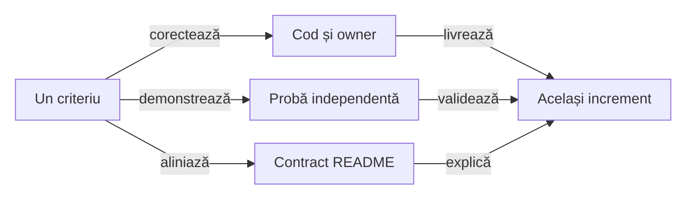

# ATF Reporting — contracte, responsabilități și pregătire JAR

## Pe scurt

Reporting deține publicarea neutră, sumarul sigur, query-ul typed și proiecția
cauzei terminale. Sursa izolată și JAR-ul fizic au gate separat în
[Reporting Tests](../../atf-reporting-tests/README.md#gate-ul-bibliotecii-distribuite).

- Pregătirea pentru release păstrează criterii distincte: API susținut,
  distribuție și compatibilitate declarată. Ghidul livrat în `lib` are probă
  executabilă pe JAR; expected-urile, endpoint-urile,
  selecția business și captura Playwright rămân la ownerii lor.
- Reporting Tests rămâne modul intern de verificare. Fiecare increment închide
  împreună codul, ownership-ul, proba și documentația.

[Contractul de autonomie](../ATF_Inline_Audit_Contract.md#profilul-fără-referințe-externe) descrie calificarea inspectorului; colectarea și livrarea Android rămân la consumer.

## Criterii rămase pentru consolidare

| Ordine | Implementare și probă de închidere | Owner al oracolului |
|---:|---|---|
| 1 | porturile declară capabilitățile și compatibilitatea susținută; nicio dovadă cerută nu dispare într-un default fără efect | consumer JAR și contracte neutre |
| 2 | proiecția recovery și flow-ul păstrează owner, cauze, timing și ordinal înainte/peste faze | comparație semantică, Extent/fallback și controale negative |
| 3 | distribuția declară API-ul și matricea Java/vendor susținută | gate de release și [Reporting Tests](ATF_Reporting_Tests_Feedback.md) |
| 4 | profilul poate declara și verifica screenshot-ul UI cu owner și acțiune explicite | source/JAR, Extent/fallback și controale negative |

Constructorul refuzat eliberează publicația, iar lifecycle-ul rendererelor este
la [contractul sesiunii](../../atf-reporting/README.md#publicare-și-ieșire).
Assets respectă inventarul executabil; aceste probe nu închid automat release-ul extern.

Fiecare extracție păstrează fațada și compatibilitatea necesară callerilor reali.
Justificați motivul de schimbare și proba independentă; o clasă nouă ori un
package mutat nu constituie singure o îmbunătățire de arhitectură.

## REPORT-OBSERVATION-CONTRACT — domeniul validatorului de artefact

**Prioritate: 72/100** = impact 29 + lacună 20 + lucrabil 16 + documentare 7.
**Owner:** profilul și inspectorul în Reporting; fixture-ul și controalele în Reporting Tests.

- **Acoperire existentă.** `ReportArtifactProfile` declară etichetele, verdicturile
  și inventarul independent pentru observații și aserțiuni fără HTTP în Extent
  și fallback. `ReportArtifactProfileComponentTest` respinge rânduri omise,
  status degradat, dovezi mutate și renderer greșit.
  [Contractul inspectorului](../../atf-reporting/README.md#inspecția-artifactului-cu-intenție-explicită)
- **Referințe PNG.** `ReportArtifactResources` și `ScreenshotReferenceComponentTest`
  verifică referințele canonice și octeții. Legarea capturii de intenția
  independentă a unui scenariu rămâne deschisă.
- **Lacună.** Pentru `uiValidation` cu `AtfUiEvidenceSource.OBSERVE`, profilul
  trebuie să declare acțiunea, ownerul, caption-ul și identitatea PNG.
  Inspectorul trebuie să confrunte captura cu pasul declarat, într-un test
  fără browser, HTTP sau Android.

- Extindeți profilul cu o dovadă UI tipizată numai dacă păstrează inventarul
  independent de HTML și leagă explicit acțiunea, ownerul și caption-ul imaginii.
- Prin JAR fizic, publicați Extent și fallback dintr-un setup local cu
  `OBSERVE`, `uiValidation` și PNG controlat; nu inventați request-uri ori pași.
- Controalele negative elimină imaginea, schimbă referința/caption-ul, înlocuiesc
  octeții PNG ori leagă captura de alt owner; toate trebuie refuzate separat.
- Păstrați verificările existente pentru observations generice, comparații,
  resurse autonome și inventarul exact. O regulă UI nouă nu relaxează contractul
  generic și nu derivă expected-urile din HTML-ul inspectat.

**Închidere:** intenția PNG este independentă de raport, iar source/JAR
inspectează aceeași dovadă UI în ambele renderere și refuză fiecare mutant.

## Ordinea pregătirii

Auditul structurii sursei aparține build-ului producătorului. Probele runtime și
consumerul Maven extern verifică aceeași bibliotecă și ca JAR; contractele livrate
sunt la ownerii lor, iar registrul păstrează numai criteriile încă deschise.

- Restanțele de mai jos decid următorul increment. Contractele livrate sunt
  legate la [ownerii lor](#contracte-existente); un gate focalizat nu închide
  automat compatibilitatea API sau pregătirea întregului release.
- Scorul este prioritate: impact /40 + lacună /30 + lucrabil /20 + datorie
  documentară /10. Nu este o notă a modulului ori un procent de acoperire.

| ID | Scor /100 | Criteriul care blochează închiderea |
|---|---:|---|
| [REPORT-SQL-STEPS-116](#report-sql-steps-116--query-uri-și-rezultate-auditabile) | 88 = 35 + 26 + 18 + 9 | pași SQL neutri, query/bind-uri și rezultate cu bugete independente; adoptare J2 după release |
| [REPORT-UI-ASSERTION-FULL-EVIDENCE-133](ATF_Android_UI_Reporting_Feedback.md#report-ui-assertion-full-evidence-133--valori-lungi-capturate-înainte-de-preview) | 88 — existing criterion | full UI values captured before caller preview; source/JAR owner and redaction proof remain separate |
| `REPORT-PUBLIC-API-43` | 81 = 31 + 24 + 17 + 9 | API-ul susținut, compatibilitatea și capabilitățile adaptoarelor nu sunt delimitate suficient |
| [Reporting Tests](ATF_Reporting_Tests_Feedback.md#report-test-audit-60--o-dovadă-identificabilă-pentru-fiecare-scenariu) | 80 = 31 + 24 + 18 + 7 | criteriu separat al consumerului: oracol per scenariu și containment fallback |
| `UI-RECOVERY-AUDIT-01` | 78 = 33 + 22 + 16 + 7 | proiecția typed a încercărilor, bugetelor și corelării rămâne la Reporting |
| `REPORT-RELEASE-CONTRACT-45` | 73 = 25 + 22 + 17 + 9 | matricea runtime/vendor, operatorul repetabil și metadatele externe nu sunt încă o politică completă |
| `REPORT-OBSERVATION-CONTRACT` | 72 = 29 + 20 + 16 + 7 | profilul declară observations generice, dar nu UI validation cu screenshot și identitatea PNG |
| [REPORT-FALLBACK-RESULT-WIDTH-101](#report-fallback-result-width-101--regresie-geometrică-pentru-badge) | 64 = 24 + 19 + 15 + 6 | lipsește un oracol geometric al badge-ului WARNING în celula RESULT |
| `REPORT-FLOW-PROJECTION-36` | 62 = 24 + 17 + 16 + 5 | calculul proiecției și protocolul publicării rămân amestecate |
| [REPORT-DISTRIBUTION-METADATA-140](#report-distribution-metadata-140--bind-optional-adoption-paths) | P2; unscored | permanent negative for stale optional consumerDistribution paths; current bytes are already correct |
| [REPORT-COMPONENT-FRAGMENTS](#report-component-fragments--costul-multor-corpuri-mici) | P2 | măsurare neutră pentru multe corpuri mici, cu inventarul complet al dovezilor |

<strong>Legendă — închiderea comună a codului și documentației</strong>

- Regula observabilă și ownerul decid refactorizarea; numărul de clase sau linii
  nu este un motiv suficient pentru un helper ori modul nou.
- Proba refuză comportamentul anterior și consumă API-ul ori artefactul real.
  README-ul descrie numai rezultatul demonstrat, cu limitele păstrate.
- Un criteriu se închide după reconcilierea celor trei ramuri. Contractul stabil
  se mută la owner, iar controlul testelor în baseline; feedback-ul păstrează numai restanțele.

## REPORT-PUBLIC-API-43 — suprafață susținută și ownership

**Prioritate: 81/100** = impact 31 + lacună 24 + lucrabil 17 + documentare 9.
**Owner:** fațadele `AtfReportPorts`, `ExtentReportSession`, `HtmlReportSession`,
`UiExtentReportSession`, modelele și adaptoarele publice.

Accesul Java `public` include și implementare: `ReportAssetComposer`,
`ReportPublicationScope`, `ExtentReportTree` și adaptorul timestamp Spark.
Namespace-ul întreg nu poate deveni automat o promisiune de compatibilitate.

- `AtfReportPorts` referă `ReportNetworkInspector.JourneyAggregate`, în timp ce
  inspectorul de proiecție folosește contractele de assertions. Modelul de
  boundary rămâne legat de clasa care calculează sumarul.
- Compatibilitatea `Object`/reflection și numeroasele overload-uri UI sunt
  păstrate în producție. Schimbarea lor cere inventarul apelanților, inclusiv
  main-ul Shop/AutoEx; extragerea nu autorizează ștergerea acestor punți.
- Unele porturi opționale au implementări implicite fără efect. Un adaptor
  extern are nevoie să știe ce evidence este suportat înaintea publicării.
- `ReportAuditSnapshot.Failures` are cinci componente pentru cauze și scenarii
  distincte. Constructorul legacy și simbolurile binare sunt păstrate; un record
  pattern Java cu patru componente cere adaptare la recompilare, probată separat
  cu `javac`. Delimitați explicit evoluția recordurilor în API-ul susținut.

**Același increment:**

- [ ] Delimitați intrări susținute, modele publice, extensii, bridge-uri legacy
      și implementare internă. Inventariați folosirile reale înainte de restrângerea
      vizibilității ori mutarea pachetelor; păstrați punțile necesare.
- [ ] Evaluați separarea modelelor neutre de calculul lor și folosirea
      `UiExtentReportOptions` ca intrare coerentă, cu overload-uri vechi delegante.
      Nu creați clase sau module numai pentru a reduce dimensiunea fișierelor.
- [ ] Stabiliți capabilități și refuzuri explicite pentru adaptoare: timing,
      assertion-step, screenshot, UI action, execution, aggregate și nested
      request. Proba distinge dovada publicată de refuzul explicit al unei
      capabilități obligatorii.
- [ ] Automatizați compatibilitatea suprafeței susținute și politica versiunilor.
      Consumerul extern și comparația binară a incrementului există; ele nu
      declară automat suport pentru fiecare clasă Java publică.

## REPORT-RELEASE-CONTRACT-45 — ce conține și ce promite pachetul

**Prioritate: 73/100** = impact 25 + lacună 22 + lucrabil 17 + documentare 9.
**Owner:** [POM Reporting](../../atf-reporting/pom.xml), manifestul de assets și procesul de release.

JAR-ul inspectat conține clasele de producție și toate resursele CSS/JS din manifestul finit;
loaderul le citește din classpath. Nu este demonstrată o lipsă de asset în
artefactul curent și nu propunem mutarea lor în Java sau într-un modul nou.

- POM-ul fixează compiler/Surefire/JAR, timestamp-ul arhivei și dependențele
  directe, inclusiv FreeMarker. Sources/JavaDoc și metadatele de licență/SCM
  cer încă o decizie explicită pentru distribuția externă.
- Adaptorul timestamp citește un template intern Spark. Compatibilitatea
  Extent trebuie urmărită; macro-ul refuză expresia vendorului schimbată.

Inventarul bibliotecilor verifică JAR/POM-ul distribuit, hash-ul și proveniența;
ghidul executabil probează consumerul binar. Dovada pachetului curent, indicată
în [proveniența de consum](../../../atf_j1/library-provenance.json), consemnează
două build-uri curate cu JAR/POM identice. Rămân operatorul automat menținut la
owner și politica explicită de compatibilitate și metadate.

**Același increment:**

- [ ] Declarați matricea Java/vendor și politica versiunilor susținute. POM-ul
      curent declară Java 21, JAR thin și dependențe directe; compatibilitatea
      pentru fiecare runtime/vendor trebuie să aibă probă proprie.
- [ ] Automatizați la owner un release gate repetabil: două build-uri curate
      din intrări identice, toolchain declarată, byte identity și proveniență.
      Operatorul menținut la owner reia probele native și sursă/JAR și verifică
      POM-ul încorporat și identitatea intrărilor, independent de scripturile TMP.
- [ ] Decideți distribuția Sources/JavaDoc și metadatele SCM/licență fără a
      deduce o licență; rezolvați POM-ul publicat într-un consumer extern înainte
      de a promova versiunea.

Ghidul consumerului este livrat în `lib` și verificat prin `ReportingLibraryGuideIT`
pe JAR-ul fizic, într-un classpath fără Core, Kit sau sursa producătorului.
Instalarea, exemplele și preview-ul 240 au contract în [README-ul de utilizare](../../lib/README.Reporting.md);
documentația internă detaliată rămâne la owner în J0.

## REPORT-FLOW-PROJECTION-36 — plan de dovezi separat de publicare

**Prioritate: 62/100** = impact 24 + lacună 17 + lucrabil 16 + documentare 5.
**Owner:** Reporting; oracolele neutre și browserul rămân în Reporting Tests.

Extragerea `ApiEvidencePublisher` și conservarea cauzei sunt livrate.
`UiEvidencePublisher.publishUnifiedFlow(...)` și `publishCrossPhaseUnifiedFlow(...)`
reunesc încă selecția propoziției, compactarea, agregarea verdictelor UI/API,
selectarea capturii și deschiderea/închiderea porturilor de publicare.

| Motiv de schimbare | Boundary de păstrat |
|---|---|
| Modificarea grupării checkpoint-urilor | transformare pură peste intrările typed, cu ordine și identitate păstrate |
| Politica screenshot/compact UI-only | decizie Reporting explicită; nicio captură nouă la renderer |
| Failure la body/complete/close | publicare peste porturile existente, cu aceeași cauză și fără repetare |

- [ ] Caracterizați independent rezultatul proiecției pentru o fază și peste
      faze, UI/API/UI+API, compact și necompact. Păstrați faza sursă, titlul,
      ownership-ul, verdictul, ordinea comparațiilor și captura originală.
- [ ] Extrageți numai calculul care poate fi probat fără porturi, HTML ori
      browser, dacă acest lucru separă efectiv motivele de schimbare. Fațada
      rămâne stabilă; nu introduceți un API public, un modul sau o clasă numai
      pentru reducerea numărului de linii.
- [ ] Publicarea consumă rezultatul typed și reutilizează publisherul API și
      protocolul scope-urilor; nu reface decizia din textul compactat și nu
      schimbă păstrarea cauzelor pentru a simplifica bucla.
- Regresiile `UiCrossPhaseCompactFlowComponentTest`,
  `ExtentUnifiedFlowMultipleScreenshotTest` și `UiPublicationFailureComponentTest`
  există deja și rămân protejate; ele nu închid separat extracția proiecției.
- [ ] Probați FAIL/SKIP într-o fază intermediară și checkpoint-uri cu API fără
      UI, nu doar flow-ul final PASS, în ambele renderere și pe JAR-ul candidat.
- [ ] Comparați Extent/fallback și navigarea între taburi pe același snapshot;
      bugetul configurat, timing-ul, un singur artifact și toate expandările accesibile
      rămân criterii, inclusiv [backlink-ul exact](../../atf-reporting/README.md#revenirea-la-comparația-eșuată).

**Închidere:** politica de grupare poate fi schimbată și probată separat de
protocolul porturilor, cu ieșire observabilă identică și fără evaluări repetate.

## UI-RECOVERY-AUDIT-01 — încercări inspectabile în Extent

**Prioritate: 78/100** = impact 33 + lacună 22 + lucrabil 16 + documentare 7.
**Owner:** model/proiecție la Reporting; probe renderer la Reporting Tests;
adaptoare și aserțiuni business în main la cei doi consumeri.

Observațiile INFO livrate sunt normate la
[Reporting](../../atf-reporting/README.md#decizii-be-fără-verdict-de-succes-implicit).
`UiRecoveryTrace` deține deja operația, încercarea, decizia, motivul, semnalul BE
și duratele; adaptoarele AutoEx/Shop le publică în rânduri INFO. Restanța este
proiecția structurată comună și matricea de acceptanță, fără parsarea mesajelor
sau repetarea deciziei la renderer.

- [ ] Compuneți faptele typed din trace, policy și signal în proiecția comună:
      operație, încercare, decizie/motiv, sursa politicii, bugete și timpi măsurați.
      Signal-ul păstrează deja scope-ul invocare/operație/frame/document și secvența;
      rendererul primește corelarea neutră de la adaptor, fără parsarea mesajului.
      Starea DOM apare numai dacă a fost observată; lipsa ei rămâne necapturată,
      fără acțiuni sau capturi suplimentare pentru completarea tabelului.
      Distingerea observației de replay trebuie să fie vizibilă în raport.
      Separați durata încercării, backoff-ul și timpul total măsurat; o durată
      indisponibilă rămâne explicit necapturată, fără valoare HTTP inventată.
- [ ] Păstrați toate cauzele intermediare și capturile permise. Recuperarea
      înaintea eșecului terminal poate avea rânduri INFO explicite, conform
      recorderului existent; nu rescrieți un FAIL deja publicat în PASS și nu
      înlocuiți raportul original cu artifactul unei rulări ulterioare.
- [ ] Definiți verdictul logic și indicatorul de recuperare: un singur test
      în totaluri, succes inițial distinct de recuperare, epuizare FAIL și abort
      păstrat SKIP. Retry-ul infrastructurii de publicare nu rerulează business-ul.
      Inputul contradictoriu este reconciliat conform
      [contractului comun Reporting](../../atf-reporting/README.md#consistența-statusului-transmis-de-caller).
- [ ] Probați expand/collapse până la fiecare încercare, acțiune, request și
      aserțiune; Fails → test/fază/pas exact și Overview trebuie să păstreze
      cauzele și totalurile coerente. Captura ulterioară nu înlocuiește starea
      consemnată la eroare.
- [ ] Verificați câte un caz relevant individual și prin suită în AutoEx și
      Shop, cu profil UI și UI+API, succes, recuperare/refuz și epuizare. Probele
      Extent neutre rămân în `atf-reporting-tests`; policy/resolver și adaptoarele
      au teste la owner, fără cuplarea testelor de business la HTML.

## Contracte existente

| Informație | Owner |
|---|---|
| Exchange terminal în Tests/Fails: un lanț agregat per scenariu, aserțiunea și diagnosticul etichetate distinct, backlink către rândul sursă | [Reporting](../../atf-reporting/README.md#execuție-api-terminată-fără-răspuns) |
| JSON semantic, canary-uri și degradarea inputului invalid | [Security](../../atf-reporting/src/main/java/atf/reporting/security/README.md) |
| YAML strict și defaults legitime | [Reporting](../../atf-reporting/README.md#intrări-și-configurare-în-bibliotecă) |
| Sursa izolată și JAR-ul fizic consumat extern | [Reporting Tests](../../atf-reporting-tests/README.md#gate-ul-bibliotecii-distribuite) |
| Buget configurabil și valoarea efectivă în System | [Reporting](../../atf-reporting/README.md#proiecția-sigură-a-aserțiunilor) |
| Lifecycle și refuzul constructorului | [Reporting](../../atf-reporting/README.md#publicare-și-ieșire) |
| Cauza publicării directe și închiderea scope-urilor | [Reporting](../../atf-reporting/README.md#cauza-publicării-și-scope-urile-deținute) |
| Tranziții de scope și refuz fără mutație | [Reporting](../../atf-reporting/README.md#atomicitatea-tranzițiilor-de-scope) |
| Timing explicit, capturi și publicare | [Reporting](../../atf-reporting/README.md#timing-e2e-la-ownerul-runtime) |
| Setup și dovezi UI în fallback | [Reporting](../../atf-reporting/README.md#evidence-ui-și-setup-în-fallback) |
| Cauza terminală unică și backlink către dovada UI | [Reporting](../../atf-reporting/README.md#neutral-ui-attribution-and-failure-ownership) |
| Coloane dinamice și scroll local | [Reporting](../../atf-reporting/README.md#lizibilitatea-dovezilor-în-panouri-înguste) |
| Probe de compatibilitate și browser | [Reporting Tests](../../atf-reporting-tests/README.md) |
| Oracole, fixture-uri binare și dovezi exacte | [Feedback Reporting Tests](ATF_Reporting_Tests_Feedback.md) |
| Inventar UI/API/UI+API și controale negative de randare | [Reporting Tests](../../atf-reporting-tests/README.md#tabele-publicate-și-inventar-independent) |
| Controale Git verificate | [Baseline](../ATF_Test_Changes_Baseline.md#controale-tehnice-verificate) |
| Contractele consumerilor | [Acceptanța business](../ATF_Testing_Guide.md#acceptanța-business-individual-și-prin-suită) |
| Identitatea query-ului între modele | [Reporting Tests](../../atf-reporting-tests/README.md#fidelitatea-query-ului-și-asocierea-mock) |

Refactorizările păstrează contractele ownerilor de mai sus și urmează
[ghidul de probă](../ATF_Testing_Guide.md#proba-fiecărui-owner-de-resurse).
Reevaluarea folosește [rubrica comună de cod](../README_Atf_CodeBestPractices.md#rubrica-reevaluării-modulelor),
cu randare inspectată și regresiile ownerului trecute în TMP.

## REPORT-FALLBACK-RESULT-WIDTH-101 — regresie geometrică pentru badge

**Prioritate: 64/100** = impact 24 + lacună 19 + lucrabil 15 + documentare 6.
**Owner:** Reporting pentru layout; Reporting Tests pentru componenta neutră.

Raportul J7 a păstrat un martor istoric: coloana RESULT măsura aproximativ
56,9 px, iar badge-ul Warning 61,8 px, cu un overflow mic la viewport de 1280 px.
Sursa curentă are alocare dinamică și probe browser pentru geometria altor familii,
dar fixture-ul permanent de alocare nu publică WARNING în celula RESULT. Martorul
vechi nu demonstrează că defectul persistă în codul sau JAR-ul curent.

- [ ] Extindeți fixture-ul existent de geometrie cu PASS/FAIL/WARNING și header
      sintetic lung; măsurați conținutul stilizat, celula și tabelul în Extent și
      fallback la lățime normală și îngustă.
- [ ] Refuzați un mutant care restrânge numai RESULT sub badge, cu verdicturile
      și valorile neschimbate. Păstrați wrapping, cele patru coloane, preview-ul
      240 și accesul la ultima comparație; nu mascați overflow-ul.

**Închidere:** geometria curentă este demonstrată pe ambele renderere, iar mutantul
este refuzat independent de verdict. Nu se cere o clasă de test nouă dacă fixture-ul
existent poate deține această probă.

<strong>Reproducere consumer — fără schimbarea rendererului</strong>

- Increment TMP atf-j2-media-cd3973d608; media-matrix/fallback-media-warning.html.
- HTML SHA-256: 59cccb14ff23d6fcb659591510e1e982e9a3b315f04a89b799bc2fe0d29f1ed4.
- JAR J7 SHA-256: 569d2babe6b9ec091cb1df6e1207110c611327ea15f1521955e847c837d9eb2a.
- Browser: Tests, patru rânduri; Content-Type JSON are WARNING și ceilalți trei PASS.
- DOM măsurat: RESULT clientWidth 56, scrollWidth 65; badge width 61,8; tabel width 869,6 și scrollWidth 877.
- Receipt-ul de valori/verdicturi trece; el nu certifică geometria, care cere regresia de componentă dedicată.

Revalidarea J8 păstrează criteriul 101 deschis: pe raportul media-warning J2,
TAB MCP măsoară la viewport 1280 px RESULT 56,99 px și badge Warning 61,79 px
(clientWidth 56, scrollWidth 65). Colapsarea și verdicturile sunt corecte;
regresia geometrică neutră cerută rămâne distinctă de testele de disclosure.

## REPORT-SQL-STEPS-116 — query-uri și rezultate auditabile

**Prioritate: 88/100** = impact 35 + lacună 26 + lucrabil 18 + documentare 9.
**Owner:** Reporting pentru contractul neutru și ambele renderere; Reporting
Tests pentru [probele dedicate](ATF_Reporting_Tests_Feedback.md#report-test-sql-steps-116--probe-dedicate-sql).
Acesta este un increment cerut, fără implementare sau versiune JAR livrată.

J2 are acum opt module sursă, prin adăugarea explicit cerută a bibliotecii atf-sql JDK-only: template, binds typed, metadata ordonată și celule capturate din aceeași execuție. Proiecția veche SqlEffectsSnapshot rămâne separată; noul adaptor publică deocamdată observations JSON, fără tabel SQL semantic.

- AtfReportPorts.Phase nu are un pas SQL semantic.
- Query-ul typed deja existent în Reporting descrie parametrii URI HTTP, nu interogări SQL.

| Responsabilitate | Contract cerut |
|---|---|
| consumer JDBC | capturează o singură execuție, query template, bind-uri ordonate și tipizate, schema și rândurile înainte de închiderea resurselor |
| Reporting | primește fapte imuabile și publică pas SQL colapsabil, la același nivel semantic cu UI/API, fără a executa interogări |
| assertions | comparația integrală și verdictul rămân la evaluator; aceeași zonă standard cu patru coloane și preview implicit 240 |
| distribuție | API cu capabilitate explicită și compatibilitate documentată; JAR/POM și acceptanță J2 după release-ul J0 |

Nu introduceți driver H2/JDBC ori dependențe Eventuate în Reporting. Nu păstrați
Connection, Statement sau ResultSet și nu reluați query-ul, COUNT sau comparația
pentru completarea raportului. Expected-urile și politica de business rămân la consumer.

<strong>Contractul faptelor și al randării SQL</strong>

- Un ID de execuție leagă faza, query-ul, parametrii, rezultatele, timing-ul și
  cauza; titlurile identice cu bind-uri diferite nu permit asocierea după text.
- Query template și bind-urile sunt separate; nu construiți SQL executabil prin
  interpolare. Bind-urile păstrează poziția/numele, tipul, NULL și politica de
  sensibilitate; conexiunea este un alias opac, fără URL cu credențiale.
- Schema este o listă ordonată cu ordinal, etichetă și tip. Etichetele duplicate
  nu devin chei Map care pierd coloane; rândurile păstrează ordinea și multiplicitatea.
- NULL, textul null, șirul gol, binarul și numerele exacte sunt distincte.
  BigDecimal și întregii mari nu trec prin Double; redacția și pretty-print-ul
  respectă [contractul numeric livrat](../../atf-reporting/src/main/java/atf/reporting/security/README.md).
- Separați execuția eșuată/anulată, rezultatul complet gol, captura parțială și
  trunchierea de afișare. Numărul total necunoscut rămâne necunoscut, fără COUNT
  suplimentar; un rezultat tăiat nu este prezentat ca zero rânduri complete.
- Un SQL error așteptat poate aparține unui test PASS; observația nu inventează
  verdictul. Eșecul neinterceptat rămâne FAIL; cleanup-ul și publicarea nu
  înlocuiesc cauza originală și nu provoacă replay.
- Timing-ul explicit separă execuția/captura de publicare, păstrând necunoscut
  versus zero. Nu închideți contractul execuției capturate printr-o durată calculată din HTML.
- Query, bind-uri, Results și Assertions au disclosure-uri accesibile și owner
  precis. Extent și fallback păstrează coloane dinamice pe lățimea disponibilă,
  scroll până la ultima coloană/rând, Enter/Space și Fails către pasul original.
- Un profil SQL-only legitim nu primește HTTP fictiv pentru inspector;
  profilul explicit J12 se declară la caller; apelul legacy rămâne strict.

### Bugete configurabile pentru payload-ul SQL

Valorile următoare sunt defaults propuse pentru noul contract, nu proprietăți
deja disponibile în J9. Query-ul și rezultatele au configurări independente;
limita 240 a preview-ului assertion-urilor rămâne neschimbată.

| Buget | Default propus | Unitatea și aplicarea |
|---|---:|---|
| query | 4.096 | caractere vizibile pentru template-ul unei execuții |
| bind-uri | 2.048 | caractere vizibile cumulate pentru parametrii unei execuții |
| rezultate | 16.384 | caractere vizibile cumulate pentru schema și toate celulele unei execuții; nu per celulă |
| payload SQL variabil per raport | 1.048.576 | unități UTF-16 serializate pentru query/bind-uri/schema/celule/omisiuni, inclusiv copii DOM/JSON și escaping; assets și metadatele standard de identitate/verdict sunt excluse |

- Numărați preview-ul în code points Unicode după redacție și formatare;
  tăierea păstrează grapheme/surrogate valide și nu depășește limita aleasă.
  Bugetul serializat distinct previne amplificarea prin escaping ori copii DOM.
- Validați configurația înainte de publicare: întregi pozitivi, fără overflow,
  lipsă de valoare sau dezactivare implicită a plafonului; capturați politica
  imuabil la crearea sesiunii. Numele finale și intervalele acceptate sunt ale API-ului J0.
- Numerele maxime includ markerul și indicatoarele de omisiune din zona
  plafonată. Rezervați structură HTML validă, ID și diagnostic minimal bounded;
  nu tăiați HTML/JSON serializat în mijlocul tagului sau al valorii.
- O epuizare indică explicit afișat/original când originalul este cunoscut,
  câte rânduri/coloane sunt omise și motivul. Trunchierea capturii și cea de
  prezentare rămân distincte; verdictul integral nu se reevaluează pe preview.
- Plafonul cumulat are contabilizare deterministă per sesiune și rezervare
  înaintea serializării, inclusiv la publicare concurentă. După epuizare nu
  repetați un marker voluminos pentru fiecare pas; rezervați un sumar bounded
  pentru omisiuni și păstrați identitatea/verdictul în metadatele standard.
- Interziceți payload-ul integral ascuns în script, atribute, DOM, base64 ori
  indexul de căutare. Un link la un artifact extern complet cere politică
  explicită, hash și redacție proprie; nu se include automat versiunea integrală în HTML.
- Redactați înainte de măsurare, în toate canalele. Template-ul și bind-urile
  primesc sensibilitate explicită de la sursă; un regex nu certifică ștergerea
  tuturor literalelor secrete din orice dialect SQL.

**Închidere:** model și capabilitate publică, limite validate, randări Extent și
fallback și componentele neutre de mai sus trec pe sursă și JAR fizic. Publicați
compatibilitatea și proveniența candidatului; apoi J2 capturează query/bind-uri
și adoptă separat contractul cu witness-ul real H2. Până atunci, observations
generice rămân comportamentul livrat; această cerere nu certifică SQL LIVE.

### Handoff producer J2 — 2026-11-01

- [Contractul SQL J2](../../../atf_j2/atf-sql/README.md) oferă acum faptele typed și un ID per execuție. Reporting primește o proiecție neutră, fără dependență către JDBC, H2 sau modulul SQL consumer.
- Matricea J2 are 12 HTML-uri/36 invocări și patru FAIL-uri JDBC controlate, cu oracol pe query, binds, duplicate labels/rows, NULL/gol, DECIMAL exact și ownership. Mutanții ID/query lipsă și număr rotunjit sunt refuzați; aceasta nu substituie componentele permanente J0 ale noului API SQL.
- Captura JDBC implicită are 4.194.304 unități conservative; nu este plafon HTML. Păstrați cerința distinctă pentru query 4.096, binds 2.048, rezultate 16.384 și total SQL 1.048.576, toate configurabile, fără payload complet ascuns. Preview-ul assertions rămâne 240.
- [Dovada J2](../../../atf_j2/docs/ATF_SQL_Live_Verification.md) separă H2, Kafka/MySQL reale și aplicația Eventuate NOT RUN. Nu certificați saga sau dialecte SQL prin fixture-ul neutru al rendererului.

## Diagnostic bounded al assertions — criteriu separat de verdict

The [safe assertion contract](../../atf-reporting/README.md#proiecția-sigură-a-aserțiunilor) preserves the original verdict and preview 240. A bounded caller value cannot reconstruct a missing suffix; [criterion 133](ATF_Android_UI_Reporting_Feedback.md#report-ui-assertion-full-evidence-133--valori-lungi-capturate-înainte-de-preview) owns the remaining capture/disclosure boundary.

## REPORT-DISTRIBUTION-METADATA-140 — bind optional adoption paths

**Priority: P2. Owner:** Reporting release/provenance in J0; deployment guards
remain with their consumers.

The J17 closing audit corrected stale J16 jar/pom
paths in the current consumerDistribution objects of J1–J3. Native coordinates,
hashes, Maven loading and binary behavior were already correct.

- [ ] Add a permanent negative fixture with valid coordinate/hash and physical
      JAR, but a stale optional consumerDistribution.jar or .pom path.
- [ ] Require those fields, when present, to match the declared flat pair;
      preserve the distinct J4 libraries/files schema and historical records.

The current metadata is corrected; the remaining criterion is guard coverage,
without a renderer change, new module or new library version.

## REPORT-COMPONENT-FRAGMENTS — costul multor corpuri mici

**P2 · owner Reporting.** Consumatorul deține partiționarea inputului.

- **Simptom.** Agregarea completă J4 a produs `OutOfMemoryError` în `StringWriter`/FreeMarker cu heap de 768 MiB. Publicările mici treceau.
- **Intrare.** Textul complet a fost împărțit în multe corpuri scurte. Cauza algoritmică și complexitatea rămân de demonstrat.
- **Proveniență.** Receipt istoric indisponibil local la
  `whist_back/maintenance/20261106-component-suite-aggregation/qualified-components/run.json`.

- [ ] Comparați același text și aceleași invocări cu părți mici și mari, pe input înghețat: caractere, număr de corpuri/noduri, heap, durată și octeții HTML. Controlați separat inventarul tehnic al surselor de datele obligatorii ale comparației.
- [ ] Calificați un buget sau un refuz explicit înaintea epuizării memoriei, fără eliminarea comparațiilor, schimbarea verdictului ori trunchierea valorilor obligatorii. Nu creșteți preview-ul implicit de 240 pentru a masca problema.
- [ ] Partajarea manifestului de hash-uri și părțile mai mari sunt optimizări de input ale consumatorului; nu dovedesc că rendererul este calificat pentru orice cardinalitate de corpuri. Nativele generice și împachetarea rămân aici.

## REPORT-PROFILE-LABELS — convenția textului vizibil

Contractul acoperă titlul literal și compararea etichetelor multiline în
Extent și fallback. [Contractul](../../atf-reporting/README.md#titluri-și-etichete-ale-profilului) · [Proba permanentă](../../atf-reporting-tests/README.md#probe-inspector-timing-și-indicator-assertions)

<strong>Rute de compatibilitate către contractele livrate</strong>

[Profilul explicit de inspecție](../../atf-reporting/README.md#inspecția-artifactului-cu-intenție-explicită) acoperă rapoarte fără HTTP.

[Contractul de audit inline](../ATF_Inline_Audit_Contract.md#full-image-viewer-target) păstrează imaginea completă și contextul la revenire. [Probele permanente](../ATF_Inline_Audit_Contract.md#acceptanță-permanentă) verifică identitatea capturii și comportamentul viewerului.

