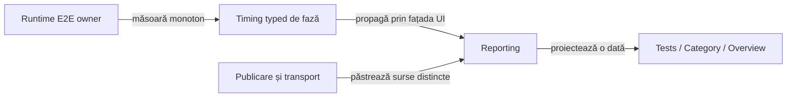

# ATF Reporting — diagnostic, timing E2E și controale

## Pe scurt

Contextul typed, valorile redactate și timing-ul măsurat sunt documentate la
[Reporting](../../atf-reporting/README.md). Rămâne nealinierea dintre proba
dinamică existentă și proiecția nouă a diagnosticului UI, plus timing-ul explicit
al fazelor E2E. Controalele demonstrate
au fost transferate în [baseline](../ATF_Test_Changes_Baseline.md#controale-tehnice-verificate).

## REPORT-FAILURE-CONTRACT-ALIGNMENT-09 — diagnosticul și proba existentă

**Prioritate:** 78/100 = impact 31 + lacună 23 + lucrabil 17 + documentare 7,
conform [registrului comun](README.md#top-feedback-uri-active).

**Owner:** Reporting Tests deține oracolul și interacțiunea browser;
Reporting deține proiecția sigură și contractul semantic al diagnosticului.

- [UiFailureReportContractTest](../../atf-reporting-tests/src/test/java/atf/ui/tests/extent/e2e/failure/UiFailureReportContractTest.java)
  eșuează în cazul `PLAYWRIGHT_ACTION`: cere acțiunea/locatorul/timeout-ul în
  Tests și markerii `Timeout 20000ms exceeded` și `***REDACTED***` în Fails.
- Noul context prioritizează operația, ținta, timpul și așteptarea; diagnosticul
  original este proiectat separat. Probele `UiFailureContextComponentTest` și
  cazul dinamic vechi verifică suprafețe diferite și trebuie reconciliate.
- Eșecul se reproduce cu fixture local și browser, inclusiv după sync-ul sursei
  live. Absența markerului în rezumat nu demonstrează singură o scurgere de secret
  sau pierderea cauzei din întregul artifact.

```text
mvn -pl atf-reporting-tests -am "-Dtest=UiFailureReportContractTest,UiFailureContextComponentTest,LegacyPreviewBudgetComponentTest" "-Dsurefire.failIfNoSpecifiedTests=false" test
```

- [ ] Stabiliți în contractul ownerului suprafața fiecărei informații: rezumat
      compact în Fails, acțiunea proiectată și diagnosticul original inspectabil
      în Tests. Verificați artifactul și selectorii înainte de a clasifica diferența.
- [ ] Păstrați type/message, cauze/suppressed, ownerul și backlink-ul; redactați
      inputul complet înaintea bugetului și verificați absența secretului din HTML.
- [ ] Dacă suprafața s-a schimbat deliberat, adaptați numai selectorul/oracolul
      afectat, cu control `testChanges` exact și verificări echivalente sau mai
      puternice. O verificare eliminată ori o așteptare relaxată nu închide gap-ul.
- [ ] Proba veche și probele contextului nou trebuie să treacă împreună în
      Extent/fallback la 240 și la limita personalizată, cu verdictul neschimbat.

**Închidere:** cazul local existent trece și dovedește unde sunt inspectate
mesajul nativ, redactarea și contextul typed, fără să ceară reinserarea unui
stack nelimitat în Fails și fără să ascundă diagnosticul necesar.

## REPORT-E2E-PHASE-TIMING-01 — execuția E2E separată de agregarea dovezilor

**Prioritate: 78/100** = impact 32 + lacună 21 + lucrabil 18 + datorie documentară 7.
**Owner:** Reporting pentru propagarea timing-ului prin fațada UI; runtime-urile
main AutoEx/Shop pentru intervalele business și Reporting Tests pentru randare.

### Dovadă și reproducere

- Purchase UI+API AutoEx și guest UI+API Shop au trecut individual și prin
  suitele canonice filtrate la același caz, cu un singur HTML per lansare.
- Fazele folosesc `data-duration-source="aggregated"`, fără metadata
  `data-atf-execution-duration-ms`. Suma pașilor și proiecțiile sunt coerente,
  dar diferă de intervalul nativ Extent păstrat separat.
- `UiExtentReportSession.UiPhase` nu expune încă `executionTiming(...)`, deși
  portul `AtfReportPorts.Phase` și modelul `ReportPhaseTiming` există pentru componente.
- Assertion-urile, valorile redactate de maximum 240, tastatura și scroll-ul până
  la ultimul rând sunt păstrate; această lacună privește proveniența timpului E2E.

1. În staging nou, lansați `AutoExPurchaseUiApiE2eTest` și `ShopPurchaseE2eTest`
   individual, cu opt-in-urile și datele demo existente.
2. Lansați `AutoExE2eSuite` și `ShopE2eSuite` cu un `PostDiscoveryFilter` limitat
   la `MethodSource` al aceleiași clase; verificați exact un test pornit și un HTML.
3. În TAB MCP, comparați sursa fazei, suma copiilor și durata nativă înainte și
   după expandare, apoi Tests/Category/Overview; timpul procesului rămâne separat.

### Abordare și criteriu de închidere



<details>
<summary><strong>Legendă — ținta propusă pentru timing-ul E2E</strong></summary>

- Diagrama descrie cerința rămasă; probele remote nu implementează acest contract.
- Runtime-ul deține intervalul business; Kit rămâne neutru, fără browser sau renderer.
- Reporting propagă aceeași valoare în Extent și fallback, fără sumarea publicării peste execuție.
- Durata HTTP necapturată rămâne necunoscută, independent de timpul fazei.

</details>

- [ ] Propagați timing-ul typed prin `UiPhase` și lifecycle-ul UI, apoi măsurați
      fazele E2E la ownerul runtime; fără a introduce logică de suport în testele business.
- [ ] Delimitați achiziția, execuția business, capturile, publicarea checkpoint-urilor
      și flush-ul final; explicați separat costurile incluse și excluse.
- [ ] Probați cu ceas controlat succesul, FAIL, abortul, setup-ul incomplet și
      teardown-ul eșuat; zero măsurat și timpul necunoscut rămân distincte.
- [ ] Verificați Extent/fallback și proiecțiile fără dublare, individual și prin
      suită, inclusiv redeschiderea cu tastatura și izolarea scenariilor-surori.
- [ ] Păstrați raportul unic, assertion-urile și plafonul 240; nu înlocuiți timing-ul
      componentelor sau durata HTTP cu timpul total al procesului ori al publicării.

O suită filtrată la un caz probează ruta de lansare și ownerul artifactului;
nu certifică interacțiunile dintre toate clasele suitei sau echivalența profilelor UI-only.

## Controale tehnice încă necesare

Cele două controale rămân active până la reconcilierea probei de compatibilitate;
schema și transferul sunt definite în [baseline](../ATF_Test_Changes_Baseline.md#reguli-de-folosire).

<details>
<summary><strong>Controale tehnice active</strong></summary>

```yaml
testChanges:
  - id: COMPONENT-DIAGNOSTIC-LIVE-RECONCILE-09
    status: ACTIVE
    base: 74143eeb0c5260aada147fedf67212dc05834eb1
    expires: 2026-11-27
    reason: >-
      Reconciliere explicită a probelor deja prezente în live la începutul
      incrementului BE. Păstrează controlul original fără rebazare și verifică
      handler-ele JUnit, diagnosticul fără HTTP, timing-ul și disclosure-urile
      pe compoziția nouă, fără schimbarea oracolelor sau a guvernanței.
    proof: mvn -pl atf-test-kit,atf-test-auto-ex,atf-reporting-tests,atf-tests -am "-Dtest=HandledComponentFailureComponentTest,AutoExComponentPhaseTimingComponentTest,ComponentExecutionDiagnosticReportTest,WholeAtfGovernanceSuiteTest" "-Datf.governance.testChanges.baseRef=74143eeb0c5260aada147fedf67212dc05834eb1" "-Dsurefire.failIfNoSpecifiedTests=false" test
    paths:
      - atf-test-auto-ex/src/test/java/atf/autoex/tests/component/reporting/AutoExComponentPhaseTimingComponentTest.java
      - atf-reporting-tests/src/test/java/atf/ui/tests/extent/component/timing/ComponentExecutionDiagnosticReportTest.java
      - atf-reporting-tests/src/test/java/atf/ui/tests/extent/support/locators/diagnostic/ComponentDiagnosticLocators.java
      - atf-test-kit/src/test/java/atf/testkit/assertions/HandledComponentFailureComponentTest.java
  - id: REPORT-FAILURE-CONTEXT-04
    status: ACTIVE
    base: e311d1d4305ba850876ae54faf1dbe0acec62bc0
    expires: 2026-11-26
    reason: "Pune contextul primei dovezi UI FAIL înaintea diagnosticului lung și păstrează Throwable-ul, cauzele/suppressed și verdictul. Adaugă probe nominale/negative și browser Extent/fallback la 240/18, inclusiv diagnostic al fazei, Fails și backlink. UiAuditLifecycleTest cere exact trei rânduri în loc de două: acțiune, noul diagnostic primar INFO și captura existentă; UiFallbackFailureEvidenceTest cere în Fails acțiunea/ținta/timpul, păstrând verificările mesajului original în Tests și ale redactării. Nu relaxează plafoane sau selecții."
    proof: mvn -pl atf-reporting-tests,atf-tests -am "-Dtest=UiFailureContextTest,UiFailureContextReportTest,UiFailureContextComponentTest,UiAuditLifecycleTest,UiFallbackFailureEvidenceTest,UiApiVerdictProjectionComponentTest,LegacyPreviewBudgetComponentTest,ReportAssetSizeInventoryTest,WholeAtfGovernanceSuiteTest" "-Datf.governance.testChanges.baseRef=e311d1d4305ba850876ae54faf1dbe0acec62bc0" "-Dsurefire.failIfNoSpecifiedTests=false" test
    paths:
      - atf-reporting-tests/src/test/java/atf/reporting/ui/failurecontext/UiFailureContextFixture.java
      - atf-reporting-tests/src/test/java/atf/reporting/ui/failurecontext/UiFailureContextReportTest.java
      - atf-reporting-tests/src/test/java/atf/reporting/ui/failure/UiFailureContextTest.java
      - atf-reporting-tests/src/test/java/atf/ui/tests/extent/component/failurecontext/UiFailureContextComponentTest.java
      - atf-reporting-tests/src/test/java/atf/ui/tests/extent/support/inspection/failurecontext/UiFailureContextProbe.java
      - atf-reporting-tests/src/test/java/atf/ui/tests/extent/support/locators/failurecontext/ReportFailureContextLocators.java
      - atf-reporting-tests/src/test/java/atf/reporting/ui/UiAuditLifecycleTest.java
      - atf-reporting-tests/src/test/java/atf/reporting/ui/UiFallbackFailureEvidenceTest.java
  - id: REPORT-ASSET-CLEANUP-COMPONENT-06
    status: ACTIVE
    base: 5eb3fd3cb099fc67b49be3c17de564db63755db7
    expires: 2026-11-24
    reason: Adaugă numai fixture-ul Spark offline pentru două cazuri componente ale pipeline-ului de publicare; probele existente ale cleanup-ului și sesiunii păstrează controalele lor exacte, fără dublare de owner sau rebazare automată.
    proof: mvn -pl atf-reporting-tests -am "-Dtest=ExtentReportAssetCleanupTest,ExtentReportSessionContractTest,AtfReportingComponentSuite,UiFailureReportContractTest" "-Dsurefire.failIfNoSpecifiedTests=false" test
    paths:
      - atf-reporting-tests/src/test/java/atf/reporting/support/publication/CleanupPublicationFixture.java
```

</details>
