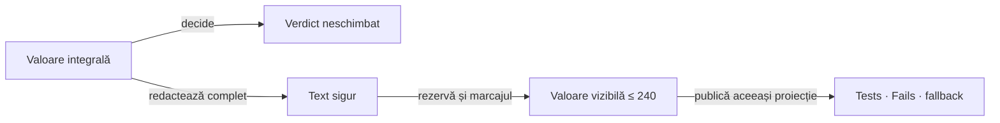

# ATF Reporting — lacune și controale

## Pe scurt

Componentele auditate și panourile înguste au probe valide la
[Reporting Tests](../../atf-reporting-tests/README.md). Rămân două lacune pe
calea directă E2E a erorilor, plus timing-ul fazelor componente, separat de publicare.

| ID | Scor /100 | Diferența care trebuie rezolvată |
|---|---:|---|
| `REPORT-LEGACY-PREVIEW-03` | **86** = 35 + 25 + 19 + 7 | limita 240 devine 286 după adăugarea marcajului de trunchiere |
| `REPORT-FAILURE-CONTEXT-04` | **80** = 32 + 23 + 18 + 7 | stack trace-ul ocupă preview-ul Fails înaintea contextului acțiunii |
| `COMPONENT-AUDIT-TIMING-01` | **74** = 31 + 22 + 15 + 6 | fazele sunt publicate fără timing-ul execuției |

Scorurile sunt priorități după [formula comună](README.md#top-feedback-uri-active),
nu note ale implementării. Contractele demonstrate rămân la
[Reporting](../../atf-reporting/README.md#proiecția-sigură-a-aserțiunilor).

## REPORT-LEGACY-PREVIEW-03 — bugetul include și marcajul

**Owner:** proiecția comună Reporting, cu probe în Reporting Tests.
`Component assertions` prin Kit/`AssertionAuditReport` nu este defectul de aici.

- **Reproducere:** selectați `AutoExCartUiE2eTest.recalculatesAndRemovesCartProduct`
  și `AutoExCartUiApiE2eTest.recalculatesAndRemovesCartProduct` într-o suită,
  cu E2E activ și `assertionMaxDisplayCharacters: 240`.
- **Observație:** cazul UI+API a eșuat la a doua căutare; valorile `OBSERVED`
  și `Failure cause` au câte **286 caractere** în HTML, fără markup sau etichete CSS.
  Valoarea originală de 1357/1358 caractere devine prefix de 240 plus marcaj de 46.
- **Cauză verificată:** [ExtentReportNodeSupport.truncate](../../atf-reporting/src/main/java/atf/reporting/markup/ExtentReportNodeSupport.java)
  aplică `substring(0, limit)` și apoi adaugă marcajul. Acesta este un plafon
  al prefixului, incompatibil cu plafonul cerut întregii valori vizibile.
- Eșecul remote este intermitent; reproducerea permanentă trebuie să folosească
  o eroare locală controlată, nu să depindă de magazinul public.



<details>
<summary><strong>Legendă — valoare limitată, diagnostic păstrat separat</strong></summary>

Marcajul intră în bugetul valorii. Metadatele suplimentare despre trunchiere
pot avea un control separat, fără a reinsera textul brut în valoare, tooltip
sau atribut HTML. Verdictul folosește datele integrale; redactarea precede tăierea.

</details>

- [ ] Refolosiți o proiecție comună cu buget total, incluzând `…`/marcajul;
      nu ridicați limita YAML și nu reduceți fontul ca remediere.
- [ ] Probați o valoare exact la limită, una lungă și o eroare multiline cu
      secret după poziția 240; verificați valoarea decodată din celulă,
      Tests/Fails, expandare și paritatea fallback. Nu numărați markup-ul.
- [ ] Păstrați evaluarea integrală, identitatea erorii și controalele existente;
      schimbarea deliberată a contractului unui test cere `testChanges`, nu
      acceptarea lui 286 într-un oracle nou.
- [ ] Separați bugetul aserțiunilor de body JSON și de calea absolută finală;
      notificarea artifactului nu se taie la 240.

## REPORT-FAILURE-CONTEXT-04 — cauza utilă înaintea stack trace-ului

**Owner:** model/proiecție Reporting și adaptoarele UI pentru contextul typed;
probele de randare rămân în Reporting Tests.

- Fails identifică ownerul, faza și verdictul corect și deschide scenariul eșuat.
  Totuși, `Failure cause` începe cu eroarea Playwright și calea temporară a stack-ului;
  `#submit_search` și așteptarea navigării sunt în afara preview-ului.
- Tabelul acțiunilor păstrează `Click #22`, ținta și așteptarea business,
  dar `OBSERVED` este consumat de același prefix tehnic. Contextul există în
  raport, însă nu este folosit în rezumatul de triere.
- [UiEvidencePublisher.failureCause](../../atf-reporting/src/main/java/atf/reporting/ui/UiEvidencePublisher.java)
  preferă `Throwable.getMessage()` când există excepție; acțiunea eșuată este
  folosită numai în fallback-ul fără Throwable.

- [ ] Compuneți rezumatul din tipul erorii și contextul disponibil al acțiunii
      eșuate: operație, țintă, așteptare și timp măsurat, înaintea stack-ului.
      Păstrați proiecția sigură în buget; nu importați selectorii AutoEx în renderer.
- [ ] Păstrați diagnosticul redacted separat și legătura cu eroarea originală;
      informația necapturată rămâne explicit necunoscută, fără status HTTP ori
      confirmare de dispatch inventate dintr-un text de excepție.
- [ ] Probați excepție lungă cu o singură acțiune eșuată, excepție fără acțiuni,
      acțiuni reușite urmate de eroare și cauze/suppressed; Fails trebuie să
      conducă la acțiunea relevantă, nu numai la un prefix de stack.
- [ ] Nu transformați timeout-ul în PASS pe baza capturii ulterioare.
      Sincronizarea și lipsa replay-ului rămân în
      [feedback-ul UI](ATF_UI_Backend_Guided_Recovery_Feedback.md#ui-action-navigation-02--click-executat-navigare-neconfirmată).

## COMPONENT-AUDIT-TIMING-01 — execuție versus publicare

**Owner:** Kit măsoară invocarea; Reporting proiectează timpul primit, iar
adaptorul consumerului convertește modelul neutru. Scope-ul class/suite al
sesiunii este o cerință separată, compatibilă cu măsurarea per invocare.

| Suprafață | Observație și efect |
|---|---|
| Kit | `ComponentAssertionAudit.start` reține numai faza, iar `PhaseResult` nu transportă timing |
| Reporting | `AssertionAuditReport.phase` deschide și închide faza după evaluare, la publicarea rezultatului |
| Reproducere | `AutoExCheckoutReadinessComponentTest` include browser și așteptare bounded, dar `TEST BODY` poate afișa numai milisecunda publicării |

Timpul JUnit include și overhead-ul fixture-ului; nu trebuie copiat ca durată
exactă a body-ului. Proba trebuie să distingă cele două intervale.

- [ ] Capturați începutul și sfârșitul cu o sursă monotonică la interceptarea
      setup/body/teardown, inclusiv ieșiri FAIL/SKIP și metode parametrizate.
      Mai multe callback-uri ale aceleiași faze se agregă explicit, fără ceas comun între invocări.
- [ ] Transportați timing-ul în rezultatul neutru Kit; Reporting nu importă
      JUnit și nu deduce durata din momentul publicării ori din textul diagnosticului.
- [ ] Distingeți timpul execuției de deschiderea/publicarea/închiderea resursei;
      definiți agregarea clasă/scenariu/fază și păstrați formatul comun al duratelor.
- [ ] Folosiți clock controlat în probe, cu durate diferite pentru fiecare fază;
      verificați Extent și fallback, Tests și Overview, inclusiv erori de publicare/close.
- [ ] Păstrați evaluarea JUnit unică, verdictul și erorile suprimate; nu fabricați
      durate pozitive și nu modificați plafonul redactat de 240 de caractere.

- [ ] Păstrați agregarea exclusive/direct children fără dublarea scenariului
      și fazelor; intervalele suprapuse nu devin wall-clock al suitei prin însumare.

**Închidere:** o fază cu execuție controlată și publicare ulterioară păstrează
durata execuției în artifact; testul eșuează dacă rendererul afișează numai
durata publicării. Aceeași regulă se verifică în ambele module consumer.

## Controale tehnice încă necesare

Aceste aprobări protejează diferențe Git, nu sunt ToDo-uri funcționale.
Transferul și eliminarea lor urmează
[baseline-ul tehnic](../ATF_Test_Changes_Baseline.md#reguli-de-folosire),
fără rebazare, extindere de scope sau relaxarea guard-urilor.

<details>
<summary><strong>Controale tehnice active</strong></summary>

```yaml
testChanges:
  - id: REPORT-NARROW-READABILITY-02
    status: ACTIVE
    base: 3219ef1ff546369d00a006cfc7434644251c6f9a
    expires: 2026-11-26
    reason: Adaugă probe nominale și negative pentru celule etichetate la lățimea panoului; păstrează limitele de scroll, lipsa overflow-ului și valorile. Pe suprafața mobilă, etichetele repetate înlocuiesc numai antetul vizual sticky, iar verificarea existentă cere eticheta fiecărei celule; desktop-ul păstrează antetul sticky.
    proof: mvn -pl atf-reporting-tests,atf-tests -am "-Dtest=NarrowEvidenceReadabilityComponentTest,ReportTableViewportComponentTest,ReportApiViewportParityComponentTest,TableViewportBrowserComponentTest,ReportAssetSizeInventoryTest,ComponentAssertionStepReportTest,WholeAtfGovernanceSuiteTest" "-Datf.governance.testChanges.baseRef=3219ef1ff546369d00a006cfc7434644251c6f9a" "-Dsurefire.failIfNoSpecifiedTests=false" test
    paths:
      - atf-reporting-tests/src/test/java/atf/ui/tests/extent/component/readability/NarrowEvidenceReadabilityComponentTest.java
      - atf-reporting-tests/src/test/java/atf/ui/tests/extent/support/inspection/readability/NarrowEvidenceReadabilityProbe.java
      - atf-reporting-tests/src/test/java/atf/ui/tests/extent/support/inspection/readability/NarrowEvidenceFailureFixture.java
      - atf-reporting-tests/src/test/java/atf/ui/tests/extent/support/inspection/table/TableViewportProbe.java
      - atf-reporting-tests/src/test/java/atf/ui/tests/extent/support/inspection/viewport/ReportApiViewportProbe.java
  - id: REPORT-ASSET-ASSERTION-DISCLOSURE-01
    status: ACTIVE
    base: 466a045e95a7336b183a7d75e0b369f8deb3082c
    expires: 2026-11-26
    reason: Rebugetează explicit numai plafoanele depășite de inventarul sursă și de disclosure-ul tipizat al aserțiunilor; păstrează CSS și totalul nativ și probează publicarea compactată.
    proof: mvn -pl atf-reporting-tests,atf-tests -am "-Dtest=ReportAssetSizeInventoryTest,ComponentAssertionStepReportTest,ExtentReportDisclosureBrowserComponentTest,WholeAtfGovernanceSuiteTest" "-Dsurefire.failIfNoSpecifiedTests=false" test
    paths:
      - atf-reporting-tests/src/test/java/atf/reporting/asset/ReportAssetSizeInventoryTest.java
  - id: REPORT-COMPONENT-ASSERTION-STEP-01
    status: ACTIVE
    base: 466a045e95a7336b183a7d75e0b369f8deb3082c
    expires: 2026-11-26
    reason: Verifică disclosure-ul Extent pentru faze goale și noduri cu evidence, plus pasul tipizat de aserțiuni în Extent și fallback; FAIL păstrează ownerul component, valorile exacte și deep-link-ul către tabel, fără request HTTP sintetic.
    proof: mvn -pl atf-reporting-tests,atf-tests -am "-Dtest=ComponentAssertionStepReportTest,ExtentReportDisclosureBrowserComponentTest,WholeAtfGovernanceSuiteTest" "-Dsurefire.failIfNoSpecifiedTests=false" test
    paths:
      - atf-reporting-tests/src/test/java/atf/ui/tests/extent/README.md
      - atf-reporting-tests/src/test/java/atf/ui/tests/extent/component/inspection/ExtentReportDisclosureBrowserComponentTest.java
      - atf-reporting-tests/src/test/java/atf/ui/tests/extent/support/inspection/disclosure/ExtentReportDisclosureProbe.java
      - atf-reporting-tests/src/test/java/atf/ui/tests/extent/component/assertions/ComponentAssertionStepReportTest.java
      - atf-reporting-tests/src/test/java/atf/ui/tests/extent/support/locators/diagnostic/ReportPhaseAuditLocators.java
  - id: REPORTING-LAUNCHER-06
    status: ACTIVE
    base: 490a0f274d71ec4bb288b01655e60f768daa74ba
    expires: 2026-11-26
    reason: Declară ExtentReportingE2eSuite drept gate UI canonic și păstrează vechiul launcher ca alias compatibil; proba de discovery compară metodele și template-urile parametrizate fără browser ori reducerea selecției.
    proof: mvn -pl atf-reporting-tests,atf-tests -am "-Dtest=ReportingUiLauncherSelectionTest,WholeAtfGovernanceSuiteTest" "-Datf.governance.testChanges.baseRef=490a0f274d71ec4bb288b01655e60f768daa74ba" "-Dsurefire.failIfNoSpecifiedTests=false" test
    paths:
      - atf-reporting-tests/src/test/java/atf/reporting/governance/AtfReportingUiAuditSuite.java
      - atf-reporting-tests/src/test/java/atf/reporting/governance/ReportingUiLauncherSelectionTest.java
  - id: REPORT-UNIFIED-TABLES-01
    status: ACTIVE
    base: 9d444354620b904f736302a2217f35e38ee5a875
    expires: 2026-11-26
    reason: Adaugă numai probe componente noi pentru agregarea UI-only cross-phase, paritatea Extent/fallback, captură terminală, policy fără captură și regresiile failure/UI+API; testele existente rămân intacte.
    proof: mvn -pl atf-reporting-tests,atf-tests -am "-Dtest=UiCrossPhaseCompactFlowComponentTest,ReportEvidenceProfileIntegrationTest,ExtentUnifiedFlowMultipleScreenshotTest,WholeAtfGovernanceSuiteTest" "-Datf.governance.testChanges.baseRef=9d444354620b904f736302a2217f35e38ee5a875" "-Dsurefire.failIfNoSpecifiedTests=false" test
    paths:
      - atf-reporting-tests/src/test/java/atf/reporting/ui/profile/UiCrossPhaseCompactFlowComponentTest.java
  - id: REPORT-UI-FAILURE-CORRELATION-10
    status: ACTIVE
    base: 9b0860bfc734df570c7512b76aa5dbb559527b7d
    expires: 2026-11-25
    reason: Corelare explicită prin identitatea aserțiunii UI publicate în scenariul curent; probe neutre pentru propagare directă și wrapped, excepții independente, identități egale ca text, canale distincte și cleanup; păstrează toate cazurile anterioare. Corelarea AutoEx este păstrată de runtime-ul main; mutarea și probele consumerului sunt urmărite separat de CONSUMER-AUTOEX-RUNTIME-10.
    proof: mvn -pl atf-reporting-tests,atf-test-auto-ex,atf-tests -am "-Dtest=AtfReportingUnitSuite,AtfReportingComponentSuite,AtfReportingIntegrationSuite,AutoExComponentSuite,WholeAtfGovernanceSuiteTest" "-Datf.governance.testChanges.baseRef=9b0860bfc734df570c7512b76aa5dbb559527b7d" "-Dsurefire.failIfNoSpecifiedTests=false" test
    paths:
      - atf-reporting-tests/src/test/java/atf/reporting/ui/failure/UiCheckpointFailureTest.java
      - atf-reporting-tests/src/test/java/atf/reporting/support/failurecorrelation/UiFailureCorrelationFixture.java
      - atf-reporting-tests/src/test/java/atf/ui/tests/extent/support/inspection/reconciliation/UiFailureCorrelationProbe.java
      - atf-reporting-tests/src/test/java/atf/ui/tests/extent/support/api/ApiReportUiFlow.java
      - atf-reporting-tests/src/test/java/atf/ui/tests/extent/component/audit/UiFailureCorrelationComponentTest.java
  - id: REPORT-ASSET-CLEANUP-COMPONENT-06
    status: ACTIVE
    base: 5eb3fd3cb099fc67b49be3c17de564db63755db7
    expires: 2026-11-24
    reason: Adaugă numai fixture-ul Spark offline pentru două cazuri componente ale pipeline-ului de publicare; probele existente ale cleanup-ului și sesiunii păstrează controalele lor exacte, fără dublare de owner sau rebazare automată.
    proof: mvn -pl atf-reporting-tests -am "-Dtest=ExtentReportAssetCleanupTest,ExtentReportSessionContractTest,AtfReportingComponentSuite,UiFailureReportContractTest" "-Dsurefire.failIfNoSpecifiedTests=false" test
    paths:
      - atf-reporting-tests/src/test/java/atf/reporting/support/publication/CleanupPublicationFixture.java
  - id: REPORT-LIVE-CONTROL-04
    status: ACTIVE
    base: b9b1325c28d665be6289bb2cf9286666513e7a05
    expires: 2026-11-24
    allowDelete: true
    reason: Revizuiește explicit diff-ul curent al relocării Network cu toate cele cinci cazuri și fațada de locatori, al probei Client și al inventarului finit standalone. Nu modifică guard-urile; reexecută probele pentru baza curentă, fără rebazarea automată a controalelor anterioare.
    proof: mvn -pl atf-reporting-tests,atf-test-kit -am "-Dtest=AtfReportingComponentSuite,AtfTestLayerArchitectureTest" "-Dsurefire.failIfNoSpecifiedTests=false" test
    paths:
      - atf-reporting-tests/src/test/java/atf/reporting/extent/session/ExtentReportSessionContractTest.java
      - atf-reporting-tests/src/test/java/atf/reporting/ui/network/NetworkCaptureEvidenceTest.java
      - atf-reporting-tests/src/test/java/atf/ui/tests/extent/component/inspection/network/NetworkCaptureEvidenceTest.java
      - atf-reporting-tests/src/test/java/atf/ui/tests/extent/support/locators/network/ReportNetworkCaptureLocators.java
      - atf-test-kit/src/test/java/atf/testkit/AtfTestLayerArchitectureTest.java
  - id: SHOP-CAPTURE-01
    status: ACTIVE
    base: 0f6a95265024a78c20754d5c18937d24434a2d2d
    expires: 2026-10-30
    reason: Probează agregarea fazelor Shop, ownership-ul API și cazul setup eșuat fără body ori screenshot terminal.
    proof: mvn -pl atf-reporting-tests,atf-test-practice-shop -am "-Dtest=ShopComponentSuite,ReportEvidenceProfileIntegrationTest,ExtentUnifiedFlowMultipleScreenshotTest" "-Dsurefire.failIfNoSpecifiedTests=false" test
    paths:
      - atf-reporting-tests/src/test/java/atf/reporting/ui/profile/ReportEvidenceProfileIntegrationTest.java
  - id: REPORT-UI-ACTION-REDACTION-01
    status: ACTIVE
    base: a23c76e662516504f55a4369c58ca98bbf2f26ec
    expires: 2026-10-30
    reason: Prove card/CVC redaction before UI evidence recording, including exception and diagnostic trace paths, plus the rendered HTML artifact.
    proof: mvn -pl atf-ui -am "-Dtest=PlaywrightActionSequenceTest" "-Dsurefire.failIfNoSpecifiedTests=false" test; mvn -pl atf-reporting-tests -am "-Dtest=ExtentReportUiEvidenceRenderingTest,ReportEnvironmentSnapshotTest" "-Dsurefire.failIfNoSpecifiedTests=false" test
    paths:
      - atf-ui/src/test/java/atf/ui/playwright/PlaywrightActionSequenceTest.java
      - atf-reporting-tests/src/test/java/atf/reporting/ui/ExtentReportUiEvidenceRenderingTest.java
```

</details>
