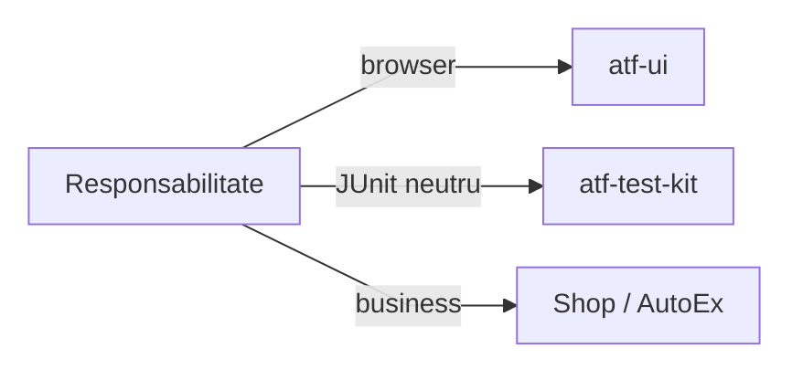

# ATF UI — sincronizare și recuperare ghidată de backend

## Pe scurt

**Stare: sincronizare nativă și politică BE read-only livrate; proiecția typed
a observațiilor, continuitatea selectului și coeziunea readiness rămân deschise.**
Ownerii sunt UI pentru sincronizare, Kit pentru declarația neutră,
consumerii pentru semantica operațiilor și Reporting pentru dovezile randate.

- Primitivele așteaptă prin operația nativă strictă. Continuitatea selectului
  rămâne la UI, iar precondițiile business ale checkout-ului sunt la consumer.
- Reluarea întregului test, a creării contului, a coșului ori a plății rămâne
  exclusă din acest increment; un rezultat necunoscut al mutației oprește replay-ul.

Contractele existente sunt în [UI](../../atf-ui/README.md),
[AutoEx](../../atf-test-auto-ex/README.md#coeziunea-suportului-autoex)
și [Kit](../../atf-test-kit/README.md). Căutarea catalogului folosește
[clickul unic cu postcondiție](../../atf-ui/README.md#click-unic-cu-postcondiție-explicită),
cu [semantica AutoEx](../../atf-test-auto-ex/README.md#confirmarea-căutării-în-catalog).
Acest feedback deține diferențele rămase,
nu schimbă acele contracte prin simpla propunere a unei configurații.

## Priorități și dovadă

Scorul este prioritate: impact /40 + lacună /30 + lucrabil /20 + datorie
documentară /10. Nu reprezintă o notă a codului sau un procent de reproducere.

| ID | Scor /100 | Criteriul care lipsește |
|---|---:|---|
| `UI-RECOVERY-AUDIT-01` | 78 = 33 + 22 + 16 + 7 | încercări vizibile, verdict reconciliat și expandare completă |
| `UI-NATIVE-SELECT-DETACH-01` | 74 = 31 + 20 + 16 + 7 | selectul înlocuit poate continua numai cu rezultat confirmat și activare unică |
| `UI-READINESS-REUSE-30` | 68 = 26 + 18 + 18 + 6 | compoziție BE duplicată și observație/decizie/cleanup amestecate în catalogul Shop |

## UI-NATIVE-SELECT-DETACH-01 — continuitate după înlocuirea selectului

**Owner:** integrarea Playwright din `atf-ui`; prioritate **74/100**.
În driverul fixat la `1.49.0`, un select dezactivat înlocuit în timpul așteptării
poate întoarce `[]`, fără excepție, fără eveniment și fără valoarea cerută.

- ATF respinge rezultatul gol, păstrând FAIL și selectorul. Continuitatea
  automată rămâne nedemonstrată; guard-ul nu reexecută selecția.
- Implementarea upstream a
  [`_selectOption`](https://github.com/microsoft/playwright/blob/v1.49.0/packages/playwright-core/src/server/dom.ts#L524)
  nu propagă rezultatul de detach înainte să returneze lista locală.
- Proba locală distinge înlocuirea cu o țintă de înlocuirea cu două ținte.

- [ ] Evaluați corecția upstream sau un adaptor bounded care dovedește că prima
      activare nu a avut loc; nu deduceți permisiunea de replay numai dintr-un timeout.
- [ ] Pentru înlocuire unică, confirmați valoarea și exact un eveniment; pentru
      înlocuire ambiguă ori rezultat necunoscut, păstrați zero activări și FAIL.
- [ ] Verificați și lipsa permanentă, document nou, select sensibil și redacția;
      o schimbare de driver cere regresiile pointer/iframe și rapoartelor existente.

## UI-RECOVERY-AUDIT-01 — încercări inspectabile în Extent

**Owner:** model/proiecție la Reporting; probe renderer la Reporting Tests;
adaptoare și aserțiuni business în main la cei doi consumeri.

Observațiile INFO livrate sunt normate la
[Reporting](../../atf-reporting/README.md#decizii-be-fără-verdict-de-succes-implicit).
`UiRecoveryTrace` deține deja operația, încercarea, decizia, motivul, semnalul BE
și duratele; adaptoarele AutoEx/Shop le publică în rânduri INFO. Restanța este
proiecția structurată comună și matricea de acceptanță, fără parsarea mesajelor
sau repetarea deciziei la renderer.

- [ ] Compuneți faptele typed din trace, policy și signal în proiecția comună:
      operație, încercare, decizie/motiv, sursa politicii, bugete și timpi măsurați.
      Signal-ul păstrează deja scope-ul invocare/operație/frame/document și secvența;
      rendererul primește corelarea neutră de la adaptor, fără parsarea mesajului.
      Starea DOM apare numai dacă a fost observată; lipsa ei rămâne necapturată,
      fără acțiuni sau capturi suplimentare pentru completarea tabelului.
      Distingerea observației de replay trebuie să fie vizibilă în raport.
      Separați durata încercării, backoff-ul și timpul total măsurat; o durată
      indisponibilă rămâne explicit necapturată, fără valoare HTTP inventată.
- [ ] Păstrați toate cauzele intermediare și capturile permise. Recuperarea
      înaintea eșecului terminal poate avea rânduri INFO explicite, conform
      recorderului existent; nu rescrieți un FAIL deja publicat în PASS și nu
      înlocuiți raportul original cu artifactul unei rulări ulterioare.
- [ ] Definiți verdictul logic și indicatorul de recuperare: un singur test
      în totaluri, succes inițial distinct de recuperare, epuizare FAIL și abort
      păstrat SKIP. Retry-ul infrastructurii de publicare nu rerulează business-ul.
      Inputul contradictoriu este reconciliat conform
      [contractului comun Reporting](../../atf-reporting/README.md#consistența-statusului-transmis-de-caller).
- [ ] Probați expand/collapse până la fiecare încercare, acțiune, request și
      aserțiune; Fails → test/fază/pas exact și Overview trebuie să păstreze
      cauzele și totalurile coerente. Captura ulterioară nu înlocuiește starea
      consemnată la eroare.
- [ ] Verificați câte un caz relevant individual și prin suită în AutoEx și
      Shop, cu profil UI și UI+API, succes, recuperare/refuz și epuizare. Probele
      Extent neutre rămân în `atf-reporting-tests`; policy/resolver și adaptoarele
      au teste la owner, fără cuplarea testelor de business la HTML.

## UI-READINESS-REUSE-30 — consolidare fără schimbarea protocoalelor

**Prioritate: 68/100** = impact 26 + lacună 18 + lucrabil 18 + documentare 6.
**Owner:** UI pentru browser și compoziția neutră; Shop/AutoEx pentru politica
operației; Kit numai pentru infrastructura JUnit neutră deja demonstrată.

Aceasta este o țintă de refactorizare, neimplementată. Inspecția codului live
și a probelor existente identifică următoarele limite, fără a declara un nou
incident E2E ori echivalența comportamentală a mecanismelor.

- **Model de referință: Shop.** Consolidarea pornește de la contractele și dovezile
  Shop; AutoEx se aliniază la primitivele extrase unde semantica este aceeași.
- Îmbunătățirea coeziunii Shop păstrează comportamentul lui, fără a transplanta
  protocolul AutoEx sau a transforma policy-urile locale în reguli universale.

| Cod inspectat | Oportunitate și limită de consolidare |
|---|---|
| [ShopBackendRecovery](../../atf-test-practice-shop/src/main/atf/shop/support/recovery/ShopBackendRecovery.java) și [AutoExBackendRecovery](../../atf-test-auto-ex/src/main/java/atf/autoex/runtime/recovery/AutoExBackendRecovery.java) | `open(...)` repetă construirea controllerului și rândul INFO cu policy/attempt/source; consumerul trebuie să păstreze endpointul, metoda și clasificarea operației |
| [ShopCatalogReadiness](../../atf-test-practice-shop/src/main/atf/shop/support/catalog/ShopCatalogReadiness.java) | aceeași clasă deține patru listener-e, identitatea cererii/documentului, clasificarea răspunsului, reload-ul și diagnosticul; separarea observației de decizia Shop permite probe independente |
| [UiRecoveryObserver](../../atf-ui/src/main/java/atf/ui/playwright/recovery/UiRecoveryObserver.java) | există deja observație corelată și lifecycle de listener-e; refolosirea trebuie să păstreze limita 64, conflictele și refuzul documentului schimbat |
| [AutoExCatalogSearch](../../atf-test-auto-ex/src/main/java/atf/autoex/runtime/catalog/AutoExCatalogSearch.java) | folosește deja `clickAndAwait` și bugetul comun; URL-ul decodat și produsul așteptat sunt postcondiții AutoEx, fără reload sau click repetat |
| [AutoExReadOnlyNavigation](../../atf-test-auto-ex/src/main/java/atf/autoex/runtime/navigation/AutoExReadOnlyNavigation.java) | reload-ul unui document GET este permis numai pentru pagina queue-full și rutele locale; această regulă nu este politica răspunsului `/products` din Shop |
| [UiRecoveryLoop](../../atf-ui/src/main/java/atf/ui/recovery/UiRecoveryLoop.java) și [RetryAfterParser](../../atf-core/src/main/java/atf/core/http/execution/RetryAfterParser.java) | parsări apropiate, cu gramatici și ancore temporale diferite; înlocuirea directă poate schimba refuzul inputului ori reînnoi delta-seconds |

<strong>Legendă — criteriul extracției propuse</strong>

- Schema clasifică responsabilitatea unei extracții viitoare, nu dependențe
  Maven noi și nici implementări deja livrate.
- UI deține observația browserului, callback-ul bounded și metadatele neutre;
  regula care autorizează o anumită operație rămâne la aplicație.
- Kit păstrează declarații, scope și cleanup test-only fără `Page`, renderer,
  YAML sau endpoint; cele două POM-uri consumer îl declară în `test` scope.
- Testele rendererului și geometriei rămân în Reporting Tests; fixture-ul
  business și expected-ul independent rămân la consumer.

**Ordinea propusă și criterii de acceptanță:**

- [ ] Caracterizați întâi cele trei protocoale: reobservarea BE pasivă nu trimite
      alt request; Shop permite cel mult un GET home după tranzitoriu confirmat;
      căutarea AutoEx păstrează un singur click. Nu introduceți un retry generic
      care acceptă un callback de mutație sau deduce siguranța numai din verb.
- [ ] Păstrați enum-urile operațiilor la consumer: aceeași cheie
      `catalog-readiness` nu certifică aceeași cerere. Registrul pasiv Shop declară
      GET, încărcarea home observă GET/QUERY, iar `UiRecoveryOperation` limitează
      read-only la GET/HEAD; extracția nu lărgește implicit allowlist-ul comun.
- [ ] Consolidați la UI compoziția repetată a celor două `*BackendRecovery.open`,
      cu policy, operații și sink explicite. Păstrați fațadele consumerilor și
      proiecția INFO existentă; criteriul typed al raportării rămâne separat la
      `UI-RECOVERY-AUDIT-01`, fără un renderer ori formatter paralel în Kit.
- [ ] Folosiți Shop ca baseline pentru rezultatele observabile, ownership și
      raportul auditabil, apoi verificați adaptorul AutoEx pe aceeași capabilitate
      neutră. Un helper deja existent în AutoEx nu devine implicit standardul
      Shop și nu justifică rescrierea flow-ului sau așteptărilor lui business.
- [ ] Desprindeți observația de regula Shop, apoi verificați dacă aceeași
      capabilitate UI servește efectiv și controllerul pasiv/AutoEx. Nu transformați
      automat `UiRecoveryObserver` într-un observer permisiv: QUERY/body, request
      curent, concurență, frame și schimbarea documentului au contracte diferite.
- [ ] Păstrați `ObservationBudget` existent la `awaitVisible`/`clickAndAwait`;
      evitați un al doilea deadline în helper sau Kit. `UiRecoveryLoop` deține
      propriul scope pasiv; o compoziție viitoare consumă restul bugetului primit,
      fără să adune două plafoane ori să relaxeze verificarea nativă finală.
- [ ] Înaintea unificării `Retry-After`, probați absent, invalid, overflow,
      delta-seconds, dată HTTP, recepție veche și pauze succesive. Loop-ul UI
      ancorează delta la `signal.capturedAt()`; parserul Core primește un clock
      și fallback. Refactorizarea nu extinde implicit gramatica acceptată și nu
      recalculează întregul delay la fiecare reobservare.
- [ ] Caracterizați atașarea parțială și toate cele patru dezabonări. Lanțul
      `finally` din `ShopCatalogReadiness.close()` încearcă cleanup-ul ulterior,
      dar o a doua excepție poate masca prima; aceasta este o constatare statică,
      fără injecție de failure executată în această analiză. Verificați cauza
      primară, suppressed, self-suppression și close-once înaintea extracției.
- [ ] Evaluați primitivele existente înaintea unui helper nou: `CleanupRegistry`
      din Core are LIFO și colectează `RuntimeException`, iar `FailureAwareCleanup`
      din Kit păstrează și `Error`, în test scope. Nu sunt substituibile orbește
      și nu justifică mutarea Kit în runtime pentru cleanup-ul listener-elor.
- [ ] Păstrați comparațiile neutre ale originii și identitatea documentului;
      nu copiați încă o implementare `sameOrigin`. Orice schimbare a acceptării
      schemei/hostului/portului implicit, a query-ului ori redirectului se probează
      separat și nu se ascunde într-o mutare mecanică de clase.

**Dovada cerută înainte de închidere:**

- Regresiile existente `ShopCatalogReadinessComponentTest`,
  `PlaywrightReadinessBudgetComponentTest`, cele două `*BackendRecoveryComponentTest`,
  `AutoExSearchReadinessComponentTest` și `AutoExStoreAvailabilityComponentTest`
  rămân oracole la owner, fără ștergeri sau relaxări pentru API-ul extras.
- Contoare independente confirmă clickuri/request-uri/reload-uri; cazurile
  GET/QUERY 503→200, 503 repetat, 200 fără produs, 403, document înlocuit și semnal
  vechi/concurent păstrează același verdict, cauză și deadline.
- Câte un E2E relevant din fiecare consumer, individual și prin suită filtrată,
  păstrează raportul unic. Extent/fallback păstrează assertion-urile colapsabile,
  limita 240, tabelele, capturile și totalurile; probele de randare sunt la
  Reporting Tests, iar backlink-ul rămâne [criteriu separat](ATF_Reporting_Feedback.md#report-failure-deep-link-29--revenire-la-dovada-eșecului).
- Instanțierea unui controller și getterul lui nu dovedesc folosirea BE în
  journey: apelurile `begin(CATALOG_READINESS)` găsite în cei doi consumeri sunt
  în componentele de recovery. Închiderea cere traseul real al capabilității
  extrase, fără activarea implicită a unui mecanism sau promisiuni E2E noi.

**Închidere:** duplicarea demonstrată are un singur owner reutilizabil, iar
politicile aplicațiilor rămân explicite; aceleași 12 module, scope-uri Maven,
deadline-uri și rezultate observabile sunt păstrate.

## Contracte păstrate și criteriu de închidere

- Auditul componentelor are evaluare JUnit unică și pas colapsabil standard,
  conform [ghidului de testare](../ATF_Testing_Guide.md#auditul-componentelor-consumerilor).
- Așteptarea nativă și activarea unică sunt la [UI](../../atf-ui/README.md#așteptare-nativă-și-unicitate);
  precondiția de identitate/coș este la [consumer](../../atf-test-auto-ex/README.md#gate-ul-coșului-și-ownerul-contului).

Bugetul redactat de 240, paritatea rendererelor și lizibilitatea dovezilor sunt
contracte [Reporting](../../atf-reporting/README.md#proiecția-sigură-a-aserțiunilor),
inclusiv în [panouri înguste](../../atf-reporting/README.md#lizibilitatea-dovezilor-în-panouri-înguste).
Aceste invariante rămân obligatorii pentru viitoarele încercări de recuperare.

Politica validată și exemplele livrate sunt la ownerii UI, Kit, Reporting și
consumeri, cu precedența documentată în
[ghidul adnotărilor](../ATF_Test_Infrastructure_Annotations.md).
[Geometria iframe-urilor](ATF_UI_Browser_Geometry_Feedback.md) are criteriu separat.
Verificarea și publicarea urmează [procesul izolat](../ATF_Build_And_Execution_Safety.md);
o repetare manuală parțială nu închide criteriile de recuperare rămase.

Controlul politicii BE livrate este în
[baseline-ul verificat](../ATF_Test_Changes_Baseline.md#controale-tehnice-verificate).

## Acceptanță pentru reevaluarea UI

- Izolarea subscriberilor păstrează observația raw și diagnosticul fiecărei
  livrări defecte; contorul de retenție nu certifică recepția în consumer.
- Identitatea cererii înaintea răspunsului și scope-ul frame/document/invocare
  se probează cu cerere veche întârziată și acțiune nouă, la boundary-ul generic;
  semantica order și expected-ul rămân în Shop.
- Politica existentă de recuperare nu devine retry al întregului test. Selecția
  și geometria păstrează activarea unică, iar rezultatul necunoscut al unei
  mutații rămâne refuz, nu permisiune de replay.
- Rulați probele locale înaintea câte unui caz consumer relevant; browserul și
  Reporting nu intră în Kit, iar adaptorul business nu repară rendererul prin CSS local.

Nota se revede prin [rubrica de cod](../README_Atf_CodeBestPractices.md#rubrica-reevaluării-modulelor),
cu criteriile independente închise la owner; o singură componentă verde nu
certifică toate adaptările consumerilor.
