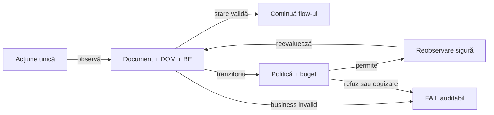

# ATF UI — sincronizare și recuperare ghidată de backend

## Pe scurt

**Stare: sincronizare nativă livrată; recuperarea ghidată de BE rămâne propusă.**
Ownerii sunt UI pentru sincronizare, Kit pentru declarația neutră,
consumerii pentru semantica operațiilor și Reporting pentru dovezile randate.

- Purchase AutoEx UI și UI+API au eșuat înaintea clickului de checkout;
  capturile ulterioare arată butonul prezent. Proba locală reproduce verificarea
  prematură a locatorului, fără să dovedească toate cauzele rulării remote.
- Primitivele așteaptă prin operația nativă strictă; rămân precondițiile business
  ale tranziției și continuitatea unui select înlocuit înaintea activării.
- Reluarea întregului test, a creării contului, a coșului ori a plății rămâne
  exclusă din acest increment; un rezultat necunoscut al mutației oprește replay-ul.

Contractele existente sunt în [UI](../../atf-ui/README.md),
[AutoEx](../../atf-test-auto-ex/README.md#coeziunea-suportului-autoex)
și [Kit](../../atf-test-kit/README.md). Căutarea catalogului folosește
[clickul unic cu postcondiție](../../atf-ui/README.md#click-unic-cu-postcondiție-explicită),
cu [semantica AutoEx](../../atf-test-auto-ex/README.md#confirmarea-căutării-în-catalog).
Acest feedback deține diferențele rămase,
nu schimbă acele contracte prin simpla propunere a unei configurații.

## Priorități și dovadă

Scorul este prioritate: impact /40 + lacună /30 + lucrabil /20 + datorie
documentară /10. Nu reprezintă o notă a codului sau un procent de reproducere.

| ID | Scor /100 | Criteriul care lipsește |
|---|---:|---|
| `UI-BACKEND-RECOVERY-01` | 80 = 33 + 24 + 16 + 7 | YAML + adnotare, corelare cauzală și decizie fără replay nesigur |
| `UI-LOCATOR-READINESS-01` | 79 = 32 + 23 + 17 + 7 | identitatea și coșul sunt validate înaintea checkout-ului, individual și suite |
| `UI-RECOVERY-AUDIT-01` | 78 = 33 + 22 + 16 + 7 | încercări vizibile, verdict reconciliat și expandare completă |
| `UI-NATIVE-SELECT-DETACH-01` | 74 = 31 + 20 + 16 + 7 | selectul înlocuit poate continua numai cu rezultat confirmat și activare unică |

<details>
<summary><strong>Dovezi observate și limita concluziei</strong></summary>

| Suprafață | Observație | Ce permite concluzia |
|---|---|---|
| Raportul purchase comun | 10 scenarii, 8 PASS și 2 FAIL; ambele failure-uri sunt `a.check_out (matched 0)` | aceeași precondiție a clickului eșuează în UI și UI+API |
| Secvența eșuată | Continue după creare cont → header Cart → checkout; ultimul rând durează 25 ms, respectiv 8 ms | eșecul precedă o așteptare utilă a țintei; nu dovedește eșec BE |
| Capturile failure | butonul checkout și Blue Top, cantitate 2, total Rs. 1000 sunt vizibile în ambele capturi | starea de după eroare diferă de observația inițială de 0 elemente |
| UI+API purchase | documentul `/view_cart`, sequence 13, are HTTP 200; body-ul documentului nu este capturat | nu există dovadă de 503 pentru această navigare; 200 nu certifică DOM-ul la momentul clickului |
| Profilul final screenshot | purchase cu o singură captură terminală trece în același raport; clasele apelează același `AutoExPurchaseJourney.execute` | selectorul nu este demonstrat invalid permanent; profilul nu trebuie folosit ca retry sau remediere a sincronizării |
| Codul UI | click/fill/select deleagă rezolvarea către operația nativă strictă; select respinge rezultatul gol | absența tranzitorie este așteptată; lipsa confirmării nu produce PASS |
| Codul AutoEx | `CartPage.proceedToCheckout()` așteaptă explicit vizibilitatea controlului înaintea clickului strict | sincronizarea locală nu modifică guard-ul generic pentru click/fill/select și nu implementează recuperarea BE |
| Baseline browser local | wrapperul anterior arunca `matched 0` pentru ținta întârziată; probele permanente acoperă acum click/fill/select | regresia inițială este reprodusă înaintea corecției; ambiguitatea rămâne respinsă |
| Repetare manuală TAB MCP | produs → adăugare unică de 2 bucăți → coș → checkout; selectorul are clasa `check_out`, iar modalul cere Register / Login | selectorul funcționează pe pagina stabilă; nu s-a repetat crearea contului sau plata |
| Reclama manuală | o vignette reală a apărut și a fost închisă prin Close | intermediarul UI trebuie observat separat; nu dovedește cauza celor două failure-uri |

Proba manuală este parțială: nu certifică tranziția autentificată după signup.
Capturile sunt ulterioare erorii; nu demonstrează retrospectiv documentul,
identitatea și numărul de elemente exact la verificarea eșuată. Timpii de
publicare ai rândurilor Extent nu se confundă cu timpii schimburilor HTTP.
În TAB MCP, expandarea tabelului arată cele trei acțiuni, aserțiunea terminală
și diagnosticul locatorului. Comanda Expand all nodes deschide ierarhia;
disclosure-urile dovezilor se deschid separat. Acest comportament nu este
declarat defect de retry și nu justifică schimbarea stării colapsabile implicite.

</details>

## UI-LOCATOR-READINESS-01 — așteptare înaintea activării unice

**Owner rămas:** AutoEx deține precondiția business a navigării spre checkout.

- Primitivele și bugetul nativ sunt normate în
  [UI](../../atf-ui/README.md#așteptare-nativă-și-unicitate).
- AutoEx aplică [readiness-ul local al checkout-ului](../../atf-test-auto-ex/README.md#readiness-înainte-de-checkout),
  cu probe pentru control întârziat, absent și ambiguu, fără click repetat.

Restanța de aici rămâne verificarea identității și a coșului înaintea tranziției
și matricea individual/suită. Succesul unui purchase nu probează refuzul unei
identități greșite ori al unui coș pierdut.

- [ ] După Continue, verificați identitatea contului deținut și starea coșului
      înainte de checkout. O cantitate greșită sau o sesiune pierdută rămâne FAIL;
      nu re-adăugați produsul și nu creați alt cont pentru a obține PASS.

**Închidere:** ținta întârziată produce un singur click, ținta ambiguă niciunul,
iar lipsa permanentă păstrează locatorul, documentul și cauza în raport.
Purchase individual și prin suită trebuie să confirme aceeași tranziție;
proba locală singură nu închide diferența remote.

## UI-NATIVE-SELECT-DETACH-01 — continuitate după înlocuirea selectului

**Owner:** integrarea Playwright din `atf-ui`; prioritate **74/100**.
În driverul fixat la `1.49.0`, un select dezactivat înlocuit în timpul așteptării
poate întoarce `[]`, fără excepție, fără eveniment și fără valoarea cerută.

- ATF respinge rezultatul gol, păstrând FAIL și selectorul. Continuitatea
  automată rămâne nedemonstrată; guard-ul nu reexecută selecția.
- Implementarea upstream a
  [`_selectOption`](https://github.com/microsoft/playwright/blob/v1.49.0/packages/playwright-core/src/server/dom.ts#L524)
  nu propagă rezultatul de detach înainte să returneze lista locală.
- Proba locală distinge înlocuirea cu o țintă de înlocuirea cu două ținte.

- [ ] Evaluați corecția upstream sau un adaptor bounded care dovedește că prima
      activare nu a avut loc; nu deduceți permisiunea de replay numai dintr-un timeout.
- [ ] Pentru înlocuire unică, confirmați valoarea și exact un eveniment; pentru
      înlocuire ambiguă ori rezultat necunoscut, păstrați zero activări și FAIL.
- [ ] Verificați și lipsa permanentă, document nou, select sensibil și redacția;
      o schimbare de driver cere regresiile pointer/iframe și rapoartelor existente.

## UI-BACKEND-RECOVERY-01 — configurație și decizie explicită

**Owner:** Kit pentru declarație/resolver fără browser sau renderer; UI pentru
politica runtime neutră și observație pasivă; main AutoEx/Shop pentru operații.



<details>
<summary><strong>Legendă — observația nu repetă mutația</strong></summary>

- Gate-ul aparține aceleiași operații, pagini și încercări; răspunsul altui
  scenariu sau al unei reclame nu poate autoriza recuperarea.
- Reobservarea așteaptă starea sau folosește o citire permisă explicit;
  muchia de întoarcere nu reexecută acțiunea business inițială.
- Erorile business, configurația invalidă și rezultatul necunoscut al unei
  mutații ajung la FAIL cu motivul refuzului și dovezile păstrate.

</details>

<details>
<summary><strong>ToDo — YAML și adnotare, propunere de contract</strong></summary>

Cheile și numele adnotării de mai jos sunt propuse; loaderul actual nu le acceptă.
Un singur boolean nu definește operațiile permise ori idempotency.

- [ ] Introduceți un bloc `browser.recovery` în YAML-ul consumerului, cu
      `enabled: false` implicit, profil de operații read-only, `maxAttempts`,
      `totalTimeout` și `backoff`. Prima evaluare intră în numărul încercărilor;
      deadline-ul comun include așteptările și retry-urile subordonate.
- [ ] Definiți o adnotare neutră, de exemplu `@AtfUiRecovery`, pe clasă/metodă,
      cu mod CONFIGURED / DISABLED / READ_ONLY. Metoda poate restrânge politica
      clasei; YAML-ul dezactivat rămâne master OFF, fără activare implicită din adnotare.
- [ ] Rezolvați configurația imutabilă înaintea resurselor. Stabiliți precedența
      metodei, clasei celei mai apropiate și adnotărilor compuse; respingeți
      conflictele de același nivel, profilurile necunoscute și bugetele invalide.
      Niciun override nu extinde allowlist-ul sau plafonul YAML.
- [ ] Izolați politica per invocare și încercare; lansările IntelliJ, Maven,
      parametrizate și prin suită folosesc același resolver, fără stare statică
      partajată între teste. Setup/cleanup și componentele nu primesc reluare globală.
- [ ] Separați captura necesară deciziei de profilul de prezentare UI/UI+API.
      UI-only nu activează teste/precondiții API ori apeluri BE suplimentare.
      Dacă semnalul necesar lipsește, recuperarea care depinde de el este refuzată;
      orice captură pasivă minimă nouă cere opt-in, redacție și owner explicit.

</details>

<details>
<summary><strong>ToDo — semnalele BE și limitele recuperării</strong></summary>

- [ ] Capturați cursorul înaintea acțiunii și asociați observația cu invocarea,
      pagina/frame-ul, origin-ul, ruta semantică și documentul curent; păstrați
      sequence și `capturedAt`. Publicarea târzie nu schimbă ownerul sau faza.
      Cursorul și semnătura redactată nu reprezintă payload identity sau idempotency.
- [ ] Modelați distinct răspuns 2xx cu DOM întârziat, redirect, refuz HTTP,
      request-failed fără răspuns și lipsa observației. HTTP 200 și `COMPLETE`
      pentru captura filtrată nu demonstrează succesul business ori toate request-urile paginii.
- [ ] Tratați 429/502/503/504 numai după clasificarea operației și corelare;
      respectați Retry-After valid în deadline. Un status singular sau
      `AssertionError` generic nu declanșează retry-ul unui test.
- [ ] Folosiți allowlist semantic, cu same-origin și citire demonstrată.
      AutoEx `GET /add_to_cart/...` și `GET /delete_account` sunt mutații;
      signup, cart, checkout/payment și cleanup nu intră prin regula „GET este sigur”.
- [ ] Reutilizați `UiRetryPolicy`, settlement-ul pasiv și observațiile existente
      unde contractele coincid. `storeAvailability` rămâne recuperarea distinctă
      pentru mesajul queue-full pe rutele deja permise; nu adăugați `/view_cart`
      sau un retry după POST prin simpla extindere a acestei politici.
- [ ] O acțiune cu răspuns întârziat se reconciliază prin observație/read-back
      permis; nu retrimiteți clickul. Un rezultat incert al unei scrieri oprește
      recuperarea automată. Un viitor retry de test complet cere alt increment,
      cu fixture nou, ownership și idempotency server-side demonstrate.
- [ ] Excludeți diferențele de aserțiune, sesiunea greșită, locatorul ambiguu,
      defectele de configurare, publicare/captură și erorile de cleanup.
      Păstrați cauza primară și erorile secundare; întreruperea oprește așteptarea.

</details>

**Închidere:** probele locale verifică fiecare refuz și fiecare recuperare
permisă, inclusiv 2xx cu DOM întârziat și 503 necorelat. Numărul de scrieri
rămâne 1; bugetul total nu crește multiplicativ prin politici imbricate.

## UI-RECOVERY-AUDIT-01 — încercări inspectabile în Extent

**Owner:** model/proiecție la Reporting; probe renderer la Reporting Tests;
adaptoare și aserțiuni business în main la cei doi consumeri.

- [ ] Publicați politica efectivă și sursa ei, operația, indexul încercării,
      bugetul, cauza, decizia permis/refuzat, schimbul BE asociat și starea DOM.
      Distingerea observației de replay trebuie să fie vizibilă în raport.
      Separați durata încercării, backoff-ul și timpul total măsurat; o durată
      indisponibilă rămâne explicit necapturată, fără valoare HTTP inventată.
- [ ] Păstrați toate cauzele intermediare și capturile permise. Recuperarea
      înaintea eșecului terminal poate avea rânduri INFO explicite, conform
      recorderului existent; nu rescrieți un FAIL deja publicat în PASS și nu
      înlocuiți raportul original cu artifactul unei rulări ulterioare.
- [ ] Definiți verdictul logic și indicatorul de recuperare: un singur test
      în totaluri, succes inițial distinct de recuperare, epuizare FAIL și abort
      păstrat SKIP. Retry-ul infrastructurii de publicare nu rerulează business-ul.
- [ ] Probați expand/collapse până la fiecare încercare, acțiune, request și
      aserțiune; Fails → test/fază/pas exact și Overview trebuie să păstreze
      cauzele și totalurile coerente. Captura ulterioară nu înlocuiește starea
      consemnată la eroare.
- [ ] Păstrați aserțiunile componente în pasul colapsabil standard, evaluarea
      JUnit unică și redactarea textului complet înaintea plafonului de 240
      caractere, inclusiv `…`, și după expandare. Unit rămâne categorie separată.
- [ ] Verificați câte un caz relevant individual și prin suită în AutoEx și
      Shop, cu profil UI și UI+API, succes, recuperare/refuz și epuizare. Probele
      Extent neutre rămân în `atf-reporting-tests`; policy/resolver și adaptoarele
      au teste la owner, fără cuplarea testelor de business la HTML.

## Documentare și închidere

- [ ] După implementare și dovadă, promovați contractul la README-urile UI,
      Kit, Reporting, AutoEx/Shop și în
      [ghidul adnotărilor](../ATF_Test_Infrastructure_Annotations.md).
      Exemplele YAML/java trebuie să corespundă API-ului livrat și valorilor implicite.
- [ ] Păstrați separat [limita geometriei browser](ATF_UI_Browser_Geometry_Feedback.md)
      și [lizibilitatea raportului](ATF_Reporting_Feedback.md); o recuperare reușită
      nu închide aceste diferențe.
- [ ] Executați conform [staging-ului și sync-ului sigur](../ATF_Build_And_Execution_Safety.md),
      cu probe și build-uri în TMP, verificare TAB MCP și reconciliere cu live-ul.
      Închideți numai ID-ul demonstrat; analiza și repetarea manuală parțială nu sunt implementare.

<details>
<summary><strong>Control tehnic — sincronizarea locatorilor</strong></summary>

```yaml
testChanges:
  - id: UI-LOCATOR-NATIVE-01
    status: ACTIVE
    base: 3219ef1ff546369d00a006cfc7434644251c6f9a
    expires: 2026-11-26
    reason: Adaugă probe browser pentru absență tranzitorie/permanentă, unicitate, document și țintă înlocuite; păstrează toate probele anterioare. Click/fill/select folosesc unicitatea și bugetul nativ; selectul fără confirmare este FAIL fără replay, iar limita driverului rămâne explicit deschisă.
    proof: mvn -pl atf-ui,atf-test-auto-ex,atf-tests -am "-Dtest=PlaywrightLocatorReadinessComponentTest,PlaywrightActionSequenceTest,PlaywrightJavaScriptClickComponentTest,AutoExCheckoutReadinessComponentTest,WholeAtfGovernanceSuiteTest" "-Datf.governance.testChanges.baseRef=3219ef1ff546369d00a006cfc7434644251c6f9a" "-Dsurefire.failIfNoSpecifiedTests=false" test
    paths:
      - atf-ui/src/test/java/atf/ui/playwright/PlaywrightLocatorReadinessComponentTest.java
      - atf-ui/src/test/resources/atf/ui/playwright/locator-readiness.html
```

</details>
