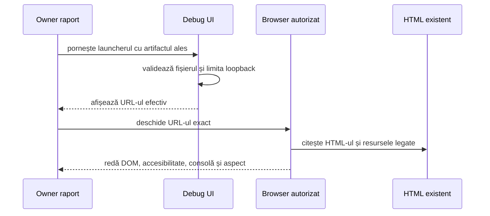

<a id="debug-ui-read-only-report-inspection"></a>
# Debug UI — inspectarea read-only a rapoartelor

`atf-debug-ui` servește un artifact HTML existent printr-un server exclusiv loopback, pentru inspectare într-un browser local autorizat sau prin TAB MCP. Nu creează, modifică ori califică raportul.

## Pe scurt

| Aspect | Contract |
|---|---|
| Owner | J0 deține sursa, testele native, contractul API, împachetarea și feedback-ul comun. |
| Consumer | J1 este primul consumer binar; launcherul este declarat numai în scope-ul de test. |
| Runtime | POM-ul publicat aduce Console; Core este tranzitiv prin Console. |
| Limită | HTTP read-only pe `127.0.0.1`; ownerul artifactului păstrează acceptanța comportamentală. |

## Fluxul de ownership



<details>
<summary><strong>Legenda diagramei — inspectare read-only</strong></summary>

- Raportul selectat este generat înainte de pornirea inspectorului.
- Browserul poate citi artifactul; Debug UI nu îi rescrie conținutul.
- Reporting deține generarea raportului, iar consumerul acceptanța journey-ului său.

</details>

## Pornirea inspectorului

Rulați `atf.debugui.AtfDebugUiLauncher` cu classpath-ul de test al consumerului și o cale explicită spre raport:

```text
--html <configured-report-path>
--port 0
```

Launcherul afișează URL-ul efectiv. Deschideți exact acel URL în browserul de inspectare permis și verificați artifactul nou: taburile cerute, secțiunile expandate și colapsate, linkurile, arborele de accesibilitate, consola și capturile. Păstrați procesul serverului activ până la încheierea inspecției.

- J1 este primul consumer. Modulul `atf-tests` declară biblioteca în scope-ul de test, astfel încât IntelliJ poate rula launcherul cu acest classpath.
- Shop și AutoEx își păstrează așteptările și acceptanța propriilor rapoarte. Consultați [catalogul consumerului J1](https://github.com/crististefanita/atf_j1/blob/main_RO/lib/README.md).

## Ownership și distribuție

- Modulul producător și regresiile native rămân în [`atf-debug-ui`](../atf-debug-ui/README.md).
- J1 selectează `atf.api:atf-debug-ui:1.0.0-d1`. POM-ul rădăcină, POM-ul alăturat, proveniența și hash-urile trebuie să identifice aceeași pereche fizică.
- Nu copiați sursele implementării într-un consumer. J2–J7 își păstrează cataloagele până la o livrare revizuită și o acceptanță locală independentă.

| Constatare | Owner |
|---|---|
| Loopback, izolarea căii, identitatea URI, shutdown sau memoria | Modulul sursă J0 și testele native |
| Configurația launcherului sau fluxul local de inspectare | Feedback-ul și acceptanța consumerului care adoptă biblioteca |
| Structura HTML Extent, aserțiunile sau randarea | Ownerul Reporting și modulul de teste Reporting |

J0 deține contractul comun; fiecare consumer deține integrarea sa. Consultați [indexul bibliotecilor](README.md) și [protocolul de sincronizare a workspace-urilor](../docs/ATF_Workspace_Synchronization.md).
