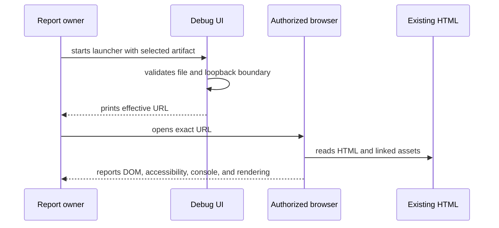

<a id="debug-ui-read-only-report-inspection"></a>
# Debug UI — read-only report inspection

`atf-debug-ui` serves an existing HTML artifact through a loopback-only server so an authorized local browser or TAB MCP can inspect it. It does not create, alter, or qualify the report.

## At a glance

| Concern | Contract |
|---|---|
| Owner | J0 owns source, native tests, API contract, packaging, and shared feedback. |
| Consumer | J1 is the first binary consumer; its launcher dependency is test-scoped. |
| Runtime | The published POM brings in Console; Core is transitive through Console. |
| Boundary | Read-only HTTP on `127.0.0.1`; the artifact owner still owns behavioral acceptance. |

## Ownership flow



<details>
<summary><strong>Diagram legend — read-only inspection</strong></summary>

- The selected report is already generated before the inspector starts.
- The browser can read the artifact; Debug UI does not rewrite its contents.
- Reporting owns report generation, while the consumer owns its journey acceptance.

</details>

## Start the inspector

Run `atf.debugui.AtfDebugUiLauncher` with the consumer's test classpath and an explicit report path:

```text
--html <configured-report-path>
--port 0
```

The launcher prints the effective URL. Open that exact URL in the permitted inspection browser, then verify the fresh artifact: required tabs, expanded and collapsed sections, links, accessibility tree, console, and screenshots. Keep the server process alive until inspection ends.

- J1 is the first consumer. Its `atf-tests` module declares the library in test scope, so IntelliJ can run the launcher with its test classpath.
- Shop and AutoEx retain their own report expectations and acceptance. See the [J1 consumer catalog](https://github.com/crististefanita/atf_j1/blob/main/lib/README.md).

## Ownership and distribution

- The producer module and native regressions remain in [`atf-debug-ui`](../atf-debug-ui/README.md).
- J1 selects `atf.api:atf-debug-ui:1.0.0-d1`. Its root POM, adjacent POM, provenance and hashes must identify the same physical pair.
- Do not copy implementation sources into a consumer. J2–J7 keep their existing catalogs until each has a reviewed delivery and independent local acceptance.

| Finding | Owner |
|---|---|
| Loopback, path containment, URI identity, shutdown, or memory contract | J0 source module and native tests |
| Launcher configuration or local inspection flow | Adopting consumer feedback and acceptance |
| Extent HTML structure, assertions, or rendering | Reporting owner and reporting-test module |

J0 owns the shared contract; each consumer owns its integration. See the [library index](README.md) and [workspace synchronization protocol](../docs/ATF_Workspace_Synchronization.md).
