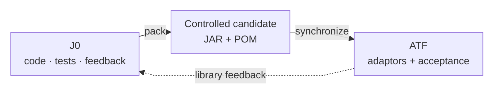

# ATF libraries - J0 source and maintenance

## At a glance

J0 holds Core, Reporting, Console, Mock and Test Kit libraries: code, API, tests, packaging and feedback. The code remains in the source modules of this project; ATF consumers re-use JAR / POM pair checked.

## Usage guidelines

| Library | What does it offer | Use her for |
|---|---|---|
| [Core](README.Core.md) | HTTP configuration, JSON, editing and lifecycle | Common mechanisms and neutral adapters. |
| [Reporting](README.Reporting.md) | Extent / fallback, assertions and evidence UI / API | Auditable reports from consumer observations. |
| [Console](README.Console.md) | Configurable events and diagnosis | Follow-up of execution in Maven and IntelliJ. |
| [Mock](README.Mock.md) | HTTP transport determinist | Components and offline contracts with own catalogue. |
| [Test Kit](README.TestKit.md) | `atf-test-kit` · audit and neutral lifecycle JUnit | Classification, comparisons and test support. |

## Maintenance and feedback

| Library | Code maintained in J0 | Canonical backlog in J0 |
|---|---|---|
| Core | [atf-core](../atf-core/README.md) | [Feedback](../docs/feedback/ATF_Core_Feedback.md) |
| Reporting | [atf-reporting](../atf-reporting/README.md) | [Feedback](../docs/feedback/ATF_Reporting_Feedback.md) |
| Console | [atf-console](../atf-console/README.md) | [Feedback](../docs/feedback/ATF_Console_Mock_Feedback.md) |
| Mock | [atf-mock](../atf-mock/README.md) | [Feedback](../docs/feedback/ATF_Console_Mock_Feedback.md) |
| Test Kit | [atf-test-kit](../atf-test-kit/README.md) | [Feedback](../docs/feedback/ATF_Common_Test_Support_Feedback.md) |

[J0 Registry](../docs/feedback/README.md#biblioteci-comune) is the entry point for all projects. Generic regression of composition and rendering Reporting remains in [atf-reporting-tests](../atf-reporting-tests/README.md); the other native tests stand next to the library implementation.

## Working flow

<strong>Legend - joint implementation, separate acceptance</strong>

- Continuous arrows describe the delivery of a candidate; the dotted arrow returns the findings to J0.
- J0 holds joint remediation and permanent regression. The consumer provides reproduction and verifies the integration of the binary in its own field.
- The diagram describes responsibilities and deliveries, not additional Maven modules or copy sources into consumers.

## Only one requirement with evidence

- Please note in J0 the project, the actual coordinate / hash, the selection / profile, the expected and observed result, the minimum reproduction and the evidence kept.
- If the origin is unclear, keep a single unconfirmed finding in J0 until isolation; do not copy the checklist in each project.
- Business rules, capture Android, ASR models and broker infrastructure remain at the consumer's owner. A task shown exclusively locally moves there with a short reference from the original criterion.
- Close the criterion only after negative control, corrected regression and relevant acceptance; keep the contract stable in documentation, without resolved ToDos or release chronologies.

## Timing and governance

1. Compare live code and local changes prior to modification; keep Git bases and configuration of each project.
2. Correct J0 and add permanent regression to the owner; build and check source / JAR in a TMP staging of your own.
3. Distribute the same candidate to affected consumers: a current pair per library, with updated provenance and original history preserved.
4. independently revalidate each consumer and selectively promote through the Core guard. A result from J1 does not automatically become evidence for J2, J3 or J4.

| Control | Contract |
|---|---|
| Consumer inventory | Exact five JAR / POM pairs, index and five user guides, directly in lib; no additional versions, nested deposit or release notes. |
| Dependencies | Console and Mock fix the verified Core; its change requires the republication of JAR / POM together without the isolated editing of POM. |
| Identity | Coordinates from POM; hashes and root provenance; POM incorporated coincides with the published pair. |
| Loading | CodeSource indicates JAR physically; parallel sources and native harness do not return to the consumer. |
| Tests | [Examples JAR / POM](../docs/ATF_Platform_Libraries.md#ghiduri-executabile-pe-publicația-binară) in J0; local consumer acceptance. |
| Reporting | 240 default preview, auditable and collapsible asserts, complete frames; the mock / component sample does not certify a real device, broker or ASR. |

In J0, this directory is the maintenance register; it does not replace the source modules and does not host building outputs. [Technical contract](../docs/ATF_Platform_Libraries.md) and [synchronization of workspaces](../docs/ATF_Workspace_Synchronization.md) detail the publication.

Project entry points are collected in the [workspace index](../docs/workspaces/README.md).
