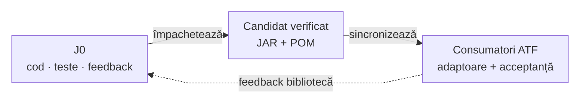

# Biblioteci ATF — sursă și mentenanță J0

## Pe scurt

J0 deține bibliotecile Core, Reporting, Console, Mock și Test Kit: cod, API, teste, împachetare și feedback. Codul rămâne în modulele sursă ale acestui proiect; consumerii ATF reutilizează perechile JAR/POM verificate.

## Ghiduri de utilizare

| Bibliotecă | Ce oferă | Folosiți-o pentru |
|---|---|---|
| [Core](README.Core.md) | HTTP, configurație, JSON, redactare și lifecycle | Mecanisme comune și adaptoare neutre. |
| [Reporting](README.Reporting.md) | Extent/fallback, aserțiuni și dovezi UI/API | Rapoarte auditabile din observațiile consumerului. |
| [Console](README.Console.md) | Evenimente și diagnostic configurabil | Urmărirea execuției în Maven și IntelliJ. |
| [Mock](README.Mock.md) | Transport HTTP determinist | Componente și contracte offline, cu catalog propriu. |
| [Test Kit](README.TestKit.md) | `atf-test-kit` · audit și lifecycle JUnit neutru | Clasificare, comparații și suportul testelor. |

## Mentenanță și feedback

| Bibliotecă | Codul întreținut în J0 | Backlog canonic în J0 |
|---|---|---|
| Core | [atf-core](../atf-core/README.md) | [Feedback](../docs/feedback/ATF_Core_Feedback.md) |
| Reporting | [atf-reporting](../atf-reporting/README.md) | [Feedback](../docs/feedback/ATF_Reporting_Feedback.md) |
| Console | [atf-console](../atf-console/README.md) | [Feedback](../docs/feedback/ATF_Console_Mock_Feedback.md) |
| Mock | [atf-mock](../atf-mock/README.md) | [Feedback](../docs/feedback/ATF_Console_Mock_Feedback.md) |
| Test Kit | [atf-test-kit](../atf-test-kit/README.md) | [Feedback](../docs/feedback/ATF_Common_Test_Support_Feedback.md) |

[Registrul J0](../docs/feedback/README.md#biblioteci-comune) este punctul de intrare pentru toate proiectele. Regresiile generice de compoziție și randare Reporting rămân în [atf-reporting-tests](../atf-reporting-tests/README.md); celelalte teste native stau lângă implementarea bibliotecii.

## Fluxul de lucru

<strong>Legendă — implementare comună, acceptanță separată</strong>

- Săgețile continue descriu livrarea unui candidat; săgeata punctată întoarce constatările la J0.
- J0 deține remedierea comună și regresia permanentă. Consumerul furnizează reproducerea și verifică integrarea binarului în propriul domeniu.
- Diagrama descrie responsabilități și livrări, nu module Maven suplimentare ori copierea surselor în consumeri.

## O singură cerință, cu dovezi

- Consemnați în J0 proiectul, coordonata/hash-ul efectiv, selecția/profilul, rezultatul așteptat și observat, reproducerea minimă și dovezile păstrate.
- Dacă originea este neclară, păstrați o singură constatare neconfirmată în J0 până la izolare; nu copiați checklist-ul în fiecare proiect.
- Regulile de business, capturarea Android, modelele ASR și infrastructura brokerului rămân la ownerul consumerului. Un task demonstrat exclusiv local se mută acolo cu o trimitere scurtă din criteriul inițial.
- Închideți criteriul numai după controlul negativ, regresia corectată și acceptanța relevantă; păstrați contractul stabil în documentație, fără ToDo-uri rezolvate sau cronologii de release.

## Sincronizare și guvernanță

1. Comparați codul live și schimbările locale înainte de modificare; păstrați bazele Git și configurația fiecărui proiect.
2. Corectați în J0 și adăugați regresia permanentă la owner; construiți și verificați sursa/JAR-ul într-un staging TMP propriu.
3. Distribuiți același candidat către consumerii afectați: o pereche curentă per bibliotecă, cu proveniența actualizată și istoricul original păstrat.
4. Revalidați independent fiecare consumer și promovați selectiv prin guard-ul Core. Un rezultat din J1 nu devine automat dovadă pentru J2, J3 sau J4.

| Control | Contract |
|---|---|
| Inventar consumer | Exact cinci perechi JAR/POM, indexul și cinci ghiduri de utilizare, direct în lib; fără versiuni suplimentare, depozit imbricat sau note de release. |
| Dependențe | Console și Mock fixează versiunea Core verificată; schimbarea ei cere republicarea JAR/POM împreună, fără editarea izolată a POM-ului. |
| Identitate | Coordonate din POM; hash-uri și proveniență la rădăcină; POM-ul încorporat coincide cu perechea publicată. |
| Încărcare | CodeSource indică JAR-ul fizic; sursele paralele și harness-urile native nu revin în consumer. |
| Teste | [Exemple JAR/POM](../docs/ATF_Platform_Libraries.md#ghiduri-executabile-pe-publicația-binară) în J0; acceptanță locală la consumer. |
| Raportare | Preview implicit 240, assert-uri auditabile și colapsabile, cadre complete; proba mock/componentă nu certifică un device, broker sau ASR real. |

În J0, acest director este registrul de mentenanță; nu înlocuiește modulele sursă și nu găzduiește output-uri de build. [Contractul tehnic](../docs/ATF_Platform_Libraries.md) și [sincronizarea workspace-urilor](../docs/ATF_Workspace_Synchronization.md) detaliază publicarea.
