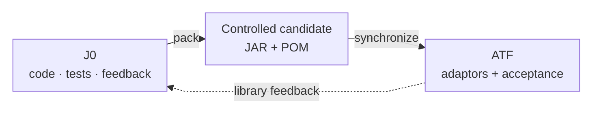

# ATF libraries - J0 source and maintenance

## At a glance

J0 maintains Core, Reporting, Console, Mock and Test Kit: implementation, APIs, tests, packaging and feedback. Source code stays in this project; consumers use verified JAR/POM pairs.

## Usage guidelines

| Library | Capability | Use |
|---|---|---|
| [Core](README.Core.md) | HTTP, configuration, JSON, redaction and lifecycle | Common mechanisms and neutral adapters. |
| [Reporting](README.Reporting.md) | Extent/fallback, assertions and UI/API evidence | Auditable reports from consumer observations. |
| [Console](README.Console.md) | Configurable events and diagnostics | Run diagnostics in Maven and IntelliJ. |
| [Mock](README.Mock.md) | Deterministic HTTP transport | Offline components and contracts with a local catalog. |
| [Test Kit](README.TestKit.md) | `atf-test-kit` · audit and a neutral JUnit lifecycle | Classification, comparisons and test support. |

## Maintenance and feedback

| Library | Code maintained in J0 | Canonical backlog in J0 |
|---|---|---|
| Core | [atf-core](../atf-core/README.md) | [Feedback](../docs/feedback/ATF_Core_Feedback.md) |
| Reporting | [atf-reporting](../atf-reporting/README.md) | [Feedback](../docs/feedback/ATF_Reporting_Feedback.md) |
| Console | [atf-console](../atf-console/README.md) | [Feedback](../docs/feedback/ATF_Console_Mock_Feedback.md) |
| Mock | [atf-mock](../atf-mock/README.md) | [Feedback](../docs/feedback/ATF_Console_Mock_Feedback.md) |
| Test Kit | [atf-test-kit](../atf-test-kit/README.md) | [Feedback](../docs/feedback/ATF_Common_Test_Support_Feedback.md) |

The [library feedback index](../docs/feedback/README.md#biblioteci-comune) routes shared findings. Generic Reporting composition and rendering regressions belong to [atf-reporting-tests](../atf-reporting-tests/README.md); other native tests stay beside their library implementation.

## Maintenance flow

<strong>Legend - joint implementation, separate acceptance</strong>

- Solid arrows describe candidate delivery; the dotted arrow returns findings to J0.
- J0 owns shared fixes and permanent regressions. Each consumer supplies a reproducer and verifies binary integration in its own domain.
- Diagram edges describe responsibility and delivery; they add no Maven modules or copied library source to consumers.

## One finding with evidence

- Record the project, exact coordinates and hashes, selection/profile, expected and observed result, minimal reproducer and retained evidence in J0.
- If ownership is unclear, keep one unconfirmed finding in J0 until it is isolated; avoid duplicating the checklist across projects.
- Business rules, Android capture, ASR models and broker infrastructure belong to the consumer. Move a confirmed local finding to that owner, leaving a short reference at the original criterion.
- Close a finding after its negative control, regression and relevant acceptance pass. Keep the durable contract in documentation; remove completed ToDos and release chronology.

## Synchronization and governance

1. Compare live code and local changes before editing; preserve each project's Git base and configuration.
2. Fix the source owner in J0 and add a permanent regression; build and verify source/JAR behavior in owned TMP staging.
3. Deliver the same candidate to affected consumers: one current pair per library, updated provenance and preserved package history.
4. Revalidate each consumer independently and promote selectively through the Core guard. J1 acceptance supplies no automatic evidence for J2, J3 or J4.

| Control | Contract |
|---|---|
| Consumer inventory | Exactly five JAR/POM pairs, the index and five usage guides directly in lib; no extra versions, nested repository or release notes. |
| Dependencies | Console and Mock pin the verified Core version; a dependency change requires republishing the JAR/POM pair together, without editing only the POM. |
| Identity | POM coordinates, hashes and root provenance agree; the embedded POM matches the published pair. |
| Loading | CodeSource identifies the physical JAR; parallel library source and the native harness stay outside the consumer. |
| Tests | [Executable JAR/POM examples](../docs/ATF_Platform_Libraries.md#ghiduri-executabile-pe-publicația-binară) in J0; local consumer acceptance. |
| Reporting | Default preview of 240 characters, auditable collapsible assertions and complete frames; a mock/component probe does not qualify a real device, broker or ASR. |

This directory indexes library maintenance; source modules own implementation and build outputs stay in TMP. The [technical contract](../docs/ATF_Platform_Libraries.md) and [workspace protocol](../docs/ATF_Workspace_Synchronization.md) describe publication.

Project entry points are collected in the [workspace index](../docs/workspaces/README.md).

## Consumer guides

[J1](https://github.com/crististefanita/atf_j1/blob/HEAD/lib/README.md) · [J2](https://github.com/crististefanita/atf_j2/blob/HEAD/lib/README.md) · [J3](https://github.com/crististefanita/atf_j3/blob/HEAD/lib/README.md) · [J4](https://github.com/crististefanita/whist/blob/HEAD/lib/README.md) · [J5](https://github.com/crististefanita/rentz/blob/HEAD/lib/README.md) · [J6](https://github.com/crististefanita/atf_j6/blob/HEAD/lib/README.md) · [J7](https://github.com/crististefanita/chess/blob/HEAD/lib/README.md)

Each guide describes its project’s library integration; versions, provenance and acceptance remain local.
